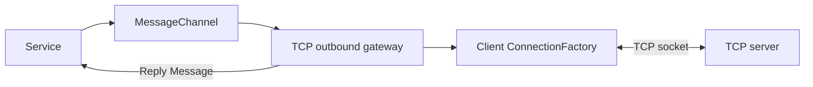
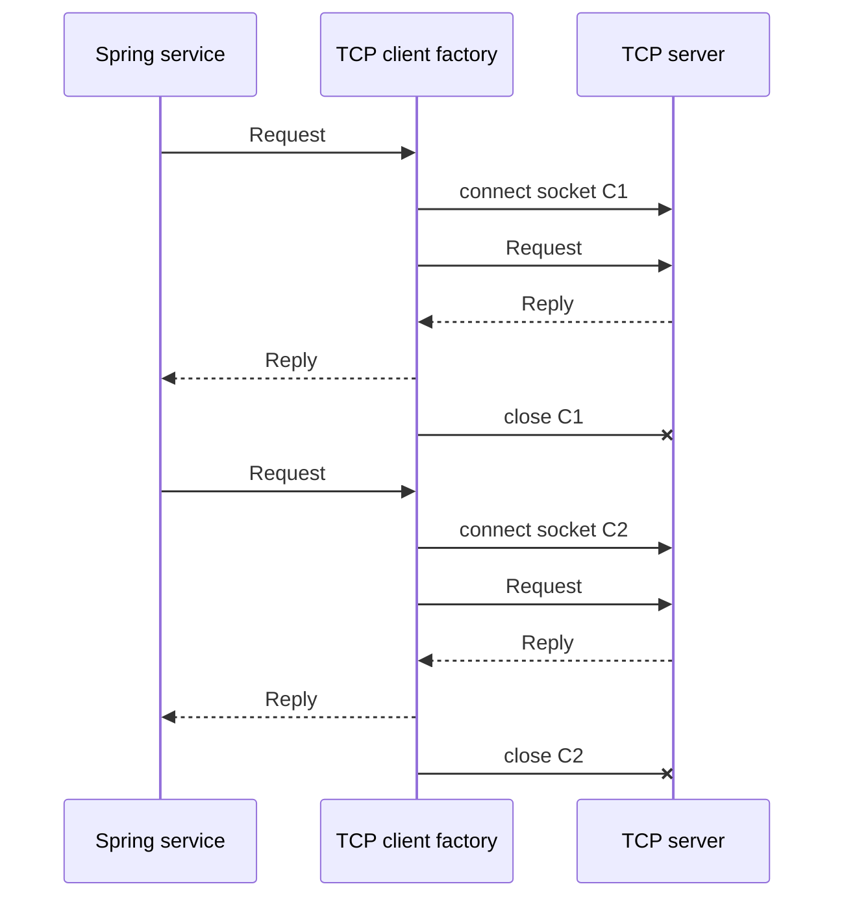
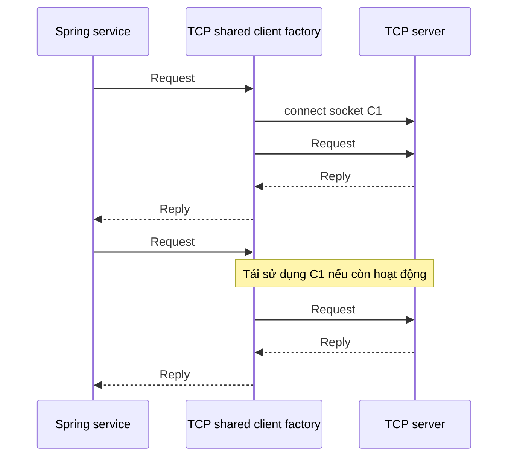
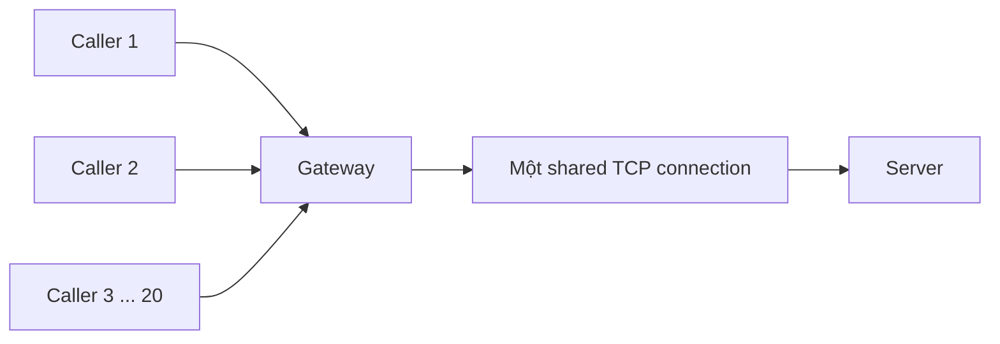
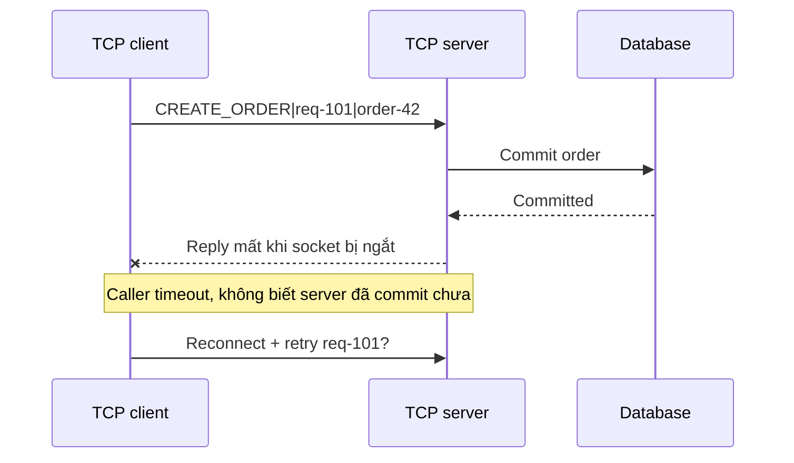

# Single-use connection và shared connection

> **Chương:** Adapter TCP  
> **Module:** SPRING_INTEGRATION_ADAPTERS  
> **Phạm vi:** Kết nối hệ thống ngoài vào Spring Integration bằng inbound/outbound adapter, gateway, poller và MessageChannel; thực hành luồng trao đổi qua file, SFTP, HTTP, JMS, AMQP, Kafka và cơ sở dữ liệu, chú trọng hợp đồng message, lỗi và vòng đời kết nối.

## 1. Mục tiêu học tập

Sau khi hoàn thành bài này, bạn có thể:

- Giải thích **single-use connection** và **shared connection** trong Spring Integration TCP; hiểu chính xác ý nghĩa của `setSingleUse(true/false)`.
- Phân biệt **một TCP connection**, **một request/reply**, **một Spring Message** và **một lượt kết nối lại**.
- Cấu hình `TcpNetClientConnectionFactory` và `TcpNetServerConnectionFactory` với serializer/deserializer thống nhất.
- Dùng `Tcp.outboundGateway(...)` với single-use và shared connection rồi quan sát hành vi mở/đóng socket.
- Phân tích ưu/nhược về chi phí TCP handshake, số socket, độ trễ, concurrency, giữ trạng thái và độ tin cậy.
- Hiểu khi nào cần `CachingClientConnectionFactory` và vì sao connection pool **không** bảo đảm đa luồng vô hạn.
- Đặt các giới hạn về timeout, số kết nối, framing, retry và idempotency khi connection bị ngắt.
- Thiết kế kiểm thử phân biệt **lỗi mạng**, **lỗi giao thức** và **kết quả nghiệp vụ chưa rõ**.

## 2. Vì sao phải chọn vòng đời TCP connection?

TCP là **kết nối có trạng thái**: client chủ động mở socket, server accept, hai bên trao đổi **byte stream** rồi đóng kết nối. Mỗi lần thiết lập socket mới có chi phí hệ thống, có thể thêm TLS handshake và tiêu tốn một ephemeral port phía client.

Nhưng việc giữ socket lâu cũng có chi phí: connection chiếm file descriptor, server cần theo dõi client, có thể bị đóng khi idle, lỗi mạng hoặc làm các request **chờ nhau** khi chỉ có một đường request-reply đang hoạt động.

Trong Spring Integration, **ConnectionFactory** quản lý socket; adapter/gateway quản lý cách biến byte thành Spring Message và ngược lại.



Lựa chọn `singleUse` ảnh hưởng tới **vòng đời socket ở ConnectionFactory**, không thay đổi tự động payload, framing hay bảo đảm nghiệp vụ.

### 2.1. Ba thực thể khác nhau

| Thực thể | Ví dụ | Phạm vi |
| --- | --- | --- |
| **TCP connection** | Socket giữa local ephemeral port và `server:9700` | Tồn tại từ connect/accept đến khi đóng. |
| **TCP frame / message** | `PING|req-101\r\n` | Ranh giới byte do serializer/deserializer xác định. |
| **Business request** | Yêu cầu `req-101` tra cứu trạng thái thiết bị | Được nhận diện bằng contract ứng dụng; có thể cần retry trên socket mới. |

Một connection **có thể** mang nhiều frame; một frame có thể bị chia qua nhiều lần `read()`. Một request nghiệp vụ cũng có thể được gửi lại trên **connection khác** nếu lần trước timeout. Vì vậy không nên đồng nhất *connection ID* với *request ID*.

## 3. Single-use: một lượt trao đổi, một connection

Khi cấu hình:

```java
factory.setSingleUse(true);
```

Connection factory sử dụng một connection cho **một lần sử dụng** theo hợp đồng endpoint, sau đó không tái sử dụng socket ấy cho các lượt tiếp theo. Với mô hình **TCP outbound gateway request-reply**, điều này tương ứng một lượt gửi request, nhận reply rồi đóng connection.



**Ưu điểm:**

- Mỗi lượt trao đổi có socket riêng, giảm nguy cơ mang **dữ liệu dư** từ lượt trước sang lượt sau.
- Không phải chia một shared socket giữa nhiều caller; cấu trúc request-reply dễ phân tích.
- Phù hợp giao thức legacy quy định **một request trên một connection** hoặc server tự đóng sau reply.
- Connection lỗi ở lượt này ít ảnh hưởng trực tiếp tới socket của lượt khác.

**Chi phí và giới hạn:**

- Thường phát sinh thêm TCP connect, có thể cả TLS handshake cho từng lượt.
- Tăng số lần mở/đóng socket và trạng thái mạng/OS cần quản lý.
- Với lưu lượng cao, có thể chạm giới hạn connection của server, file descriptor, ephemeral port hoặc connection tracking.
- **Không** giúp retry một lệnh ghi dữ liệu trở thành an toàn: server vẫn có thể xử lý xong rồi mất reply.

### 3.1. Single-use không có nghĩa "đóng mỗi khi nhận một byte"

`singleUse=true` điều khiển phạm vi **sử dụng connection**, không điều khiển byte TCP theo từng lần `read()`. Một request dài có thể cần nhiều lần đọc cho tới khi đủ **một frame** CRLF hoặc length header.

Nếu deserializer chưa nhận đủ frame, nó không thể tạo một message hợp lệ chỉ vì socket đã đọc được vài byte. Trường hợp EOF giữa frame phải được xử lý như lỗi framing/connection theo hợp đồng.

### 3.2. Một request-reply khác với một event một chiều

Với outbound adapter, "một lần sử dụng" có thể là **một lần gửi message**; với gateway, là **một chu kỳ request-reply**. Đừng tự áp dụng kết luận "đã có ACK từ nghiệp vụ" chỉ vì một outbound adapter đóng connection sau khi ghi byte.

Giao thức dùng **EOF để đánh dấu message** cần được thiết kế riêng: nếu server chỉ nhận đủ request khi client đóng hẳn socket nhưng client còn chờ reply trên socket ấy, hai phía có thể deadlock. Hãy phân biệt **half-close**, **close hoàn toàn** và framing bằng delimiter/length header.

## 4. Shared connection: tái sử dụng socket đang sống

Khi cấu hình:

```java
factory.setSingleUse(false);
```

Connection factory cho phép tái sử dụng **connection còn hoạt động** cho nhiều message hoặc nhiều lượt request-reply. Với client factory dạng shared, nhiều lượt gửi có thể dùng **một socket** thay vì tạo socket mới cho từng yêu cầu.



**Ưu điểm:**

- Tiết kiệm công tạo/đóng socket và có thể giảm độ trễ, đặc biệt khi TLS handshake tốn kém.
- Phù hợp nhiều request nhỏ, tuần tự hoặc giao thức yêu cầu **session liên tục**.
- Giảm connection churn và số socket ngắn hạn trên server.

**Đánh đổi:**

- Socket có thể chết bất kỳ lúc nào do idle timeout, server restart, firewall/NAT hoặc lỗi mạng.
- Nếu giao thức request-reply không có multiplexing, nhiều request gửi cùng socket phải được **điều phối/tuần tự hóa**.
- Một reply đến muộn, reply thừa hoặc framing lỗi có thể làm connection mất đồng bộ.
- Long-lived connection có thể giữ tài nguyên lâu và cần chính sách close/health check.

**Lưu ý:** `singleUse=false` không phải cam kết *giữ socket mãi mãi*. Nó chỉ cho phép reuse. Nếu peer đóng socket hoặc connection không còn khả dụng, factory/endpoint phải phát hiện và tạo connection mới theo cơ chế phù hợp.

## 5. So sánh single-use với shared

| Tiêu chí | **Single-use** — `true` | **Shared** — `false` |
| --- | --- | --- |
| Một lượt request-reply | Dùng connection riêng rồi đóng sau lượt. | Có thể dùng lại connection cũ. |
| Chi phí connect | Thường trả cho mỗi lượt. | Phân bổ trên nhiều lượt. |
| TLS handshake | Thường lặp lại theo socket mới. | Có thể giảm số handshake. |
| Tài nguyên khi lưu lượng cao | Nhiều lần mở/đóng, cần giới hạn concurrency. | Ít socket hơn nhưng connection sống lâu. |
| Request-reply đồng thời | Có thể dùng các socket riêng nếu đủ tài nguyên. | Một shared socket thường bị tuần tự hóa theo lượt gateway. |
| Trạng thái phiên server | Không nên phụ thuộc session lâu dài. | Phù hợp server giữ session theo connection. |
| Sự cố framing/late reply | Thường giới hạn trong lượt/socket đó. | Có thể ảnh hưởng những lượt tiếp theo trên socket. |
| Server đóng kết nối sau một request | Phù hợp. | Factory phải phát hiện và reconnect ở lượt sau. |
| Server yêu cầu kết nối liên tục | Không phù hợp. | Phù hợp hơn. |
| Bảo đảm exactly-once | **Không có.** | **Không có.** |

**Cách quyết định:** Giao thức của peer là tiêu chí đầu tiên. Sau đó mới cân nhắc throughput, latency, số connection, quản lý session, backpressure và yêu cầu vận hành.

## 6. Client mode, server mode và hướng adapter/gateway

Từ "single-use" và "shared" **không** đồng nghĩa TCP client/server:

- **TCP client** chủ động `connect` tới host/port bên ngoài.
- **TCP server** `bind/listen/accept` client kết nối vào.
- **Inbound/outbound** của Spring Integration mô tả hướng **Spring Message**, không phải ai mở TCP socket.
- **Gateway** bổ sung hợp đồng request-reply, còn **channel adapter** chủ yếu chuyển dữ liệu một chiều.

| Vai trò | Endpoint mẫu | Ý nghĩa của reuse |
| --- | --- | --- |
| TCP client + **outbound gateway** | Spring gọi TCP server và chờ reply. | Một request-reply dùng socket mới hoặc shared socket. |
| TCP server + **inbound gateway** | Peer gọi vào Spring và chờ reply. | Server cho phép client gửi một hay nhiều lượt trên cùng socket. |
| TCP client + **outbound adapter** | Spring chỉ đẩy frame. | Một message dùng socket riêng hoặc chung; không tự chờ reply. |
| TCP server + **inbound adapter** | Spring nhận event từ thiết bị. | Thiết bị có thể gửi một event rồi đóng hoặc giữ session dài hạn. |

Đối với **server connection factory**, mỗi client TCP được server accept đã là một socket riêng. `singleUse=false` cho phép **một client** dùng socket đó cho nhiều frame; không có nghĩa **mọi client bên ngoài dùng chung một socket**.

```text
Client A -> accepted socket A ----\
                                    > TcpNetServerConnectionFactory
Client B -> accepted socket B ----/   -> inbound endpoint

socket A != socket B
```

Nếu server cần **gửi chủ động** lại client bằng TCP outbound adapter, phải giữ header `IpHeaders.CONNECTION_ID` tương ứng với accepted connection còn sống. Shared/single-use không biến connection ID thành request ID hoặc định danh thiết bị.

## 7. Demo: so sánh hai TCP client factories tới cùng một server

Thử nghiệm gồm **hai ứng dụng**:

1. **Server Spring Boot** lắng nghe cổng `9700` và trả `ACK|<requestId>` cho request `PING|<requestId>`.
2. **Client Spring Boot** có hai outbound gateways: một dùng `singleUse=true`, một dùng `singleUse=false`; lần lượt gửi hai request trên mỗi cấu hình.

Mục tiêu là so sánh **vòng đời socket**, không chạy benchmark hiệu năng chính thức.

### 7.1. Hợp đồng wire format

| Thành phần | Quy ước |
| --- | --- |
| TCP server | `127.0.0.1:9700` khi chạy local. |
| Encoding | UTF-8. |
| Request payload | `PING|req-001`. |
| Reply payload | `ACK|req-001`. |
| Framing | CRLF `0D 0A` ở cuối mỗi frame. |
| Số reply | Đúng **một reply cho mỗi request**. |
| Thứ tự request demo | Gửi **tuần tự**, đợi reply rồi mới gửi request tiếp theo. |

Cả hai bên dùng `ByteArrayCrLfSerializer`. Payload Spring Message **không** được tự nối `\r\n` vì serializer làm việc đó khi ghi wire bytes.

### 7.2. Maven dependencies

Với Spring Boot BOM quản lý phiên bản, mỗi ứng dụng cần:

```xml
<dependencies>
    <dependency>
        <groupId>org.springframework.boot</groupId>
        <artifactId>spring-boot-starter-integration</artifactId>
    </dependency>
    <dependency>
        <groupId>org.springframework.integration</groupId>
        <artifactId>spring-integration-ip</artifactId>
    </dependency>
</dependencies>
```

Ví dụ viết theo phong cách Java 17+ và Spring Integration 6.x, không cố định patch version. Cần một class `@SpringBootApplication` và component scan bao phủ cấu hình của **mỗi ứng dụng riêng**.

### 7.3. Server: inbound gateway và ConnectionFactory dùng shared

Tạo `TcpDemoServerConfiguration.java` **chỉ trong ứng dụng server**:

```java
import java.nio.charset.StandardCharsets;

import org.springframework.context.annotation.Bean;
import org.springframework.context.annotation.Configuration;
import org.springframework.integration.config.EnableIntegration;
import org.springframework.integration.dsl.IntegrationFlow;
import org.springframework.integration.ip.IpHeaders;
import org.springframework.integration.ip.dsl.Tcp;
import org.springframework.integration.ip.tcp.connection.TcpNetServerConnectionFactory;
import org.springframework.integration.ip.tcp.serializer.ByteArrayCrLfSerializer;

@Configuration
@EnableIntegration
public class TcpDemoServerConfiguration {

    @Bean
    TcpNetServerConnectionFactory demoServerFactory() {
        var factory = new TcpNetServerConnectionFactory(9700);
        factory.setSerializer(new ByteArrayCrLfSerializer());

        var decoder = new ByteArrayCrLfSerializer();
        decoder.setMaxMessageSize(1024);
        factory.setDeserializer(decoder);

        // Một accepted socket có thể phục vụ nhiều request tuần tự.
        factory.setSingleUse(false);
        return factory;
    }

    @Bean
    IntegrationFlow demoServerFlow(
            TcpNetServerConnectionFactory demoServerFactory) {

        return IntegrationFlow
                .from(Tcp.inboundGateway(demoServerFactory))
                .handle((payload, headers) -> {
                    String request = new String(
                            (byte[]) payload, StandardCharsets.UTF_8
                    );

                    Object connectionId =
                            headers.get(IpHeaders.CONNECTION_ID);

                    String[] parts = request.split("\\|", -1);
                    String reply;

                    if (parts.length == 2
                            && "PING".equals(parts[0])
                            && parts[1].matches("[A-Za-z0-9_-]{1,40}")) {
                        reply = "ACK|" + parts[1];
                    } else {
                        reply = "ERR|BAD_REQUEST";
                    }

                    System.out.printf(
                            "received=%s connectionId=%s%n",
                            request, connectionId
                    );

                    return reply.getBytes(StandardCharsets.UTF_8);
                })
                .get();
    }
}
```

Server giữ `singleUse=false` để:

- **Shared client** có thể gửi nhiều request trên cùng accepted socket.
- **Single-use client** vẫn có quyền đóng connection phía mình sau mỗi request; server nhận socket mới ở lượt kế tiếp.
- So sánh hai chế độ **chỉ bằng cách thay client factory**, tránh trộn hai thay đổi vào một phép thử.

**Lưu ý:** `TcpNetServerConnectionFactory(9700)` khai báo port nghe, không tự bảo đảm chỉ bind loopback. Trong production, ràng buộc địa chỉ mạng, TLS, firewall và authentication rõ ràng.

### 7.4. Client: hai ConnectionFactory tách biệt

Tạo `TcpDemoClientConfiguration.java` **chỉ trong ứng dụng client**:

```java
import org.springframework.beans.factory.annotation.Qualifier;
import org.springframework.context.annotation.Bean;
import org.springframework.context.annotation.Configuration;
import org.springframework.integration.annotation.IntegrationComponentScan;
import org.springframework.integration.config.EnableIntegration;
import org.springframework.integration.dsl.IntegrationFlow;
import org.springframework.integration.ip.dsl.Tcp;
import org.springframework.integration.ip.tcp.connection.TcpNetClientConnectionFactory;
import org.springframework.integration.ip.tcp.serializer.ByteArrayCrLfSerializer;

@Configuration
@EnableIntegration
@IntegrationComponentScan
public class TcpDemoClientConfiguration {

    @Bean("singleUseClientFactory")
    TcpNetClientConnectionFactory singleUseClientFactory() {
        var factory =
                new TcpNetClientConnectionFactory("127.0.0.1", 9700);

        factory.setSingleUse(true);
        factory.setSerializer(new ByteArrayCrLfSerializer());
        factory.setDeserializer(new ByteArrayCrLfSerializer());
        return factory;
    }

    @Bean("sharedClientFactory")
    TcpNetClientConnectionFactory sharedClientFactory() {
        var factory =
                new TcpNetClientConnectionFactory("127.0.0.1", 9700);

        factory.setSingleUse(false);
        factory.setSerializer(new ByteArrayCrLfSerializer());
        factory.setDeserializer(new ByteArrayCrLfSerializer());
        return factory;
    }

    @Bean
    IntegrationFlow singleUseRequestFlow(
            @Qualifier("singleUseClientFactory")
            TcpNetClientConnectionFactory singleUseFactory) {

        return IntegrationFlow
                .from("singleUseRequests")
                .handle(Tcp.outboundGateway(singleUseFactory))
                .get();
    }

    @Bean
    IntegrationFlow sharedRequestFlow(
            @Qualifier("sharedClientFactory")
            TcpNetClientConnectionFactory sharedFactory) {

        return IntegrationFlow
                .from("sharedRequests")
                .handle(Tcp.outboundGateway(sharedFactory))
                .get();
    }
}
```

Trong cả hai trường hợp, Spring Integration có một outbound **gateway** chờ reply. Sự khác biệt có chủ đích chỉ là `setSingleUse(...)` của **client ConnectionFactory**.

**Không chia sẻ một ConnectionFactory** đang dùng cho flow single-use với flow shared mà hy vọng mỗi endpoint có vòng đời khác nhau. Phải có cấu hình nhất quán cho các endpoint dùng factory đó.

### 7.5. Hai interface Messaging Gateway

Để Java code gọi hai flow như method thông thường, tạo:

```java
import org.springframework.integration.annotation.MessagingGateway;

@MessagingGateway(defaultRequestChannel = "singleUseRequests")
public interface SingleUsePingGateway {
    byte[] exchange(byte[] request);
}
```

Và:

```java
import org.springframework.integration.annotation.MessagingGateway;

@MessagingGateway(defaultRequestChannel = "sharedRequests")
public interface SharedPingGateway {
    byte[] exchange(byte[] request);
}
```

`@MessagingGateway` là giao diện **Spring Messaging** phía service; nó **không** tự mở socket. `Tcp.outboundGateway(...)` mới thực hiện giao tiếp TCP bằng ConnectionFactory tương ứng.

### 7.6. Gửi hai request tuần tự ở mỗi chế độ

Tạo `ConnectionModeDemoRunner.java`:

```java
import java.nio.charset.StandardCharsets;

import org.springframework.boot.ApplicationRunner;
import org.springframework.context.annotation.Bean;
import org.springframework.context.annotation.Configuration;

@Configuration
public class ConnectionModeDemoRunner {

    @Bean
    ApplicationRunner compareModes(
            SingleUsePingGateway singleUse,
            SharedPingGateway shared) {

        return args -> {
            System.out.println("--- single-use ---");
            test(singleUse::exchange, "req-single-1");
            test(singleUse::exchange, "req-single-2");

            System.out.println("--- shared ---");
            test(shared::exchange, "req-shared-1");
            test(shared::exchange, "req-shared-2");
        };
    }

    private static void test(
            java.util.function.Function<byte[], byte[]> exchange,
            String requestId) {

        byte[] request = ("PING|" + requestId)
                .getBytes(StandardCharsets.UTF_8);

        byte[] reply = exchange.apply(request);

        String text = new String(reply, StandardCharsets.UTF_8);
        if (!("ACK|" + requestId).equals(text)) {
            throw new IllegalStateException(
                    "Unexpected reply: " + text
            );
        }

        System.out.printf(
                "request=%s reply=%s%n", requestId, text
        );
    }
}
```

Chạy thử:

1. Khởi động **server application** trước, đảm bảo cổng `9700` chưa có process khác dùng.
2. Khởi động **client application** với cấu hình client và runner.
3. Đọc output client: bốn request phải có bốn reply đúng `requestId`.
4. Đọc log server: nhóm single-use thường tạo connection ID khác cho hai request; nhóm shared thường dùng **cùng connection ID** nếu peer không đóng socket giữa hai lượt.
5. Thử khởi động lại server giữa hai lượt shared để quan sát tình huống connection cũ không còn hoạt động.

Kết quả **kỳ vọng** tại client:

```text
--- single-use ---
request=req-single-1 reply=ACK|req-single-1
request=req-single-2 reply=ACK|req-single-2
--- shared ---
request=req-shared-1 reply=ACK|req-shared-1
request=req-shared-2 reply=ACK|req-shared-2
```

Connection ID thực tế do framework sinh ra, không gán cứng trong bài. Để xác nhận reuse trong môi trường thật, nên kiểm tra **connection open/close events** bên cạnh log request; chỉ nhìn bốn dòng reply không đủ để phân biệt hai chế độ.

### 7.7. Phân tích kết quả

- **Single-use:** hai request thường lần lượt tạo socket mới; server nhận hai accepted connections khác nhau.
- **Shared:** sau request đầu, client giữ socket để request hai có thể tái sử dụng; server thường thấy cùng connection ID.
- Nếu shared bị peer đóng trước request thứ hai, client có thể phải tạo socket mới. Sự kiện này không phủ định ý nghĩa `singleUse=false`.
- Nếu có lỗi framing hoặc reply không đầy đủ, gateway có thể chờ timeout; đừng kết luận ngay đó là lỗi reuse nếu chưa kiểm tra byte trên wire.

Đây là một **bài quan sát hành vi**, không phải phép đo chứng minh single-use luôn chậm hoặc shared luôn nhanh. Benchmarks cần tải đại diện, timeout rõ, warm-up, metrics và xác minh chính sách kết nối.

## 8. Vấn đề concurrency: nhiều caller và một socket

### 8.1. Shared connection không tự tạo multiplexing

Giả sử 20 caller đồng thời gửi request đến cùng TCP outbound gateway dùng **một shared client connection**:



Trong giao thức **mỗi request một reply** không có cách ghép reply độc lập, gateway cần bảo vệ mối quan hệ request ↔ reply trên connection. Thực tế, các lượt có thể **tuần tự hóa** hoặc phải chờ quyền sử dụng connection.

Hậu quả:

- Request đứng sau có thể chờ request trước nhận reply.
- Khi server chậm, latency của các caller tăng; timeout có thể xảy ra ở nhiều tầng.
- Một socket TCP về mặt byte có thể chở nhiều frame, nhưng **khả năng multiplex đúng nghiệp vụ** không tự xuất hiện vì `singleUse=false`.

Đừng nhầm "TCP full-duplex" với "gateway cho phép nhiều request-reply đang chờ cùng lúc không cần correlation". Nếu yêu cầu giao thức là **nhiều request song song trên một socket**, phải thiết kế request ID, reply correlation, flow bất đồng bộ và xử lý late reply tường minh.

### 8.2. Single-use cũng cần giới hạn đồng thời

Nếu 20 caller cùng gọi single-use gateway và mỗi request tạo một socket, hệ thống có thể mở nhiều connection cùng lúc. Điều đó không phải miễn phí:

- Server có giới hạn accepted connections.
- Hệ điều hành giới hạn file descriptors và ephemeral port range.
- TLS handshake tiêu tốn CPU.
- Nếu server dùng blocking IO hoặc xử lý một client tại một thời điểm, nhiều socket có thể **không tăng throughput**.

Cần giới hạn số request đồng thời, thời gian chờ, queue, kết nối tối đa và retry budget thay vì mở vô hạn.

## 9. Pool/cache: giải pháp ở giữa

Giữa hai thái cực "mỗi lượt mở socket mới" và "mọi lượt dùng một shared socket", có giải pháp **pool các kết nối còn sống**.

Spring Integration cung cấp `CachingClientConnectionFactory` để tổ chức một số connection được cache, giới hạn số lượng và cho phép mượn/trả chúng theo chính sách.

```text
                          ┌── Connection 1 ──┐
Gateway requests ──> Pool ├── Connection 2 ──┤ ──> TCP server
                          └── Connection 3 ──┘
```

### 9.1. Ví dụ cấu hình cache có giới hạn

```java
import org.springframework.integration.ip.tcp.connection.CachingClientConnectionFactory;
import org.springframework.integration.ip.tcp.connection.TcpNetClientConnectionFactory;
import org.springframework.integration.ip.tcp.serializer.ByteArrayCrLfSerializer;

// Factory cấp connection cho cache.
var target = new TcpNetClientConnectionFactory("127.0.0.1", 9700);
target.setSingleUse(true);
target.setSerializer(new ByteArrayCrLfSerializer());
target.setDeserializer(new ByteArrayCrLfSerializer());

// Cache tối đa 4 connection theo cấu hình ví dụ.
var cache = new CachingClientConnectionFactory(target, 4);
```

Đoạn trên là **phần cấu hình minh họa** (có thể đưa vào `@Bean` theo vòng đời Spring). Factory được bọc cần cấu hình `singleUse` phù hợp với hợp đồng của `CachingClientConnectionFactory`; kiểm tra điều kiện của phiên bản Spring Integration đang triển khai trước khi lắp cache vào gateway.

**Tư duy đúng:** cache/pool có thể dùng lại **các socket khác nhau** để tăng số lượt request-reply có thể tiến hành đồng thời, nhưng mỗi socket vẫn có giới hạn correlation và framing riêng.

### 9.2. Pool không phải vô hạn

| Tham số | Cần quyết định |
| --- | --- |
| **Pool size** | Bao nhiêu TCP connection đồng thời là phù hợp với server và tải? |
| **Thời gian chờ mượn** | Caller đợi được bao lâu khi pool đã hết connection? |
| **Connection hỏng** | Làm sao loại bỏ socket bị reset/đóng/timeout? |
| **Idle timeout** | Giữ connection nhàn rỗi trong bao lâu? |
| **Shared session state** | Server có cho phép một client dùng nhiều socket với cùng identity không? |
| **Reply correlation** | Ai đảm bảo một connection không có nhiều request chưa nhận reply trái giao thức? |
| **TLS** | Bao nhiêu handshake, session và certificate checks cùng lúc? |

Cache TCP connection **không phải cache kết quả nghiệp vụ** và không lưu bền vững request chưa có reply. Khi application process chết, connection pool mất đi cùng với các socket.

### 9.3. Khi nào không nên dùng pool?

- Server chỉ cho phép **một connection cho mỗi tài khoản/thiết bị**.
- Giao thức giữ **session state** duy nhất trên mỗi TCP connection và không có cơ chế đồng bộ session giữa các socket.
- Yêu cầu thứ tự toàn cục của message khiến nhiều connection gây đảo thứ tự nghiệp vụ.
- Tải thấp, chi phí pool/health-check không mang lại lợi ích rõ.
- Giao thức hoặc server không chịu được concurrency tăng.

Nếu thêm pool, hãy benchmark với **server thật** và xác minh tính đúng của session state, không chỉ đo requests/second.

## 10. Framing phải đúng trong cả hai chế độ

Single-use/shared chỉ nói về socket lifecycle. **Không thay thế** quy tắc tách message từ TCP byte stream.

| Framing | Khi phù hợp | Vấn đề cần chú ý |
| --- | --- | --- |
| **CRLF** | Lệnh văn bản, line protocol. | Payload chứa CRLF phải được escape/cấm; serializer tự thêm CRLF. |
| **LF** | Line protocol chỉ kết thúc bằng `0A`. | Không hoán đổi với CRLF tùy ý. |
| **Length header** | Payload nhị phân hoặc chứa byte tùy ý. | Thống nhất kích thước header, byte order, giới hạn frame và inclusive/exclusive. |
| **EOF/close** | Giao thức quy định kết thúc một frame khi stream đóng. | Không phù hợp shared connection mang nhiều frame; phải giải quyết chiều reply. |

### 10.1. Vì sao shared connection đòi hỏi framing đặc biệt rõ?

Với shared socket, frame thứ hai bắt đầu **ngay sau byte cuối frame thứ nhất**. Nếu serializer/deserializer sai, một reply trễ hoặc byte dư có thể làm parser **đọc nhầm frame tiếp theo**.

Ví dụ:

```text
Client -> Server: PING|req-1\r\n
Server -> Client: ACK|req-1\r\n
Client -> Server: PING|req-2\r\n
Server -> Client: ACK|req-2\r\n
```

Nếu server vô tình gửi `ACK|req-1\r\n\r\n`, decoder có thể tạo **frame rỗng** ở giữa. Với gateway request-reply, các frame thừa cần được xử lý như protocol error; không được tự gán reply rỗng cho request kế tiếp.

### 10.2. Single-use có bỏ qua framing được không?

**Không nên giả định như vậy.** Ngay cả trên socket chỉ dùng một lượt, nếu server dự kiến CRLF để biết khi nào request hoàn chỉnh, client vẫn phải gửi CRLF. Chỉ bỏ delimiter khi giao thức quy định rõ **EOF** hoặc **length** làm ranh giới khác.

Giao thức "đóng socket để báo hết request" thường không kết hợp đơn giản với "đợi reply trên cùng socket" nếu cả hai phía chưa thống nhất half-close hoặc trình tự close. Thay đổi `singleUse=true` không tự sửa vấn đề này.

## 11. Timeout, reconnect và kết quả chưa rõ

### 11.1. Phân biệt nơi chờ

| Thời gian chờ | Vai trò |
| --- | --- |
| **Connect timeout** | Giới hạn thời gian tạo socket mới, quan trọng với single-use. |
| **Socket/read timeout** | Giới hạn thời gian đợi byte từ peer; có thể đang đọc dở một frame. |
| **Gateway reply timeout** | Giới hạn thời gian chờ reply tương ứng. |
| **Pool wait timeout** | Giới hạn thời gian chờ mượn connection khi cache/pool cạn. |
| **Business timeout** | Giới hạn thời gian handler/DB/API downstream xử lý. |

Ví dụ một số thuộc tính tại tầng client factory:

```java
var factory =
        new TcpNetClientConnectionFactory("127.0.0.1", 9700);

factory.setSingleUse(false);
factory.setSoTimeout(5_000);
```

`setSoTimeout(...)` liên quan socket I/O, **không** nhất thiết giới hạn toàn bộ thời gian của Java method gọi gateway, vì còn connect, chờ tài nguyên, reply timeout và xử lý ứng dụng. Hãy cấu hình/tận dụng các timeout phù hợp theo phiên bản thư viện và thực sự thử với TCP server chậm.

### 11.2. Điều gì xảy ra khi shared socket bị đóng?

Kịch bản:

1. Client gửi `PING|req-1`, nhận reply thành công, giữ socket.
2. Server đóng connection vì idle timeout hoặc restart.
3. Client tiếp tục gửi `PING|req-2`.
4. Hành vi có thể là lỗi I/O rồi reconnect ở lượt sau, hoặc factory phát hiện connection không hợp lệ và tạo socket mới tùy chính sách/timing.

**Không** giả định factory tự replay tất cả request đang dở khi reconnect. Đặc biệt với request có tác dụng phụ, mất reply là trạng thái **chưa rõ kết quả**.

### 11.3. Request đã được commit nhưng reply mất



Nếu client retry bằng **ID khác** hoặc server không deduplicate, có thể tạo đơn hai lần. Vấn đề này tồn tại ở **cả single-use và shared**; mode connection không quyết định tính đúng của business transaction.

### 11.4. Idempotency khi cần retry

Đối với command ghi dữ liệu:

- Sinh `requestId` **một lần** trước các attempts.
- Gửi request ID trong payload/envelope nếu hệ thống ngoài cần đối chiếu.
- Server lưu request ID và kết quả cùng transaction nghiệp vụ theo thiết kế nhất quán.
- Reply chứa request ID và trạng thái `ACCEPTED`/`COMPLETED`/`REJECTED` rõ ràng.
- Khi retry cùng request ID, server trả kết quả đã lưu thay vì lặp thao tác.
- Đặt total deadline, backoff/jitter và đối soát `UNKNOWN` nếu không xác nhận được kết quả.

**Một TCP connection mới không đồng nghĩa một transaction mới an toàn.**

## 12. Connection ID và correlation header

Spring Integration có header `IpHeaders.CONNECTION_ID`, tên wire-independent thường là `ip_connectionId`, giúp biết **socket nào** đã nhận message. Khi server dùng **cặp inbound/outbound adapters**, outbound adapter cần header này để gửi về **đúng accepted socket**.

| ID | Phạm vi | Điểm cần nhớ |
| --- | --- | --- |
| **Connection ID** | Một TCP connection cụ thể. | Shared connection có thể dùng một ID cho nhiều request; reconnect tạo phiên mới. |
| **Spring Message ID** | Một message trong flow nội bộ. | Không phải khóa giao dịch bền vững. |
| **Correlation ID** | Nhóm/luồng message liên quan. | Có thể do ứng dụng/EIP đặt; không tự có trên wire. |
| **Request ID** | Lệnh nghiệp vụ end-to-end. | Nên ổn định qua retry và được đưa vào TCP payload khi peer cần. |

Nếu client dùng shared connection để gửi `req-1` và `req-2`, cả hai có thể có **cùng connection ID**. Vì vậy không thể dùng connection ID thay cho request ID để phân biệt hai command.

Ngoài ra, các serializer `ByteArray*Serializer` thông thường **chỉ gửi payload + framing**: Spring Message headers không tự được truyền qua TCP. Muốn peer biết request ID, cần đưa vào schema payload hoặc định nghĩa message envelope tương thích.

## 13. Bảo mật và vận hành

### 13.1. Single-use và chi phí TLS

Với TLS, mở socket mới thường yêu cầu handshake và kiểm tra certificate theo cấu hình. Vì vậy single-use có thể làm tăng chi phí CPU/latency so với connection tái sử dụng.

Ngược lại, shared connection đòi hỏi chiến lược phát hiện connection chết, xử lý certificate rotation, idle timeout và đóng socket khi shutdown. **Không** chọn shared chỉ để giảm chi phí mà bỏ qua yêu cầu giao thức hoặc bảo mật.

Cả hai mode đều cần:

- TLS và kiểm tra server identity khi truyền dữ liệu cần bảo vệ.
- Xác thực/phân quyền lệnh nghiệp vụ độc lập connection ID.
- Giới hạn kích thước frame, số connection, request đang chờ và retry.
- Không ghi secret hoặc raw payload nhạy cảm vào log.
- Quy tắc đóng connection khi protocol không còn đồng bộ.

### 13.2. Metrics nên đo

| Metrics | Ý nghĩa |
| --- | --- |
| **Connection opened / closed** | Single-use có thường tạo nhiều connection hơn shared không? |
| **Connection lifetime** | Phát hiện session quá ngắn hoặc giữ idle quá lâu. |
| **Open socket count** | Đảm bảo không vượt ngân sách file descriptors/ports. |
| **Connect duration** | Đo độ trễ tạo socket, đặc biệt với single-use/TLS. |
| **Request-reply latency p50/p95/p99** | So sánh tác động thực của mỗi mode. |
| **Gateway pending requests** | Tìm nghẽn do shared connection tuần tự hóa. |
| **Pool in-use / waiting / exhausted** | Tìm cache pool quá nhỏ hoặc server chậm. |
| **Connection reset / timeout / reconnect** | Theo dõi độ ổn định transport. |
| **Reply framing errors / late replies** | Phát hiện socket bị mất đồng bộ protocol. |
| **Duplicate request IDs** | Đánh giá retry/idempotency. |

Nên ghi tách riêng **connection ID**, **request ID**, **attempt**, **endpoint mode** và **business result** để không kết luận sai từ một dòng log `send success`.

### 13.3. Shutdown có kiểm soát

Trong cả hai mode, ứng dụng cần dừng nhận request mới, cho các lượt đang xử lý hoàn tất theo deadline và đóng connection. Một request chưa có reply khi shutdown có thể cần **đối soát** thay vì gán `FAILED` vô điều kiện.

Nếu một connection được dùng lại bởi nhiều lượt nghiệp vụ, hãy tránh đóng đột ngột khi còn request đang chờ. Với pool, cần bảo đảm việc trả connection, loại bỏ connection hỏng và cleanup lúc dừng ứng dụng.

## 14. Troubleshooting: nhìn đúng lỗi

| Triệu chứng | Khả năng nguyên nhân | Hướng xử lý |
| --- | --- | --- |
| Single-use gửi một message thành công nhưng request thứ hai thất bại | Server hết resource hoặc connection churn. | Kiểm tra giới hạn socket/accept rate/ephemeral ports. |
| Shared hoạt động lần đầu, lỗi ở lần thứ hai | Server đóng socket sau một reply hoặc idle timeout. | Kiểm tra contract server, close events và reconnect. |
| Shared nhiều caller nhưng throughput thấp | Một connection request-reply đang được tuần tự hóa. | Đo wait time, cân nhắc pool nếu server hỗ trợ. |
| Shared reply sai request | Protocol không có correlation/late reply hoặc extra frame. | Kiểm tra framing, request ID, đồng bộ và timeout. |
| Single-use rất chậm với TLS | Handshake lặp nhiều lần. | Đo connect/TLS latency; cân nhắc reuse nếu contract cho phép. |
| Socket mở nhưng handler không được gọi | Thiếu CRLF/length header. | Kiểm tra byte wire và serializer/deserializer. |
| Server đóng sau mỗi request dù client shared | Server policy single-use hoặc protocol một kết nối một lệnh. | Chọn single-use ở client hoặc thay contract server nếu được. |
| Pool exhausted | Quá nhiều yêu cầu hoặc connection không được hoàn trả. | Giới hạn tải, giám sát wait/borrow, xử lý timeout/connection hỏng. |
| Timeout rồi retry tạo tác vụ trùng | Không có idempotency hoặc request ID thay đổi. | Dedup ở server, lưu kết quả và đối soát khi chưa rõ trạng thái. |
| Client/server ghi sai UTF-8 | Parser encoding không thống nhất. | Dùng một charset rõ ràng, validate payload. |

**Chuỗi điều tra đề xuất:** (1) socket đã connect chưa; (2) framing đúng chưa; (3) request đã thành Spring Message chưa; (4) handler đã chạy chưa; (5) reply đã được serialize/ghi ra chưa; (6) caller đã nhận reply đúng request ID chưa.

## 15. Ma trận kiểm thử single-use và shared

| Trường hợp | Single-use | Shared |
| --- | --- | --- |
| Hai request tuần tự thành công | Thường hai socket. | Thường một socket nếu còn sống. |
| Server đóng connection sau reply | Phù hợp. | Cần phát hiện/khôi phục cho lượt sau. |
| Server yêu cầu session dài hạn | Có thể không đáp ứng. | Phù hợp hơn. |
| Hai caller đồng thời | Nhiều socket; cần giới hạn resource. | Có thể bị tuần tự hóa trên một socket. |
| Reply đến chậm hơn timeout | Kết quả chưa rõ; không retry mù. | Kết quả chưa rõ; thêm nguy cơ socket mất đồng bộ. |
| Frame thiếu delimiter | Không tạo message đúng. | Không tạo message đúng. |
| Server gửi thêm reply ngoài hợp đồng | Có thể bị ảnh hưởng trong lượt đó. | Có thể ảnh hưởng lượt sau nếu cùng socket. |
| Idle server đóng socket | Lượt sau mở socket mới. | Lượt sau có thể gặp socket cũ bị đóng. |
| TLS handshake tốn kém | Chi phí nhiều lượt. | Có thể giảm chi phí nhờ reuse. |
| Reconnect với request ID cũ | Socket mới, request ID giữ nguyên. | Socket mới, request ID giữ nguyên. |

### 15.1. Fault injection

Thực hiện trong môi trường phát triển:

1. Chạy server và client; ghi nhận connection IDs cho bốn request trong demo.
2. Dừng server giữa hai lần gọi **shared**; quan sát exception/reconnect theo cấu hình.
3. Cho server trả reply thiếu CRLF; xác nhận client không nhận một reply hoàn chỉnh.
4. Cho handler server ngủ nhiều giây; tạo nhiều caller shared và đo thời gian chờ.
5. Thử single-use dưới tải có giới hạn, đo socket churn và file descriptors.
6. Bật pool giới hạn, đo connection borrow wait và throughput nếu server cho phép nhiều phiên.
7. Với command ghi, mô phỏng server xử lý xong rồi đóng socket trước reply; kiểm tra idempotency.

**Không thực hiện fault injection trên hệ thống production khi chưa có giới hạn ảnh hưởng và quy trình phê duyệt rõ ràng.**

## 16. Bài tập mở rộng

**Bài 1 — Quan sát lifecycle.** Chạy demo, ghi bảng các request, connection IDs và số lần mở/đóng socket. Từ dữ liệu quan sát, giải thích vì sao single-use và shared có đặc tính khác nhau.

**Bài 2 — Đổi server thành single-use.** Trong server factory, cấu hình `singleUse=true`. Dự đoán hành vi khi client shared cố gửi hai request tuần tự. Khi nào client nên chọn single-use để phù hợp peer?

**Bài 3 — Concurrency.** Tạo 20 caller đồng thời, server mất 300 ms xử lý mỗi request. So sánh latency p95 giữa một shared connection, single-use có giới hạn concurrency và cache/pool bốn connection. Nêu rõ server có xử lý song song được không.

**Bài 4 — Framing.** Đổi cả server và client sang length header 4 byte; gửi payload chứa `\r\n`. Giải thích vì sao mode connection không thay thế framing.

**Bài 5 — Giao thức có trạng thái.** Server quy định phải gửi `LOGIN` trước `QUERY` trên cùng connection. Chọn mode phù hợp, chỉ ra nguy cơ nếu pool dùng nhiều socket và thiết kế authentication/session policy.

**Bài 6 — Retry và idempotency.** Thiết kế lệnh `CHARGE|requestId|orderId|amount`. Mô phỏng server đã commit nhưng client mất reply; chỉ ra cách request ID và dedup store giúp xử lý an toàn ở cả single-use/shared.

**Bài 7 — TLS và vận hành.** So sánh TLS handshake count, connection lifetime, CPU và p95 latency cho 1000 request ở single-use/shared dưới tải tương đương. Không chỉ dựa vào thời gian test đơn lẻ để kết luận.

## 17. Câu hỏi tự kiểm tra

1. `setSingleUse(true)` có nghĩa gì với vòng đời một TCP outbound gateway request-reply?
2. `setSingleUse(false)` có bảo đảm socket luôn tồn tại mãi không?
3. Vì sao dùng một shared connection có thể làm các request-reply phải chờ nhau?
4. TCP full-duplex có đồng nghĩa gateway có thể tự ghép vô hạn reply song song mà không cần correlation không?
5. Cặp inbound/outbound adapters ở server cần header gì để gửi lại đúng accepted socket?
6. Vì sao single-use có thể tốn nhiều TCP/TLS handshake hơn?
7. Khi nào shared phù hợp hơn single-use trong giao thức có session?
8. Khi nào một server chỉ cho phép một request/connection khiến shared không thích hợp?
9. `CachingClientConnectionFactory` giải quyết hạn chế nào của một shared client connection?
10. Cache TCP connection có lưu bền vững kết quả nghiệp vụ hoặc các request chưa nhận reply không?
11. Timeout sau khi gửi `CREATE_ORDER` có chứng minh server chưa tạo đơn không?
12. Nếu peer dùng CRLF, `singleUse=true` có cho phép bỏ delimiter khỏi payload không?
13. Tại sao request ID không thể dùng thay connection ID?
14. Pool có nên được đặt kích thước vô hạn để tăng throughput không?
15. Những metrics nào giúp quyết định nên dùng single-use, shared hay pool?

**Gợi ý trả lời:** (1) Một lượt request-reply dùng socket riêng rồi không tái sử dụng. (2) Không; server và mạng có thể đóng connection. (3) Gateway phải liên kết đúng reply với request trên socket. (4) Không. (5) `IpHeaders.CONNECTION_ID`. (6) Mở socket mới mỗi lượt. (7) Khi protocol yêu cầu session hoặc có lợi từ reuse. (8) Khi peer đóng socket sau một lệnh. (9) Cho nhiều connection được quản lý, giúp tăng concurrency có giới hạn. (10) Không. (11) Không, reply có thể mất sau commit. (12) Không, phải theo framing contract. (13) Connection ID mô tả socket; request ID mô tả tác vụ. (14) Không, cần bảo vệ tài nguyên/server. (15) Connect latency, open sockets, request latency, pool wait, throughput, reset/retry và errors.

## 18. Tài liệu tham khảo

- [Spring Integration Reference — TCP Connection Factories](https://docs.spring.io/spring-integration/reference/ip/tcp-connection-factories.html).
- [Spring Integration Reference — TCP Gateways](https://docs.spring.io/spring-integration/reference/ip/tcp-gateways.html).
- [Spring Integration Reference — TCP Adapters](https://docs.spring.io/spring-integration/reference/ip/tcp-adapters.html).
- [Spring Integration Reference — IP Message Headers](https://docs.spring.io/spring-integration/reference/ip/msg-headers.html).
- [Spring Integration API — CachingClientConnectionFactory](https://docs.spring.io/spring-integration/docs/current/api/org/springframework/integration/ip/tcp/connection/CachingClientConnectionFactory.html).

**Điểm cần nhớ:** **Single-use connection** ưu tiên mỗi lượt giao tiếp có socket riêng; **shared connection** ưu tiên tái sử dụng socket còn sống. Không có cấu hình nào luôn tốt hơn: chọn theo **giao thức peer**, mức độ đồng thời, latency, trạng thái phiên và giới hạn tài nguyên. Cả hai đều cần framing đúng, timeout/reconnect rõ ràng, correlation request-reply và idempotency cho lệnh có tác dụng phụ.
