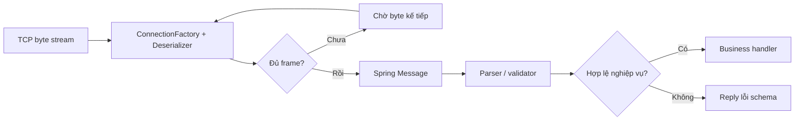
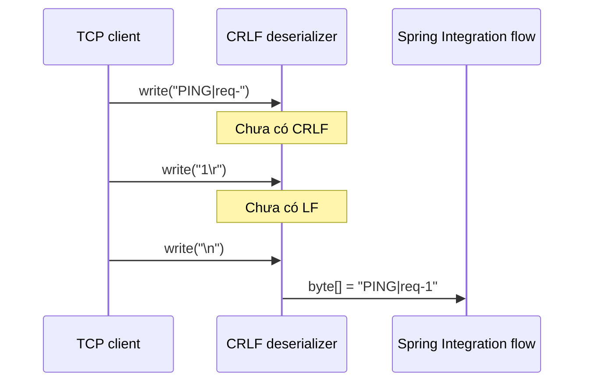
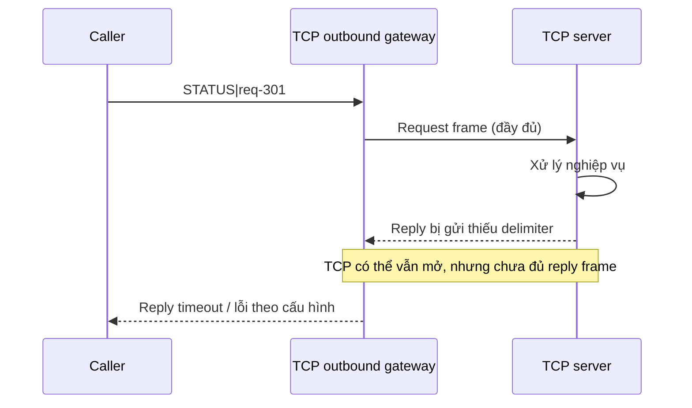
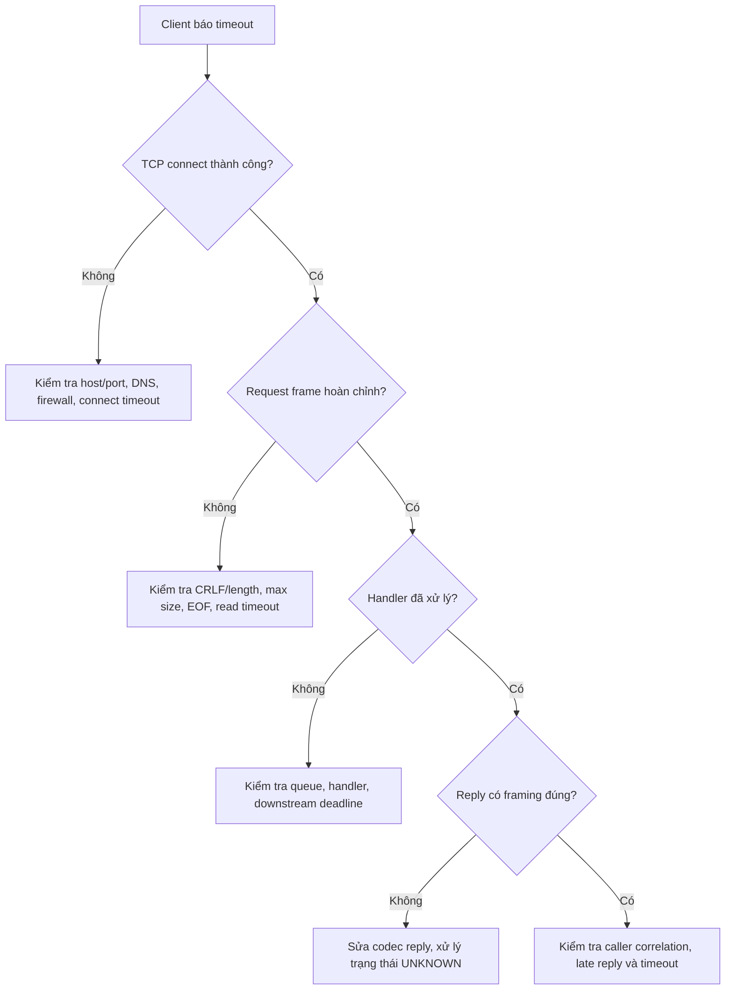

# Xử lý timeout socket và partial message

> **Chương:** Adapter TCP  
> **Module:** SPRING_INTEGRATION_ADAPTERS  
> **Phạm vi module:** Kết nối các hệ thống ngoài vào Spring Integration bằng inbound/outbound adapter, gateway, poller và MessageChannel. Thực hành luồng trao đổi qua file, SFTP, HTTP, JMS, AMQP, Kafka và cơ sở dữ liệu; xử lý hợp đồng message, lỗi và vòng đời kết nối.

## 1. Mục tiêu học tập

Sau bài học, bạn có thể:

- Giải thích chính xác vì sao TCP có thể giao dữ liệu thành **nhiều phần (partial read)** dù phía gửi chỉ gọi `write()` một lần.
- Phân biệt **partial TCP frame**, **partial business request**, **timeout** và **EOF**; không đồng nhất chúng với nhau.
- Thiết kế serializer/deserializer phù hợp để chỉ tạo Spring Message khi nhận đủ delimiter hoặc số byte đã khai báo.
- Phân biệt **connect timeout**, **socket/read timeout**, **gateway reply timeout**, **send/channel timeout** và **business deadline**.
- Cấu hình `TcpNetServerConnectionFactory` với `setSoTimeout(...)`, `ByteArrayCrLfSerializer`, `ByteArrayLengthHeaderSerializer` và `setMaxMessageSize(...)`.
- Xây dựng ví dụ hai TCP server endpoint dùng Spring Integration Java DSL, kiểm thử bằng client Java Socket chủ động gửi frame bị chia/thiếu byte.
- Lý giải nguy cơ **mất đồng bộ trên shared connection**, reply đến muộn, retry gây trùng lặp và cách phòng tránh.
- Lập ma trận kiểm thử và các chỉ số quan sát lỗi mạng, framing và nghiệp vụ.

## 2. TCP là byte stream: partial message không nhất thiết là lỗi

TCP cung cấp một **luồng byte có thứ tự trên một connection**; nó không ghi nhớ "một lần gửi bằng một bản tin". Một bản tin ứng dụng được chia thành nhiều TCP segments, có thể được kernel trả qua nhiều lần `read()`; nhiều bản tin cũng có thể xuất hiện cùng một lần đọc.

Giả sử hệ thống gửi request:

```text
STATUS|req-101|sensor-01\r\n
```

Đây là **một frame** của giao thức CRLF, nhưng byte có thể được bên nhận đọc theo nhiều cách:

```text
Trường hợp A:
  read #1: STATUS|req-101|sensor-01\r\n

Trường hợp B:
  read #1: STATUS|req-
  read #2: 101|sensor-01\r
  read #3: \n

Trường hợp C (hai frame cùng một lần read):
  read #1: STATUS|req-101|sensor-01\r\nSTATUS|req-102|sensor-02\r\n
```

Các trường hợp đều **hợp lệ ở tầng TCP**. Vì vậy:

- **Partial read:** một lần đọc chưa có đủ byte để dựng một frame. Đây có thể chỉ là phân mảnh bình thường.
- **Partial frame:** codec đang giữ một phần byte của frame, chờ thêm dữ liệu để xác định ranh giới.
- **Truncated frame:** connection bị đóng/EOF hoặc lỗi khiến frame không thể hoàn tất theo giao thức.
- **Business message không đầy đủ:** frame đã hoàn chỉnh nhưng payload thiếu trường bắt buộc, ví dụ `STATUS|req-101\r\n` không có device ID. Đây là lỗi **validation**, không phải lỗi framing.



**Nguyên tắc cốt lõi:** Không parse request mỗi lần socket trả về một mảng byte. Hãy để **codec** giữ ranh giới và chỉ chuyển payload đầy đủ sang `MessageChannel`/handler.

## 3. Ba lớp của một giao thức TCP

| Lớp | Câu hỏi | Ví dụ |
| --- | --- | --- |
| **Transport/socket** | Có connection không, byte có đến/đi được không? | Connect, EOF, read timeout, reset. |
| **Framing/codec** | Byte nào tạo thành **một** bản tin? | CRLF `0D 0A`; length header 4 byte. |
| **Nghiệp vụ** | Payload hoàn chỉnh có đúng schema/quyền và kết quả là gì? | `STATUS|req-101|sensor-01` → `OK|req-101|ACTIVE`. |

Ví dụ phân loại:

| Tình huống | Lỗi hay bình thường? | Lớp xử lý |
| --- | --- | --- |
| TCP nhận `STATUS|req` rồi 20 ms sau nhận phần còn lại. | **Bình thường**, nếu vẫn trong các deadline. | Deserializer ghép frame. |
| CRLF thiếu `\n`, connection còn mở. | Frame **chưa hoàn thành**. | Deserializer đợi thêm hoặc hết hạn. |
| CRLF thiếu `\n` rồi peer đóng socket. | **Truncated frame / EOF giữa frame**. | Decoder/connection, không phát business message hợp lệ. |
| Length header báo 100 byte, chỉ nhận 40 byte rồi EOF. | **Truncated frame**. | Decoder/connection. |
| Frame đúng CRLF nhưng có `STATUS|req-1`. | **Schema không hợp lệ**. | Handler/validator. |
| Request đã xử lý nhưng reply mất. | **Kết quả chưa rõ ở caller**. | Gateway/ứng dụng/idempotency. |

## 4. Hai codec điển hình và partial frame

### 4.1. CRLF delimiter: đợi đủ hai byte cuối

Một message logic `PING|req-1` được serialize thành:

```text
50 49 4E 47 7C 72 65 71 2D 31 0D 0A
 P  I  N  G  |  r  e  q  -  1 CR LF
```

Với `ByteArrayCrLfSerializer`, deserializer phải đọc tới dấu **CRLF** mới trả ra payload hoàn chỉnh. Nếu đã nhận `\r` nhưng chưa có `\n`, không được coi đó là dấu kết thúc.



Nếu application tự thêm `\r\n` vào payload rồi vẫn dùng serializer CRLF khi ghi, trên wire có thể có **hai delimiter** và sinh thêm frame rỗng. Payload được đưa vào `ByteArrayCrLfSerializer` chỉ nên chứa **nội dung logic**, không tự thêm dấu phân cách cuối frame.

**Rủi ro của delimiter:** Payload có CRLF nội bộ sẽ bị cắt thành nhiều frame nếu không có escape hoặc quy ước cấm ký tự xuống dòng. Với nội dung nhị phân tùy ý, length header thường dễ quản lý hơn.

### 4.2. Length header: đợi đủ header rồi đủ payload

Giả sử giao thức đặt **4 byte big-endian** ghi số byte payload (không tính header):

```text
[00 00 00 05][48 45 4C 4C 4F]
 length = 5     H  E  L  L  O
```

Codec cần:

1. Đọc **đúng 4 byte** header; nếu chỉ nhận 1–3 byte thì **chưa** biết length.
2. Decode length và kiểm tra `0 ≤ length ≤ maxMessageSize` (hoặc từ chối 0 nếu protocol quy định).
3. Đọc **đủ length byte** nội dung; có thể qua nhiều lần socket đọc.
4. Chỉ sau khi đủ payload mới tạo message.

Ví dụ bị chia:

```text
read #1: 00 00
read #2: 00 05 48
read #3: 45 4C
read #4: 4C 4F

=> Header = 00 00 00 05, payload = HELLO
=> Chỉ 1 message được phát ra sau read #4.
```

Với Spring Integration, `ByteArrayLengthHeaderSerializer` là serializer/deserializer tiêu chuẩn cho cấu trúc có length header. Các hệ thống ngoài có thể dùng header size, byte order hoặc length-inclusive khác; **hai phía phải khớp chính xác**.

### 4.3. Partial frame không giống một TCP packet mất

TCP có cơ chế retransmission theo giao thức ở tầng transport, nhưng application vẫn có thể thấy frame đến **chưa đủ** vì peer gửi chậm, socket đóng sớm hoặc đọc giữa chừng. Đừng thiết kế retry mỗi khi `read()` trả ít byte: hành vi đó không cho biết peer đã mất dữ liệu hay chỉ chưa gửi tiếp.

**Tách frame là nhiệm vụ deserializer**, không phải chức năng của poller hay `MessageChannel`. Một TCP inbound adapter/gateway nhận `Message` **sau** bước này.

## 5. Timeout: mỗi đồng hồ đo một việc khác nhau

| Timeout/deadline | Điểm bắt đầu và đo | Kết quả khi hết hạn |
| --- | --- | --- |
| **Connect timeout** | Client khởi tạo TCP socket tới host/port. | Connection mới không được thiết lập đúng hạn. |
| **Socket read timeout** (`SO_TIMEOUT`) | Một lần đọc socket chờ dữ liệu. | Lệnh đọc có thể phát sinh `SocketTimeoutException`; không chứng minh toàn bộ request đã thất bại nghiệp vụ. |
| **Frame completion deadline** | Thời điểm bắt đầu một frame đến khi nhận đủ delimiter/length. | Ngăn peer gửi từng byte rải rác để giữ connection mãi. Cần thiết kế/kiểm soát riêng. |
| **Gateway reply timeout** | Endpoint gọi TCP request-reply chờ reply tương ứng. | Caller không nhận đủ reply đúng hạn; kết quả phía server có thể chưa rõ. |
| **Channel send timeout** | Producer chờ channel/consumer có giới hạn. | Message có thể chưa đến TCP handler, khác với reply timeout. |
| **Business deadline** | Tổng thời gian cho một lệnh, gồm connect, wait, processing, retry. | Ứng dụng dừng chờ theo SLA; cần xác định trạng thái cuối rõ ràng. |

### 5.1. `setSoTimeout(...)` trên connection factory

Cấu hình thường gặp:

```java
TcpNetServerConnectionFactory factory =
        new TcpNetServerConnectionFactory(9800);

factory.setSoTimeout(2_000);
```

Ý nghĩa chính của `SO_TIMEOUT`: giới hạn thời gian **đợi đọc dữ liệu từ socket** theo cách triển khai I/O đang dùng. Nó **không** tương đương:

- Deadline hoàn tất **toàn bộ frame** CRLF.
- Tổng thời gian xử lý của một business request.
- Timeout gọi HTTP/DB trong handler.
- Cam kết Java method gọi gateway kết thúc đúng 2 giây.

Ví dụ peer cứ gửi **mỗi 1 giây một byte** có thể tránh timeout đọc 2 giây trong khi một frame dài không bao giờ hoàn tất. Muốn chống *slowloris/trickle attack*, cần thêm **frame deadline** hoặc giới hạn tốc độ tối thiểu theo chính sách mạng/giao thức.

> **Chi tiết phiên bản:** Sau một `SocketTimeoutException`, việc connection bị đóng, tái lập hay tiếp tục đọc phụ thuộc vào loại connection factory (Net/NIO), endpoint và phiên bản Spring Integration. Không viết code nghiệp vụ dựa trên giả định **mọi read timeout đều tự đóng socket** hoặc **mọi read timeout đều giữ nguyên buffer**. Kiểm chứng chính sách trên phiên bản đang chạy.

### 5.2. Connect và reply timeout có thể cộng dồn

Ví dụ một caller có:

- Connect thử tối đa 3 giây.
- Chờ quyền dùng shared connection hoặc pool 2 giây.
- Chờ reply 5 giây.
- Retry hai lượt, mỗi lượt backoff 500 ms.

Không thể giả định tổng thời gian của caller luôn nhỏ hơn 5 giây. Cần có **deadline end-to-end** và giới hạn retries sao cho tổng thời gian đáp ứng SLA thực tế.

### 5.3. Read timeout chưa chắc làm business request bị hủy

Nếu server đã xử lý `CREATE_ORDER|req-201` nhưng reply về chậm, client gặp reply timeout vẫn không biết chắc order đã được tạo chưa. Ngắt socket chỉ làm mất đường phản hồi; nó không tự rollback transaction bên kia.

Trạng thái cần phân biệt:

- **REJECTED:** Có reply hợp lệ xác nhận server từ chối.
- **COMPLETED:** Có reply theo contract xác nhận hoàn thành.
- **UNKNOWN:** Caller chưa có chứng cứ chắc chắn về kết quả sau timeout hoặc reset.

Đối với command có tác dụng phụ, `UNKNOWN` không nên bị ánh xạ mù thành `FAILED` rồi retry bằng request ID mới.

## 6. EOF, half-close và frame dang dở

### 6.1. EOF trước frame và EOF giữa frame

**EOF** nghĩa là luồng đọc đã kết thúc. Có hai trạng thái:

- **EOF giữa hai frame:** peer đóng connection sau một frame hoàn chỉnh; ứng dụng có thể coi là kết thúc phiên bình thường nếu protocol cho phép.
- **EOF trong header/payload:** một phần frame đã có, nhưng peer đóng trước khi đủ. Đây là **truncated frame** và cần báo lỗi/loại connection theo contract.

Ví dụ length header:

```text
Đã nhận: 00 00 00 0A 41 42 43
Header yêu cầu: 10 byte
Payload thực tế: 3 byte "ABC"
Peer: EOF
=> Lỗi truncated frame, không phát payload "ABC" như request hoàn chỉnh.
```

Một số serializer của Spring Integration phân biệt EOF khi chưa có byte của frame mới và EOF giữa frame bằng exception dành riêng (ví dụ `SoftEndOfStreamException` cho một số tình huống EOF sạch). Tuy nhiên **kiểu exception chính xác** và nơi phát sự kiện có thể khác theo serializer/phiên bản; kiểm thử thay vì gán cứng mọi EOF là cùng một loại lỗi.

### 6.2. Half-close là hợp đồng đặc biệt

Trong Java Socket, `shutdownOutput()` đóng **nửa chiều gửi** của socket; đầu đọc ở phía bên kia sẽ thấy EOF sau khi nhận hết byte đã gửi. Nó khác `close()`, vốn đóng socket toàn phần.

Một số giao thức dùng EOF để báo **kết thúc request** rồi vẫn mong nhận reply theo chiều ngược lại. Khi đó hai phía phải thống nhất half-close, quy tắc reply, serializer phù hợp và khả năng endpoint xử lý.

**Không** dùng `ByteArrayCrLfSerializer` nhưng lại kỳ vọng thiếu CRLF được tự hợp thức hóa bởi `shutdownOutput()`: nếu contract là CRLF, EOF giữa frame vẫn là lỗi protocol.

## 7. Ví dụ Spring Integration: hai cổng để quan sát partial frame

Ta tạo một **ứng dụng Spring Boot** với hai TCP inbound gateways:

- Cổng **9800**: CRLF framing, nhận `STATUS|req-id|device-id`.
- Cổng **9801**: 4-byte length header, nhận `byte[]` nhị phân và echo trả lại đúng payload.

Dùng hai cổng vì hai endpoint áp dụng **hai wire protocols khác nhau**. Cả hai dùng server connection factory vì ứng dụng **lắng nghe/accept** client ngoài.

### 7.1. Dependency

Với Java 17+, Spring Boot và Spring Integration 6.x (phiên bản do Spring Boot BOM quản lý):

```xml
<dependencies>
    <dependency>
        <groupId>org.springframework.boot</groupId>
        <artifactId>spring-boot-starter-integration</artifactId>
    </dependency>
    <dependency>
        <groupId>org.springframework.integration</groupId>
        <artifactId>spring-integration-ip</artifactId>
    </dependency>
</dependencies>
```

Ứng dụng có class `@SpringBootApplication` và component scan bao phủ cấu hình dưới đây.

### 7.2. Server CRLF với socket timeout và max frame

```java
import java.nio.charset.StandardCharsets;

import org.springframework.context.annotation.Bean;
import org.springframework.context.annotation.Configuration;
import org.springframework.integration.config.EnableIntegration;
import org.springframework.integration.dsl.IntegrationFlow;
import org.springframework.integration.ip.IpHeaders;
import org.springframework.integration.ip.dsl.Tcp;
import org.springframework.integration.ip.tcp.connection.TcpNetServerConnectionFactory;
import org.springframework.integration.ip.tcp.serializer.ByteArrayCrLfSerializer;
import org.springframework.integration.ip.tcp.serializer.ByteArrayLengthHeaderSerializer;

@Configuration
@EnableIntegration
public class TcpPartialMessageConfiguration {

    @Bean
    TcpNetServerConnectionFactory textTcpFactory() {
        var factory = new TcpNetServerConnectionFactory(9800);

        var decoder = new ByteArrayCrLfSerializer();
        decoder.setMaxMessageSize(2048);
        factory.setDeserializer(decoder);
        factory.setSerializer(new ByteArrayCrLfSerializer());

        factory.setSoTimeout(2_000);
        factory.setSingleUse(false);
        return factory;
    }

    @Bean
    IntegrationFlow textRequestReplyFlow(
            TcpNetServerConnectionFactory textTcpFactory) {

        return IntegrationFlow
                .from(Tcp.inboundGateway(textTcpFactory))
                .handle((payload, headers) -> {
                    String request = new String(
                            (byte[]) payload, StandardCharsets.UTF_8
                    );
                    Object connectionId =
                            headers.get(IpHeaders.CONNECTION_ID);

                    System.out.printf(
                            "CRLF frame complete: connection=%s text=%s%n",
                            connectionId, request
                    );

                    String[] fields = request.split("\\|", -1);

                    String reply;
                    if (fields.length == 3
                            && "STATUS".equals(fields[0])
                            && fields[1].matches("[A-Za-z0-9_-]{1,40}")
                            && fields[2].matches("[A-Za-z0-9_-]{1,40}")) {
                        reply = "OK|" + fields[1] + "|ACTIVE";
                    } else {
                        reply = "ERR|BAD_REQUEST";
                    }

                    return reply.getBytes(StandardCharsets.UTF_8);
                })
                .get();
    }

    @Bean
    TcpNetServerConnectionFactory binaryTcpFactory() {
        var factory = new TcpNetServerConnectionFactory(9801);

        var decoder = new ByteArrayLengthHeaderSerializer();
        decoder.setMaxMessageSize(4096);
        factory.setDeserializer(decoder);
        factory.setSerializer(new ByteArrayLengthHeaderSerializer());

        factory.setSoTimeout(2_000);
        factory.setSingleUse(false);
        return factory;
    }

    @Bean
    IntegrationFlow binaryEchoFlow(
            TcpNetServerConnectionFactory binaryTcpFactory) {

        return IntegrationFlow
                .from(Tcp.inboundGateway(binaryTcpFactory))
                .handle((payload, headers) -> {
                    byte[] bytes = (byte[]) payload;
                    System.out.println(
                            "Length frame complete: size=" + bytes.length
                    );
                    return bytes; // Reply có cùng payload nhị phân.
                })
                .get();
    }
}
```

**Giải thích:**

1. Mỗi factory **đọc byte** theo deserializer riêng và **ghi reply** bằng serializer cùng hợp đồng.
2. `setMaxMessageSize(...)` giới hạn frame nhận, tránh việc codec giữ hoặc cấp phát bộ nhớ vô hạn.
3. `setSoTimeout(2_000)` đặt giới hạn đợi đọc socket theo cơ chế I/O; đây **không phải** deadline 2 giây cho toàn bộ frame.
4. `singleUse=false` cho phép dùng socket cho nhiều frame, tạo điều kiện thử ảnh hưởng của lỗi partial frame tới phiên lâu dài.
5. Handler chỉ được gọi **khi deserializer tạo ra frame hoàn chỉnh**. Với frame bị thiếu byte, không nên mong handler trả `ERR|BAD_REQUEST`.
6. Trong demo, handler CRLF dùng parser text, handler length-header giữ nguyên `byte[]`; không dùng `String` để xử lý dữ liệu nhị phân.

### 7.3. Giữ lỗi framing ra khỏi handler nghiệp vụ

Code trong `textRequestReplyFlow` cố tình log `CRLF frame complete` **chỉ sau khi có đủ frame**. Khi gửi `STATUS|req-101|sensor-01\r` rồi dừng, bạn có thể thấy connection exception/timeout nhưng **không** thấy log handler tương ứng.

Đó là tính đúng mong muốn: một frame chưa hoàn tất không được phát thành message để handler giả vờ đã nhận một request đầy đủ.

Để xử lý protocol error ở production, thêm quan sát exception và event tại tầng connection/serializer. **Không giả định** tất cả framing errors tự chuyển thành `Message<?>` ở `errorChannel`, vì những lỗi này có thể phát sinh **trước khi có Spring Message**.

## 8. Client Java Socket: chủ động tạo partial CRLF frame

### 8.1. Gửi một frame chia thành nhiều lần write

Tạo file `PartialCrLfClientDemo.java` và chạy sau khi Spring server đã start:

```java
import java.io.BufferedReader;
import java.io.InputStreamReader;
import java.net.InetSocketAddress;
import java.net.Socket;
import java.nio.charset.StandardCharsets;

public class PartialCrLfClientDemo {

    public static void main(String[] args) throws Exception {
        try (Socket socket = new Socket()) {
            socket.connect(
                    new InetSocketAddress("127.0.0.1", 9800), 3000
            );
            socket.setSoTimeout(3000);

            // Chủ động chia request thành ba lần write().
            var out = socket.getOutputStream();

            out.write("STATUS|req-101|".getBytes(
                    StandardCharsets.UTF_8));
            out.flush();

            Thread.sleep(100);

            out.write("sensor-01\r".getBytes(
                    StandardCharsets.UTF_8));
            out.flush();

            Thread.sleep(100);

            out.write('\n'); // CRLF hoàn chỉnh tại đây.
            out.flush();

            var reader = new BufferedReader(new InputStreamReader(
                    socket.getInputStream(), StandardCharsets.UTF_8));

            System.out.println(reader.readLine());
        }
    }
}
```

Kết quả **kỳ vọng**:

```text
OK|req-101|ACTIVE
```

Giải thích:

- Client gọi `write()` ba lần nhưng đó vẫn là **một frame CRLF**.
- Deserializer chỉ tạo **một** Spring Message sau khi thấy `\r\n`.
- Handler chỉ chạy một lần và gửi đúng một reply.
- Việc tách ba lần `write()` **không bảo đảm** kernel trả cho server đúng ba lần `read()`; test này kiểm tra logic end-to-end, không được suy diễn ranh giới TCP packets từ số lần write.

### 8.2. Thiếu delimiter, đọc reply với timeout

Thay đoạn gửi ở client bằng:

```java
socket.getOutputStream().write(
        "STATUS|req-102|sensor-02\r".getBytes(
                StandardCharsets.UTF_8)
);
socket.getOutputStream().flush();

// Không gửi byte LF cuối khung.
socket.setSoTimeout(3000);

var reader = new BufferedReader(new InputStreamReader(
        socket.getInputStream(), StandardCharsets.UTF_8));

try {
    String reply = reader.readLine();
    System.out.println("reply=" + reply);
}
catch (java.net.SocketTimeoutException e) {
    System.out.println("Client timed out waiting for reply");
}
```

Đoạn này chỉ **minh họa thay thế phần logic trong phạm vi `socket` của client ở mục 8.1**, không phải một class độc lập. Bên server chưa nhận frame hợp lệ, nên handler không có cơ sở để trả `OK`.

Sau timeout ở phía client, vẫn có các cách quan sát khác nhau tùy xử lý server:

- Client ném `SocketTimeoutException` khi đợi reply.
- Server có thể đóng connection, client đọc `null`/EOF khi đang chờ line.
- Server log exception của decoder hoặc sự kiện ngắt connection.

**Không cố định duy nhất một dạng output lỗi**. Đặt các log/sự kiện có request/connection ID và chạy thử trên phiên bản Spring Integration đang dùng.

### 8.3. Nếu gửi LF chậm nhưng không vượt SO_TIMEOUT?

Cho client gửi từng byte cách nhau **nhỏ hơn** thời gian `SO_TIMEOUT` nhưng không bao giờ gửi `\n` cuối cùng. Có thể không có *individual read timeout* dù frame chưa hoàn chỉnh trong thời gian dài.

Đó là lý do môi trường production cần **frame completion deadline** hoặc giới hạn tốc độ/connection idle. Chỉ `setSoTimeout(...)` là chưa đủ để chống một peer cố tình giữ nhiều connection trong trạng thái chờ.

## 9. Client Java Socket: length header thiếu payload

### 9.1. Thử frame bị cắt giữa chừng

Chạy Spring server ở cổng `9801`, rồi tạo `PartialLengthClientDemo.java`:

```java
import java.io.DataInputStream;
import java.io.DataOutputStream;
import java.net.InetSocketAddress;
import java.net.Socket;

public class PartialLengthClientDemo {

    public static void main(String[] args) throws Exception {
        try (Socket socket = new Socket()) {
            socket.connect(
                    new InetSocketAddress("127.0.0.1", 9801), 3000
            );
            socket.setSoTimeout(3000);

            DataOutputStream out =
                    new DataOutputStream(socket.getOutputStream());

            // 4-byte big-endian, khai báo sẽ có 10 byte payload.
            out.writeInt(10);

            // Thực tế chỉ gửi 3 byte.
            out.write(new byte[]{0x41, 0x42, 0x43});
            out.flush();

            // Báo EOF chiều gửi; framing length vẫn đang thiếu 7 byte.
            socket.shutdownOutput();

            try {
                // Nếu peer không gửi reply, ta có thể gặp EOF/timeout.
                int b = socket.getInputStream().read();
                System.out.println("First reply byte = " + b);
            }
            catch (java.net.SocketTimeoutException e) {
                System.out.println("No complete reply before client timeout");
            }
        }
    }
}
```

Khung thực tế:

```text
Header: 00 00 00 0A  (length=10)
Payload: 41 42 43   (3 byte)
EOF sau 3 byte

=> Thiếu 7 byte. Đây là truncated frame.
=> Handler binaryEchoFlow không được nhận message 3 byte.
```

`shutdownOutput()` là half-close, không tương đương `close()` hoàn toàn. Nhưng deserializer **length-header** không coi EOF là kết thúc hợp lệ của frame đã khai báo 10 byte. Thời gian và loại exception/close cụ thể ở server phụ thuộc triển khai, nên đánh giá qua log/event decoder.

### 9.2. Test header bị chia nhiều lần nhưng vẫn hợp lệ

Một frame length=5, payload `HELLO`:

```text
write #1: 00
write #2: 00 00 05 48
write #3: 45 4C
write #4: 4C 4F

=> Đủ 4-byte header + 5-byte payload.
=> Handler echo trả đúng 5 byte HELLO.
```

Nếu muốn viết client test, có thể gửi từng đoạn qua `OutputStream.write(byte[])` rồi dùng `DataInputStream` để đọc reply:

```java
var input = new DataInputStream(socket.getInputStream());

// Đọc header reply đầy đủ, không đoán 1 read() là 1 frame.
int length = input.readInt();
if (length < 0 || length > 4096) {
    throw new java.io.IOException("Invalid reply length");
}

byte[] reply = new byte[length];
input.readFully(reply);
```

Đoạn này sử dụng `socket` trong phạm vi đã tạo và giả định peer cũng dùng **4-byte big-endian exclusive**. Với dữ liệu nhị phân, **không** dùng `BufferedReader.readLine()` vì ký tự xuống dòng có thể nằm trong payload.

### 9.3. Kiểm tra length header trước khi cấp phát

Nếu client gửi `7F FF FF FF`, length dạng 4-byte signed int rất lớn. Không được tạo `byte[length]` theo dữ liệu chưa xác thực mà không giới hạn. Codec phải kiểm tra giới hạn như `maxMessageSize`; client thuần cũng phải kiểm tra trước khi tạo array.

Điều này đặc biệt quan trọng khi server là TCP listener công khai hoặc nhận dữ liệu từ thiết bị ngoài không đáng tin.

## 10. Gateway request-reply và các tầng timeout

### 10.1. Gateway có thêm một đồng hồ chờ response

Với `Tcp.outboundGateway(...)`, caller gửi một Spring Message, gateway serialize request và chờ deserializer đọc được reply frame tương ứng.



Một server có thể đã xử lý request **hoàn chỉnh** nhưng quên gửi CRLF ở cuối reply. Client nhận byte reply dạng partial, deserializer chưa phát message; outbound gateway cuối cùng timeout dù **business handler server** đã hoàn thành.

**Phân tích đúng:** Lỗi này là **reply framing**, không phải request chưa được server xử lý.

### 10.2. Phân biệt response timeout và handler timeout

- **Socket/read timeout:** có thể xảy ra trong lúc deserializer đang chờ đủ byte.
- **Gateway reply timeout:** có thể xảy ra do không có response tương ứng, bao gồm reply framing không hoàn chỉnh.
- **Handler timeout:** server chưa tạo reply vì xử lý downstream chậm.
- **Channel timeout:** caller đợi tài nguyên hoặc message delivery nội bộ.

Không nên cộng các timeout tùy ý mà bỏ qua SLA. Đặt tổng deadline và đo các nhánh để phát hiện bottleneck thực tế.

### 10.3. Một shared connection có thể bị mất đồng bộ

Giả sử client dùng `singleUse=false` và gateway thực hiện các request tuần tự:

```text
Request #1:  STATUS|req-1\r\n
Reply #1:    OK|req-1|ACTIVE         (thiếu CRLF)

Request #2:  STATUS|req-2\r\n
Reply #2:    OK|req-2|ACTIVE\r\n
```

Về mặt byte, deserializer CRLF có thể nhìn thấy phần reply #1 dính với reply #2 như **một frame** khi CRLF cuối cùng đến. Điều đó làm mất tương quan giữa response và request.

Trong tình huống này, **không nên cứ tiếp tục dùng shared socket như không có chuyện gì**. Cần:

1. Phát hiện **timeout/protocol mismatch**.
2. Loại bỏ hoặc đóng connection mất đồng bộ theo cơ chế endpoint/factory phù hợp.
3. Chỉ tiếp tục gửi khi có một connection ở trạng thái framing được xác định rõ.
4. Với request #1 chưa có reply hợp lệ, giữ trạng thái `UNKNOWN` cho tới khi đối soát; không retry command ghi dữ liệu mù.

**Không tự tin rằng đặt `singleUse=false` hoặc retry sẽ chữa được lỗi framing**.

## 11. Partial write và lỗi ghi: người gửi cũng không biết chính xác

Partial message không chỉ xuất hiện ở phía đọc. Phía gửi có thể gặp exception khi đang ghi bytes vào socket:

```text
Client dự kiến gửi frame 100 byte
  - Ghi một phần vào socket buffer
  - Mạng/peer ngắt connection
  - Ghi tiếp thất bại: IOException
```

Không được kết luận:

- "Ghi thất bại" nghĩa là **server không nhận byte nào**.
- "Ghi thành công" nghĩa là **server đã xử lý và commit**.
- "Connect thất bại trên lượt này" nghĩa là request trước trên socket cũ **chưa** được xử lý.

Ghi thành công thường chỉ xác nhận dữ liệu đã được chuyển sang các lớp vận chuyển tại thời điểm quan sát. Kết quả nghiệp vụ phải dựa trên **ACK/reply theo contract** hoặc cơ chế xác minh riêng.

### 11.1. Không phát lại nửa frame lên socket cũ

Nếu write thất bại khi frame đang dở, tiếp tục gửi phần còn lại trên một socket không xác định trạng thái thường là sai. Với giao thức có framing rõ, cần **đóng/loại connection bị lỗi**, thiết lập một phiên mới rồi quyết định **retry trọn request** nếu an toàn về nghiệp vụ.

Không cố biến "partial write" thành "chỉ cần gửi nốt vài byte" khi không biết peer đã nhận bao nhiêu byte hoặc socket còn đồng bộ hay không.

## 12. Error channel và sự kiện kết nối

Một message chỉ được đưa vào `IntegrationFlow` sau khi decoder xác định đủ frame. Vì vậy:

- Lỗi parser **sau khi có Spring Message** có thể được xử lý theo cơ chế error channel/advice của flow.
- Lỗi **socket read/EOF/deserializer** có thể xảy ra trước khi Spring Message tồn tại; cần theo dõi log và application events ở tầng TCP.
- Lỗi **gateway reply timeout** xuất hiện ở phía request/reply, có thể được gửi về caller dưới dạng exception.
- Một lỗi **send** tại outbound adapter/gateway có thể đi qua error flow theo kiểu channel đồng bộ hoặc bất đồng bộ; cần xác minh cấu hình thực tế.

### 12.1. Nhóm sự kiện cần quan sát

Spring Integration IP cung cấp các sự kiện vòng đời connection; những sự kiện cụ thể và cách subscribe phụ thuộc phiên bản. Nên quan sát:

| Loại sự kiện | Điều cần log |
| --- | --- |
| Connection open | Connection ID, remote endpoint, thời gian mở. |
| Connection close | Tuổi socket, lý do đóng nếu có, số message đã xử lý. |
| Connection exception | Exception class, frame mode, request ID nếu đã có. |
| Deserialization error | Đã có đủ header/delimiter chưa, kích thước đã nhận. |
| Gateway timeout | Thời gian chờ, request ID, trạng thái `UNKNOWN`. |
| Protocol error | Wrong delimiter, length vượt max, encoding/schema lỗi. |

Đừng log toàn bộ payload nhạy cảm hoặc token để tìm lỗi; có thể ghi **kích thước byte, vài byte prefix/suffix dạng hex đã lọc**, thời gian và connection ID.

### 12.2. Connection ID khác request ID

`IpHeaders.CONNECTION_ID` giúp quan sát **socket** nhận message. Nó không thay thế request ID:

- Một socket shared có thể xử lý nhiều request.
- Socket mới sau reconnect mang connection ID mới.
- Request ID nghiệp vụ có thể giữ nguyên qua retry.
- Khi frame chưa đủ, chưa chắc đã có Spring Message chứa các header IP tương ứng.

Nếu cần theo dõi request từ khi frame chưa hoàn chỉnh, ghi thêm **connection-level metrics/event**; đừng mong handler log request ID vì handler còn chưa được gọi.

## 13. Thiết kế retry, reconnect và idempotency

### 13.1. Phân biệt ba cơ chế

| Cơ chế | Phục hồi gì? | Không giải quyết điều gì? |
| --- | --- | --- |
| **Reconnect** | Thiết lập socket mới sau EOF/reset/idle close. | Không tự khôi phục frame/request cũ. |
| **Retry** | Gửi lại một lệnh đã thất bại/chưa có kết quả. | Không bảo đảm an toàn nếu server đã xử lý trước timeout. |
| **Failover** | Chọn server TCP khác khi node đầu lỗi. | Không đồng bộ trạng thái nghiệp vụ giữa các node. |

Đừng coi read timeout là lý do mặc định để retry mọi lệnh. Một command `CREATE_ORDER` có thể đã commit, nhưng reply bị phân mảnh rồi mất.

### 13.2. Request ID và idempotency

Ví dụ:

```text
Request: CREATE_ORDER|req-501|order-42\r\n
Reply:   OK|req-501|COMPLETED\r\n
```

Server xử lý xong, nhưng reply mất trước byte `\n`. Client timeout. Nếu client retry bằng **ID mới**, server có thể tạo thêm đơn nữa.

Thiết kế an toàn cần:

1. Tạo `requestId` **một lần** trước khi gửi.
2. Server ràng buộc uniqueness của request ID trong cơ chế lưu dữ liệu đủ bền vững.
3. Khi nhận lại cùng ID, trả kết quả đã lưu thay vì thực hiện lại.
4. Phân biệt reply `ACCEPTED` và `COMPLETED`.
5. Có đường **truy vấn trạng thái/đối soát** khi client chỉ biết `UNKNOWN`.
6. Giới hạn retry, backoff/jitter và tổng deadline.

Đối với lệnh **đọc thuần** như `STATUS`, retry thường đơn giản hơn, nhưng vẫn cần xử lý tình huống server dự phòng có dữ liệu cũ hoặc reply sai request ID.

### 13.3. Backpressure và slow client

Một TCP server có nhiều client gửi mỗi người một byte vài giây một lần có thể giữ nhiều connection trong trạng thái chờ decoder. Để không cạn tài nguyên:

- Giới hạn connection đồng thời và số socket đang chờ frame.
- Giới hạn `maxMessageSize`.
- Đặt read timeout và **frame completion deadline** phù hợp.
- Giới hạn tốc độ request và số tác vụ đang xử lý.
- Theo dõi kết nối idle, duration và lượng byte nhận trong frame chưa hoàn chỉnh.
- Áp dụng TLS/authentication, rate limiting hoặc proxy theo nhu cầu.

**Read timeout không thay thế frame deadline** nếu peer liên tục gửi byte để tránh timeout.

## 14. Ma trận kiểm thử timeout và partial message

| Kịch bản | Kết quả kỳ vọng và lớp quan sát |
| --- | --- |
| Một request CRLF hoàn chỉnh | Một Spring Message; handler chạy một lần, một reply đúng request ID. |
| CRLF bị chia thành ba `write()` | Vẫn chỉ một message; không phụ thuộc ranh giới write. |
| `\r` và `\n` đến hai lần khác nhau | Decoder chờ `\n` rồi mới phát message. |
| CRLF thiếu `\n`, socket còn mở | Handler chưa nhận message; có thể timeout tùy cấu hình. |
| CRLF thiếu `\n` rồi EOF | Truncated frame; không biến thành request hợp lệ. |
| Hai frame hoàn chỉnh dính liền một lần gửi | Trả hai message riêng biệt, không gộp payload. |
| CRLF xuất hiện trong nội dung payload | Protocol phải escape/cấm hoặc chuyển length header. |
| Length header chỉ nhận 1–3 byte | Chờ đủ 4 byte trước khi tính payload length. |
| Length=10, payload mới 3 byte rồi EOF | Truncated frame, không phát message 3 byte. |
| Header length vượt `maxMessageSize` | Codec từ chối sớm, không cấp phát tùy ý. |
| Một frame dài được gửi mỗi byte cách nhau 1 giây | Có thể tránh read timeout 2 giây; cần frame deadline độc lập. |
| Server xử lý xong nhưng reply thiếu delimiter | Client gateway timeout/protocol error; kết quả nghiệp vụ chưa rõ. |
| Shared connection nhận reply muộn từ request trước | Phải ngăn gán reply cũ cho request mới; xem reset connection. |
| Server accept connection nhưng không trả reply | TCP connect vẫn thành công; gateway reply timeout. |
| Client bị connection refused | Connect failure; khác với partial frame. |
| Server shutdown giữa frame | EOF/reset/exception; xác minh connection cleanup. |
| Nhiều client cùng gửi frame thiếu | Không cạn socket, memory hoặc thread vượt giới hạn vận hành. |

### 14.1. Ba câu hỏi cần trả lời cho mỗi test

1. **Đã tạo Spring Message chưa?** Nếu chưa, lỗi ở socket/framing, không phải handler.
2. **Đã gửi request nghiệp vụ đầy đủ chưa?** Nếu đã, một timeout reply không chứng minh server chưa xử lý.
3. **Connection còn đồng bộ để tái sử dụng không?** Nếu không chắc, không tái sử dụng mù khi shared socket gặp partial frame.

## 15. Troubleshooting từng lớp

| Triệu chứng | Nguyên nhân thường gặp | Cách điều tra |
| --- | --- | --- |
| Socket connect được nhưng handler không chạy | Thiếu CRLF, length header sai, frame chưa đủ. | Hex dump có kiểm soát; so sánh wire contract. |
| Handler chỉ chạy sau khi client đóng socket | Protocol đang dùng EOF/raw framing hoặc codec khác kỳ vọng. | Kiểm tra serializer/deserializer ở hai bên. |
| Gateway timeout nhưng server đã log xử lý | Reply thiếu framing, reply mất hoặc chậm. | Kiểm tra byte response, timeout, request ID. |
| `SocketTimeoutException` lặp lại | Peer gửi chậm, idle, frame dở. | Đo thời điểm từng byte đến và thời hạn hoàn tất frame. |
| Frame quá lớn, memory tăng | Không giới hạn decoder hoặc header bị lỗi. | Đặt `maxMessageSize`, kiểm tra length trước allocate. |
| Request thứ hai có reply chứa byte của request trước | Shared socket mất đồng bộ sau partial reply. | Dừng reuse connection lỗi, kiểm tra protocol và late reply. |
| Có EOF giữa frame length header | Peer đóng trước khi gửi đủ payload. | Phân loại truncated frame; không trả payload ngắn. |
| Lỗi parser sau khi nhận frame hoàn chỉnh | Schema/encoding/validation lỗi. | Trả response lỗi nghiệp vụ theo protocol. |
| Client gặp lỗi ghi rồi retry gây tác vụ trùng | Server có thể đã nhận một phần/toàn bộ lệnh trước mất reply. | Request ID, idempotency store, đối soát. |
| Một client giữ socket bằng cách gửi từng byte | Chỉ có read timeout, thiếu frame deadline. | Giới hạn tốc độ, số connection, thời hạn frame. |

### 15.1. Thứ tự chẩn đoán khuyến nghị



Không bắt đầu bằng cách tăng tất cả timeout: việc đó chỉ khiến lỗi protocol **đợi lâu hơn**. Trước tiên phải biết đang thiếu **byte**, **reply**, **tài nguyên** hay **thời gian xử lý**.

## 16. Bài tập thực hành

**Bài 1 — CRLF phân đoạn.** Chạy `PartialCrLfClientDemo`. Chia request thành 2, 3, 5 lần `write()` ở những vị trí khác nhau. Kiểm tra handler vẫn chạy **một lần** sau khi frame hoàn tất.

**Bài 2 — CRLF thiếu byte.** Chỉ gửi `STATUS|req-102|sensor-02\r` rồi giữ socket mở. Quan sát timeout/close theo cấu hình. Giải thích vì sao handler không trả `ERR|BAD_REQUEST`.

**Bài 3 — Trickle attack.** Cho client gửi một byte cách nhau 1 giây, không gửi CRLF; server `SO_TIMEOUT=2s`. Giải thích vì sao cần thêm frame deadline và giới hạn số connection.

**Bài 4 — Length header thiếu payload.** Gửi header `length=10` nhưng chỉ có 3 byte `ABC` rồi `shutdownOutput()`. Quan sát decoder; chứng minh không có reply echo `ABC` hợp lệ.

**Bài 5 — Length header bị tách.** Chia 4 byte header thành nhiều lần gửi; xác nhận server echo đúng payload nhị phân có `0D 0A` ở giữa khi đủ frame.

**Bài 6 — Reply thiếu delimiter.** Tạo TCP server giả lập gửi `OK|req-201|ACTIVE` nhưng **không gửi CRLF**. Dùng outbound gateway với timeout, phân biệt lỗi reply framing và lỗi business.

**Bài 7 — Shared connection mất đồng bộ.** Gửi một reply không có CRLF, sau đó một reply hợp lệ trên cùng socket. Dự đoán decoder nhìn thấy byte thế nào; xây chính sách đóng/loại connection lỗi.

**Bài 8 — Không xử lý trùng.** Thiết kế `CREATE_ORDER|req-401|order-42`. Server đã commit rồi socket đóng trước reply. Dùng request ID, uniqueness và result store để retry an toàn.

**Bài 9 — Quan sát và cảnh báo.** Thiết kế metrics cho connection timeout, incomplete frames, rejected oversize, gateway timeout, reconnect và request outcome UNKNOWN. Đặt ngưỡng cảnh báo phù hợp với tải.

**Bài 10 — Tổng deadline.** Caller có 3 lần thử, connect timeout mỗi lần 2 giây, reply timeout 5 giây và backoff. Thiết kế một total deadline 8 giây và quy tắc cắt giảm số lần thử để không vượt SLA.

## 17. Câu hỏi tự kiểm tra

1. Vì sao một lần `write()` ở TCP client không đảm bảo một lần `read()` ở server trả đúng request?
2. Partial read có luôn là lỗi kết nối không?
3. Với CRLF codec, khi đã nhận byte `\r` nhưng chưa có `\n`, deserializer có nên phát message không?
4. Với length header yêu cầu 10 byte nhưng chỉ có 3 byte rồi EOF, server nên đưa ba byte đó cho handler hay không?
5. `setSoTimeout(2_000)` có bảo đảm toàn frame phải hoàn tất trong 2 giây không?
6. Frame completion deadline giúp giải quyết vấn đề gì mà socket read timeout không đảm bảo?
7. Connect timeout và gateway reply timeout khác nhau thế nào?
8. Vì sao một reply thiếu delimiter có thể khiến gateway timeout dù server đã chạy handler?
9. EOF sạch giữa hai frame khác EOF giữa một frame ở đâu?
10. Vì sao tiếp tục dùng shared socket sau một reply bị mất framing có thể nguy hiểm?
11. Error channel có luôn nhận một Spring Message khi deserializer chưa đọc đủ frame không?
12. Nếu client timeout sau `CREATE_ORDER`, có thể suy ra order chắc chắn chưa được tạo không?
13. Tại sao reconnect và retry là hai quyết định khác nhau?
14. Một request retry nên giữ nguyên request ID hay tạo ID mới?
15. Khi test chủ động chia request thành ba lần `write()`, có chắc server nhận chính xác ba lần `read()` không?
16. Những chỉ số nào giúp phân biệt protocol framing error, network timeout và business timeout?

**Gợi ý trả lời:** (1) TCP là byte stream, không bảo toàn ranh giới write. (2) Không, có thể chỉ là frame đang đến. (3) Không, phải đợi đủ CRLF. (4) Không, đó là truncated frame. (5) Không; SO_TIMEOUT chủ yếu giới hạn chờ một lần đọc socket. (6) Ngăn frame bị kéo dài mãi bằng các byte rải rác. (7) Một bên tạo connection, bên kia chờ reply. (8) Decoder chưa có frame hoàn chỉnh để trả cho gateway. (9) EOF giữa frame có dữ liệu dở cần báo lỗi. (10) Reply cũ và mới có thể bị ghép/sai correlation. (11) Không, có thể lỗi trước khi tạo message. (12) Không; server có thể đã commit. (13) Reconnect khôi phục socket, retry phát lại operation. (14) Giữ nguyên để deduplicate. (15) Không. (16) Socket/decoder errors, bytes received, gateway latency, business request/result và connection lifecycle.

## 18. Tài liệu tham khảo

- [Spring Integration Reference — TCP Connection Factories và Message Demarcation](https://docs.spring.io/spring-integration/reference/ip/tcp-connection-factories.html).
- [Spring Integration Reference — TCP Gateways](https://docs.spring.io/spring-integration/reference/ip/tcp-gateways.html).
- [Spring Integration Reference — TCP Adapters](https://docs.spring.io/spring-integration/reference/ip/tcp-adapters.html).
- [Spring Integration Reference — IP Message Headers](https://docs.spring.io/spring-integration/reference/ip/msg-headers.html).
- [Spring Integration API — ByteArrayCrLfSerializer](https://docs.spring.io/spring-integration/api/org/springframework/integration/ip/tcp/serializer/ByteArrayCrLfSerializer.html).
- [Spring Integration API — ByteArrayLengthHeaderSerializer](https://docs.spring.io/spring-integration/api/org/springframework/integration/ip/tcp/serializer/ByteArrayLengthHeaderSerializer.html).

**Điểm cần nhớ:** **Partial TCP read là bình thường**, còn **frame thiếu byte khi EOF/timeout** có thể là lỗi giao thức. Serializer/deserializer phải ghép và tách frame chính xác; `SO_TIMEOUT` không thay thế deadline của toàn frame hoặc timeout request-reply. Khi lỗi xảy ra, cần phân biệt trạng thái **chưa có Spring Message**, **đã xử lý nhưng mất reply**, và **socket không còn đồng bộ**. Retry/reconnect chỉ an toàn khi có hợp đồng request ID, idempotency, giới hạn tài nguyên và khả năng đối soát kết quả nghiệp vụ.
