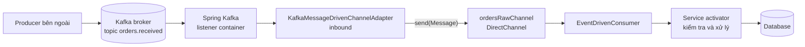
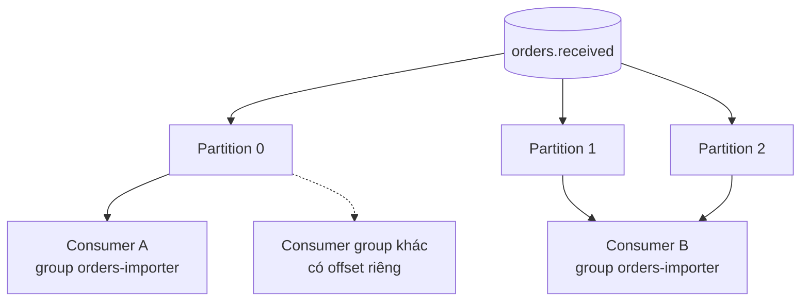
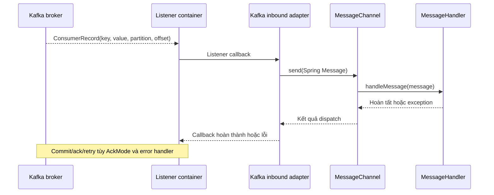
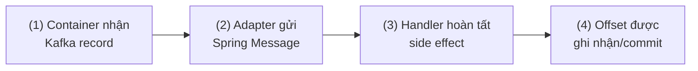
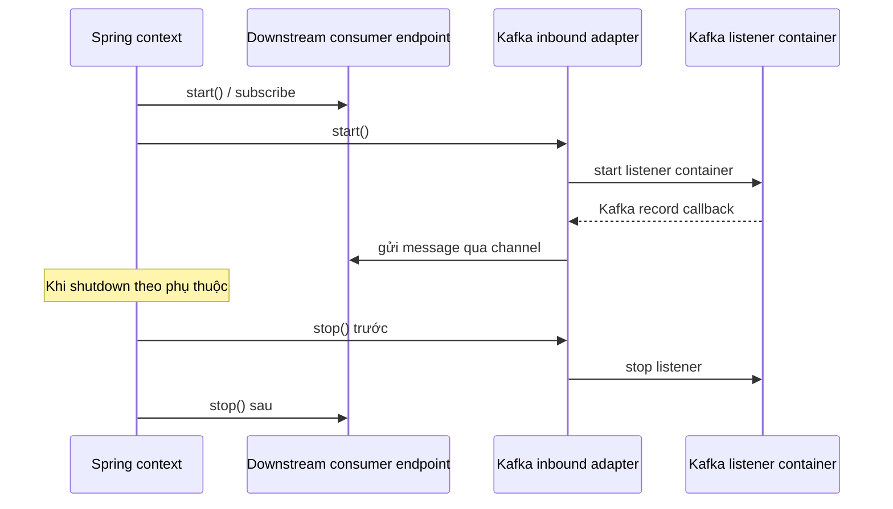

# Kafka inbound channel adapter

**Kafka inbound channel adapter** đưa bản ghi từ một topic Apache Kafka vào luồng message của Spring Integration. Một listener container do Spring for Apache Kafka quản lý việc kết nối, nhận record, phân vùng và offset; adapter chuyển record thành `Message<?>` rồi gửi tới `MessageChannel`. Các bước tiếp theo có thể là transformer, filter, router, service activator hoặc outbound adapter JDBC/HTTP/SFTP.

Bài thuộc chương **Adapter Kafka** của module **SPRING_INTEGRATION_ADAPTERS**. Module kết nối hệ thống ngoài bằng inbound/outbound adapter, gateway, poller và `MessageChannel`; thực hành file, SFTP, HTTP, JMS, AMQP, Kafka và cơ sở dữ liệu, chú trọng message contract, lỗi và vòng đời. Ở bài này, trọng tâm là **chiều Kafka → Spring Integration**, không phải gửi dữ liệu ngược ra Kafka.

> **Ý chính:** Kafka inbound adapter là **producer endpoint của flow Spring Integration** nhưng là **consumer của Kafka broker**. Hai chữ “producer/consumer” đang được nhìn từ hai hệ thống khác nhau.

## 1. Mục tiêu học tập

Sau khi học, bạn có thể:

1. Mô tả mối quan hệ giữa topic, partition, consumer group, listener container, inbound adapter và output channel.
2. Giải thích vì sao Kafka inbound dạng message-driven **không cần Spring Integration poller**, mặc dù Kafka consumer client có vòng lặp `poll()` riêng.
3. Khởi tạo `KafkaMessageDrivenChannelAdapter` với `ConcurrentMessageListenerContainer` và một `DirectChannel` trong Spring Boot.
4. Phân biệt chế độ nhận **record** và **batch**, payload và Kafka metadata trong headers.
5. Thiết kế thời điểm xử lý thành công, commit offset, acknowledgment, retry và dead-letter topic (DLT).
6. Đánh giá ảnh hưởng của `DirectChannel` và channel bất đồng bộ tới lỗi, transaction và nguy cơ mất/nhận lại message.
7. Theo dõi lag, throughput, partition assignment, rebalance và trạng thái lifecycle khi vận hành.

## 2. Kafka inbound nằm ở đâu trong IntegrationFlow?



**Các lớp trách nhiệm:**

| Thành phần | Trách nhiệm | Có phải Spring Integration poller? |
|---|---|---|
| Kafka broker | Lưu record theo topic/partition, quản lý log và offset | Không |
| Kafka consumer client | Gửi fetch/poll tới broker, tham gia consumer group | Không |
| `ConcurrentMessageListenerContainer` | Quản lý consumer thread, listener callback, ack, rebalance | Không |
| `KafkaMessageDrivenChannelAdapter` | Chuyển sự kiện nhận được thành Spring message, gửi đến output channel | Không |
| `DirectChannel` | Dispatch message tới handler đã đăng ký | Không |
| `EventDrivenConsumer` | Subscribe handler vào `DirectChannel` | Không |
| `MessageHandler` | Xử lý dữ liệu hoặc gửi sang hệ thống đích | Không |

Về mặt Kafka, consumer **thực sự vẫn gọi `poll()`** trong listener container. Tuy nhiên, bạn không cấu hình `Pollers.fixedDelay(...) ` hay `SourcePollingChannelAdapter` để nhận Kafka record trong mô hình này. Hãy phân biệt **consumer poll của Kafka client** với **polling endpoint của Spring Integration**.

### 2.1. Kafka topic, partition và consumer group

Giả sử topic `orders.received` có 3 partition. Ba instance cùng `group.id=orders-importer` có thể được phân công các partition để **chia nhau xử lý record** trong group. Một group khác có thể đọc cùng topic độc lập.



Trong một consumer group, mỗi partition được giao tối đa cho **một consumer đang hoạt động tại một thời điểm**. Kafka bảo đảm thứ tự record **trong từng partition** theo offset, không bảo đảm thứ tự toàn cục của cả topic. Nếu có ít partition hơn tổng số consumer trong group, một số consumer có thể không được phân công công việc.

## 3. Adapter nào phù hợp?

Spring Integration Kafka có các endpoint nhận dữ liệu với hợp đồng khác nhau. Ở bài này ta dùng **message-driven channel adapter**.

| Lựa chọn | Chiều message | Khi dùng |
|---|---|---|
| `KafkaMessageDrivenChannelAdapter` | Kafka → `MessageChannel` | Nhận event một chiều rồi xử lý trong IntegrationFlow |
| Kafka inbound gateway | Kafka request → Spring flow → Kafka reply | Khi cần mô hình request–reply qua Kafka |
| Kafka outbound channel adapter | Spring `MessageChannel` → Kafka topic | Publish message ra Kafka, không có reply message nghiệp vụ |
| Kafka outbound gateway | Spring request → Kafka → reply | Khi cần reply/correlation qua Kafka |
| `@KafkaListener` của Spring Kafka | Kafka → method Java | Khi chỉ cần listener Spring Kafka, không nhất thiết đi qua IntegrationFlow |

`@KafkaListener` không sai; nó phù hợp nếu luồng đơn giản và bạn không cần EIP channel/transformer/router của Spring Integration. `KafkaMessageDrivenChannelAdapter` hữu ích khi muốn dùng một **message contract nội bộ thống nhất** để nối Kafka với JDBC, HTTP, SFTP, JMS, AMQP hoặc những flow khác.

## 4. Chu trình nhận một record



Trình tự này mô tả **đường xử lý đồng bộ** với `DirectChannel`. Nếu output channel là `ExecutorChannel` hoặc `QueueChannel`, việc gửi có thể kết thúc trước khi handler thực sự xử lý xong. Khi đó listener container có thể xem callback hoàn tất và thực hiện chính sách offset/ack trước khi side effect downstream được commit: đây là một khác biệt kiến trúc cần đánh giá rõ.

### 4.1. Record Kafka khác Spring Message

Một Kafka record thường có key, value, topic, partition, offset, timestamp và headers gốc. Adapter thông qua converter/mapper đưa dữ liệu vào Spring `Message<?> `:

- **Payload:** thường là record value đã được deserializer/converter xử lý; không mặc định là DTO nghiệp vụ.
- **Message headers:** có thể chứa topic, partition, offset, key, timestamp và những header được mapping.
- **Message ID/correlation:** header `MessageHeaders.ID` là ID message trong Spring, **không phải Kafka offset** và cũng không phải business ID.

Đừng dùng Kafka offset **một mình** làm khóa dedup toàn cục: offset chỉ có ý nghĩa trong phạm vi **topic + partition**; nếu làm lại dữ liệu hoặc đổi topic, khóa nghiệp vụ như `orderId`/`eventId` thường thích hợp hơn.

## 5. Cấu hình dự án ví dụ

Ta xây dựng ứng dụng nhận message chuỗi từ topic `orders.received`, đưa vào `DirectChannel`, sau đó xử lý tại `@ServiceActivator`.

Điều kiện chạy:

- Java 17+ và một phiên bản Spring Boot tương thích với Spring Integration và Spring Kafka.
- Kafka broker truy cập được tại `localhost:9092` hoặc địa chỉ cấu hình khác.
- Topic `orders.received` đã tồn tại; ví dụ có 3 partition.
- Consumer group demo `orders-integration-demo` có quyền đọc topic.

### 5.1. Maven dependencies

Trong `pom.xml`, sử dụng dependency management của Spring Boot để các phiên bản Spring Kafka và Spring Integration tương thích:

```xml
<dependencies>
    <dependency>
        <groupId>org.springframework.boot</groupId>
        <artifactId>spring-boot-starter-integration</artifactId>
    </dependency>

    <dependency>
        <groupId>org.springframework.integration</groupId>
        <artifactId>spring-integration-kafka</artifactId>
    </dependency>
</dependencies>
```

Không cần đồng thời tạo một `@KafkaListener` khác nhận cùng topic/group chỉ để demo adapter: listener đó sẽ là **consumer cạnh tranh** và có thể khiến record được chia sang một luồng khác.

### 5.2. Cấu hình kết nối

Trong `application.properties`:

```properties
app.kafka.bootstrap-servers=localhost:9092

# Dùng một group ID riêng cho môi trường demo;
# không tái sử dụng group đang chạy nghiệp vụ production.
app.kafka.orders-group=orders-integration-demo
```

Ở hệ thống thực cần thêm TLS/SASL và secret management tùy cluster. Đừng lưu username/password vào Markdown, mã nguồn mẫu commit công khai hoặc message headers.

## 6. Ví dụ hoàn chỉnh: `KafkaMessageDrivenChannelAdapter`

Lớp dưới đây tạo ba thành phần: `ConsumerFactory`, `ConcurrentMessageListenerContainer` và inbound adapter. Container được tạo cục bộ và truyền cho adapter; adapter quản lý listener container trong vòng đời của nó. Consumer xử lý nghiệp vụ được cấu hình riêng bằng `@ServiceActivator`.

```java
package com.example.integration;

import java.util.HashMap;
import java.util.Map;

import org.apache.kafka.clients.consumer.ConsumerConfig;
import org.apache.kafka.common.serialization.StringDeserializer;

import org.springframework.beans.factory.annotation.Qualifier;
import org.springframework.beans.factory.annotation.Value;
import org.springframework.context.annotation.Bean;
import org.springframework.context.annotation.Configuration;
import org.springframework.integration.channel.DirectChannel;
import org.springframework.integration.config.EnableIntegration;
import org.springframework.integration.kafka.inbound.KafkaMessageDrivenChannelAdapter;
import org.springframework.kafka.core.ConsumerFactory;
import org.springframework.kafka.core.DefaultKafkaConsumerFactory;
import org.springframework.kafka.listener.ConcurrentMessageListenerContainer;
import org.springframework.kafka.listener.ContainerProperties;
import org.springframework.messaging.MessageChannel;

@Configuration
@EnableIntegration
public class OrdersKafkaInboundConfig {

    @Bean("ordersConsumerFactory")
    public ConsumerFactory<String, String> ordersConsumerFactory(
            @Value("${app.kafka.bootstrap-servers}") String brokers,
            @Value("${app.kafka.orders-group}") String groupId) {

        Map<String, Object> props = new HashMap<>();
        props.put(ConsumerConfig.BOOTSTRAP_SERVERS_CONFIG, brokers);
        props.put(ConsumerConfig.GROUP_ID_CONFIG, groupId);
        props.put(ConsumerConfig.KEY_DESERIALIZER_CLASS_CONFIG,
                StringDeserializer.class);
        props.put(ConsumerConfig.VALUE_DESERIALIZER_CLASS_CONFIG,
                StringDeserializer.class);
        props.put(ConsumerConfig.ENABLE_AUTO_COMMIT_CONFIG, false);
        props.put(ConsumerConfig.AUTO_OFFSET_RESET_CONFIG, "earliest");

        return new DefaultKafkaConsumerFactory<>(props);
    }

    @Bean("ordersRawChannel")
    public MessageChannel ordersRawChannel() {
        return new DirectChannel();
    }

    @Bean("ordersKafkaInbound")
    public KafkaMessageDrivenChannelAdapter<String, String> ordersKafkaInbound(
            @Qualifier("ordersConsumerFactory")
                    ConsumerFactory<String, String> factory,
            @Qualifier("ordersRawChannel") MessageChannel outputChannel) {

        ContainerProperties containerProperties =
                new ContainerProperties("orders.received");

        // Với RECORD, container đánh dấu/commit theo từng record
        // được xử lý thành công, theo các quy tắc commit của Spring Kafka.
        containerProperties.setAckMode(ContainerProperties.AckMode.RECORD);

        ConcurrentMessageListenerContainer<String, String> container =
                new ConcurrentMessageListenerContainer<>(
                        factory, containerProperties);
        container.setConcurrency(2);

        KafkaMessageDrivenChannelAdapter<String, String> adapter =
                new KafkaMessageDrivenChannelAdapter<>(container);
        adapter.setOutputChannel(outputChannel);
        return adapter;
    }
}
```

**Giải thích từng cấu hình:**

1. `ConsumerFactory` tạo Kafka consumer với key/value deserializer kiểu `String`. Thay bằng JSON/Avro/Protobuf deserializer hoặc converter tương ứng khi payload thực là DTO có schema.
2. `group.id` xác định trạng thái offset và nhóm consumer cạnh tranh. Hai ứng dụng cùng group chia partition; hai group khác nhau đọc độc lập.
3. `enable.auto.commit=false` tránh cơ chế auto-commit theo lịch của Kafka client; việc commit do listener container và `AckMode` kiểm soát.
4. `auto.offset.reset=earliest` **chỉ có tác dụng khi group/partition chưa có committed offset hợp lệ** hoặc offset không còn hợp lệ theo điều kiện cấu hình; nó không “phát lại từ đầu” mỗi lần restart.
5. `ContainerProperties("orders.received")` đăng ký topic cần nghe.
6. `AckMode.RECORD` là lựa chọn minh họa cho callback nhận một record; offset được container ghi nhận theo chính sách commit sau khi record xử lý thành công. Nó **không** bao trùm transaction DB hoặc hệ thống ngoài.
7. `setConcurrency(2)` có thể tạo hai consumer thread; lượng tiêu thụ song song còn phụ thuộc số partition được giao và các consumer khác trong group.
8. `adapter.setOutputChannel(outputChannel)` là điểm nối **Kafka inbound → Spring Integration channel**.

**Quan trọng:** Ví dụ chọn `DirectChannel` để đường xử lý đồng bộ. Thay bằng `QueueChannel` mà giữ nguyên kỳ vọng “callback thành công = DB đã ghi xong” có thể khiến offset được commit quá sớm. Phải có durable handoff hoặc chiến lược acknowledgment tách biệt nếu muốn ranh giới bảo đảm khác.

### 6.1. Consumer nhận Spring Message

```java
package com.example.integration;

import org.springframework.integration.annotation.ServiceActivator;
import org.springframework.kafka.support.KafkaHeaders;
import org.springframework.messaging.Message;
import org.springframework.stereotype.Component;

@Component
public class OrderReceivedHandler {

    @ServiceActivator(inputChannel = "ordersRawChannel")
    public void handle(Message<String> message) {

        String orderId = message.getPayload();
        Object topic = message.getHeaders()
                .get(KafkaHeaders.RECEIVED_TOPIC);
        Object partition = message.getHeaders()
                .get(KafkaHeaders.RECEIVED_PARTITION);
        Object offset = message.getHeaders()
                .get(KafkaHeaders.OFFSET);

        // Demo: thay bằng validation + transaction DB khi cần.
        if (orderId == null || orderId.isBlank()) {
            throw new IllegalArgumentException("orderId không hợp lệ");
        }

        System.out.printf(
                "Kafka topic=%s partition=%s offset=%s orderId=%s%n",
                topic, partition, offset, orderId);
    }
}
```

Method `@ServiceActivator` là một **consumer endpoint** trên `DirectChannel`. Framework đăng ký `MessageHandler` để gọi method. Inbound Kafka adapter và consumer endpoint phía sau là **hai endpoint khác nhau**.

Ứng dụng cần một class `@SpringBootApplication` trong `com.example.integration` hoặc package cha. Với dữ liệu mẫu `ORD-101` được producer gửi vào topic, output dự kiến có dòng log kèm topic, partition, offset và `orderId`. Offset cụ thể phụ thuộc dữ liệu hiện có; **không** giả định record sẽ luôn ở offset 0.

### 6.2. Cách thử có kiểm soát

1. Khởi động Kafka broker và tạo topic `orders.received` với ba partition.
2. Khởi động ứng dụng Spring Boot, kiểm tra adapter `ordersKafkaInbound` và handler phía sau đã hoạt động.
3. Dùng một Kafka producer hoặc console producer gửi các value như `ORD-101`, `ORD-102`, `ORD-103`.
4. Quan sát log và consumer group offset/lag bằng công cụ Kafka.
5. Dừng ứng dụng, gửi thêm record, khởi động lại cùng `group.id`: kiểm tra record chưa được commit có thể được nhận lại theo chính sách hiện tại.
6. Thử handler ném exception với một record có giá trị `BAD` và quan sát error handler/retry; không coi một log lỗi là đã đưa vào DLT.

Nếu dùng `kafka-console-producer`, key có thể mặc định không được gửi theo cách người dùng mong muốn. Muốn kiểm tra partition theo key, cần cấu hình key serializer, cách nhập key và partitioner thích hợp.

## 7. Chế độ record và batch

`KafkaMessageDrivenChannelAdapter` hỗ trợ hai cách nhận sự kiện tùy `ListenerMode` và cấu hình container/converter.

| Chế độ | Đơn vị callback | Payload thường gặp | Khi nên dùng |
|---|---|---|---|
| **Record** | Mỗi lần một `ConsumerRecord` | Một value/DTO sau conversion | Logic per-event, ghi DB từng đơn vị, retry rõ theo record |
| **Batch** | Một nhóm `ConsumerRecord` | Tập hợp phần tử sau batch conversion | Xử lý hàng loạt, batch DB và tăng throughput |

Ở **record mode**, handler trong ví dụ dùng `Message<String>`. Khi chuyển sang **batch mode**, không được giữ nguyên giả định payload là một `String`; handler/converter phải chấp nhận payload và metadata dạng batch theo hợp đồng của phiên bản thư viện.

Kích thước batch không đồng nghĩa chính xác `max.poll.records` mỗi lần: nó còn phụ thuộc dữ liệu sẵn có, container và consumer poll. Trong batch mode, một record hỏng ảnh hưởng cả batch như thế nào còn phụ thuộc batch error handler, vị trí record lỗi và cơ chế seek/commit.

### 7.1. Khi nào chọn batch?

Batch có ích khi đích hỗ trợ insert nhiều bản ghi trong một transaction và cần throughput cao. Tuy nhiên, batch làm tăng độ phức tạp của xử lý record lỗi, reprocessing và idempotency. Không nên chuyển sang batch chỉ để giảm số log hoặc tăng số phần tử trong một callback nếu nghiệp vụ vẫn phải gửi HTTP từng record.

## 8. Header mapping và message contract

Một `ConsumerRecord<K,V>` chứa thông tin Kafka. Adapter chuyển sang `Message<?>` và đưa một số trường vào headers theo converter/header mapper. Những header thường được quan tâm gồm:

| Thông tin | Ví dụ | Sử dụng |
|---|---|---|
| Topic nhận | `KafkaHeaders.RECEIVED_TOPIC` | Phân loại nguồn/route |
| Partition nhận | `KafkaHeaders.RECEIVED_PARTITION` | Theo dõi phân vùng |
| Offset | `KafkaHeaders.OFFSET` | Quan sát vị trí xử lý |
| Key | `KafkaHeaders.RECEIVED_KEY` | Giữ affinity theo khóa |
| Acknowledgment | `KafkaHeaders.ACKNOWLEDGMENT` trong chế độ manual phù hợp | Xác nhận record sau điều kiện xử lý |
| Payload | `String`, DTO, `byte[]`... | Nghiệp vụ |

Tên và sự hiện diện của headers phụ thuộc converter, record/batch mode, cấu hình nhận và phiên bản Spring Kafka. **Không giả định mọi message đều có đủ mọi header**; khi cần bắt buộc, hãy validate và xử lý thiếu metadata có chủ đích.

Với topic compacted, **tombstone** có value null là tín hiệu có ngữ nghĩa riêng. Spring Kafka có thể biểu diễn payload null bằng sentinel tương thích với Spring Messaging (ví dụ `KafkaNull` tùy converter). Không nên ép mọi record value thành non-null `String` mà bỏ qua tombstone nếu ứng dụng cần xử lý xóa.

### 8.1. Schema và deserializer

Ví dụ dùng `StringDeserializer`, nên consumer nhìn thấy value chuỗi. Khi record là JSON `OrderCreated`, thêm ràng buộc rõ ràng:

- Version schema và tương thích backward/forward.
- Xác định key/value serializer tương ứng bên producer.
- Converter/deserializer có validation và phân loại lỗi parse.
- Quy tắc xử lý record từ schema cũ.
- Không log nguyên payload chứa PII hoặc thông tin nhạy cảm.

Không phải adapter tự biến một JSON string thành `OrderCreated` chỉ vì handler nhận DTO. Cần cấu hình chuyển đổi hoặc transformer tường minh.

## 9. Offset, acknowledgment và ranh giới hoàn tất

Kafka lưu record trong partition, còn consumer group lưu **committed offset** để biết vị trí có thể đọc tiếp. Khi consumer được phân công lại partition hoặc restart, nó dựa vào offset được commit theo chính sách của container.

Có ba mốc không được đánh đồng:



Trong một flow đồng bộ với `DirectChannel`, callback không hoàn tất thành công trước khi handler trả về bình thường. Điều này thuận lợi cho chính sách `AckMode.RECORD`, nhưng **không tạo transaction phân tán** giữa Kafka và database.

### 9.1. Các chế độ ack cần biết

| `AckMode` (Spring Kafka) | Ý tưởng | Điều cần cân nhắc |
|---|---|---|
| `RECORD` | Container xử lý ack/commit theo mỗi record hoàn tất | Dễ gắn thành công với callback record đồng bộ |
| `BATCH` | Ghi nhận theo nhóm record của một lần poll | Ranh giới commit rộng hơn per-record |
| `MANUAL` | Listener/ứng dụng gọi `Acknowledgment.acknowledge()` | Cần đảm bảo đúng thời điểm ack và tương thích thread/lifecycle |
| `MANUAL_IMMEDIATE` | Xác nhận theo kiểu manual và cố gắng commit tại thời điểm gọi trên consumer thread | Gọi từ thread khác có thể không có ngữ nghĩa “immediate” như mong đợi |

Các chế độ khác có thể tồn tại theo phiên bản Spring Kafka. Không nên chọn ack mode bằng tên gọi mà bỏ qua concurrency, error handler, transaction, commit timeout và yêu cầu delivery.

### 9.2. Manual acknowledgment có phải luôn tốt hơn?

Không. Manual ack hữu ích khi bạn cần gắn việc xác nhận với một bước nghiệp vụ cụ thể, nhưng phải nắm được **ai sở hữu consumer thread và khi nào handler đã hoàn tất**.

Ví dụ minh họa trong một consumer đồng bộ, khi container và adapter đã được cấu hình manual ack:

```java
// Trích đoạn trong handler của một flow đồng bộ.
Acknowledgment acknowledgment = message.getHeaders()
        .get(KafkaHeaders.ACKNOWLEDGMENT, Acknowledgment.class);

saveOrderIdempotently(message.getPayload()); // Cần triển khai thật.

if (acknowledgment == null) {
    throw new IllegalStateException("Thiếu acknowledgment");
}
acknowledgment.acknowledge();
```

Import `org.springframework.kafka.support.Acknowledgment` và `KafkaHeaders` khi dùng. **Đoạn trên không phải mặc định của ví dụ mục 6**, vì mục 6 dùng `AckMode.RECORD`. Để chạy manual ack, thay đổi cấu hình container cho phù hợp và đảm bảo nơi xử lý có header acknowledgment. Với `DirectChannel` đồng bộ, callback đang ở ranh giới listener; với channel bất đồng bộ phải nghiên cứu kỹ quy tắc ack từ thread khác.

### 9.3. Có đạt exactly-once không?

Không chỉ bằng adapter. Giả sử handler ghi DB thành công, sau đó ứng dụng chết **trước khi offset commit**. Lúc restart, Kafka có thể phát lại record. Nếu handler không idempotent, DB có thể bị ghi trùng. Đây là hành vi **at-least-once** điển hình của ranh giới Kafka → DB khi thiết kế theo cách thông thường.

Thực hành an toàn là dùng business key như `orderId`, unique constraint hoặc inbox table, transaction DB thích hợp và chỉ xác nhận Kafka khi kết quả nghiệp vụ đã ở trạng thái bền vững. Nếu nghiệp vụ yêu cầu mạnh hơn, cần thiết kế transaction và idempotency theo đúng các tài nguyên tham gia. Kafka transaction/producer exactly-once **không tự bao trùm một database hoặc HTTP API tùy ý**.

## 10. `DirectChannel` và channel bất đồng bộ: khác biệt lớn

### 10.1. `DirectChannel`: đồng bộ theo callback

```text
Kafka listener thread
  -> KafkaMessageDrivenChannelAdapter
  -> DirectChannel.send(message)
  -> EventDrivenConsumer
  -> handler ghi DB
  -> callback trả về (hoặc exception)
  -> container áp dụng ack/error policy
```

Ưu điểm: thành công/thất bại của handler có thể quay về callback listener, giúp container áp dụng retry/error handler theo record. Nhược điểm: handler chậm giữ listener thread, có thể làm chậm poll, tăng consumer lag hoặc chạm giới hạn `max.poll.interval.ms` khi xử lý vượt thời gian cho phép.

### 10.2. `QueueChannel` hoặc `ExecutorChannel`: ranh giới bất đồng bộ

```text
Kafka listener thread
  -> KafkaMessageDrivenChannelAdapter
  -> QueueChannel.enqueue(message)  [send thành công]
  -> callback trả về

Một thời điểm khác:
  -> PollingConsumer.dequeue(message)
  -> handler ghi DB [có thể lỗi]
```

Nếu offset được commit khi callback gửi vào queue thành công, nhưng **queue chỉ nằm trong RAM** và ứng dụng chết trước khi ghi DB, record có thể đã được coi là xử lý xong trong Kafka nhưng side effect chưa tồn tại. Vì vậy, không được thay `DirectChannel` bằng queue RAM mà giữ nguyên cam kết delivery.

Các phương án cần cân nhắc là durable handoff (queue/broker hoặc message store phù hợp), acknowledgment gắn với xác nhận sau xử lý, hoặc thiết kế nguồn/đích có cơ chế khôi phục đáng tin cậy. Việc chuyển `Acknowledgment` qua nhiều thread cũng cần tuân thủ hợp đồng Spring Kafka; không ack tùy tiện từ thread nền.

## 11. Xử lý lỗi, retry và dead-letter topic

Trong flow có Kafka inbound, lỗi có thể xảy ra ở ít nhất ba lớp:

| Lớp lỗi | Ví dụ | Hướng xử lý |
|---|---|---|
| **Kafka consumer / deserialization** | Không parse được JSON, mất broker, auth lỗi | Deserializer phù hợp, error handling của container, cảnh báo |
| **Adapter / channel dispatch** | Không có subscriber, converter lỗi, channel quá tải | Kiểm tra wiring, lifecycle, error channel theo cấu hình |
| **Downstream handler** | DB timeout, HTTP 503, validation không đạt | Retry có giới hạn, lỗi nghiệp vụ, idempotency, DLT |

### 11.1. Lỗi đồng bộ và Spring Kafka error handler

Với `DirectChannel`, exception từ handler có thể quay về listener container khi không bị một tầng khác xử lý/suppress. Khi đó `DefaultErrorHandler` của Spring Kafka có thể được cấu hình để retry, backoff hoặc đưa record lỗi vào DLT thông qua `DeadLetterPublishingRecoverer`.

Tuy nhiên, các tính năng **không tự xuất hiện chỉ vì có inbound adapter**. Cần cấu hình error handler, producer dùng để ghi DLT, topic/quyền truy cập và chính sách recovered record có được xem là xử lý xong hay không.

### 11.2. Error channel của Spring Integration

Một số adapter/endpoint hỗ trợ đưa lỗi thành `ErrorMessage` qua error channel. Đây là luồng xử lý lỗi **của Spring Integration**, không đồng nghĩa Kafka container sẽ nhận lại một exception hoặc tự seek để phát lại record.

Ví dụ sai lầm:

```text
Handler ném lỗi
  -> errorChannel ghi log
  -> container thấy callback hoàn tất
  -> offset có thể được xử lý như thành công
```

Kịch bản trên có thể xảy ra nếu exception bị “nuốt” hoặc error flow xử lý xong mà không báo thất bại. Cần kiểm thử **thời điểm offset commit, retry và recovery** trong đúng cấu hình đang chạy, không chỉ kiểm tra log.

### 11.3. Lỗi không thể khắc phục

Record sai schema hoặc vi phạm dữ liệu vĩnh viễn không nên bị retry vô hạn. Một chiến lược hợp lý:

1. Phân loại lỗi recoverable (DB timeout, HTTP 503) và non-recoverable (JSON hỏng, business invariant sai).
2. Retry có giới hạn/backoff cho lỗi tạm thời.
3. Đưa record lỗi không thể khắc phục vào DLT hoặc kho quarantine có metadata.
4. Ghi topic, partition, offset, key, loại lỗi và correlation ID đủ để tra soát, tránh log bí mật.
5. Định nghĩa quy trình kiểm tra, sửa dữ liệu và replay.
6. Kiểm thử rằng việc ghi DLT thất bại không bị nhầm thành recovery thành công.

DLT không thay thế idempotency. Khi replay record từ DLT, handler vẫn cần chống tác dụng phụ trùng.

## 12. Concurrency, ordering, rebalance và độ trễ

### 12.1. Concurrency không đồng nghĩa throughput tuyến tính

Với `container.setConcurrency(2)`, hai consumer thread có thể nhận các partition khác nhau. Nếu topic chỉ có một partition hoặc group đã có consumer khác, nhiều thread không có việc. Nếu handler ghi vào một DB đang nghẽn, tăng concurrency có thể làm quá tải DB thay vì tăng throughput.

Throughput phụ thuộc số partition, kích thước payload, thời gian handler, network, serialization, transaction và giới hạn tài nguyên downstream. Cần đo thay vì tăng thread theo trực giác.

### 12.2. Ordering chỉ trong partition

Kafka giữ thứ tự theo offset **bên trong partition**. Một handler đồng bộ chạy tuần tự trên listener thread thường giữ thứ tự callback trong partition đó. Nhưng nếu đẩy record sang executor nhiều thread hoặc gom lại theo batch, thứ tự **hoàn tất side effect** có thể khác thứ tự record.

Nếu nghiệp vụ yêu cầu các event của cùng `orderId` đúng thứ tự, producer nên dùng key thích hợp để cùng khóa được partition nhất quán; consumer phải tránh đưa các event cùng khóa vào luồng xử lý phá thứ tự.

### 12.3. Rebalance và xử lý lại

Khi instance vào/ra group hoặc consumer không poll trong khoảng hợp lệ, partition có thể được gán lại. Record chưa được commit có thể được nhận bởi consumer khác; hệ thống phải chịu được **duplicate**. Xử lý quá lâu có thể đụng `max.poll.interval.ms`, kéo theo rebalance và tăng thời gian xử lý lại.

### 12.4. Những metric nên theo dõi

- **Consumer lag** theo group/topic/partition.
- Offset đang đọc so với committed offset.
- Thời gian handler và số record/giây.
- Số lần retry, DLT, deserialization failure.
- Rebalance count và partition assignment.
- Thời gian commit, broker disconnect/auth failures.
- Queue depth và task in-flight nếu đã tách bất đồng bộ.
- Trạng thái `isRunning()` của adapter, container và downstream endpoint.

Một endpoint `running=true` **không chứng minh** đang có partition assignment hoặc đang xử lý thành công. Cần đo lag và kiểm tra event cuối cùng đã commit downstream.

## 13. Vòng đời và thứ tự khởi động

`KafkaMessageDrivenChannelAdapter` là inbound message producer cho Spring Integration, còn `ConcurrentMessageListenerContainer` quản lý consumer kết nối Kafka. Khi khởi động, container phải có listener đúng và đủ cấu hình, downstream channel phải có consumer sẵn sàng.



Nguyên tắc thiết kế thường là **consumer nội bộ sẵn sàng trước inbound adapter**; khi stop thì inbound ngừng nhận mới trước, rồi downstream xử lý nốt trong khả năng cấu hình. Có thể dùng `SmartLifecycle`/phase để phối hợp trong cùng Spring context.

Nhưng phase **không bảo đảm** HTTP API/DB ngoài đã sẵn sàng, không bảo đảm message đang xử lý sẽ hoàn tất ngay khi shutdown, và không đồng bộ startup giữa nhiều service/pod. Với Kafka, cần phối hợp container shutdown, offset/ack, task in-flight và thời hạn graceful shutdown.

## 14. Phân biệt với các inbound adapter khác trong module

| Giao thức | Cách kích hoạt inbound thường gặp | Yếu tố delivery riêng |
|---|---|---|
| **File** | Spring Integration poll `FileReadingMessageSource` | File chưa ghi xong, filter, metadata store |
| **SFTP/FTP** | Source polling/remote synchronization | Session, timeout, accept-once, remote file rename |
| **HTTP inbound** | Server nhận HTTP request | Response, request timeout, retry phía client |
| **JMS inbound** | Listener container nhận message | Session, acknowledgment, transaction, redelivery |
| **AMQP inbound** | Listener nhận delivery từ broker | Ack/nack, requeue, dead-letter |
| **Kafka inbound** | Spring Kafka listener container consume topic/partition | Consumer group, offset commit, rebalance, DLT |
| **JDBC inbound** | Query/claim record theo poller | Claim atomically, transaction, dedup |

Các giao thức đều có thể đưa payload vào `MessageChannel`, nhưng **không chia sẻ một cơ chế xác nhận duy nhất**. Adapter chuẩn hóa hợp đồng message nội bộ; nó không xóa đi semantics của Kafka, SFTP, JMS, HTTP hoặc database.

## 15. Những hiểu lầm thường gặp

| Hiểu lầm | Cách hiểu đúng |
|---|---|
| “Kafka inbound adapter cần `Pollers.fixedDelay`.” | Message-driven adapter dùng Kafka listener container; Kafka client có poll loop riêng. |
| “Inbound adapter là Kafka producer.” | Nó là consumer từ Kafka nhưng là **producer message nội bộ**. |
| “Hai instance cùng `group.id` đều nhận mọi record.” | Trong cùng group, partition được chia cho consumer; muốn xử lý độc lập cần group riêng. |
| “Kafka bảo đảm thứ tự toàn topic.” | Kafka bảo đảm thứ tự trong từng partition, không toàn cục. |
| “`auto.offset.reset=earliest` phát lại từ đầu mỗi restart.” | Khi group đã có offset hợp lệ, consumer tiếp tục theo committed offset. |
| “`send()` vào channel thành công nghĩa là DB đã commit.” | Đặc biệt sai với queue/executor bất đồng bộ. |
| “RECORD ack mode bảo đảm exactly-once với DB.” | Không có distributed transaction tự động; phải thiết kế idempotency/commit. |
| “Có error channel thì Kafka chắc chắn retry.” | Nếu exception bị handled, container có thể không thấy lỗi để retry. |
| “Tăng concurrency luôn nhanh hơn.” | Giới hạn partition, broker, handler và DB có thể khiến không hiệu quả. |
| “DLT là tự động khi handler ném exception.” | DLT cần cấu hình recovery/publisher, quyền truy cập và chính sách xác nhận. |
| “Record Kafka value luôn non-null String.” | Value tùy deserializer/schema, topic compacted có tombstone. |
| “Offset là ID nghiệp vụ.” | Offset chỉ định danh vị trí trong topic/partition; không thay business key. |

## 16. Bài tập thực hành

### Bài 1 — Chạy thử Kafka inbound

Chạy cấu hình mục 6 với topic `orders.received`. Gửi 5 message bằng Kafka producer, ghi lại topic, partition, offset và value. Giải thích tại sao hai record có thể ở hai partition khác nhau và không nên so sánh offset giữa chúng.

### Bài 2 — Kiểm chứng `group.id` và `auto.offset.reset`

Khởi động ứng dụng với group `orders-integration-demo`, xử lý một số record rồi restart cùng group. Sau đó dùng **group ID mới** và `auto.offset.reset=earliest`. Quan sát khác nhau về những record đọc được, nêu vai trò của committed offset và retention.

### Bài 3 — Handler lỗi sau khi ghi DB

Giả sử handler đã `INSERT` đơn hàng thành công nhưng JVM chết trước khi offset được commit. Phác thảo chu trình record được nhận lại. Thiết kế unique constraint theo `orderId`, transaction DB và chính sách offset/ack sao cho xử lý lại không tạo bản ghi trùng.

### Bài 4 — Thay output channel

Thay `DirectChannel` bằng `QueueChannel` có capacity 10 và thêm `PollingConsumer` để ghi DB. Dự đoán điều gì xảy ra nếu listener callback enqueue thành công, offset được commit, rồi process chết khi queue vẫn còn record. Đề xuất thiết kế bền vững hoặc khác ranh giới acknowledgment.

### Bài 5 — Retry và DLT

Chia 3 loại lỗi: JSON không parse được, DB timeout, vi phạm unique constraint. Đề xuất lỗi nào retry có giới hạn, lỗi nào nên quarantine/DLT, lỗi nào có thể được coi là duplicate xử lý an toàn. Liệt kê metadata phải lưu để replay và cách kiểm tra offset không bị commit sai.

### Bài 6 — Concurrency và ordering

Topic có 3 partition và group có 2 consumer thread. Với key `customer-42`, mô tả cơ chế Kafka quyết định partition và thứ tự record. Nếu downstream được thay bằng `ExecutorChannel` nhiều thread, điều kiện nào có thể khiến thao tác DB hoàn tất sai thứ tự?

### Bài 7 — Vận hành production

Một consumer group có lag tăng, adapter `isRunning=true`, database dùng 100% CPU, nhiều `HTTP 503` ở nhánh downstream. Hãy đề xuất cách kiểm tra nguyên nhân, giảm tải có kiểm soát, theo dõi retry và lựa chọn có nên tăng concurrency hay không. Chỉ ra thời điểm tạm dừng nhận và chiến lược khôi phục khi DB ổn định.

## 17. Câu hỏi tự kiểm tra

1. `KafkaMessageDrivenChannelAdapter` là producer hay consumer, xét theo Kafka và theo Spring Integration?
2. Kafka listener container có dùng Spring Integration `Poller` không?
3. Vì sao `DirectChannel` thuận lợi hơn `QueueChannel` khi muốn callback listener phản ánh kết quả xử lý đồng bộ?
4. `group.id`, topic, partition và offset khác nhau thế nào?
5. `auto.offset.reset=earliest` có ý nghĩa khi nào?
6. Có thể dùng `KafkaHeaders.OFFSET` một mình làm khóa chống trùng nghiệp vụ không?
7. Record mode khác batch mode ở ranh giới xử lý và lỗi?
8. Khi handler ném exception nhưng error flow xử lý xong, vì sao có thể ảnh hưởng cơ chế Kafka retry?
9. Khi nào cần manual acknowledgment và tại sao phải chú ý thread?
10. Vì sao Kafka transaction không tự bảo đảm exactly-once cho database hoặc HTTP API ngoài Kafka?
11. Dấu hiệu nào cho thấy adapter đang chạy nhưng không xử lý được công việc hiệu quả?
12. DLT có thay thế được validation và idempotency không?

## 18. Tổng kết

Kafka inbound channel adapter nối **Kafka topic/partition → Spring Kafka listener container → `KafkaMessageDrivenChannelAdapter` → output `MessageChannel` → handler của Spring Integration**. Đây là cầu nối một chiều thích hợp cho các luồng tiếp nhận event từ Kafka và xử lý bằng các Enterprise Integration Patterns.

Thiết kế đúng không dừng ở việc record xuất hiện trên channel. Cần xác định **thời điểm side effect hoàn tất**, chính sách **offset/ack**, trường hợp **retry/rebalance/duplicate**, giới hạn concurrency và đường xử lý lỗi. Chính các ranh giới này quyết định khả năng khôi phục khi nối Kafka với file, SFTP, HTTP, JMS, AMQP hoặc cơ sở dữ liệu.

## Tài liệu tham khảo

- [Spring Integration Reference — Kafka Support](https://docs.spring.io/spring-integration/reference/kafka.html)
- [Spring Integration API — KafkaMessageDrivenChannelAdapter](https://docs.spring.io/spring-integration/api/org/springframework/integration/kafka/inbound/KafkaMessageDrivenChannelAdapter.html)
- [Spring for Apache Kafka Reference — Message Listener Containers](https://docs.spring.io/spring-kafka/reference/kafka/receiving-messages/message-listener-container.html)
- [Spring for Apache Kafka Reference — Handling Exceptions](https://docs.spring.io/spring-kafka/reference/kafka/annotation-error-handling.html)
- [Spring for Apache Kafka Reference — Topic/Partition/Offset](https://docs.spring.io/spring-kafka/reference/kafka/receiving-messages/kafkalistener-attrs.html)
- [Apache Kafka Documentation — Consumer Configuration](https://kafka.apache.org/documentation/#consumerconfigs)
