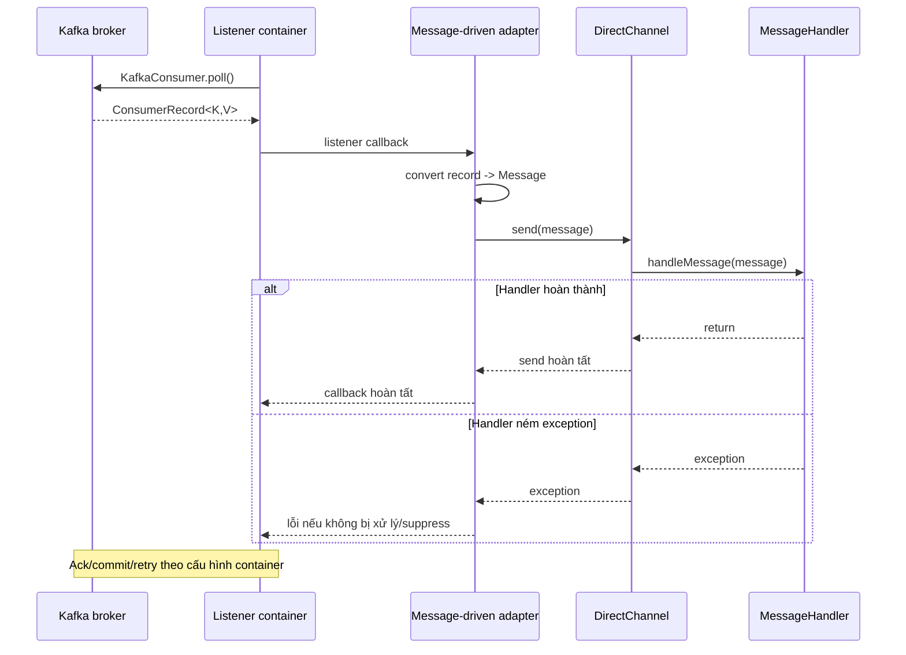
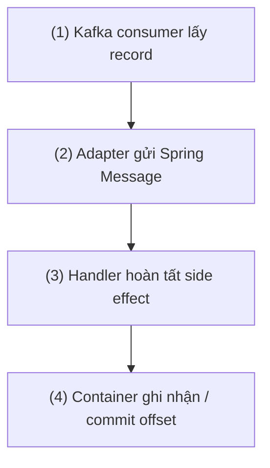
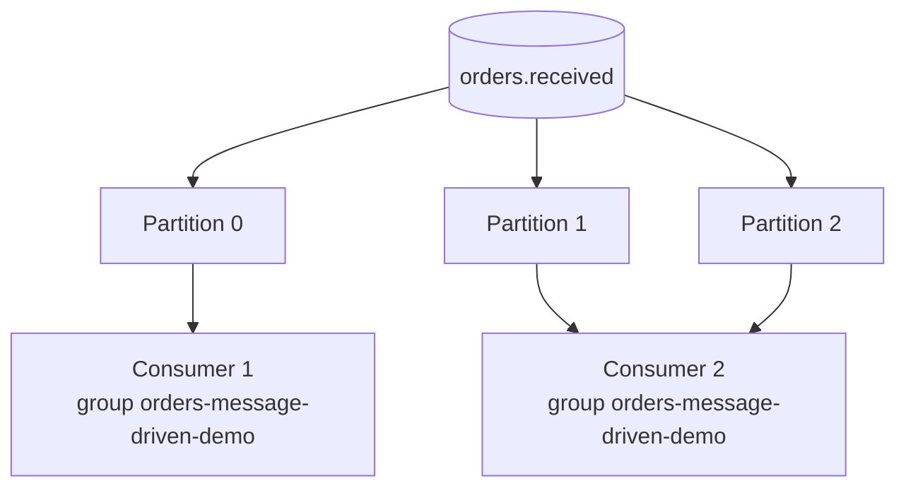
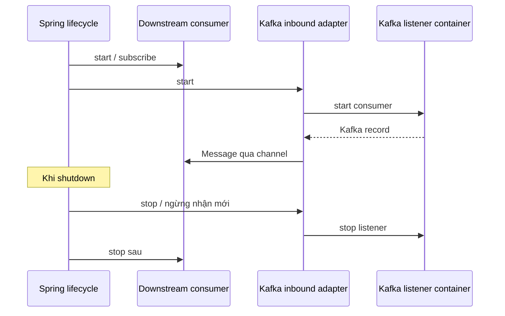

# Kafka message-driven channel adapter

**Kafka message-driven channel adapter** là điểm nhận dữ liệu do sự kiện Kafka kích hoạt trong Spring Integration. Thay vì để một `Poller` của Spring Integration định kỳ gọi `MessageSource.receive()`, adapter sử dụng **Spring for Apache Kafka listener container** để nhận callback khi Kafka consumer lấy được record. Adapter chuyển record thành Spring `Message<?>` và phát vào **output `MessageChannel`**, từ đó các thành phần EIP như filter, transformer, router hoặc service activator tiếp tục xử lý.

Bài học thuộc chương **Adapter Kafka** trong module **SPRING_INTEGRATION_ADAPTERS**. Module hướng tới kết nối hệ thống ngoài qua inbound/outbound adapter, gateway, poller và `MessageChannel`, thực hành với file, SFTP, HTTP, JMS, AMQP, Kafka và cơ sở dữ liệu, cùng việc kiểm soát message contract, lỗi và vòng đời. Bài này đi sâu vào **cơ chế message-driven**, phân biệt nó với **Kafka inbound polling**, và làm rõ mối quan hệ giữa callback, channel, transaction, acknowledgment và offset commit.

## 1. Mục tiêu học tập

Sau bài này, bạn có thể:

1. Mô tả cách `KafkaMessageDrivenChannelAdapter` phối hợp với `ConcurrentMessageListenerContainer` và `MessageChannel`.
2. Phân biệt **Kafka client poll nội bộ**, **message-driven adapter**, **KafkaMessageSource polling adapter** và **outbound adapter**.
3. Cấu hình một message-driven adapter ở chế độ `record` bằng Java configuration và nối với `@ServiceActivator` qua `DirectChannel`.
4. Giải thích chế độ `record` và `batch`, các header Kafka và giới hạn của conversion.
5. Phân tích kết quả khi handler xử lý thành công, ném exception, retry, gửi lỗi tới error channel hoặc chuyển bản ghi vào dead-letter topic.
6. Đánh giá rủi ro khi thay `DirectChannel` bằng `QueueChannel` hoặc `ExecutorChannel`.
7. Thiết kế ranh giới xác nhận offset, idempotency, ordering, rebalance, lifecycle và quan sát production.

## 2. Bức tranh kiến trúc: message-driven nghĩa là gì?

```mermaid
flowchart LR
    Producer["Ứng dụng sản xuất sự kiện"] --> Topic[("Kafka topic<br/>orders.received")]
    Topic --> Container["Spring Kafka<br/>ConcurrentMessageListenerContainer"]
    Container -->|"listener callback"| Adapter["KafkaMessageDrivenChannelAdapter"]
    Adapter -->|"send(Message<?>)"| Channel["DirectChannel<br/>ordersFromKafka"]
    Channel --> Consumer["EventDrivenConsumer"]
    Consumer --> Handler["Service activator<br/>xử lý nghiệp vụ"]
    Handler --> Database[("Database")]
```

`KafkaMessageDrivenChannelAdapter<K,V>` là một **message producer endpoint của Spring Integration**, nhưng ở phía Kafka nó tiêu thụ record thông qua listener container.



Các ranh giới trách nhiệm:

| Thành phần | Việc đảm nhận | Không đảm nhận |
|---|---|---|
| Kafka broker | Lưu record theo topic/partition, phục vụ fetch | Không chạy Spring Integration flow |
| Kafka consumer client | Tham gia consumer group, `poll()` và quản lý vị trí đọc | Không tự chạy `MessageHandler` của ứng dụng |
| Listener container | Quản lý consumer thread, listener callback, ack/commit, rebalance | Không tự biết mọi side effect nghiệp vụ đã commit |
| `KafkaMessageDrivenChannelAdapter` | Đổi dữ liệu Kafka thành Spring message, gửi tới output channel | Không là Kafka producer gửi record ra broker |
| `MessageChannel` | Phân phối message theo semantics channel | Không tự lưu DB hay gọi HTTP |
| Consumer endpoint + handler | Nhận message từ channel, thực hiện logic đích | Không tự quyết định Kafka offset theo tên handler |

### 2.1. Vì sao vẫn có `poll()` mà gọi là message-driven?

Spring Kafka listener container vận hành vòng `KafkaConsumer.poll()` để lấy record từ broker, giữ consumer group sống và xử lý heartbeat/rebalance. **Đó là API của Kafka client**. Ứng dụng Spring Integration không cần khai báo `@Poller(fixedDelay=...)` cho `KafkaMessageDrivenChannelAdapter`: listener callback sẽ chuyển record vào adapter khi container nhận được dữ liệu.

Hai từ “poll” đề cập đến **hai lớp trừu tượng khác nhau**, không mâu thuẫn với nhau.

### 2.2. So sánh với Kafka polling inbound adapter

Spring Integration có một kiểu inbound khác dựa trên `KafkaMessageSource`:

| Tiêu chí | Message-driven adapter | Kafka inbound polling adapter |
|---|---|---|
| Component chính | `KafkaMessageDrivenChannelAdapter` | `KafkaMessageSource` |
| Điểm kích hoạt ở cấp Spring Integration | Callback từ listener container | `SourcePollingChannelAdapter` / Spring Integration poller |
| Cách đưa message vào flow | Adapter `send()` tới output channel | Poller gọi source `receive()` rồi `send()` |
| Tối ưu cho | Stream sự kiện liên tục và Kafka consumer group | Nhu cầu điều tiết bằng poller Spring Integration |
| Điều khiển nhận | Container, pause/resume, ack/error handler | Trigger, lịch poll, metadata của message source |
| Cần hiểu | Container, record/batch, offset commit, rebalance | `KafkaMessageSource`, polling interval, claim/ack và offset |
| Có giống Kafka outbound không? | Không | Không |

**Đừng cấu hình cả hai endpoint để tiêu thụ cùng topic/group nếu mục tiêu chỉ là một luồng xử lý**: chúng có thể cạnh tranh phân vùng, khiến bản ghi xuất hiện ở luồng không mong muốn.

## 3. Hợp đồng dữ liệu: Kafka record đi vào channel như thế nào?

Một `ConsumerRecord<K,V>` mang topic, partition, offset, key, value, timestamp và Kafka headers. Adapter dùng converter để tạo Spring `Message<?>`, sau đó gửi tới output channel.



Khi output là `DirectChannel` và handler hoạt động đồng bộ, listener callback có thể quan sát kết quả handler. Nếu output là `QueueChannel`, callback có thể hoàn tất sau **enqueue**, không đợi handler ghi DB. Hai tình huống có **delivery boundary** rất khác nhau.

### 3.1. Các header cần nhận biết

Tên hằng số ở các phiên bản hiện đại của Spring Kafka nằm trong `org.springframework.kafka.support.KafkaHeaders`:

| Metadata | Header thường dùng | Ghi chú |
|---|---|---|
| Topic đã nhận | `KafkaHeaders.RECEIVED_TOPIC` | Tên topic nguồn |
| Partition đã nhận | `KafkaHeaders.RECEIVED_PARTITION` | Số partition |
| Offset | `KafkaHeaders.OFFSET` | Vị trí record trong partition |
| Key đã nhận | `KafkaHeaders.RECEIVED_KEY` | Có thể **không có header** nếu key null |
| Timestamp | `KafkaHeaders.RECEIVED_TIMESTAMP` | Phụ thuộc metadata/converter |
| Acknowledgment | `KafkaHeaders.ACKNOWLEDGMENT` | Chỉ khả dụng trong cấu hình manual ack phù hợp |

Đừng mặc định mọi header đều tồn tại: converter, record/batch mode, key null, ack mode và version có thể làm thay đổi metadata. `MessageHeaders.ID` của Spring không tương đương Kafka offset hoặc business event ID.

Kafka offset chỉ có nghĩa trong phạm vi **topic + partition**. Đối với nghiệp vụ, `orderId`/`eventId` bền vững thích hợp hơn để chống ghi trùng.

## 4. Chuẩn bị ví dụ Spring Boot

Bài thực hành nhận chuỗi đơn hàng từ Kafka topic `orders.received` và in/validate trong handler. Để tập trung vào message-driven, ví dụ không cần database thật; ở production thay phần in log bằng logic nghiệp vụ idempotent và có transaction phù hợp.

Điều kiện: Java 17+; Spring Boot/Spring Integration/Spring Kafka là các phiên bản tương thích; Kafka broker đã chạy và topic tồn tại. Ví dụ giả định Kafka ở `localhost:9092`.

### 4.1. Maven dependencies

Dùng Spring Boot BOM hoặc parent để quản lý phiên bản, thay vì tự ghép các version không tương thích:

```xml
<!-- Bên trong <dependencies> của pom.xml -->
<dependency>
    <groupId>org.springframework.boot</groupId>
    <artifactId>spring-boot-starter-integration</artifactId>
</dependency>
<dependency>
    <groupId>org.springframework.integration</groupId>
    <artifactId>spring-integration-kafka</artifactId>
</dependency>
```

### 4.2. Cấu hình properties

```properties
demo.kafka.bootstrap-servers=localhost:9092
demo.kafka.group-id=orders-message-driven-demo
```

Khi triển khai thực tế, Kafka có thể yêu cầu `SASL_SSL`, TLS truststore và quyền đọc topic. Hãy dùng secret/configuration management thích hợp, không lưu credentials trong message headers hoặc mã ví dụ.

## 5. Ví dụ Java configuration: listener container + adapter

Lớp sau tạo Kafka consumer factory, `DirectChannel`, listener container và adapter. Container được tạo **bên trong bean adapter**, không đăng ký lặp như một bean listener độc lập cho cùng flow.

```java
package com.example.integration;

import java.util.HashMap;
import java.util.Map;

import org.apache.kafka.clients.consumer.ConsumerConfig;
import org.apache.kafka.common.serialization.StringDeserializer;

import org.springframework.beans.factory.annotation.Qualifier;
import org.springframework.beans.factory.annotation.Value;
import org.springframework.context.annotation.Bean;
import org.springframework.context.annotation.Configuration;
import org.springframework.integration.channel.DirectChannel;
import org.springframework.integration.config.EnableIntegration;
import org.springframework.integration.kafka.inbound.KafkaMessageDrivenChannelAdapter;
import org.springframework.kafka.core.ConsumerFactory;
import org.springframework.kafka.core.DefaultKafkaConsumerFactory;
import org.springframework.kafka.listener.ConcurrentMessageListenerContainer;
import org.springframework.kafka.listener.ContainerProperties;
import org.springframework.messaging.MessageChannel;

@Configuration
@EnableIntegration
public class OrdersKafkaConfig {

    @Bean("ordersKafkaConsumerFactory")
    ConsumerFactory<String, String> ordersKafkaConsumerFactory(
            @Value("${demo.kafka.bootstrap-servers}") String brokers,
            @Value("${demo.kafka.group-id}") String groupId) {

        Map<String, Object> config = new HashMap<>();
        config.put(ConsumerConfig.BOOTSTRAP_SERVERS_CONFIG, brokers);
        config.put(ConsumerConfig.GROUP_ID_CONFIG, groupId);
        config.put(ConsumerConfig.KEY_DESERIALIZER_CLASS_CONFIG,
                StringDeserializer.class);
        config.put(ConsumerConfig.VALUE_DESERIALIZER_CLASS_CONFIG,
                StringDeserializer.class);
        config.put(ConsumerConfig.ENABLE_AUTO_COMMIT_CONFIG, false);
        config.put(ConsumerConfig.AUTO_OFFSET_RESET_CONFIG, "earliest");

        return new DefaultKafkaConsumerFactory<>(config);
    }

    @Bean("ordersFromKafka")
    MessageChannel ordersFromKafka() {
        return new DirectChannel();
    }

    @Bean("ordersKafkaMessageDrivenAdapter")
    KafkaMessageDrivenChannelAdapter<String, String> ordersKafkaAdapter(
            @Qualifier("ordersKafkaConsumerFactory")
            ConsumerFactory<String, String> consumerFactory,
            @Qualifier("ordersFromKafka")
            MessageChannel outputChannel) {

        ContainerProperties containerProperties =
                new ContainerProperties("orders.received");

        // Record listener + offset được container quản lý.
        containerProperties.setAckMode(ContainerProperties.AckMode.RECORD);

        ConcurrentMessageListenerContainer<String, String> container =
                new ConcurrentMessageListenerContainer<>(
                        consumerFactory, containerProperties);
        container.setConcurrency(2);

        KafkaMessageDrivenChannelAdapter<String, String> adapter =
                new KafkaMessageDrivenChannelAdapter<>(
                        container,
                        KafkaMessageDrivenChannelAdapter.ListenerMode.record);

        adapter.setOutputChannel(outputChannel);
        return adapter;
    }
}
```

**Những lựa chọn đáng chú ý:**

1. `ConsumerFactory<String,String>` quyết định bootstrap servers, group ID, deserializer và những property Kafka client. Dùng kiểu `String` để ví dụ không cần JSON converter.
2. `ContainerProperties("orders.received")` yêu cầu container subscribe vào topic. Container mới là thành phần điều phối Kafka consumer poll loop.
3. `enable.auto.commit=false` tránh commit tự động của Kafka client theo timer; Spring Kafka container sẽ dùng chính sách `AckMode`.
4. `AckMode.RECORD` ghi nhận/commit theo record listener hoàn tất theo cơ chế container, **không phải commit transaction ở database**.
5. `setConcurrency(2)` tạo tối đa hai Kafka consumer thread cho container; tốc độ còn phụ thuộc số partition và những consumer khác trong group.
6. `ListenerMode.record` có nghĩa mỗi callback từ adapter phát message của **một record**.
7. `setOutputChannel(...)` là điểm nối **Kafka → Spring Integration**. Channel này không phải Kafka topic hay Kafka consumer group.

**Chú ý version:** Ví dụ dùng API Java của Spring Integration/Spring Kafka hiện đại. Với dự án đang dùng phiên bản khác, cần kiểm tra Javadoc tương ứng và BOM của dự án; không chép một cấu hình từ các phiên bản khác nhau rồi giả định mọi import/method giống nhau.

### 5.1. Handler nhận message từ `DirectChannel`

Thêm class này trong package được Spring Boot component-scan:

```java
package com.example.integration;

import org.springframework.integration.annotation.ServiceActivator;
import org.springframework.kafka.support.KafkaHeaders;
import org.springframework.messaging.Message;
import org.springframework.stereotype.Component;

@Component
public class OrdersHandler {

    @ServiceActivator(inputChannel = "ordersFromKafka")
    public void process(Message<String> message) {
        String orderId = message.getPayload();

        // Demo có chủ đích: lỗi để kiểm tra đường propagation.
        if (orderId == null || orderId.isBlank()) {
            throw new IllegalArgumentException("Thiếu orderId");
        }

        Object topic = message.getHeaders()
                .get(KafkaHeaders.RECEIVED_TOPIC);
        Object partition = message.getHeaders()
                .get(KafkaHeaders.RECEIVED_PARTITION);
        Object offset = message.getHeaders()
                .get(KafkaHeaders.OFFSET);

        System.out.printf(
                "ORDER %s from %s-%s@%s%n",
                orderId, topic, partition, offset);
    }
}
```

Ứng dụng cần một class `@SpringBootApplication` ở `com.example.integration` hoặc package cha. Khi Spring khởi động, `@ServiceActivator` trên `DirectChannel` tạo **event-driven consumer endpoint**. Adapter là inbound endpoint khác, quản lý listener nhận record từ Kafka.

Thực hiện nghiệp vụ thực tế trong handler cần thêm validate payload, khóa idempotency, transaction và khả năng retry. `System.out.printf(...)` chỉ nhằm quan sát message contract.

### 5.2. Chạy thử bằng Kafka CLI

Cú pháp CLI tùy bản phân phối Kafka và môi trường. Ví dụ với Kafka CLI sẵn có, broker local, topic thử nghiệm:

```bash
kafka-topics.sh --bootstrap-server localhost:9092 \
  --create --if-not-exists \
  --topic orders.received --partitions 3 --replication-factor 1

kafka-console-producer.sh \
  --bootstrap-server localhost:9092 \
  --topic orders.received
```

Nhập lần lượt:

```text
ORD-1001
ORD-1002
ORD-1003
```

Quan sát log ứng dụng: mỗi record in ra orderId cùng topic, partition, offset thực tế. **Offset không nhất thiết bắt đầu từ 0**, bởi nó phụ thuộc topic và trạng thái group. `auto.offset.reset=earliest` chỉ quyết định vị trí đọc khi group chưa có offset hợp lệ hoặc theo tình huống reset được Kafka xác định, không buộc đọc lại từ đầu mỗi lần restart.

### 5.3. Tại sao không để `@KafkaListener` chạy song song với adapter?

Nếu tạo thêm một `@KafkaListener` cùng topic và `group.id`, listener đó tham gia **cùng consumer group** và có thể nhận một phần partition thay vì adapter. Bạn có thể tưởng adapter “mất record”, trong khi chúng đã được phân phối tới consumer khác. Chỉ làm điều đó khi chủ đích chia tải hoặc thử nghiệm chính xác consumer group.

## 6. Cấu hình bằng Java DSL và XML

Có thể dùng Java DSL để framework dựng endpoint/container thay vì trực tiếp `new KafkaMessageDrivenChannelAdapter`:

```java
// Đoạn đặt trong một class @Configuration với ConsumerFactory bean phù hợp.
@Bean
IntegrationFlow orderListenerFlow(
        ConsumerFactory<String, String> consumerFactory) {

    return IntegrationFlow
            .from(Kafka.messageDrivenChannelAdapter(
                    consumerFactory,
                    KafkaMessageDrivenChannelAdapter.ListenerMode.record,
                    "orders.received")
                .id("ordersKafkaDslAdapter"))
            .channel("ordersFromKafka")
            .get();
}
```

Cần import `org.springframework.integration.dsl.IntegrationFlow`, `org.springframework.integration.kafka.dsl.Kafka` và `KafkaMessageDrivenChannelAdapter`. Đây là **phương án thay thế** bean adapter trong mục 5, không nên chạy đồng thời với nó cho cùng topic/group trừ khi muốn nhiều consumer.

Với DSL, endpoint `id("ordersKafkaDslAdapter")` giúp đặt tên có chủ đích. Spring Integration có thể đăng ký listener container liên quan bằng tên dựa trên ID endpoint (ví dụ hậu tố `.container` theo cơ chế DSL được tài liệu mô tả). Hãy kiểm tra tên bean thực tế thay vì phụ thuộc tên tự sinh.

Cấu hình XML có thể biểu đạt cùng mục đích bằng namespace `int-kafka`:

```xml
<!-- Minh họa trong cấu hình đã khai báo namespace int-kafka. -->
<int-kafka:message-driven-channel-adapter
        id="ordersKafkaInbound"
        listener-container="ordersListenerContainer"
        channel="ordersFromKafka"
        mode="record"
        auto-startup="true"/>
```

`ordersListenerContainer` và `ordersFromKafka` phải được khai báo/tiêm phù hợp. Trong trường hợp này, thuộc tính `channel` là **output channel** của inbound adapter, không phải input channel của outbound adapter.

## 7. Record mode và batch mode: hai hợp đồng khác nhau

`KafkaMessageDrivenChannelAdapter.ListenerMode` có hai giá trị phổ biến: `record` và `batch`. Mặc định là `record` trong các cấu hình được hỗ trợ.

| Khía cạnh | `record` | `batch` |
|---|---|---|
| Đơn vị message | Một record được chuyển thành message | Nhiều record từ poll được chuyển thành một message |
| Payload | Thường một value/DTO | Thường là danh sách các value/DTO |
| Metadata topic/partition/offset | Thường giá trị đơn | Có thể là danh sách vị trí tương ứng payload |
| Xử lý lỗi | Theo từng record, thuận lợi cho kiểm tra cụ thể | Phải xác định record hỏng và chiến lược retry từng phần |
| Ghi DB | Mỗi record/một thao tác | Có thể insert/update hàng loạt |
| Ack/commit | Phù hợp `AckMode.RECORD` hoặc chính sách record | Phù hợp chính sách batch và listener mode tương ứng |

Với batch mode, constructor có thể nhận `ListenerMode.batch`:

```java
new KafkaMessageDrivenChannelAdapter<>(
        listenerContainer,
        KafkaMessageDrivenChannelAdapter.ListenerMode.batch);
```

**Đoạn chỉ minh họa constructor**, không phải đủ cấu hình batch. Listener container, converter, handler và `AckMode` phải tương thích với kiểu batch. Đặc biệt, **đừng giữ method `Message<String>` và kỳ vọng nhận một chuỗi** nếu adapter chuyển một batch thành danh sách. Với batch, metadata headers như `RECEIVED_TOPIC`, `RECEIVED_PARTITION`, `OFFSET` có thể chứa các danh sách tương ứng từng phần tử.

### 7.1. Batch không có kích thước cố định

`max.poll.records` là giới hạn cho số record một consumer poll trả về, **không đảm bảo luôn trả đúng từng ấy**. Kích thước thực tế còn phụ thuộc dữ liệu sẵn có, broker fetch, consumer configuration và container.

Ví dụ, `max.poll.records=500` không có nghĩa mỗi message batch luôn gồm 500 sự kiện.

### 7.2. Khi nào chọn record mode?

Record mode thường dễ thiết kế hơn khi mỗi event gây side effect riêng (ví dụ gọi HTTP đối tác, tạo đơn hàng trong DB) hoặc cần xử lý lỗi theo khóa nghiệp vụ. Batch mode phù hợp khi downstream hỗ trợ thao tác batch thực sự và bạn đã thiết kế rõ chiến lược xử lý batch lỗi.

## 8. Acknowledgment và committed offset

Một message “đã được nhận” có ít nhất ba mốc khác nhau:



Thực tế, thứ tự và thời điểm commit có thể khác tùy `AckMode`, transaction và error handling. Trong flow đồng bộ `DirectChannel`, mốc (2) thường không hoàn thành trước khi handler đã trả về; với `QueueChannel`, nó có thể hoàn thành ngay sau enqueue.

### 8.1. Các chế độ ack thường gặp

| `AckMode` | Hành vi điển hình khi auto commit bị tắt |
|---|---|
| `RECORD` | Container commit offset sau khi listener xử lý record trở về thành công |
| `BATCH` | Commit sau khi xử lý các record của một consumer poll theo cơ chế container |
| `MANUAL` | Ứng dụng gọi `Acknowledgment.acknowledge()`; xử lý commit theo ngữ nghĩa batch |
| `MANUAL_IMMEDIATE` | Ứng dụng gọi `acknowledge()`; có ngữ nghĩa commit ngay khi gọi trên consumer thread |

Với `enable.auto.commit=false`, Spring Kafka container quản lý offset theo chính sách của nó. Một **commit thành công ghi nhận tiến độ đọc**, không tự chứng minh DB, SFTP hoặc HTTP ngoài Kafka đã commit giao dịch tương ứng.

### 8.2. Manual ack có cần không?

Không bắt buộc cho mọi bài toán. Nếu chọn manual ack, phải cấu hình container bằng `AckMode.MANUAL` hoặc `MANUAL_IMMEDIATE` và bảo đảm listener/adapter truyền acknowledgment theo hợp đồng. Khi đó header `KafkaHeaders.ACKNOWLEDGMENT` mới có ý nghĩa trong handler.

```java
// Minh họa trong handler đồng bộ, với manual ack đã được cấu hình.
Acknowledgment ack = message.getHeaders().get(
        KafkaHeaders.ACKNOWLEDGMENT,
        Acknowledgment.class);

if (ack == null) {
    throw new IllegalStateException(
            "Không có acknowledgment; kiểm tra AckMode");
}

persistIdempotently(message.getPayload()); // Hàm nghiệp vụ tự triển khai.
ack.acknowledge();
```

Cần import `org.springframework.kafka.support.Acknowledgment`. Đây không phải code chạy nguyên xi cùng cấu hình `AckMode.RECORD` ở mục 5. Trong mô hình bất đồng bộ, việc giữ acknowledgement để dùng ở thread khác phải tuân thủ ràng buộc Spring Kafka và chính sách out-of-order ack; không tự suy diễn rằng callback có thể ack ở bất kỳ thread nào.

### 8.3. At-least-once và xử lý trùng

Ví dụ: handler ghi DB thành công, process chết trước khi Kafka offset được commit. Sau restart, record có thể được xử lý lại. Nếu handler `INSERT` không có khóa chống trùng, DB có thể tạo hai bản ghi cho một event.

Giải pháp điển hình:

1. Chọn `eventId` hoặc `orderId` là business key.
2. Áp dụng unique constraint/inbox table hoặc idempotency key bền vững ở đích.
3. Commit transaction DB cùng trạng thái đã xử lý nghiệp vụ.
4. Chỉ xem Kafka record là hoàn tất khi giao thức acknowledgment và chính sách lỗi phù hợp đã chạy.
5. Kiểm thử bằng tình huống crash **sau DB commit, trước offset commit**.

Kafka producer transactions/exactly-once không tự tạo transaction phân tán cho DB hay HTTP API. Cần thiết kế thực tế cho các tài nguyên tham gia.

## 9. Error channel, retry và dead-letter: chọn đúng tầng xử lý

Một đường đi bị lỗi có thể có **ba nơi khác nhau**:

| Nơi phát sinh | Ví dụ | Cơ chế cần xem |
|---|---|---|
| Deserializer / Kafka consumer | Dữ liệu hỏng, auth lỗi, partition revoke | Container error handler, deserializer và recoverer |
| Adapter / channel dispatch | Converter lỗi, output channel không có subscriber | Adapter error channel, exception propagation |
| Handler / hệ thống đích | DB timeout, HTTP 503, validation exception | Retry, transaction, DLT hoặc flow lỗi |

### 9.1. Cách exception lan truyền rất quan trọng

Với `DirectChannel`, handler ném exception có thể quay về listener callback, và Spring Kafka container có cơ hội áp dụng `DefaultErrorHandler` nếu không có thành phần trung gian nào nuốt lỗi.

Nếu cấu hình **error channel** và recovery callback ở tầng adapter, một exception có thể được biến thành `ErrorMessage` và gửi tới flow xử lý lỗi. Nếu flow đó kết thúc bình thường, **không được mặc định rằng Kafka vẫn sẽ retry record**: cần kiểm tra contract recovery/exception propagation. Điều này đặc biệt quan trọng khi ack/commit dựa trên callback thành công.

### 9.2. Adapter retry và container retry khác nhau

Spring Integration Kafka hỗ trợ cấu hình retry ở adapter và cơ chế lỗi ở listener container. Hai lựa chọn có thể mang lại ngữ nghĩa khác nhau:

- **Adapter retry:** thử lại thao tác gửi/dispatch message theo policy; có thể cấu hình recovery callback hoặc error channel sau khi hết lần thử. Retry ngay trong callback có thể giữ consumer thread khá lâu.
- **Container retry/error handler:** `DefaultErrorHandler` có thể quản lý retry, backoff và recovery ở mức Kafka record. Có thể kết hợp `DeadLetterPublishingRecoverer` để publish record lỗi vào DLT, nếu producer/topic/quyền đã được cấu hình.
- **Business error flow:** tách record invalid vĩnh viễn sang quarantine; xử lý duplicate idempotently; báo cáo tình trạng không thể sửa tự động.

**Cảnh báo:** Retry blocking quá lâu có thể khiến khoảng xử lý vượt `max.poll.interval.ms`, gây rebalance. Tài liệu Spring Integration khuyến nghị cân nhắc container error handler thay cho kiểu retry khiến listener bị chiếm lâu.

### 9.3. Dead-letter topic không tự xuất hiện

Một chiến lược DLT cần có:

1. Topic DLT và quy tắc đặt tên/partition phù hợp.
2. Kafka producer/template có quyền ghi vào DLT.
3. Recoverer hoặc error handler chuyển đúng record và metadata lỗi.
4. Chính sách xử lý **khi ghi DLT thất bại**.
5. Quy trình truy vết, sửa dữ liệu và replay có idempotency.

Gửi một `ErrorMessage` tới logging handler **không phải** là đã publish vào Kafka DLT. Nên kiểm thử cả side effect đích, committed offset và record trong DLT, thay vì chỉ nhìn log “recovered”.

### 9.4. Bảng quyết định theo loại lỗi

| Sự cố | Chính sách tham khảo | Lý do |
|---|---|---|
| Kafka payload sai schema | Quarantine/DLT sau khi phân loại | Retry cùng byte vô hạn không sửa được schema |
| DB tạm không kết nối | Retry có giới hạn/backoff, không ack quá sớm | Sự cố có thể hồi phục |
| Business key đã xử lý | Idempotent no-op rồi xác nhận theo policy | Nhận lại record không được tạo tác dụng phụ |
| Channel không có subscriber | Sửa lifecycle/wiring, alert | Không thể coi như handler đã chạy |
| Publish DLT bị lỗi | Tiếp tục xử lý lỗi theo policy, không báo recovery giả | Nếu coi là recovered sẽ mất dấu record |
| Rebalance khi xử lý lâu | Giảm blocking, cân chỉnh interval/throughput | Consumer có thể bị revoke partition |

## 10. Tại sao đổi output channel có thể làm thay đổi đảm bảo dữ liệu?

### 10.1. `DirectChannel`: chạy đồng bộ

```text
Kafka listener thread
  -> adapter.send()
  -> DirectChannel
  -> EventDrivenConsumer
  -> handler ghi database
  -> callback success / exception
  -> container ack / error policy
```

Ưu điểm là callback thường phản ánh kết quả handler. Đổi lại, một handler chậm chiếm consumer thread, có thể tăng lag và rủi ro vượt khoảng `max.poll.interval.ms`.

### 10.2. `QueueChannel`: enqueue không phải hoàn tất xử lý

```text
Kafka listener thread
  -> adapter.send()
  -> QueueChannel.enqueue(message)
  -> callback success, container có thể commit offset

Lúc khác:
  -> PollingConsumer.dequeue(message)
  -> JDBC handler
```

Nếu queue trong RAM, offset đã commit nhưng JVM chết trước khi handler chạy, Kafka có thể **không phát lại record**, trong khi DB cũng chưa có dữ liệu. Đây là rủi ro mất message do chuyển ranh giới acknowledgment.

Khi muốn tách tải bằng queue, cần **durable handoff** hoặc cơ chế chỉ xác nhận Kafka sau khi downstream đã xử lý thành công, được triển khai và kiểm chứng theo ràng buộc thread/ack của Spring Kafka. Đừng suy rằng thêm `QueueChannel` tự động làm message bền vững.

### 10.3. `ExecutorChannel` và ordering

`ExecutorChannel` dispatch trên executor nên xử lý có thể song song và kết thúc lệch thứ tự. Nếu downstream cần giữ thứ tự theo customer/order, phải tính partition key, routing, serialized processing theo key hoặc thiết kế dữ liệu chịu được out-of-order.

### 10.4. `PublishSubscribeChannel` không thay Kafka fan-out

Một Kafka record được gửi vào `PublishSubscribeChannel` nội bộ có thể tới nhiều subscriber trong **một service**. Nhưng điều đó không tương đương hai consumer group Kafka độc lập: chúng có riêng offset và khả năng replay. Chọn kiểu fan-out theo yêu cầu lỗi và độ tin cậy, không chỉ theo số handler.

## 11. Consumer group, partition, concurrency và rebalance



Với `container.setConcurrency(2)`, container có thể có hai consumer client. **Mỗi partition trong một group chỉ được gán cho một consumer tại một thời điểm**. Nếu topic có ít partition hơn consumer threads, có thread không được phân công. Nếu nhiều instance cùng group, Kafka chia partition cho toàn group chứ không cho mỗi instance toàn bộ record.

- **Ordering:** Kafka giữ thứ tự offset trong một partition. Không có thứ tự toàn cục trên mọi partition.
- **Key:** Producer thường gán cùng key vào cùng partition theo partitioner, nhờ đó có thể giữ thứ tự theo khóa khi cấu hình producer ổn định.
- **Rebalance:** Khi member vào/ra group, session/poll timeout hoặc có thay đổi assignment, partition có thể chuyển sang consumer khác.
- **Duplicate:** Record chưa commit có thể được đọc lại sau rebalance/restart; nghiệp vụ phải idempotent.
- **Throughput:** Tăng concurrency khi DB/HTTP đã quá tải không giải quyết bottleneck; cần quan sát lag, CPU, thời gian handler và rate limit.

### 11.1. Những timeout dễ nhầm

| Giá trị | Chi phối điều gì |
|---|---|
| `max.poll.interval.ms` | Khoảng tối đa giữa các lần Kafka consumer poll theo contract; xử lý block quá lâu có thể dẫn đến rebalance |
| `max.poll.records` | Giới hạn số record trả về từ một lần consumer poll |
| `session.timeout.ms` | Khả năng phát hiện consumer mất kết nối theo consumer group protocol |
| `request.timeout.ms` | Timeout cho Kafka request tới broker |
| Spring Integration send timeout | Giới hạn chờ khi adapter gửi vào một channel hỗ trợ timeout/backpressure |

Không dùng `fixedDelay` của Spring Integration để thay thế cấu hình trên cho **message-driven adapter**.

## 12. Lifecycle, pause/resume và shutdown

`KafkaMessageDrivenChannelAdapter` là endpoint có lifecycle; listener container bên dưới cũng quản lý trạng thái consumer. Khi khởi động, cần để **consumer endpoint phía sau channel sẵn sàng** trước khi adapter bắt đầu phát message, đặc biệt nếu output là `DirectChannel`.



Trong cùng `ApplicationContext`, `SmartLifecycle`/`phase` có thể hỗ trợ thứ tự start/stop. Nhưng **phase không xác nhận broker, DB hay HTTP API đã khỏe**. Kafka container có thể chưa nhận partition dù bean báo running; cần kiểm tra assignment và lag.

Khi cần giảm tải tạm thời, một số adapter/container hỗ trợ pause/resume để hạn chế tiếp nhận trong khi vẫn quản lý consumer group theo cơ chế tương ứng. Phải phân biệt **pause** với **stop**: stop có thể kéo theo rời group và rebalance; pause cần được dùng qua API hợp lệ và quan sát tác động tới records đã fetch.

**Graceful shutdown** không chỉ là gọi `stop()`: cần xem callback đang xử lý, commit offset, transaction DB, task bất đồng bộ, dead-letter publisher và thời hạn shutdown. Không được tự kết luận mọi record đã xử lý vì adapter vừa chuyển sang `running=false`.

## 13. Quan sát và chẩn đoán production

Các chỉ số quan trọng:

| Chỉ số / tín hiệu | Câu hỏi cần trả lời |
|---|---|
| Consumer lag theo group/partition | Record đang tồn đọng ở Kafka bao nhiêu? |
| Committed offset, current position | Tiến độ đọc có đang được ghi nhận đúng không? |
| Handler latency & error rate | Downstream chậm/hỏng ở bước nào? |
| Retry count, DLT count | Lỗi tạm thời hay dữ liệu không phục hồi được? |
| Partition assignment, rebalance count | Consumer có ổn định trong group không? |
| Container running/paused | Adapter đang chạy, tạm dừng hay không được assignment? |
| Channel queue depth/in-flight | Nếu có buffer, message đã đến downstream chưa? |
| DB transaction / HTTP status | Side effect đích có thực sự hoàn thành? |

### Tình huống 1: `running=true` nhưng không có log xử lý

Kiểm tra topic, `group.id`, committed offset, topic retention, partition assignment, consumer lag, deserializer, output channel, trạng thái downstream endpoint. Nếu group đã đi qua tất cả offset và không có record mới, không có log xử lý là bình thường.

### Tình huống 2: record xuất hiện nhiều lần

Kiểm tra lỗi handler, retry, rebalance, commit offset, group ID bị thay đổi và business key. Một lần xử lý bị lỗi sau DB commit nhưng trước Kafka commit có thể gây duplicate đúng theo thiết kế at-least-once, không nhất thiết là bug của adapter.

### Tình huống 3: DLT có record nhưng DB vẫn thiếu

Xác định record được recover như thế nào, DLT có publish thật không, offset nguồn đã commit chưa và ai có trách nhiệm replay. Nếu handler bị lỗi do schema, cần sửa dữ liệu/transformer; không chạy lại DLT nguyên xi rồi kỳ vọng lỗi biến mất.

### Tình huống 4: lag tăng nhanh sau khi thêm concurrency

Kiểm tra số partition thật, DB connection pool, HTTP rate limit, CPU, GC, timeouts và rebalance. Nhiều consumer có thể cùng gây nghẽn đích. Giảm concurrency hoặc tạm pause để phục hồi, sau đó nâng tải từng bước dựa trên số đo.

## 14. So sánh với những adapter ngoài Kafka

| Hệ thống | Kích hoạt inbound thường gặp | Cơ chế xác nhận/khôi phục |
|---|---|---|
| File, SFTP | Spring Integration source poller | Filter, metadata store, file rename/claim |
| HTTP inbound | HTTP request từ client | HTTP status, request timeout, retry phía client |
| JMS, AMQP | Broker listener/consumer container | Ack/nack, transaction, redelivery và DLQ |
| **Kafka message-driven** | Kafka listener container callback | Offset, consumer group, rebalance, error handler/DLT |
| JDBC inbound | Query/claim theo lịch | Transaction/claim và khóa idempotency |

Tất cả đều có thể tạo Spring `Message<?>`, nhưng không thể dùng một công thức retry/ack chung mà bỏ qua semantics của từng giao thức.

## 15. Sai lầm phổ biến

| Nhận định sai | Thực tế |
|---|---|
| “Message-driven không liên quan `poll()`.” | Kafka client vẫn poll; chỉ **Spring Integration endpoint không dùng `@Poller`**. |
| “Kafka inbound adapter và KafkaMessageSource giống nhau.” | Một bên callback listener, bên kia là nguồn cho polling adapter. |
| “`KafkaMessageDrivenChannelAdapter` là Kafka producer.” | Nó consume Kafka và produce Spring message nội bộ. |
| “Mọi record trong topic được gửi tới mỗi instance cùng group.” | Partition được phân công giữa consumer trong group. |
| “Topic có thứ tự toàn cục.” | Chỉ có thứ tự theo partition. |
| “`auto.offset.reset=earliest` replay tất cả mỗi lần restart.” | Committed offset hợp lệ thường quyết định vị trí đọc. |
| “`AckMode.RECORD` bảo đảm một lần duy nhất khi ghi DB.” | DB commit và Kafka offset commit là hai ranh giới. |
| “`QueueChannel.send()` thành công là record đã xử lý.” | Có thể mới enqueue, chưa có side effect. |
| “Error channel luôn khiến container retry.” | Recovery có thể xử lý/suppress exception; cần kiểm tra callback và offset. |
| “`max.poll.records` là kích thước batch cố định.” | Là giới hạn tối đa, không phải số lượng bắt buộc. |
| “Tăng concurrency luôn giảm lag.” | Bị giới hạn bởi partition, tài nguyên và downstream. |
| “Đã có DLT thì không cần idempotency.” | Record replay từ DLT vẫn có thể gây duplicate. |

## 16. Bài tập thực hành

### Bài 1 — Khảo sát listener callback

Chạy cấu hình mục 5 và gửi năm record từ console producer. Ghi lại topic, partition và offset của mỗi record. Giải thích vì sao hai offset ở hai partition khác nhau không thể so sánh như một thứ tự toàn cục.

### Bài 2 — Đổi consumer group

Chạy demo với `orders-message-driven-demo`, sau đó restart cùng group và gửi record mới. Đổi sang group ID chưa tồn tại, giữ `auto.offset.reset=earliest`. Quan sát kết quả với record vẫn còn trong retention và giải thích cơ chế committed offset.

### Bài 3 — Record mode và batch mode

Chuyển adapter sang `ListenerMode.batch` trong một nhánh thử riêng; chỉnh container và handler tương thích với batch. Kiểm tra payload/headers trước khi xử lý. Giải thích vì sao giữ nguyên `Message<String>` sẽ sai về message contract.

### Bài 4 — Lỗi DB tạm thời

Giả lập handler ném exception cho event `ORD-FAIL` trong hai lượt đầu rồi thành công ở lượt sau. Đề xuất cấu hình retry/backoff có giới hạn và cách xác minh số lần nhận lại, committed offset, side effect cuối cùng. Phân biệt adapter retry với container error handler.

### Bài 5 — Crash sau side effect

Giả định đã insert `orderId=ORD-101` vào DB nhưng process chết trước khi commit Kafka offset. Vẽ lại dòng thời gian và thiết kế unique constraint/inbox table để việc xử lý lại không tạo bản ghi thứ hai.

### Bài 6 — Queue bất đồng bộ

Thay `DirectChannel` thành `QueueChannel(100)` và thêm `PollingConsumer` xử lý chậm. Khi Kafka callback enqueue thành công, nhưng JVM chết trước khi handler chạy, phân tích khả năng record bị mất nếu offset đã commit. Đề xuất phương án durable handoff hoặc sửa ranh giới ack.

### Bài 7 — DLT không thành công

Cấu hình recovery để publish record sai schema vào DLT. Giả lập Kafka producer ghi DLT lỗi. Hãy xác định expected error behavior, giám sát và cách chứng minh record nguồn **chưa bị đánh dấu recovered nhầm**.

### Bài 8 — Concurrency và thứ tự

Có topic 4 partition, 3 consumer threads trong một group. Gửi event của hai customer với Kafka key tương ứng. Đo thứ tự record trong từng partition và so sánh khi downstream dùng `ExecutorChannel` nhiều thread. Thiết kế cơ chế giữ thứ tự theo customer nếu nghiệp vụ yêu cầu.

### Bài 9 — Tạm dừng nhận khi DB quá tải

Khi DB chậm và lag tăng, thiết kế quy trình pause/resume hoặc stop/start có kiểm soát. Nêu chỉ số xác nhận downstream đã sẵn sàng trở lại, điều kiện tránh retry storm và cách xử lý records đang in-flight.

## 17. Câu hỏi tự kiểm tra

1. Vì sao gọi `KafkaMessageDrivenChannelAdapter` là inbound **message producer** trong Spring Integration?
2. Điểm khác nhau cốt lõi giữa adapter message-driven và `KafkaMessageSource` là gì?
3. Thành phần nào sở hữu Kafka consumer thread và áp dụng chính sách commit offset?
4. Tại sao listener callback đồng bộ cùng `DirectChannel` có lợi cho việc phản ánh lỗi downstream?
5. Khi nào Kafka header key có thể không xuất hiện?
6. Metadata của batch mode khác record mode như thế nào?
7. Vì sao `max.poll.interval.ms` liên quan đến retry blocking?
8. Khi handler đã ghi DB nhưng Kafka chưa commit offset, điều gì có thể xảy ra sau restart?
9. Khi nào `MANUAL_IMMEDIATE` khác `MANUAL` về thời điểm commit?
10. Có thể nhận record đồng thời trên nhiều partition mà vẫn giữ thứ tự toàn topic không?
11. Đổi channel thành queue RAM có thể làm thay đổi độ tin cậy theo cách nào?
12. Error channel của Spring Integration và Kafka DLT có cùng ý nghĩa không?
13. Khi adapter `running=true` nhưng lag không giảm, bạn cần đo những thành phần nào?

## 18. Tổng kết

Hợp đồng của Kafka message-driven channel adapter là:

```text
Kafka topic / partition
    -> Spring Kafka listener container
    -> KafkaMessageDrivenChannelAdapter
    -> output MessageChannel
    -> consumer endpoint / MessageHandler
    -> database, HTTP, SFTP hoặc một hệ thống đích khác
```

Điểm quan trọng nhất khi thiết kế không phải là “đã nhận được payload”, mà là **ràng buộc giữa callback, thời điểm hoàn tất side effect và thời điểm Kafka offset được xác nhận**. Phải xác định rõ khi nào record có thể được phát lại, khi nào lỗi bị recover, cách xử lý trùng và điều gì xảy ra khi chuyển sang channel bất đồng bộ. Đây là cơ sở để vận hành Kafka inbound flow đáng tin cậy trong Spring Integration.

## Tài liệu tham khảo

- [Spring Integration Reference — Kafka Support, Message-driven Channel Adapter](https://docs.spring.io/spring-integration/reference/kafka.html)
- [Spring Integration API — KafkaMessageDrivenChannelAdapter](https://docs.spring.io/spring-integration/api/org/springframework/integration/kafka/inbound/KafkaMessageDrivenChannelAdapter.html)
- [Spring Kafka Reference — Message Listener Containers](https://docs.spring.io/spring-kafka/reference/kafka/receiving-messages/message-listener-container.html)
- [Spring Kafka Reference — Exception Handling](https://docs.spring.io/spring-kafka/reference/kafka/annotation-error-handling.html)
- [Spring Kafka Reference — @KafkaListener / Kafka Headers](https://docs.spring.io/spring-kafka/reference/kafka/receiving-messages/listener-annotation.html)
- [Apache Kafka Documentation — Consumer Configs](https://kafka.apache.org/documentation/#consumerconfigs)
