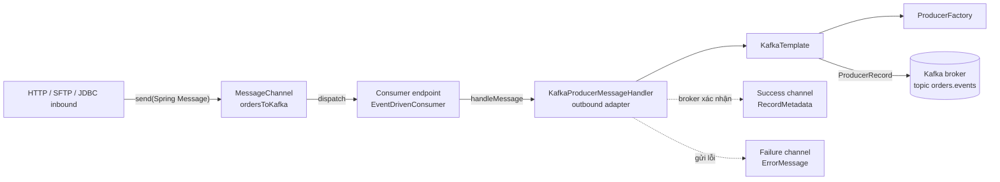
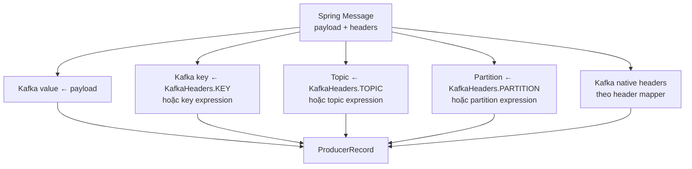
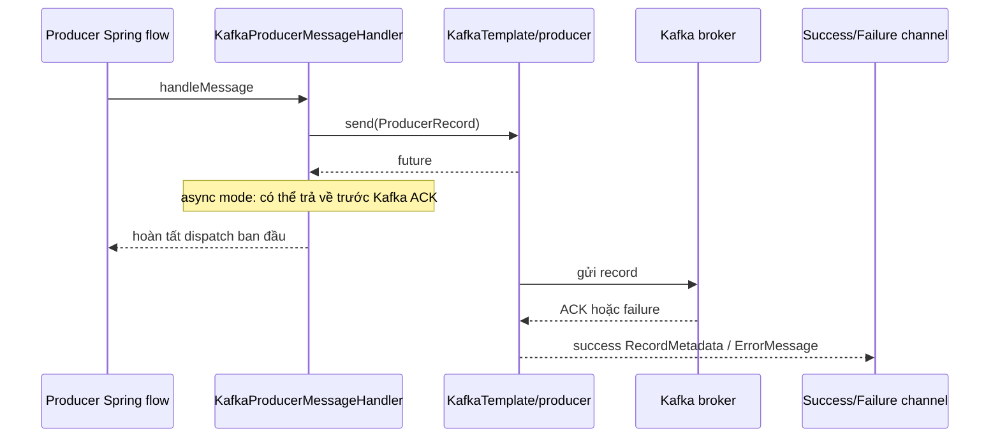
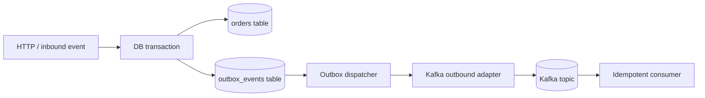
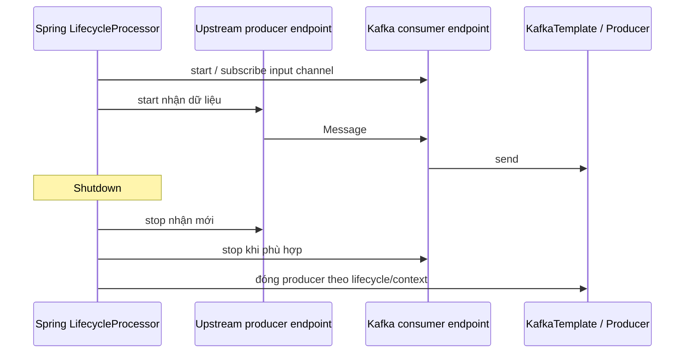

# Kafka outbound channel adapter

**Kafka outbound channel adapter** là điểm đầu ra của Spring Integration dùng để **gửi message từ một `MessageChannel` đến topic Apache Kafka**. Bên trong, adapter thường dùng `KafkaProducerMessageHandler` kết hợp `KafkaTemplate<K,V>` và `ProducerFactory<K,V>`. Message của Spring được ánh xạ thành Kafka `ProducerRecord`, rồi client producer gửi dữ liệu đến broker. Thành phần phía trước có thể là HTTP inbound gateway, file/SFTP inbound adapter, JDBC polling flow hoặc một service activator.

Bài thuộc chương **Adapter Kafka** của module **SPRING_INTEGRATION_ADAPTERS**. Module kết nối hệ thống ngoài bằng inbound/outbound adapter, gateway, poller và `MessageChannel`, thực hành với file, SFTP, HTTP, JMS, AMQP, Kafka, cơ sở dữ liệu cùng yêu cầu về hợp đồng message, lỗi và vòng đời. Bài này chỉ tập trung vào **chiều Spring Integration → Kafka**, từ cách nối input channel đến xác nhận kết quả publish, cấu hình định tuyến và thiết kế độ tin cậy.

> **Cần nhớ:** `MessageChannel.send(message)` thành công **không luôn đồng nghĩa Kafka broker đã xác nhận record**, càng không có nghĩa consumer ở hệ thống khác đã xử lý xong. Đây là ba mốc khác nhau, đặc biệt khi producer gửi bất đồng bộ.

## 1. Mục tiêu học tập

Sau bài này, bạn có thể:

1. Nêu được vai trò của `KafkaProducerMessageHandler`, `KafkaTemplate`, `ProducerFactory` và consumer endpoint nối với input channel.
2. Xây dựng luồng `MessageChannel → Kafka outbound channel adapter → topic` bằng Java configuration và Java DSL.
3. Ánh xạ payload, topic, key, partition, timestamp và các headers thành Kafka record; nhận biết độ ưu tiên giữa cấu hình tĩnh, expression và header.
4. Phân biệt publish **async** và **sync**, sử dụng success/failure channel để quan sát kết quả thật.
5. Chẩn đoán serialization error, timeout, broker disconnect, authorization error, record quá lớn và những trường hợp retry tạo trùng dữ liệu.
6. Hiểu ý nghĩa của `acks`, idempotent producer, transaction, ordering và giới hạn exactly-once khi đi từ JDBC/HTTP/SFTP sang Kafka.
7. Thiết kế lifecycle, backpressure, monitoring, outbox và kiểm thử failure path cho hệ thống production.

## 2. Chiều luồng dữ liệu và những thành phần tham gia



**Các vai trò không được nhầm:**

| Thành phần | Chịu trách nhiệm | Không bảo đảm |
|---|---|---|
| Input `MessageChannel` | Nhận message từ luồng nội bộ | Không tự gửi dữ liệu tới Kafka |
| Consumer endpoint | Subscribe hoặc poll input channel và gọi handler | Không tự biết Kafka topic |
| `KafkaProducerMessageHandler` | Chuyển message thành record, gửi bằng template, xử lý kết quả | Không nhận record từ Kafka |
| `KafkaTemplate<K,V>` | API Spring Kafka để publish record | Không có transaction phân tán với DB/HTTP theo mặc định |
| `ProducerFactory<K,V>` | Tạo producer với serializers, broker, security, tuning | Không quyết định business key giúp dedup |
| Kafka broker | Nhận/lưu record theo topic/partition và `acks` | Không chứng minh consumer downstream đã hoàn tất |
| Success/failure channel | Phát kết quả publish thành công hoặc thất bại | Không phải reply nghiệp vụ kiểu request–reply |

Một **Kafka outbound channel adapter** là **one-way handler**. Nó khác với **Kafka outbound gateway**, vốn có hợp đồng request–reply qua Kafka và thường dùng reply container/correlation. **Success channel** của adapter chỉ báo kết quả gửi record tới Kafka, không biến adapter thành một gateway nhận phản hồi nghiệp vụ.

### 2.1. “Inbound” và “outbound” nhìn từ phía nào?

- `KafkaMessageDrivenChannelAdapter` là **inbound** của Spring Integration: đọc từ Kafka rồi **gửi ra output channel nội bộ**.
- `KafkaProducerMessageHandler` là **outbound** của Spring Integration: **nhận từ input channel nội bộ** rồi publish tới Kafka.
- Cả hai đều sử dụng Kafka client ở lớp thấp hơn, nhưng vai trò, lifecycle, acknowledgment/offset và error handling khác nhau.

## 3. Message contract: từ Spring Message thành ProducerRecord

`KafkaProducerMessageHandler` chuyển message thành Kafka producer record theo key/value, topic, partition và metadata. Mặc định, **payload** trở thành Kafka value. Key, topic, partition có thể lấy từ headers hoặc do handler định nghĩa bằng literal/expression.



### 3.1. Các headers để xuất bản

| Spring Kafka constant | Tên header phổ biến | Ý nghĩa |
|---|---|---|
| `KafkaHeaders.TOPIC` | `kafka_topic` | Topic đích |
| `KafkaHeaders.KEY` | `kafka_messageKey` | Key dùng cho partitioner, ordering và compacted log |
| `KafkaHeaders.PARTITION` | `kafka_partitionId` | Partition đích tường minh nếu được đặt |
| `KafkaHeaders.TIMESTAMP` | `kafka_timestamp` | Timestamp producer record khi phù hợp |
| `MessageHeaders.ID` | UUID do Spring Messaging quản lý | **Không** tự trở thành Kafka key |
| Header nghiệp vụ, ví dụ `eventId` | Tùy schema | Cần header mapper nếu muốn mang qua native Kafka headers |

Tên constant nên lấy từ `org.springframework.kafka.support.KafkaHeaders` thay vì tự gõ chuỗi, vì điều này giúp code rõ mục đích và thuận lợi khi nâng cấp phiên bản.

**Khác biệt inbound và outbound:** các header như `KafkaHeaders.RECEIVED_TOPIC`, `RECEIVED_KEY`, `RECEIVED_PARTITION` thường mô tả **record đã nhận**. Để publish, sử dụng các constant **`TOPIC`, `KEY`, `PARTITION`** hoặc expression thích hợp; không dùng “received header” như thể nó tự định tuyến record outbound.

### 3.2. Ưu tiên giữa header và expression

Nếu bạn đặt `handler.setTopicExpression(new LiteralExpression("orders.events"))`, topic được chọn theo expression cố định đó. Một header `KafkaHeaders.TOPIC` trong message **không mặc nhiên override** giá trị cố định. Nguyên tắc tương tự áp dụng cho key và partition nếu chúng được cấu hình trên adapter.

Khi muốn header có quyền quyết định nhưng có fallback, có thể dùng SpEL như:

```java
// Trích đoạn trên KafkaProducerMessageHandler; dùng khi có policy topic rõ ràng.
handler.setTopicExpression(
        new SpelExpressionParser().parseExpression(
                "headers['kafka_topic'] ?: 'orders.events'"));
```

Không dùng dynamic topic dựa trên input người dùng không kiểm soát trong hệ thống nhiều tenant. Hãy áp dụng allowlist topic, authorization theo producer principal và quy ước định tuyến để tránh gửi nhầm dữ liệu.

### 3.3. Key và thứ tự sự kiện

Kafka bảo đảm **thứ tự offset trong một partition**, không bảo đảm thứ tự toàn topic. Khi cần các event của cùng `orderId` được đọc đúng thứ tự, nên dùng key nhất quán (ví dụ `orderId`) cùng quy tắc partitioning ổn định.

Tránh cưỡng ép `KafkaHeaders.PARTITION` cho mọi record nếu không có lý do nghiệp vụ: nó khóa trực tiếp một partition, có thể gây hotspot hoặc lỗi nếu partition ID không tồn tại. Cùng key thường được đưa vào cùng partition khi số partition, partitioner và serialization ổn định; việc **tăng số partition** có thể thay đổi mapping key → partition của những record tương lai.

## 4. Chuẩn bị dự án demo

Ví dụ: service nội bộ gửi JSON string biểu diễn đơn hàng đến topic `orders.events` qua `ordersToKafka`. Một success channel và một failure channel cho phép quan sát kết quả của từng lần gửi.

Yêu cầu:

- Java 17+ và một phiên bản Spring Boot tương thích với Spring Integration/Spring Kafka.
- Kafka broker có thể truy cập tại `localhost:9092`.
- Topic `orders.events` đã được tạo hoặc được provisioning theo chính sách cluster.
- Producer principal có quyền ghi topic.
- Chạy ví dụ riêng biệt, không đăng ký hai consumer endpoint cho cùng `ordersToKafka` nếu chỉ muốn gửi **một lần**.

### 4.1. Maven

Khai báo dependency và dùng Spring Boot parent/BOM quản lý phiên bản:

```xml
<dependency>
    <groupId>org.springframework.boot</groupId>
    <artifactId>spring-boot-starter-integration</artifactId>
</dependency>
<dependency>
    <groupId>org.springframework.integration</groupId>
    <artifactId>spring-integration-kafka</artifactId>
</dependency>
```

Không cần thêm `spring-integration-jms`, `spring-integration-file` hay module khác cho demo Kafka outbound thuần túy. Khi nối từ file/SFTP/JMS/AMQP/JDBC, bổ sung dependency tương ứng của adapter nguồn.

### 4.2. application.properties

```properties
demo.kafka.bootstrap-servers=localhost:9092
```

Trong production, cấu hình `SASL_SSL`/TLS, credentials, ACL và topic provisioning từ hệ thống quản lý bí mật/cấu hình phù hợp; không hard-code mật khẩu vào file tài liệu hoặc message headers.

## 5. Ví dụ hoàn chỉnh: KafkaProducerMessageHandler + input channel

Ví dụ dùng Java configuration để tách rõ **producer factory**, **KafkaTemplate**, **inbound channel của outbound adapter**, **handler** và **hai channel kết quả**. Chúng ta chọn chế độ **async** để nhìn thấy sự khác nhau giữa enqueue/send ở phía ứng dụng với broker acknowledgment.

### 5.1. Cấu hình producer và flow

```java
package com.example.integration;

import java.util.HashMap;
import java.util.Map;

import org.apache.kafka.clients.producer.ProducerConfig;
import org.apache.kafka.common.serialization.StringSerializer;

import org.springframework.beans.factory.annotation.Qualifier;
import org.springframework.beans.factory.annotation.Value;
import org.springframework.context.annotation.Bean;
import org.springframework.context.annotation.Configuration;
import org.springframework.expression.common.LiteralExpression;
import org.springframework.integration.channel.DirectChannel;
import org.springframework.integration.config.EnableIntegration;
import org.springframework.integration.dsl.IntegrationFlow;
import org.springframework.integration.kafka.outbound.KafkaProducerMessageHandler;
import org.springframework.kafka.core.DefaultKafkaProducerFactory;
import org.springframework.kafka.core.KafkaTemplate;
import org.springframework.kafka.core.ProducerFactory;
import org.springframework.messaging.MessageChannel;

@Configuration
@EnableIntegration
public class OrdersKafkaOutboundConfig {

    @Bean("ordersProducerFactory")
    public ProducerFactory<String, String> producerFactory(
            @Value("${demo.kafka.bootstrap-servers}") String brokers) {

        Map<String, Object> config = new HashMap<>();
        config.put(ProducerConfig.BOOTSTRAP_SERVERS_CONFIG, brokers);
        config.put(ProducerConfig.KEY_SERIALIZER_CLASS_CONFIG,
                StringSerializer.class);
        config.put(ProducerConfig.VALUE_SERIALIZER_CLASS_CONFIG,
                StringSerializer.class);

        // Các lựa chọn minh họa cho độ bền gửi.
        config.put(ProducerConfig.ACKS_CONFIG, "all");
        config.put(ProducerConfig.ENABLE_IDEMPOTENCE_CONFIG, true);

        return new DefaultKafkaProducerFactory<>(config);
    }

    @Bean("ordersKafkaTemplate")
    public KafkaTemplate<String, String> kafkaTemplate(
            @Qualifier("ordersProducerFactory")
            ProducerFactory<String, String> factory) {
        return new KafkaTemplate<>(factory);
    }

    // Đây là INPUT channel của outbound adapter.
    @Bean("ordersToKafka")
    public MessageChannel ordersToKafka() {
        return new DirectChannel();
    }

    @Bean("ordersKafkaSendSuccess")
    public MessageChannel ordersKafkaSendSuccess() {
        return new DirectChannel();
    }

    @Bean("ordersKafkaSendFailures")
    public MessageChannel ordersKafkaSendFailures() {
        return new DirectChannel();
    }

    @Bean("ordersKafkaPublishHandler")
    public KafkaProducerMessageHandler<String, String> publishHandler(
            @Qualifier("ordersKafkaTemplate")
            KafkaTemplate<String, String> template,
            @Qualifier("ordersKafkaSendSuccess")
            MessageChannel successes,
            @Qualifier("ordersKafkaSendFailures")
            MessageChannel failures) {

        KafkaProducerMessageHandler<String, String> handler =
                new KafkaProducerMessageHandler<>(template);

        // Topic cố định cho toàn flow; header KafkaHeaders.TOPIC
        // không tự thay thế topic expression tĩnh này.
        handler.setTopicExpression(
                new LiteralExpression("orders.events"));

        handler.setSync(false); // Broker result được xử lý bất đồng bộ.
        handler.setSendSuccessChannel(successes);
        handler.setSendFailureChannel(failures);

        return handler;
    }

    @Bean("ordersKafkaOutboundFlow")
    public IntegrationFlow ordersKafkaOutboundFlow(
            @Qualifier("ordersKafkaPublishHandler")
            KafkaProducerMessageHandler<String, String> handler) {

        return IntegrationFlow.from("ordersToKafka")
                .handle(handler, endpoint -> endpoint
                        .id("ordersKafkaOutboundEndpoint"))
                .get();
    }
}
```

**Đường đi đúng:**

```text
Spring producer/HTTP/SFTP/JDBC flow
    -> MessageChannel: ordersToKafka
    -> EventDrivenConsumer: ordersKafkaOutboundEndpoint
    -> KafkaProducerMessageHandler: ordersKafkaPublishHandler
    -> KafkaTemplate
    -> Kafka topic: orders.events
```

`ordersToKafka` là **input channel của outbound adapter**, mặc dù nội dung sau đó được publish ra Kafka. Bên trong Spring Integration, consumer endpoint lấy message từ channel để gọi handler; không cần `@Poller` cho `DirectChannel`.

### 5.2. Lắng nghe kết quả publish

Tạo component khác cho thành công và thất bại:

```java
package com.example.integration;

import org.apache.kafka.clients.producer.RecordMetadata;
import org.springframework.integration.annotation.ServiceActivator;
import org.springframework.integration.kafka.support.KafkaSendFailureException;
import org.springframework.messaging.Message;
import org.springframework.messaging.support.ErrorMessage;
import org.springframework.stereotype.Component;

@Component
public class KafkaPublishMonitor {

    @ServiceActivator(inputChannel = "ordersKafkaSendSuccess")
    public void onSuccess(Message<RecordMetadata> message) {
        RecordMetadata metadata = message.getPayload();
        System.out.printf(
                "KAFKA ACK topic=%s partition=%d offset=%d%n",
                metadata.topic(),
                metadata.partition(),
                metadata.offset());
    }

    @ServiceActivator(inputChannel = "ordersKafkaSendFailures")
    public void onFailure(ErrorMessage error) {
        Throwable cause = error.getPayload();

        if (cause instanceof KafkaSendFailureException sendFailure) {
            System.err.println(
                    "PUBLISH FAILED topic="
                    + sendFailure.getRecord().topic()
                    + ", cause=" + sendFailure.getCause());
        } else {
            System.err.println("PUBLISH FAILED " + cause);
        }
    }
}
```

Với `KafkaProducerMessageHandler`, success channel nhận message có **payload là `RecordMetadata`**; failure channel nhận **`ErrorMessage` chứa `KafkaSendFailureException`**, cung cấp record thất bại, original Spring message và nguyên nhân (theo API phiên bản đang dùng).

Handler trong ví dụ chỉ log và **không thực hiện retry tự động**. Production cần quyết định liệu event phải được giữ trong outbox/quarantine, có retry ở tầng nào và khi nào phát cảnh báo. Không log toàn bộ message nếu có dữ liệu nhạy cảm.

### 5.3. Gửi một message để thử nghiệm

Trong class cấu hình của ứng dụng demo, có thể thêm:

```java
import org.springframework.beans.factory.annotation.Qualifier;
import org.springframework.boot.ApplicationRunner;
import org.springframework.context.annotation.Bean;
import org.springframework.kafka.support.KafkaHeaders;
import org.springframework.messaging.MessageChannel;
import org.springframework.messaging.support.MessageBuilder;

@Bean
ApplicationRunner sendSample(
        @Qualifier("ordersToKafka") MessageChannel channel) {
    return args -> {
        boolean accepted = channel.send(
                MessageBuilder.withPayload(
                        "{\"orderId\":\"ORD-1001\",\"status\":\"CREATED\"}")
                    .setHeader(KafkaHeaders.KEY, "ORD-1001")
                    .setHeader("eventId", "evt-1001")
                    .build());

        System.out.println("Accepted by Spring channel = " + accepted);
    };
}
```

Đây là đoạn **bổ sung bên trong class `@Configuration`**, không phải file Java độc lập. Trong `@SpringBootApplication`, bảo đảm Spring component scan bao trùm `com.example.integration` và Kafka broker/topic đã sẵn sàng.

Dòng `Accepted by Spring channel = true` chỉ cho biết `DirectChannel.send(...)` **đã dispatch handler thành công tới thời điểm nó trả về**. Vì handler đang gửi async, đó **chưa phải Kafka ACK**. Khi broker xác nhận publish, bạn sẽ thấy log `KAFKA ACK...` trên success channel.

### 5.4. Xác nhận dữ liệu đã vào Kafka

Dùng công cụ quản lý topic hoặc Kafka CLI, ví dụ:

```bash
kafka-topics.sh --bootstrap-server localhost:9092 \
  --create --if-not-exists \
  --topic orders.events --partitions 3 --replication-factor 1

kafka-console-consumer.sh \
  --bootstrap-server localhost:9092 \
  --topic orders.events --from-beginning
```

Kết quả giá trị record dự kiến:

```json
{"orderId":"ORD-1001","status":"CREATED"}
```

Số offset và partition thực tế phụ thuộc trạng thái topic, key, partitioner và dữ liệu sẵn có. Với cluster production, quyền và chính sách tạo topic có thể không cho phép CLI tự tạo topic. Không tạo topic demo trên cluster sản xuất.

## 6. Phương án Java DSL rút gọn

Spring Integration cung cấp factory DSL `org.springframework.integration.kafka.dsl.Kafka`. Một flow thay thế có thể trực tiếp khai báo outbound handler từ `ProducerFactory`:

```java
import org.springframework.context.annotation.Bean;
import org.springframework.integration.dsl.IntegrationFlow;
import org.springframework.integration.kafka.dsl.Kafka;
import org.springframework.kafka.core.ProducerFactory;

@Bean
IntegrationFlow ordersKafkaDslFlow(
        ProducerFactory<String, String> producerFactory) {

    return IntegrationFlow.from("ordersToKafka")
            .handle(
                Kafka.outboundChannelAdapter(producerFactory)
                    .topicExpression("'orders.events'")
                    .sendSuccessChannel("ordersKafkaSendSuccess")
                    .sendFailureChannel("ordersKafkaSendFailures")
                    .sync(false),
                endpoint -> endpoint.id("ordersKafkaDslEndpoint"))
            .get();
}
```

Đây là **phương án thay thế** `ordersKafkaOutboundFlow` ở mục 5, không chạy cả hai cùng subscribe vào `DirectChannel` `ordersToKafka` nếu muốn mọi event được publish **một lần**. Hai subscriber trên `DirectChannel` thường cạnh tranh xử lý mỗi message, **không** broadcast; nếu cần hai topic, thiết kế fan-out một cách chủ đích.

DSL cho phép cấu hình topic/key/partition bằng expression hoặc lambda, success/failure channel và KafkaTemplate. Đối với API/overload, dùng version Spring Integration được Spring Boot BOM quản lý và xác nhận bằng tài liệu version tương ứng.

## 7. Cấu hình XML tương đương

Trong hệ thống còn dùng namespace XML, outbound adapter nhận message từ attribute `channel` (đây là **input channel**) và dùng bean template:

```xml
<!-- Trích đoạn trong XML đã khai báo int-kafka và beans namespaces -->
<int-kafka:outbound-channel-adapter
        id="ordersKafkaOutboundEndpoint"
        channel="ordersToKafka"
        kafka-template="ordersKafkaTemplate"
        topic="orders.events"
        sync="false"
        send-success-channel="ordersKafkaSendSuccess"
        send-failure-channel="ordersKafkaSendFailures"/>
```

Không khai báo đồng thời `topic` và `topic-expression` cho cùng mục đích; tương tự với cặp `message-key`/`message-key-expression` và `partition-id`/`partition-id-expression`. Chọn giá trị tĩnh nếu mọi record cùng topic; chọn expression khi định tuyến động được phép.

## 8. Sync và async: “gửi thành công” nghĩa là gì?

Mặc định `KafkaProducerMessageHandler` có thể gửi **bất đồng bộ** (`sync=false`). Trong trường hợp đó, handler gọi KafkaTemplate để bắt đầu publish và không đợi kết quả broker trước khi trả về. Ở `sync=true`, handler đợi kết quả gửi trong giới hạn timeout tương ứng.



| Mốc | Có ý nghĩa gì? | Chưa chứng minh gì? |
|---|---|---|
| `MessageChannel.send` trả về thành công | Message đã được channel/handler chấp nhận theo semantics tương ứng | Broker đã lưu record |
| KafkaTemplate hoàn tất future thành công | Producer nhận kết quả gửi/ACK theo `acks` | Consumer khác đã đọc/xử lý |
| Success channel nhận `RecordMetadata` | Có metadata topic/partition/offset của publish thành công | Giao dịch DB/HTTP downstream đã hoàn tất |
| Consumer group commit offset | Nhóm tiêu thụ ghi tiến độ đọc | Mọi side effect của consumer luôn bền vững |

### 8.1. `sync=true` nên dùng khi nào?

Nếu caller cần biết publish thành công/thất bại **trước khi tiếp tục một thao tác đồng bộ**, `sync=true` giúp gọi handler chờ kết quả gửi và có thể đưa exception vào call path. Ví dụ:

```java
handler.setSync(true);
```

Nhưng nó **giữ thread gọi handler** (có thể là thread HTTP, JMS listener hoặc poller SFTP/JDBC), làm tăng latency và tác động tới throughput. Cần cấu hình timeout và phương án xử lý nếu broker chậm.

**Ngay cả sync=true không bảo đảm “đúng một lần từ DB đến Kafka”**. Nếu HTTP client mất kết nối sau khi Kafka ACK, client có thể retry và publish lại event. Nếu DB commit và Kafka publish không nằm trong cùng một transaction thực sự, có thể tồn tại trạng thái lệch.

### 8.2. `acks=all` và timeout

`acks=all` yêu cầu leader chờ xác nhận theo cơ chế in-sync replicas thích hợp của Kafka. Kết quả cụ thể phụ thuộc cấu hình broker/topic như replication factor và `min.insync.replicas`; `acks=all` không tự đảm bảo tồn tại nhiều replica nếu topic chỉ có một replica.

Các tham số Kafka producer liên quan:

| Cấu hình | Vai trò |
|---|---|
| `acks` | Chính sách broker acknowledgment |
| `enable.idempotence` | Giảm khả năng producer retry tạo bản ghi trùng trong phạm vi hỗ trợ |
| `retries` | Số lần client producer có thể retry lỗi phù hợp |
| `delivery.timeout.ms` | Giới hạn thời gian tổng thể cho việc gửi record theo cấu hình |
| `request.timeout.ms` | Timeout cho một request tới broker |
| `max.block.ms` | Giới hạn chờ một số thao tác producer phía client như buffer/metadata |
| `batch.size` và `linger.ms` | Gom record trước khi gửi nhằm tối ưu batching |
| `compression.type` | Nén payload/batch để giảm network và storage |

Timeout có thể tạo tình huống **không biết chắc** broker đã nhận record hay chưa: producer hết thời gian chờ nhưng record có thể đã được broker xử lý. Vì vậy cần idempotency ở tầng nghiệp vụ và quy trình đối soát, không dựa vào “gặp timeout thì chắc chắn chưa gửi”.

## 9. Success channel khác reply channel

Outbound Kafka adapter là **one-way**. Hai channel `sendSuccessChannel` và `sendFailureChannel` mô tả **kết quả thao tác publish**, không phải response nghiệp vụ của consumer Kafka.

Ví dụ:

```text
ordersToKafka
   -> Kafka outbound adapter
   -> Kafka broker ACK
   -> ordersKafkaSendSuccess (RecordMetadata)

Khi Kafka producer fail:
   -> ordersKafkaSendFailures (ErrorMessage)
```

Nếu cần một dịch vụ khác **xử lý event và trả kết quả** qua Kafka, hãy cân nhắc Kafka outbound gateway/request-reply pattern, reply topic, correlation ID, reply consumer container và timeout tương ứng. Một ACK thành công từ Kafka broker không phải xác nhận đơn hàng đã được đối tác chấp nhận.

### 9.1. Send failure và `errorChannel` khác nhau

- **Send-failure channel** của Kafka outbound handler là cơ chế cụ thể để nhận lỗi publish (kể cả lỗi xuất hiện bất đồng bộ khi future hoàn tất).
- **Spring Integration `errorChannel`** nhận `ErrorMessage` theo cấu hình các flow/task executor/poller/message handlers; không phải mọi exception đều tự được route vào đó.
- Với `DirectChannel` đồng bộ, lỗi từ handler có thể ném ngược tới producer trên cùng thread.
- Khi đã có failure channel, phải tạo consumer thật cho channel đó và quyết định lưu trữ, alert hay retry. Chỉ log rồi bỏ qua có thể làm mất dấu nghiệp vụ.

Không nên kết luận có một channel lỗi là hệ thống **tự động retry chính xác một lần**. Chính sách retry cần xác định số lần, backoff, trường hợp không nên retry, business key và nơi giữ record chưa gửi được.

## 10. Kafka key, partition, ordering và headers

### 10.1. Chọn key theo aggregate hoặc business identity

Nếu mỗi `orderId` có chuỗi event `CREATED → PAID → SHIPPED` và cần thứ tự theo đơn hàng, hãy dùng `orderId` làm Kafka key nhất quán. Điều này giúp các event của một đơn hàng thường đi vào cùng partition khi producer dùng cùng partitioner/partition count.

Nhưng ngay cả khi cùng partition, **hai producer độc lập** có thể publish không theo thứ tự nghiệp vụ. Ngoài ra, retry, việc thay partition count hoặc xử lý downstream bất đồng bộ cũng có thể ảnh hưởng thứ tự quan sát. Khi ordering là yêu cầu cứng, cần thiết kế version/sequence hoặc cơ chế serialize theo aggregate.

### 10.2. Topic động

Một adapter có thể gửi các event tới nhiều topic theo header `KafkaHeaders.TOPIC`, nếu handler được cấu hình để dùng nó. Đừng cho input payload tùy ý quyết định tên topic mà không kiểm soát; có nguy cơ route sai tenant hoặc gửi dữ liệu ra topic không phù hợp.

Nếu policy chỉ cho phép `orders.created` và `orders.updated`, hãy validate giá trị ở transformer/router trước khi đến outbound handler hoặc dùng expression có allowlist rõ ràng.

### 10.3. Header mapper và dữ liệu nhạy cảm

Không phải mọi Spring message header tự thành Kafka native header: conversion/header mapping phụ thuộc `KafkaProducerMessageHandler` và `KafkaTemplate`. Các header hệ thống (reply channel, error channel, runtime object) không nên bị serialize bừa bãi ra broker. Chọn mapper, whitelist/blacklist phù hợp, kiểm tra byte format của header native và không đưa credential, token, PII không cần thiết vào log/header.

Trong bài demo, `"eventId"` là header nghiệp vụ để minh họa. Nếu consumer cần header đó, hãy **kiểm chứng header mapper** trong cấu hình thực tế hoặc đưa business ID vào payload theo schema thay vì chỉ giả định nó đã được propagate.

### 10.4. Trường hợp payload là `ProducerRecord` dựng sẵn

`KafkaProducerMessageHandler` hỗ trợ nhận payload là một `ProducerRecord` đã được xây dựng trước. Trường hợp này, phần lớn thuộc tính như topic/key expression của handler **có thể bị bỏ qua**, vì record đã mang thông tin định tuyến của nó.

Điều đó hữu ích khi upstream cần kiểm soát chính xác record, nhưng làm tăng rủi ro bypass policy topic/header của adapter. Không trộn hai cách tùy tiện trong cùng flow; xác định một contract rõ ràng để consumer downstream biết cách kiểm tra event.

### 10.5. Null payload / tombstone trên compacted topic

Trong Kafka, record có **value null** là tombstone cho log compaction. Spring Messaging thông thường không cho payload null trong `Message<?>`; vì vậy nếu nghiệp vụ cần tombstone, phải dùng cơ chế sentinel/conversion được Spring Kafka/Spring Integration hỗ trợ hoặc xây `ProducerRecord` phù hợp. Không thử truyền `MessageBuilder.withPayload(null)` rồi giả định một record tombstone sẽ được tạo.

## 11. Idempotent producer, transaction và exactly-once

### 11.1. `enable.idempotence=true` giúp gì?

Kafka idempotent producer giảm nguy cơ duplicate khi **cùng producer session** retry record đến Kafka bằng sequence number theo partition và các ràng buộc cấu hình. Tuy nhiên nó **không loại bỏ** mọi duplicate ở tầng nghiệp vụ:

- Ứng dụng có thể gửi **hai message nghiệp vụ riêng** chứa cùng `eventId`.
- HTTP caller có thể retry sau timeout không rõ kết quả.
- JDBC listener có thể xử lý lại cùng bản ghi do restart.
- Outbox dispatcher có thể publish lại event sau crash trước khi đánh dấu đã phát.

**Phân biệt:** producer idempotence xử lý một lớp retry kỹ thuật; **business idempotency** dựa trên eventId/orderId bền vững xử lý replay từ toàn bộ pipeline.

### 11.2. Kafka transactions

`KafkaTemplate` có thể tham gia Kafka transaction khi producer factory và transaction management được cấu hình phù hợp, ví dụ với `transactionIdPrefix`. Một transaction Kafka có thể gói nhiều bản ghi publish, và các trường hợp consume-transform-produce dùng Kafka transaction có chính sách commit offset tương ứng.

Tuy nhiên Kafka transaction **không tự commit chung** với database, SFTP hoặc HTTP API. Khi publish từ DB sang Kafka, không nên mô tả “một method `@Transactional` đã bao phủ mọi tài nguyên” nếu chưa có cơ chế phối hợp transaction và phân tích failure window.

### 11.3. Vì sao outbox thường phù hợp JDBC → Kafka?

Một hướng triển khai đáng tin cậy là **transactional outbox**:



1. Transaction DB ghi business entity và một **outbox event** trong cùng database.
2. Dispatcher chỉ lấy event chưa publish hoặc chưa được xác nhận đủ.
3. Dispatcher gửi message vào Kafka outbound adapter.
4. Khi có xác nhận thành công từ Kafka, hệ thống đánh dấu outbox event đã publish theo chính sách nhất quán.
5. Nếu dispatcher chết **sau publish, trước update outbox**, event có thể publish lại; consumer phải dedup theo `eventId`.

Outbox ưu tiên **không mất event** và chấp nhận khả năng duplicate có kiểm soát, thay vì suy rằng có exactly-once xuyên DB và Kafka chỉ nhờ một transaction annotation.

## 12. Backpressure, throughput và threading

### 12.1. Input `DirectChannel`

Trong ví dụ, `ordersToKafka` là `DirectChannel`. `KafkaProducerMessageHandler` được gọi ngay trên thread gửi. Với `sync=false`, thao tác thường không đợi Kafka ACK nhưng vẫn có thể chờ serializer, lấy metadata topic hoặc chờ buffer khi producer quá tải. Do đó, async **không đồng nghĩa luôn tức thì hoặc không thể block**.

Nếu upstream là HTTP request hoặc SFTP polling, cần xét `max.block.ms`, serializer latency, error path và tình huống broker không sẵn sàng.

### 12.2. Input `QueueChannel`

Nếu tách ingress khỏi publish bằng `QueueChannel`, consumer endpoint cần một **poller** để lấy message. Điều đó giới hạn nhịp publish nhưng tạo một ranh giới mới:

```text
HTTP / SFTP inbound
    -> QueueChannel.enqueue
    -> PollingConsumer
    -> KafkaProducerMessageHandler
    -> Kafka
```

Queue trong RAM **không bền** qua restart. Nếu inbound xác nhận nguồn sau enqueue, rồi process chết trước khi producer publish, event có thể mất. Muốn đảm bảo dữ liệu, cần persistent message store, transactional outbox hoặc broker bền vững thích hợp; đừng coi “đã vào queue nội bộ” là đã publish Kafka.

### 12.3. Batching và compression

`linger.ms`, `batch.size`, compression, number of partitions và cấu hình broker ảnh hưởng tới throughput. Batching có thể nâng hiệu quả khi publish nhiều message nhỏ, nhưng tăng latency. Theo dõi producer record send rate, request latency, buffer wait, retry rate và error rate trước khi chỉnh concurrency.

### 12.4. Ordering và nhiều luồng publish

Nếu nhiều producer thread cùng gửi event cho một key, thứ tự broker nhận có thể phản ánh thứ tự lời gọi send thực tế, không nhất thiết thứ tự transaction nghiệp vụ. Bảo toàn thứ tự cần định nghĩa nguồn thứ tự (DB version/sequence), đường publish theo aggregate và cách xử lý event cũ ở consumer.

## 13. Retry, lỗi và tình huống kết quả không chắc chắn

| Lỗi | Thời điểm có thể gặp | Biện pháp |
|---|---|---|
| Serializer không chuyển được payload | Trước khi request hợp lệ được gửi | Validate schema/converter, không retry vô hạn cùng object sai |
| Topic không tồn tại/thiếu quyền | Lấy metadata hoặc khi publish | Provisioning/ACL, alert và giữ event để phát lại |
| Broker chậm/network timeout | Trước hoặc sau khi broker nhận record | Retry theo policy, idempotency, đối soát kết quả |
| Producer buffer đầy | Trước khi record được gửi | Backpressure, buffer/timeout tuning, giới hạn upstream |
| Record quá lớn | Khi serialize hoặc broker từ chối | Kiểm soát kích thước/schema, không retry vô hạn |
| Kafka publish thành công nhưng dispatcher chết trước cập nhật DB | Sau broker ACK | Outbox + eventId dedup |
| Success/failure channel chưa có consumer | Sau khi future hoàn tất | Đảm bảo có handler, monitoring và error policy |
| Topic dynamic không đúng tenant | Khi định tuyến | Validate allowlist, ACL và contract headers |

### 13.1. Đừng retry ở nhiều lớp mà không có thiết kế

Có thể tồn tại Kafka producer internal retry, Spring Integration retry advice, HTTP client retry và outbox dispatcher retry. Nếu mỗi lớp tự retry 5 lần, tổng số publish attempt và thời gian trễ có thể tăng ngoài dự đoán.

Thiết kế cần chỉ rõ:

- Lỗi nào **recoverable** và lỗi nào **permanent**.
- Lớp nào sở hữu retry, số lần, backoff/jitter.
- Cách **ghi nhận trạng thái** trong DB/outbox.
- Cách phát hiện event đã thành công khi lần trước timeout không rõ kết quả.
- Cơ chế quarantine/DLT riêng nếu nghiệp vụ cần replay có kiểm soát.

### 13.2. Kafka DLT khác failure channel của producer

**Dead-letter topic** là một topic Kafka dành cho record không thể xử lý ở một flow cụ thể, thường gặp phía consumer. **Send-failure channel** của outbound adapter là Spring `MessageChannel` nhận thông tin lỗi publish. Bạn có thể xây một flow từ failure channel đến kho lưu/retry, nhưng nó **không tự động** ghi Kafka DLT; nếu Kafka broker đang hỏng, cố publish vào DLT trên cùng broker cũng có thể thất bại.

## 14. Lifecycle và thứ tự startup/shutdown

`KafkaProducerMessageHandler` và consumer endpoint của flow có lifecycle do Spring Integration quản lý. Producer factory/template sở hữu tài nguyên Kafka client, có thể có cleanup riêng khi Spring context đóng.



Nếu upstream là inbound SFTP polling, JDBC poller hoặc HTTP ingress, nên đảm bảo consumer của input channel đã sẵn sàng trước khi nguồn phát message. Khi shutdown, ngừng nhận mới rồi chờ kết quả gửi Kafka đang **in-flight** theo deadline và chính sách thư viện. Chỉ thấy `isRunning=false` **không chứng minh** mọi future đã thành công hoặc mọi event đã được đưa ra khỏi outbox.

`SmartLifecycle.phase` chỉ điều phối thứ tự trong cùng context, không đợi Kafka cluster khỏe và không điều phối giữa nhiều pod. Cần health/readiness, timeout, retry, quản lý producer flush/close theo API và bài test graceful shutdown.

## 15. Observability và điều tra lỗi

### 15.1. Những tín hiệu quan trọng

| Tín hiệu | Điều cần xác minh |
|---|---|
| Lượt nhận vào `ordersToKafka` | Có producer nội bộ gửi message không? |
| Success count / failure count | Broker có ACK theo chính sách producer không? |
| RecordMetadata topic/partition/offset | Publish đi đúng topic, partition chưa? |
| Producer request latency / retry rate | Broker/network có nghẽn không? |
| Producer buffer wait / records queued | Outbound có bị backpressure không? |
| Outbox pending events | Event đã commit DB nhưng chưa publish bao nhiêu? |
| End-to-end delivery age | Từ tạo event đến khi có broker ACK bao lâu? |
| Consumer lag downstream | Consumer khác đang tụt lại bao nhiêu? |
| Unauthorized / serialization / too-large errors | Có lỗi cấu hình hoặc schema không? |

`RecordMetadata` không chứa business status của người nhận ở topic đích. Nếu cần chứng minh nghiệp vụ downstream hoàn tất, thiết kế acknowledgment application-level hoặc event phản hồi với correlation ID và timeout.

### 15.2. Quy trình debug khi không thấy record

1. Kiểm tra có gửi đúng input channel `ordersToKafka` và endpoint consumer đã `running=true` không.
2. Kiểm tra handler được wired, topic expression/`KafkaHeaders.TOPIC`, producer serializers, ACL, broker bootstrap address.
3. Tìm success/failure channel, phân biệt Kafka ACK với `MessageChannel.send`.
4. Xem Kafka producer metrics và broker logs; kiểm tra topic thực có record nhưng consumer CLI đang đọc từ offset cuối hay không.
5. Khi có record trùng, kiểm tra HTTP/JDBC retry, outbox dispatcher, producer idempotence và eventId trước khi kết luận adapter publish hai lần.
6. Chỉ tăng concurrency/đổi timeout sau khi đã đo nơi nghẽn.

## 16. Những hiểu lầm thường gặp

| Nhận định sai | Hiểu đúng |
|---|---|
| “Outbound adapter phải có output channel vì nó gửi dữ liệu đi.” | Nó nhận **từ input channel nội bộ**, rồi gửi ra Kafka ngoài hệ thống. |
| “`KafkaProducerMessageHandler` là listener đọc Kafka.” | Nó là outbound handler dùng `KafkaTemplate` để publish. |
| “`send() == true` có nghĩa Kafka đã ACK.” | Với async mode, kết quả broker có thể đến sau. |
| “Success channel là reply topic.” | Nó chỉ báo metadata của **lần gửi**, không phải phản hồi nghiệp vụ. |
| “`acks=all` đảm bảo consumer khác đã xử lý.” | Nó chỉ là chính sách Kafka producer acknowledgment. |
| “`KafkaHeaders.RECEIVED_TOPIC` dùng để đặt topic publish.” | Nên dùng `KafkaHeaders.TOPIC` hoặc topic expression. |
| “`MessageHeaders.ID` tự trở thành Kafka key.” | Key cần header/expression rõ ràng. |
| “Topic expression và header topic tự cộng gộp nhau.” | Cấu hình tĩnh/expression có precedence, cần chọn policy cụ thể. |
| “`enable.idempotence=true` loại hết duplicate ở DB/outbox.” | Chỉ giải quyết một phần Kafka producer retry; business replay vẫn có thể trùng. |
| “`sync=true` nghĩa exactly-once xuyên HTTP/DB/Kafka.” | Sync đợi kết quả publish, không tạo distributed transaction. |
| “`QueueChannel` luôn an toàn hơn `DirectChannel`.” | RAM queue có thể mất message sau crash; cần durable handoff. |
| “Gửi thất bại thì cứ retry vô hạn.” | Phải phân loại lỗi, giới hạn retry và bảo toàn event để kiểm tra/replay. |
| “ProducerRecord dựng sẵn vẫn luôn bị topic expression override.” | Với pre-built record, nhiều biểu thức adapter có thể bị bỏ qua. |

## 17. Bài tập thực hành

### Bài 1 — Gửi sự kiện và xem broker ACK

Chạy code mục 5, gửi ba payload đơn hàng với `KafkaHeaders.KEY` khác nhau. Quan sát log `Accepted by Spring channel` và `KAFKA ACK`. Vì sao thứ tự của hai loại log không đủ để chứng minh consumer downstream xử lý xong?

### Bài 2 — Thử lại topic expression và header

Gửi một Spring message có `KafkaHeaders.TOPIC="orders.override"` trong khi handler đặt topic expression cố định `orders.events`. Dự đoán topic nhận record. Sau đó thay expression bằng fallback đọc header và kiểm tra lại, với điều kiện cả hai topic đã được tạo và producer có quyền gửi.

### Bài 3 — Chế độ sync so với async

Đổi `setSync(false)` thành `setSync(true)`. Mô phỏng broker chậm/mất kết nối và quan sát thread gọi handler, timeout và success/failure channel. Nêu vì sao HTTP request thread hoặc SFTP poller có thể bị ảnh hưởng throughput.

### Bài 4 — Khóa Kafka và ordering

Publish một chuỗi event của cùng `orderId` với `KafkaHeaders.KEY` bằng orderId, sau đó gửi một chuỗi không có key. So sánh partition của các record và phân tích thay đổi partition count ảnh hưởng tới mapping key trong tương lai.

### Bài 5 — Failure channel có xử lý thật không?

Tạo handler trên `ordersKafkaSendFailures` có thể lưu failure vào bảng quarantine/outbox; giả lập lỗi authorization hoặc broker unreachable. Định nghĩa business ID, retry interval, trạng thái `PENDING/RETRY/SENT/FAILED` và cách tránh publish trùng khi restart.

### Bài 6 — Outbox từ database sang Kafka

Một REST endpoint cần cập nhật đơn hàng vào DB và phát `OrderCreated` tới Kafka. Thiết kế transaction ghi `orders` và `outbox_events`, dispatcher đọc outbox và gọi Kafka outbound adapter, cập nhật trạng thái khi có success channel. Chỉ ra crash windows gây duplicate và cách consumer idempotent xử lý.

### Bài 7 — Queue và độ bền

Thay `ordersToKafka` bằng `QueueChannel(50)` và cấu hình poller phù hợp. Cho 100 event đến nhanh, producer Kafka chậm. Giải thích lúc queue đầy, điều gì xảy ra khi JVM chết, và cách thiết kế persistent message store nếu muốn queue không mất dữ liệu.

### Bài 8 — Payload và serialization

Đổi producer value serializer sang JSON/Avro/Protobuf theo schema giả định. Thiết kế converter, schema version và kiểm thử lỗi serialize; giải thích vì sao chỉ thay kiểu Java của handler không đủ để bảo đảm Kafka consumer khác đọc được dữ liệu.

### Bài 9 — Đường phản hồi nghiệp vụ

Một hệ thống đích cần nhận sự kiện và trả `PaymentAccepted` trong 10 giây. Phân tích vì sao send-success channel không đáp ứng yêu cầu, rồi đề xuất Kafka outbound gateway hoặc một flow request/reply riêng với correlation ID, reply topic, timeout và duplicate handling.

### Bài 10 — Shutdown có in-flight send

Cho adapter chạy async và gửi 1.000 record, sau đó yêu cầu shutdown ngay. Thiết kế điều kiện dừng upstream, theo dõi future/success/error, flush hoặc close producer theo timeout và outbox pending status. Kể rõ điều gì có thể biết chắc và điều gì vẫn “không chắc kết quả” sau crash.

## 18. Câu hỏi tự kiểm tra

1. Kafka outbound channel adapter tiêu thụ channel nào và gửi record tới đâu?
2. `KafkaProducerMessageHandler` khác `KafkaMessageDrivenChannelAdapter` ở chiều dữ liệu ra sao?
3. Vì sao một `DirectChannel` đầu vào vẫn có thể cần consumer endpoint?
4. Kafka key, topic, partition được quyết định bằng những header/biểu thức nào?
5. Nếu set topic expression cố định, `KafkaHeaders.TOPIC` còn chắc chắn được dùng không?
6. Ý nghĩa của payload `RecordMetadata` trên success channel là gì?
7. Lỗi publish bất đồng bộ được phát hiện qua đâu?
8. `sync=true` có chứng minh consumer Kafka khác đã ghi DB xong không?
9. Vì sao `acks=all` không đồng nghĩa exactly-once từ JDBC sang Kafka?
10. `enable.idempotence=true` xử lý được loại duplicate nào, và loại nào vẫn cần `eventId`?
11. Khi `QueueChannel` trong RAM chấp nhận message rồi app crash, rủi ro gì xảy ra?
12. Điều gì thay đổi nếu payload là pre-built `ProducerRecord`?
13. Outbox có thể gửi trùng sau crash ở điểm nào?
14. Vì sao failure channel không tương đương Kafka DLT?
15. Khi record không xuất hiện trên Kafka topic, nên kiểm tra những thành phần nào trước khi tăng retry?

## 19. Tổng kết

Luồng **Spring Integration → Kafka** gồm:

```text
Inbound hoặc nghiệp vụ bên trong ứng dụng
    -> input MessageChannel
    -> consumer endpoint
    -> KafkaProducerMessageHandler
    -> KafkaTemplate / ProducerFactory
    -> Kafka broker / topic / partition
    -> success hoặc failure channel (nếu cấu hình)
```

Thiết kế Kafka outbound đáng tin cậy đòi hỏi phân biệt **chấp nhận message trong Spring**, **Kafka broker xác nhận record** và **consumer phía sau xử lý nghiệp vụ**. Cần chọn đúng topic/key/partition, có contract payload và header rõ ràng, thiết kế retry có idempotency, giữ event bền vững qua outbox khi nguồn là database, đồng thời quan sát lifecycle và publish outcome. Đây là nền tảng nối file, SFTP, HTTP, JMS, AMQP hoặc JDBC với Kafka mà không đánh đồng các ranh giới transaction và lỗi.

## Tài liệu tham khảo

- [Spring Integration Reference — Apache Kafka Support, Outbound Channel Adapter](https://docs.spring.io/spring-integration/reference/kafka.html)
- [Spring Integration API — KafkaProducerMessageHandler](https://docs.spring.io/spring-integration/api/org/springframework/integration/kafka/outbound/KafkaProducerMessageHandler.html)
- [Spring Integration Reference — Message Endpoints](https://docs.spring.io/spring-integration/reference/endpoint.html)
- [Spring Kafka Reference — Sending Messages](https://docs.spring.io/spring-kafka/reference/kafka/sending-messages.html)
- [Spring Kafka Reference — Transactions](https://docs.spring.io/spring-kafka/reference/kafka/transactions.html)
- [Spring Kafka API — KafkaHeaders](https://docs.spring.io/spring-kafka/api/org/springframework/kafka/support/KafkaHeaders.html)
- [Apache Kafka Documentation — Producer Configuration](https://kafka.apache.org/documentation/#producerconfigs)
