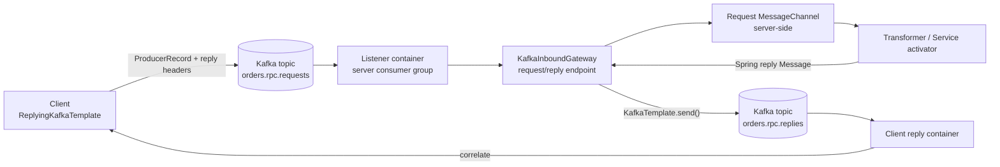
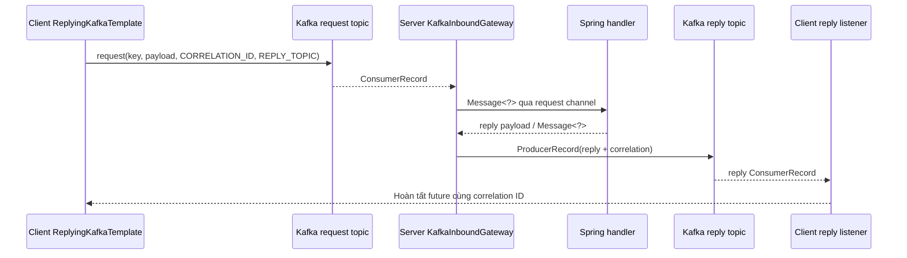
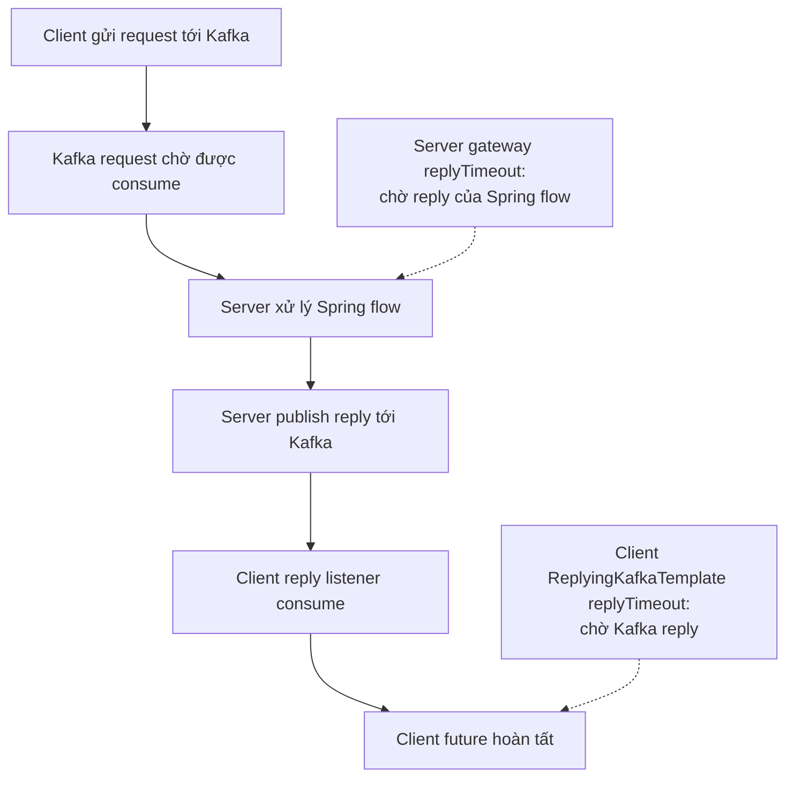
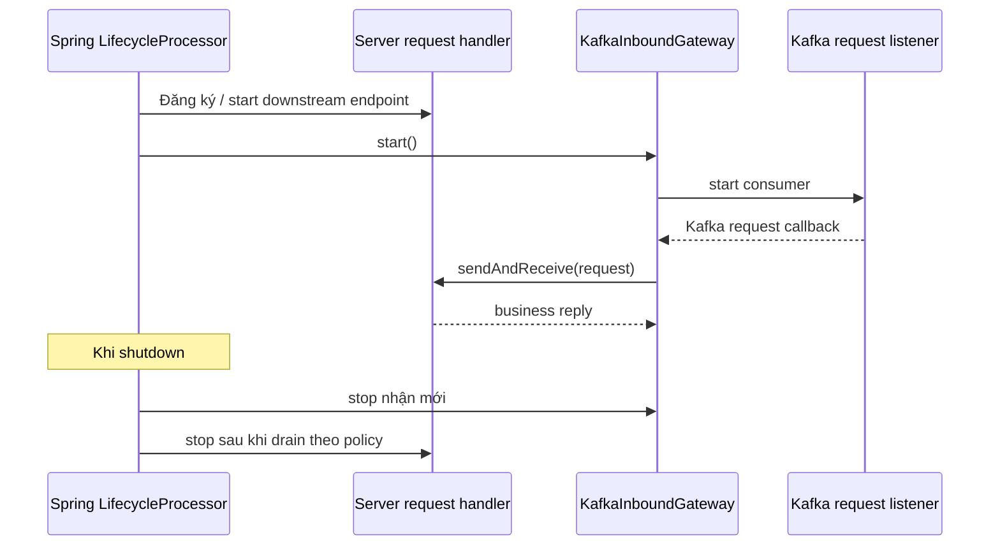

# Kafka inbound gateway request-reply

**Kafka inbound gateway** nhận request từ topic Apache Kafka, đưa request thành Spring `Message<?>` vào luồng Spring Integration, **chờ kết quả xử lý trong luồng nội bộ**, rồi dùng Kafka producer gửi một reply tới topic phản hồi của phía gọi. Khác với inbound channel adapter một chiều, gateway có **hợp đồng request–reply**: một record đầu vào có thể dẫn tới một reply record được ghép cặp bằng correlation ID.

Bài thuộc chương **Adapter Kafka** của module **SPRING_INTEGRATION_ADAPTERS**. Module này kết nối các hệ thống ngoài bằng inbound/outbound adapter, gateway, poller và `MessageChannel`, thực hành với file, SFTP, HTTP, JMS, AMQP, Kafka và cơ sở dữ liệu; đồng thời kiểm soát message contract, lỗi và vòng đời kết nối. Trọng tâm ở đây là **Kafka → Spring Integration → Kafka reply**, bao gồm thiết lập hai topic, đường reply, timeout, lỗi và khả năng xử lý trùng khi request được phát lại.

> **Nguyên tắc cốt lõi:** Kafka request–reply **không phải RPC đồng bộ ở tầng broker**. Kafka vẫn lưu và phân phối record theo topic/partition; việc ghép reply với request là giao thức ứng dụng dựa trên các headers và cơ chế tương quan của Spring Kafka/Spring Integration.

## 1. Mục tiêu học tập

Sau bài học, bạn có thể:

1. Phân biệt `KafkaInboundGateway` với `KafkaMessageDrivenChannelAdapter`, `KafkaMessageSource` và `KafkaProducerMessageHandler` outbound gateway.
2. Vẽ đường đi của request từ `ReplyingKafkaTemplate` phía client qua request topic đến `KafkaInboundGateway` phía server rồi quay lại reply topic.
3. Mô tả ý nghĩa của `KafkaHeaders.CORRELATION_ID`, `KafkaHeaders.REPLY_TOPIC` và `KafkaHeaders.REPLY_PARTITION`.
4. Cấu hình server bằng `ConcurrentMessageListenerContainer`, `KafkaTemplate` và Java DSL `Kafka.inboundGateway(...)`.
5. Tạo client với `ReplyingKafkaTemplate.sendAndReceive(...)`, xử lý send future và reply future riêng biệt.
6. Chọn timeout phù hợp, xử lý trường hợp không có reply, reply đến muộn, lỗi xử lý hoặc reply bị thất lạc.
7. Giải thích cách ack/offset, retry, rebalance và transaction ảnh hưởng tới duplicate request/reply.
8. Thiết kế partition, consumer group, security và lifecycle cho request–reply nhiều instance.

## 2. Inbound gateway nằm ở đâu?

Một luồng request–reply điển hình gồm **hai topic Kafka** và các channel nội bộ của server:



Từ góc nhìn **server**:

- `KafkaInboundGateway<K,V,R>` là **inbound endpoint** vì nó nhận request từ Kafka vào Spring Integration.
- Gateway dùng `requestChannel` để gửi request message đến handler/transformer.
- Handler trả một kết quả (payload hoặc message) qua **Spring Integration reply contract**.
- Gateway dùng `KafkaTemplate<K,R>` để publish kết quả thành **Kafka reply record**.
- Gateway không cần một **reply Kafka listener container** riêng chỉ để gửi phản hồi; container nhận reply thuộc về **client đang chờ**.

Từ góc nhìn **client**:

- `ReplyingKafkaTemplate<K,V,R>` gửi request và giữ một future chờ reply có correlation ID phù hợp.
- `ReplyingKafkaTemplate` có **reply listener container** subscribe vào topic phản hồi.
- Khi reply hợp lệ đến, template ghép correlation ID và hoàn tất future của request tương ứng.

### 2.1. Tại sao lại gọi là “gateway”?

Gateway là thành phần đưa một **cuộc hội thoại yêu cầu–trả lời** qua ranh giới hệ thống:



Nếu request đã được broker lưu nhưng server chưa sẵn sàng, record có thể chờ trong topic. Nếu server xử lý xong nhưng reply tới muộn hơn deadline của client, client **vẫn có thể timeout**. Hai sự kiện không mâu thuẫn vì xử lý phía server và thời hạn chờ phía client là hai ranh giới độc lập.

## 3. So sánh các endpoint Kafka

| Thành phần | Đường đi | Hợp đồng phản hồi |
|---|---|---|
| `KafkaMessageDrivenChannelAdapter` | Kafka topic → Spring output channel | One-way; không tự publish Kafka reply nghiệp vụ |
| `KafkaMessageSource` | Kafka → `MessageSource.receive()` với Spring Integration poller | Polling inbound, không phải request–reply mặc định |
| **`KafkaInboundGateway`** | Kafka request topic → Spring flow → Kafka reply topic | **Request–reply phía server** |
| `KafkaProducerMessageHandler` outbound adapter | Spring input channel → Kafka topic | One-way; kết quả send ACK không phải reply nghiệp vụ |
| Kafka outbound gateway | Spring request channel → Kafka → Spring reply channel | **Request–reply phía client** |
| `ReplyingKafkaTemplate` | Kafka producer + reply listener container | Client API để gửi và chờ reply |
| `@KafkaListener` + `@SendTo` | Kafka → method → Kafka reply | Một lựa chọn server khác không bắt buộc đi qua IntegrationFlow |

Không nên tạo **hai consumer server cùng group** để “tăng độ an toàn” mà chưa hiểu partition assignment: các consumer trong cùng group sẽ **chia** record, không phải mọi consumer đều nhận mọi request.

## 4. Ba Kafka headers quyết định đường reply

Trong request–reply trên Kafka, hãy phân biệt metadata định tuyến với dữ liệu nghiệp vụ.

| Header | Do ai sử dụng? | Vai trò |
|---|---|---|
| `KafkaHeaders.CORRELATION_ID` | Client tạo và giữ; server cần phản ánh lại | Ghép reply với request đang chờ |
| `KafkaHeaders.REPLY_TOPIC` | Client chỉ định; server dùng để publish reply | Cho biết topic nhận phản hồi |
| `KafkaHeaders.REPLY_PARTITION` | Tùy chọn | Chỉ định partition reply khi hợp đồng yêu cầu |
| `KafkaHeaders.RECEIVED_TOPIC` | Server quan sát request đã nhận | Không phải địa chỉ gửi reply |
| `KafkaHeaders.RECEIVED_PARTITION` | Server quan sát partition request | Không mặc định là partition reply |
| `KafkaHeaders.OFFSET` | Metadata tiến độ Kafka request | Không phải correlation ID |
| Kafka record key | Client chọn theo nghiệp vụ | Có thể ảnh hưởng partition request và thứ tự |
| Business key như `orderId` | Ứng dụng | Chống duplicate hoặc truy xuất giao dịch |

`ReplyingKafkaTemplate` thường tự tạo `CORRELATION_ID` cho mỗi request và, nếu reply container subscribe đúng **một reply topic/partition được nhận diện**, có thể tự thêm `REPLY_TOPIC` hoặc `REPLY_PARTITION` tương ứng. Nếu reply container có cấu hình phức tạp, client phải cung cấp các headers định tuyến thích hợp.

**Giữ nguyên correlation header khi đi qua hệ thống khác:** nếu có custom converter, header mapper, non-Spring producer hoặc service xử lý nhiều bước, hãy bảo đảm các Kafka request/reply headers được bảo tồn. Một reply thiếu hoặc sai correlation ID có thể đã xuất hiện trên topic nhưng **không thể hoàn tất future đang chờ**.

### 4.1. Correlation ID và business ID không giống nhau

```text
Kafka request:
  correlationId = A9D2...       (một lần gửi/chờ reply)
  orderId       = ORD-101       (định danh nghiệp vụ)

Kafka request được client gửi lại:
  correlationId = B731...       (lần chờ reply mới)
  orderId       = ORD-101       (vẫn cùng nghiệp vụ)
```

Nếu client timeout rồi retry, request lần hai có thể có **correlation ID khác** dù cùng một `orderId`. Server phải chống tác dụng phụ trùng theo **business key**, không chỉ theo correlation ID.

### 4.2. Không dùng topic reply làm một `MessageChannel` nội bộ

`orders.rpc.replies` là **Kafka topic**. `replyChannel` của `KafkaInboundGateway`, nếu cấu hình, là **Spring Integration MessageChannel** thuộc cơ chế nhận kết quả từ flow. Hai khái niệm có tên giống nhau nhưng không cùng tầng.

## 5. Các lớp chính trong triển khai

| API/class | Vai trò |
|---|---|
| `KafkaInboundGateway<K,V,R>` | Inbound request–reply endpoint của Spring Integration |
| `ConcurrentMessageListenerContainer<K,V>` | Nhận Kafka request record theo consumer group |
| `ConsumerFactory<K,V>` | Tạo Kafka consumer client/deserializer |
| `KafkaTemplate<K,R>` | Gửi reply record từ server đến Kafka |
| `ProducerFactory<K,R>` | Tạo Kafka producer client/serializer |
| `IntegrationFlow` | Định nghĩa xử lý request trong Spring Integration |
| `Kafka.inboundGateway(...)` | Factory Java DSL tạo/cấu hình inbound gateway |
| `ReplyingKafkaTemplate<K,V,R>` | Client gửi request, nghe reply, ghép correlation |
| `RequestReplyFuture<K,V,R>` | Future cho send-result và reply-result phía client |

**Kiểu generic:** `K` là Kafka record key; `V` là **request value**; `R` là **reply value**. Với demo bên dưới, cả ba dùng `String`. Hệ thống thật có thể dùng JSON DTO, Avro/Protobuf hoặc binary, nhưng phải chọn serializer/deserializer và converter tương ứng.

## 6. Chuẩn bị ứng dụng demo

Ví dụ thực hành gồm hai ứng dụng hoặc hai tiến trình tách biệt:

- **Server:** nghe `orders.rpc.requests`, xử lý payload `status:ORD-101` và trả `ACK:status:ORD-101`.
- **Client:** gửi request, đợi reply tại `orders.rpc.replies`.
- **Kafka:** một broker local `localhost:9092` và hai topic đã được provisioning.

Với Spring Boot tương thích Java 17+, khai báo:

```xml
<dependency>
    <groupId>org.springframework.boot</groupId>
    <artifactId>spring-boot-starter-integration</artifactId>
</dependency>
<dependency>
    <groupId>org.springframework.integration</groupId>
    <artifactId>spring-integration-kafka</artifactId>
</dependency>
```

Dùng Spring Boot parent/BOM để đồng bộ Spring Integration với Spring Kafka. Trong production, cấu hình `SASL_SSL`/TLS, ACL Kafka và secret management; không commit password vào mã nguồn hoặc header Kafka.

### 6.1. Tạo hai topic

Nếu có Kafka CLI và broker thử nghiệm:

```bash
kafka-topics.sh --bootstrap-server localhost:9092 \
  --create --if-not-exists \
  --topic orders.rpc.requests --partitions 3 --replication-factor 1

kafka-topics.sh --bootstrap-server localhost:9092 \
  --create --if-not-exists \
  --topic orders.rpc.replies --partitions 3 --replication-factor 1
```

`--replication-factor 1` chỉ thích hợp demo một broker. Production cần đặt replication factor, `min.insync.replicas`, retention và ACL theo SLA.

## 7. Server: Java DSL tạo `KafkaInboundGateway`

Trong **server application**, cấu hình Spring Boot:

```properties
demo.kafka.bootstrap-servers=localhost:9092
demo.kafka.server-group=orders-rpc-server
```

### 7.1. ConsumerFactory, ProducerFactory, KafkaTemplate và flow

```java
package com.example.rpcserver;

import java.util.HashMap;
import java.util.Map;

import org.apache.kafka.clients.consumer.ConsumerConfig;
import org.apache.kafka.clients.producer.ProducerConfig;
import org.apache.kafka.common.serialization.StringDeserializer;
import org.apache.kafka.common.serialization.StringSerializer;

import org.springframework.beans.factory.annotation.Value;
import org.springframework.context.annotation.Bean;
import org.springframework.context.annotation.Configuration;
import org.springframework.integration.config.EnableIntegration;
import org.springframework.integration.dsl.IntegrationFlow;
import org.springframework.integration.kafka.dsl.Kafka;
import org.springframework.kafka.core.ConsumerFactory;
import org.springframework.kafka.core.DefaultKafkaConsumerFactory;
import org.springframework.kafka.core.DefaultKafkaProducerFactory;
import org.springframework.kafka.core.KafkaTemplate;
import org.springframework.kafka.core.ProducerFactory;
import org.springframework.kafka.listener.ConcurrentMessageListenerContainer;
import org.springframework.kafka.listener.ContainerProperties;

@Configuration
@EnableIntegration
public class KafkaRpcServerConfig {

    @Bean
    ConsumerFactory<String, String> rpcConsumerFactory(
            @Value("${demo.kafka.bootstrap-servers}") String brokers,
            @Value("${demo.kafka.server-group}") String groupId) {

        Map<String, Object> cfg = new HashMap<>();
        cfg.put(ConsumerConfig.BOOTSTRAP_SERVERS_CONFIG, brokers);
        cfg.put(ConsumerConfig.GROUP_ID_CONFIG, groupId);
        cfg.put(ConsumerConfig.KEY_DESERIALIZER_CLASS_CONFIG,
                StringDeserializer.class);
        cfg.put(ConsumerConfig.VALUE_DESERIALIZER_CLASS_CONFIG,
                StringDeserializer.class);
        cfg.put(ConsumerConfig.ENABLE_AUTO_COMMIT_CONFIG, false);
        cfg.put(ConsumerConfig.AUTO_OFFSET_RESET_CONFIG, "earliest");

        return new DefaultKafkaConsumerFactory<>(cfg);
    }

    @Bean
    ProducerFactory<String, String> rpcReplyProducerFactory(
            @Value("${demo.kafka.bootstrap-servers}") String brokers) {

        Map<String, Object> cfg = new HashMap<>();
        cfg.put(ProducerConfig.BOOTSTRAP_SERVERS_CONFIG, brokers);
        cfg.put(ProducerConfig.KEY_SERIALIZER_CLASS_CONFIG,
                StringSerializer.class);
        cfg.put(ProducerConfig.VALUE_SERIALIZER_CLASS_CONFIG,
                StringSerializer.class);
        cfg.put(ProducerConfig.ACKS_CONFIG, "all");
        cfg.put(ProducerConfig.ENABLE_IDEMPOTENCE_CONFIG, true);

        return new DefaultKafkaProducerFactory<>(cfg);
    }

    @Bean
    KafkaTemplate<String, String> rpcReplyTemplate(
            ProducerFactory<String, String> rpcReplyProducerFactory) {
        return new KafkaTemplate<>(rpcReplyProducerFactory);
    }

    @Bean("ordersRpcServerFlow")
    IntegrationFlow ordersRpcServerFlow(
            ConsumerFactory<String, String> rpcConsumerFactory,
            KafkaTemplate<String, String> rpcReplyTemplate) {

        ContainerProperties properties =
                new ContainerProperties("orders.rpc.requests");
        properties.setAckMode(ContainerProperties.AckMode.RECORD);

        ConcurrentMessageListenerContainer<String, String> container =
                new ConcurrentMessageListenerContainer<>(
                        rpcConsumerFactory, properties);
        container.setConcurrency(2);

        return IntegrationFlow
                .from(Kafka.inboundGateway(container, rpcReplyTemplate)
                        .id("ordersKafkaInboundGateway")
                        .replyTimeout(10_000))
                .<String, String>transform(request -> {
                    if (request.isBlank()) {
                        throw new IllegalArgumentException(
                                "Request không hợp lệ");
                    }
                    return "ACK:" + request;
                })
                .get();
    }
}
```

Đặt `@SpringBootApplication` trong package `com.example.rpcserver` hoặc package cha. Có thể dùng cấu hình Kafka và application class theo quy ước của dự án.

**Giải thích:**

1. `rpcConsumerFactory` dùng `StringDeserializer` để đọc Kafka request value thành `String`; `group.id` là group của **server**.
2. `ConcurrentMessageListenerContainer` listen vào `orders.rpc.requests`, dùng `AckMode.RECORD` và concurrency tối đa 2.
3. `Kafka.inboundGateway(container, rpcReplyTemplate)` tạo inbound gateway làm việc với cả container nhận request và KafkaTemplate gửi reply.
4. `id("ordersKafkaInboundGateway")` giúp truy xuất/lifecycle trong Spring context.
5. `replyTimeout(10_000)` là giới hạn đợi **reply từ Spring Integration flow nội bộ**. Nó **không phải** client-side timeout chờ Kafka reply topic.
6. Bước `transform` trả `String` nên Spring Integration có thể trả reply cho gateway qua reply contract. Nếu transform ném exception, luồng có lỗi và sẽ được xử lý theo cấu hình error handling, **không mặc định gửi một reply nghiệp vụ thành công**.
7. Gateway dùng metadata của request (như reply topic/correlation) để gửi reply record bằng `KafkaTemplate`, theo hợp đồng Spring Integration/Spring Kafka.

**Lựa chọn cấu hình:** Trong ví dụ, container được tạo nội bộ trong bean flow và được gateway/DSL quản lý. Không nên đồng thời đăng ký một Kafka listener/container khác nhận cùng topic/group mà không có mục đích thiết kế rõ ràng.

### 7.2. Vì sao không đặt reply topic cố định trong transform?

`transform` chỉ trả kết quả nghiệp vụ, chẳng hạn `"ACK:status:ORD-101"`. Địa chỉ reply cần do **hợp đồng request–reply** quyết định, không phải do chuỗi payload. Ở phía gọi, `ReplyingKafkaTemplate` gửi request với Kafka headers định tuyến; phía server dùng các thông tin đó khi tạo reply.

Nếu yêu cầu giới hạn reply về các topic được phép, kiểm tra/áp dụng policy cho `KafkaHeaders.REPLY_TOPIC`, ACL và đường publish. Không cho một client không tin cậy sử dụng reply topic để gửi dữ liệu tới topic ngoài phạm vi cấp phép.

### 7.3. Tại sao handler có thể trả giá trị mà không khai báo reply channel?

Khi `KafkaInboundGateway` gửi request vào flow nội bộ, nó dùng cơ chế `MessagingGatewaySupport` tạo **reply contract**, thường thông qua reply channel trong Spring message headers. Các EIP endpoint trả một payload/message hợp lệ sẽ đưa kết quả theo đường đó. Vì vậy Java DSL có thể viết gọn `.transform(...).get()` mà không tự khai báo Kafka reply topic thành một Spring `DirectChannel`.

Tuy nhiên, nếu đặt một `.channel("someOtherChannel")` hoặc chuyển sang xử lý bất đồng bộ, bạn phải bảo đảm reply path và correlation vẫn được giữ. Nếu không còn producer reply nội bộ trước deadline, gateway có thể timeout.

## 8. Cách cấu hình tường minh bằng Java

Nếu cần tách bean channel và logic nghiệp vụ để quản trị, có thể tạo `KafkaInboundGateway` trực tiếp. Đây là **phương án thay thế** cho flow ở mục 7; không chạy đồng thời hai gateway nhận cùng request topic/group nếu muốn kiểm tra một server duy nhất.

```java
// Trích đoạn trong class @Configuration với các bean Kafka
// rpcConsumerFactory và rpcReplyTemplate đã tồn tại.

@Bean("rpcRequestsChannel")
MessageChannel rpcRequestsChannel() {
    return new DirectChannel();
}

@Bean("ordersKafkaInboundGateway")
KafkaInboundGateway<String, String, String> ordersKafkaInboundGateway(
        ConsumerFactory<String, String> rpcConsumerFactory,
        KafkaTemplate<String, String> rpcReplyTemplate,
        @Qualifier("rpcRequestsChannel") MessageChannel requests) {

    ContainerProperties props =
            new ContainerProperties("orders.rpc.requests");
    props.setAckMode(ContainerProperties.AckMode.RECORD);

    ConcurrentMessageListenerContainer<String, String> container =
            new ConcurrentMessageListenerContainer<>(
                    rpcConsumerFactory, props);

    KafkaInboundGateway<String, String, String> gateway =
            new KafkaInboundGateway<>(container, rpcReplyTemplate);
    gateway.setRequestChannel(requests);
    gateway.setReplyTimeout(10_000);
    return gateway;
}
```

Các import bổ sung là `org.springframework.messaging.MessageChannel`, `org.springframework.integration.channel.DirectChannel`, `org.springframework.integration.kafka.inbound.KafkaInboundGateway` và `org.springframework.beans.factory.annotation.Qualifier`.

Một service activator có thể trả reply:

```java
package com.example.rpcserver;

import org.springframework.integration.annotation.ServiceActivator;
import org.springframework.stereotype.Component;

@Component
public class OrderRpcService {

    @ServiceActivator(inputChannel = "rpcRequestsChannel")
    public String process(String command) {
        return "ACK:" + command;
    }
}
```

Gateway nhận một request từ Kafka, dispatch tới `rpcRequestsChannel`, method trả `String` để flow nội bộ đưa reply về gateway. `setReplyChannel(...)` là cấu hình tùy chọn khi thiết kế reply channel nội bộ riêng; nó **không** chỉ định Kafka reply topic. Các class/bean được giả định nằm trong package Spring Boot quét được.

### 8.1. XML namespace

Spring Integration cũng cung cấp namespace `int-kafka` cho inbound gateway. Ví dụ cấu hình rút gọn:

```xml
<!-- Trong XML đã khai báo các namespace int-kafka và beans -->
<int-kafka:inbound-gateway
        id="ordersKafkaInboundGateway"
        listener-container="ordersRequestListenerContainer"
        kafka-template="rpcReplyTemplate"
        request-channel="rpcRequestsChannel"
        reply-timeout="10000"
        auto-startup="true"/>
```

`ordersRequestListenerContainer`, `rpcReplyTemplate` và `rpcRequestsChannel` phải được khai báo phù hợp. Để trả reply từ Spring flow, cần một handler/transformer có kết quả hoặc một reply path rõ ràng. XML chỉ là lựa chọn cấu hình; bản chất request–reply và offset không thay đổi.

## 9. Client: gửi request và chờ reply với `ReplyingKafkaTemplate`

**Client là một ứng dụng khác** với server ở mục 7. Nó cần Kafka producer để gửi request và reply listener container để nhận `orders.rpc.replies`.

Trong client dùng Spring Boot, có thể dựa vào `ProducerFactory<String,String>` và `ConcurrentKafkaListenerContainerFactory<String,String>` được cấu hình phù hợp. Properties minh họa:

```properties
spring.kafka.bootstrap-servers=localhost:9092
spring.kafka.producer.key-serializer=org.apache.kafka.common.serialization.StringSerializer
spring.kafka.producer.value-serializer=org.apache.kafka.common.serialization.StringSerializer
spring.kafka.consumer.key-deserializer=org.apache.kafka.common.serialization.StringDeserializer
spring.kafka.consumer.value-deserializer=org.apache.kafka.common.serialization.StringDeserializer
spring.kafka.consumer.auto-offset-reset=latest
```

### 9.1. Tạo reply container và template

```java
package com.example.rpcclient;

import java.time.Duration;
import java.util.UUID;

import org.springframework.context.annotation.Bean;
import org.springframework.context.annotation.Configuration;
import org.springframework.kafka.core.ProducerFactory;
import org.springframework.kafka.listener.ConcurrentKafkaListenerContainerFactory;
import org.springframework.kafka.listener.ConcurrentMessageListenerContainer;
import org.springframework.kafka.requestreply.ReplyingKafkaTemplate;

@Configuration
public class KafkaRpcClientConfig {

    @Bean
    ReplyingKafkaTemplate<String, String, String> rpcClientTemplate(
            ProducerFactory<String, String> producerFactory,
            ConcurrentKafkaListenerContainerFactory<String, String>
                    containerFactory) {

        ConcurrentMessageListenerContainer<String, String> replyContainer =
                containerFactory.createContainer("orders.rpc.replies");

        // Với shared reply topic, mỗi instance requester cần group riêng.
        replyContainer.getContainerProperties().setGroupId(
                "orders-rpc-replies-" + UUID.randomUUID());

        // Template tự quản lý listener container chờ reply.
        replyContainer.setAutoStartup(false);

        ReplyingKafkaTemplate<String, String, String> template =
                new ReplyingKafkaTemplate<>(
                        producerFactory, replyContainer);
        template.setDefaultReplyTimeout(Duration.ofSeconds(15));
        return template;
    }
}
```

**Lưu ý:** `UUID.randomUUID()` ở group ID chỉ là lựa chọn demo để đảm bảo mỗi requester instance nhận toàn bộ reply khi chia sẻ một reply topic. Production có thể chọn group ID instance-unique ổn định theo vòng đời instance, reply partition riêng hoặc topic riêng. Một topic reply chung với nhiều requester instance có trade-off **fan-out thừa**: nhiều instance nhận reply không phải của mình và bỏ qua vì correlation ID không khớp.

Nếu dùng chung reply topic theo mô hình này, `ReplyingKafkaTemplate.setSharedReplyTopic(true)` có thể giảm mức log về các reply không tương ứng request đang chờ. Điều này **không** thay đổi cơ chế bảo đảm delivery.

### 9.2. Gửi request trong `ApplicationRunner`

```java
package com.example.rpcclient;

import java.time.Duration;
import java.util.concurrent.TimeUnit;

import org.apache.kafka.clients.consumer.ConsumerRecord;
import org.apache.kafka.clients.producer.ProducerRecord;
import org.springframework.boot.ApplicationRunner;
import org.springframework.context.annotation.Bean;
import org.springframework.context.annotation.Configuration;
import org.springframework.kafka.requestreply.ReplyingKafkaTemplate;
import org.springframework.kafka.requestreply.RequestReplyFuture;

@Configuration
public class KafkaRpcClientRunner {

    @Bean
    ApplicationRunner runRequest(
            ReplyingKafkaTemplate<String, String, String> template) {

        return args -> {
            // Tránh race: request được xử lý trước khi listener reply
            // đã nhận partition assignment.
            if (!template.waitForAssignment(Duration.ofSeconds(10))) {
                throw new IllegalStateException(
                        "Reply listener chưa sẵn sàng");
            }

            ProducerRecord<String, String> request =
                    new ProducerRecord<>(
                            "orders.rpc.requests",
                            "ORD-101",
                            "status:ORD-101");

            RequestReplyFuture<String, String, String> future =
                    template.sendAndReceive(
                            request, Duration.ofSeconds(15));

            // (1) Kafka broker đã nhận request?
            var sendResult = future.getSendFuture()
                    .get(10, TimeUnit.SECONDS);
            System.out.println("REQUEST SENT offset="
                    + sendResult.getRecordMetadata().offset());

            // (2) Server đã trả reply hợp lệ?
            ConsumerRecord<String, String> reply =
                    future.get(15, TimeUnit.SECONDS);
            System.out.println("RPC REPLY: " + reply.value());
        };
    }
}
```

Với server ở mục 7 chạy và sẵn sàng, output nghiệp vụ dự kiến:

```text
REQUEST SENT offset=...
RPC REPLY: ACK:status:ORD-101
```

Mỗi output có ý nghĩa khác nhau:

- `getSendFuture()` hoàn tất thành công chỉ chứng minh **request được Kafka producer gửi thành công theo chính sách ACK**.
- `future.get(...)` trả về Kafka reply record đã được ghép **correlation ID**, không chỉ là một ACK của broker.
- `waitForAssignment(...)` giúp tránh gửi request trước khi reply listener nhận assignment, đặc biệt khi dùng `auto.offset.reset=latest`.

Khi reply container subscribe **một topic**, `ReplyingKafkaTemplate` thường tự đặt `KafkaHeaders.REPLY_TOPIC` và `CORRELATION_ID`; client không cần tự dựng các headers trong demo này. Nếu có nhiều reply topic/partition hoặc dùng non-Spring client, cần cấu hình/publish headers rõ ràng.

### 9.3. Demo chỉ có một broker không đủ kiểm định production

Hai đoạn code minh họa **server application** và **client application** chạy riêng, cùng Kafka cluster, không phải đặt tất cả class vào một Spring Boot context. Trong production còn phải provision topic, cấu hình ACL, serializer, timeout, observability, multi-instance reply strategy và kiểm thử recovery.

## 10. Hai timeout khác nhau: phía server và phía client

Một request–reply có nhiều đồng hồ chạy song song:



| Timeout | Thiết lập ở đâu | Điều được giới hạn |
|---|---|---|
| **Server `KafkaInboundGateway.replyTimeout`** | `.replyTimeout(10_000)` hoặc `setReplyTimeout(10000)` | Chờ reply từ **Spring Integration processing flow** |
| **Client `ReplyingKafkaTemplate` reply timeout** | `setDefaultReplyTimeout(Duration)` hoặc tham số `sendAndReceive` | Thời gian chờ **Kafka reply record** phù hợp |
| Kafka producer delivery timeout | Kafka producer config | Thời gian gửi request/reply tới broker |
| Kafka request timeout | Kafka client config | Thời gian chờ một broker request |
| Kafka `max.poll.interval.ms` | Consumer client | Giới hạn thời gian giữa các lần poll, có thể ảnh hưởng rebalance |
| Downstream DB/HTTP timeout | Business service/client | Thời gian chờ tài nguyên ở đích |

**Thiết kế thông thường:** server replyTimeout ngắn hơn deadline end-to-end của client, còn client timeout cần bao gồm thời gian request được phân phối, xử lý, publish reply và client consume reply, cộng khoảng dự phòng phù hợp. Hai số **10s** (server) và **15s** (client) trong demo chỉ mang tính học tập.

### 10.1. Client timeout nhưng server vẫn đã xử lý thành công

```mermaid
sequenceDiagram
    participant C as Client
    participant Q as Kafka request topic
    participant S as Server
    participant R as Kafka reply topic

    C->>Q: Request orderId=ORD-101
    Q-->>S: Consume request
    S->>S: Ghi DB thành công
    Note over C: Hết deadline chờ reply
    C-->>C: TimeoutException
    S->>R: Publish reply đến muộn
    Note over C,R: Future cũ đã timeout; reply có thể bị bỏ qua
```

**Không được suy luận “timeout = request chưa được xử lý”**. Client retry có thể khiến server thực hiện side effect lần hai nếu không có idempotency.

Khi yêu cầu có side effect như tạo đơn hàng, hãy gửi business key/idempotency key trong payload hoặc header, lưu kết quả xử lý bền vững, và có khả năng trả lại kết quả cũ cho request được gửi lại.

### 10.2. Server không trả reply

Có thể do handler ném exception, branch filter chặn message, handler return null, reply channel sai hoặc xử lý bất đồng bộ làm mất reply headers. Khi hết thời gian chờ, gateway có thể báo lỗi/timeout theo cấu hình, và client cũng có thể timeout ở thời điểm khác.

Đối với nghiệp vụ bắt buộc trả trạng thái, **đừng dùng null hoặc nuốt exception làm câu trả lời ngầm**. Hãy thiết kế schema reply như `OK/REJECTED/ERROR` với `requestId` và business key rõ ràng, kèm chính sách lỗi/hồi phục.

## 11. Reply topic, partition và consumer group nhiều instance

### 11.1. Vì sao không dùng cùng group cho tất cả client chờ cùng reply topic?

Giả sử client A và client B cùng subscribe `orders.rpc.replies` với **cùng group.id**. Kafka phân phối mỗi partition cho một consumer trong group, nên reply của A có thể đến B. B không có correlation ID đang chờ, bỏ qua reply; A **timeout**.

Có những phương án:

| Chiến lược | Ý tưởng | Đánh đổi |
|---|---|---|
| Reply topic riêng cho từng client instance | Mỗi instance có topic/permission riêng | Tăng topic và overhead vận hành |
| Một reply topic dùng **group ID riêng mỗi instance** | Mỗi instance nhận reply, chỉ accept correlation tương ứng | Fan-out thừa, cần xử lý unexpected replies |
| Một reply topic, **partition riêng cho mỗi instance** | Client sở hữu partition cố định, server gửi reply đúng partition | Phải quản lý partition/scale, reply-partition header |
| Gateway protocol ứng dụng có state store | Lưu kết quả và request status bền vững | Tăng độ phức tạp nhưng chịu được client restart |

Nếu sử dụng `KafkaHeaders.REPLY_PARTITION`, hãy bảo đảm header có format Kafka yêu cầu và listener client được cấu hình nhận đúng partition. Với native Kafka headers, partition thường là số nguyên mã hóa thành bốn byte big-endian; đừng tự gửi chuỗi `"1"` rồi giả định server hiểu giống int.

### 11.2. Cẩn trọng với dynamic reply topic

Không để client không tin cậy đặt `REPLY_TOPIC` tùy ý rồi khiến server publish dữ liệu nhạy cảm sang topic ngoài phạm vi cho phép. Hãy kết hợp ACL theo producer principal, topic allowlist, validation payload và giới hạn kích thước request/reply.

### 11.3. Header correlation xuyên phiên bản hoặc non-Spring client

Spring Kafka cho phép tùy chỉnh tên các headers correlation/reply trong một số phiên bản và API. Khi client/server dùng ngôn ngữ khác nhau, hãy ghi lại một **wire contract** gồm tên header, byte encoding, serializer, schema và timeout, rồi kiểm thử một record thật. Đừng coi `MessageHeaders.ID` hoặc `traceId` như thay thế tự động cho `KafkaHeaders.CORRELATION_ID`.

## 12. Ack, offset và message durability

Một inbound gateway nhận request từ Kafka có ít nhất bốn mốc:

1. Kafka consumer lấy record từ request topic.
2. Spring flow xử lý request, có thể gây side effect ở DB/HTTP/SFTP.
3. Kafka producer gửi reply đến reply topic.
4. Server consumer container commit offset của request theo cấu hình.

Thứ tự 2–4 và ranh giới thành công có thể phụ thuộc cách xử lý, timeout, commit/ack policy và KafkaTemplate. **Không được khẳng định chỉ cần `AckMode.RECORD` là Kafka reply và DB commit cùng một transaction.**

### 12.1. `AckMode.RECORD` ở server

Với `enable.auto.commit=false`, listener container có thể dùng `AckMode.RECORD` để ghi nhận tiến độ sau khi callback record xử lý thành công. Khi callback bị lỗi và exception quay về container, error handler sẽ quyết định retry, seek/recovery và offset theo cấu hình.

Tuy nhiên:

- Nếu error flow xử lý/suppress exception, container có thể coi callback thành công theo contract.
- Nếu gửi reply là bất đồng bộ, callback và Kafka broker ACK cho reply có thể không cùng thời điểm.
- DB commit, Kafka reply send và request offset commit không mặc định có atomic transaction chung.
- Sau crash, request chưa được commit có thể được phát lại và tạo **duplicate reply** hoặc duplicate side effect.

### 12.2. Nếu muốn at-least-once với nghiệp vụ

Dùng **business ID**, giao dịch DB/idempotent handler và khả năng trả kết quả ổn định khi nhận lại cùng request. Ví dụ: bảng `requests_processed(request_id, result)` có unique constraint. Khi một request trùng đến, server đọc kết quả đã lưu thay vì gọi lại side effect; sau đó có thể publish lại reply phù hợp correlation ID của lần gửi hiện tại.

### 12.3. “Exactly-once” có thật không?

Kafka transactions giúp đạt một số bảo đảm trong **Kafka-only** workflows khi producer, consumer offset và isolation được cấu hình đúng. Nhưng ghi database hoặc gọi HTTP/SFTP không tự tham gia vào transaction Kafka.

Với Kafka request–reply nối DB, cần thiết kế chống trùng, durable state hoặc outbox; tránh tuyên bố “exactly-once end-to-end” chỉ vì bật Kafka transaction hay producer idempotence.

## 13. Lỗi, retry và dead-letter

Có ba lớp lỗi cần phân biệt:

| Nguồn lỗi | Ví dụ | Cơ chế cần xem |
|---|---|---|
| Kafka consumer / deserializer | Request không deserialize được, mất quyền đọc, rebalance | Container error handler, error deserializer |
| Spring flow / gateway | Không có consumer trên request channel, handler ném exception, reply timeout | Spring Integration error channel, request/reply contract |
| Kafka reply producer | Không ghi được reply topic, ACL, broker timeout | KafkaTemplate future/error handling, retry/outbox |
| Client reply container | Không được phân partition, thiếu correlation header, sai deserializer | Client future timeout, unmatched reply logs, consumer group |

### 13.1. Retry ở gateway hoặc container

`KafkaInboundGateway` có API cho retry/recovery; `DefaultErrorHandler` của Spring Kafka quản lý lỗi ở listener container. Hai lớp **không tự hợp nhất** thành một chính sách.

- Retry blocking trong gateway giữ listener thread lâu; nếu vượt `max.poll.interval.ms` có thể gây rebalance.
- Container error handler có thể retry/backoff hoặc dùng `KafkaErrorSendingMessageRecoverer` để chuyển lỗi sang flow phù hợp.
- Nếu cấu hình error channel và recoverer kết thúc thành công, exception có thể **không** quay về container nữa; hậu quả đối với offset phải được kiểm tra bằng test.
- DLT cần producer và policy publish đúng; chỉ ghi log `ErrorMessage` không phải đã chuyển request vào Kafka DLT.

### 13.2. Có nên trả reply lỗi thay vì throw?

Hai mô hình đều khả thi nhưng khác contract:

**Mô hình A — reply nghiệp vụ có trạng thái:** Handler trả một payload như `{"status":"REJECTED","reason":"INVALID_ORDER"}`. Client nhận reply thành công về mặt vận chuyển, sau đó phân biệt `OK`, `REJECTED` hoặc `FAILED` bằng schema.

**Mô hình B — lỗi hạ tầng/không thể xử lý:** Handler ném exception và container retry hoặc chuyển request vào DLT. Client có thể timeout nếu không có reply hợp lệ; cần cơ chế truy vấn trạng thái để tránh retry gây duplicate.

Không nên trả `"OK"` sau khi bắt exception chỉ để future client hoàn tất. Nếu side effect chưa được commit, một reply thành công là thông tin sai.

### 13.3. Trường hợp reply publish thất bại

Server có thể đã ghi DB rồi nhưng Kafka reply publish thất bại. Đừng tự xóa trạng thái nghiệp vụ hoặc giả định client có thể tự biết kết quả. Có thể cần outbox reply, lưu result theo request ID, retry publish có giới hạn và/hoặc API truy vấn trạng thái.

## 14. Concurrency, ordering và throughput

Gateway server cũng dựa vào Kafka consumer group:

- Một partition request được giao cho một consumer trong group tại một thời điểm; nhiều instance cùng group phân chia request.
- Kafka giữ thứ tự **trong partition**, không giữ thứ tự toàn topic.
- `container.setConcurrency(2)` không hữu ích nếu topic chỉ có một partition hoặc downstream DB đang nghẽn.
- Xử lý request quá lâu trên listener thread làm tăng lag, có nguy cơ vượt `max.poll.interval.ms`.
- Reply có thể đến **khác thứ tự request** do nhiều partition, concurrency hoặc thời gian xử lý khác nhau. Client phải ghép theo correlation ID, **không theo thứ tự nhận**.

### 14.1. Nếu handler thực thi bất đồng bộ?

Khi xử lý request bị đẩy qua `ExecutorChannel` hoặc `QueueChannel`, thread listener có thể tách khỏi thread nghiệp vụ. Đừng giả định result sẽ tự quay về gateway: cần bảo tồn reply channel/correlation metadata, hoàn tất trước deadline và hiểu rõ offset ack khi listener callback đã kết thúc.

Với task kéo dài nhiều phút, request–reply qua Kafka có thể không phù hợp. Có thể chọn **async command + result event**, nơi client không chờ future ngắn mà theo dõi kết quả bằng business ID trên reply/status stream.

## 15. Lifecycle và khởi động theo thứ tự

`KafkaInboundGateway` là endpoint có vòng đời; listener container phục vụ nó được start/stop theo cơ chế framework. Server cũng phải có handler/transformer sẵn sàng để nhận Spring message.



Đặt phase phù hợp khi cần **consumer nội bộ sẵn sàng trước inbound gateway**. `isRunning()==true` chỉ mô tả trạng thái endpoint, không chắc chắn consumer đã được Kafka assign partition hoặc broker đang sẵn sàng. Với client, nên dùng `waitForAssignment` của `ReplyingKafkaTemplate` để tránh gửi trước lúc reply listener hoạt động.

Khi shutdown, ngừng tiếp nhận request mới, quản lý request đang xử lý, pending reply futures và timeout, sau đó đóng producer/container theo chính sách. Nếu process chết giữa DB commit và Kafka reply publish, khả năng phát lại request và idempotent result store sẽ quyết định tính đúng đắn.

## 16. Vận hành và quan sát

Những tín hiệu nên đo:

| Tín hiệu | Câu hỏi |
|---|---|
| Request consumer lag (server group) | Có nhiều request chưa xử lý không? |
| Record arrival và processing latency | Thời gian từ Kafka tới business handler bao lâu? |
| Server gateway timeout count | Có handler không trả reply nội bộ? |
| Reply producer success/failure | Reply có được broker ACK không? |
| Client reply timeout / unmatched correlation | Reply đến muộn, sai topic, sai group hoặc mất headers? |
| Partition assignment / rebalance | Container có ổn định không? |
| Duplicate requestId / business key | Request bị replay hoặc client retry bao nhiêu lần? |
| DB/HTTP/SFTP side-effect result | Hệ thống đích đã thật sự thực hiện thao tác? |
| DLT / retry rates | Record lỗi đang được lưu và xử lý lại đúng policy? |
| Request/reply size and serialization errors | Payload/schema có tương thích hai phía? |

### 16.1. Bảng khắc phục sự cố

| Hiện tượng | Nguyên nhân có thể | Hướng kiểm tra |
|---|---|---|
| Client send future thành công nhưng reply future timeout | Server chưa xử lý, không có reply, sai reply topic hoặc correlation | Request lag, server logs, reply topic, headers |
| Server log đã xử lý nhưng client timeout | Reply publish fail, reply đến muộn, reply container chưa assign | KafkaTemplate send result, client assignment, timeout |
| Một client instance nhận reply của instance khác | Shared reply topic nhưng group ID/partition design sai | Group ID từng instance, `REPLY_PARTITION`, correlation |
| Gateway server báo timeout dù handler xử lý nền đã xong | Reply tới Spring flow sau deadline hoặc mất reply channel | Gateway replyTimeout, async channel, header propagation |
| Client thấy nhiều reply cùng business ID | Client retry hoặc Kafka redelivery | Request ID, offset, DB idempotency, duplicate handling |
| Reply topic có record nhưng client không khớp | Thiếu/sai correlation hoặc deserializer | Raw Kafka headers, converter, correlation ID |
| Server tăng concurrency nhưng lag không giảm | DB/HTTP bottleneck, ít partition | Partition count, handler latency, connection pool |
| Error channel có log nhưng broker không retry | Exception đã bị recover/suppress | Error flow, container DefaultErrorHandler, offset |
| Client timeout khi server restart | Request chưa xử lý hoặc reply đến muộn | Reply state, request offset, idempotent replay |

## 17. Quy tắc thiết kế request–reply trong thực tế

Một hệ thống yêu cầu trả kết quả nhanh, tác vụ ngắn và cần giao tiếp bằng Kafka có thể dùng inbound gateway. Tuy nhiên nên:

1. Đặt **request topic** và **reply topic** rõ ràng, không trộn lẫn với business event stream.
2. Chuẩn hóa header `CORRELATION_ID`, `REPLY_TOPIC`, `REPLY_PARTITION` (nếu dùng), payload schema và lỗi.
3. Đặt **business request ID** để chống replay/duplicate và truy vấn trạng thái sau timeout.
4. Xác định deadline client, gateway timeout, Kafka send timeout và downstream timeout.
5. Chọn reply topic strategy hỗ trợ nhiều requester instances.
6. Giới hạn số request đang chờ và concurrency; không mở vô hạn pending futures.
7. Kiểm thử crash/rebalance ở các mốc **trước DB commit**, **sau DB commit trước reply send**, **sau reply send trước request offset commit**.
8. Lưu trạng thái kết quả bền vững nếu side effect quan trọng và client có thể timeout/retry.
9. Triển khai alert cho lag, reply timeout, unmatched correlation, retry storm và DLT.
10. Chọn asynchronous command/result event khi một tác vụ kéo dài, có thể cần theo dõi nhiều giờ hoặc có SLA không phù hợp request–reply.

## 18. Bài tập thực hành

### Bài 1 — Chạy client/server độc lập

Khởi động hai topic và server ở mục 7, sau đó client ở mục 9. Gửi ba request, xác nhận `sendFuture`, `replyFuture` và payload reply. Đọc metadata của reply: topic, partition, offset. Giải thích vì sao ACK gửi request không đồng nghĩa đã có reply.

### Bài 2 — Sửa lỗi correlation

Cấu hình một lớp converter/header mapper tùy chỉnh để cố ý loại bỏ `KafkaHeaders.CORRELATION_ID` ở reply; quan sát client nhận reply topic nhưng future không hoàn tất. Khôi phục header mapper đúng và giải thích sự khác nhau giữa correlation ID và business order ID.

### Bài 3 — Thử timeout

Cho server xử lý chậm hơn client timeout nhưng vẫn hoàn tất business transaction. Quan sát late reply và thử client gửi lại cùng `orderId`. Thiết kế unique constraint/idempotent result store để tránh lặp side effect.

### Bài 4 — Hai client instances

Chạy client A và B cùng một reply topic. Thử cùng group ID, sau đó thay bằng group ID riêng mỗi instance. Đo các reply không khớp correlation và giải thích lựa chọn reply topic/partition cho autoscaling.

### Bài 5 — Không có reply

Tạo branch filter loại message hoặc handler return null. Kiểm tra timeout server/client và logs. Thiết kế reply payload có trạng thái `REJECTED` rõ ràng thay vì im lặng bỏ request.

### Bài 6 — DB lỗi tạm thời

Giả lập handler gọi DB bị timeout hai lần, sau đó thành công. Đề xuất nơi đặt retry, giới hạn backoff, điều kiện không nên retry, và cách chứng minh request offset chỉ được commit theo error policy mong muốn.

### Bài 7 — Reply gửi lỗi sau khi commit DB

Cho DB ghi thành công, nhưng Kafka reply template không thể publish vì ACL hoặc broker unavailable. Phân tích các failure windows, thiết kế nơi lưu reply/outbox và cách client kiểm tra kết quả không phụ thuộc reply duy nhất.

### Bài 8 — Cấu hình client non-Spring

Giả sử client viết bằng ngôn ngữ khác và gửi Kafka headers với byte encoding tùy ý. Định nghĩa wire contract cho reply topic, correlation, reply partition, schema và timeout. Nêu cách kiểm thử tương thích Spring server.

### Bài 9 — Handler bất đồng bộ

Thay request channel bằng `ExecutorChannel` rồi xử lý ở thread pool. Kiểm tra reply headers và deadline của gateway. Vì sao việc `send()` thành công trong Spring không đủ để gateway đã nhận reply?

### Bài 10 — Khi nào không nên dùng request–reply?

Thiết kế một tác vụ xuất báo cáo kéo dài 20 phút, cần retry trên nhiều node. So sánh inbound gateway với pattern **command topic → job state table → result event topic**, kèm cơ chế client truy vấn `jobId`. Trình bày vì sao một RPC future 20 phút thường tạo gánh nặng tài nguyên và khó xử lý restart.

## 19. Câu hỏi tự kiểm tra

1. `KafkaInboundGateway` khác `KafkaMessageDrivenChannelAdapter` ở hợp đồng output nào?
2. Trong Kafka request–reply, **client** hay **server** cần reply listener container?
3. `KafkaInboundGateway.replyTimeout` giới hạn thời gian đợi gì?
4. `ReplyingKafkaTemplate` xác định reply thuộc request nào?
5. Khi client `getSendFuture()` thành công nhưng `future.get()` timeout, có thể kết luận server chưa xử lý không?
6. `KafkaHeaders.REPLY_TOPIC` khác `KafkaHeaders.RECEIVED_TOPIC` thế nào?
7. Vì sao `REPLY_PARTITION` cần format byte chính xác và ownership rõ ràng?
8. Vì sao hai requester instances dùng chung reply topic và chung consumer group dễ làm mất reply tương ứng?
9. Khi reply đến sau khi request future đã timeout, hệ quả là gì?
10. `AckMode.RECORD` có làm DB và reply producer commit cùng transaction không?
11. Cần khóa nào để chống trùng khi client timeout rồi retry?
12. Khi nào nên trả reply có trạng thái lỗi, khi nào nên để container xử lý exception?
13. Tác vụ kéo dài nhiều phút nên chuyển sang pattern nào?
14. Những metric nào giúp phân biệt gateway running nhưng service xử lý chậm với sai correlation header?
15. Java DSL cần gọi `Kafka.inboundGateway(...)` với hai loại đối tượng gì?

## 20. Tổng kết

**Kafka inbound gateway request–reply** nối hai thế giới:

```text
Client:
ReplyingKafkaTemplate
    -> request Kafka topic
    -> (chờ correlation ID ở reply topic)

Server:
Kafka listener container
    -> KafkaInboundGateway
    -> Spring Integration request MessageChannel
    -> transformer/service activator
    -> Spring reply Message
    -> KafkaTemplate
    -> reply Kafka topic

Client reply listener:
    -> ghép KafkaHeaders.CORRELATION_ID
    -> hoàn tất RequestReplyFuture
```

Một implementation đúng không chỉ có code trả `"ACK"`. Nó phải bảo tồn **reply destination và correlation**, phân biệt **server gateway timeout với client Kafka reply timeout**, xử lý **late reply** và **duplicate request**, đồng thời kiểm soát ack/offset, transaction, producer retry và lifecycle. Khi ranh giới ấy rõ ràng, bạn có thể tích hợp Kafka request–reply với JDBC, HTTP, SFTP, JMS hoặc AMQP mà không ngộ nhận rằng Kafka tự bảo đảm exactly-once trên toàn bộ hệ thống.

## Tài liệu tham khảo

- [Spring Integration Reference — Apache Kafka Support, Inbound Gateway](https://docs.spring.io/spring-integration/reference/kafka.html#inbound-gateway)
- [Spring Integration API — KafkaInboundGateway](https://docs.spring.io/spring-integration/api/org/springframework/integration/kafka/inbound/KafkaInboundGateway.html)
- [Spring Integration API — KafkaInboundGatewaySpec](https://docs.spring.io/spring-integration/api/org/springframework/integration/kafka/dsl/KafkaInboundGatewaySpec.html)
- [Spring for Apache Kafka Reference — Sending Messages / ReplyingKafkaTemplate](https://docs.spring.io/spring-kafka/reference/kafka/sending-messages.html#replying-kafka-template)
- [Spring for Apache Kafka Reference — Listener Containers](https://docs.spring.io/spring-kafka/reference/kafka/receiving-messages/message-listener-container.html)
- [Spring for Apache Kafka Reference — Error Handling](https://docs.spring.io/spring-kafka/reference/kafka/annotation-error-handling.html)
- [Apache Kafka — Consumer Configuration](https://kafka.apache.org/documentation/#consumerconfigs)
