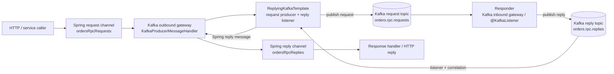
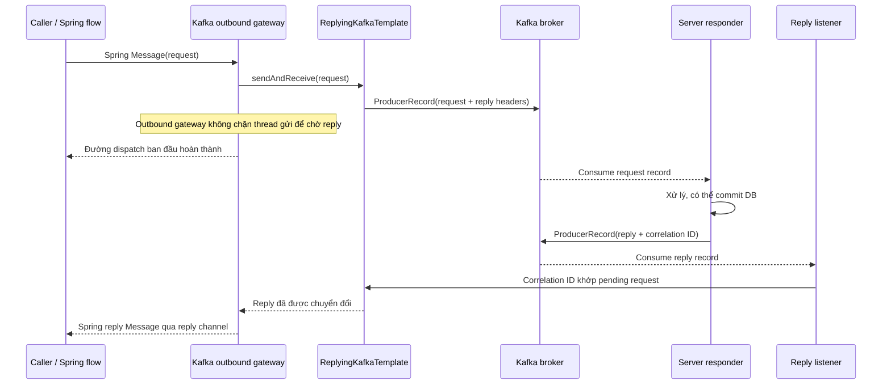
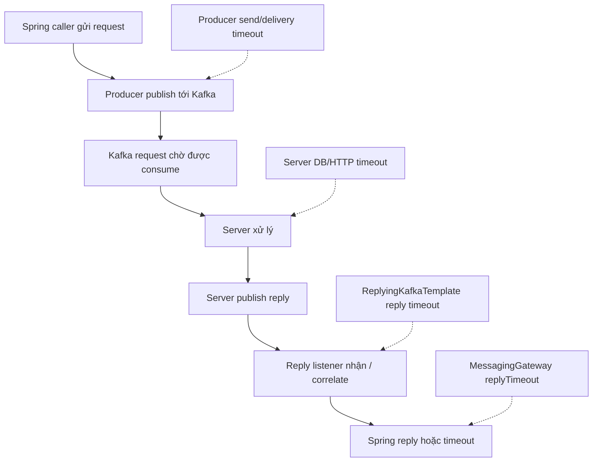
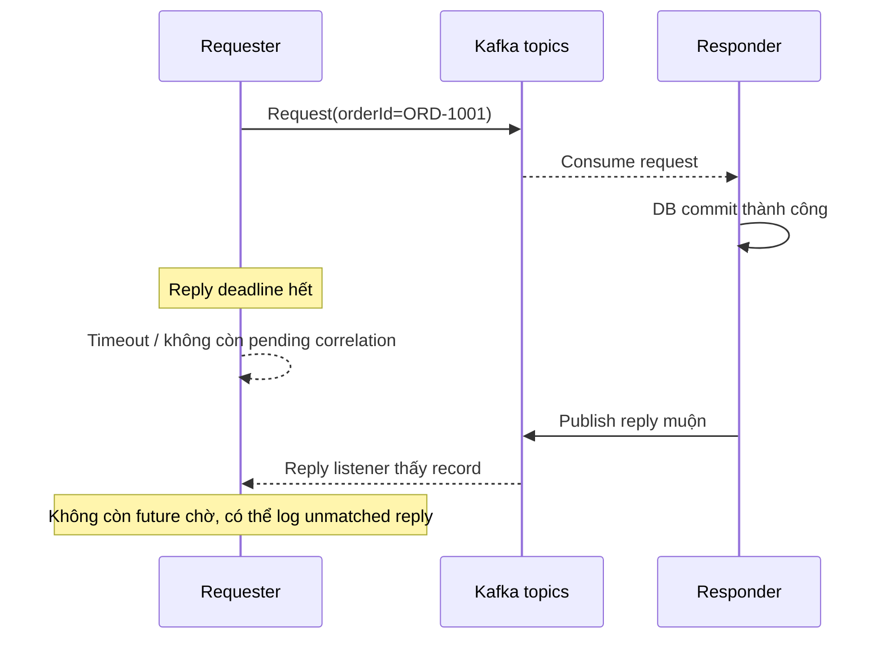

# Kafka outbound gateway request-reply

**Kafka outbound gateway** là điểm đầu ra của Spring Integration dùng để gửi một **request message** sang topic Kafka rồi đưa **reply message tương ứng** trở lại luồng Spring Integration. Nó không giống Kafka outbound channel adapter một chiều: bên cạnh publish record, gateway phải quản lý **reply destination, correlation ID, timeout và kết quả trả về**.

Bài thuộc chương **Adapter Kafka** của module **SPRING_INTEGRATION_ADAPTERS**. Module có mục tiêu kết nối hệ thống ngoài bằng inbound/outbound adapter, gateway, poller và `MessageChannel`; thực hành file, SFTP, HTTP, JMS, AMQP, Kafka, cơ sở dữ liệu cùng các vấn đề hợp đồng message, lỗi và vòng đời kết nối. Chủ đề này tập trung vào **chiều Spring Integration → Kafka request → Kafka reply → Spring Integration**, với ví dụ một ứng dụng yêu cầu kiểm tra trạng thái đơn hàng từ dịch vụ khác.

> **Điểm thiết kế cần nhớ:** Spring Integration Kafka outbound gateway **không chặn thread gửi để chờ Kafka reply** ở tầng handler. Reply thường được xử lý trên **thread của reply listener container**, rồi chuyển vào Spring Integration reply channel. Nếu tầng gọi là một `@MessagingGateway` đồng bộ, **thread gọi gateway proxy** mới đợi reply hoặc hết thời hạn.

## 1. Mục tiêu học tập

Sau bài này, bạn có thể:

1. Phân biệt Kafka outbound channel adapter một chiều, Kafka outbound gateway request–reply và Kafka inbound gateway phía server.
2. Giải thích sự phối hợp giữa `KafkaProducerMessageHandler`, `ReplyingKafkaTemplate`, reply listener container và Spring Integration input/reply channels.
3. Viết Java configuration và Java DSL cho luồng request–reply, kèm một server Kafka minh họa trả kết quả.
4. Nhận biết `KafkaHeaders.TOPIC`, `KEY`, `CORRELATION_ID`, `REPLY_TOPIC`, `REPLY_PARTITION` cùng vai trò của topic, partition và consumer group.
5. Phân biệt việc **gửi request được broker ACK**, **reply được nhận**, **business handler phía server đã commit**.
6. Chọn timeout, retry, xử lý late reply, no reply, reply sai correlation và lỗi serialization.
7. Thiết kế request–reply cho nhiều requester instance, giữ idempotency, quản lý lifecycle và giám sát production.
8. Quyết định khi nào nên dùng request–reply, khi nào nên dùng asynchronous command/result event.

## 2. Kiến trúc từ requester đến responder

Giả sử ứng dụng A có HTTP inbound gateway nhận câu hỏi về trạng thái đơn hàng, nhưng dữ liệu được sở hữu bởi ứng dụng B. A gửi command vào Kafka; B trả phản hồi qua topic khác:



Có **hai hệ thống channel khác nhau**:

- **Spring Integration `MessageChannel`:** `ordersRpcRequests` nhận request từ ứng dụng A; `ordersRpcReplies` nhận reply để tiếp tục flow nội bộ.
- **Kafka topic:** `orders.rpc.requests` chứa request record; `orders.rpc.replies` chứa reply record. Chúng lưu trữ, phân phối và giữ offset theo Kafka.

Một channel nội bộ không tự trở thành Kafka topic. Một topic Kafka cũng không phải Spring `MessageChannel` chỉ vì tên gần giống nhau.

### 2.1. Các thành phần và trách nhiệm

| Thành phần | Nhiệm vụ | Không phải |
|---|---|---|
| `KafkaProducerMessageHandler<K,V>` | Handler gửi Kafka record; khi được cấp `ReplyingKafkaTemplate` đóng vai trò outbound gateway | Một Kafka request consumer |
| `ReplyingKafkaTemplate<K,V,R>` | Kafka producer để gửi request, reply listener để nhận và ghép reply | Spring Integration `Poller` |
| `ProducerFactory<K,V>` | Cấu hình client producer/serializer/acks | Bộ xử lý nghiệp vụ |
| `ConsumerFactory<K,R>` | Cấu hình client đọc reply/deserializer/group | Factory của server request consumer |
| Reply listener container | Consume reply topic, hoàn tất pending request theo correlation | Business server |
| `MessageChannel` đầu vào | Đưa Spring request tới outbound gateway | Reply topic |
| `MessageChannel` đầu ra | Nhận Spring reply và tiếp tục luồng xử lý | Kafka broker ACK |
| Kafka inbound gateway hoặc `@KafkaListener` phía server | Consume request, xử lý logic và publish reply | Client chờ reply |

**Một điểm dễ bỏ sót:** Ở phiên bản Spring Integration hiện đại, **cùng lớp `KafkaProducerMessageHandler`** được dùng cho outbound adapter và outbound gateway. Khác biệt cốt lõi là template:

```java
// Outbound channel adapter một chiều:
new KafkaProducerMessageHandler<>(ordinaryKafkaTemplate);

// Outbound gateway request-reply:
new KafkaProducerMessageHandler<>(replyingKafkaTemplate);
```

Đây là các lệnh minh họa *thay thế nhau*, không nên đồng thời wire cả hai vào một `DirectChannel` khi muốn mỗi request được gửi đúng một lần.

## 3. Vòng đời một cuộc hội thoại



Trong thực tế callback gửi request và callback nhận reply có thể xen kẽ, lỗi hoặc timeout. Không giả định request/reply được xử lý theo đúng thứ tự tổng thể nếu có nhiều partition và nhiều consumer.

### 3.1. Ba mốc “thành công” khác nhau

| Mốc | Bằng chứng | Điều chưa được bảo đảm |
|---|---|---|
| Spring `send()` chấp nhận request | Input channel đã dispatch theo semantics channel | Kafka broker đã lưu record |
| Kafka producer báo ACK request | Producer send future thành công theo `acks` | Server đã xử lý nghiệp vụ |
| Reply khớp correlation được nhận | Reply listener nhận reply hợp lệ, Spring flow có result | Side effect DB của server chắc chắn bền nếu contract server không bảo đảm |

Vì vậy **request send ACK ≠ business reply**; và một reply “OK” sai hợp đồng vẫn có thể che lỗi nghiệp vụ. Cần định nghĩa reply schema và cách server xác nhận side effect một cách rõ ràng.

## 4. Khi nào dùng outbound gateway?

| Nhu cầu | Thành phần phù hợp | Lý do |
|---|---|---|
| Fire-and-forget event publish | Kafka outbound channel adapter | Không yêu cầu application-level reply |
| Yêu cầu dịch vụ khác trả trạng thái/định danh | **Kafka outbound gateway** | Có request–reply với correlation, timeout |
| Server nhận command và trả Kafka reply | Kafka inbound gateway | Là phía responder |
| Chỉ cần request/reply bằng code Kafka, không cần EIP | `ReplyingKafkaTemplate` trực tiếp | Ít abstraction khi không có IntegrationFlow |
| Tác vụ chạy rất lâu hoặc cần tiến độ | Command topic + result event/status store | Không giữ pending reply future kéo dài |
| Trả HTTP response ngay từ DB nội bộ | Service gọi trực tiếp hoặc HTTP gateway | Kafka RPC có thể không cần thiết |

**Kafka không phải RPC broker:** Kafka chỉ cung cấp khả năng lưu/phân phối record. **Client và server** xây quy ước reply topic, correlation, serializer, timeout và idempotency để biến hai record thành một cuộc hội thoại.

## 5. Headers điều phối request và reply

`ReplyingKafkaTemplate` và các inbound reply-capable handler dùng những headers đặc biệt của Spring Kafka. Khi gửi message từ Spring Integration, adapter cũng dùng header hoặc expression để tạo Kafka record.

| Header | Vai trò |
|---|---|
| `KafkaHeaders.TOPIC` | Xác định request topic nếu không bị topic expression tường minh override |
| `KafkaHeaders.KEY` | Kafka record key, thường là `orderId` hoặc aggregate ID |
| `KafkaHeaders.PARTITION` | Partition request chỉ định tường minh nếu cần |
| **`KafkaHeaders.CORRELATION_ID`** | ID ghép reply với request đang chờ |
| **`KafkaHeaders.REPLY_TOPIC`** | Địa chỉ Kafka topic mà server phải gửi reply về |
| **`KafkaHeaders.REPLY_PARTITION`** | Partition reply chỉ định (nếu dùng) |
| `KafkaHeaders.RECEIVED_TOPIC` | Metadata topic của record đã nhận, không phải topic publish |
| `MessageHeaders.ID` | UUID của Spring message, không tự thay thế correlation ID |
| `requestId`/`orderId` nghiệp vụ | Khóa để idempotency, theo dõi quy trình và đối soát |

### 5.1. Ai đặt correlation ID?

`ReplyingKafkaTemplate` tạo/cấp correlation ID cho pending request và dùng ID ấy để hoàn tất reply future. Khi reply listener đọc một record, nó tìm correlation header và đối chiếu với những request đang chờ.

```text
Lần gọi 1: orderId=ORD-1001, correlationId=corr-A
Lần gọi 2: orderId=ORD-1001, correlationId=corr-B
```

Hai lần gửi có cùng **business ID** nhưng correlation khác nhau. Nếu client timeout rồi retry, server cần **idempotency theo orderId/requestId nghiệp vụ**, không dùng correlation ID làm khóa duy nhất chống side effect trùng.

### 5.2. Ai đặt reply topic?

Nếu reply listener container của `ReplyingKafkaTemplate` subscribe đúng **một topic**, template thường tự xác định và thêm `KafkaHeaders.REPLY_TOPIC` khi gửi request. Nếu client có nhiều topic/partition hoặc dùng non-Spring producer, phải cấu hình headers reply rõ ràng.

Với outbound gateway, nếu Spring message đầu vào có `KafkaHeaders.REPLY_TOPIC` thì nó được **kiểm tra xem có phù hợp reply container subscriptions**; nếu reply container chỉ subscribe một topic, có thể dùng topic đó. `KafkaHeaders.REPLY_PARTITION` cũng phải nhất quán với assignment tương ứng.

Không cho input không tin cậy tùy ý cung cấp reply topic rồi dùng producer quyền cao gửi dữ liệu sang topic bất kỳ. Cần allowlist và Kafka ACL.

### 5.3. Bảo toàn header qua converter

Một custom `RecordMessageConverter` hoặc `KafkaHeaderMapper` có thể thay đổi metadata được serialize/deserialize. Khi tích hợp khác ngôn ngữ, hãy đặc tả **tên header trên wire, byte encoding, schema request/reply và failure semantics** rồi kiểm tra bằng record thật.

Header `KafkaHeaders.REPLY_PARTITION` trong Kafka native headers thường được encode bằng **bốn byte big-endian**. Không gửi chuỗi ký tự `"1"` rồi mặc nhiên kỳ vọng server hiểu là số nguyên partition 1.

## 6. Thiết lập môi trường thực hành

Ví dụ gồm hai tiến trình:

- **Requester:** Spring Boot + Spring Integration Kafka **outbound gateway**.
- **Responder:** Spring Boot + Spring Kafka `@KafkaListener` và `@SendTo`; có thể thay bằng Kafka inbound gateway ở mục 11.
- **Broker:** Kafka tại `localhost:9092`, có hai topic `orders.rpc.requests` và `orders.rpc.replies`.

Dùng Java 17+ với một Spring Boot BOM đồng bộ Spring Kafka/Spring Integration. Request/reply payload demo đều là `String` để không cần converter JSON.

### 6.1. Dependencies requester

```xml
<!-- Trong <dependencies> của pom.xml; Spring Boot parent/BOM quản lý version -->
<dependency>
    <groupId>org.springframework.boot</groupId>
    <artifactId>spring-boot-starter-integration</artifactId>
</dependency>
<dependency>
    <groupId>org.springframework.integration</groupId>
    <artifactId>spring-integration-kafka</artifactId>
</dependency>
```

Responder dùng `spring-kafka` thông qua dependency do BOM quản lý, và có thể dùng `spring-boot-starter` làm nền. Không khai báo các module SFTP/JDBC/JMS nếu ví dụ không dùng chúng.

### 6.2. Chuẩn bị topic

```bash
kafka-topics.sh --bootstrap-server localhost:9092 \
  --create --if-not-exists --topic orders.rpc.requests \
  --partitions 3 --replication-factor 1

kafka-topics.sh --bootstrap-server localhost:9092 \
  --create --if-not-exists --topic orders.rpc.replies \
  --partitions 3 --replication-factor 1
```

Replication factor 1 chỉ phù hợp lab một broker. Production cần replication factor và `min.insync.replicas` theo yêu cầu sẵn sàng/durability, cùng Kafka ACL cho requester/responder.

### 6.3. Requester properties

```properties
demo.kafka.bootstrap-servers=localhost:9092
demo.kafka.reply-group=orders-rpc-client-dev-1
```

`reply-group` trong demo chỉ dùng cho **một requester instance**. Nếu chạy nhiều requester instances cùng một reply topic, phải thiết kế **group/partition reply** để không làm reply của instance A bị consume bởi instance B, khiến A timeout.

## 7. Ví dụ requester: ProducerFactory, reply ConsumerFactory, ReplyingKafkaTemplate

Lớp này tạo producer gửi Kafka request, reply listener đọc response và template ghép correlation. Cấu hình dùng hai factory độc lập để nhìn rõ hai vai trò.

```java
package com.example.rpcrequester;

import java.time.Duration;
import java.util.HashMap;
import java.util.Map;

import org.apache.kafka.clients.consumer.ConsumerConfig;
import org.apache.kafka.clients.producer.ProducerConfig;
import org.apache.kafka.common.serialization.StringDeserializer;
import org.apache.kafka.common.serialization.StringSerializer;

import org.springframework.beans.factory.annotation.Qualifier;
import org.springframework.beans.factory.annotation.Value;
import org.springframework.context.annotation.Bean;
import org.springframework.context.annotation.Configuration;
import org.springframework.integration.config.EnableIntegration;
import org.springframework.kafka.core.ConsumerFactory;
import org.springframework.kafka.core.DefaultKafkaConsumerFactory;
import org.springframework.kafka.core.DefaultKafkaProducerFactory;
import org.springframework.kafka.core.ProducerFactory;
import org.springframework.kafka.listener.ConcurrentMessageListenerContainer;
import org.springframework.kafka.listener.ContainerProperties;
import org.springframework.kafka.requestreply.ReplyingKafkaTemplate;

@Configuration
@EnableIntegration
public class KafkaRpcRequesterInfrastructure {

    @Bean("rpcRequestProducerFactory")
    ProducerFactory<String, String> rpcRequestProducerFactory(
            @Value("${demo.kafka.bootstrap-servers}") String brokers) {

        Map<String, Object> cfg = new HashMap<>();
        cfg.put(ProducerConfig.BOOTSTRAP_SERVERS_CONFIG, brokers);
        cfg.put(ProducerConfig.KEY_SERIALIZER_CLASS_CONFIG,
                StringSerializer.class);
        cfg.put(ProducerConfig.VALUE_SERIALIZER_CLASS_CONFIG,
                StringSerializer.class);
        cfg.put(ProducerConfig.ACKS_CONFIG, "all");
        cfg.put(ProducerConfig.ENABLE_IDEMPOTENCE_CONFIG, true);
        return new DefaultKafkaProducerFactory<>(cfg);
    }

    @Bean("rpcReplyConsumerFactory")
    ConsumerFactory<String, String> rpcReplyConsumerFactory(
            @Value("${demo.kafka.bootstrap-servers}") String brokers,
            @Value("${demo.kafka.reply-group}") String replyGroup) {

        Map<String, Object> cfg = new HashMap<>();
        cfg.put(ConsumerConfig.BOOTSTRAP_SERVERS_CONFIG, brokers);
        cfg.put(ConsumerConfig.GROUP_ID_CONFIG, replyGroup);
        cfg.put(ConsumerConfig.KEY_DESERIALIZER_CLASS_CONFIG,
                StringDeserializer.class);
        cfg.put(ConsumerConfig.VALUE_DESERIALIZER_CLASS_CONFIG,
                StringDeserializer.class);
        cfg.put(ConsumerConfig.ENABLE_AUTO_COMMIT_CONFIG, false);

        // Topic reply chỉ dùng cho các response mới trong phiên demo.
        cfg.put(ConsumerConfig.AUTO_OFFSET_RESET_CONFIG, "latest");
        return new DefaultKafkaConsumerFactory<>(cfg);
    }

    @Bean("rpcReplyingKafkaTemplate")
    ReplyingKafkaTemplate<String, String, String> rpcReplyingKafkaTemplate(
            @Qualifier("rpcRequestProducerFactory")
                    ProducerFactory<String, String> requestFactory,
            @Qualifier("rpcReplyConsumerFactory")
                    ConsumerFactory<String, String> replyFactory) {

        ContainerProperties properties =
                new ContainerProperties("orders.rpc.replies");

        properties.setAckMode(ContainerProperties.AckMode.RECORD);

        ConcurrentMessageListenerContainer<String, String> replyContainer =
                new ConcurrentMessageListenerContainer<>(
                        replyFactory, properties);

        // Template quản lý vòng đời reply container.
        replyContainer.setAutoStartup(false);

        ReplyingKafkaTemplate<String, String, String> template =
                new ReplyingKafkaTemplate<>(
                        requestFactory, replyContainer);

        template.setDefaultReplyTimeout(Duration.ofSeconds(15));
        return template;
    }
}
```

**Giải thích:**

1. `ProducerFactory` là client gửi request vào `orders.rpc.requests`.
2. `ConsumerFactory` tạo client đọc `orders.rpc.replies`; không phải consumer nhận business request của server.
3. `ConcurrentMessageListenerContainer` subscribe reply topic. `setAutoStartup(false)` ở container để `ReplyingKafkaTemplate` kiểm soát listener.
4. `ReplyingKafkaTemplate` theo dõi các request đang chờ và correlation ID. Khi reply hợp lệ đến, nó hoàn tất future/callback để outbound gateway chuyển thành Spring reply.
5. `setDefaultReplyTimeout(15s)` đặt timeout đợi **Kafka reply**; nó không phải timeout cho việc `DirectChannel.send()` vào gateway.

Trong cấu hình với nhiều instance và shared reply topic, hãy dùng **reply group riêng cho từng instance** hoặc partition reply gán riêng. Không dùng cùng một reply group cho các requester độc lập nếu chúng đều cần nhận reply gửi đến cùng topic.

## 8. Ví dụ requester: Java DSL nối input và reply channel

Lớp này xây IntegrationFlow. Một message gửi vào `ordersRpcRequests` đi qua Kafka outbound gateway, rồi khi reply đến sẽ được gửi tiếp vào `ordersRpcReplies`.

```java
package com.example.rpcrequester;

import java.time.Duration;

import org.springframework.beans.factory.annotation.Qualifier;
import org.springframework.boot.ApplicationRunner;
import org.springframework.context.annotation.Bean;
import org.springframework.context.annotation.Configuration;
import org.springframework.integration.channel.DirectChannel;
import org.springframework.integration.dsl.IntegrationFlow;
import org.springframework.integration.kafka.dsl.Kafka;
import org.springframework.kafka.requestreply.ReplyingKafkaTemplate;
import org.springframework.kafka.support.KafkaHeaders;
import org.springframework.messaging.MessageChannel;
import org.springframework.messaging.support.MessageBuilder;

@Configuration
public class KafkaRpcRequesterFlow {

    @Bean("ordersRpcRequests")
    MessageChannel ordersRpcRequests() {
        return new DirectChannel();
    }

    @Bean("ordersRpcReplies")
    MessageChannel ordersRpcReplies() {
        return new DirectChannel();
    }

    @Bean("ordersOutboundGatewayFlow")
    IntegrationFlow ordersOutboundGatewayFlow(
            @Qualifier("rpcReplyingKafkaTemplate")
            ReplyingKafkaTemplate<String, String, String> template) {

        return IntegrationFlow.from("ordersRpcRequests")
                .handle(
                    Kafka.outboundGateway(template)
                            .topic("orders.rpc.requests"),
                    endpoint -> endpoint.id("ordersKafkaOutboundGateway"))
                .channel("ordersRpcReplies")
                .get();
    }

    @Bean
    ApplicationRunner publishDemoRequest(
            @Qualifier("rpcReplyingKafkaTemplate")
                    ReplyingKafkaTemplate<String, String, String> template,
            @Qualifier("ordersRpcRequests") MessageChannel requests) {

        return args -> {
            // Reply listener phải được Kafka assign partition trước khi gửi.
            if (!template.waitForAssignment(Duration.ofSeconds(10))) {
                throw new IllegalStateException(
                        "Reply listener chưa sẵn sàng");
            }

            boolean accepted = requests.send(
                    MessageBuilder.withPayload("status:ORD-1001")
                            .setHeader(KafkaHeaders.KEY, "ORD-1001")
                            .setHeader("requestId", "request-1001")
                            .build());

            System.out.println("Spring request dispatched=" + accepted);
        };
    }
}
```

Tạo handler nhận reply:

```java
package com.example.rpcrequester;

import org.springframework.integration.annotation.ServiceActivator;
import org.springframework.stereotype.Component;

@Component
public class RpcReplyObserver {

    @ServiceActivator(inputChannel = "ordersRpcReplies")
    public void printReply(String reply) {
        System.out.println("KAFKA RPC REPLY: " + reply);
    }
}
```

Cả ba class ở requester cần nằm trong package mà `@SpringBootApplication` quét được, ví dụ `com.example.rpcrequester`. Khi responder ở mục 9 hoạt động, kết quả dự kiến:

```text
Spring request dispatched=true
KAFKA RPC REPLY: ACK:status:ORD-1001
```

Dòng `dispatched=true` cho biết message được Spring channel gửi vào flow; nó **không chứng minh** server đã xử lý hoặc Kafka reply đã đến. Reply có thể xuất hiện sau trên thread khác.

### 8.1. Vì sao không thấy `sendAndReceive()` trong code DSL?

DSL `Kafka.outboundGateway(template)` xây một handler được cấp `ReplyingKafkaTemplate`. Handler dùng khả năng gửi request và nhận reply của template để thực hiện EIP request–reply.

Luồng `.channel("ordersRpcReplies")` được đặt **sau** `.handle(...)` để nhận reply. Nếu thay bằng outbound **channel adapter**, không có reply nghiệp vụ để chuyển qua bước này theo cùng contract.

### 8.2. Điều khiển input/output channel

| Tên | Vai trò |
|---|---|
| `ordersRpcRequests` | **Input channel** của Kafka outbound gateway |
| `ordersKafkaOutboundGateway` | ID consumer endpoint/gateway handler trong flow |
| `orders.rpc.requests` | Kafka **request topic** |
| `orders.rpc.replies` | Kafka **reply topic** |
| `ordersRpcReplies` | Spring Integration **output/reply channel** sau outbound gateway |
| `rpcReplyingKafkaTemplate` | Bean template quản lý producer và reply listener |

**Đừng nhầm:** tên Kafka topic không phải bean `MessageChannel`. Kafka reply topic không phải Spring `replyChannel`.

## 9. Responder demo: Kafka listener gửi reply

Để demo độc lập với những bài inbound gateway, server có thể dùng **Spring Kafka `@KafkaListener` + `@SendTo`**. Đây là một lựa chọn responder hợp lệ; khi cần nhiều EIP bước, có thể thay bằng Spring Integration `KafkaInboundGateway`.

Trong **ứng dụng server riêng**, ví dụ `application.properties`:

```properties
spring.kafka.bootstrap-servers=localhost:9092
spring.kafka.consumer.group-id=orders-rpc-server-demo
spring.kafka.consumer.key-deserializer=org.apache.kafka.common.serialization.StringDeserializer
spring.kafka.consumer.value-deserializer=org.apache.kafka.common.serialization.StringDeserializer
spring.kafka.producer.key-serializer=org.apache.kafka.common.serialization.StringSerializer
spring.kafka.producer.value-serializer=org.apache.kafka.common.serialization.StringSerializer
```

Cấu hình listener container factory có reply template:

```java
package com.example.rpcresponder;

import org.springframework.context.annotation.Bean;
import org.springframework.context.annotation.Configuration;
import org.springframework.kafka.annotation.EnableKafka;
import org.springframework.kafka.config.ConcurrentKafkaListenerContainerFactory;
import org.springframework.kafka.core.ConsumerFactory;
import org.springframework.kafka.core.KafkaTemplate;

@Configuration
@EnableKafka
public class KafkaResponderConfig {

    @Bean("kafkaListenerContainerFactory")
    ConcurrentKafkaListenerContainerFactory<String, String>
    kafkaListenerContainerFactory(
            ConsumerFactory<String, String> consumerFactory,
            KafkaTemplate<String, String> kafkaTemplate) {

        ConcurrentKafkaListenerContainerFactory<String, String> factory =
                new ConcurrentKafkaListenerContainerFactory<>();

        factory.setConsumerFactory(consumerFactory);
        factory.setReplyTemplate(kafkaTemplate);
        return factory;
    }
}
```

Handler:

```java
package com.example.rpcresponder;

import org.springframework.kafka.annotation.KafkaListener;
import org.springframework.messaging.handler.annotation.SendTo;
import org.springframework.stereotype.Component;

@Component
public class OrderStatusResponder {

    @KafkaListener(
            topics = "orders.rpc.requests",
            groupId = "orders-rpc-server-demo")
    @SendTo
    public String process(String request) {
        if (request.isBlank()) {
            return "REJECTED:EMPTY_REQUEST";
        }
        return "ACK:" + request;
    }
}
```

`@SendTo` không có giá trị topic cụ thể sẽ dùng metadata reply destination của request, theo cấu hình Spring Kafka. Hạ tầng trả reply cũng phản ánh correlation header phù hợp. Client `ReplyingKafkaTemplate` đối chiếu correlation để chuyển reply vào `ordersRpcReplies`.

**Đây là demo đơn giản**: server trả “ACK” mà chưa ghi database. Khi handler có side effect thật, cần transaction/idempotency và reply schema có ý nghĩa chính xác. Không đặt server demo chung application context với requester nếu cấu hình `KafkaTemplate`, `ConsumerFactory` của hai phía đang có bean names trùng hoặc group khác mục đích.

### 9.1. Responder thay thế bằng Spring Integration inbound gateway

Nếu server cũng dùng Spring Integration, có thể thay `@KafkaListener` bằng một flow:

```java
// Trích trong @Configuration server, không chạy đồng thời với
// @KafkaListener responder trên cùng request topic/group.
@Bean
IntegrationFlow ordersServerFlow(
        ConcurrentMessageListenerContainer<String, String> requestContainer,
        KafkaTemplate<String, String> replyTemplate) {

    return IntegrationFlow
            .from(Kafka.inboundGateway(requestContainer, replyTemplate)
                    .replyTimeout(10_000))
            .<String, String>transform(request -> "ACK:" + request)
            .get();
}
```

Ở ví dụ này, `requestContainer` là listener container subscribe `orders.rpc.requests`; `replyTemplate` dùng publish response. Đây chỉ là **phần flow**, cần định nghĩa hai bean hạ tầng phù hợp. Hướng của server là **Kafka → Spring Integration → Kafka reply**, khác với outbound gateway ở requester là **Spring Integration → Kafka → Spring Integration reply**.

## 10. Nếu caller muốn trả kết quả đồng bộ thì sao?

`@ServiceActivator` ở `ordersRpcReplies` phù hợp với kiểu tiếp nhận reply **bất đồng bộ**. Nếu ứng dụng cần method Java trả giá trị theo phong cách RPC, dùng **Messaging Gateway proxy** ở phía trước.

**Ví dụ thay thế**, không dùng đồng thời cùng input channel với flow `ordersOutboundGatewayFlow` ở mục 8:

```java
import org.springframework.integration.annotation.MessagingGateway;

@MessagingGateway(
        defaultRequestChannel = "syncRpcRequests",
        defaultReplyTimeout = "20000")
public interface OrderStatusClient {
    String lookup(String query);
}
```

Flow tương ứng:

```java
@Bean
IntegrationFlow synchronousRpcFlow(
        ReplyingKafkaTemplate<String, String, String> template) {

    return IntegrationFlow.from("syncRpcRequests")
            .handle(Kafka.outboundGateway(template)
                    .topic("orders.rpc.requests"))
            // Không ép reply vào một channel riêng: dùng replyChannel
            // tạm do Messaging Gateway proxy gửi trong headers.
            .get();
}
```

Cần có `MessageChannel` bean tên `syncRpcRequests` và các import thích hợp. Đây là cấu hình **minh họa thay thế**, với `ReplyingKafkaTemplate` đã được start và reply listener sẵn sàng.

Khi gọi:

```java
String result = orderStatusClient.lookup("status:ORD-1001");
```

Thread gọi `lookup()` **có thể chờ tới khi nhận reply hoặc hết 20 giây**, vì `@MessagingGateway` tạo một reply channel tạm và đợi kết quả. **Không phải Kafka outbound handler đang chặn thread Kafka reply listener**. Đó là sự phân chia trách nhiệm giữa gateway proxy đồng bộ bên ngoài và Kafka outbound handler bất đồng bộ bên trong.

Lưu ý rằng `@MessagingGateway` timeout thường có thể trả `null` hoặc kích hoạt đường lỗi tùy hợp đồng và phiên bản/cấu hình. Không giả định nó luôn ném `TimeoutException` giống `ReplyingKafkaTemplate.sendAndReceive(...).get(...)`; luôn kiểm tra kết quả và error contract.

### 10.1. Khi nào nên tránh chờ đồng bộ?

Nếu HTTP endpoint có SLA 2 giây mà Kafka/DB phía server có p99 10 giây, việc chặn HTTP request trong 20 giây gây chiếm thread và timeout liên tầng. Xem xét trả `202 Accepted + requestId` rồi phát kết quả dưới dạng event hoặc endpoint truy vấn trạng thái.

## 11. Reply topic, reply partition và mở rộng nhiều requester

Giả sử có **ba pod requester** cùng chờ reply topic `orders.rpc.replies`. Nếu tất cả thuộc cùng một Kafka **consumer group**, Kafka chỉ giao mỗi partition cho một consumer trong group. Reply của pod A có thể được giao sang pod B; B không có correlation ID đang chờ và loại bỏ record, trong khi A **timeout**.

Một số chiến lược:

| Chiến lược | Cách thực hiện | Đánh đổi |
|---|---|---|
| Reply topic riêng cho từng requester instance | Mỗi pod chờ một topic khác | Nhiều topic và ACL |
| Reply topic chung, **group ID khác cho từng pod** | Mỗi pod có offset/assignment riêng, cùng nhận reply | Fan-out thừa, phải xử lý unmatched reply |
| Reply topic chung, **partition riêng từng pod** | Client và server thống nhất `REPLY_PARTITION` | Phải quản lý partition, scale và assignment cố định |
| Status store bền vững | Lưu kết quả theo business ID, client có thể truy vấn | Tốn thêm storage/orchestration |

`ReplyingKafkaTemplate.setSharedReplyTopic(true)` hữu ích khi nhiều template tiêu thụ cùng một shared reply topic với group khác nhau: giảm mức độ log các reply **không khớp correlation**. Nó **không sửa** cấu hình group sai, cũng không biến Kafka thành broadcast trong cùng consumer group.

### 11.1. Consumer group phía responder khác phía requester

- **Responder group:** nhiều server chia request topic partitions; có thể xử lý song song.
- **Requester reply group:** được thiết kế để **đúng instance** nhìn thấy reply cho request mình gửi.

Không tái sử dụng group của responder cho reply container chỉ vì chúng cùng thuộc một ứng dụng tổ chức.

### 11.2. Reply listener phải sẵn sàng trước request đầu tiên

Nếu reply container dùng `auto.offset.reset=latest` và request được gửi **trước khi container nhận partition assignment**, reply có thể được publish rồi bị bỏ lỡ ở thời điểm bắt đầu đọc. Hãy gọi:

```java
if (!replyingKafkaTemplate.waitForAssignment(Duration.ofSeconds(10))) {
    throw new IllegalStateException("Reply container chưa assign partition");
}
```

Đây là bước hữu ích cho **startup/readiness**. Việc listener đã assign partition cũng chưa xác nhận server đang khỏe, nên vẫn cần timeout và khả năng kiểm tra business status.

## 12. Các timeout độc lập

Kafka outbound request–reply có nhiều timeout, không phải chỉ một:



| Timeout | Cấu hình điển hình | Ý nghĩa |
|---|---|---|
| Kafka producer `delivery.timeout.ms` | Producer configuration | Giới hạn tổng thời gian delivery |
| Handler `sendTimeoutExpression` | `KafkaProducerMessageHandler` | Giới hạn chờ send-result ở đường có liên quan |
| `ReplyingKafkaTemplate.defaultReplyTimeout` | `Duration.ofSeconds(15)` | Chờ Kafka reply tương ứng correlation |
| `@MessagingGateway.defaultReplyTimeout` | `"20000"` (ms) | Chờ Spring reply ở phương thức đồng bộ |
| Downstream DB/HTTP timeout | Client/service phía responder | Chờ thao tác nghiệp vụ |
| `max.poll.interval.ms` | Kafka consumer | Giới hạn khoảng giữa những poll, có thể ảnh hưởng rebalance |

Tài liệu Spring Integration lưu ý rằng mặc định của `KafkaProducerMessageHandler.sendTimeoutExpression` được gắn với Kafka producer `delivery.timeout.ms + 5000` để ưu tiên nhận **Kafka send error thực tế** thay vì timeout do framework đặt quá sớm. Mặc định Kafka delivery timeout có thể khá dài (thường 120 giây). Nếu SLA cần lỗi sớm, hãy cấu hình **nhất quán cả producer và gateway**, thay vì chỉ giảm một số timeout.

### 12.1. Một reply đến muộn là điều hoàn toàn có thể



**Timeout không chứng minh server chưa thực thi.** Người dùng retry sau timeout có thể tạo thêm side effect nếu server không chống trùng. Cần business request ID, trạng thái xử lý bền vững hoặc cơ chế truy vấn kết quả.

## 13. Xử lý lỗi: send failure, reply timeout, reply error

Một request Kafka có thể lỗi ở nhiều điểm:

| Vị trí | Ví dụ | Cách xử lý |
|---|---|---|
| Spring input channel | Không có subscriber, endpoint stopped | Kiểm tra wiring và `SmartLifecycle` |
| Producer gửi request | Thiếu ACL, serialization error, broker timeout | Error channel/exception, retry có giới hạn |
| Request consumer phía server | Sai schema, server không assign partition, lag | Container error handler, validation, DLT |
| Nghiệp vụ server | DB timeout, HTTP 503, invalid command | Reply status hoặc retry theo phân loại |
| Producer gửi reply | Reply topic không tồn tại, authorization error | Server-side retry/outbox/quarantine |
| Reply listener phía requester | Deserialize fail, sai group/partition, thiếu correlation | Reply deserializer, consumer config, tracing |
| Reply quá deadline | Server xử lý chậm hoặc reply lost | Client timeout, trạng thái không chắc chắn, idempotency |

### 13.1. Lỗi gửi request khác lỗi không có reply

- **Send failure:** producer không gửi record thành công theo Kafka result. `ReplyingKafkaTemplate` có send future và reply future; send future thất bại có thể làm reply future thất bại theo hợp đồng Spring Kafka.
- **Reply timeout:** request có thể đã được gửi thành công, nhưng không có reply hợp lệ trước deadline.
- **Business rejection reply:** server trả payload `REJECTED`; đây là **reply vận chuyển thành công** nhưng nghiệp vụ từ chối.
- **Unmatched correlation:** reply tới đúng topic nhưng không ghép được với request hiện tại; có thể do late reply, header mất hoặc reply của instance khác.

Đừng gom tất cả thành một thông báo `"Kafka failed"`. Cần ghi riêng requestId/business ID, nguyên nhân, topic, partition và callback status.

### 13.2. Khi server không thể xử lý

Có hai cách định nghĩa:

**Reply có trạng thái lỗi:** Server trả `{"status":"REJECTED","code":"INVALID_ORDER"}`. Requester phân biệt rejected với success theo schema. Nếu cần, `ReplyingKafkaTemplate` có `replyErrorChecker` để biến một reply theo convention lỗi thành exception, nhưng phải cấu hình policy rõ ràng.

**Ném exception / không trả reply:** Container server retry hoặc đưa record vào DLT theo cấu hình; requester có thể timeout. Cần cơ chế tra cứu trạng thái theo requestId khi kết quả không rõ.

Một `ErrorMessage` ở Spring Integration `errorChannel` **không tự đồng nghĩa Kafka đã publish một error reply**. Cũng không tự đồng nghĩa DLT đã nhận record.

### 13.3. Retry phải đi cùng idempotency

Nếu retry ở cả HTTP caller, Spring Integration advice, Kafka producer, responder container và business client, tổng số lần thử có thể tăng mạnh. Nên chỉ rõ:

1. Lỗi nào retry được và lỗi nào là permanent.
2. Tầng nào sở hữu retry, backoff, jitter và giới hạn thời gian.
3. Nơi lưu **business requestId** để chống tác dụng phụ trùng.
4. Cách kiểm tra server có thể đã commit dù client timeout.
5. Chính sách quarantine/DLT cho record hỏng hoặc không thể xử lý.

## 14. Transaction, offset và duplicate request/reply

### 14.1. Các mốc thực thi phía server

Một request–reply nối Kafka với database có thể đi qua:

```text
(1) Responder consume request Kafka record
(2) Responder xử lý và commit DB
(3) Responder publish reply Kafka record
(4) Responder commit request consumer offset
(5) Requester consume reply và hoàn tất pending request
```

Giữa bất kỳ hai mốc nào, process có thể crash. Chẳng hạn **DB đã commit nhưng request offset chưa commit**: cùng command được nhận lại sau restart. Nếu responder không idempotent, DB bị cập nhật hai lần; reply cũng có thể bị gửi trùng.

Kafka producer idempotence hoặc Kafka-only transaction **không tự bao phủ database/HTTP/SFTP**, vì vậy không thể khẳng định exactly-once end-to-end chỉ bằng cấu hình Kafka.

### 14.2. Cách xử lý idempotent ở responder

Với command tạo đơn hàng, dùng khóa `clientRequestId` hoặc `orderId`:

1. Trong một transaction DB, kiểm tra/lưu request ID chưa xử lý.
2. Ghi side effect nghiệp vụ và trạng thái kết quả bền vững.
3. Với request ID đã xử lý, **không thực thi lại side effect**; trả lại kết quả đã lưu.
4. Khi publish reply thất bại, có thể dùng outbox reply để phát lại kết quả mà không chạy lại nghiệp vụ.
5. Khi requester timeout, ứng dụng có thể hỏi trạng thái theo business ID trước khi gửi request mới.

**Correlation ID** dùng để hoàn tất một lời gọi đang chờ; **requestId** được dùng để tránh chạy lại một thao tác nghiệp vụ.

### 14.3. Duplicate reply ở requester

Một reply có thể được publish lại vì server retry, requester restart hoặc người gửi tạo nhiều lần request. `ReplyingKafkaTemplate` có thể thấy reply không khớp pending correlation khi request đã timeout. Hãy giám sát unmatched/late replies, không tự coi chúng là một reply mới cho request khác.

## 15. Ordering, key, partition và concurrency

- Kafka bảo đảm thứ tự record **trong từng partition**; không có thứ tự toàn topic.
- Nếu thứ tự các command cùng `orderId` quan trọng, chọn `KafkaHeaders.KEY = orderId` và thống nhất partitioning/aggregate version.
- Một reply có thể đến **khác thứ tự các request được gửi** vì server xử lý song song hoặc chậm nhanh khác nhau. Dùng correlation ID, không ghép theo thứ tự đến.
- Responder consumer group có thể tăng concurrency theo số partition; requester reply listener cũng có thể xử lý reply song song. Tăng concurrency khi DB đang nghẽn thường làm áp lực lớn hơn.
- Nếu topic tăng số partition, mapping key → partition có thể thay đổi cho các record mới, nên cần thiết kế ordering/sequence vững chắc.
- Với `ExecutorChannel` trong Spring flow, reply có thể được giao trên thread khác; phải bảo toàn reply headers/correlation và deadline trước khi gateway proxy timeout.

## 16. Lifecycle, startup và shutdown

`KafkaProducerMessageHandler` trong flow có lifecycle và `ReplyingKafkaTemplate` quản lý producer/reply container. Một chuỗi startup an toàn:

1. Kafka request/reply topics đã được provision, ACL và serializers đúng.
2. Reply listener container được start và **đã nhận partition assignment**.
3. Spring input channel có consumer endpoint cho outbound gateway.
4. Request mới được gửi, với timeout và idempotency key rõ ràng.

Khi shutdown:

1. Ngừng nhận request mới (HTTP/SFTP/JDBC inbound hoặc upstream event).
2. Theo dõi pending request futures và handler đang chạy.
3. Chờ reply hoặc kết thúc theo một deadline rõ ràng.
4. Đóng reply listener và producer theo lifecycle của template/context.
5. Ghi lại các request chưa có kết quả chắc chắn để tra soát/retry an toàn.

`isRunning() == true` không có nghĩa reply listener đã có assignment, broker khỏe hoặc responder có thể trả lời. `SmartLifecycle.phase` giúp sắp thứ tự **trong một Spring context**, không đồng bộ các pod hay tiến trình độc lập.

### 16.1. Vì sao không nên giữ pending future quá lâu?

Mỗi request đang chờ reply dùng tài nguyên (correlation state, timers, callbacks hoặc thread ở tầng caller đồng bộ). Nếu server kéo dài 20 phút và lượng request lớn, việc giữ pending map trong một tiến trình dễ làm tăng memory/timeout risk và thất bại sau restart.

Đối với tác vụ dài, dùng **command topic → trạng thái công việc bền vững → result event hoặc status API**, thay vì một Kafka RPC future kéo dài.

## 17. Quan sát và xử lý sự cố

| Triệu chứng | Nguyên nhân có thể | Nên kiểm tra |
|---|---|---|
| `send()` đã thành công nhưng không thấy reply | Request chỉ mới dispatch, server chậm/hỏng, reply listener chưa assign | Send-result, request lag, server log, reply lag |
| Request topic có record, server không xử lý | Group ID, partition assignment, deserialize, container lỗi | Kafka consumer group, error handler |
| Server trả reply nhưng requester timeout | Reply topic sai, group reply dùng chung, correlation sai hoặc reply đến muộn | Reply topic records/headers, group design, deadline |
| Cùng request tạo hai bản ghi DB | Caller retry sau timeout, server redelivery | Business requestId, unique constraint, transaction |
| Reply có record nhưng không vào Spring channel | Unmatched correlation hoặc conversion lỗi | Raw headers, `ReplyingKafkaTemplate` logs, converter |
| Gateway không start | Channel/wiring, bean lifecycle, reply container config | Endpoint ID, bean type, `isRunning()` |
| Reply handler chạy hai lần | Hai flow/subscriber hoặc duplicate request/reply | Consumer group, flow IDs, business key |
| Lượng pending requests tăng không kiểm soát | Responder chậm, timeout quá lớn, high concurrency | p95/p99 latency, pending count, inflight limit |
| Lỗi serialization không hiện reply timeout | Send future thất bại trước khi chờ được reply | Producer serializer, cause chain, request future |

### 17.1. Chỉ số production cần thu thập

- Request publish success/failure rate và Kafka producer latency.
- Request topic consumer lag theo responder group/partition.
- Response latency theo p50, p95, p99.
- Reply timeout, unmatched reply, missing correlation header.
- Reply listener assignment, rebalance count và lag.
- Số pending requests và giới hạn concurrency.
- Business rejected/success/failed count.
- DB commit latency, idempotency duplicate detected count.
- DLQ/DLT/quarantine rate và khả năng replay.
- Producer/consumer auth, SSL/TLS hoặc serialization failures.

Khi log, dùng requestId/correlation ID và topic/partition/offset đủ cho đối soát, **không log payload chứa token, thông tin cá nhân nhạy cảm hoặc password**.

## 18. Bài tập thực hành

### Bài 1 — Chạy hai tiến trình

Tạo hai topic, chạy responder ở mục 9 và requester ở mục 7–8. Gửi ba request khác nhau. Ghi lại thời điểm `requests.send()` hoàn thành và thời điểm `ordersRpcReplies` nhận reply. Giải thích vì sao hai thời điểm đó khác nhau.

### Bài 2 — Thử reply đến muộn

Thêm sleep có kiểm soát ở responder để vượt `defaultReplyTimeout`. Quan sát timeout/unmatched reply. Gửi lại cùng `requestId` và giải thích vì sao server cần trả kết quả đã lưu thay vì tạo side effect lần hai.

### Bài 3 — Đổi sang @MessagingGateway đồng bộ

Thực hiện phương án ở mục 10. So sánh thread xử lý Kafka reply với thread gọi `lookup()`. Thử `defaultReplyTimeout="2000"` khi server xử lý 5 giây. Ghi rõ kết quả/exception thực tế của phiên bản Spring đang dùng.

### Bài 4 — Hai requester instances

Chạy requester A/B cùng reply topic và cùng reply group: quan sát reply không đúng correlation. Sau đó đổi mỗi instance sang reply group riêng. Giải thích trade-off giữa shared reply topic và dedicated reply partition.

### Bài 5 — Headers và non-Spring responder

Viết một responder Kafka thuần không dùng Spring. Nó phải đọc `CORRELATION_ID`, `REPLY_TOPIC`, trả cùng correlation và publish reply. Định nghĩa wire format/byte encoding, xử lý topic không được phép và kiểm thử fail khi thiếu correlation.

### Bài 6 — Lỗi gửi request và lỗi phản hồi

Thử sai serializer hoặc Kafka ACL để gây **send failure**, sau đó khôi phục producer nhưng cho responder không trả reply để gây **reply timeout**. Phân biệt hai nguyên nhân trong log/metric.

### Bài 7 — Duplicate sau crash

Giả lập server đã ghi DB, crash trước commit request offset. Khi restart request được nhận lại. Thiết kế `requestId` + unique constraint + stored result/outbox reply để tránh tạo bản ghi trùng và vẫn có thể phản hồi.

### Bài 8 — Kafka outbound adapter hay gateway?

Thiết kế hai flow:

- A: HTTP inbound nhận payment event và chỉ cần Kafka broker chấp nhận publish.
- B: HTTP inbound cần hỏi hệ thống xử lý payment để trả `APPROVED/REJECTED`.

Chọn outbound adapter hoặc outbound gateway tương ứng, nêu reply/timeout/transaction contract của từng loại.

### Bài 9 — Observability dưới tải

Gửi 1.000 request với responder xử lý chậm, điều chỉnh pending limit và concurrency. Theo dõi request lag, reply lag, timeout, CPU/memory và thread blocked ở caller. Đề xuất throttling và async command/result nếu SLA không đáp ứng.

### Bài 10 — Thiết kế công việc dài

Một báo cáo mất 30 phút để tổng hợp từ nhiều database. Hãy thay Kafka RPC bằng `report.command` topic + DB trạng thái `jobId` + `report.result` topic. Mô tả cách người dùng tra cứu tiến độ, restart không mất công việc và idempotency khi command được phát lại.

## 19. Câu hỏi tự kiểm tra

1. Outbound gateway khác outbound channel adapter Kafka ở hợp đồng gì?
2. Vì sao outbound gateway vẫn dùng `KafkaProducerMessageHandler`?
3. `ReplyingKafkaTemplate` có hai loại client Kafka nào?
4. Thread nào thường xử lý Kafka reply, và thread nào có thể bị chặn khi gọi `@MessagingGateway` đồng bộ?
5. `ordersRpcRequests` và `orders.rpc.requests` khác nhau thế nào?
6. `CORRELATION_ID` và `requestId` nghiệp vụ khác nhau ở mục đích nào?
7. Khi reply listener subscribe một topic, ai có thể tự xác định `REPLY_TOPIC`?
8. Vì sao hai requester pod cùng reply consumer group có thể làm mất reply cần chờ?
9. Khi `send()` trả về `true` nhưng không có reply, đã chắc chắn Kafka broker nhận request chưa?
10. Tại sao reply timeout không chứng minh responder chưa commit DB?
11. Khi nào `waitForAssignment()` đặc biệt cần thiết?
12. `AckMode.RECORD` ở responder có tạo transaction với DB và reply producer không?
13. Khi nào nên dùng reply topic partition riêng?
14. Send failure và reply timeout khác nhau thế nào?
15. Vì sao tăng concurrency có thể làm hệ thống chậm hơn khi database đang nghẽn?
16. Một command kéo dài 30 phút nên dùng pattern nào thay cho request–reply ngắn?

## 20. Tổng kết

Kafka outbound gateway ghép hai nửa của một cuộc hội thoại:

```text
Requester / Spring Integration:
    Spring input MessageChannel
    -> KafkaProducerMessageHandler (ReplyingKafkaTemplate)
    -> Kafka request topic

Responder:
    Kafka request listener / inbound gateway
    -> Business service
    -> Kafka reply topic + correlation ID

Requester / Spring Integration:
    ReplyingKafkaTemplate reply listener
    -> correlation match
    -> Spring reply MessageChannel
    -> caller / next handler
```

Để triển khai đúng cần giữ rõ các ranh giới: **dispatch request**, **Kafka send ACK**, **xử lý phía responder**, **nhận reply**, **timeout của caller** và **commit side effect**. Hãy chọn correlation header để ghép lời gọi, business request ID để chống duplicate, reply topic/group để định tuyến theo instance và deadline để tránh chờ vô hạn. Với những công việc kéo dài hoặc có side effect quan trọng, ưu tiên idempotent responder, result store và async command/result khi phù hợp.

## Tài liệu tham khảo

- [Spring Integration Reference — Apache Kafka Support, Outbound Gateway](https://docs.spring.io/spring-integration/reference/kafka.html#outbound-gateway)
- [Spring Integration API — KafkaProducerMessageHandler](https://docs.spring.io/spring-integration/api/org/springframework/integration/kafka/outbound/KafkaProducerMessageHandler.html)
- [Spring Integration API — Kafka DSL](https://docs.spring.io/spring-integration/api/org/springframework/integration/kafka/dsl/Kafka.html)
- [Spring Integration Reference — Messaging Gateway](https://docs.spring.io/spring-integration/reference/gateway.html)
- [Spring Kafka Reference — ReplyingKafkaTemplate](https://docs.spring.io/spring-kafka/reference/kafka/sending-messages.html#replying-kafka-template)
- [Spring Kafka Reference — Message Listener Containers](https://docs.spring.io/spring-kafka/reference/kafka/receiving-messages/message-listener-container.html)
- [Spring Kafka Reference — Handling Exceptions](https://docs.spring.io/spring-kafka/reference/kafka/annotation-error-handling.html)
- [Apache Kafka Documentation — Producer Configs](https://kafka.apache.org/documentation/#producerconfigs)
