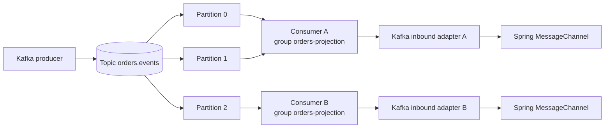
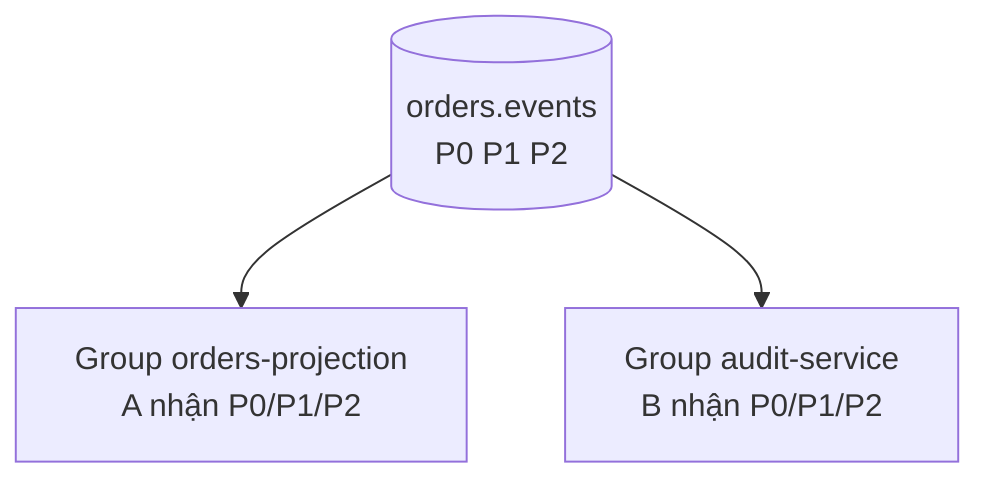
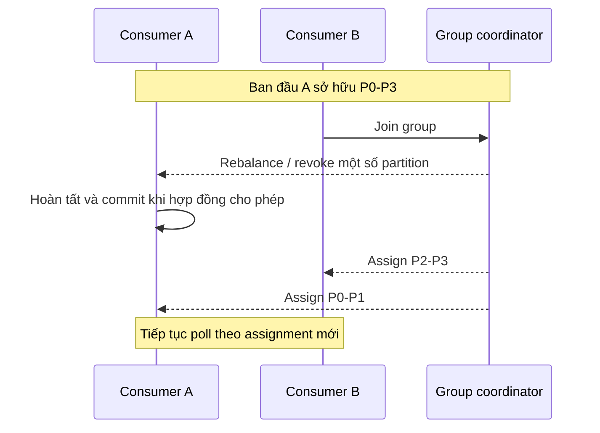
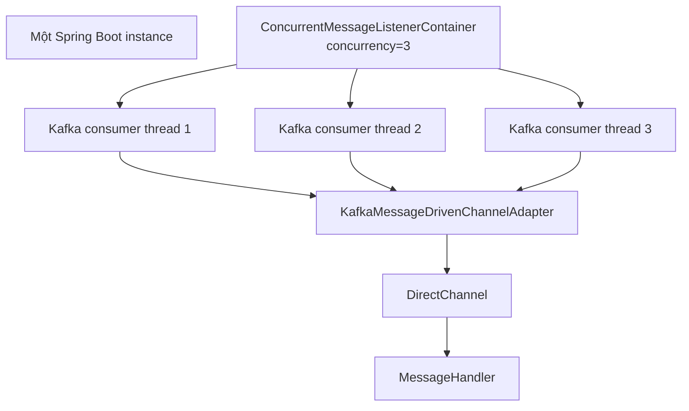
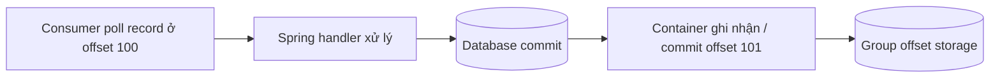
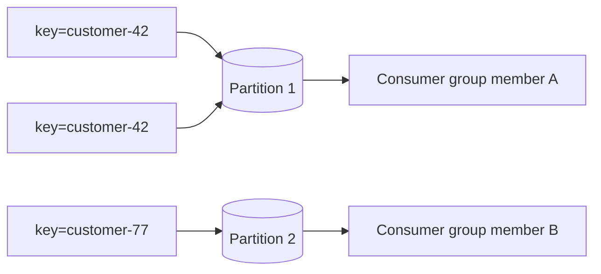

# Consumer group và partition assignment

Khi một ứng dụng Spring Integration nhận record từ Apache Kafka, việc một record được giao cho instance nào **không do tên `MessageChannel` hay số lượng `@ServiceActivator` quyết định**. Kafka phân phối công việc theo **consumer group** và **partition assignment**. Nếu cấu hình `group.id`, `concurrency` hoặc cơ chế rebalance sai, hệ thống có thể có consumer rảnh rỗi, tăng lag, mất thứ tự xử lý ở tầng nghiệp vụ hoặc xử lý lại record sau khi chuyển giao partition.

Bài thuộc chương **Adapter Kafka** trong module **SPRING_INTEGRATION_ADAPTERS**. Module sử dụng inbound/outbound adapter, gateway, poller và `MessageChannel` để kết nối file, SFTP, HTTP, JMS, AMQP, Kafka và cơ sở dữ liệu; đồng thời xử lý hợp đồng message, lỗi và vòng đời kết nối. Ở bài này, ta tập trung vào **Kafka consumer group và partition assignment** khi dùng Kafka inbound channel adapter, listener container và các flow Spring Integration.

> **Quy tắc nền tảng:** Trong một **Kafka consumer group thông thường**, mỗi partition được phân công cho **tối đa một consumer của group tại một thời điểm**. Một consumer có thể sở hữu nhiều partition; nhiều consumer vượt quá số partition có thể phải chờ không có việc. Đây không phải quy tắc của Kafka *share groups*, một mô hình khác với consumer group truyền thống.

## 1. Mục tiêu học tập

Sau bài học, bạn có thể:

1. Giải thích sự khác biệt giữa **topic**, **partition**, **Kafka consumer**, **consumer group**, **member assignment**, **consumer offset** và **committed offset**.
2. Dự đoán cách phân bố partition khi tăng `concurrency` hoặc số pod cùng `group.id`.
3. Phân biệt **hai group độc lập cùng đọc một topic** với **nhiều consumer cạnh tranh trong cùng group**.
4. Mô tả group coordinator, rebalance và các tình huống chuyển partition do scale, restart, timeout hoặc đổi metadata.
5. So sánh Range, RoundRobin, Sticky và CooperativeSticky; nhận biết khác biệt giữa Kafka group protocol `classic` và `consumer`.
6. Cấu hình `ConcurrentMessageListenerContainer`, `ConsumerFactory` và `KafkaMessageDrivenChannelAdapter` trong Spring Integration.
7. Quan sát assignment/revocation bằng `ConsumerAwareRebalanceListener` và Kafka CLI.
8. Phân tích ảnh hưởng của rebalance đến offset commit, acknowledgment, side effect, idempotency và ordering.
9. Thiết kế scale-out, static membership, monitoring, backpressure và quy trình xử lý sự cố production.

## 2. Từ vựng và bản đồ trách nhiệm



| Thuật ngữ | Bản chất | Vai trò |
|---|---|---|
| **Topic** | Tên log dữ liệu Kafka, gồm nhiều partition | Nhóm sự kiện cùng hợp đồng |
| **Partition** | Một log có thứ tự theo offset và được replication | Đơn vị Kafka phân công cho consumer |
| **Consumer** | Một client Kafka `KafkaConsumer` | Poll record, tham gia group |
| **Consumer group** | Các consumer có cùng `group.id` | Chia nhau đọc các partition được subscribe |
| **Assignment** | Tập `TopicPartition` mà một consumer sở hữu | Cho biết consumer nhận dữ liệu từ đâu |
| **Group coordinator** | Thành phần của Kafka broker quản lý group | Membership, rebalance, generation/epoch |
| **Current position** | Offset consumer sẽ lấy tiếp | Có thể tiến trước offset đã commit |
| **Committed offset** | Vị trí lưu cho group để khôi phục | Quyết định vị trí đọc sau reassignment/restart |
| **Lag** | Chênh lệch giữa log end offset và committed/processed position theo công cụ đo | Tín hiệu tồn đọng, không chứng minh hiệu quả nghiệp vụ |
| **Spring Integration channel** | Kênh giao tiếp trong tiến trình ứng dụng | Nối Kafka inbound adapter với handler |

**Hai tầng scheduling khác nhau:** Kafka quyết định *consumer nào sở hữu partition*. Sau đó Spring Integration mới quyết định *message từ adapter đi tới handler nào* dựa trên `MessageChannel`. Ví dụ, hai `EventDrivenConsumer` cùng subscribe một `DirectChannel` không làm Kafka cấp một partition cho cả hai; nó chỉ tạo nhiều handler cạnh tranh **bên trong Spring**.

## 3. Phân chia partition: ví dụ từng bước

Giả sử topic `orders.events` có sáu partition:

```text
orders.events:
  P0  P1  P2  P3  P4  P5
```

### 3.1. Một consumer trong group

```text
group.id = orders-projection
consumer A: P0, P1, P2, P3, P4, P5
```

Consumer A có thể lần lượt poll từ tất cả sáu partition. Thứ tự các record từ **một partition** được định nghĩa bởi offset, nhưng Kafka không tạo thứ tự toàn cục của sáu partition.

### 3.2. Hai consumer trong cùng group

```text
group.id = orders-projection
consumer A: P0, P1, P2
consumer B: P3, P4, P5
```

Đây là **một assignment minh họa**, không phải luôn đúng cho mọi assignor. Mỗi partition vẫn do tối đa một consumer trong group sở hữu. Hai consumer có thể cùng chạy trên một JVM hoặc ở hai pod khác nhau.

### 3.3. Bốn consumer trong cùng group

```text
group.id = orders-projection
consumer A: P0, P1
consumer B: P2, P3
consumer C: P4
consumer D: P5
```

Một assignor cố cân bằng tải có thể tạo phân bố 2–2–1–1; chiến lược, subscription và trạng thái ban đầu quyết định assignment cụ thể.

### 3.4. Tám consumer nhưng chỉ sáu partition

Tại một thời điểm, tối đa **sáu consumer** có thể nhận các partition từ **topic duy nhất sáu partition** này. Ít nhất hai consumer sẽ rảnh rỗi nếu cả tám chỉ subscribe topic đó.

```text
6 partitions / 8 consumers cùng group
    -> tối đa 6 consumers có assignment
    -> ít nhất 2 consumers không có partition
```

Tăng số JVM, số pod hoặc `concurrency` quá số partition **không tự tăng độ song song ở cấp Kafka partition**.

### 3.5. Hai group hoàn toàn khác nhau



Hai group riêng có **committed offsets độc lập**, nên mỗi group có thể xử lý toàn bộ dữ liệu topic theo vị trí đọc và retention tương ứng. Đây là cách phổ biến để xây nhiều logical subscribers độc lập như `orders-projection`, `audit-service` và `fraud-detector`.

**Không phải** hai group nhận record cùng mili giây, cũng không có nghĩa group mới sẽ đọc lại mọi record mãi mãi: điểm bắt đầu do offset đã commit và `auto.offset.reset` quyết định.

## 4. `group.id` là hợp đồng chia tải và tiến độ đọc

Một `group.id` xác định consumer thuộc logical subscriber nào, đồng thời là một phần của khóa lưu committed offset (cùng topic và partition).

| Cấu hình | Kết quả điển hình |
|---|---|
| Hai instance cùng `group.id`, cùng subscribe topic | Chia partition để xử lý cạnh tranh |
| Hai instance khác `group.id`, cùng subscribe topic | Mỗi group đọc độc lập |
| Đổi `group.id` từ `orders-v1` thành `orders-v2` | Đây là **group mới**, không tiếp tục offset cũ của `orders-v1` |
| Khởi động lại cùng `group.id` và có committed offset hợp lệ | Tiếp tục theo offset đã commit |
| Group chưa có committed offset | Áp dụng `auto.offset.reset` phù hợp |
| Hai Kafka listener container trong cùng process và cùng group | Chúng cũng có thể cạnh tranh partition |

### 4.1. `auto.offset.reset` không phải nút “phát lại từ đầu”

`auto.offset.reset=earliest` áp dụng khi group/partition không có committed offset hợp lệ (hoặc vị trí cũ không tồn tại nữa theo chính sách). Nó **không** buộc một group có committed offset hợp lệ đọc lại từ offset 0 mỗi khi ứng dụng restart.

Muốn replay có kiểm soát, phải hiểu retention và trạng thái group; sử dụng reset offsets khi consumer đã dừng, hoặc group ID riêng cho lần thử nghiệm. Đừng thay `group.id` production tùy tiện chỉ để “sửa lag”, vì có thể làm đọc lại rất nhiều record và gây side effect trùng.

### 4.2. `group.id` không thay cho business identity

- Group ID: định danh logical subscriber.
- Record key: quyết định partitioning theo producer policy, ví dụ `customerId`.
- `MessageHeaders.ID`: ID của Spring message.
- Business `eventId`: khóa đối chiếu/idempotency.
- Topic-partition-offset: địa chỉ một record Kafka trong một topic cụ thể.

Không dùng group ID hay offset đơn lẻ làm khóa nghiệp vụ toàn cục. Offset `7` của `orders.events-0` và offset `7` của `orders.events-1` là hai record khác nhau.

## 5. Rebalance xảy ra khi nào?

**Rebalance** là quá trình thay đổi quyền sở hữu partition giữa các thành viên trong group. Trong `classic` protocol, group coordinator theo dõi membership; việc lập kế hoạch assignment được thực hiện theo cơ chế leader/assignor của group. Khi một member rời hoặc gia nhập, một số partition được revoke và assign lại.



Những tình huống thường gây assignment thay đổi:

1. Scale-out: thêm pod hoặc tăng số consumer trong cùng group.
2. Scale-in, shutdown hoặc container stop: consumer rời group.
3. Process crash, network partition, mất heartbeat hoặc session timeout.
4. Handler giữ poll thread quá lâu, vượt `max.poll.interval.ms`.
5. Topic subscription/metadata thay đổi, ví dụ số partition tăng.
6. Điều chỉnh group protocol, assignor hoặc cấu hình membership.
7. Một consumer bị **fenced** khi dùng `group.instance.id` trùng trong static membership.

**Không phải mọi rebalance đều revoke toàn bộ partition.** Eager assignment có thể gây ngắt rộng; cooperative hoặc broker-driven incremental assignment cố giảm số partition bị di chuyển. Hành vi chi tiết phụ thuộc phiên bản Kafka, protocol và strategy.

### 5.1. Rebalance không có nghĩa dữ liệu Kafka bị xóa

Kafka vẫn lưu record theo retention. Điều thay đổi là **consumer nào được quyền đọc** một partition. Nếu offset chưa commit, consumer mới có thể đọc lại các record mà consumer cũ đã từng xử lý. Duplicate sau rebalance là điều hệ thống cần chuẩn bị, đặc biệt khi handler đã ghi DB nhưng offset chưa commit.

### 5.2. Lost khác revoked

- **Revoked:** container được báo rằng một số partition sẽ bị thu hồi, có cơ hội thực hiện bước chuyển giao phù hợp và commit các offset hợp lệ trước/đến thời điểm bàn giao.
- **Lost:** partition có thể đã thuộc về consumer khác; không nên coi như vẫn còn quyền thao tác/commit giống trường hợp revoke thông thường.

Khi implement callback, không tự gọi thủ công `onPartitionsRevoked` từ `onPartitionsLost` nếu framework đã quản lý chuỗi callback. Cần tuân thủ contract `ConsumerAwareRebalanceListener` và giới hạn Kafka consumer thread.

## 6. Các chiến lược partition assignment

Trong Kafka `classic` group protocol, `partition.assignment.strategy` chọn `ConsumerPartitionAssignor` tương thích giữa các thành viên. Những lựa chọn thông dụng:

| Assignor | Ý tưởng | Lưu ý |
|---|---|---|
| `RangeAssignor` | Chia partition **theo từng topic** thành dải liên tiếp | Nhiều topic cùng số partition có thể tập trung việc vào một nhóm consumer |
| `RoundRobinAssignor` | Phân phối partition theo vòng tới các member phù hợp | Có thể cân bằng tổng số partition tốt hơn khi subscription tương thích |
| `StickyAssignor` | Cân bằng nhưng cố giữ assignment cũ | Giảm partition movement so với chia lại hoàn toàn |
| `CooperativeStickyAssignor` | Sticky kết hợp cooperative/incremental revoke/assign | Giảm gián đoạn khi thay đổi membership, cần tương thích cả group |

### 6.1. Vì sao Range có thể làm nhiều consumer rảnh?

Giả sử ba topic `orders`, `payments`, `refunds`, **mỗi topic 5 partition**, và 15 consumer cùng subscribe cả ba. Với cách chia theo topic của Range, có thể chỉ **5 consumer** hoạt động, mỗi consumer nhận một partition từ **mỗi topic**, để lại 10 consumer không có assignment.

Trong cùng tình huống, `RoundRobinAssignor` có thể phân phối 15 partition đến nhiều consumer hơn. Đây là trường hợp cần quan sát assignment thật thay vì chỉ nhìn tổng partition hoặc `concurrency=15`.

### 6.2. Chọn strategy theo mục tiêu

- Ít topic, tất cả consumers subscribe giống nhau, muốn đơn giản: Range thường đủ.
- Nhiều topic và cần san đều số partition: cân nhắc RoundRobin.
- Muốn giảm chuyển partition khi scale: Sticky hoặc CooperativeSticky có thể phù hợp.
- Nếu yêu cầu giữ state theo partition (local cache, state store), cần đặc biệt quan tâm thời điểm revoke/lost và cách di chuyển state.

**Cấu hình phải phù hợp phiên bản và protocol.** Đặc biệt, nếu dùng `group.protocol=consumer` (giao thức mới), assignment được điều phối phía broker; `partition.assignment.strategy` kiểu client-side không phải công cụ điều khiển assignment như trong `classic`.

## 7. Hai giao thức group: `classic` và `consumer`

Kafka hiện đại hỗ trợ hai hướng điều phối group, tùy phiên bản broker/client:

| Đặc điểm | `classic` | `consumer` (giao thức mới) |
|---|---|---|
| Quyết định assignment | Client leader sử dụng assignor đã thương lượng | Broker-side group coordinator/assignor |
| Cách tổ chức rebalance | Eager hoặc cooperative tùy assignor | Incremental, broker-driven |
| Tùy chỉnh assignment | `partition.assignment.strategy` ở consumer | Server-side assignor và cơ chế lựa chọn được phiên bản hỗ trợ |
| Một số timeout/heartbeat | `heartbeat.interval.ms` do client điều chỉnh | Heartbeat interval do broker điều phối |
| Khả dụng | Phổ biến trên nhiều phiên bản Kafka | Cần broker/client/framework hỗ trợ KIP-848 |

Cấu hình minh họa khi dùng hệ sinh thái Kafka/Spring Kafka hỗ trợ:

```properties
# Chỉ dùng nếu broker/client và Spring Kafka tương thích:
spring.kafka.consumer.properties.group.protocol=consumer
```

Không nên ép property này trong dự án cũ: broker hoặc client không hỗ trợ có thể khiến consumer không tham gia group. Với Spring for Apache Kafka 4.0, tài liệu hỗ trợ giao thức mới và nêu rằng **custom client-side assignor bị bỏ qua** trong chế độ `consumer`.

**Đừng trộn trong cùng ví dụ** một đoạn ép `CooperativeStickyAssignor` và một đoạn `group.protocol=consumer` rồi khẳng định cả hai phối hợp để assignment; đó là hai cơ chế điều phối khác nhau.

## 8. Spring Kafka `ConcurrentMessageListenerContainer` ánh xạ concurrency thế nào?

`ConcurrentMessageListenerContainer` tạo các `KafkaMessageListenerContainer` con. Mỗi container con có một Kafka consumer, cùng tham gia group theo `ConsumerFactory` và group config.



`container.setConcurrency(3)` là **3 Kafka consumer clients** trong một ứng dụng, không phải 3 Kafka partitions mới. Assignment tính trên **tất cả consumer clients cùng group ở tất cả pods**.

### 8.1. Ví dụ tính tổng consumer

| Pod | `concurrency` | Consumer clients |
|---|---:|---:|
| Pod A | 2 | 2 |
| Pod B | 2 | 2 |
| Pod C | 2 | 2 |
| **Tổng** | — | **6** |

Với một topic có 4 partition, **tối đa 4/6 consumer** có assignment cho topic đó trong group. Thêm concurrency có thể tăng overhead, connection và rebalance mà không tạo thêm công việc hữu ích.

### 8.2. `@KafkaListener(concurrency=...)` so với adapter

Spring Kafka cho phép `@KafkaListener` dùng container factory/concurrency. Spring Integration `KafkaMessageDrivenChannelAdapter` thường nhận một listener container đã cấu hình. Cả hai đều dựa trên consumer group assignment của Kafka.

Không nhầm Kafka `concurrency` với `maxMessagesPerPoll` của Spring Integration poller hoặc số subscriber của `DirectChannel`. Chúng nằm ở **các lớp khác nhau**.

### 8.3. Nhiều topic, subscription và assignment

Khi `ContainerProperties("topicA", "topicB")` được dùng, Kafka sẽ phân bổ các partition theo group. Nếu dùng `ContainerProperties(TopicPartitionOffset...)`, container có thể **gán cố định partition** thay vì tham gia cơ chế `subscribe`/group balancing.

Phần này cần tách riêng: nếu cố định assignment, đừng kỳ vọng các pod tự chia lại partition khi scale như với group subscription.

## 9. Ví dụ hoàn chỉnh: Kafka inbound adapter và consumer group

Mục tiêu: hai hoặc nhiều instance Spring Boot cùng subscribe topic `orders.events` với `group.id=orders-projection-demo`. Mỗi instance có thể chạy 2 Kafka consumers. Mỗi record được gửi từ Kafka inbound adapter vào `ordersInput`, sau đó `@ServiceActivator` xử lý. Một rebalance listener giúp in log assignment/revocation.

### 9.1. Dependency Maven

Dùng Spring Boot parent/BOM quản lý các phiên bản Spring Integration và Spring Kafka tương thích:

```xml
<dependency>
    <groupId>org.springframework.boot</groupId>
    <artifactId>spring-boot-starter-integration</artifactId>
</dependency>
<dependency>
    <groupId>org.springframework.integration</groupId>
    <artifactId>spring-integration-kafka</artifactId>
</dependency>
```

### 9.2. application.properties

```properties
demo.kafka.bootstrap-servers=localhost:9092
demo.kafka.group-id=orders-projection-demo
demo.kafka.concurrency=2
```

**Chỉ một group demo:** Khi chạy nhiều instance cần giữ `group-id` giống nhau. Nếu muốn kiểm tra xử lý độc lập, chạy lần hai với group ID khác. Trong production, đặt ACL, TLS/SASL, serializer, retention và schema phù hợp.

### 9.3. Java configuration

```java
package com.example.kafka;

import java.util.Collection;
import java.util.HashMap;
import java.util.Map;

import org.apache.kafka.clients.consumer.Consumer;
import org.apache.kafka.clients.consumer.ConsumerConfig;
import org.apache.kafka.common.TopicPartition;
import org.apache.kafka.common.serialization.StringDeserializer;
import org.springframework.beans.factory.annotation.Qualifier;
import org.springframework.beans.factory.annotation.Value;
import org.springframework.context.annotation.Bean;
import org.springframework.context.annotation.Configuration;
import org.springframework.integration.channel.DirectChannel;
import org.springframework.integration.config.EnableIntegration;
import org.springframework.integration.kafka.inbound.KafkaMessageDrivenChannelAdapter;
import org.springframework.kafka.core.ConsumerFactory;
import org.springframework.kafka.core.DefaultKafkaConsumerFactory;
import org.springframework.kafka.listener.ConcurrentMessageListenerContainer;
import org.springframework.kafka.listener.ConsumerAwareRebalanceListener;
import org.springframework.kafka.listener.ContainerProperties;
import org.springframework.messaging.MessageChannel;

@Configuration
@EnableIntegration
public class OrdersGroupConfig {

    @Bean("ordersConsumerFactory")
    public ConsumerFactory<String, String> ordersConsumerFactory(
            @Value("${demo.kafka.bootstrap-servers}") String brokers,
            @Value("${demo.kafka.group-id}") String groupId) {

        Map<String, Object> properties = new HashMap<>();
        properties.put(ConsumerConfig.BOOTSTRAP_SERVERS_CONFIG, brokers);
        properties.put(ConsumerConfig.GROUP_ID_CONFIG, groupId);
        properties.put(ConsumerConfig.KEY_DESERIALIZER_CLASS_CONFIG,
                StringDeserializer.class);
        properties.put(ConsumerConfig.VALUE_DESERIALIZER_CLASS_CONFIG,
                StringDeserializer.class);
        properties.put(ConsumerConfig.ENABLE_AUTO_COMMIT_CONFIG, false);
        properties.put(ConsumerConfig.AUTO_OFFSET_RESET_CONFIG, "earliest");
        properties.put(ConsumerConfig.CLIENT_ID_CONFIG, "orders-projection");

        // Có thể cấu hình assignor cho group.protocol=classic.
        // Không ép strategy khi muốn dùng group.protocol=consumer.
        return new DefaultKafkaConsumerFactory<>(properties);
    }

    @Bean("ordersInput")
    public MessageChannel ordersInput() {
        return new DirectChannel();
    }

    @Bean("ordersKafkaInbound")
    public KafkaMessageDrivenChannelAdapter<String, String>
    ordersKafkaInbound(
            @Qualifier("ordersConsumerFactory")
                    ConsumerFactory<String, String> factory,
            @Qualifier("ordersInput") MessageChannel outputChannel,
            @Value("${demo.kafka.concurrency}") int concurrency) {

        ContainerProperties cp =
                new ContainerProperties("orders.events");
        cp.setAckMode(ContainerProperties.AckMode.RECORD);

        cp.setConsumerRebalanceListener(
                new ConsumerAwareRebalanceListener() {

                    @Override
                    public void onPartitionsAssigned(
                            Consumer<?, ?> consumer,
                            Collection<TopicPartition> partitions) {
                        System.out.println("ASSIGNED " + partitions);
                    }

                    @Override
                    public void onPartitionsRevokedBeforeCommit(
                            Consumer<?, ?> consumer,
                            Collection<TopicPartition> partitions) {
                        System.out.println("REVOKED " + partitions);
                        // Chỉ log: framework/container vẫn chịu trách
                        // nhiệm commit theo AckMode và error policy.
                    }

                    @Override
                    public void onPartitionsLost(
                            Consumer<?, ?> consumer,
                            Collection<TopicPartition> partitions) {
                        System.err.println("LOST " + partitions);
                    }
                });

        ConcurrentMessageListenerContainer<String, String> container =
                new ConcurrentMessageListenerContainer<>(factory, cp);
        container.setConcurrency(concurrency);

        KafkaMessageDrivenChannelAdapter<String, String> adapter =
                new KafkaMessageDrivenChannelAdapter<>(
                        container,
                        KafkaMessageDrivenChannelAdapter.ListenerMode.record);
        adapter.setOutputChannel(outputChannel);
        return adapter;
    }
}
```

Trong code, `ContainerProperties("orders.events")` là **topic subscription**; Kafka tự assignment theo group. Nếu thay bằng danh sách `TopicPartitionOffset` cố định, cơ chế assignment sẽ khác. `client.id` giúp quan sát client; Spring Kafka có thể thêm hậu tố cho các consumer con nhằm phân biệt metrics/JMX.

### 9.4. Downstream consumer Spring Integration

```java
package com.example.kafka;

import org.springframework.integration.annotation.ServiceActivator;
import org.springframework.kafka.support.KafkaHeaders;
import org.springframework.messaging.Message;
import org.springframework.stereotype.Component;

@Component
public class OrdersProjectionHandler {

    @ServiceActivator(inputChannel = "ordersInput")
    public void handle(Message<String> message) {
        String event = message.getPayload();

        Object topic = message.getHeaders()
                .get(KafkaHeaders.RECEIVED_TOPIC);
        Object partition = message.getHeaders()
                .get(KafkaHeaders.RECEIVED_PARTITION);
        Object offset = message.getHeaders()
                .get(KafkaHeaders.OFFSET);
        Object key = message.getHeaders()
                .get(KafkaHeaders.RECEIVED_KEY);

        // Demo: production cần transaction DB và idempotency.
        System.out.printf(
                "PROCESS thread=%s topic=%s part=%s offset=%s "
                        + "key=%s value=%s%n",
                Thread.currentThread().getName(),
                topic, partition, offset, key, event);
    }
}
```

Đặt class `@SpringBootApplication` trong package `com.example.kafka` hoặc package cha. Với `DirectChannel`, handler thường xử lý đồng bộ trên thread Kafka listener; exception có thể quay về container khi không bị xử lý/suppress ở tầng trung gian.

### 9.5. Kết quả dự kiến

Chạy một instance: log `ASSIGNED [...]` có thể chứa nhiều partition. Chạy instance thứ hai **cùng group**: group rebalance, assignment chuyển giữa các Kafka consumers; một số partition sẽ xuất hiện ở instance mới. Dừng instance thứ hai: partition có thể được phân lại cho instance đầu.

**Không kỳ vọng mỗi bản ghi xuất hiện ở mọi instance.** Trong cùng group, một record từ partition được giao cho consumer sở hữu partition đó. Chỉ khi có **group thứ hai** thì logical subscriber thứ hai mới độc lập nhận dữ liệu theo offset của nó.

## 10. Thực hành với Kafka CLI

### 10.1. Tạo topic thử nghiệm

Trên máy có Kafka CLI và một broker local:

```bash
kafka-topics.sh --bootstrap-server localhost:9092 \
  --create --if-not-exists \
  --topic orders.events --partitions 6 --replication-factor 1
```

Lệnh này phù hợp môi trường học tập. Production có thể không cho phép tự tạo topic; replication factor 1 cũng không phải cấu hình chịu lỗi broker.

### 10.2. Gửi record có key

```bash
kafka-console-producer.sh \
  --bootstrap-server localhost:9092 \
  --topic orders.events \
  --property parse.key=true \
  --property key.separator=:
```

Nhập:

```text
customer-1:order-101-created
customer-1:order-102-created
customer-2:order-201-created
customer-1:order-101-paid
```

Nếu producer sử dụng partitioner nhất quán và số partition không đổi, record có cùng key thường được đặt vào cùng partition. Điều này **không** có nghĩa mọi record khác key đều đi sang partition khác.

### 10.3. Xem group và assignment

Sau khi ứng dụng đã join group:

```bash
# Committed offsets, log end offset, lag theo partition:
kafka-consumer-groups.sh \
  --bootstrap-server localhost:9092 \
  --describe --group orders-projection-demo

# Thành viên và assignment chi tiết:
kafka-consumer-groups.sh \
  --bootstrap-server localhost:9092 \
  --describe --group orders-projection-demo \
  --members --verbose
```

Tùy phiên bản Kafka CLI, định dạng output có thể khác. Chỉ số cần ghi lại:

| Trường | Ý nghĩa |
|---|---|
| `GROUP` | Consumer group đang quan sát |
| `TOPIC` / `PARTITION` | Địa chỉ partition |
| `CURRENT-OFFSET` | Offset đã commit của group |
| `LOG-END-OFFSET` | Vị trí cuối log tương ứng công cụ |
| `LAG` | Chênh lệch giữa log end và committed position |
| `CONSUMER-ID` | Consumer member thực tế |
| `HOST` | Nơi consumer đang chạy |
| `CLIENT-ID` | Client ID để đối chiếu Spring Kafka metrics |
| `ASSIGNMENT` | Danh sách partition thuộc thành viên |

Nếu consumer chưa commit offset, một số trường có thể hiện `-` hoặc thông tin trống. Đừng đọc giá trị lag khi group đang rebalance như một chân lý tuyệt đối ở mọi thời điểm.

### 10.4. Quan sát 4 kịch bản

1. Chạy 1 instance, concurrency 2; lưu assignment.
2. Khởi động instance thứ hai cùng group; đối chiếu assignment và log rebalance.
3. Tắt instance thứ hai; quan sát partition chuyển lại.
4. Đổi group ID ở instance thứ hai; kiểm tra hai group độc lập cùng subscribe topic.

Làm thí nghiệm bằng **topic demo** và payload không nhạy cảm. Không reset offsets hoặc đổi group production trong quá trình học tập.

## 11. Group assignment khác gán partition cố định

Một sự khác biệt quan trọng của Spring Kafka là hai cách tạo `ContainerProperties`:

### 11.1. Topic subscription — Kafka group quyết định

```java
ContainerProperties cp =
        new ContainerProperties("orders.events");

ConcurrentMessageListenerContainer<String, String> container =
        new ConcurrentMessageListenerContainer<>(consumerFactory, cp);
container.setConcurrency(3);
```

Với subscription, consumer tham gia group và Kafka phân công các partition. Khi scale, crash hoặc metadata thay đổi, group có thể rebalance.

### 11.2. Explicit partition assignment — ứng dụng quyết định

```java
import org.springframework.kafka.support.TopicPartitionOffset;

ContainerProperties cp = new ContainerProperties(
        new TopicPartitionOffset("orders.events", 0),
        new TopicPartitionOffset("orders.events", 1));

ConcurrentMessageListenerContainer<String, String> container =
        new ConcurrentMessageListenerContainer<>(consumerFactory, cp);
container.setConcurrency(2);
```

Ở đây container được chỉ định hai `TopicPartitionOffset`. Spring Kafka phân chia các partition đã liệt kê cho consumer con. Nó **không dựa vào group coordinator để cân bằng tự động các partition này giữa các pod** như trong chế độ subscribe.

**Hệ quả nghiêm trọng:** Nếu triển khai hai pod với cùng cấu hình explicit assignment `P0, P1`, cả hai có thể cùng đọc các partition ấy một cách độc lập. Chúng không tự động phân chia P0 cho pod A và P1 cho pod B chỉ vì cùng `group.id`. Có nguy cơ side effect trùng hoặc tranh chấp offset. Dùng explicit assignment chỉ khi bạn thực sự chịu trách nhiệm sở hữu partition, failover và offset.

### 11.3. Tình huống sử dụng explicit assignment

- Nhu cầu pin partition theo thiết bị/job hoặc xử lý dữ liệu đặc thù.
- Khôi phục thủ công một số partition bằng consumer riêng.
- Consumer kiểm thử chỉ muốn đọc các partition được chọn.
- Một hệ thống quản lý partition ownership **ngoài Kafka group balancing**.

Trong ứng dụng nghiệp vụ scale tự động bằng Kubernetes, **topic subscription** thường đơn giản và an toàn hơn.

## 12. Offset, acknowledgment và rebalance

Mỗi consumer duy trì **current position** cho từng partition; group lưu **committed offset** để khôi phục. Chúng có thể khác nhau.



Sơ đồ trên là **kịch bản lý tưởng**: consumer xử lý thành công record offset 100 rồi commit **next offset 101**. Ranh giới thực tế phụ thuộc `AckMode`, error handler, transaction và việc flow đồng bộ hay bất đồng bộ.

### 12.1. Vì sao offset commit thường là “offset kế tiếp”?

Nếu Kafka record đã xử lý có offset `100`, committed offset thường là `101`, nghĩa là lần đọc tiếp theo bắt đầu tại vị trí 101. Không hiểu nhầm `CURRENT-OFFSET=101` thành “record 101 đã được commit DB”.

### 12.2. Mất partition trước khi commit

Giả sử:

```text
T0: Consumer A nhận record offset 100
T1: Consumer A ghi database thành công
T2: Group rebalance; P0 chuyển cho consumer B
T3: Offset 101 chưa commit thành công
T4: Consumer B đọc lại từ committed offset cũ
```

Consumer B có thể nhận lại record offset 100. Nếu DB không có idempotency, side effect bị lặp. Đây là một failure window điển hình của **at-least-once**.

### 12.3. `AckMode.RECORD` và lỗi xử lý

Trong chế độ record listener, `AckMode.RECORD` của Spring Kafka quản lý offset sau callback record xử lý thành công theo chính sách container. Nếu `DirectChannel` dispatch handler đồng bộ và handler ném exception, container có thể áp dụng error handler/retry khi exception không bị chặn.

**Tuy nhiên:**

- `AckMode.RECORD` không tạo transaction chung với JDBC, HTTP hoặc SFTP.
- Error channel có thể xử lý exception thành công, khiến Kafka container không còn thấy lỗi.
- Nếu handler trả về sớm nhưng side effect chạy ở thread khác, callback không còn phản ánh kết quả thực.
- Nếu ứng dụng chết sau DB commit nhưng trước Kafka commit, record có thể bị phát lại.

### 12.4. Channel bất đồng bộ thay đổi ranh giới ack

```text
Kafka listener
  -> KafkaMessageDrivenChannelAdapter
  -> QueueChannel.enqueue(record)  [callback thành công]
  -> container có thể commit offset

Sau đó:
  -> PollingConsumer.dequeue
  -> JDBC handler [có thể thất bại]
```

Nếu `QueueChannel` ở RAM, offset đã commit mà JVM crash trước DB commit, record có thể **mất khỏi luồng nghiệp vụ**. Cần durable handoff hoặc thiết kế ack/transaction đúng contract nếu muốn tách Kafka listener khỏi handler. Việc thêm một queue không tự giải quyết idempotency hay exactly-once.

## 13. Rebalance listener: làm gì và không nên làm gì?

Trong ví dụ mục 9, `ConsumerAwareRebalanceListener` nhận các callback về assignment, revoked và lost partitions.

| Callback | Thời điểm khái quát | Hành động phù hợp |
|---|---|---|
| `onPartitionsAssigned` | Partition được giao cho consumer | Khởi tạo state theo partition, metric/log |
| `onPartitionsRevokedBeforeCommit` | Sắp trả partition trước bước commit pending offsets của container | Chuyển trạng thái draining, hoàn tất công việc hợp lệ theo deadline |
| `onPartitionsRevokedAfterCommit` | Sau khi container xử lý pending commit | Ghi state/tracing, cleanup theo contract |
| `onPartitionsLost` | Quyền sở hữu partition đã mất | Không coi mình còn có quyền commit/ghi state cho partition ấy |

**Không đặt việc gọi HTTP lâu hoặc xử lý batch lớn vào rebalance callback.** Nó chạy trong bối cảnh nhạy cảm về consumer thread và group coordination. Block quá lâu làm tăng downtime, khiến group tiếp tục không ổn định và có thể làm timeout.

Nếu lưu offset/state ở kho riêng, chỉ ghi những giá trị mà ứng dụng đã xác nhận thật sự xử lý thành công; không lấy `consumer.position()` đơn thuần thay cho “đã commit nghiệp vụ”.

### 13.1. Cooperative/incremental rebalance

Với cooperative strategy hoặc giao thức `consumer`, mỗi lần callback có thể nói về **một tập con partition nhỏ** thay vì luôn tất cả partition. Logic cleanup cần xử lý từng partition, không xóa toàn bộ cache chỉ vì nhận một sự kiện rebalance.

### 13.2. Kết hợp idempotency với business DB

Khi handler nhận message có `eventId`, một cách phòng tránh trùng phổ biến:

```sql
-- Schema minh họa, cần điều chỉnh theo database thực tế.
CREATE TABLE processed_events (
    event_id VARCHAR(128) PRIMARY KEY,
    processed_at TIMESTAMP NOT NULL
);
```

Trong **cùng một DB transaction** với side effect nghiệp vụ, ghi/kiểm tra `event_id` theo cơ chế atomic thích hợp. Khi Kafka redeliver record, duplicate bị nhận diện và handler có thể xác nhận theo policy mà không chạy lại side effect. Không dùng `topic-partition-offset` như business key nếu event có thể được replay sang topic khác.

## 14. Static membership với `group.instance.id`

**Dynamic membership** cho phép broker cấp member ID theo phiên tham gia group. **Static membership** dùng `group.instance.id` để nhận diện một consumer instance ổn định qua restart, giảm một số rebalance không cần thiết.

Cấu hình minh họa:

```properties
# Chỉ dùng khi mỗi process/pod có group.instance.id riêng và ổn định:
spring.kafka.consumer.properties.group.instance.id=orders-projection-pod-0
```

Các nguyên tắc quan trọng:

- **Không được trùng `group.instance.id` giữa hai consumer đang hoạt động trong cùng group**; duplicate có thể khiến consumer bị fenced.
- Với Spring Kafka `ConcurrentMessageListenerContainer`, khi concurrency > 1 và hỗ trợ static membership, framework có thể thêm hậu tố `-n` vào base instance ID để tạo ID cho các consumer con. Cần xác minh cách đặt tên ở phiên bản đang dùng.
- Static membership phù hợp với pod có danh tính ổn định (ví dụ một số mô hình StatefulSet). Pod có ID ngẫu nhiên mỗi lần deploy không đạt mục tiêu ổn định.
- Session timeout lớn có thể **giảm rebalance khi restart ngắn**, nhưng cũng có thể **làm failover chậm hơn khi member thật sự chết**.
- Static membership **không thay thế** business idempotency, offset commit hoặc readiness.

### 14.1. Rebalance không phải lúc nào cũng là bug

Scale-out có chủ đích hoặc cập nhật assignment do thêm partition là hoạt động bình thường. Điều cần điều tra là **rebalance diễn ra quá thường xuyên**, mất nhiều thời gian hoặc khiến lag/duplicate tăng không kiểm soát.

## 15. Partition key, ordering và phân bố tải

Kafka producer chọn partition dựa trên partition được chỉ định, key/partitioner và cấu hình client. Consumer group **không** quyết định record được ghi vào partition nào; nó chỉ quyết định consumer nào **đọc** partition ấy.



**Ordering:**

- Kafka giữ thứ tự offset **bên trong partition**.
- Nếu producer gửi cùng key vào cùng partition và consumer xử lý tuần tự, việc xử lý theo key có thể giữ được thứ tự record.
- Không có thứ tự tổng thể của mọi partition.
- `ExecutorChannel` nhiều thread hoặc handler bất đồng bộ có thể khiến **thứ tự hoàn tất side effect** khác offset, ngay cả khi record được lấy đúng thứ tự.
- Khi **tăng số partition**, ánh xạ key → partition có thể thay đổi, ảnh hưởng giả định ordering lịch sử.

### 15.1. Hot partition và giới hạn scale-out

Nếu 80% traffic có cùng key hoặc được ép vào một partition, partition đó vẫn do một consumer của group sở hữu. Việc tăng từ 3 lên 30 consumer không làm riêng partition này được đọc song song bởi 30 consumer theo mô hình consumer group truyền thống.

Có thể cần:

1. Đánh giá phân phối key và partition metrics.
2. Xem lại mô hình key nếu nghiệp vụ cho phép sharding.
3. Tối ưu handler và batch processing cho partition nóng.
4. Tăng partitions với kế hoạch migration và ordering.
5. Tách heavy events sang topic/flow riêng nếu phù hợp.

Không chọn partitioner ngẫu nhiên nếu yêu cầu xử lý đúng thứ tự theo aggregate còn tồn tại.

## 16. Một công thức capacity đơn giản

Với **một topic** có `P` partition và tổng `C` Kafka consumer clients thuộc cùng group:

```text
Số consumer tối đa có công việc từ topic đó <= min(P, C)
```

Ví dụ:

| P | Số pod | Concurrency/pod | Tổng C | Max consumers hoạt động từ topic |
|---:|---:|---:|---:|---:|
| 3 | 1 | 1 | 1 | 1 |
| 3 | 1 | 3 | 3 | 3 |
| 3 | 2 | 2 | 4 | 3 |
| 6 | 3 | 2 | 6 | 6 |
| 6 | 3 | 4 | 12 | 6 |

Đây chỉ là **giới hạn lý thuyết về assignment**, không phải dự báo throughput tuyến tính. Một consumer có thể đang sở hữu partition nhưng không có record mới; số partition được phân đều vẫn không bảo đảm tải đều.

### 16.1. Tính throughput từ nút thắt

Ví dụ mỗi consumer xử lý 100 event/giây với downstream đủ khỏe, thì 4 consumer hoạt động có thể đạt khoảng 400 event/giây trong điều kiện thuận lợi. Nhưng nếu DB chỉ ghi được 250 event/giây, tăng lên 8 consumer có thể làm DB nghẽn, timeout và lag tăng.

Mỗi lần chỉnh `concurrency` phải xem:

- Consumer lag theo partition.
- Poll time, handler latency và `max.poll.interval.ms`.
- CPU/GC/memory, connection pool của DB/HTTP.
- Retry, rebalance count và error handling.
- Broker fetch/throughput, network và message size.
- Thứ tự và khả năng xử lý lại record.

### 16.2. Tương quan với Kubernetes

Scale pod làm thay đổi **tổng consumer trong group** và có thể kích hoạt rebalance. Nếu dùng HPA theo lag, cần đặt giới hạn sao cho scale không dao động quá nhanh. Ngừng pod cần graceful shutdown và cơ chế offset/side-effect phù hợp; Kubernetes SIGTERM không tự flush mọi công việc trong Spring Integration.

## 17. Group membership, timeout và health

Những cấu hình dễ nhầm:

| Property | Tác động chính |
|---|---|
| `group.id` | Định danh consumer group và namespace committed offset |
| `client.id` | Định danh consumer để theo dõi metrics/traces |
| `group.instance.id` | Danh tính static member, cần duy nhất trong group |
| `session.timeout.ms` | Phát hiện member không còn sống theo group protocol |
| `heartbeat.interval.ms` | Khoảng heartbeat với giao thức `classic` |
| `max.poll.interval.ms` | Giới hạn giữa các lần poll; xử lý blocking quá lâu có thể khiến group thay ownership |
| `max.poll.records` | Số record tối đa trả về mỗi consumer poll, không phải batch size cố định |
| `partition.assignment.strategy` | Chọn client-side assignor cho `classic` |
| `group.protocol` | Chọn `classic` hoặc `consumer` khi được hỗ trợ |
| `auto.offset.reset` | Vị trí đọc nếu không có committed offset hợp lệ |
| `enable.auto.commit` | Kafka client có tự commit offset theo thời gian không |

**Điểm cần nhớ:** Với `group.protocol=consumer`, một số tùy chọn heartbeat/session thuộc phía broker và client-side assignment strategy có ngữ nghĩa khác hoặc không áp dụng. Hãy tham khảo tài liệu **đúng phiên bản broker/client** trước khi tune.

### 17.1. Container running chưa chắc consumer có assignment

`adapter.isRunning() == true` hoặc `container.isRunning() == true` có thể đi cùng với:

- Consumer đang join/rebalance, chưa có partition.
- Số consumer lớn hơn số partition.
- Group đang pause hoặc topic không có record mới.
- Broker không truy cập được hoặc không đủ ACL.
- Handler processing chậm khiến lag vẫn tăng.

Do đó readiness cần kiểm tra **assignment, lag, last-successful-processing và tình trạng downstream**, không chỉ trạng thái bean Spring.

## 18. Chẩn đoán những tình huống thường gặp

| Triệu chứng | Giả thuyết | Hướng kiểm chứng |
|---|---|---|
| 4 pod nhưng chỉ một pod xử lý | Topic chỉ có một partition hoặc key quá lệch | Xem số partition và assignment group |
| `concurrency=10` nhưng nhiều thread rảnh | Quá ít partition hoặc RangeAssignor đa topic | `--members --verbose`, assignor |
| Hai service cùng group nhưng một service không nhận record | Chúng đang chia partition, không phải hai logical subscribers | Chọn group ID riêng nếu cần xử lý độc lập |
| Sau restart toàn bộ record cũ được đọc lại | Group ID đổi hoặc không có offset hợp lệ | Kiểm tra committed offset, `auto.offset.reset`, retention |
| Duplicate DB sau rebalance | Side effect commit trước Kafka offset commit | Idempotency, ack/error policy, transaction |
| Rebalance liên tục | Handler blocking lâu, mạng lỗi, member join/leave liên tục | `max.poll.interval.ms`, rebalance events, heartbeat, HPA |
| Một static member không start được | `group.instance.id` trùng với member khác | Kiểm tra fencing và ID per instance |
| Group có lag nhưng adapter running | Không có assignment, downstream chậm hoặc channel bất đồng bộ | Metrics per partition, handler latency, queue depth |
| Tăng partition mà throughput không tăng | Key skew, DB bottleneck, consumer count không phù hợp | Phân phối key/lag, DB metrics |
| Đổi sang `QueueChannel` rồi record mất sau crash | Offset đã commit trước khi handler hoàn tất; queue RAM | Durable handoff, ack boundary |
| Consumer B đọc lại offset đã xử lý bởi A | Rebalance và committed offset chưa cập nhật | Crash window, idempotency store |
| Explicit assignment gây duplicate giữa pods | Cùng pin một partition ở nhiều instance | Xem `TopicPartitionOffset` thay vì `subscribe()` |

### 18.1. Quy trình điều tra an toàn

1. Xác định đúng **topic, group ID, số partition, số pod và concurrency mỗi pod**.
2. Xem Kafka CLI `--describe --group` và `--members --verbose`.
3. Ghép `client.id`, hostname/pod và assignment từ log rebalance.
4. Kiểm tra `last processed offset`, committed offset và lag, phân biệt chúng.
5. Đối chiếu handler latency, error rate, DB/HTTP capacity và Kafka client timeouts.
6. Xác định lỗi có phát sinh duplicate do rebalance/retry không; kiểm tra business idempotency.
7. Thay đổi **một biến mỗi lần**: concurrency, assignor, poll batch, session/heartbeat, instance count.
8. Đo lại và ghi nhận kết quả. Không reset offset production khi chưa có kế hoạch replay/rollback.

## 19. Bài tập thực hành

### Bài 1 — Vẽ assignment cho một topic

Topic có 8 partition. Vẽ một assignment có thể có cho 1, 2, 4, 8 và 10 consumers cùng group. Nêu tối đa bao nhiêu consumers thực sự có partition ở mỗi trường hợp.

### Bài 2 — Hai group cùng một topic

Chạy hai ứng dụng cùng subscribe `orders.events` nhưng dùng `group.id` khác nhau. Gửi năm record. Kiểm tra mỗi group có committed offset độc lập. Sau đó chuyển sang cùng group và quan sát việc chia partition.

### Bài 3 — Concurrency qua nhiều pod

Chạy ví dụ mục 9 với 2 pod, mỗi pod `concurrency=2` và topic 6 partition. Dùng `kafka-consumer-groups.sh --members --verbose` vẽ assignment thực tế. Tăng concurrency lên 4/pod và giải thích consumer nào rảnh.

### Bài 4 — Multi-topic Range vs RoundRobin

Tạo 3 topic, mỗi topic 5 partition; 15 consumers subscribe tất cả. Quan sát với `RangeAssignor` của `classic`, sau đó thử `RoundRobinAssignor` trong môi trường riêng. Ghi lại số consumer active và số partition/member. Không giả định mọi version Kafka có cùng default assignor.

### Bài 5 — Rebalance có chủ đích

Khởi động một instance, sau đó thêm instance thứ hai và dừng instance đầu. Thu thập log `ASSIGNED`, `REVOKED` và `LOST`. Khi nào có thể thấy callback `LOST`? Vì sao không nên commit offset thủ công sau khi mất ownership?

### Bài 6 — Crash sau commit DB

Cho handler ghi DB thành công rồi crash trước khi Kafka offset commit. Tạo bảng `processed_events` với unique constraint trên `eventId` và thực hiện kiểm tra idempotent. Xác minh record được phát lại không tạo side effect trùng.

### Bài 7 — Explicit assignment

Tạo hai instance đều cấu hình `TopicPartitionOffset("orders.events",0)`. Quan sát chúng có thể đọc cùng partition thay vì tự chia theo group. Giải thích vì sao cấu hình này nguy hiểm nếu copy y hệt lên nhiều pod.

### Bài 8 — Hot partition

Gửi 90% record với cùng `customerId`. Xem lag theo partition và CPU/latency per consumer. Nếu tăng concurrency gấp đôi mà lag của partition nóng không giảm, hãy đề xuất thay đổi key, batch hoặc mô hình dữ liệu phù hợp yêu cầu ordering.

### Bài 9 — Static membership

Trên một cluster và Spring Kafka version hỗ trợ, cấu hình `group.instance.id` duy nhất cho từng pod có danh tính ổn định. So sánh thời gian rebalance khi rolling restart với dynamic membership. Phân tích trade-off khi session timeout quá dài và pod chết thật.

### Bài 10 — Giao thức `classic` và `consumer`

Trên Kafka 4.x có hỗ trợ, so sánh assignment/rebalance khi dùng `group.protocol=classic` với `group.protocol=consumer`. Quan sát số lần callback partial assignment, cảnh báo về client assignor không được dùng ở protocol mới, và các property timeout phù hợp. Không thực hiện trực tiếp trên production group.

### Bài 11 — MessageChannel bất đồng bộ

Thay `DirectChannel` trong ví dụ bằng `QueueChannel` RAM và một polling consumer ghi DB. Cho listener enqueue xong rồi kill JVM trước khi handler commit. Xác định ranh giới mất dữ liệu và đề xuất durable message store/outbox hoặc cách phối hợp ack khác.

### Bài 12 — Thiết kế scale-out production

Hệ thống có 12 partition, 3 pod, mỗi pod 3 consumer; DB cho phép tối đa 400 updates/giây. Dữ liệu có key skew và retry rate tăng khi scale. Lập kế hoạch kiểm tra từ partition lag, handler p95, connection pool và rebalance trước khi đề xuất tăng lên 6 consumer/pod.

## 20. Câu hỏi tự kiểm tra

1. Một partition có thể đồng thời được giao cho hai consumer trong **cùng consumer group truyền thống** không?
2. Consumer group và Kafka share group có cùng hợp đồng assignment không?
3. Hai group khác nhau có cùng committed offset không?
4. `client.id` và `group.id` khác nhau thế nào?
5. `concurrency` của `ConcurrentMessageListenerContainer` tạo thêm partition hay consumer?
6. Với 4 partition và 10 consumers cùng group, tối đa bao nhiêu consumer sở hữu partition?
7. Vì sao `RangeAssignor` với nhiều topic có thể để nhiều consumer rảnh?
8. Cooperative rebalance khác eager rebalance ở việc revoke partition ra sao?
9. `group.protocol=consumer` có dùng client-side `partition.assignment.strategy` như `classic` không?
10. `group.instance.id` phải được cấp như thế nào khi chạy nhiều pods?
11. Điều gì xảy ra khi consumer giữ poll thread quá lâu so với `max.poll.interval.ms`?
12. `TopicPartitionOffset` explicit assignment khác subscribe topic ở đâu?
13. Offset đã commit thường chỉ vị trí record cuối đã xử lý hay vị trí **kế tiếp**?
14. Nếu DB commit thành công nhưng Kafka offset chưa commit, có thể xảy ra hiện tượng gì?
15. Vì sao `isRunning=true` không chứng minh consumer đã được assign partition?
16. Tại sao tăng số partition có thể ảnh hưởng ordering theo key?
17. Kafka rebalance listener nên xử lý thế nào khi nhận `onPartitionsLost`?
18. Nếu consumer lag bằng 0 nhưng queue nội bộ còn 1.000 message, có thể kết luận flow hoàn tất không?

## 21. Tổng kết

**Consumer group** là đơn vị chia tải và theo dõi committed offset của một logical subscriber Kafka; **partition assignment** xác định Kafka consumer nào thực sự sở hữu từng partition. Trong Spring Integration, một `KafkaMessageDrivenChannelAdapter` nhận record qua listener container rồi phát Spring message tới channel, nhưng chính Kafka group protocol mới điều phối partition giữa các consumer trên mọi JVM/pod cùng `group.id`.

Thiết kế đúng phải kết hợp **số partition, tổng concurrency, assignor/protocol, rebalance, committed offset, business idempotency và năng lực downstream**. Đừng chỉ tăng số consumer hoặc nhìn trạng thái `running=true`. Cần quan sát assignment, lag theo partition, handler latency và kết quả nghiệp vụ; kiểm thử những thời điểm crash/rebalance để bảo vệ dữ liệu khi nối Kafka với file, SFTP, HTTP, JMS, AMQP hoặc cơ sở dữ liệu.

## Tài liệu tham khảo

- [Spring Integration Reference — Apache Kafka Support](https://docs.spring.io/spring-integration/reference/kafka.html)
- [Spring Integration API — KafkaMessageDrivenChannelAdapter](https://docs.spring.io/spring-integration/api/org/springframework/integration/kafka/inbound/KafkaMessageDrivenChannelAdapter.html)
- [Spring Kafka Reference — Message Listener Containers](https://docs.spring.io/spring-kafka/reference/kafka/receiving-messages/message-listener-container.html)
- [Spring Kafka Reference — Rebalancing Listeners / Kafka 4.0 Consumer Rebalance Protocol](https://docs.spring.io/spring-kafka/reference/kafka/receiving-messages/rebalance-listeners.html)
- [Spring Kafka API — ConsumerAwareRebalanceListener](https://docs.spring.io/spring-kafka/api/org/springframework/kafka/listener/ConsumerAwareRebalanceListener.html)
- [Apache Kafka Documentation — Consumer Configs](https://kafka.apache.org/44/configuration/consumer-configs/)
- [Apache Kafka API — KafkaConsumer Consumer Groups and Topic Subscriptions](https://kafka.apache.org/44/javadoc/org/apache/kafka/clients/consumer/KafkaConsumer.html)
- [Apache Kafka Documentation — Consumer Group Design](https://kafka.apache.org/documentation/)
