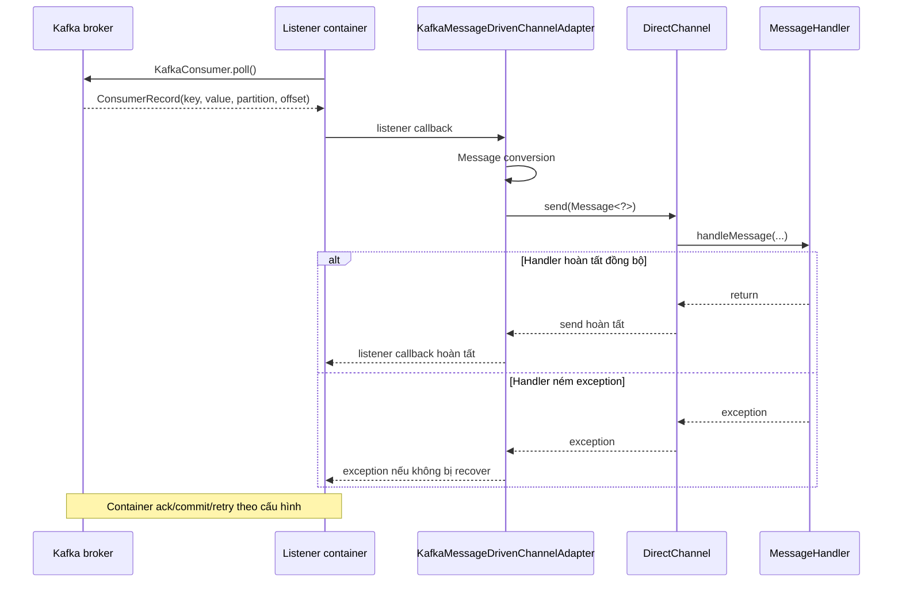
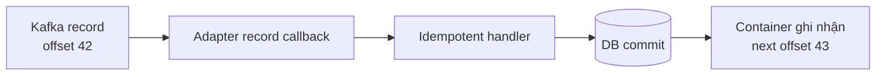
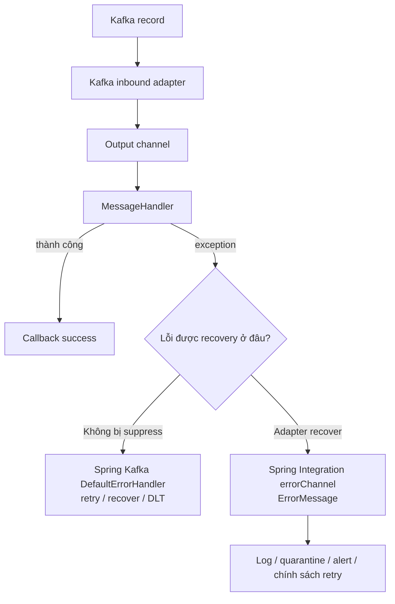
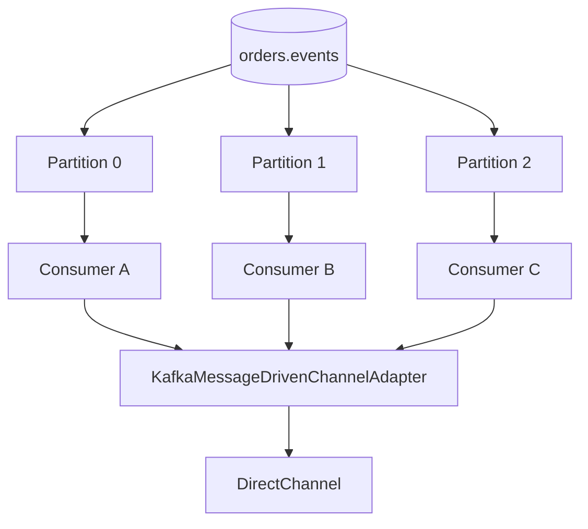
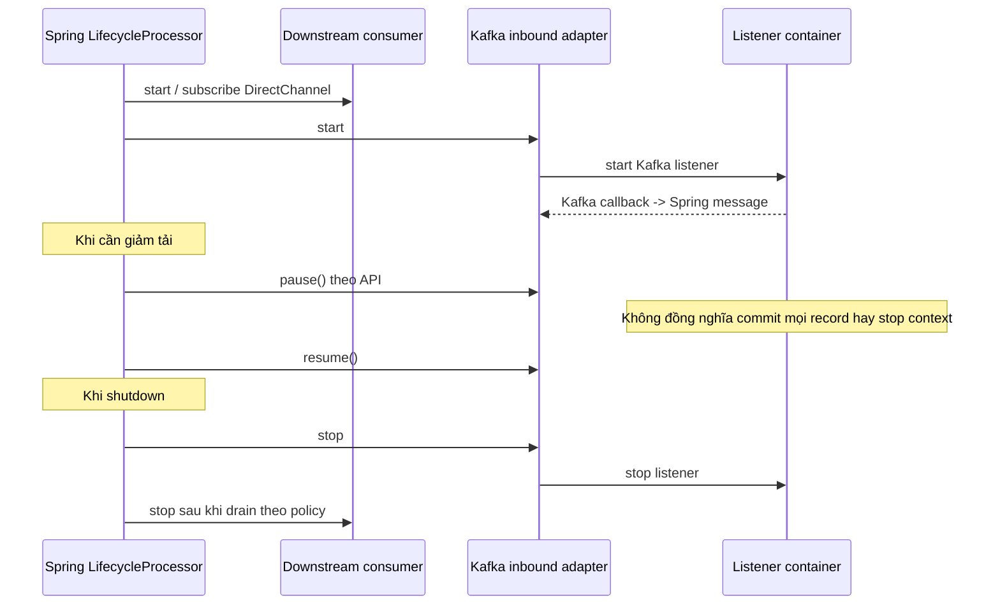

# KafkaMessageDrivenChannelAdapter

`KafkaMessageDrivenChannelAdapter<K,V>` là endpoint **nhận dữ liệu Kafka theo cơ chế message-driven** của Spring Integration. Nó dùng một Spring Kafka listener container để nhận callback chứa record hoặc batch; sau đó chuyển dữ liệu thành Spring `Message<?>` và gửi tới **output `MessageChannel`**. Đây là điểm giao giữa cơ chế tiêu thụ Kafka (topic, partition, group, offset) và các Enterprise Integration Patterns của Spring Integration (channel, filter, transformer, router, service activator).

Bài thuộc chương **Adapter Kafka** của module **SPRING_INTEGRATION_ADAPTERS**, trong đó các hệ thống file, SFTP, HTTP, JMS, AMQP, Kafka và cơ sở dữ liệu được nối bằng inbound/outbound adapter, gateway, poller và `MessageChannel`; đồng thời phải kiểm soát hợp đồng message, xử lý lỗi và vòng đời kết nối. Bài này đi sâu vào **chính API và cơ chế vận hành `KafkaMessageDrivenChannelAdapter`**, không chỉ dừng ở khái niệm Kafka inbound chung.

> **Nguyên tắc an toàn:** Một record đi từ Kafka vào Spring channel **không đồng nghĩa** side effect ở database/HTTP đã hoàn tất hay offset đã được commit đúng ý định. Độ tin cậy của flow phụ thuộc listener container, loại channel, acknowledgment, lỗi và chính sách xử lý trùng.

## 1. Kết quả học tập

Sau bài này, bạn có thể:

1. Mô tả chuỗi `KafkaConsumer → MessageListenerContainer → KafkaMessageDrivenChannelAdapter → MessageChannel → MessageHandler`.
2. Đọc Javadoc và chọn constructor `KafkaMessageDrivenChannelAdapter(container)` hoặc `KafkaMessageDrivenChannelAdapter(container, ListenerMode)`.
3. Phân biệt `ListenerMode.record` với `ListenerMode.batch` và chọn converter/handler đúng kiểu payload.
4. Cấu hình adapter bằng Java `@Bean`, Java DSL và XML namespace; gắn ID endpoint và output channel rõ ràng.
5. Sử dụng các API `setMessageConverter`, `setPayloadType`, `setRecordFilterStrategy`, `setAckDiscarded`, `setBindSourceRecord` khi phù hợp.
6. Phân biệt **error channel của Spring Integration** với **error handler của Spring Kafka container**, đồng thời hiểu ảnh hưởng của retry/recovery lên offset.
7. Phân tích sự khác biệt giữa `DirectChannel`, `QueueChannel` và `ExecutorChannel` ở điểm xác nhận xử lý.
8. Quản lý lifecycle, pause/resume, rebalance, concurrency, partition ordering và các chỉ số quan sát.
9. Thực hành mô phỏng retry, record trùng, batch lỗi, DLT và restart mà không làm mất dữ liệu nghiệp vụ.

## 2. Vị trí của class trong Spring Integration

```mermaid
flowchart LR
    Broker[("Kafka topic<br/>orders.events")]
    Container["Kafka listener container<br/>ConcurrentMessageListenerContainer"]
    Adapter["KafkaMessageDrivenChannelAdapter<br/>MessageProducerSupport"]
    Output["Spring output channel<br/>ordersFromKafka"]
    Consumer["EventDrivenConsumer"]
    Handler["MessageHandler<br/>validate / persist"]
    Target[("Database / HTTP / SFTP")]

    Broker -->|"KafkaConsumer.poll()"| Container
    Container -->|"listener callback"| Adapter
    Adapter -->|"send(Message<?>)"| Output
    Output --> Consumer
    Consumer --> Handler
    Handler --> Target
```

Theo Javadoc, `KafkaMessageDrivenChannelAdapter<K,V>` kế thừa `MessageProducerSupport` và thực hiện các hợp đồng inbound/lifecycle như `KafkaInboundEndpoint`, `SmartLifecycle` và `Pausable`.



Có **hai góc nhìn**:

- **Theo Kafka:** ứng dụng là consumer của topic, nhận record và quản lý offset trong một consumer group.
- **Theo Spring Integration:** adapter là **message producer endpoint**, phát message ra output channel; handler ở phía sau là consumer endpoint của message.

Vì vậy, gọi adapter là “producer” **không có nghĩa nó publish Kafka record**. Thành phần publish Kafka ra ngoài là **Kafka outbound channel adapter**, thường dựa trên `KafkaProducerMessageHandler`.

### 2.1. Những lớp và interface cần phân biệt

| Thành phần | Vai trò |
|---|---|
| `ConsumerFactory<K,V>` | Cấu hình Kafka consumer client: broker, deserializer, group ID, security |
| `ContainerProperties` | Topic/partition, ack mode và một phần cấu hình listener |
| `KafkaMessageListenerContainer<K,V>` | Listener container với một Kafka consumer |
| `ConcurrentMessageListenerContainer<K,V>` | Điều phối nhiều listener container con theo `concurrency` |
| `KafkaMessageDrivenChannelAdapter<K,V>` | Chuyển callback Kafka thành Spring message và gửi ra output channel |
| `MessageProducerSupport` | Base class cung cấp output/error channel và hỗ trợ gửi message |
| `MessageChannel` | Định tuyến message đến consumer phía sau |
| `EventDrivenConsumer` | Subscribe handler vào `SubscribableChannel` như `DirectChannel` |
| `PollingConsumer` | Nhận từ `PollableChannel` như `QueueChannel` theo Spring Integration poller |
| `KafkaMessageSource` | Nguồn Kafka dành cho **polling inbound adapter**, là mô hình khác |

### 2.2. Vì sao có chữ “message-driven” dù Kafka client vẫn poll?

Kafka listener container gọi `KafkaConsumer.poll()` để nhận record, heartbeat và tham gia consumer group. Nhưng ở cấp Spring Integration, bạn **không** đặt `@Poller(fixedDelay="...")` lên `KafkaMessageDrivenChannelAdapter`. Khi container nhận record, nó gọi listener do adapter đăng ký.

Ngược lại, `KafkaMessageSource` có thể được nối vào `SourcePollingChannelAdapter` để Spring Integration **chủ động gọi `receive()` theo poller**:

```text
Message-driven:
  Kafka consumer poll loop (Spring Kafka container)
       -> listener callback
       -> KafkaMessageDrivenChannelAdapter
       -> output channel

Polling inbound:
  Spring Integration Poller
       -> KafkaMessageSource.receive()
       -> SourcePollingChannelAdapter
       -> output channel
```

Hai cơ chế có lifecycle, điều tiết và acknowledgment khác nhau. Không cấu hình chúng cùng topic và group nếu không chủ đích tạo các consumers cạnh tranh.

## 3. API cốt lõi của `KafkaMessageDrivenChannelAdapter`

### 3.1. Hai constructor

```java
// Record mode: mặc định khi chỉ truyền container.
KafkaMessageDrivenChannelAdapter<String, String> recordAdapter =
        new KafkaMessageDrivenChannelAdapter<>(container);

// Record hoặc batch mode được chọn tường minh.
KafkaMessageDrivenChannelAdapter<String, String> batchAdapter =
        new KafkaMessageDrivenChannelAdapter<>(
                anotherContainer,
                KafkaMessageDrivenChannelAdapter.ListenerMode.batch);
```

`container` và `anotherContainer` ở đây là biến minh họa thuộc loại `AbstractMessageListenerContainer<String,String>`; trong code thật cần tạo và quản lý chúng đúng vòng đời. Đây là **hai phương án để so sánh**, không khuyến nghị khởi động cả hai cùng group/topic ngoài chủ đích.

Trong Javadoc, `ListenerMode` gồm:

| Giá trị | Một Spring message đại diện cho |
|---|---|
| `ListenerMode.record` | **Một** `ConsumerRecord` đã được convert |
| `ListenerMode.batch` | **Một nhóm** record từ một lần consumer poll, sau batch conversion |

**Lưu ý:** `ConsumerRecord<K,V>` là dữ liệu Kafka trước conversion; payload của Spring `Message<?>` không nhất thiết là toàn bộ `ConsumerRecord`. Với cấu hình converter thông thường, payload là **value** hoặc tập value đã convert. Metadata topic/partition/offset được đưa vào headers tương ứng.

### 3.2. Những setter quan trọng

| API | Dùng để làm gì | Lưu ý |
|---|---|---|
| `setOutputChannel(channel)` | Xác định nơi adapter phát message | Channel cần consumer phù hợp |
| `setErrorChannel(channel)` | Cấu hình đường ErrorMessage của Spring Integration | Cơ chế recovery ảnh hưởng exception propagation |
| `setSendTimeout(long)` | Giới hạn chờ gửi vào channel khi được hỗ trợ | Không phải Kafka broker timeout |
| `setRecordMessageConverter(converter)` | Converter cho `record` | Phải phù hợp deserializer/schema |
| `setBatchMessageConverter(converter)` | Converter cho `batch` | Payload/headers có dạng batch |
| `setMessageConverter(converter)` | Cấu hình converter chung | Converter phải tương thích listener mode |
| `setPayloadType(SomeDto.class)` | Gợi ý kiểu đích cho type-aware converter | Không tự tạo JSON parser nếu chưa cấu hình converter |
| `setRecordFilterStrategy(filter)` | Chọn record cần bỏ qua trước downstream | Chỉ phù hợp đường record filter |
| `setAckDiscarded(boolean)` | Quy định xác nhận record bị filter bỏ | Cân nhắc lost-message risk và ack policy |
| `setFilterInRetry(boolean)` | Chọn filter được chạy lại mỗi lần retry hay chỉ một lần | Có ý nghĩa khi cấu hình cả filter và adapter retry |
| `setRetryTemplate(retryTemplate)` | Retry delivery/dispatch ở tầng adapter | Blocking, có thể tác động `max.poll.interval.ms` |
| `setRecoveryCallback(callback)` | Xử lý sau khi adapter retry hết | Có thể quyết định suppress hay propagate lỗi |
| `setBindSourceRecord(true)` | Giữ bản gốc trong `IntegrationMessageHeaderAccessor.SOURCE_DATA` | Hữu ích cho tracing, nhưng không nên chuyển sang thread khác rồi thao tác consumer |
| `setPhase(int)`, `setAutoStartup(boolean)` | Điều khiển lifecycle | Không thay Kafka readiness/offset semantics |
| `pause()`, `resume()`, `isPaused()` | Quản lý tiếp nhận ở runtime | Không phải commit, seek hay stop toàn bộ context |

Danh sách này chủ yếu dựa vào class hiện đại trong Javadoc Spring Integration; các API và default có thể thay đổi giữa các version. Dự án cần dùng **một bộ Spring Boot/Spring Integration/Spring Kafka tương thích**, kiểm tra Javadoc đúng phiên bản đang chạy.

### 3.3. Message producer endpoint khác MessageHandler

`KafkaMessageDrivenChannelAdapter` là **endpoint ở đầu luồng**, không phải một `MessageHandler` dùng để “nhận” từ input channel. Đúng wiring:

```text
Kafka topic -> adapter -> outputChannel -> consumer endpoint -> handler
```

Sai hướng:

```text
inputChannel -> KafkaMessageDrivenChannelAdapter   // Sai vai trò
```

Muốn nhận message từ một channel rồi gửi vào Kafka, dùng `KafkaProducerMessageHandler`/Kafka outbound adapter.

## 4. Chu trình một record từ broker tới handler



Với `DirectChannel`, handler thường chạy trên **thread listener**; khi handler thành công thì callback có thể coi là hoàn tất. Với `QueueChannel` hoặc `ExecutorChannel`, việc `send()` trả về có thể chỉ chứng minh **enqueue hoặc giao việc cho executor**, không chứng minh side effect đã commit.

### 4.1. Bốn mốc cần phân biệt

1. Kafka consumer **fetch** được record.
2. Adapter **convert và dispatch** Spring message.
3. Downstream **thực hiện side effect** (ví dụ DB commit).
4. Container **ack/commit offset** theo AckMode, transaction và error handler.

Các mốc có thể không cùng thứ tự trong mô hình bất đồng bộ. Bất kỳ failure window nào cũng có thể tạo record nhận lại hoặc side effect thiếu/trùng nếu không có chiến lược bền vững.

## 5. Chuẩn bị môi trường thực hành

Chúng ta nhận các sự kiện đơn hàng `String` từ topic `orders.events` bằng `KafkaMessageDrivenChannelAdapter<String,String>`. Handler ghi log các metadata; một nhánh thực hành sau sẽ thay log bằng DB transaction.

Yêu cầu:

- Java 17+ và Spring Boot có dependency management tương thích Spring Integration/Spring Kafka.
- Kafka broker thử nghiệm tại `localhost:9092` (điều chỉnh theo môi trường).
- Topic `orders.events` có sẵn, ví dụ ba partition.
- `group.id` demo riêng, không dùng group production.

### 5.1. Maven dependency

Trong `pom.xml`, dùng BOM hoặc parent Spring Boot:

```xml
<dependency>
    <groupId>org.springframework.boot</groupId>
    <artifactId>spring-boot-starter-integration</artifactId>
</dependency>
<dependency>
    <groupId>org.springframework.integration</groupId>
    <artifactId>spring-integration-kafka</artifactId>
</dependency>
```

Tùy BOM đang dùng, kiểm tra dependency tree khi phát sinh xung đột giữa `spring-integration-kafka`, `spring-kafka` và `kafka-clients`. **Không** tự gán version theo một ví dụ Internet rồi giả định tương thích mọi API.

### 5.2. Properties

```properties
demo.kafka.bootstrap-servers=localhost:9092
demo.kafka.group-id=orders-adapter-class-demo
demo.kafka.concurrency=2
```

Với production, broker có thể yêu cầu TLS/SASL, ACL, schema registry và secret management; không log token/mật khẩu trong payload hay Kafka headers.

## 6. Cấu hình Java đầy đủ: adapter ở record mode

Đây là ví dụ tập trung vào **class `KafkaMessageDrivenChannelAdapter`**: tạo `ConsumerFactory`, `ContainerProperties`, `ConcurrentMessageListenerContainer`, output channel và adapter.

```java
package com.example.integration;

import java.util.HashMap;
import java.util.Map;

import org.apache.kafka.clients.consumer.ConsumerConfig;
import org.apache.kafka.common.serialization.StringDeserializer;

import org.springframework.beans.factory.annotation.Qualifier;
import org.springframework.beans.factory.annotation.Value;
import org.springframework.context.annotation.Bean;
import org.springframework.context.annotation.Configuration;
import org.springframework.integration.channel.DirectChannel;
import org.springframework.integration.config.EnableIntegration;
import org.springframework.integration.kafka.inbound.KafkaMessageDrivenChannelAdapter;
import org.springframework.kafka.core.ConsumerFactory;
import org.springframework.kafka.core.DefaultKafkaConsumerFactory;
import org.springframework.kafka.listener.ConcurrentMessageListenerContainer;
import org.springframework.kafka.listener.ContainerProperties;
import org.springframework.messaging.MessageChannel;

@Configuration
@EnableIntegration
public class OrdersKafkaAdapterConfig {

    @Bean("ordersConsumerFactory")
    public ConsumerFactory<String, String> ordersConsumerFactory(
            @Value("${demo.kafka.bootstrap-servers}") String brokers,
            @Value("${demo.kafka.group-id}") String groupId) {

        Map<String, Object> props = new HashMap<>();
        props.put(ConsumerConfig.BOOTSTRAP_SERVERS_CONFIG, brokers);
        props.put(ConsumerConfig.GROUP_ID_CONFIG, groupId);
        props.put(ConsumerConfig.KEY_DESERIALIZER_CLASS_CONFIG,
                StringDeserializer.class);
        props.put(ConsumerConfig.VALUE_DESERIALIZER_CLASS_CONFIG,
                StringDeserializer.class);
        props.put(ConsumerConfig.ENABLE_AUTO_COMMIT_CONFIG, false);
        props.put(ConsumerConfig.AUTO_OFFSET_RESET_CONFIG, "earliest");

        return new DefaultKafkaConsumerFactory<>(props);
    }

    @Bean("ordersFromKafka")
    public MessageChannel ordersFromKafka() {
        return new DirectChannel();
    }

    @Bean("ordersMessageDrivenAdapter")
    public KafkaMessageDrivenChannelAdapter<String, String> inboundAdapter(
            @Qualifier("ordersConsumerFactory")
                ConsumerFactory<String, String> factory,
            @Qualifier("ordersFromKafka")
                MessageChannel output,
            @Value("${demo.kafka.concurrency}") int concurrency) {

        // Container subscribe theo group vào topic.
        ContainerProperties listenerProperties =
                new ContainerProperties("orders.events");

        // Commit theo callback record hoàn tất, theo Spring Kafka.
        listenerProperties.setAckMode(
                ContainerProperties.AckMode.RECORD);

        ConcurrentMessageListenerContainer<String, String> container =
                new ConcurrentMessageListenerContainer<>(
                        factory, listenerProperties);
        container.setConcurrency(concurrency);

        KafkaMessageDrivenChannelAdapter<String, String> adapter =
                new KafkaMessageDrivenChannelAdapter<>(
                        container,
                        KafkaMessageDrivenChannelAdapter.ListenerMode.record);

        adapter.setOutputChannel(output);
        adapter.setAutoStartup(true);

        // Consumer nội bộ trên DirectChannel nên start trước.
        adapter.setPhase(200);

        return adapter;
    }
}
```

#### Giải thích không bỏ sót

1. `StringDeserializer` đưa Kafka key/value thành `String`. Nó **không tự** chuyển JSON thành DTO đã validate.
2. `ConsumerConfig.GROUP_ID_CONFIG` xác định logical subscriber; nhiều instance cùng group chia nhau partition.
3. `ENABLE_AUTO_COMMIT_CONFIG=false` để container quản lý commit theo AckMode, tránh auto-commit theo timer Kafka client.
4. `AUTO_OFFSET_RESET_CONFIG=earliest` chỉ áp dụng khi group/partition **không có committed offset hợp lệ** hoặc điều kiện reset tương ứng; không tự replay từ đầu mỗi restart.
5. `ContainerProperties("orders.events")` dùng **topic subscription**; không phải explicit partition assignment.
6. `AckMode.RECORD` là một lựa chọn dễ phân tích với `record` listener và `DirectChannel`; không phải transaction phân tán với DB.
7. `setConcurrency(2)` tạo tối đa hai consumer con; throughput phụ thuộc số partition và các consumer khác cùng group.
8. Adapter sử dụng **output `ordersFromKafka`**; channel phải có consumer đã subscribe trước khi adapter phát record.
9. `setPhase(200)` mang ý nghĩa lifecycle của endpoint, **không** phải thời gian chờ 200 ms hay độ ưu tiên Kafka.
10. Adapter là một bean `SmartLifecycle` được quản lý; nên **không** tự gọi `container.start()` độc lập bên ngoài ở ví dụ này.

**Điều kiện chạy:** thêm `@SpringBootApplication` trong package `com.example.integration` hoặc package cha; đảm bảo handler ở mục tiếp theo đã được Spring quét. Nếu cùng topic/group còn có `@KafkaListener` khác, các consumers sẽ **cạnh tranh assignment**, không phải mọi thành phần đều nhận mọi record.

## 7. Handler tiêu thụ message từ output channel

Ở đây handler được kết nối qua `@ServiceActivator(inputChannel=...)`:

```java
package com.example.integration;

import org.springframework.integration.annotation.EndpointId;
import org.springframework.integration.annotation.ServiceActivator;
import org.springframework.kafka.support.KafkaHeaders;
import org.springframework.messaging.Message;
import org.springframework.stereotype.Component;

@Component
public class OrdersEventHandler {

    @EndpointId("ordersEventConsumer")
    @ServiceActivator(inputChannel = "ordersFromKafka")
    public void onEvent(Message<String> message) {

        String payload = message.getPayload();
        String topic = message.getHeaders().get(
                KafkaHeaders.RECEIVED_TOPIC, String.class);

        Object partition = message.getHeaders().get(
                KafkaHeaders.RECEIVED_PARTITION);
        Object offset = message.getHeaders().get(KafkaHeaders.OFFSET);
        Object key = message.getHeaders().get(
                KafkaHeaders.RECEIVED_KEY);

        if (payload.isBlank()) {
            // Cho container nhận biết lỗi khi không bị recover ở tầng adapter.
            throw new IllegalArgumentException(
                    "Không có order payload");
        }

        System.out.printf(
                "RECEIVED topic=%s partition=%s offset=%s "
                        + "key=%s value=%s%n",
                topic, partition, offset, key, payload);
    }
}
```

- `@ServiceActivator` tạo một **consumer endpoint** lắng nghe `DirectChannel`.
- `@EndpointId` giúp đặt ID dễ kiểm tra lifecycle/management; nó **không** là ID của Kafka group.
- `KafkaHeaders.RECEIVED_KEY` có thể **không tồn tại** khi Kafka record key là null; dùng lookup nullable.
- `KafkaHeaders.OFFSET` cho vị trí record trong partition; nó không phải khóa idempotency nghiệp vụ.
- `System.out.printf` chỉ là demo; production cần log có cấu trúc và không lộ dữ liệu nhạy cảm.

### 7.1. Thử bằng Kafka CLI

```bash
# Môi trường lab một broker:
kafka-topics.sh --bootstrap-server localhost:9092 \
  --create --if-not-exists \
  --topic orders.events --partitions 3 --replication-factor 1

# Gửi value không cần key (CLI tùy phiên bản):
kafka-console-producer.sh \
  --bootstrap-server localhost:9092 \
  --topic orders.events
```

Nhập:

```text
ORD-101
ORD-102
ORD-103
```

Trong log ứng dụng, bạn sẽ thấy metadata topic, partition, offset và value; **không giả định** offset bắt đầu từ 0 hoặc event luôn nằm ở một partition cố định.

Kiểm tra group:

```bash
kafka-consumer-groups.sh \
  --bootstrap-server localhost:9092 \
  --describe --group orders-adapter-class-demo

kafka-consumer-groups.sh \
  --bootstrap-server localhost:9092 \
  --describe --group orders-adapter-class-demo \
  --members --verbose
```

Hai lệnh giúp quan sát committed offset, lag và partition assignment; khi group đang rebalance, một số trường có thể tạm trống.

## 8. Java DSL: tạo adapter qua factory của Spring Integration

Thay vì tạo bean adapter bằng `new`, Java DSL có builder `Kafka.messageDrivenChannelAdapter(...)`.

```java
// Đặt trong class @Configuration, là phương án thay thế @Bean adapter ở mục 6.
import org.springframework.context.annotation.Bean;
import org.springframework.integration.dsl.IntegrationFlow;
import org.springframework.integration.kafka.dsl.Kafka;
import org.springframework.integration.kafka.inbound.KafkaMessageDrivenChannelAdapter;
import org.springframework.kafka.core.ConsumerFactory;

@Bean
public IntegrationFlow ordersKafkaDslInbound(
        ConsumerFactory<String, String> factory) {
    return IntegrationFlow
            .from(
                Kafka.messageDrivenChannelAdapter(
                        factory,
                        KafkaMessageDrivenChannelAdapter.ListenerMode.record,
                        "orders.events")
                    .id("ordersDslInbound"))
            .channel("ordersFromKafka")
            .get();
}
```

Cấu hình DSL này minh họa **builder chịu trách nhiệm tạo container và adapter**. Khi dùng một listener container do `ConcurrentKafkaListenerContainerFactory` tạo, cũng có overload nhận **container đã tạo**; ví dụ theo tài liệu:

```java
IntegrationFlow.from(
    Kafka.messageDrivenChannelAdapter(
            kafkaListenerContainerFactory.createContainer("orders.events"),
            KafkaMessageDrivenChannelAdapter.ListenerMode.record)
        .id("ordersDslInbound"))
    .channel("ordersFromKafka")
    .get();
```

Đoạn thứ hai là **mảnh DSL minh họa** trong bối cảnh có `kafkaListenerContainerFactory` phù hợp; không phải method Java độc lập.

Với DSL đăng ký container tương ứng, đặt ID adapter như `ordersDslInbound` giúp framework dùng tên có quy ước như `ordersDslInbound.container` cho listener container. Quy ước phụ thuộc cách đăng ký/component version; **không tự đoán tên bean** khi introspect production.

**Quan trọng:** Mục 6 và mục 8 là **hai lựa chọn thay thế**. Nếu bật cả hai cùng `group.id` và topic, Kafka phân partition giữa chúng; có thể tưởng một adapter “mất record”, thực tế record đã được giao cho consumer còn lại.

## 9. XML namespace khi hệ thống dùng cấu hình khai báo

`KafkaMessageDrivenChannelAdapter` tương ứng phần tử XML `<int-kafka:message-driven-channel-adapter>`.

```xml
<!-- Trích trong Spring XML đã khai báo beans và int-kafka namespace. -->
<int-kafka:message-driven-channel-adapter
        id="ordersKafkaInbound"
        listener-container="ordersListenerContainer"
        channel="ordersFromKafka"
        mode="record"
        auto-startup="true"
        phase="200"
        send-timeout="5000"
        error-channel="ordersKafkaErrors"/>
```

Ở XML:

- `listener-container` tham chiếu bean container nhận từ Kafka.
- `channel` là **output channel** mang Spring messages sau conversion.
- `mode="record"` xác định listener mode.
- `auto-startup` và `phase` quản lý lifecycle endpoint.
- `send-timeout` liên quan gửi vào Spring channel, **không phải Kafka `request.timeout.ms`**.
- `error-channel` liên quan Spring Integration error messages, **không tự publish Kafka DLT**.

Cần khai báo các bean `ordersListenerContainer`, `ordersFromKafka` và `ordersKafkaErrors` tương ứng. Đừng chạy XML adapter đồng thời với Java config cùng topic/group nếu không muốn chia partition.

## 10. `ListenerMode.record` và `ListenerMode.batch`

### 10.1. Record mode

```text
Kafka poll() trả:
  [ConsumerRecord A, ConsumerRecord B, ConsumerRecord C]

Adapter ListenerMode.record phát:
  Spring Message A
  Spring Message B
  Spring Message C
```

Mỗi message thường có một payload value (hoặc DTO sau conversion) và metadata topic/partition/offset ở dạng giá trị đơn.

### 10.2. Batch mode

```text
Kafka poll() trả:
  [ConsumerRecord A, ConsumerRecord B, ConsumerRecord C]

Adapter ListenerMode.batch phát:
  1 Spring Message:
      payload = [value A, value B, value C]
      headers chứa metadata dạng danh sách tương ứng
```

Với batch mode, payload thường là danh sách value/DTO, và các header `KafkaHeaders.RECEIVED_KEY`, `RECEIVED_PARTITION`, `RECEIVED_TOPIC`, `OFFSET` có thể là danh sách theo vị trí.

| Đặc điểm | Record | Batch |
|---|---|---|
| Số message gửi vào Spring channel | Một message / Kafka record | Một message / batch nhận từ poll |
| Handler signature thường gặp | `Message<String>` / `Message<Order>` | `Message<List<String>>` / danh sách DTO |
| Metadata | Topic/partition/offset đơn | Các list metadata tương ứng các phần tử |
| Xử lý record lỗi | Dễ xác định record cụ thể | Cần chính sách xác định phần tử lỗi |
| Transaction đích | Từng record hoặc do handler gom | Có thể xử lý hàng loạt |
| Ack/commit | Phụ thuộc container AckMode record | Phụ thuộc batch listener/AckMode, không tương đương record |
| Ordering | Mỗi partition theo offset | Có thể chứa nhiều partition trong một poll |

**Sai lầm phổ biến:** Đổi constructor sang `ListenerMode.batch` nhưng giữ handler `Message<String>`. Contract payload đã thay đổi; handler phải được viết lại và batch converter/container cần tương thích.

### 10.3. Ví dụ chuyển sang batch

```java
KafkaMessageDrivenChannelAdapter<String, String> batchAdapter =
        new KafkaMessageDrivenChannelAdapter<>(
                batchContainer,
                KafkaMessageDrivenChannelAdapter.ListenerMode.batch);
batchAdapter.setOutputChannel(batchOutputChannel);
```

Đây là snippet trong nơi bạn đã tạo `batchContainer` và `batchOutputChannel`; để chạy thật, listener container phải được cấu hình tương thích batch, và downstream cần nhận dạng danh sách:

```java
@ServiceActivator(inputChannel = "ordersBatchChannel")
public void processBatch(Message<java.util.List<String>> message) {
    for (String value : message.getPayload()) {
        // Validate và xử lý mỗi record / batch theo chính sách.
        System.out.println("Batch value=" + value);
    }
}
```

Mã method nằm trong bean Spring và cần import `@ServiceActivator`, `Message`. Batch không nhất thiết luôn có đúng `max.poll.records` record; đó chỉ là giới hạn cho consumer poll.

### 10.4. Batch failure khó hơn ở đâu?

Nếu batch chứa 100 record và record thứ 53 sai, cần quyết định:

- Retry toàn bộ batch hay chỉ record lỗi?
- 52 record đầu đã ghi DB chưa? Có thể rollback không?
- Có cần DLT record 53 rồi tiếp tục 54–100?
- Ack/commit offset đến đâu là an toàn?
- Business key có đủ cho xử lý lại hàng loạt?

Không chọn batch chỉ để tăng throughput nếu không thiết kế rõ partial failure và idempotency.

## 11. Message conversion và `setPayloadType`

Kafka key/value deserializer chạy **trước** conversion của Spring Integration. Ví dụ:

```text
Kafka bytes
    -> StringDeserializer / JsonDeserializer / ...
    -> ConsumerRecord<K,V>
    -> RecordMessageConverter / BatchMessageConverter
    -> Spring Message<?> với payload/headers
```

Mỗi lớp có trách nhiệm riêng:

| Lớp | Ví dụ | Nếu cấu hình sai |
|---|---|---|
| Kafka deserializer | `StringDeserializer`, `ErrorHandlingDeserializer` | Không tạo được record value |
| Spring Kafka message converter | `StringJsonMessageConverter`, converter tùy biến | Không khớp schema/target type |
| Adapter `setPayloadType(...)` | `OrderCreated.class` | Type-aware converter không biết kiểu muốn tạo |
| Spring Integration transformer/validator | JSON → business DTO, Bean Validation | Downstream nhận payload không hợp lệ |
| Handler nghiệp vụ | Ghi DB, gọi HTTP | Side effect lỗi hoặc trùng |

### 11.1. Ví dụ type-aware converter

Nếu Kafka value là JSON string và phiên bản Spring Kafka có `StringJsonMessageConverter` phù hợp:

```java
// Snippet thêm vào adapter ở record mode.
// OrderCreated là DTO do ứng dụng tự định nghĩa.
adapter.setRecordMessageConverter(
        new StringJsonMessageConverter());
adapter.setPayloadType(OrderCreated.class);
```

Các import tương ứng là `org.springframework.kafka.support.converter.StringJsonMessageConverter`. Cần có class `OrderCreated` và Jackson trên classpath theo BOM, cùng schema JSON khớp kiểu đích.

Không dùng `setPayloadType(OrderCreated.class)` mà mong `StringDeserializer` tự biến text JSON thành DTO khi chưa có converter phù hợp.

### 11.2. Null value và tombstone

Kafka compacted topic có thể chứa record có `value=null` để biểu diễn xóa theo key (tombstone). Spring Messaging không cho payload null theo hợp đồng thông thường; Spring Kafka có thể sử dụng marker như `KafkaNull` hoặc cơ chế conversion khác tùy library.

Nếu ứng dụng xử lý tombstone, phải xác định **hợp đồng của converter**, kiểm thử value null và tránh logic `message.getPayload().toString()` gây lỗi hoặc xóa sai dữ liệu.

### 11.3. Header mapping

Các header phổ biến phía inbound:

| Header | Ý nghĩa |
|---|---|
| `KafkaHeaders.RECEIVED_TOPIC` | Topic chứa record nhận |
| `KafkaHeaders.RECEIVED_PARTITION` | Partition chứa record |
| `KafkaHeaders.OFFSET` | Offset record đã đọc |
| `KafkaHeaders.RECEIVED_KEY` | Kafka key, thường vắng mặt nếu key null |
| `KafkaHeaders.RECEIVED_TIMESTAMP` | Timestamp nếu converter cung cấp |
| `KafkaHeaders.ACKNOWLEDGMENT` | Có thể xuất hiện khi manual ack phù hợp |
| `IntegrationMessageHeaderAccessor.SOURCE_DATA` | Có thể chứa raw source record nếu bật `setBindSourceRecord(true)` |

**Cảnh báo thread safety:** Nếu message có header tham chiếu `KafkaConsumer` (tùy converter/cấu hình), consumer đó **không thread-safe**. Không gọi `pause`/`seek`/`commit` trên consumer từ thread khác sau khi đưa message qua `ExecutorChannel`.

Không nên log toàn bộ raw record nếu dữ liệu chứa thông tin cá nhân, token hoặc schema nhạy cảm.

## 12. Filter record trước downstream

Đôi khi cần bỏ qua record không thuộc nghiệp vụ của flow. Class hỗ trợ `setRecordFilterStrategy`:

```java
// Snippet cấu hình trên adapter record mode.
// Bỏ các event có value bắt đầu bằng tiền tố "IGNORED:".
adapter.setRecordFilterStrategy(record ->
        record.value() != null
                && record.value().startsWith("IGNORED:"));

// Chỉ bật khi nghiệp vụ thực sự cho phép bỏ qua record đó.
adapter.setAckDiscarded(true);
```

`RecordFilterStrategy.filter(record)` trả `true` nghĩa là **bỏ record**, không phải “cho đi tiếp”. Đây là điểm dễ đọc ngược.

### 12.1. `setAckDiscarded(true)` có hậu quả gì?

Khi filter discard record, tùy mode acknowledgment, cấu hình `ackDiscarded` điều chỉnh việc acknowledgment các record đó. Nếu bỏ nhầm record hợp lệ và ack nó, ứng dụng có thể **không đọc lại được bằng group offset hiện tại**.

Nên:

1. Dựa trên một quy tắc nghiệp vụ có thể kiểm thử.
2. Lưu metric/counter cho record bị discard.
3. Không dùng filter thay thế validation/error routing cho record hỏng chưa được điều tra.
4. Kiểm tra behavior khi retry, ack mode và handler ném lỗi.

### 12.2. `setFilterInRetry`

Khi đồng thời dùng filter và `RetryTemplate` ở adapter:

- `setFilterInRetry(false)`: filter thường được đánh giá một lần cho delivery từ container.
- `setFilterInRetry(true)`: filter có thể chạy lại trên mỗi attempt retry.

Nếu filter có state hoặc phụ thuộc thời gian, hai cách có thể cho quyết định khác nhau. Filter nên deterministic nếu dùng với retry; không thiết kế filter như một side effect thay đổi dữ liệu.

## 13. AckMode và thời điểm commit offset

Kafka consumer group lưu offset đã commit làm điểm đọc tiếp sau restart/rebalance. Với listener container do Spring Kafka quản lý, các `AckMode` quyết định lúc nào container ghi nhận/commit offset **khi auto-commit của Kafka client đã tắt**.

| AckMode | Ý tưởng |
|---|---|
| `RECORD` | Commit offset sau khi callback record trả về thành công |
| `BATCH` | Commit sau khi xử lý các record của một consumer poll |
| `TIME`, `COUNT`, `COUNT_TIME` | Commit theo kết hợp thời gian/số record được xử lý theo container |
| `MANUAL` | Ứng dụng gọi `acknowledge()`; áp dụng semantics commit tương tự batch |
| `MANUAL_IMMEDIATE` | Ứng dụng acknowledge; cố commit tức thời nếu gọi đúng consumer thread |

**Chú ý:** mode `ListenerMode.record/batch` ở adapter và `AckMode` ở container là **hai cấu hình khác nhau**. Chọn cho tương thích; đừng suy rằng `ListenerMode.record` tự động bắt container dùng `AckMode.RECORD`.

### 13.1. Ví dụ thứ tự an toàn mong muốn



Khi handler đồng bộ và hoàn tất thành công, container có thể ghi offset theo policy. Nhưng nếu JVM chết **sau DB commit trước offset commit**, Kafka có thể gửi lại record offset 42. Do đó:

- Cần business ID như `eventId`/`orderId`.
- Ghi idempotency key bền vững trong cùng DB transaction khi phù hợp.
- Không tuyên bố exactly-once xuyên Kafka và database chỉ nhờ `AckMode.RECORD`.
- Với HTTP/SFTP/AMQP/JMS đích, cần thêm cơ chế retry/dedup phù hợp từng giao thức.

### 13.2. Manual acknowledgment

Trong một flow đồng bộ với manual ack đã cấu hình ở container, handler có thể đọc header:

```java
// Ví dụ trong method handler; khác ví dụ AckMode.RECORD ở mục 6.
Acknowledgment ack = message.getHeaders().get(
        KafkaHeaders.ACKNOWLEDGMENT,
        Acknowledgment.class);

if (ack == null) {
    throw new IllegalStateException(
            "Không có acknowledgment: kiểm tra manual AckMode");
}

persistIdempotently(message.getPayload()); // Hàm ứng dụng tự triển khai.
ack.acknowledge();
```

Cần import `org.springframework.kafka.support.Acknowledgment` và `KafkaHeaders`; `persistIdempotently` là pseudocode nghiệp vụ. Để chạy, đặt container `AckMode.MANUAL` hoặc `MANUAL_IMMEDIATE` theo nhu cầu.

Không dùng acknowledgment để “sửa” kiến trúc queue bất đồng bộ một cách tùy tiện: `KafkaConsumer` và nhiều API ack/seek có ràng buộc consumer thread; cần kiểm chứng hợp đồng cụ thể (đặc biệt khi gọi từ worker thread hoặc ack lệch thứ tự).

## 14. `DirectChannel`, `QueueChannel`, `ExecutorChannel` và delivery boundary

### 14.1. `DirectChannel`

```text
Kafka listener thread
  -> KafkaMessageDrivenChannelAdapter
  -> DirectChannel
  -> EventDrivenConsumer / JDBC handler
  -> handler hoàn tất hoặc ném lỗi
  -> listener callback kết thúc
  -> container áp dụng ack/error policy
```

Ưu điểm là downstream error có thể propagate về Kafka container. Nhược điểm là handler chậm làm chậm Kafka poll loop, tăng lag, có thể vượt `max.poll.interval.ms`.

### 14.2. `QueueChannel` trong RAM

```text
Kafka listener thread
  -> adapter.send()
  -> QueueChannel.enqueue() [thành công]
  -> listener callback kết thúc; offset có thể được commit

Một thời điểm khác:
  -> PollingConsumer.dequeue()
  -> JDBC handler [có thể lỗi]
```

Nếu offset đã commit trong khi message chỉ ở queue RAM, JVM chết trước DB commit có thể làm **mất message nghiệp vụ**: Kafka coi offset đã xử lý, còn queue biến mất.

**Không dùng queue RAM như durable handoff.** Nếu muốn tách nhận Kafka với side effect chậm, cần message store bền vững, broker/queue bền hoặc thiết kế ack gắn đúng kết quả xử lý. Mỗi phương án phải được test failure window.

### 14.3. `ExecutorChannel`

`ExecutorChannel` dispatch qua thread pool: thread Kafka listener có thể trả về trước khi handler chạy; ordering hoàn tất có thể đổi. Nếu sự kiện cùng `orderId` cần xử lý theo offset, phải serialize theo key hoặc thiết kế domain event có version và xử lý out-of-order.

### 14.4. `PublishSubscribeChannel`

Dùng khi cùng Kafka event cần kích hoạt nhiều subscriber trong một process. Tuy nhiên fan-out nội bộ **khác** hai Kafka consumer groups độc lập: chúng không có offset/durability riêng tại broker. Với nhiều subscriber, cần xác định nhánh nào lỗi có được coi là **toàn bộ Kafka record thất bại** hay không.

## 15. Error channel của Spring Integration vs container error handler

Đây là phần quyết định behavior khi handler ném exception.



### 15.1. Lỗi đồng bộ đi đâu?

Với `DirectChannel` và handler ném exception:

- Nếu không có thành phần nào xử lý/suppress, exception có thể trở lại listener container; `DefaultErrorHandler` có cơ hội retry hoặc recover record theo chính sách.
- Nếu adapter retry/recovery xử lý lỗi rồi **kết thúc bình thường**, listener container có thể thấy callback thành công; offset có thể được commit theo AckMode dù handler chính chưa hoàn tất.
- Nếu dùng `errorChannel`, cần hiểu chính xác **ErrorMessage được tạo ở tầng nào** và điều gì xảy ra sau khi consumer của error channel xử lý xong.

**Không giả định** “có errorChannel tức Kafka tự retry” hoặc “có DefaultErrorHandler tức mọi exception đều đến nó”.

### 15.2. `setRetryTemplate` và `setRecoveryCallback`

Adapter hỗ trợ retry **delivery/dispatch**:

```java
// Minh họa policy; trong code thật import và cấu hình Spring Retry.
RetryTemplate template = new RetryTemplate();
adapter.setRetryTemplate(template);

// Nếu muốn container xử lý lỗi cuối cùng,
// cần bảo đảm error channel/recovery callback không suppress nó.
```

Khi adapter có `RetryTemplate` và error channel, framework có thể dùng `ErrorMessageSendingRecoverer` làm recovery callback mặc định. Có thể cấu hình `setRecoveryCallback(...)` khác hoặc để exception đi về container theo hợp đồng hỗ trợ.

**Cảnh báo:** retry blocking trong callback có thể kéo dài đến mức Kafka consumer không poll kịp trong `max.poll.interval.ms`, gây rebalance. Với lỗi cần backoff/recovery theo Kafka record, thường cân nhắc **Spring Kafka `DefaultErrorHandler`** ở listener container.

### 15.3. Container `DefaultErrorHandler`

Một ví dụ cấu hình retry có giới hạn ở listener container:

```java
import org.springframework.kafka.listener.DefaultErrorHandler;
import org.springframework.util.backoff.FixedBackOff;

// Snippet trước khi đưa container vào KafkaMessageDrivenChannelAdapter.
// 2 retry sau lần xử lý ban đầu, giữa các lần cách 1 giây.
container.setCommonErrorHandler(
        new DefaultErrorHandler(new FixedBackOff(1_000L, 2L)));
```

Đây là **ví dụ retry/backoff**, không phải cấu hình DLT đầy đủ. Hành vi sau khi hết retry phụ thuộc recoverer và các thiết lập của error handler. Không coi record đã được lưu ở DLT nếu chưa có `DeadLetterPublishingRecoverer` và publisher hoạt động.

### 15.4. DLT cần cấu hình rõ ràng

Để chuyển record không thể xử lý vào dead-letter topic:

1. Provision topic DLT và số partition phù hợp (hoặc định nghĩa custom destination resolver).
2. Tạo Kafka producer template với serializer và ACL phù hợp.
3. Cấu hình `DeadLetterPublishingRecoverer` cho error handler.
4. Chọn retry/backoff và phân loại lỗi permanent vs transient.
5. Kiểm tra **failure khi publish DLT**: không báo recovered giả nếu DLT write thất bại.
6. Có quy trình triage, sửa payload và replay với idempotency.

Spring Integration `errorChannel` thường mang `ErrorMessage` **nội bộ**; nó không tự là Kafka DLT topic.

### 15.5. ErrorMessage mang ngữ cảnh gì?

Adapter có `setErrorMessageStrategy(...)` từ `MessageProducerSupport`. Mặc định hướng xử lý Kafka có thể dùng `RawRecordHeaderErrorMessageStrategy` để cung cấp converted message và raw source record trong error context.

Khi log lỗi nên ghi topic, partition, offset, message ID/correlation và loại exception; tránh log raw payload chứa dữ liệu nhạy cảm. Header raw record hỗ trợ debug nhưng không thay thế durable replay store.

## 16. Record filter, deserialization error và retry có mối quan hệ gì?

Ba cơ chế xử lý lỗi/loại record ở các tầng khác nhau:

| Tầng | Ví dụ | Điều nên làm |
|---|---|---|
| **Deserializer** | JSON bytes hỏng, class schema không hợp lệ | `ErrorHandlingDeserializer` và container/error handler theo version |
| **Record filter** | Event hợp lệ nhưng không thuộc loại ứng dụng cần | `RecordFilterStrategy`, chỉ discard khi policy cho phép |
| **Business validation** | Order thiếu trường bắt buộc | Validation trong flow, lỗi nghiệp vụ, quarantine/DLT hoặc reject |
| **Infrastructure** | DB timeout, HTTP 503 | Retry giới hạn, backoff, idempotency |
| **Unknown error** | Logic bug, mapping sai | Alert, không ack/skip tùy tiện |

Nếu deserializer thất bại **trước khi tạo message**, một handler trên `ordersFromKafka` **không thể xử lý JSON hỏng như thể nó là payload bình thường**. Đó là lý do lỗi deserialization thường cần công cụ ở tầng Spring Kafka container.

Nếu record hợp lệ nhưng nên bỏ qua theo policy, record filter có thể thích hợp hơn việc ném exception và gửi DLT. Song hãy kiểm thử `ackDiscarded` để tránh replay vô hạn hoặc commit sai.

## 17. Concurrency, partition assignment và ordering

Một `ConcurrentMessageListenerContainer` với `concurrency=3` có thể tạo ba Kafka consumers thuộc cùng group. Nếu topic chỉ có hai partition, sẽ có consumer không có assignment từ topic đó.



**Những quy tắc cần kiểm tra:**

- Mỗi partition thường được giao cho tối đa một consumer trong **cùng group truyền thống** tại một thời điểm.
- Kafka giữ thứ tự record trong một partition, **không có thứ tự toàn topic**.
- Nhiều pod cùng group chia partition; nhiều group có offset độc lập.
- Key ổn định giúp record cùng business aggregate thường đi vào cùng partition khi producer partitioning nhất quán.
- Concurrency Kafka không đồng nghĩa handler downstream có concurrency thích hợp; một DB chậm có thể nghẽn dù tăng listener threads.
- Rebalance hoặc restart có thể khiến record **đã xử lý nhưng chưa commit offset** được nhận lại.

### 17.1. `max.poll.interval.ms` không phải timeout message channel

Nếu handler sync mất quá lâu, Kafka consumer không poll kịp; group có thể rebalance. Nếu muốn giảm blocking, phải thiết kế async handoff bền vững và acknowledgment phù hợp, không chỉ đổi channel sang `ExecutorChannel` hoặc tăng `max.poll.interval.ms` mù quáng.

### 17.2. Assignment khác explicit partition pinning

`ContainerProperties("orders.events")` subscribe topic, dùng group management để chia partition. `ContainerProperties(new TopicPartitionOffset(...))` là explicit assignment: ứng dụng pin partition và không kỳ vọng Kafka group tự chia lại giữa pod như topic subscription.

Hai instance copy cùng danh sách pinned partition có thể cùng đọc và gây tác dụng phụ trùng. Chỉ dùng pinning khi đã có một chiến lược ownership/failover riêng.

## 18. Lifecycle, `pause()` và `resume()`

Class implement `SmartLifecycle`, nên có `start()`, `stop()`, `isRunning()`, `getPhase()` và `isAutoStartup()`. Ở phiên bản hiện đại, class còn có `pause()`, `resume()` và `isPaused()`.



### 18.1. Khi nào pause thay vì stop?

- **Pause:** tạm dừng tiếp nhận/fetch delivery theo cơ chế container, hữu ích khi DB bị quá tải nhưng không muốn ngắt vòng đời listener theo cách stop. Consumer vẫn cần tuân thủ poll/heartbeat và các record đã in-flight.
- **Stop:** dừng endpoint/container theo lifecycle, có thể khiến member rời group và gây rebalance; start lại có thể cần assignment mới.

Cách thức pause thực tế chịu ảnh hưởng của container và Kafka version. Sau `pause()`, cần quan sát `isPaused()` cùng metrics; **không tự coi pause là “mọi record đã xử lý xong”**.

### 18.2. Quản lý trạng thái bằng `ApplicationContext`

```java
// Snippet trong ApplicationRunner hoặc service quản trị.
KafkaMessageDrivenChannelAdapter<?, ?> adapter =
        context.getBean(
                "ordersMessageDrivenAdapter",
                KafkaMessageDrivenChannelAdapter.class);

System.out.printf("running=%s phase=%d paused=%s%n",
        adapter.isRunning(),
        adapter.getPhase(),
        adapter.isPaused());

// Chỉ thực hiện khi có lý do vận hành và quyền điều khiển rõ ràng.
// adapter.pause();
// adapter.resume();
```

Snippet cần `ApplicationContext` và Kafka adapter imports. Nếu đặt ID/bean name khác, phải dùng đúng tên trong context. Không cung cấp một HTTP endpoint công khai cho bất kỳ người dùng nào tự gọi pause/stop consumer.

### 18.3. Startup/shutdown không đảm bảo tính sẵn sàng của hệ thống ngoài

Consumer endpoint phía sau output channel nên subscribe trước inbound adapter, nhất là với `DirectChannel`. Khi shutdown, ngừng inbound trước, sau đó quản lý in-flight/backlog trước khi dừng downstream.

Nhưng `phase` chỉ điều phối trong **một Spring context**, không đợi Kafka broker khỏe, database migrate xong hay pod khác sẵn sàng. Các phép thử readiness cần thêm partition assignment, lag và trạng thái hệ thống đích.

## 19. Monitoring, tracing và chẩn đoán production

### 19.1. Những metric cần thiết

| Metric / log | Câu hỏi |
|---|---|
| Consumer group lag theo topic/partition | Có đang tụt sau Kafka producer không? |
| Current/committed offset | Vị trí đọc và tiến độ commit khác nhau thế nào? |
| Partition assignment và rebalance count | Consumer đã được assign chưa, group có ổn định không? |
| Adapter running/paused | Endpoint hoạt động hay tạm dừng? |
| Record conversion/deserialization errors | Payload có hợp đồng đúng không? |
| Downstream handler p95/p99 latency | Có bị chậm ở JDBC/HTTP/SFTP không? |
| Retry, recovery và DLT counts | Lỗi tạm thời hay permanent? |
| Message channel send failures | Có subscriber và capacity không? |
| Queue depth / executor active tasks | Có backlog/in-flight sau khi Kafka callback kết thúc không? |
| Business dedup / DB commit results | Side effect đã hoàn tất và chống duplicate chưa? |

### 19.2. Khi adapter `running=true` nhưng không nhận record

Kiểm tra theo thứ tự:

1. Topic tồn tại, bootstrap server và ACL hợp lệ.
2. `group.id` và committed offsets; group đã ở cuối topic hay chưa?
3. Partition assignment; concurrency có vượt số partition không?
4. Container có bị pause không, có rebalance liên tục không?
5. Deserializer/converter có lỗi trước khi tạo message không?
6. Output channel có consumer subscribe không?
7. Handler có đang chờ DB/HTTP hoặc bị timeout không?
8. Có group khác đang nhận record vì dùng cùng group ID không?

### 19.3. Khi thấy duplicate record

Xác định xem duplicate xuất hiện do:

- Kafka producer gửi lại một **business event** mới.
- Kafka redelivery vì offset chưa commit sau handler/DB commit.
- Retry ở adapter/container.
- Container rebalance khiến partition chuyển consumer.
- Consumer group ID thay đổi hoặc reset offset.
- Outbox/replay đưa cùng event tới topic lại.

Dùng `eventId` hoặc unique constraint DB để phân biệt **hai lần đọc cùng Kafka record** với **hai record Kafka có payload nghiệp vụ giống nhau**. Không kết luận có “Kafka gửi trùng” chỉ từ hai dòng log giống nhau.

### 19.4. Khi mất dữ liệu sau khi đổi channel

Nếu trước đây là `DirectChannel` và sau đó chuyển sang `QueueChannel` RAM, Kafka commit offset có thể xảy ra sau enqueue nhưng trước DB write. Kiểm tra:

- Message đã được enqueue nhưng chưa dequeue bao lâu?
- Offset commit xảy ra lúc nào?
- JVM crash/restart có làm queue mất nội dung?
- Handler thực sự đã commit DB hay chưa?
- Có durable message store hoặc idempotent source/consumer không?

Đây là ranh giới thiết kế, không phải lỗi tên bean.

## 20. Những hiểu lầm thường gặp

| Hiểu lầm | Cách hiểu đúng |
|---|---|
| “KafkaMessageDrivenChannelAdapter là Kafka producer.” | Nó **consume Kafka**, sau đó **produce Spring message** vào channel. |
| “Message-driven nghĩa là không có `poll()`.” | Kafka client vẫn poll; chỉ Spring Integration không dùng source poller. |
| “Output channel là Kafka topic.” | Nó là Spring `MessageChannel`; Kafka topic nằm ở phía listener container. |
| “Adapter tự xử lý nghiệp vụ.” | Handler ở downstream consumer endpoint xử lý. |
| “`ListenerMode.record` tự chọn `AckMode.RECORD`.” | Mode adapter và AckMode container là hai cấu hình độc lập. |
| “`ListenerMode.batch` vẫn phát `Message<String>`.” | Thường payload là list; handler và converter phải đổi. |
| “`setPayloadType` đủ để parse JSON.” | Cần deserializer/converter phù hợp. |
| “`filter(record)==true` nghĩa là giữ record.” | Thường nghĩa là **discard** record. |
| “Discarded record luôn có thể đọc lại.” | Nếu được ack/commit, group có thể không nhận lại. |
| “Error channel chắc chắn khiến container retry.” | Exception có thể đã được recovery/suppress. |
| “`RetryTemplate` không ảnh hưởng Kafka rebalance.” | Retry blocking có thể vượt `max.poll.interval.ms`. |
| “`send()` vào QueueChannel thành công nghĩa DB đã commit.” | Có thể mới enqueue; RAM queue không bền qua crash. |
| “`isRunning()` chứng minh có partition assignment.” | Cần xem group/assignment/lag thực tế. |
| “`pause()` tương đương đã drain toàn bộ message.” | Pause chỉ thay cơ chế nhận, không xác nhận in-flight/commit. |
| “`AckMode.RECORD` bảo đảm exactly-once với DB.” | DB và Kafka offset commit không có atomic transaction mặc định. |

## 21. Bài tập thực hành

### Bài 1 — Chạy record mode và ghi metadata

Chạy ví dụ mục 6–7 với ba partition. Gửi mười Kafka record bằng CLI, ghi topic/partition/offset/key/value. Dùng Kafka CLI xem assignment theo `group.id`. Nêu vì sao offset của hai partition khác nhau không thể so sánh để tạo một thứ tự toàn cục.

### Bài 2 — Chuyển từ Java `@Bean` sang Java DSL

Giữ nguyên `ConsumerFactory` và downstream handler. Thay adapter `@Bean` bằng `Kafka.messageDrivenChannelAdapter(...)`, đặt ID `ordersDslInbound` và kiểm tra tên endpoint/container thật bằng `ApplicationContext`. Vì sao không được khởi động cả hai adapter cùng topic/group nếu bài thử chỉ cần một consumer logic?

### Bài 3 — Batch mode và payload contract

Tạo phiên bản `ListenerMode.batch` với `Message<List<String>>` và batch converter phù hợp. Gửi 20 record, in kích thước mỗi batch và các list metadata. Nêu vì sao không thể kỳ vọng mỗi batch luôn bằng `max.poll.records`.

### Bài 4 — Filter và ack discarded

Cấu hình filter bỏ các record có tiền tố `IGNORED:`. Gửi xen kẽ record bình thường và record bị filter. Kiểm tra log/metrics và committed offset trước/sau khi bật `setAckDiscarded(true)`. Giải thích vì sao cần quy tắc nghiệp vụ rõ ràng trước khi discard.

### Bài 5 — Converter JSON có kiểu

Đổi value thành JSON `{"eventId":"e101","orderId":"ORD-101"}`. Thêm converter hỗ trợ `OrderCreated.class` và `setPayloadType(OrderCreated.class)`; thay handler nhận DTO. Thử JSON hỏng và phân biệt lỗi deserializer với lỗi converter và business validation.

### Bài 6 — `DirectChannel` so với queue RAM

Thay output channel thành `QueueChannel(10)`, thêm `PollingConsumer` xử lý DB chậm. Cho listener enqueue xong, offset commit, rồi kill JVM trước DB commit. Chỉ ra record nào có thể mất và thiết kế lại bằng durable handoff hoặc ack strategy có kiểm chứng.

### Bài 7 — Retry ở adapter và ở container

Cho handler ném exception hai lần rồi thành công. Thử lần lượt `RetryTemplate` ở adapter và `DefaultErrorHandler` ở container. Đo số attempt, thread, latency, committed offset. Vì sao cấu hình cả hai retry không kiểm soát có thể tạo retry storm?

### Bài 8 — DLT sau khi hết retry

Cấu hình recoverer publish lỗi không thể khắc phục vào topic DLT. Gửi record vi phạm schema. Kiểm tra raw DLT record, metadata lỗi và offset nguồn. Giả lập publish DLT thất bại để xác nhận policy không đánh dấu record đã recovered giả.

### Bài 9 — Rebalance khi handler chậm

Dùng handler sleep lâu với `DirectChannel` và chỉnh `max.poll.interval.ms` nhỏ trong môi trường lab. Quan sát rebalance/duplicate/lag. Thiết kế phương án giảm thời gian blocking hoặc durable async handoff an toàn.

### Bài 10 — Pause/resume

Tạo điểm điều khiển nội bộ bảo vệ quyền thao tác. Khi DB báo quá tải, gọi `adapter.pause()`, theo dõi `isPaused()`, lag và in-flight tasks. Khi DB khỏe, `resume()` và quan sát quá trình bắt kịp lag. Vì sao pause không tương đương commit offset hoặc dừng hoàn toàn?

### Bài 11 — Raw source record và thread safety

Bật `setBindSourceRecord(true)` và kiểm tra `IntegrationMessageHeaderAccessor.SOURCE_DATA` ở handler. Thử route sang `ExecutorChannel` chỉ để đọc/log metadata an toàn; giải thích vì sao không được gọi phương thức `KafkaConsumer` từ thread xử lý không sở hữu consumer.

### Bài 12 — Thiết kế production Kafka → JDBC

Một Kafka topic 12 partition có 3 pod, mỗi pod `concurrency=2`; handler JDBC cần 200 ms/record, DB có giới hạn connection pool. Đề xuất throughput lý thuyết, giới hạn thực tế, `AckMode`, error handler, idempotency key, batch hay record mode, HPA và các metric cần theo dõi. Nêu kế hoạch xử lý khi scale lên 6 pod.

## 22. Câu hỏi tự kiểm tra

1. `KafkaMessageDrivenChannelAdapter` kế thừa lớp gì và hoạt động như loại endpoint nào?
2. Kafka listener container sở hữu những trách nhiệm nào mà adapter không tự thực hiện?
3. Vì sao class có output channel mà không phải input channel?
4. `ListenerMode.record` khác `ListenerMode.batch` ở số message và payload?
5. `AckMode.RECORD` có tự bật khi dùng `ListenerMode.record` không?
6. Phương thức nào cấu hình converter cho record? Phương thức nào cho batch?
7. `setPayloadType(OrderCreated.class)` có tự parse mọi JSON khi không có converter thích hợp không?
8. `RecordFilterStrategy.filter(record) == true` có nghĩa gì?
9. `setAckDiscarded(true)` có thể gây rủi ro nghiệp vụ nào?
10. `setFilterInRetry(true)` có ý nghĩa khi cấu hình những thành phần nào?
11. Error channel và Kafka container error handler khác nhau như thế nào?
12. Vì sao retry blocking có thể tạo rebalance?
13. Khi `DirectChannel` đổi sang `QueueChannel`, điều gì thay đổi về commit boundary?
14. Vì sao `KafkaHeaders.RECEIVED_KEY` có thể không xuất hiện?
15. Source record/raw metadata có thay thế được business ID để dedup không?
16. `pause()` khác `stop()` ở tác động tới listener như thế nào?
17. Với ba partition nhưng sáu Kafka consumers cùng group, có bao nhiêu consumers tối đa sở hữu partition từ topic đó?
18. `adapter.isRunning() == true` có chắc chắn broker đã assign partition không?
19. Khi DB đã commit trước khi Kafka commit offset, điều gì có thể xảy ra sau restart?
20. DLT có thể được tạo chỉ bằng `adapter.setErrorChannel(...)` không?

## 23. Tổng kết

`KafkaMessageDrivenChannelAdapter` là cầu nối chuyên dụng cho **message-driven Kafka inbound**:

```text
Kafka topic / partition
    -> Spring Kafka listener container
    -> KafkaMessageDrivenChannelAdapter (record hoặc batch)
    -> Spring output MessageChannel
    -> consumer endpoint / MessageHandler
    -> Database, HTTP, SFTP, JMS, AMQP hoặc logic khác
```

Hiểu API của class giúp bạn cấu hình chính xác **output channel, listener mode, converter, filter, retry/recovery, error channel và lifecycle**. Nhưng một flow đáng tin cậy còn cần nắm rõ **consumer group, offset/ack, synchronous vs asynchronous channel, side-effect transaction và idempotency**. Chính ranh giới giữa “Kafka record đã được lấy”, “Spring message đã gửi” và “nghiệp vụ đã commit” quyết định khả năng xử lý lỗi và khôi phục khi hệ thống vận hành thật.

## Tài liệu tham khảo

- [Spring Integration Reference — Kafka Message-driven Channel Adapter](https://docs.spring.io/spring-integration/reference/kafka.html#message-driven-channel-adapter)
- [Spring Integration API — KafkaMessageDrivenChannelAdapter](https://docs.spring.io/spring-integration/api/org/springframework/integration/kafka/inbound/KafkaMessageDrivenChannelAdapter.html)
- [Spring Integration API — KafkaMessageDrivenChannelAdapter.ListenerMode](https://docs.spring.io/spring-integration/api/org/springframework/integration/kafka/inbound/KafkaMessageDrivenChannelAdapter.ListenerMode.html)
- [Spring for Apache Kafka Reference — Message Listener Containers](https://docs.spring.io/spring-kafka/reference/kafka/receiving-messages/message-listener-container.html)
- [Spring for Apache Kafka Reference — Handling Exceptions](https://docs.spring.io/spring-kafka/reference/kafka/annotation-error-handling.html)
- [Spring for Apache Kafka API — KafkaHeaders](https://docs.spring.io/spring-kafka/api/org/springframework/kafka/support/KafkaHeaders.html)
- [Apache Kafka Documentation — Consumer Configuration](https://kafka.apache.org/documentation/#consumerconfigs)
