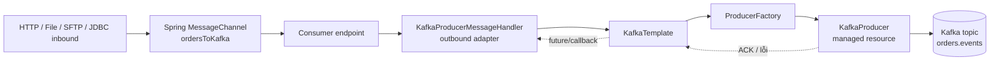
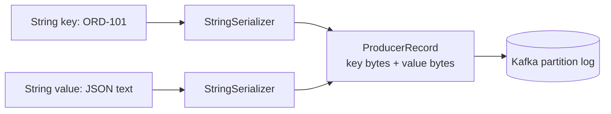
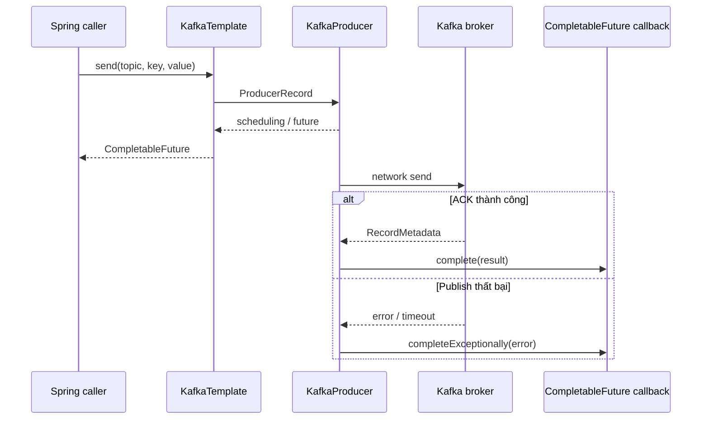
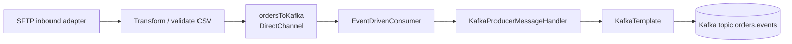
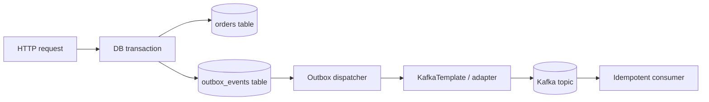

# KafkaTemplate và producer factory

**`KafkaTemplate<K,V>`** là API cấp cao của Spring for Apache Kafka để xuất bản Kafka record; **`ProducerFactory<K,V>`** là hợp đồng tạo và quản lý Kafka producer mà template sử dụng. Trong Spring Integration, hai thành phần này thường đứng **bên dưới Kafka outbound channel adapter hoặc outbound gateway**: message được gửi vào Spring `MessageChannel`, một handler nhận message, rồi gọi KafkaTemplate để publish đến broker.

Bài thuộc chương **Adapter Kafka** của module **SPRING_INTEGRATION_ADAPTERS**. Module này kết nối các hệ thống ngoài bằng inbound/outbound adapter, gateway, poller và `MessageChannel`; thực hành trao đổi qua file, SFTP, HTTP, JMS, AMQP, Kafka và cơ sở dữ liệu, đồng thời chú trọng message contract, lỗi và vòng đời kết nối. Trọng tâm của bài là **hạ tầng gửi Kafka và những đảm bảo thực sự khi publish**, không phải consumer group/offset inbound.

> **Cần nhớ:** `KafkaTemplate.send(...)` trả một `CompletableFuture<SendResult<K,V>>` trong các phiên bản Spring Kafka hiện đại. **Khởi tạo một lần gửi**, **broker xác nhận thành công** và **consumer phía nhận hoàn tất nghiệp vụ** là ba mốc khác nhau. Đặc biệt, gửi bất đồng bộ không đồng nghĩa kết quả broker đã thành công khi method `send()` trả về.

## 1. Mục tiêu học tập

Sau bài học, bạn có thể:

1. Giải thích ranh giới giữa `ProducerFactory`, `DefaultKafkaProducerFactory`, Kafka `Producer`, `KafkaTemplate`, `KafkaProducerMessageHandler` và Spring `MessageChannel`.
2. Tạo producer factory với bootstrap servers, key/value serializers, `acks`, idempotence và các giới hạn timeout.
3. Tạo `KafkaTemplate<String,String>`, dùng `send(topic, key, value)`, `send(ProducerRecord)` và `send(Message<?>)` đúng hợp đồng.
4. Xử lý `CompletableFuture<SendResult<K,V>>`, `RecordMetadata`, lỗi đồng bộ và bất đồng bộ, không chặn Kafka I/O callback.
5. Nối template vào Kafka outbound channel adapter trong Spring Integration bằng Java DSL.
6. Lựa chọn producer dùng chung, producer riêng theo thread và cách quản lý vòng đời/đổi cấu hình của factory.
7. Giải thích retry, `acks=all`, `enable.idempotence`, ordering, batching, compression và throughput.
8. Phân biệt Kafka transaction với transaction database, sử dụng `executeInTransaction` và xác định khi nào cần transactional outbox.
9. Kiểm thử, quan sát và khắc phục các lỗi serializer, topic, ACL, network, buffer, timeout và trạng thái kết quả không chắc chắn.

## 2. Producer factory và template nằm ở đâu?



| Thành phần | Trách nhiệm | Không tự bảo đảm |
|---|---|---|
| `ProducerFactory<K,V>` | Tạo/cung cấp producer theo cấu hình, quản lý tái sử dụng và vòng đời | Không định nghĩa request nghiệp vụ hoặc message routing |
| `DefaultKafkaProducerFactory<K,V>` | Triển khai producer factory phổ biến của Spring Kafka | Không phải một `MessageHandler` |
| `KafkaProducer<K,V>` | Serialize, partition, batch, retry và gửi request tới broker | Không đảm bảo consumer downstream đã xử lý |
| `KafkaTemplate<K,V>` | Cung cấp API gửi, future, listener, transaction helper, metrics | Không tự tạo distributed transaction với DB |
| `KafkaProducerMessageHandler` | Nhận Spring message, đổi thành Kafka record và dùng template publish | Không đọc Kafka topic như inbound adapter |
| Spring `MessageChannel` | Nối producer nội bộ với outbound consumer endpoint | Không phải Kafka topic |
| Kafka broker | Tiếp nhận record, tổ chức log theo topic/partition và trả ACK | Không biết nghiệp vụ bên ngoài đã commit |

### 2.1. Generic `K` và `V` là gì?

Với `KafkaTemplate<String,String>`:

- `K` là kiểu **record key**: `String`, phải được `StringSerializer` xử lý hoặc một serializer tương thích.
- `V` là kiểu **record value**: `String`, cũng cần serializer thích hợp.
- Payload của Spring `Message<?>` có thể được dùng làm Kafka value nếu đi qua `KafkaTemplate.send(Message<?>)` hoặc outbound handler với converter phù hợp.

Không được hiểu generic Java như một phép chuyển đổi runtime tự động. Nếu bạn đặt `ProducerFactory<String, OrderCreated>` nhưng value serializer chỉ biết `String`, cấu hình có thể bị lỗi khi gửi. Producer và consumer phải thống nhất **wire format**: JSON, Avro, Protobuf, bytes hoặc một chuẩn được quy ước.

### 2.2. Vì sao không tạo một `new KafkaProducer` ở mỗi lần gửi?

Kafka producer là tài nguyên quản lý network connections, buffer, batch, I/O thread và metadata. Tạo mới producer cho mỗi message gây tốn chi phí, giảm batching và làm khó việc đóng/giải phóng tài nguyên.

`DefaultKafkaProducerFactory` giúp template dùng lại producer theo cơ chế Spring Kafka. Với trường hợp **không transaction**, mặc định factory dùng một producer chia sẻ cho nhiều lời gọi; `KafkaProducer` được thiết kế để sử dụng đồng thời. Khi dùng **transaction**, factory có thể quản lý một cache các transactional producer riêng.

## 3. Cấu hình `ProducerFactory`

`ProducerFactory<K,V>` là interface; `DefaultKafkaProducerFactory<K,V>` là implementation phổ biến. Nguồn cấu hình chính là một `Map<String,Object>` chứa các Kafka client properties.

```java
@Bean("orderProducerFactory")
ProducerFactory<String, String> orderProducerFactory(
        @Value("${demo.kafka.bootstrap-servers}") String brokers) {

    Map<String, Object> props = new HashMap<>();
    props.put(ProducerConfig.BOOTSTRAP_SERVERS_CONFIG, brokers);
    props.put(ProducerConfig.KEY_SERIALIZER_CLASS_CONFIG,
            StringSerializer.class);
    props.put(ProducerConfig.VALUE_SERIALIZER_CLASS_CONFIG,
            StringSerializer.class);
    props.put(ProducerConfig.ACKS_CONFIG, "all");
    props.put(ProducerConfig.ENABLE_IDEMPOTENCE_CONFIG, true);

    return new DefaultKafkaProducerFactory<>(props);
}
```

Đây là một method trong class `@Configuration`; cần các import Java/Spring tương ứng, sẽ có ở ví dụ hoàn chỉnh mục 6. Cấu hình gửi cần phù hợp yêu cầu SLA và số replication của Kafka topic, không nên bê nguyên mọi setting từ một hướng dẫn cũ.

### 3.1. Serializer: type Java khác bytes trên Kafka



| Loại dữ liệu | Serializer thường dùng | Lưu ý |
|---|---|---|
| `String` | `StringSerializer` | Encoding, độ dài payload, JSON text không tự có schema |
| `byte[]` | `ByteArraySerializer` | Ứng dụng tự kiểm soát wire format |
| DTO JSON | `JsonSerializer<T>` hoặc converter phù hợp | Thống nhất schema/version/type headers với consumer |
| Integer/Long key | `IntegerSerializer`, `LongSerializer` | Phải khớp kiểu key thực tế |
| Avro/Protobuf | Serializer của hệ sinh thái/schema registry đang dùng | Cần schema, compatibility, credentials phù hợp |

Đừng chỉ thay `KafkaTemplate<String,String>` thành `KafkaTemplate<String,OrderCreated>` rồi kỳ vọng JSON tự được sinh ra. Thay đổi **producer factory value serializer** và kiểm thử record bằng consumer độc lập.

### 3.2. Serializer instances và serializer suppliers

`DefaultKafkaProducerFactory` hỗ trợ nhận serializer **class** thông qua properties, hoặc có thể nhận **serializer instance**/**supplier** tùy constructor và phiên bản.

- Serializer **class**: client/factory tạo serializer theo cấu hình.
- Serializer **instance**: có thể được chia sẻ với producer theo cách khởi tạo factory.
- Serializer **supplier**: tạo instance riêng khi cần một serializer có state hoặc vòng đời riêng.

Với serializer custom chứa mutable state, hãy cân nhắc cách factory tái sử dụng và tính thread-safe. Không chọn một serializer chung nếu implementation không bảo đảm dùng đồng thời an toàn.

## 4. Những producer configs quyết định độ bền và hiệu năng

Các cấu hình quan trọng:

| Property Kafka producer | Ý nghĩa | Sai lầm thường gặp |
|---|---|---|
| `bootstrap.servers` | Danh sách broker seed để lấy metadata | Chỉ một địa chỉ sai làm tưởng topic không tồn tại |
| `key.serializer` / `value.serializer` | Chuyển đối tượng Java thành bytes | DTO không thể được serializer hiện tại xử lý |
| `acks` | Chính sách ACK từ broker | Nhầm ACK với business consumer đã xử lý |
| `enable.idempotence` | Giảm duplicate do producer retry ở phạm vi Kafka hỗ trợ | Nhầm với idempotency nghiệp vụ xuyên restart |
| `retries` | Retry các lỗi gửi phù hợp ở Kafka producer | Retry nhiều tầng gây bùng số attempt |
| `delivery.timeout.ms` | Giới hạn thời gian tổng thể để gửi một record | Giả định timeout chứng minh broker chưa nhận |
| `request.timeout.ms` | Giới hạn chờ phản hồi một broker request | Bỏ qua quan hệ với delivery timeout |
| `max.block.ms` | Giới hạn block cho metadata/buffer ở một số lời gọi producer | “Async” vẫn có thể block ở thread caller |
| `linger.ms` | Cho phép chờ ngắn để gom batch | Bật quá cao tăng latency |
| `batch.size` | Mục tiêu kích thước batch theo partition | Không phải số message bắt buộc trong batch |
| `compression.type` | Nén record batch | Tốn CPU để giảm network/storage |
| `buffer.memory` | Ngân sách memory producer buffer | Buffer đầy khiến send bị chặn/lỗi |
| `max.in.flight.requests.per.connection` | Giới hạn request chưa ACK trên một kết nối | Phải tương thích idempotence và ordering |
| `client.id` | Nhận diện producer để quan sát | Không phải consumer group ID |
| `transactional.id` / prefix của factory | Nhận diện transactional producer | Trùng giữa pods có thể bị fencing |

**Bộ ba nên hiểu cùng nhau:** `acks=all`, `enable.idempotence=true` và `retries` thích hợp giúp giảm một số lỗi do retry ở Kafka producer; để idempotence được bảo đảm, phải tuân theo yêu cầu cấu hình Kafka client (như `acks=all`, retries > 0, `max.in.flight.requests.per.connection ≤ 5` theo phiên bản tương ứng). Không đặt các giá trị mâu thuẫn nhau.

### 4.1. `acks=all` không phải phép màu

`acks=all` yêu cầu leader chờ các replica thuộc ISR theo policy. Độ bền còn phụ thuộc **replication factor**, `min.insync.replicas` và tình trạng cluster. Topic chỉ có một replica không trở thành chịu lỗi broker chỉ nhờ `acks=all`.

### 4.2. `enable.idempotence=true` xử lý loại trùng nào?

Kafka producer sử dụng sequence number/producer identity để giảm duplicate do retry kỹ thuật trên cùng phiên producer. Điều này **không** xóa hết duplicate do:

- HTTP caller retry cùng request sau timeout.
- Outbox dispatcher publish lại sau restart.
- Producer ứng dụng gọi `send()` hai lần cho cùng business event.
- Cùng event được đưa tới Kafka từ hai service khác nhau.

Muốn chống tác dụng phụ trùng nghiệp vụ, cần `eventId`, unique constraint hoặc consumer inbox/idempotency store.

### 4.3. Producer retry và timeout mơ hồ

Nếu network timeout xảy ra, Kafka broker có thể **đã append record** nhưng ACK bị mất; cũng có thể record chưa được broker lưu. Người gửi không nên khẳng định “timeout nghĩa là chưa gửi”. Phải thiết kế retry an toàn với khóa nghiệp vụ và khả năng đối soát.

## 5. Các API quan trọng của `KafkaTemplate`

`KafkaTemplate<K,V>` triển khai `KafkaOperations<K,V>` và bọc Kafka producer với những API cấp cao:

| Phương thức | Khi dùng |
|---|---|
| `send(String topic, V data)` | Gửi một value đến topic |
| `send(String topic, K key, V data)` | Gửi kèm key để partitioning |
| `send(String topic, Integer partition, K key, V data)` | Chỉ định partition khi thực sự cần |
| `send(ProducerRecord<K,V> record)` | Tự dựng Kafka record, kiểm soát headers/timestamp |
| `send(Message<?> message)` | Chuyển Spring message sang Kafka record |
| `sendDefault(...)` | Gửi tới default topic đã khai báo trên template |
| `execute(callback)` | Truy cập producer thông qua callback |
| `executeInTransaction(callback)` | Gửi trong một Kafka transaction cục bộ |
| `metrics()` | Truy cập metrics của producer |
| `partitionsFor(topic)` | Lấy metadata partition cho topic |
| `flush()` | Yêu cầu producer flush các record đã buffer theo contract |

Trong Spring Kafka hiện đại, các method `send` trả **`CompletableFuture<SendResult<K,V>>`**, không phải kết quả Kafka ACK ngay lập tức.

### 5.1. Gửi theo topic/key/value

```java
CompletableFuture<SendResult<String, String>> future =
        kafkaTemplate.send(
                "orders.events", "ORD-101",
                "{\"eventId\":\"evt-101\",\"status\":\"CREATED\"}");
```

`ORD-101` là Kafka key; JSON ở đây **vẫn là String**, không phải DTO Java. Chọn key ổn định giúp các event cùng aggregate thường đến cùng một partition khi partitioner, số partition và serializer không đổi.

### 5.2. Dùng `ProducerRecord` khi cần metadata chi tiết

```java
ProducerRecord<String, String> record =
        new ProducerRecord<>(
                "orders.events",       // topic
                "ORD-101",             // key
                "{\"eventId\":\"evt-101\",\"status\":\"CREATED\"}");

record.headers().add(
        "eventId",
        "evt-101".getBytes(StandardCharsets.UTF_8));

CompletableFuture<SendResult<String, String>> future =
        kafkaTemplate.send(record);
```

Với cách này, code cần imports `ProducerRecord` và `StandardCharsets`. Header `eventId` là **Kafka native header bytes**, khác với String header nằm trong Spring message trước khi được mapper/converter xử lý.

### 5.3. Dùng Spring `Message<?>` và `KafkaHeaders`

```java
Message<String> message = MessageBuilder
        .withPayload("{\"eventId\":\"evt-101\"}")
        .setHeader(KafkaHeaders.TOPIC, "orders.events")
        .setHeader(KafkaHeaders.KEY, "ORD-101")
        .build();

CompletableFuture<SendResult<String, String>> future =
        kafkaTemplate.send(message);
```

Cần import `KafkaHeaders`, `Message` và `MessageBuilder`. Template/converter sử dụng các header như `TOPIC`, `KEY`, `PARTITION`, `TIMESTAMP` để lập record.

**Đừng nhầm:** `KafkaHeaders.RECEIVED_TOPIC` là metadata của record **đã nhận** trong Kafka inbound. Nó không thay thế tự động `KafkaHeaders.TOPIC` khi gửi outbound.

### 5.4. `sendDefault(...)` cần default topic

```java
KafkaTemplate<String, String> template =
        new KafkaTemplate<>(producerFactory);
template.setDefaultTopic("orders.events");

template.sendDefault("ORD-101", "CREATED");
```

Đoạn này minh họa template được tạo cục bộ; trong ứng dụng Spring Boot nên để container quản lý bean. Nếu chưa cấu hình default topic thì gọi `sendDefault` không có destination hợp lệ.

### 5.5. Timestamp và partition

Kafka producer record có thể mang timestamp do ứng dụng đặt; broker/topic có thể dùng `CreateTime` hoặc `LogAppendTime`. Với `LogAppendTime`, broker có thể ghi timestamp phía broker thay vì sử dụng giá trị client.

Một partition được chỉ định tường minh có thể tạo hotspot hoặc lỗi nếu partition không tồn tại. Nếu không có yêu cầu đặc biệt, để partitioner chọn theo key sẽ đơn giản hơn và thuận lợi khi scale.

## 6. Demo hoàn chỉnh: Spring Boot Java configuration

Mục tiêu: dùng `DefaultKafkaProducerFactory` và `KafkaTemplate<String,String>` gửi một event đơn hàng tới `orders.events`, quan sát future/callback và metadata broker.

### 6.1. Dependencies

Dùng Java 17+ và một bộ Spring Boot/Spring Kafka/Spring Integration tương thích. Với một ứng dụng Spring Integration, có thể khai báo:

```xml
<dependency>
    <groupId>org.springframework.boot</groupId>
    <artifactId>spring-boot-starter-integration</artifactId>
</dependency>

<dependency>
    <groupId>org.springframework.integration</groupId>
    <artifactId>spring-integration-kafka</artifactId>
</dependency>
```

Dependency Kafka tích hợp mang các thư viện Spring Kafka liên quan theo BOM/metadata của dự án. Nếu chỉ cần publish Kafka thuần mà không dùng IntegrationFlow, có thể dùng dependency Spring Kafka thích hợp. Tránh trộn thủ công nhiều version không tương thích.

### 6.2. application.properties

```properties
demo.kafka.bootstrap-servers=localhost:9092
demo.kafka.topic=orders.events
```

Kafka cluster và topic phải được tạo hoặc provision đúng. Nếu dựa vào auto-creation thông qua `NewTopic` bean, **không gửi trong `@PostConstruct`** vì bean KafkaAdmin/topic có thể chưa sẵn sàng; dùng `ApplicationRunner` hoặc giai đoạn sau context refresh.

### 6.3. Class cấu hình producer factory và template

```java
package com.example.integration;

import java.util.HashMap;
import java.util.Map;

import org.apache.kafka.clients.producer.ProducerConfig;
import org.apache.kafka.common.serialization.StringSerializer;
import org.springframework.beans.factory.annotation.Value;
import org.springframework.context.annotation.Bean;
import org.springframework.context.annotation.Configuration;
import org.springframework.kafka.core.DefaultKafkaProducerFactory;
import org.springframework.kafka.core.KafkaTemplate;
import org.springframework.kafka.core.ProducerFactory;

@Configuration
public class OrdersKafkaProducerConfig {

    @Bean("ordersProducerFactory")
    public ProducerFactory<String, String> ordersProducerFactory(
            @Value("${demo.kafka.bootstrap-servers}") String brokers) {

        Map<String, Object> config = new HashMap<>();
        config.put(ProducerConfig.BOOTSTRAP_SERVERS_CONFIG, brokers);
        config.put(ProducerConfig.KEY_SERIALIZER_CLASS_CONFIG,
                StringSerializer.class);
        config.put(ProducerConfig.VALUE_SERIALIZER_CLASS_CONFIG,
                StringSerializer.class);

        config.put(ProducerConfig.ACKS_CONFIG, "all");
        config.put(ProducerConfig.ENABLE_IDEMPOTENCE_CONFIG, true);
        config.put(ProducerConfig.DELIVERY_TIMEOUT_MS_CONFIG, 30_000);
        config.put(ProducerConfig.REQUEST_TIMEOUT_MS_CONFIG, 10_000);
        config.put(ProducerConfig.LINGER_MS_CONFIG, 5);
        config.put(ProducerConfig.COMPRESSION_TYPE_CONFIG, "gzip");

        return new DefaultKafkaProducerFactory<>(config);
    }

    @Bean("ordersKafkaTemplate")
    public KafkaTemplate<String, String> ordersKafkaTemplate(
            ProducerFactory<String, String> ordersProducerFactory) {

        KafkaTemplate<String, String> template =
                new KafkaTemplate<>(ordersProducerFactory);
        template.setDefaultTopic("orders.events");
        return template;
    }
}
```

Các timeout và compression ở trên chỉ là **giá trị lab** để minh họa producer configs; production phải tune dựa trên broker, throughput, SLA và yêu cầu reliability. Không bật `transactionIdPrefix` trong ví dụ này, nên đây là **non-transactional producer factory**.

### 6.4. Publisher theo dõi future

```java
package com.example.integration;

import java.util.concurrent.CompletableFuture;

import org.springframework.beans.factory.annotation.Qualifier;
import org.springframework.kafka.core.KafkaTemplate;
import org.springframework.kafka.support.SendResult;
import org.springframework.stereotype.Service;

@Service
public class OrderEventPublisher {

    private final KafkaTemplate<String, String> kafkaTemplate;

    public OrderEventPublisher(
            @Qualifier("ordersKafkaTemplate")
            KafkaTemplate<String, String> kafkaTemplate) {
        this.kafkaTemplate = kafkaTemplate;
    }

    public CompletableFuture<SendResult<String, String>> publish(
            String orderId, String eventJson) {

        // Trả future lên caller để caller có thể quan sát kết quả.
        return kafkaTemplate.send("orders.events", orderId, eventJson);
    }
}
```

Class publisher **không bỏ qua tương lai của thao tác gửi**. Caller cần quan sát success/failure hoặc giữ event ở kho bền vững để retry; không gửi fire-and-forget rồi tuyên bố “đã giao”.

### 6.5. ApplicationRunner demo

```java
package com.example.integration;

import java.util.concurrent.CompletableFuture;

import org.springframework.boot.ApplicationRunner;
import org.springframework.context.annotation.Bean;
import org.springframework.context.annotation.Configuration;
import org.springframework.kafka.support.SendResult;

@Configuration
public class OrdersKafkaDemoRunner {

    @Bean
    ApplicationRunner sendOrderEvent(OrderEventPublisher publisher) {
        return args -> {
            CompletableFuture<SendResult<String, String>> future =
                    publisher.publish(
                            "ORD-101",
                            "{\"eventId\":\"evt-101\","
                                + "\"orderId\":\"ORD-101\","
                                + "\"type\":\"ORDER_CREATED\"}");

            future.whenComplete((result, error) -> {
                if (error != null) {
                    System.err.println(
                            "KAFKA SEND FAILED: " + error);
                    return;
                }

                var metadata = result.getRecordMetadata();
                System.out.printf(
                        "KAFKA ACK topic=%s partition=%d offset=%d%n",
                        metadata.topic(),
                        metadata.partition(),
                        metadata.offset());
            });
        };
    }
}
```

Một `@SpringBootApplication` trong package `com.example.integration` hoặc package cha sẽ quét các bean. Ví dụ không cần tạo Kafka consumer trong chính ứng dụng publisher; dùng Kafka CLI hoặc ứng dụng khác để kiểm tra record đã vào topic.

**Không giả định** offset luôn bằng 0 hoặc một record luôn nằm ở partition cụ thể. Kafka partition được chọn theo key/partitioner, số partition và dữ liệu sẵn có.

### 6.6. Chuẩn bị Kafka topic và quan sát

Với một broker lab, Kafka CLI:

```bash
kafka-topics.sh --bootstrap-server localhost:9092 \
  --create --if-not-exists \
  --topic orders.events --partitions 3 --replication-factor 1

kafka-console-consumer.sh \
  --bootstrap-server localhost:9092 \
  --topic orders.events --from-beginning
```

Bản ghi value ví dụ:

```json
{"eventId":"evt-101","orderId":"ORD-101","type":"ORDER_CREATED"}
```

Lệnh CLI là minh họa cho môi trường thử nghiệm. Với cluster production, topic/replication/ACL phải được provision theo quy trình quản trị riêng.

## 7. Async callback, kết quả gửi và lỗi

API gửi trả `CompletableFuture<SendResult<K,V>>`:



`SendResult<K,V>` cho biết `ProducerRecord` gốc và `RecordMetadata`, trong đó metadata thường gồm topic, partition, offset. Khi future thất bại, root cause có thể là một `KafkaProducerException`/serializer/broker exception tùy lỗi và phiên bản.

### 7.1. `whenComplete` xử lý cả thành công và lỗi

```java
CompletableFuture<SendResult<String, String>> future =
        kafkaTemplate.send("orders.events", "ORD-101", "CREATED");

future.whenComplete((result, ex) -> {
    if (ex == null) {
        RecordMetadata meta = result.getRecordMetadata();
        metrics.incrementSuccess(meta.topic());
    } else {
        metrics.incrementFailure();
        logger.error("Kafka publish failure for orderId={}",
                "ORD-101", ex);
        // Chuyển trạng thái event/outbox về RETRY theo policy.
    }
});
```

Trong snippet, `metrics` và `logger` là dependency ứng dụng cần tự khai báo/inject. **Không block/đọc DB lâu ngay trong callback**: callback có thể chạy trên thread I/O của producer hoặc một thread hoàn tất future, tùy tình huống. Với công việc tốn thời gian, dispatch sang executor được quản lý và lưu event bền vững.

### 7.2. `ProducerListener` để quan sát tập trung

`KafkaTemplate` có thể gắn `ProducerListener`; interface hỗ trợ callback `onSuccess(ProducerRecord, RecordMetadata)` và `onError(ProducerRecord, RecordMetadata, Exception)`.

```java
kafkaTemplate.setProducerListener(
        new ProducerListener<String, String>() {
            @Override
            public void onSuccess(
                    ProducerRecord<String, String> record,
                    RecordMetadata metadata) {
                System.out.println("ACK " + metadata.topic()
                        + "-" + metadata.partition());
            }

            @Override
            public void onError(
                    ProducerRecord<String, String> record,
                    RecordMetadata metadata,
                    Exception exception) {
                System.err.println(
                        "SEND FAILURE " + exception.getClass().getName());
            }
        });
```

Cần import `org.springframework.kafka.support.ProducerListener`, `ProducerRecord` và `RecordMetadata`. Snippet đặt trong nơi cấu hình template, **trước khi bắt đầu gửi**.

Mặc định KafkaTemplate có `LoggingProducerListener` để log lỗi. Điều đó **không thay thế** việc lưu event/outbox hoặc chính sách retry của nghiệp vụ.

### 7.3. Exception cũng có thể xuất hiện ngay ở lời gọi `send()`

Không nên chỉ gắn `whenComplete` rồi giả định mọi lỗi luôn xảy ra bất đồng bộ. Tùy serializer, client buffer/metadata và cách gửi, một số lỗi có thể xuất hiện trước khi bạn nhận được future thành công để theo dõi.

Với luồng nghiệp vụ quan trọng, hãy bao phủ cả:

```java
try {
    CompletableFuture<SendResult<String, String>> future =
            kafkaTemplate.send("orders.events", "ORD-101", payload);

    future.whenComplete((result, ex) -> {
        if (ex != null) {
            recordPublishFailure("ORD-101", ex);
        } else {
            recordPublishSuccess("ORD-101",
                    result.getRecordMetadata().offset());
        }
    });
} catch (RuntimeException sendFailure) {
    recordPublishFailure("ORD-101", sendFailure);
}
```

`payload`, `recordPublishFailure` và `recordPublishSuccess` là biến/hàm minh họa do ứng dụng định nghĩa. Nếu sử dụng cùng object event để retry, phải chống trùng và kiểm tra kết quả mơ hồ.

## 8. Khi cần gửi đồng bộ: `get(timeout)`

`CompletableFuture.get(timeout, unit)` chặn thread caller đến khi producer hoàn tất hoặc hết deadline:

```java
try {
    SendResult<String, String> result =
            kafkaTemplate.send(
                    "orders.events", "ORD-101", "CREATED")
            .get(10, TimeUnit.SECONDS);

    System.out.println("Broker ACK offset="
            + result.getRecordMetadata().offset());
} catch (InterruptedException ex) {
    Thread.currentThread().interrupt();
    throw new IllegalStateException("Interrupted while publishing", ex);
} catch (TimeoutException ex) {
    throw new IllegalStateException(
            "No confirmed Kafka result within deadline", ex);
} catch (ExecutionException ex) {
    throw new IllegalStateException(
            "Kafka producer returned failure", ex.getCause());
}
```

Cần các import `TimeUnit`, `ExecutionException`, `TimeoutException`, `SendResult`. Với Spring Integration outbound handler, có thể cấu hình chế độ sync thay vì tự gọi `get()` từ business code.

**Điểm quan trọng:** Một timeout ở thread chờ **không khẳng định record chưa được broker append**. Future có thể hoàn tất sau deadline; cần xử lý trạng thái không chắc chắn và idempotency khi retry.

### 8.1. Vì sao không gọi `flush()` sau mọi event?

`KafkaTemplate.flush()` yêu cầu producer đẩy các record đang buffer theo contract. Gọi sau mọi message có thể phá lợi ích batching và gây tranh chấp khi nhiều thread dùng chung producer.

- Dùng `flush()` khi có ranh giới yêu cầu đẩy ngay, theo thời hạn rõ ràng.
- Không coi `flush()` là consumer acknowledgment hay business commit.
- Nếu dùng `producerPerThread`, quản lý cleanup riêng cho thread-bound producers.
- Khi shutdown, kết hợp producer lifecycle, pending futures và outbox; không chỉ gọi flush rồi kết luận mọi side effect đã bền vững.

## 9. KafkaTemplate với Spring Integration outbound adapter

Một mục tiêu của module **SPRING_INTEGRATION_ADAPTERS** là nối các hệ thống khác vào Kafka mà vẫn dùng `MessageChannel` làm contract nội bộ. Ví dụ:



### 9.1. Java DSL dùng template đã có

Trong class `@Configuration` có bean `ordersKafkaTemplate` từ mục 6:

```java
package com.example.integration;

import org.springframework.beans.factory.annotation.Qualifier;
import org.springframework.context.annotation.Bean;
import org.springframework.context.annotation.Configuration;
import org.springframework.expression.common.LiteralExpression;
import org.springframework.integration.channel.DirectChannel;
import org.springframework.integration.dsl.IntegrationFlow;
import org.springframework.integration.kafka.outbound.KafkaProducerMessageHandler;
import org.springframework.kafka.core.KafkaTemplate;
import org.springframework.messaging.MessageChannel;

@Configuration
public class OrdersKafkaFlowConfig {

    @Bean("ordersToKafka")
    MessageChannel ordersToKafka() {
        return new DirectChannel();
    }

    @Bean("ordersKafkaOutboundHandler")
    KafkaProducerMessageHandler<String, String> ordersKafkaOutboundHandler(
            @Qualifier("ordersKafkaTemplate")
            KafkaTemplate<String, String> template) {

        KafkaProducerMessageHandler<String, String> handler =
                new KafkaProducerMessageHandler<>(template);

        handler.setTopicExpression(
                new LiteralExpression("orders.events"));
        handler.setSync(false);
        return handler;
    }

    @Bean("ordersKafkaOutboundFlow")
    IntegrationFlow ordersKafkaOutboundFlow(
            @Qualifier("ordersKafkaOutboundHandler")
            KafkaProducerMessageHandler<String, String> handler) {

        return IntegrationFlow.from("ordersToKafka")
                .handle(handler, endpoint -> endpoint
                        .id("ordersKafkaOutboundEndpoint"))
                .get();
    }
}
```

Đường message:

```text
ordersToKafka (Spring input channel)
    -> EventDrivenConsumer (ordersKafkaOutboundEndpoint)
    -> KafkaProducerMessageHandler
    -> KafkaTemplate
    -> ProducerFactory
    -> Kafka broker / topic
```

**Outbound adapter** nhận từ **input channel** Spring Integration, dù bản thân nó gửi dữ liệu *ra Kafka*. Nó khác **Kafka inbound adapter** có **output channel**.

### 9.2. Gửi Spring Message vào flow

```java
Message<String> message = MessageBuilder
        .withPayload("{\"eventId\":\"evt-101\"}")
        .setHeader(KafkaHeaders.KEY, "ORD-101")
        .build();

ordersToKafka.send(message);
```

Đây là snippet trong method được Spring quản lý và đã inject bean `ordersToKafka`. Khi handler dùng topic expression tĩnh `orders.events`, một `KafkaHeaders.TOPIC` có trên message **không tự override** expression ấy. Muốn topic động, định nghĩa policy tường minh/allowlist.

### 9.3. Java DSL xây handler từ factory

Spring Integration còn có DSL factory:

```java
@Bean
IntegrationFlow kafkaDslFlow(
        @Qualifier("ordersProducerFactory")
        ProducerFactory<String, String> factory) {

    return IntegrationFlow.from("ordersToKafka")
            .handle(
                Kafka.outboundChannelAdapter(factory)
                    .topic("orders.events"),
                endpoint -> endpoint.id("ordersKafkaDslEndpoint"))
            .get();
}
```

Cần import `org.springframework.integration.kafka.dsl.Kafka` và `ProducerFactory`. Đây là **phương án thay thế** flow ở mục 9.1; đừng chạy đồng thời hai flow subscribe cùng `DirectChannel` chỉ để “tăng độ tin cậy”. Với `DirectChannel`, nhiều consumer thường cạnh tranh xử lý một message, không tạo fan-out.

### 9.4. Success/failure channel của outbound handler

Một outbound handler có thể cấu hình **success channel** nhận `RecordMetadata` khi Kafka publish thành công và **failure channel** nhận `ErrorMessage` cùng chi tiết failed record. Đây là các **Spring Integration channels**, không phải Kafka reply topic.

Trong những trường hợp cần lưu trạng thái publish, flow xử lý failure phải thực sự lưu event bền vững, retry/quarantine và phát cảnh báo. Chỉ có logging handler không tạo guarantee giao hàng.

## 10. Producer dùng chung, producer-per-thread và vòng đời

Một điểm dễ bỏ sót là **factory quản lý tài nguyên lâu dài**, không chỉ là một constructor chứa map properties.

### 10.1. Mặc định: non-transactional shared producer

Trong cấu hình mặc định không transaction, `DefaultKafkaProducerFactory` tạo một producer dùng chung cho các client/template cần nó; cách này phù hợp đa số trường hợp và khai thác Kafka producer batching tốt.

- Nhiều thread cùng gọi `KafkaTemplate.send(...)` có thể sử dụng cùng producer.
- `flush()` trên template dùng shared producer có thể ảnh hưởng các thread cùng producer.
- Không tự `producer.close()` trong một method nghiệp vụ nếu producer được Spring factory quản lý.
- Shutdown nên để container/factory xử lý hoặc dùng lifecycle API có kiểm soát.

### 10.2. `producerPerThread`

Một số workload cần tránh flush của thread này ảnh hưởng thread khác:

```java
DefaultKafkaProducerFactory<String, String> factory =
        new DefaultKafkaProducerFactory<>(producerConfigs);

factory.setProducerPerThread(true);
```

Khi bật, factory có thể tạo/cache producer riêng cho từng thread. **Quan trọng:** thread-bound producer không tự được dọn bằng `reset()` hay `destroy()` theo cơ chế mặc định; ứng dụng phải gọi `closeThreadBoundProducer()` khi thread không còn dùng producer đó.

Đừng bật tùy tiện khi ứng dụng dùng executor pool lâu dài hoặc số thread thay đổi liên tục; có thể tăng số connection, buffer, memory và tạo rủi ro resource leak.

### 10.3. Transactional producer cache

Khi có `transactionIdPrefix`, factory tạo/cache transactional producers. Mỗi producer mang một `transactional.id` riêng. Nếu nhiều instance dùng trùng ID, broker có thể **fence** producer cũ; cần bảo đảm prefix riêng cho mỗi application instance.

Cache có giới hạn cũng có thể hết producer khả dụng nếu concurrent transactions lớn hơn kích thước pool; Spring Kafka có thể báo `NoProducerAvailableException` trong các cấu hình nhất định. Cần tune concurrency và kích thước cache hợp lý.

### 10.4. `reset()` và cập nhật config runtime

Một số phiên bản `DefaultKafkaProducerFactory` hỗ trợ:

```java
factory.updateConfigs(changedConfigs);
factory.removeConfig("some.config.key");
factory.reset();
```

Đây là snippet; `changedConfigs` phải là một `Map<String,Object>` hợp lệ và cần import tương ứng. Việc cập nhật factory **không thay cấu hình trên producer instance đã được tạo**. `reset()` làm producer được tạo lại để áp dụng config mới theo cơ chế factory.

Không dùng reset tùy tiện lúc nhiều gửi/transaction đang chạy: phải xác định các future in-flight và graceful handoff. Cũng không được đổi một transactional factory thành non-transactional (hoặc ngược lại) bằng cách cập nhật vài config tại runtime.

## 11. Transaction: `KafkaTemplate.executeInTransaction`

Kafka có producer transaction để nhóm các Kafka operations; Spring Kafka hỗ trợ thông qua transactional `DefaultKafkaProducerFactory` và `KafkaTemplate`.

### 11.1. Bật transaction cho producer factory

Tạo **factory riêng** trong cấu hình transaction thay vì chỉnh factory non-transactional của demo khi nó đang hoạt động:

```java
@Bean("transactionalProducerFactory")
ProducerFactory<String, String> transactionalProducerFactory(
        @Value("${demo.kafka.bootstrap-servers}") String brokers,
        @Value("${demo.instance-id}") String instanceId) {

    Map<String, Object> configs = new HashMap<>();
    configs.put(ProducerConfig.BOOTSTRAP_SERVERS_CONFIG, brokers);
    configs.put(ProducerConfig.KEY_SERIALIZER_CLASS_CONFIG,
            StringSerializer.class);
    configs.put(ProducerConfig.VALUE_SERIALIZER_CLASS_CONFIG,
            StringSerializer.class);
    configs.put(ProducerConfig.ACKS_CONFIG, "all");

    DefaultKafkaProducerFactory<String, String> factory =
            new DefaultKafkaProducerFactory<>(configs);

    factory.setTransactionIdPrefix(
            "orders-tx-" + instanceId + "-");
    return factory;
}

@Bean("transactionalKafkaTemplate")
KafkaTemplate<String, String> transactionalKafkaTemplate(
        @Qualifier("transactionalProducerFactory")
        ProducerFactory<String, String> factory) {
    return new KafkaTemplate<>(factory);
}
```

`demo.instance-id` là định danh **duy nhất giữa các tiến trình/pod** có thể sống cùng lúc; cần cấp từ môi trường triển khai, không dùng một giá trị giống nhau trên mọi replica. Đây là ví dụ bổ sung thuộc một class `@Configuration` với imports tương ứng.

### 11.2. Kafka local transaction

```java
String result = transactionalKafkaTemplate.executeInTransaction(ops -> {
    ops.send("orders.events", "ORD-101", "CREATED");
    ops.send("orders.audit", "ORD-101", "AUDITED");
    return "PUBLISHED";
});
```

Bộ operation này chạy trong **một Kafka transaction** được template bắt đầu/commit hoặc rollback. Khi callback ném exception, transaction được rollback theo contract. Cần broker/topic hỗ trợ transaction và consumer downstream có `isolation.level=read_committed` nếu muốn không đọc các record thuộc transaction bị abort.

`executeInTransaction` không tạo transaction của database. Một lời gọi method chứa cả `jdbcTemplate.update(...)` và `transactionalKafkaTemplate.executeInTransaction(...)` **không** tự tạo giao dịch atomic xuyên hai hệ thống.

### 11.3. `KafkaTransactionManager` và `@Transactional`

Với một producer factory có transaction capability, `KafkaTransactionManager` có thể quản lý Kafka transaction bằng Spring transaction APIs.

```java
@Bean("kafkaTransactionManager")
KafkaTransactionManager<String, String> kafkaTransactionManager(
        @Qualifier("transactionalProducerFactory")
        ProducerFactory<String, String> factory) {
    return new KafkaTransactionManager<>(factory);
}
```

Sau đó một service có thể dùng `@Transactional("kafkaTransactionManager")` hoặc `TransactionTemplate` để nhóm Kafka sends. Nhưng khi ứng dụng có nhiều transaction manager (Kafka và JDBC), **phải chọn rõ manager nào**. Không cho rằng một annotation không nêu manager sẽ tự điều phối tất cả.

Với Spring Boot, một số cấu hình transaction có thể được auto-configure từ `spring.kafka.producer.transaction-id-prefix`; nếu đã tự khai báo producer factory/manager, cần tránh tạo duplicate/conflict không cần thiết.

### 11.4. Transactional template thường yêu cầu transaction đang hoạt động

Một `KafkaTemplate` dùng transactional producer factory thường yêu cầu send nằm trong transaction, qua `@Transactional`, `TransactionTemplate`, `executeInTransaction` hoặc container transaction. Nếu gọi send ngoài transaction, có thể nhận `IllegalStateException`.

Spring Kafka có `allowNonTransactional` khi cần hỗn hợp mode, nhưng nên phân định rõ ràng thay vì để caller ngầm gửi non-transactional trong một luồng tưởng là transactional.

## 12. Kafka transaction không thay thế outbox khi đi cùng database

Giả sử một API cần **ghi đơn hàng vào JDBC** và **publish OrderCreated tới Kafka**. Nếu DB commit thành công nhưng Kafka send/commit thất bại, trạng thái hai hệ thống lệch. Nếu Kafka commit trước DB commit, consumer có thể thấy event cho đơn hàng chưa tồn tại.



**Transactional outbox** thường là lựa chọn vững hơn cho DB → Kafka:

1. Trong **một DB transaction**, ghi entity và một outbox row chứa `eventId`, payload và trạng thái `PENDING`.
2. Dispatcher đọc/claim những event chưa publish rồi gửi bằng `KafkaTemplate` hoặc Kafka outbound adapter.
3. Sau khi nhận producer ACK thành công, cập nhật trạng thái outbox là `SENT` theo chính sách thích hợp.
4. Nếu dispatcher chết **sau Kafka ACK nhưng trước UPDATE outbox**, lần sau có thể gửi lại event; consumer cần dedup theo `eventId`.
5. Khi Kafka không sẵn sàng, outbox vẫn giữ event đã commit DB để retry có giới hạn và quan sát backlog.

Kafka idempotent producer và producer transaction vẫn hữu ích, nhưng **không bảo đảm exactly-once end-to-end giữa DB và Kafka** nếu không có cơ chế phối hợp/thiết kế phù hợp.

### 12.1. Một ví dụ schema outbox tối thiểu

```sql
CREATE TABLE outbox_events (
    event_id VARCHAR(128) PRIMARY KEY,
    aggregate_id VARCHAR(128) NOT NULL,
    topic VARCHAR(255) NOT NULL,
    payload TEXT NOT NULL,
    status VARCHAR(20) NOT NULL,
    created_at TIMESTAMP NOT NULL
);
```

Đây là schema minh họa, cần điều chỉnh theo SQL dialect và mô hình dữ liệu. Production nên có cơ chế claim an toàn khi nhiều dispatcher chạy, retry count/next attempt time, trạng thái uncertain và retention/cleanup.

## 13. Tối ưu throughput: batching, compression và backpressure

Kafka producer tối ưu việc gửi theo **batch ở cấp partition**. Những yếu tố quan trọng:

| Thành phần | Tác động |
|---|---|
| `linger.ms` | Cho phép chờ một khoảng ngắn để gom thêm record |
| `batch.size` | Giới hạn/mục tiêu batch bytes theo partition |
| `compression.type` | Nén batch để giảm network/storage, tốn CPU |
| `buffer.memory` | Giới hạn buffer producer, liên quan `max.block.ms` khi đầy |
| `max.in.flight.requests.per.connection` | Pipeline nhiều request chưa ACK, liên quan ordering |
| Số partition | Tạo nhiều luồng append độc lập, ảnh hưởng batching |
| Record size/schema | Quyết định network, CPU, broker/topic limit |
| Consumer/downstream | Dù producer gửi nhanh, consumer lag vẫn có thể tăng |

### 13.1. Vì sao tăng `linger.ms` không phải luôn tốt?

Nếu ứng dụng chỉ gửi một event mỗi phút và cần SLA 50 ms, chờ gom batch quá lâu làm tăng end-to-end latency không cần thiết. Nếu gửi hàng chục nghìn event nhỏ mỗi giây, batching/compression có thể giảm request overhead đáng kể.

Không tune chỉ bằng số “message/s” của producer; cần đo **record send rate, request latency, batch size, retry/error rate, buffer wait, CPU/network và consumer lag**.

### 13.2. Backpressure xuất hiện ở đâu?

Ngay cả khi dùng `KafkaTemplate.send(...)` async, producer có thể chặn một khoảng khi cần metadata topic hoặc khi buffer không đủ, theo `max.block.ms`. Nếu nguồn là HTTP inbound hoặc SFTP poller, điều này có thể làm chậm thread caller và lan áp lực ngược lên upstream.

**Đừng thêm `QueueChannel` RAM rồi coi đó là dữ liệu bền:** queue nội bộ có thể mất khi JVM restart. Nếu source đã xác nhận trước khi event tới Kafka, cần durable queue, outbox hoặc chính sách acknowledgment thích hợp.

### 13.3. Giữ thứ tự theo business aggregate

Kafka giữ thứ tự record trong **một partition**, không toàn topic. Dùng Kafka key là `orderId` giúp record cùng aggregate thường cùng partition khi cấu hình partitioning nhất quán. Nhưng nhiều sender song song có thể publish sai thứ tự nghiệp vụ; cần aggregate version/sequence hoặc single-writer discipline nếu ordering là yêu cầu cứng.

Tăng số partition có thể thay đổi mapping key → partition đối với record trong tương lai. Không coi “cùng Kafka key” là bảo đảm thứ tự lịch sử tuyệt đối khi partition count/partitioner thay đổi.

## 14. `RoutingKafkaTemplate` và nhiều kiểu serializer

Khi ứng dụng gửi tới những topic khác nhau với **wire formats khác nhau**, có thể dùng các producer factory/template riêng. Spring Kafka cũng có `RoutingKafkaTemplate` chọn factory theo **tên topic**.

```text
orders.json  -> ProducerFactory<String, String>   -> JSON text
images.raw   -> ProducerFactory<String, byte[]>   -> bytes
```

Chọn factory theo topic regex có ích khi nhiều type cùng ứng dụng; tuy nhiên `RoutingKafkaTemplate` **không hỗ trợ** một số API như transactions, `execute`, `flush` và `metrics` vì những thao tác đó không có topic để chọn factory.

Dùng routing template khi topic là dấu hiệu hợp lệ cho serializer. Nếu cùng một topic có nhiều loại payload, cân nhắc delegating serializer/schema envelope thay vì routing producer chỉ theo topic.

### 14.1. Khi nào nên dùng một template mỗi luồng?

Tách template/factory khi:

- Hai nhóm topic có serializer hoặc security principal khác nhau.
- Cần client-id và metrics phân biệt SLA.
- Một luồng cần transaction, luồng kia non-transactional.
- Một luồng gửi record lớn/batch, luồng kia yêu cầu latency thấp.
- Cần tránh cùng producer bị `flush()`/throttle ảnh hưởng.

Đổi lại, nhiều factory có thêm connection, buffer và vận hành phức tạp. Không tạo một KafkaTemplate cho từng message; hãy quản lý dưới dạng bean dùng lại.

## 15. Security và message contract

Trong production, producer cần quan tâm:

- **TLS/SASL:** kết nối mã hóa, xác thực broker, truststore/keystore khi cần.
- **Kafka ACL:** chỉ cho phép publish tới topic/topic pattern được cấp quyền.
- **Secret management:** không commit password/token trong mã hoặc example YAML.
- **Header mapping:** Spring message headers không phải mọi thứ đều nên biến thành Kafka native headers.
- **Schema evolution:** versioning/backward compatibility, giới hạn kích thước và dữ liệu nhạy cảm.
- **Dynamic topic:** nếu topic lấy từ header/payload, phải allowlist và kiểm tra tenant isolation.
- **Logging:** tránh dump raw payload chứa thông tin cá nhân, key bí mật hoặc credential.

Với Kafka outbound handler, nếu cấu hình topic/key expression tường minh, expression ấy có thể **ưu tiên** so với header tương ứng. Điều đó cần được kiểm thử để tránh vô tình gửi dữ liệu của tenant A sang topic tenant B.

## 16. Quan sát producer và template

`KafkaTemplate.metrics()` cung cấp Kafka producer metrics; Spring Boot/Micrometer cũng có thể thu thập các meter được hỗ trợ theo cấu hình.

| Tín hiệu | Câu hỏi cần trả lời |
|---|---|
| Producer send success/failure | Có bao nhiêu record được broker xác nhận? |
| `RecordMetadata` topic/partition/offset | Record được publish đến đâu? |
| Record send rate, byte rate | Tốc độ publish thực tế là bao nhiêu? |
| Request latency p95/p99 | Kafka broker/network có đang chậm? |
| Retry/error rate | Có lỗi tạm thời hoặc topic/ACL sai? |
| Batch size/compression ratio | Batching có hiệu quả? |
| Buffer available/wait time | Producer có bị backpressure? |
| Outbox pending/retry age | Bao nhiêu event DB đã commit nhưng Kafka chưa xác nhận? |
| Consumer lag downstream | Consumer đọc chậm dù producer publish thành công? |
| Producer count/connection usage | Có tạo factory/template hoặc producer-per-thread quá nhiều? |

### 16.1. Metadata không phải business receipt

`RecordMetadata` chứa topic, partition, offset và metadata liên quan kết quả publish. Nó không mang bằng chứng một hệ thống nhận đã commit database. Nếu quy trình cần phản hồi nghiệp vụ, dùng Kafka request–reply với reply topic/correlation hoặc event kết quả có business ID.

### 16.2. Correlation ID và event ID

- `MessageHeaders.ID`: ID message trong Spring Messaging.
- Kafka record key: ảnh hưởng partitioning, ví dụ `orderId`.
- `eventId`: định danh **một sự kiện nghiệp vụ**, phù hợp idempotency.
- Correlation ID: liên kết một cuộc hội thoại hoặc chuỗi thao tác.
- Topic/partition/offset: địa chỉ record Kafka cụ thể.

Nếu cùng event được publish lại ở offset mới, dùng topic-partition-offset làm khóa dedup sẽ không nhận ra đó là event trùng nghiệp vụ.

## 17. Chẩn đoán những lỗi thường gặp

| Triệu chứng | Nguyên nhân có thể | Cách kiểm tra |
|---|---|---|
| `ClassCastException`/serialization exception | Serializer và value type không khớp | `K,V`, producer config, DTO/schema |
| `send()` trả về rồi không có record | Future đã failed, sai topic hoặc broker unreachable | `whenComplete`, `ProducerListener`, broker logs |
| Timeout dù record thực tế đã tới broker | ACK bị mất/chậm hoặc deadline quá ngắn | Producer metadata, retry, eventId |
| Topic không tồn tại | Topic chưa provision, auto-create bị tắt | `KafkaAdmin`/CLI, ACL, startup order |
| `TopicAuthorizationException` | Producer không có quyền WRITE/DESCRIBE | Kafka ACL, principal, topic |
| `RecordTooLargeException` | Record vượt giới hạn client/broker/topic | Payload size, schema, compression, broker config |
| Producer buffer đầy | Downstream Kafka chậm, traffic tăng | `buffer.memory`, `max.block.ms`, producer metrics |
| Throughput thấp sau thêm `flush()` | Phá batching/đợi producer toàn cục | Tần suất flush, linger, latency |
| Trùng sự kiện sau HTTP retry | Caller retry cùng business request | `eventId`, idempotent producer vs business dedup |
| `IllegalStateException` dùng transactional template | Send ngoài Kafka transaction bắt buộc | `transactionIdPrefix` và transaction boundary |
| `ProducerFencedException` | Transactional ID trùng hoặc hết hạn/producer invalid | Unique instance prefix, producer maxAge, broker setting |
| Memory/connection tăng khi dùng producer-per-thread | Thread-bound producer không được close | `closeThreadBoundProducer()` mỗi thread |
| DB đã commit nhưng Kafka chưa có event | Không có atomic DB-Kafka transaction | Transactional outbox, pending dispatcher |
| Spring input channel chấp nhận message nhưng Kafka không ACK | Outbound handler async, publish failure về sau | Success/failure channel, producer future, outbox |

### 17.1. Quy trình điều tra

1. Xác định **producer bean nào** và template/factory nào đang được flow dùng.
2. Kiểm tra `bootstrap.servers`, serializer, topic, key, payload size và ACL.
3. Đọc **future kết quả gửi**, không chỉ log “dispatched to channel”.
4. Nếu dùng Spring Integration, kiểm tra endpoint ID, input channel, success/failure channel và trạng thái lifecycle.
5. Quan sát Kafka producer metrics, buffer wait, timeout/retry và broker response.
6. Phân biệt record **chưa publish** với record **đã publish nhưng consumer chưa xử lý**.
7. Nếu có duplicate, phân loại retry producer, retry caller, replay outbox và consumer redelivery theo `eventId`.
8. Chỉ thay một config mỗi lần, rồi kiểm tra trade-off latency/durability/throughput.

## 18. Kiểm thử producer đáng tin cậy

### 18.1. Unit test policy publish

Với service bọc `KafkaTemplate`, có thể mock template để kiểm tra:

- Topic và key đúng với contract.
- Payload đã được validate/serialize đúng dạng dự kiến.
- Success/failure future được xử lý theo policy.
- Khi future thất bại, sự kiện được lưu trạng thái retry chứ không bị bỏ qua.
- Không tạo extra `KafkaTemplate` hoặc `KafkaProducer` trong business method.

Unit test không chứng minh Kafka broker ACK hoặc serialization ngoài thực tế nếu chỉ dùng mock.

### 18.2. Integration test với Kafka thật/embedded

Dùng môi trường Kafka test cô lập (ví dụ Testcontainers hoặc embedded broker phù hợp version), rồi:

1. Publish record bằng template.
2. Chờ future, xác minh `RecordMetadata`.
3. Consume record bằng một consumer test group khác.
4. Kiểm tra key/value/native headers thực.
5. Test lỗi serializer, topic không tồn tại, missing ACL (nếu môi trường test cho phép).
6. Test restart, timeout và event gửi lại theo khóa `eventId`.
7. Test Kafka transaction abort/commit với consumer `read_committed` nếu có transaction.

Không dùng `Thread.sleep()` cố định làm bằng chứng duy nhất rằng record đã đến; đợi future/record bằng polling/await có deadline cụ thể.

### 18.3. Test failure windows với outbox

Đối với DB → Kafka, thử những thời điểm crash:

| Failure window | Hệ quả mong đợi | Cơ chế bảo vệ |
|---|---|---|
| Trước DB commit | Không có order/outbox event bền | DB rollback |
| Sau DB commit, trước Kafka publish | Outbox còn PENDING | Dispatcher phát lại |
| Sau Kafka ACK, trước mark SENT | Có thể publish lại | Consumer dedup theo `eventId` |
| Broker unavailable | Pending/retry age tăng | Backoff, alert, không xóa outbox |
| Consumer xử lý trùng event | Business side effect không lặp | Inbox/unique constraint |

## 19. Các hiểu lầm cần tránh

| Hiểu lầm | Cách hiểu đúng |
|---|---|
| “KafkaTemplate tự mở broker connection mới mỗi `send()`.” | Template dùng producer từ factory; thường tái sử dụng producer. |
| “`ProducerFactory` là consumer group manager.” | Nó tạo producer; consumer group là trách nhiệm của consumer client/container. |
| “Generic `KafkaTemplate<String,Order>` tự serialize JSON.” | Cần value serializer hoặc converter tương ứng. |
| “`send()` trả future nghĩa là broker đã ACK.” | Future phải **hoàn tất thành công** mới có send result. |
| “`acks=all` bảo đảm consumer DB đã commit.” | ACK chỉ thuộc Kafka producer/broker, không phải nghiệp vụ. |
| “Timeout chứng minh record không được publish.” | Có thể record đã append nhưng ACK tới muộn/mất. |
| “`enable.idempotence=true` ngăn mọi duplicate của event.” | Business retries/replay vẫn có thể tạo event trùng. |
| “Gọi `flush()` sau mỗi record luôn an toàn hơn.” | Có thể phá batching và chặn các thread khác. |
| “`producerPerThread=true` không cần cleanup.” | Phải đóng thread-bound producer theo API. |
| “`executeInTransaction` tạo transaction DB.” | Nó là Kafka local transaction. |
| “`@Transactional` mặc nhiên commit Kafka và JDBC atomically.” | Các manager/tài nguyên cần thiết kế, có failure window. |
| “`QueueChannel` RAM giúp đảm bảo event không mất.” | RAM queue có thể mất khi restart nếu nguồn đã ack. |
| “Header `KafkaHeaders.RECEIVED_TOPIC` luôn quyết định topic gửi.” | Đây là inbound metadata; outbound dùng `TOPIC`/expression. |
| “Nhiều template luôn tăng throughput.” | Có thể tăng connection/buffer mà không khắc phục bottleneck. |

## 20. Bài tập thực hành

### Bài 1 — Producer factory và KafkaTemplate

Chạy ví dụ mục 6, tạo topic ba partition và publish 20 event với hai `orderId`. Ghi nhận metadata topic, partition, offset và key. Giải thích vì sao record có cùng key thường cùng partition trong điều kiện partitioning nhất quán.

### Bài 2 — Thử send future

Viết service trả `CompletableFuture<SendResult<String,String>>`, quan sát callback thành công/thất bại. Thử broker unreachable trong môi trường lab, so sánh lỗi xuất hiện ngay trong `send()` với lỗi được báo sau qua future.

### Bài 3 — Serializer sai kiểu

Dùng `StringSerializer` làm value serializer nhưng thử gửi DTO `OrderCreated`. Mô tả lỗi mong đợi. Sửa bằng cách chuyển DTO sang JSON string hoặc dùng một JSON serializer tương thích, sau đó kiểm tra bằng Kafka consumer độc lập.

### Bài 4 — So sánh sync và async

Gửi 1.000 event bằng future callbacks, sau đó thử đợi `get(10, TimeUnit.SECONDS)` sau mỗi send. So sánh latency, throughput, số request in-flight và nguy cơ block thread HTTP/poller. Không tuyên bố async là hoàn tất khi chưa nhận broker ACK.

### Bài 5 — Tác động của `acks` và timeout

Trên Kafka test cluster có replication phù hợp, điều chỉnh `acks`, `min.insync.replicas` và mô phỏng một broker không sẵn sàng. Quan sát send results, error class và thời gian chờ. Nêu vì sao `acks=all` trên topic replication factor 1 không thể chịu lỗi broker.

### Bài 6 — Đưa template vào IntegrationFlow

Dùng `KafkaProducerMessageHandler` từ mục 9 nhận từ `ordersToKafka`. Thêm transformer biến `Message<File>` từ file inbound thành JSON string trước khi publish. Kiểm tra contract payload/header giữa file, channel và Kafka.

### Bài 7 — Producer dùng chung và `flush()`

Chạy hai threads gửi qua cùng template, đo latency khi một thread gọi `flush()` nhiều lần. Thử factory `producerPerThread=true` trong một bài test riêng, bảo đảm mỗi thread gọi `closeThreadBoundProducer()`. So sánh tài nguyên và hậu quả nếu quên cleanup.

### Bài 8 — Kafka transaction

Tạo factory transactional có prefix riêng mỗi instance. Dùng `executeInTransaction` publish hai record, sau đó ném exception để thử rollback. Với consumer `isolation.level=read_committed`, xác minh record aborted không xuất hiện trong luồng đọc thông thường.

### Bài 9 — JDBC và transactional outbox

Một REST endpoint ghi `orders` và `outbox_events` trong cùng DB transaction. Dispatcher phát event ra Kafka bằng template, cập nhật outbox status sau ACK. Giả lập crash giữa Kafka ACK và mark SENT, sau đó chứng minh consumer dùng `eventId` chống tác dụng phụ trùng.

### Bài 10 — Tune batching

Thử nhiều giá trị `linger.ms`, `batch.size` và `compression.type` trong workload giả lập. Thu thập producer latency, batch-size-avg, throughput, CPU và compression ratio. Giải thích lựa chọn khi SLA ưu tiên p99 thấp so với khi ưu tiên throughput.

### Bài 11 — Security và dynamic topic

Thiết kế một publisher multi-tenant trong đó Spring message có header topic. Áp dụng allowlist và Kafka ACL, thử input cố gửi sang topic không được phép. Phân biệt lỗi validation nghiệp vụ với lỗi authorization của broker.

### Bài 12 — Khi nào không chắc kết quả

Mô phỏng producer timeout nhưng có khả năng record đã được broker append. Đề xuất eventId, outbox và cơ chế đối soát; không dựa vào việc “gửi lỗi thì chắc chắn chưa có bản ghi”.

## 21. Câu hỏi tự kiểm tra

1. `ProducerFactory` và `KafkaTemplate` khác nhau ở trách nhiệm nào?
2. Vì sao `DefaultKafkaProducerFactory` thường dùng lại một producer non-transactional?
3. Một generic `KafkaTemplate<String,Order>` đã đủ để serialize DTO chưa?
4. `send(String topic, K key, V value)` dùng Kafka key với mục đích gì?
5. `send(Message<?>)` đọc những Kafka headers quan trọng nào?
6. `sendDefault(...)` cần cấu hình gì trước?
7. `CompletableFuture<SendResult<K,V>>` và `RecordMetadata` chứng minh điều gì?
8. Vì sao callback `whenComplete` không nên xử lý blocking lâu?
9. Trường hợp nào có thể gây exception trước khi nhận future?
10. `get(timeout)` timeout có chứng minh broker chưa append record không?
11. `acks=all` có đảm bảo mọi Kafka consumer đã xử lý record không?
12. `enable.idempotence` giải quyết lớp duplicate nào?
13. Vì sao `flush()` có thể gây ảnh hưởng khi template dùng shared producer?
14. Khi bật `producerPerThread`, cần cleanup như thế nào?
15. `transactionIdPrefix` phải được đặt ra sao khi triển khai nhiều pods?
16. `executeInTransaction` có tạo transaction xuyên JDBC và Kafka không?
17. Khi nào nên dùng transactional outbox?
18. `KafkaProducerMessageHandler` nhận input hay output channel khi publish Kafka?
19. `KafkaHeaders.TOPIC` và `RECEIVED_TOPIC` khác nhau thế nào?
20. Một consumer lag cao có phải chứng minh producer gửi không thành công không?

## 22. Tổng kết

`ProducerFactory<K,V>` tạo và quản lý Kafka producer theo serializers, broker, ACK, retry và transaction settings; `KafkaTemplate<K,V>` cung cấp **API gửi có future, metadata, callback và transaction helper**. Trong Spring Integration, một Kafka outbound handler dùng template để nhận Spring message từ **input channel** và publish đến Kafka topic.

```text
Spring MessageChannel
    -> KafkaProducerMessageHandler
    -> KafkaTemplate<K,V>
    -> DefaultKafkaProducerFactory<K,V>
    -> KafkaProducer
    -> Kafka broker ACK / send result
    -> callback, success/failure channel hoặc outbox status
```

Để vận hành đáng tin cậy, luôn phân biệt **dispatch nội bộ**, **producer ACK** và **business completion**; thiết kế serializer/schema đúng, producer resource lifecycle, ACK/timeout/retry/idempotency và phương án transaction phù hợp. Khi nối database hoặc HTTP/SFTP/JMS/AMQP vào Kafka, cần **business event ID và durable handoff** để chịu được crash window mà không mất dữ liệu quan trọng.

## Tài liệu tham khảo

- [Spring for Apache Kafka Reference — Sending Messages / KafkaTemplate](https://docs.spring.io/spring-kafka/reference/kafka/sending-messages.html)
- [Spring for Apache Kafka Reference — Using DefaultKafkaProducerFactory](https://docs.spring.io/spring-kafka/reference/kafka/sending-messages.html#using-defaultkafkaproducerfactory)
- [Spring for Apache Kafka Reference — Transactions](https://docs.spring.io/spring-kafka/reference/kafka/transactions.html)
- [Spring for Apache Kafka API — KafkaTemplate](https://docs.spring.io/spring-kafka/api/org/springframework/kafka/core/KafkaTemplate.html)
- [Spring for Apache Kafka API — DefaultKafkaProducerFactory](https://docs.spring.io/spring-kafka/api/org/springframework/kafka/core/DefaultKafkaProducerFactory.html)
- [Spring Integration Reference — Apache Kafka Outbound Channel Adapter](https://docs.spring.io/spring-integration/reference/kafka.html)
- [Spring Integration API — KafkaProducerMessageHandler](https://docs.spring.io/spring-integration/api/org/springframework/integration/kafka/outbound/KafkaProducerMessageHandler.html)
- [Apache Kafka Documentation — Producer Configuration](https://kafka.apache.org/documentation/#producerconfigs)
