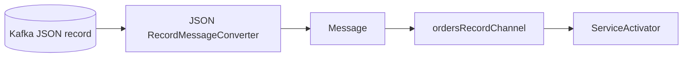
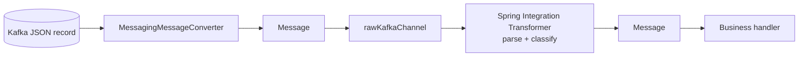
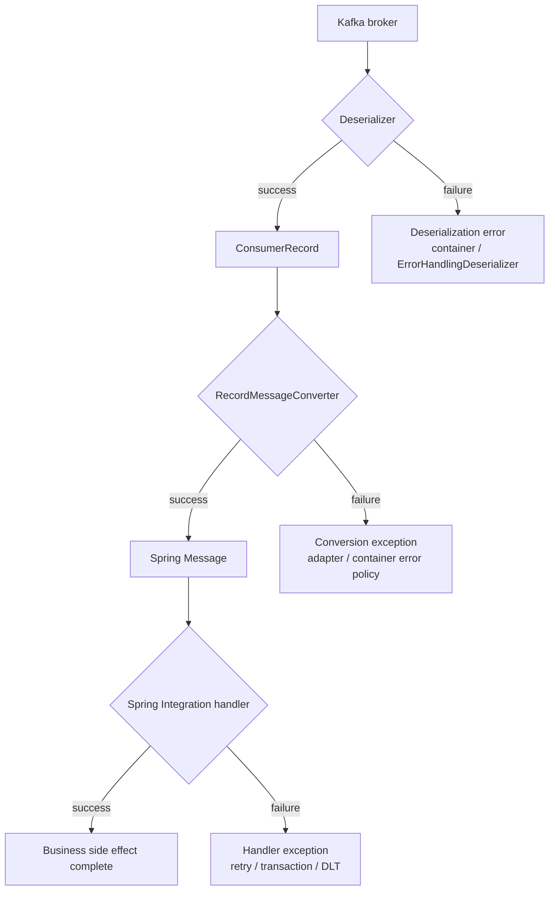
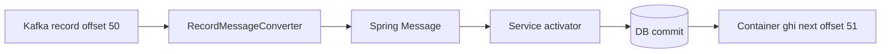

# Record message converter

**Record message converter** là thành phần chuyển đổi **một Kafka `ConsumerRecord<K,V>` thành một Spring Messaging `Message<?>`**, để Spring Integration có thể tiếp tục xử lý payload và headers qua `MessageChannel`. Trong chiều gửi ngược lại, cùng loại converter có thể hỗ trợ chuyển từ Spring message thành Kafka `ProducerRecord`. Điểm quan trọng nhất là phân biệt **Kafka deserializer**, **record message converter** và **Spring Integration transformer**: chúng làm việc ở các tầng khác nhau, vào những thời điểm khác nhau và phát sinh lỗi theo những cơ chế khác nhau.

Bài thuộc chương **Adapter Kafka**, module **SPRING_INTEGRATION_ADAPTERS**. Module học cách nối các hệ thống ngoài qua inbound/outbound adapter, gateway, poller và `MessageChannel`, thực hành với file, SFTP, HTTP, JMS, AMQP, Kafka và cơ sở dữ liệu; đồng thời quản lý message contract, lỗi và vòng đời kết nối. Trong bài này, trọng tâm là **`RecordMessageConverter` khi Kafka inbound nhận từng record**, đặc biệt ở `KafkaMessageDrivenChannelAdapter`.

> **Nguyên tắc:** Deserializer quyết định Kafka `ConsumerRecord.value()` là kiểu Java nào; record message converter quyết định **Spring `Message.payload` và `Message.headers`** được tạo ra như thế nào. Không có cấu hình JSON phù hợp thì một chuỗi JSON thường vẫn chỉ là `String`.

## 1. Mục tiêu học tập

Sau khi học, bạn có thể:

1. Phân biệt chính xác `Deserializer<V>`, `RecordMessageConverter`, `BatchMessageConverter` và Spring Integration transformer.
2. Giải thích phương thức `toMessage(...)`, `fromMessage(...)` cùng các thành phần `ConsumerRecord`, `Acknowledgment`, Kafka `Consumer` và `payloadType`.
3. Lựa chọn giữa `MessagingMessageConverter` (giá trị sẵn có) với bộ JSON converter thích hợp khi muốn nhận DTO.
4. Nhận biết sự khác biệt tên class giữa Spring Kafka sử dụng **Jackson 2** và các bản hiện đại sử dụng **Jackson 3**.
5. Cấu hình `KafkaMessageDrivenChannelAdapter` ở `ListenerMode.record`, `setRecordMessageConverter(...)` và `setPayloadType(...)`.
6. Đọc được payload, Kafka topic/key/partition/offset, native headers và các metadata có thể không tồn tại.
7. Phân biệt lỗi deserialization trước listener, lỗi message conversion, lỗi validation/transformer và lỗi business handler.
8. Xử lý tombstone (Kafka value null), type information, trusted packages và schema evolution an toàn.
9. Kiểm thử converter độc lập bằng `ConsumerRecord` mẫu và kiểm thử integration bằng Kafka broker thật.
10. Quyết định khi nào nên chuyển đổi ngay tại boundary Kafka, khi nào giữ payload thô và chuyển đổi ở một transformer downstream.

## 2. Converter đứng ở đâu trong luồng Spring Integration?

```mermaid
flowchart LR
    Producer["Producer gửi JSON bytes"] --> Broker[("Kafka topic<br/>orders.events")]
    Broker --> Deser["Kafka value deserializer<br/>StringDeserializer"]
    Deser --> Record["ConsumerRecord<String,String><br/>value là JSON text"]
    Record --> Converter["RecordMessageConverter<br/>JacksonJsonMessageConverter"]
    Converter --> Message["Spring Message<OrderCreated><br/>payload DTO + Kafka headers"]
    Message --> Adapter["KafkaMessageDrivenChannelAdapter<br/>outputChannel"]
    Adapter --> Channel["DirectChannel"]
    Channel --> Handler["Service activator<br/>validate + persist"]
    Handler --> DB[("Database")]
```



**Nhìn theo từng ranh giới:**

| Ranh giới | Input | Output | Thành phần |
|---|---|---|---|
| Broker → Kafka client | Bytes trong Kafka log | Key/value Java | Kafka `Deserializer` |
| Kafka client → listener container | `ConsumerRecord<K,V>` | Callback record | `MessageListenerContainer` |
| Listener callback → Spring message | `ConsumerRecord<K,V>` + ack/consumer/target type | `Message<?>` | `RecordMessageConverter` |
| Spring message → channel | `Message<?>` | Message dispatch | `KafkaMessageDrivenChannelAdapter` |
| Channel → nghiệp vụ | Spring message đã convert | Side effect hoặc message khác | Transformer/filter/service activator |

Ví dụ: nếu producer gửi:

```json
{"eventId":"evt-101","orderId":"ORD-101","type":"ORDER_CREATED"}
```

và consumer dùng `StringDeserializer` thì Kafka record value thường là:

```java
String value =
        "{\"eventId\":\"evt-101\",\"orderId\":\"ORD-101\","
        + "\"type\":\"ORDER_CREATED\"}";
```

**Chưa có record converter**, handler nhận `Message<String>`, không phải `Message<OrderCreated>`. Khi dùng JSON record converter cùng target type `OrderCreated.class`, converter có thể tạo Spring message chứa một DTO đúng schema.

### 2.1. Inbound adapter là producer hay consumer?

`KafkaMessageDrivenChannelAdapter` là **Kafka consumer** nhưng là **Spring Integration message producer endpoint**: nó nhận record từ listener container rồi gửi Spring message ra **output `MessageChannel`**. Nó không publish Kafka record ra topic khác. Nếu muốn nhận message từ một input channel rồi publish Kafka, dùng Kafka outbound adapter với `KafkaProducerMessageHandler`.

### 2.2. Vì sao record converter không phải Spring Integration poller?

Message-driven adapter lấy callback từ Spring Kafka listener container; consumer client vẫn gọi `poll()` ở tầng Kafka nhưng **không cần `Pollers.fixedDelay(...)` của Spring Integration** để kích hoạt adapter này.

Record converter **không nhận nhiệm vụ polling**, không điều phối partition assignment và không tự quyết định commit offset. Những việc đó thuộc container, Kafka client và chính sách acknowledgment.

## 3. API `RecordMessageConverter`

Trong Spring Kafka, interface:

```java
org.springframework.kafka.support.converter.RecordMessageConverter
```

định nghĩa chuyển đổi giữa Spring message và Kafka producer/consumer record.

### 3.1. Phương thức inbound `toMessage(...)`

Chữ ký cốt lõi (giản lược chú thích nullability theo phiên bản):

```java
Message<?> toMessage(
        ConsumerRecord<?, ?> record,
        Acknowledgment acknowledgment,
        Consumer<?, ?> consumer,
        Type payloadType);
```

| Tham số | Ý nghĩa |
|---|---|
| `record` | Kafka record vừa được consumer nhận: topic, partition, offset, timestamp, key, value, headers |
| `acknowledgment` | Đối tượng dùng với manual ack khi container/mode cung cấp |
| `consumer` | Kafka consumer hiện tại nếu được cung cấp; **không thread-safe** |
| `payloadType` | Kiểu Java đích gợi ý cho converter hỗ trợ type-aware mapping |
| Return `Message<?>` | Spring message với payload và headers đã convert |

**`payloadType` không bắt buộc khiến converter nào cũng deserialize JSON.** Ví dụ `MessagingMessageConverter` mặc định thường giữ value đã được deserializer trả về; converter JSON mới thực hiện binding String/bytes thành DTO.

### 3.2. Phương thức outbound `fromMessage(...)`

```java
ProducerRecord<?, ?> fromMessage(
        Message<?> message,
        String defaultTopic);
```

Nó dùng để biến Spring message thành Kafka producer record khi cần, chẳng hạn ở `KafkaTemplate.send(Message<?>)` hoặc outbound handler có converter phù hợp. Tuy nhiên **bài này tập trung chiều inbound `toMessage`**; việc một class có cả hai method không có nghĩa mọi converter inbound phải được dùng lại vô điều kiện cho outbound.

### 3.3. Không nhầm với hai `MessageConverter` khác

| Tên/hợp đồng | Package/khái niệm | Mục đích |
|---|---|---|
| **`RecordMessageConverter`** | `org.springframework.kafka.support.converter` | Kafka `ConsumerRecord` ↔ Spring `Message` |
| `MessageConverter` của Spring Kafka | `org.springframework.kafka.support.converter` | Superinterface Kafka-specific, có khả năng xử lý record/batch tùy implementation |
| `MessageConverter` của Spring Messaging | `org.springframework.messaging.converter` | Chuyển đổi payload trong hệ sinh thái Spring Messaging |
| `SmartMessageConverter` | Spring Messaging | Có conversion hint/content type, có thể được converter Kafka ủy quyền |
| `Transformer` | Spring Integration | Bước EIP chuyển đổi message/payload sau khi message đã vào flow |

**Lỗi import phổ biến:** một method cần `RecordMessageConverter` nhưng ứng dụng import nhầm `org.springframework.messaging.converter.MessageConverter`. Hãy dùng tên package đầy đủ trong review hoặc khi khai báo bean để tránh nhầm.

## 4. `MessagingMessageConverter` và các converter JSON

### 4.1. `MessagingMessageConverter`

`MessagingMessageConverter` là implementation phổ biến của `RecordMessageConverter`. Với incoming value kiểu `String` hoặc DTO đã deserialized, mặc định nó chủ yếu xây Spring message, đưa payload từ `record.value()` và ánh xạ Kafka metadata/headers.

Nó **không phải JSON parser tự động** cho chuỗi JSON tùy ý. Nếu Kafka value là String JSON, downstream thường vẫn nhận String nếu không cấu hình converter JSON hoặc Spring Messaging converter bổ sung.

### 4.2. Converter JSON theo phiên bản

Trong Spring Kafka 4.x/Jackson 3, các tên class phổ biến là:

| API Jackson 3 hiện đại | Bối cảnh |
|---|---|
| `JacksonJsonMessageConverter` | Base JSON converter; inbound có thể xử lý `String`, `byte[]` và Kafka `Bytes` |
| `StringJacksonJsonMessageConverter` | JSON converter, outbound value kiểu String khi đi với StringSerializer |
| `ByteArrayJacksonJsonMessageConverter` | JSON converter, outbound value kiểu byte[] |
| `BytesJacksonJsonMessageConverter` | JSON converter, outbound value kiểu Kafka Bytes |
| `JacksonProjectingMessageConverter` | Chuyển JSON thành projection interface khi dùng Spring Data projection phù hợp |

Trong các dự án Spring Boot 3.x/Spring Kafka 3.x sử dụng Jackson 2, các tên thường gặp là:

| API Jackson 2 | Ghi chú nâng cấp |
|---|---|
| `JsonMessageConverter` | Base JSON converter đời Jackson 2 |
| `StringJsonMessageConverter` | JSON/String converter đời Jackson 2 |
| `ByteArrayJsonMessageConverter` | JSON/byte[] converter đời Jackson 2 |
| `BytesJsonMessageConverter` | JSON/Bytes converter đời Jackson 2 |
| `ProjectingMessageConverter` | Projection converter đời Jackson 2 |

Khi nâng lên Spring Kafka 4.x, nhóm Jackson 2 cũ có thể vẫn hiện diện nhưng **đã được deprecate để hướng sang Jackson 3**. **Không** sao chép một import `StringJsonMessageConverter` từ bài dùng Spring Boot 3 và một import `tools.jackson...` từ Spring Boot 4 vào cùng dự án rồi cho rằng không có khác biệt runtime.

> **Phạm vi version của demo chính:** Java 17+, **Spring Boot 4.x / Spring Integration 7.x / Spring Kafka 4.x** và Jackson 3. Khi áp dụng cho Spring Boot 3.x, thay `JacksonJsonMessageConverter` bằng `JsonMessageConverter`/`StringJsonMessageConverter` phù hợp và dùng các class Jackson 2 theo BOM của Boot 3. Không trộn phiên bản thủ công.

### 4.3. Chọn converter theo dữ liệu thực

| Kafka value sau deserializer | Nhu cầu bên Spring | Phương án |
|---|---|---|
| `String` thuần, ví dụ `ORD-101` | Giữ String | `MessagingMessageConverter` mặc định |
| `String` chứa JSON | DTO `OrderCreated` | JSON record converter + target type |
| `byte[]` chứa JSON | DTO `OrderCreated` | JSON converter hỗ trợ bytes + target type |
| `OrderCreated` đã do JSON deserializer tạo | Giữ DTO và map metadata | `MessagingMessageConverter` thường đủ |
| `byte[]` chứa Protobuf | DTO Protobuf | Protobuf deserializer/converter chuyên dụng |
| Value null (tombstone) | Tín hiệu xóa | Contract KafkaNull/null phù hợp, không ép JSON DTO mù quáng |

Cấu hình nào tốt nhất phụ thuộc **wire format**, nguồn tạo dữ liệu, sự tương thích schema và số loại event trong topic. Đừng buộc mọi topic phải dùng JSON khi đối tác thực tế sử dụng Avro/Protobuf/binary.

## 5. Type resolution: converter biết tạo DTO nào?

Giả sử payload JSON trên topic chứa:

```json
{
  "eventId": "evt-101",
  "orderId": "ORD-101",
  "type": "ORDER_CREATED"
}
```

Ta muốn nhận:

```java
public record OrderCreated(
        String eventId,
        String orderId,
        String type) {
}
```

Với Spring Integration inbound adapter, có thể đặt **target payload type**:

```java
adapter.setRecordMessageConverter(
        new JacksonJsonMessageConverter());
adapter.setPayloadType(OrderCreated.class);
```

Ở đây, `setPayloadType` cung cấp type hint cho converter type-aware. **Nó không chạy Jackson thay bạn** nếu adapter vẫn dùng converter mặc định không hỗ trợ JSON binding.

### 5.1. Type hint so với type ID header

JSON producer của Spring Kafka có thể gửi type information trong Kafka native headers. JSON converter có cơ chế type mapper và chính sách lựa chọn giữa:

- **Kiểu được caller/adapter gợi ý** như `OrderCreated.class`.
- **Type ID trong header Kafka** nếu có và nếu type mapper cho phép.
- **Kiểu mặc định/khác** mà converter được cấu hình.

Đừng để header chứa class name từ nguồn không tin cậy tùy ý quyết định class Java được deserialize. Giới hạn **trusted packages, type mapping/allowlist và target type cố định** khi có thể. Trường `type` trong payload như `"ORDER_CREATED"` là loại event nghiệp vụ, **không mặc nhiên là Spring Kafka Java type header**.

### 5.2. Kiểu đích và schema evolution

Nếu producer thêm field mới, đổi tên field hoặc đổi kiểu dữ liệu, converter có thể xử lý khác nhau tùy cấu hình Jackson mapper. Cần định nghĩa:

1. Field nào bắt buộc, field nào có default.
2. Cách xử lý null, missing field và unknown field.
3. Version schema/event và khả năng tương thích giữa producer/consumer.
4. Trường hợp đổi tên hoặc tách một event type thành nhiều type.
5. Cách quarantine và replay record không tương thích.
6. Test contract với record thực từ nhiều phiên bản producer.

**Convert thành công chưa có nghĩa dữ liệu hợp lệ nghiệp vụ**. Ví dụ `orderId=""` vẫn có thể tạo `OrderCreated` hợp lệ về kiểu Java; validator/downstream handler mới kiểm tra bất biến “orderId không được rỗng”.

## 6. Ví dụ đầy đủ: JSON record → `Message<OrderCreated>`

Ví dụ tạo một Spring Boot 4.x application tiêu thụ topic `orders.events`. Kafka value là JSON **String**; một `JacksonJsonMessageConverter` chuyển nó thành DTO rồi adapter gửi qua `DirectChannel` tới `@ServiceActivator`.

### 6.1. Dependencies Maven

Dùng Spring Boot parent/BOM phù hợp, không tự ghép version Spring Kafka và Spring Integration:

```xml
<dependencies>
    <dependency>
        <groupId>org.springframework.boot</groupId>
        <artifactId>spring-boot-starter-integration</artifactId>
    </dependency>

    <dependency>
        <groupId>org.springframework.integration</groupId>
        <artifactId>spring-integration-kafka</artifactId>
    </dependency>

    <!-- JSON mapper cho Spring Boot 4 / Jackson 3 -->
    <dependency>
        <groupId>org.springframework.boot</groupId>
        <artifactId>spring-boot-starter-json</artifactId>
    </dependency>
</dependencies>
```

Một bộ BOM Spring Boot 4 tương thích sẽ quản lý Spring Kafka 4/Jackson 3. Với Boot 3, class converter JSON và các dependency Jackson cần theo đúng BOM khác; **không copy nguyên import lớp Jackson 3 vào Boot 3**.

### 6.2. application.properties

```properties
demo.kafka.bootstrap-servers=localhost:9092
demo.kafka.group-id=orders-json-record-demo
demo.kafka.concurrency=2
```

Topic `orders.events` cần tồn tại và Kafka broker có thể truy cập. Môi trường production phải bổ sung TLS/SASL, topic ACL, secret management và schema policy, không dùng group hoặc credentials demo trên production.

### 6.3. DTO dữ liệu

Tệp Java `com.example.kafka.OrderCreated`:

```java
package com.example.kafka;

public record OrderCreated(
        String eventId,
        String orderId,
        String type) {
}
```

Kiểu `record` Java 17+ biểu diễn một DTO bất biến đơn giản. JSON names trong payload mẫu phải tương ứng với component names. Ở production, có thể dùng field `schemaVersion` và Bean Validation, nhưng bài demo giữ dữ liệu tối thiểu.

### 6.4. Kafka consumer factory, container và converter

```java
package com.example.kafka;

import java.util.HashMap;
import java.util.Map;

import org.apache.kafka.clients.consumer.ConsumerConfig;
import org.apache.kafka.common.serialization.StringDeserializer;
import org.springframework.beans.factory.annotation.Qualifier;
import org.springframework.beans.factory.annotation.Value;
import org.springframework.context.annotation.Bean;
import org.springframework.context.annotation.Configuration;
import org.springframework.integration.channel.DirectChannel;
import org.springframework.integration.config.EnableIntegration;
import org.springframework.integration.kafka.inbound.KafkaMessageDrivenChannelAdapter;
import org.springframework.kafka.core.ConsumerFactory;
import org.springframework.kafka.core.DefaultKafkaConsumerFactory;
import org.springframework.kafka.listener.ConcurrentMessageListenerContainer;
import org.springframework.kafka.listener.ContainerProperties;
import org.springframework.kafka.support.converter.JacksonJsonMessageConverter;
import org.springframework.messaging.MessageChannel;

@Configuration
@EnableIntegration
public class OrdersJsonRecordInboundConfig {

    @Bean("ordersJsonConsumerFactory")
    public ConsumerFactory<String, String> ordersJsonConsumerFactory(
            @Value("${demo.kafka.bootstrap-servers}") String brokers,
            @Value("${demo.kafka.group-id}") String groupId) {

        Map<String, Object> props = new HashMap<>();
        props.put(ConsumerConfig.BOOTSTRAP_SERVERS_CONFIG, brokers);
        props.put(ConsumerConfig.GROUP_ID_CONFIG, groupId);
        props.put(ConsumerConfig.KEY_DESERIALIZER_CLASS_CONFIG,
                StringDeserializer.class);
        props.put(ConsumerConfig.VALUE_DESERIALIZER_CLASS_CONFIG,
                StringDeserializer.class);
        props.put(ConsumerConfig.ENABLE_AUTO_COMMIT_CONFIG, false);
        props.put(ConsumerConfig.AUTO_OFFSET_RESET_CONFIG, "earliest");
        return new DefaultKafkaConsumerFactory<>(props);
    }

    @Bean("ordersRecordChannel")
    public MessageChannel ordersRecordChannel() {
        return new DirectChannel();
    }

    @Bean("ordersRecordKafkaInbound")
    public KafkaMessageDrivenChannelAdapter<String, String> ordersInbound(
            @Qualifier("ordersJsonConsumerFactory")
                    ConsumerFactory<String, String> factory,
            @Qualifier("ordersRecordChannel")
                    MessageChannel outputChannel,
            @Value("${demo.kafka.concurrency}") int concurrency) {

        ContainerProperties containerProperties =
                new ContainerProperties("orders.events");
        containerProperties.setAckMode(
                ContainerProperties.AckMode.RECORD);

        ConcurrentMessageListenerContainer<String, String> container =
                new ConcurrentMessageListenerContainer<>(
                        factory, containerProperties);
        container.setConcurrency(concurrency);

        KafkaMessageDrivenChannelAdapter<String, String> adapter =
                new KafkaMessageDrivenChannelAdapter<>(
                        container,
                        KafkaMessageDrivenChannelAdapter.ListenerMode.record);

        // RecordMessageConverter: String JSON -> OrderCreated DTO.
        adapter.setRecordMessageConverter(
                new JacksonJsonMessageConverter());
        adapter.setPayloadType(OrderCreated.class);

        // Kafka record được chuyển thành Spring Message<?> trước
        // khi gửi tới output channel này.
        adapter.setOutputChannel(outputChannel);
        return adapter;
    }
}
```

**Điều đáng chú ý:** `ConsumerFactory<String,String>` vẫn trả value **String** từ `StringDeserializer`. `setPayloadType(OrderCreated.class)` tác động ở **lớp conversion sang Spring message**. Không nên đổi factory generic thành `ConsumerFactory<String,OrderCreated>` khi value deserializer thực tế vẫn là `StringDeserializer`.

`ContainerProperties.AckMode.RECORD` là chính sách của listener container, độc lập với record converter. Converter không quyết định lúc nào được commit offset.

### 6.5. Service activator nhận DTO

```java
package com.example.kafka;

import org.springframework.integration.annotation.ServiceActivator;
import org.springframework.kafka.support.KafkaHeaders;
import org.springframework.messaging.Message;
import org.springframework.stereotype.Component;

@Component
public class OrdersRecordHandler {

    @ServiceActivator(inputChannel = "ordersRecordChannel")
    public void onEvent(Message<OrderCreated> message) {
        OrderCreated order = message.getPayload();

        if (order.eventId() == null
                || order.eventId().isBlank()
                || order.orderId() == null
                || order.orderId().isBlank()) {
            throw new IllegalArgumentException(
                    "Thiếu eventId hoặc orderId");
        }

        Object topic = message.getHeaders()
                .get(KafkaHeaders.RECEIVED_TOPIC);
        Object partition = message.getHeaders()
                .get(KafkaHeaders.RECEIVED_PARTITION);
        Object offset = message.getHeaders()
                .get(KafkaHeaders.OFFSET);

        System.out.printf(
                "ORDER eventId=%s orderId=%s type=%s"
                + " from %s-%s@%s%n",
                order.eventId(), order.orderId(), order.type(),
                topic, partition, offset);

        // Production: gọi service có idempotency + DB transaction.
    }
}
```

Cần một `@SpringBootApplication` trong package `com.example.kafka` hoặc package cha để Spring quét các bean. `@ServiceActivator` tạo consumer endpoint của `DirectChannel`, **không** phải Kafka consumer client mới.

### 6.6. Kết quả chạy mong đợi

Nếu Kafka có record:

```json
{"eventId":"evt-101","orderId":"ORD-101","type":"ORDER_CREATED"}
```

thì log dự kiến tương tự:

```text
ORDER eventId=evt-101 orderId=ORD-101 type=ORDER_CREATED
  from orders.events-1@42
```

Topic/partition/offset thực tế phụ thuộc producer key, partitioner và trạng thái topic; **không** giả định partition 1, offset 42 là cố định.

## 7. Chạy thử và quan sát message contract

Trên môi trường lab có Kafka CLI:

```bash
kafka-topics.sh --bootstrap-server localhost:9092 \
  --create --if-not-exists \
  --topic orders.events --partitions 3 --replication-factor 1

kafka-console-producer.sh \
  --bootstrap-server localhost:9092 \
  --topic orders.events
```

Nhập mỗi dòng là một JSON record value:

```json
{"eventId":"evt-101","orderId":"ORD-101","type":"ORDER_CREATED"}
{"eventId":"evt-102","orderId":"ORD-102","type":"ORDER_CREATED"}
{"eventId":"evt-103","orderId":"ORD-103","type":"ORDER_PAID"}
```

Quan sát:

1. Kafka producer console phát **chuỗi JSON**.
2. Consumer dùng `StringDeserializer` tạo `ConsumerRecord<String,String>`.
3. `JacksonJsonMessageConverter` biến value thành `OrderCreated` theo `payloadType`.
4. Adapter gửi `Message<OrderCreated>` vào `ordersRecordChannel`.
5. `@ServiceActivator` in log và có thể ném exception khi validation thất bại.

### 7.1. Kiểm tra committed offset và lag

```bash
kafka-consumer-groups.sh \
  --bootstrap-server localhost:9092 \
  --describe --group orders-json-record-demo
```

`auto.offset.reset=earliest` chỉ xác định vị trí bắt đầu khi group chưa có committed offset hợp lệ hoặc theo điều kiện reset của Kafka. Nó **không** bắt consumer đọc từ đầu topic ở mọi lần restart.

Một lỗi converter có thể làm record được retry hoặc recovery; hãy kiểm tra offset, log, retry và DLT theo **container error policy thực tế**, không coi có log lỗi nghĩa là record chắc chắn chưa bị commit.

## 8. Header mapping: dữ liệu Kafka thành Spring headers

Một Kafka record có topic, partition, offset, timestamp, key, value và **Kafka native headers**. Record converter đưa thông tin cần thiết vào `MessageHeaders`.

| Trường Kafka | Spring header thường dùng | Lưu ý |
|---|---|---|
| Topic | `KafkaHeaders.RECEIVED_TOPIC` | Tên topic đã nhận |
| Partition | `KafkaHeaders.RECEIVED_PARTITION` | Partition chứa record |
| Offset | `KafkaHeaders.OFFSET` | Offset trong partition, không phải business ID |
| Key | `KafkaHeaders.RECEIVED_KEY` | Header có thể không có nếu key null |
| Timestamp | `KafkaHeaders.RECEIVED_TIMESTAMP` | Phụ thuộc metadata/converter/version |
| Timestamp type | `KafkaHeaders.RECEIVED_TIMESTAMP_TYPE` khi hỗ trợ | Phụ thuộc converter |
| Acknowledgment | `KafkaHeaders.ACKNOWLEDGMENT` | Chỉ hợp lệ khi ack mode tương ứng cung cấp |
| Consumer object | `KafkaHeaders.CONSUMER` khi hỗ trợ | Không thread-safe; không lưu để gọi từ thread khác |
| Kafka native headers | Theo `KafkaHeaderMapper` | Có thể decode/filter theo policy |
| Spring message ID | `MessageHeaders.ID` | Không đồng nghĩa Kafka offset hoặc eventId |

**Không giả định mọi header đều tồn tại.** Khi record key null, `KafkaHeaders.RECEIVED_KEY` có thể vắng mặt. Nếu ack mode không phải manual, `Acknowledgment` có thể không được đưa vào message. Nếu converter không mapping một custom header, downstream cũng không tự nhìn thấy nó.

### 8.1. Kafka key khác eventId

Ví dụ:

```text
topic             orders.events
partition         2
offset            38
Kafka key         ORD-101
payload.eventId   evt-101
Spring Message.ID UUID(...)
```

- **Kafka key** giúp partitioning/order theo aggregate.
- **eventId** xác định một event nghiệp vụ để chống xử lý trùng.
- **topic-partition-offset** định vị một lần ghi Kafka cụ thể.
- **MessageHeaders.ID** định danh message nội bộ Spring.

Nếu cùng event nghiệp vụ được publish lại vào offset mới, dedup bằng offset **không** nhận ra event trùng. Dùng `eventId` bền vững hoặc một khóa nghiệp vụ tương đương.

### 8.2. Native Kafka headers và security

Kafka native headers là các cặp `String key → byte[] value`, còn Spring `MessageHeaders` có thể chứa object typed. `KafkaHeaderMapper` kiểm soát cách chuyển đổi, không nhất thiết sao chép mọi header.

Đặc biệt tránh:

- Copy credential, token, connection object hoặc cả `Consumer` ra Kafka header/log.
- Để class name/type ID không tin cậy khiến converter instantiate class ngoài allowlist.
- Log toàn bộ raw JSON khi payload có PII.
- Nhầm `kafka_receivedTopic` với `kafka_topic` khi xây outbound flow.

## 9. `setRecordMessageConverter` khác `setMessageConverter` và cấu hình listener factory

### 9.1. Cấu hình trực tiếp trên adapter

Cách rõ ràng nhất khi dùng Spring Integration message-driven inbound:

```java
KafkaMessageDrivenChannelAdapter<String, String> adapter =
        new KafkaMessageDrivenChannelAdapter<>(
                container,
                KafkaMessageDrivenChannelAdapter.ListenerMode.record);

adapter.setRecordMessageConverter(
        new JacksonJsonMessageConverter());
adapter.setPayloadType(OrderCreated.class);
adapter.setOutputChannel(ordersRecordChannel);
```

Javadoc cũng có setter `setMessageConverter(...)` cho hợp đồng converter tổng quát; tuy nhiên `setRecordMessageConverter(...)` **nêu rõ mode record**. Nó giúp người đọc và reviewer tránh nhầm với `BatchMessageConverter`.

### 9.2. Cấu hình của `@KafkaListener` là đường khác

Trong một ứng dụng Spring Kafka thuần, `@KafkaListener` thường dùng:

```java
@Bean
ConcurrentKafkaListenerContainerFactory<String, String>
recordListenerFactory(
        ConsumerFactory<String, String> factory) {

    ConcurrentKafkaListenerContainerFactory<String, String> listenerFactory =
            new ConcurrentKafkaListenerContainerFactory<>();
    listenerFactory.setConsumerFactory(factory);
    listenerFactory.setRecordMessageConverter(
            new JacksonJsonMessageConverter());
    return listenerFactory;
}
```

Đây là cấu hình dành cho **listener adapter gọi method `@KafkaListener`**, không tự thay thế setting `setRecordMessageConverter(...)` trên một `KafkaMessageDrivenChannelAdapter` đã tạo trực tiếp theo cách ở mục 6.

**Đừng đăng ký một `@KafkaListener` cạnh tranh cùng topic/group chỉ để “kiểm tra converter”**: hai consumer sẽ được group coordinator phân partition, khiến dữ liệu xuất hiện ở luồng ngoài dự kiến.

### 9.3. Có cần đổi deserializer thành DTO không?

Không, nếu đã chọn phương án `StringDeserializer + JacksonJsonMessageConverter + payloadType`. Có thể thiết kế phương án khác:

```text
Phương án A — convert ở message boundary:
 Kafka bytes
   -> StringDeserializer
   -> ConsumerRecord<String,String>
   -> JacksonJsonMessageConverter
   -> Message<OrderCreated>

Phương án B — deserialize thành DTO:
 Kafka bytes
   -> JsonDeserializer/ JacksonJsonDeserializer<OrderCreated>
   -> ConsumerRecord<String,OrderCreated>
   -> MessagingMessageConverter
   -> Message<OrderCreated>
```

Phương án B chuyển lỗi JSON parse lên tầng **deserializer**; phương án A để việc parse ở tầng **record message converter**. Hai hướng đều có thể đúng, nhưng **failure classification và error handling khác nhau**.

## 10. Chọn record converter hay transformer downstream?

Có hai phong cách triển khai:

### 10.1. Convert ngay khi nhận



**Ưu điểm:** Downstream nhận DTO thống nhất, handler không cần parse JSON, các header Kafka đã map rõ. Thích hợp khi topic có schema ổn định và một logical event type.

**Nhược điểm:** JSON hỏng không vào downstream handler thông thường; cần error handling ngay tại adapter/container. Khi một topic chứa nhiều schema/event, fixed `payloadType` có thể quá hẹp.

### 10.2. Giữ String rồi transformer xử lý



**Ưu điểm:** Có thể kiểm tra schema version, route nhiều event types hoặc lưu raw input trước parse theo một flow chủ động. Một số loại lỗi có thể được xử lý/quarantine ở tầng EIP.

**Nhược điểm:** Payload thô phải có contract rõ ràng; nhiều handler có thể vô tình xử lý String chưa validate. Cần thiết kế retry/error channel và offset boundary để không ack record chỉ vì raw message đã đi vào queue.

**Quy tắc lựa chọn:** Converter phù hợp với **định dạng vận chuyển → Spring message**; transformer phù hợp với **chuyển đổi EIP/nghiệp vụ**. Đừng nhồi validation, gọi DB hoặc HTTP request vào một record converter chỉ vì nó nằm gần Kafka.

## 11. Chuyển đổi header và type mapping chi tiết hơn

`MessagingMessageConverter` hỗ trợ một `KafkaHeaderMapper` và có thể phối hợp với một `SmartMessageConverter` của Spring Messaging. Hợp đồng này cho phép chuyển đổi payload dựa trên `contentType` trong những trường hợp thích hợp.

### 11.1. Mapping header không chỉ là copy string

Một native Kafka header chỉ lưu bytes. Spring message có thể muốn một giá trị như:

```text
Kafka header:
    eventId -> bytes UTF-8

Spring header:
    eventId -> "evt-101" (String)
```

Mapping có thể dùng quy tắc JSON header mapper, pattern matching, trusted packages hoặc policy ứng dụng. Với non-Spring producer, đừng mặc nhiên giả định header encode theo chính xác cách Spring Kafka serialize Java types.

Nếu cần interoperable wire contract, hãy viết rõ:

- Header names phân biệt chữ hoa/thường.
- Byte encoding, ví dụ UTF-8 hoặc big-endian integer.
- Type information có được phép xuất hiện không.
- Payload schema/version.
- Cách xử lý header thiếu/trùng hoặc không tin cậy.

### 11.2. `SmartMessageConverter` có phải `RecordMessageConverter`?

Không. `SmartMessageConverter` thuộc tầng Spring Messaging và có thể được `MessagingMessageConverter` **ủy quyền conversion**. Luồng khái quát:

```text
ConsumerRecord
  -> Kafka RecordMessageConverter
  -> Spring Message tạm
  -> SmartMessageConverter (nếu cấu hình và áp dụng được)
  -> Spring Message cuối
```

Nếu Smart converter không xử lý được type và trả null theo contract, converter Kafka có thể giữ payload ban đầu. Vì vậy cần integration test đúng dữ liệu để kiểm tra kết quả, không chỉ nhận thấy bean converter tồn tại trong context.

### 11.3. Type headers: rủi ro bảo mật

Nếu nhận Kafka record từ nguồn không tin cậy, type metadata có thể cố gắng định hướng deserialize sang một class không mong muốn. Với JSON converter/deserializer:

1. Cấu hình trusted packages hẹp.
2. Dùng mapping từ **type ID công khai → class DTO cho phép** thay vì cho phép class name bất kỳ.
3. Ưu tiên target type cố định ở topic có một schema.
4. Không bật trust all (`*`) vô điều kiện trong production.
5. Chặn payload size bất thường và validate dữ liệu trước side effect.

## 12. Tombstone: khi Kafka value bằng null

Ở **compacted topic**, record có key và `value=null` thường là **tombstone**, dùng cho xóa trạng thái của key theo ngữ nghĩa Kafka log compaction.

Spring Messaging không cho `Message<?>` có payload Java `null` thông thường. Spring Kafka/Spring Integration có cơ chế đại diện tombstone bằng marker `KafkaNull` hoặc xử lý thành null ở một số signature annotated method theo version.

```text
Kafka:
  key   = "ORD-101"
  value = null

Spring Messaging:
  payload không thể đơn giản là Java null trong MessageBuilder
  -> converter/framework sử dụng marker phù hợp (ví dụ KafkaNull)
```

Nếu bài toán cần xóa theo key, hãy thiết kế handler riêng để nhận tombstone. Không dùng code:

```java
// Không an toàn nếu payload có thể là KafkaNull/tombstone.
OrderCreated dto = (OrderCreated) message.getPayload();
```

mà chưa kiểm tra marker/annotation conversion. **Ví dụ mục 6 chỉ phù hợp với topic chứa event JSON non-null theo contract demo**, không phải hướng dẫn xử lý tombstone đầy đủ.

### 12.1. Tại sao tombstone dễ bị xử lý sai?

Một hệ thống có thể xem value null như dữ liệu hỏng, đưa vào DLT hoặc retry vô hạn. Nhưng với compacted topic, đó có thể là **hành động xóa hợp lệ**. Hãy xác định từ schema/topic contract xem tombstone được phép không, dùng key để tìm aggregate cần xóa và kiểm thử riêng với record value null.

## 13. Error handling: lỗi diễn ra ở tầng nào?



| Lỗi | Thời điểm | Handler downstream có nhận DTO không? |
|---|---|---|
| Key/value bytes không deserialized được | Trước khi có record value hợp lệ | Thường **không** |
| JSON malformed khi parse ở converter | Có `ConsumerRecord<String,String>` nhưng conversion thất bại | **Không** |
| Converter chọn sai class hoặc type header không tin cậy | Trong `toMessage` | **Không** |
| Missing `orderId` nhưng JSON parse thành DTO | Sau conversion | Có, handler/validator quyết định |
| DB timeout, HTTP 503 | Khi xử lý nghiệp vụ | Có, lỗi downstream |
| Queue RAM crash sau enqueue | Sau callback listener, trước side effect | Có thể chưa đến handler |

### 13.1. Deserializer error

Nếu dùng Kafka `JsonDeserializer`/`JacksonJsonDeserializer` và JSON lỗi, failure có thể xảy ra trong poll/deserialization **trước record converter**. Một `ErrorHandlingDeserializer` có thể đóng gói nguyên nhân lỗi để container error handler/recoverer xử lý và đưa dữ liệu vào DLT theo cấu hình.

Không đặt logic “bắt deserializer error” duy nhất trong `@ServiceActivator(inputChannel="ordersRecordChannel")`, vì record hỏng có thể **chưa bao giờ được chuyển thành Spring message**.

### 13.2. Converter exception

Nếu dùng `StringDeserializer` nhưng `JacksonJsonMessageConverter` không parse được JSON, exception phát sinh trong quá trình listener adapter tạo Spring message.

Với `DirectChannel` đồng bộ, lỗi conversion/handler **có thể lan về Kafka listener container** để `DefaultErrorHandler` xử lý, nếu không bị một tầng error/recovery khác bắt và kết thúc bình thường. Cần kiểm thử theo đúng phiên bản/framework wiring.

### 13.3. Error channel không đồng nghĩa Kafka DLT

Một `errorChannel` của Spring Integration chứa `ErrorMessage` nội bộ. Nó **không tự publish record vào Kafka DLT**. Nếu recovery callback hoặc error flow **nuốt exception**, container có thể xem callback thành công và ghi nhận offset theo chính sách; dữ liệu hỏng có thể bị bỏ qua dù business handler chưa xử lý.

Hãy kiểm tra:

1. Lỗi xuất hiện ở deserializer, converter hay handler?
2. Exception còn lan ra listener container không?
3. Ai retry, số lần/backoff bao nhiêu?
4. Record được recovery vào DLT/quarantine thực sự chưa?
5. Khi recovery/DLT publish thất bại, offset được xử lý thế nào?
6. Business ID nào cho phép retry/replay mà không tạo side effect trùng?

### 13.4. Một ví dụ container retry có giới hạn

```java
import org.springframework.kafka.listener.DefaultErrorHandler;
import org.springframework.util.backoff.FixedBackOff;

// Đặt trước khi adapter sử dụng container.
container.setCommonErrorHandler(
        new DefaultErrorHandler(
                new FixedBackOff(1_000L, 2L)));
```

Ở đây có thể retry thêm hai lần sau attempt ban đầu, với backoff minh họa 1 giây. Cấu hình này **không đủ để có DLT**: cần `DeadLetterPublishingRecoverer`, producer/template và topic/ACL phù hợp, kèm chính sách lỗi nếu publish DLT không thành công.

Đừng retry vô hạn một JSON malformed không thể sửa chỉ bằng cách lặp conversion. Nên phân loại permanent parse/schema error khác với transient DB/network errors.

### 13.5. Giữ raw record và metadata để điều tra

`KafkaMessageDrivenChannelAdapter` có thể dùng `setBindSourceRecord(true)` (tùy version) để gắn source record vào header `IntegrationMessageHeaderAccessor.SOURCE_DATA`.

```java
adapter.setBindSourceRecord(true);
```

Đây là cách hỗ trợ trace khi message đã convert thành công; nó **không phải cơ chế đảm bảo mọi bản ghi lỗi conversion vẫn đến downstream**. Record thực sự lỗi trước `toMessage` có thể cần container recoverer/error strategy riêng để lưu raw bytes vào kho kiểm tra.

## 14. Converter không quyết định offset commit

Kafka consumer group lưu committed offsets; Spring Kafka listener container quyết định việc ack/commit theo `AckMode` và error handling. Converter chỉ tạo message, không biết DB transaction đã hoàn tất.



Sơ đồ trên là **đường xử lý mong muốn** với flow đồng bộ; thực tế có thể thất bại hoặc có thêm retry/recovery.

### 14.1. `DirectChannel`

Với `DirectChannel`, handler chạy đồng bộ trong listener callback trừ khi downstream tự tách thread. Exception từ handler có cơ hội quay về container. `AckMode.RECORD` ghi nhận/commit sau callback record thành công theo cơ chế container, nhưng **không tạo transaction phân tán với DB**.

### 14.2. `QueueChannel` hoặc `ExecutorChannel`

```text
Kafka listener thread
  -> Converter thành công
  -> adapter.send(Message<OrderCreated>)
  -> QueueChannel.enqueue() thành công
  -> callback trở về; offset có thể được commit

Một thời điểm khác:
  -> PollingConsumer.dequeue()
  -> handler ghi database
```

Nếu queue chỉ nằm trong RAM, JVM chết sau Kafka offset commit nhưng trước DB write có thể làm **mất message nghiệp vụ**. Đổi converter không sửa vấn đề này. Cần durable handoff hoặc acknowledgment gắn với kết quả downstream theo hợp đồng Kafka/Spring.

### 14.3. At-least-once và idempotency

Giả sử handler DB commit record `eventId=evt-101`, nhưng ứng dụng chết trước khi Kafka commit offset. Sau restart, record có thể được nhận lại và converter lại tạo một DTO tương tự.

Hãy dùng business `eventId`/unique constraint/inbox table để việc xử lý lần hai **không tạo tác dụng phụ trùng**. Kafka transaction hoặc `AckMode.RECORD` một mình không tự bảo đảm exactly-once xuyên Kafka và JDBC.

## 15. Record converter và batch converter là hai hợp đồng

`KafkaMessageDrivenChannelAdapter.ListenerMode.record` xử lý **từng record** và thích hợp với `RecordMessageConverter`. `ListenerMode.batch` xử lý **một nhóm record** và cần `BatchMessageConverter` phù hợp.

| Tiêu chí | Record converter | Batch converter |
|---|---|---|
| Hợp đồng chính | `ConsumerRecord` → `Message<?>` | Danh sách `ConsumerRecord` → `Message<?>` |
| Input adapter mode | `ListenerMode.record` | `ListenerMode.batch` |
| Payload thường gặp | `OrderCreated` | `List<OrderCreated>` |
| Metadata | Topic/partition/offset đơn | Danh sách topic/partition/offset tương ứng |
| Xử lý lỗi | Record riêng | Partial batch failure, index record lỗi |
| Spring Integration handler | `Message<OrderCreated>` | `Message<List<OrderCreated>>` |
| Cấu hình adapter | `setRecordMessageConverter(...)` | `setBatchMessageConverter(...)` |

### 15.1. Không đổi mode mà giữ nguyên handler signature

Ví dụ sai:

```java
// Adapter ListenerMode.batch nhưng handler vẫn đòi OrderCreated đơn.
@ServiceActivator(inputChannel = "ordersBatchChannel")
public void handle(Message<OrderCreated> message) {
    // Payload thực tế có thể là List<OrderCreated>.
}
```

Nếu muốn batch, phải cấu hình listener container/converter đúng batch mode, handler nhận danh sách, và thiết kế cách retry/commit nếu record thứ 53 hỏng sau khi 52 record trước đã ghi DB.

### 15.2. Batch converter có thể dùng record converter bên trong

`BatchMessagingMessageConverter` có thể kết hợp một `RecordMessageConverter` thích hợp để convert từng phần tử trước khi tạo batch message. Đây là cơ chế hữu ích nhưng **không làm batch giống record mode**: việc ack, headers và partial failure vẫn có hợp đồng riêng.

Ví dụ minh họa ý tưởng, không phải cấu hình chạy song song với adapter record mode của mục 6:

```java
// Với batch container và handler batch đã được cấu hình.
adapter.setBatchMessageConverter(
        new BatchMessagingMessageConverter(
                new JacksonJsonMessageConverter()));
```

Cần import `org.springframework.kafka.support.converter.BatchMessagingMessageConverter` và cấu hình adapter `ListenerMode.batch` thật sự. Kiểm tra constructor và API version cụ thể trước khi áp dụng.

## 16. Custom `RecordMessageConverter`: khi nào cần?

Không phải lúc nào JSON converter mặc định cũng đủ. Một ứng dụng có thể cần:

- Mapping native header `eventType` thành Spring header nghiệp vụ.
- Chuyển Kafka value wrapper/envelope thành một payload chuẩn.
- Xử lý một định dạng binary/protocol được tổ chức nội bộ quy định.
- Chuẩn hóa metadata từ nhiều producer khác nhau.
- Từ chối schema version không được phép **trước khi** tạo Spring message.

Nhưng **converter không nên chứa side effect** như gửi HTTP, update DB hoặc gọi nhiều hệ thống ngoài. Nếu converter thất bại hoặc record retry, side effect không idempotent có thể bị lặp.

### 16.1. Ví dụ custom converter ủy quyền

Đoạn sau minh họa kiểu thiết kế wrapper: converter lõi lo JSON, wrapper thêm header eventId sau khi đã tạo DTO.

```java
package com.example.kafka;

import java.lang.reflect.Type;

import org.apache.kafka.clients.consumer.Consumer;
import org.apache.kafka.clients.consumer.ConsumerRecord;
import org.apache.kafka.clients.producer.ProducerRecord;
import org.springframework.kafka.support.Acknowledgment;
import org.springframework.kafka.support.converter.JacksonJsonMessageConverter;
import org.springframework.kafka.support.converter.RecordMessageConverter;
import org.springframework.messaging.Message;
import org.springframework.messaging.support.MessageBuilder;

public final class OrderHeaderRecordConverter
        implements RecordMessageConverter {

    private final RecordMessageConverter delegate =
            new JacksonJsonMessageConverter();

    @Override
    public Message<?> toMessage(
            ConsumerRecord<?, ?> record,
            Acknowledgment acknowledgment,
            Consumer<?, ?> consumer,
            Type payloadType) {

        Message<?> converted = delegate.toMessage(
                record, acknowledgment, consumer, payloadType);

        if (!(converted.getPayload() instanceof OrderCreated order)) {
            throw new IllegalArgumentException(
                    "Payload không phải OrderCreated");
        }

        if (order.eventId() == null || order.eventId().isBlank()) {
            throw new IllegalArgumentException("Thiếu eventId");
        }

        return MessageBuilder.fromMessage(converted)
                .setHeader("businessEventId", order.eventId())
                .build();
    }

    @Override
    public ProducerRecord<?, ?> fromMessage(
            Message<?> message, String defaultTopic) {
        return delegate.fromMessage(message, defaultTopic);
    }
}
```

Cấu hình trên adapter:

```java
adapter.setRecordMessageConverter(
        new OrderHeaderRecordConverter());
adapter.setPayloadType(OrderCreated.class);
```

**Điểm cần cân nhắc:** Wrapper đang validate `eventId` ngay tại conversion boundary; nếu `eventId` bị thiếu, exception thuộc conversion stage nên không có Spring message downstream bình thường. Với schema yêu cầu chỉ cần JSON parse rồi business validation riêng, hãy **đưa điều kiện kiểm tra eventId sang `@ServiceActivator` hoặc validator** thay vì khóa cứng vào converter.

`fromMessage(...)` được delegate để tôn trọng hai chiều của interface; ứng dụng chỉ dùng inbound vẫn phải implement contract đầy đủ.

## 17. Hiệu năng và chi phí conversion

Mỗi Kafka record đi qua deserializer, converter và Spring message creation có chi phí:

- Deserialize bytes → String/byte[]/DTO.
- Parse JSON thành object và có thể allocate nhiều object.
- Map native Kafka headers và Spring message headers.
- Validate payload.
- Dispatch qua Spring channel.
- Thực hiện downstream handler.

### 17.1. Tránh parse JSON hai lần

Không nên cấu hình `JacksonJsonDeserializer<OrderCreated>` để trả DTO rồi lại dùng JSON record converter parse lần nữa như thể value là JSON text. Chọn một điểm chịu trách nhiệm parse chính, trừ khi hệ thống có lý do rõ ràng để tái chuẩn hóa.

### 17.2. String so với byte[]

Nếu Kafka value là JSON bytes, dùng `StringDeserializer` rồi JSON converter có thể tạo thêm bước **bytes → String → DTO**. `ByteArrayDeserializer` cùng JSON converter hỗ trợ byte[] có thể giảm một bước; đánh đổi là phần còn lại của pipeline phải giữ đúng contract và xử lý raw bytes khi lỗi.

Đừng đổi deserializer chỉ vì nghe nói “byte[] nhanh hơn” mà không benchmark throughput, memory, GC, payload size và broker/network bottleneck.

### 17.3. Header mapping và kích thước message

Những native headers lớn hoặc nhiều header có thể tăng chi phí cấp phát/copy dữ liệu. Chỉ ánh xạ metadata cần thiết và tránh gắn raw record nếu không phục vụ observability/debug thật sự.

### 17.4. Concurrency và ordering

`ConcurrentMessageListenerContainer.setConcurrency(n)` tạo nhiều Kafka consumer threads cùng group. Mỗi partition thường chỉ thuộc một consumer trong group tại một thời điểm. Converter chạy trên đường listener callback; nếu converter chậm, nó **giữ consumer thread**, có thể tăng lag và ảnh hưởng `max.poll.interval.ms` khi xử lý lâu.

Không thực hiện network I/O/blocking DB trong converter. Việc tách sang `ExecutorChannel` để tăng throughput cần được đánh giá lại offset boundary, thứ tự hoàn tất và durability, không chỉ hiệu năng parse JSON.

## 18. Testing: converter unit test không cần Kafka broker

Một lợi ích của `RecordMessageConverter` là có thể kiểm thử riêng từ `ConsumerRecord` mẫu:

```java
import org.apache.kafka.clients.consumer.ConsumerRecord;
import org.springframework.kafka.support.converter.JacksonJsonMessageConverter;
import org.springframework.messaging.Message;

// Một đoạn unit test minh họa, nằm trong method @Test.
ConsumerRecord<String, String> record = new ConsumerRecord<>(
        "orders.events",
        0,             // partition
        42L,           // offset
        "ORD-101",     // key
        "{\"eventId\":\"evt-101\","
        + "\"orderId\":\"ORD-101\","
        + "\"type\":\"ORDER_CREATED\"}");

JacksonJsonMessageConverter converter =
        new JacksonJsonMessageConverter();

Message<?> converted = converter.toMessage(
        record, null, null, OrderCreated.class);

OrderCreated order = (OrderCreated) converted.getPayload();

assertEquals("evt-101", order.eventId());
assertEquals("ORD-101", order.orderId());
```

Mã giả định đã khai báo DTO `OrderCreated`, JUnit `assertEquals` và dependency JSON converter. Đây là **unit test conversion**, không xác minh broker, consumer group, retry hay offset commit.

### 18.1. Những test cases bắt buộc

| Test | Điều cần kiểm |
|---|---|
| JSON hợp lệ | Tạo đúng DTO và metadata |
| JSON thiếu `eventId` | Hành vi mapper vs validation |
| JSON thêm field tương lai | Contract backward compatibility |
| JSON sai kiểu field | Conversion error được phân loại |
| JSON malformed | Exception; record không lặng lẽ mất |
| Kafka key null | Header key có thể vắng |
| Native header UTF-8 | Mapping đúng bytes/encoding |
| Type ID không tin cậy | Không deserialize class ngoài allowlist |
| Value null/tombstone | Theo topic contract, không ép DTO vô điều kiện |
| Record có nhiều custom headers | Mapper không làm lộ dữ liệu cấm |
| Record retry lần hai | Side effect được dedup ở handler/DB |
| Batch mode nhầm converter record | Cấu hình thất bại hoặc contract không khớp, được phát hiện sớm |

### 18.2. Integration test với broker thật

Dùng Kafka test cluster cô lập (ví dụ Testcontainers hoặc embedded Kafka tương thích), gửi JSON record với producer riêng rồi:

1. Đợi Spring Integration consumer group có partition assignment.
2. Gửi message JSON hợp lệ.
3. Xác nhận handler nhận `OrderCreated` chứ không phải String.
4. Kiểm tra topic, partition, offset, key và headers.
5. Gửi malformed JSON và quan sát retry/error handler/offset theo policy.
6. Thử restart để kiểm tra idempotency với eventId.
7. Test custom header và schema version từ producer không phải Spring.
8. Kiểm thử shutdown và rebalance khi conversion hoặc business handler đang xử lý.

Tránh chỉ dựa vào `Thread.sleep(...)` cố định; dùng assertion/await có deadline để tránh flaky tests. **Không** dùng Kafka production group cho bài kiểm thử replay/reset offsets.

## 19. Troubleshooting: converter sai ở đâu?

| Triệu chứng | Khả năng cao | Cách kiểm tra |
|---|---|---|
| Handler mong `OrderCreated` nhưng nhận `String` | Chưa set JSON converter hoặc payloadType | Adapter wiring, converter, deserializer |
| Handler nhận DTO nhưng field null | JSON schema/field names không khớp | Record raw, Jackson mapping, validation |
| Lỗi trước khi thấy Spring message | Deserializer hoặc converter ném exception | Stacktrace/cause, phase của listener |
| Type header dẫn đến class không mong muốn | Type mapper precedence/trusted packages | Kafka native headers, type allowlist |
| JSON hỏng retry vô hạn | Error handler không phân loại permanent error | Retry/backoff/DLT, committed offset |
| `KafkaHeaders.RECEIVED_KEY` null | Kafka key thật sự null hoặc header không mapping | `ConsumerRecord.key()`, mapper |
| Không thấy `Acknowledgment` | Không bật manual ack hoặc converter/header policy | Container `AckMode` |
| `QueueChannel` đã nhận nhưng DB không có dữ liệu sau crash | Offset đã commit trước side effect | Durable handoff/ack boundary |
| Đổi sang batch làm `ClassCastException` | Handler vẫn mong một DTO | ListenerMode, BatchMessageConverter, handler signature |
| DTO parse được nhưng DB ghi sai | Business validation thiếu | Validator, transaction, event schema |
| Conversion CPU cao, lag tăng | JSON parse/header mapping đắt | Profiling, String vs bytes, payload size |
| Kafka native header không có trong Spring message | Header mapper filter/không hỗ trợ type | Mapper patterns, encoding, tests |
| Spring Integration error channel ghi log nhưng Kafka không retry | Lỗi đã được recover/suppress | Propagation, error policy, offset |
| Topic compacted bị lỗi payload khi tombstone | Không xử lý KafkaNull/null semantics | Topic contract, converter, handler tombstone |

### 19.1. Quy trình điều tra ngắn

1. Xác định **Kafka record thật**: topic, key, value bytes, headers, schema.
2. Xác định **value deserializer** của `ConsumerFactory`.
3. Xác định **converter trên chính adapter**, không chỉ bean converter tồn tại trong context.
4. Kiểm tra `ListenerMode.record` và `setPayloadType(...)`.
5. Kiểm tra payload Java tại điểm đầu output channel.
6. Nếu có lỗi, phân biệt lỗi **deserializer → converter → business handler**.
7. Kiểm tra container error handler/retry/recovery và trạng thái committed offset.
8. Chỉ sửa một tầng mỗi lần, sau đó kiểm tra lại bằng record thực.

## 20. Bài tập thực hành

### Bài 1 — String JSON thành DTO

Chạy demo ở mục 6 với năm Kafka JSON events. In ra class thực của `message.getPayload()` và metadata Kafka. Giải thích vì sao `ConsumerFactory<String,String>` vẫn đúng khi handler nhận `Message<OrderCreated>`.

### Bài 2 — Bỏ converter JSON

Tạm bỏ `adapter.setRecordMessageConverter(...)` và `setPayloadType(...)`. Gửi cùng JSON record, quan sát payload thành String (hoặc lỗi method signature nếu handler vẫn ép DTO). Ghi nhận khác biệt giữa `Deserializer` và `RecordMessageConverter`.

### Bài 3 — Đổi điểm parse JSON

Chuyển sang JSON deserializer tạo `OrderCreated` trước listener, để converter mặc định map Spring message. So sánh lỗi JSON malformed với phương án parse trong converter. Tầng nào cần `ErrorHandlingDeserializer`, tầng nào cần adapter/container error policy?

### Bài 4 — Header mapping

Dùng một producer tạo Kafka native headers `eventId`, `tenantId` và một header giả lập token nhạy cảm. Kiểm tra chúng có vào Spring message không, thêm policy chỉ map headers cần thiết và không log token.

### Bài 5 — Kafka type header không tin cậy

Gửi record với type information header hướng tới class không thuộc allowlist. Kiểm tra converter xử lý như thế nào khi target type cố định so với type mapper lấy type ID từ header; mô tả trusted packages và cách tránh deserialize class bất kỳ.

### Bài 6 — Validation khác conversion

Gửi JSON hợp lệ cú pháp nhưng `orderId=""`. Converter có thể tạo DTO; handler phải từ chối. Thiết kế reply/error/DLT policy sao cho biết lỗi do schema hay do nghiệp vụ và không retry vô hạn record không thể sửa.

### Bài 7 — JSON malformed

Gửi chuỗi `{eventId:` vào topic demo. Kiểm tra exception loại gì, container retry mấy lần, offset đã commit chưa, có DLT hay không. Đề xuất phân loại đây là permanent conversion error và lưu raw record để tra soát.

### Bài 8 — Tombstone

Dùng topic compacted thử nghiệm và gửi một record có key `ORD-101`, value null. Thiết kế handler riêng cho tombstone; xác nhận không ép payload null thành `OrderCreated` một cách mù quáng.

### Bài 9 — Custom converter

Dùng `OrderHeaderRecordConverter` ở mục 16, kiểm tra header `businessEventId` có đúng bằng DTO `eventId`. Thử thiếu eventId và quan sát lỗi phát sinh ở converter; so sánh với việc đặt validation trong service activator.

### Bài 10 — Record mode vs batch mode

Tạo biến thể dùng `ListenerMode.batch`, `BatchMessageConverter` và handler nhận danh sách DTO. Gửi 30 record. Giải thích vì sao batch size không mặc nhiên bằng `max.poll.records`, và nêu chính sách khi record thứ 7 trong batch bị lỗi.

### Bài 11 — DirectChannel và QueueChannel

Đổi output từ `DirectChannel` sang `QueueChannel` RAM. Giả lập crash sau enqueue nhưng trước DB commit. Xác định rủi ro commit offset quá sớm và cách thiết kế durable handoff hoặc acknowledgment theo kết quả xử lý.

### Bài 12 — Schema evolution

Giả sử producer version 2 thêm `currency` và đổi `type` thành `eventType`. Viết contract tương thích giữa producer cũ/mới, cấu hình mapper/DTO/validation, xác định record nào được accept, record nào vào quarantine.

### Bài 13 — Security review

Review một hệ thống bật trust all packages cho JSON type headers và log toàn bộ raw payload. Đề xuất policy trusted packages, fixed payloadType, header filtering, data masking và số liệu cần lưu để debug mà không lộ PII.

### Bài 14 — Hiệu năng conversion

So sánh `StringDeserializer + JacksonJsonMessageConverter` với `ByteArrayDeserializer + converter hỗ trợ byte[]` trên cùng dataset. Đo p95/p99 parse latency, allocations/GC, consumer lag và khả năng xử lý malformed JSON; chọn phương án dựa trên dữ liệu đo thực tế.

## 21. Câu hỏi tự kiểm tra

1. Kafka `Deserializer` và `RecordMessageConverter` khác nhau ở input/output như thế nào?
2. `RecordMessageConverter.toMessage(...)` nhận những tham số gì?
3. Vì sao `MessageConverter` của Spring Messaging không đồng nghĩa `RecordMessageConverter`?
4. Khi chỉ dùng `StringDeserializer`, JSON payload có tự thành `OrderCreated` không?
5. `setPayloadType(OrderCreated.class)` có ý nghĩa gì khi đi cùng JSON converter?
6. Spring Kafka 4.x dùng tên class JSON converter nào thay cho nhóm Jackson 2?
7. `KafkaMessageDrivenChannelAdapter` gửi message ra input hay output channel?
8. Nếu `KafkaHeaders.RECEIVED_KEY` không có, đó có nhất thiết là converter lỗi không?
9. `MessageHeaders.ID` có phải Kafka offset hoặc eventId không?
10. Native Kafka header khác Spring typed header như thế nào?
11. Tại sao type header cần trusted packages/allowlist?
12. Converter có phải nơi thích hợp để gọi JDBC/HTTP không?
13. Vì sao một JSON parse thành công vẫn có thể vi phạm business rule?
14. Lỗi deserializer có chắc chắn đến được `@ServiceActivator` không?
15. Converter exception và DB handler exception nên được phân loại retry ra sao?
16. `errorChannel` có tự tạo Kafka DLT không?
17. Tombstone cần xử lý gì khác so với JSON record thông thường?
18. `ListenerMode.batch` có nên dùng `RecordMessageConverter` trực tiếp như record mode không?
19. Khi `DirectChannel` đổi thành `QueueChannel`, điều gì xảy ra với ack boundary?
20. Vì sao cần eventId/idempotency dù converter và Kafka offset đều hoạt động đúng?

## 22. Tổng kết

`RecordMessageConverter` là cầu nối giữa **Kafka `ConsumerRecord`** và **Spring `Message<?>`** khi một endpoint nhận Kafka record. Nó quyết định payload Java sau conversion và metadata headers mà phần còn lại của Spring Integration có thể sử dụng.

```text
Kafka broker bytes
  -> Kafka Deserializer<K,V>
  -> ConsumerRecord<K,V>
  -> RecordMessageConverter.toMessage(...)
  -> Spring Message<DTO> + Kafka metadata headers
  -> KafkaMessageDrivenChannelAdapter output MessageChannel
  -> Transformer / ServiceActivator / Outbound adapter
  -> Database / HTTP / SFTP / JMS / AMQP
```

Để xây pipeline đáng tin cậy, phải tách rõ **deserialize**, **convert**, **validate**, **thực thi side effect**, **ack/commit offset** và **xử lý lỗi**. Chọn converter đúng phiên bản Spring Kafka/Jackson, kiểm tra type mapping và trusted headers, xử lý tombstone theo topic contract, đồng thời thiết kế retry/DLT/idempotency ở ranh giới phù hợp. Chỉ khi các ranh giới này rõ ràng, message đi từ Kafka đến các hệ thống ngoài mới có hợp đồng vận hành có thể kiểm chứng.

## Tài liệu tham khảo

- [Spring Integration Reference — Kafka Support](https://docs.spring.io/spring-integration/reference/kafka.html)
- [Spring Integration API — KafkaMessageDrivenChannelAdapter](https://docs.spring.io/spring-integration/api/org/springframework/integration/kafka/inbound/KafkaMessageDrivenChannelAdapter.html)
- [Spring Kafka Reference — Serialization, Deserialization and Message Conversion](https://docs.spring.io/spring-kafka/reference/kafka/serdes.html)
- [Spring Kafka API — RecordMessageConverter](https://docs.spring.io/spring-kafka/api/org/springframework/kafka/support/converter/RecordMessageConverter.html)
- [Spring Kafka API — MessagingMessageConverter](https://docs.spring.io/spring-kafka/api/org/springframework/kafka/support/converter/MessagingMessageConverter.html)
- [Spring Kafka API — JacksonJsonMessageConverter](https://docs.spring.io/spring-kafka/api/org/springframework/kafka/support/converter/JacksonJsonMessageConverter.html)
- [Spring Kafka API — BatchMessagingMessageConverter](https://docs.spring.io/spring-kafka/api/org/springframework/kafka/support/converter/BatchMessagingMessageConverter.html)
- [Spring Kafka Reference — Handling Exceptions](https://docs.spring.io/spring-kafka/reference/kafka/annotation-error-handling.html)
- [Spring Boot 4.0 — JSON](https://docs.spring.io/spring-boot/4.0/reference/features/json.html)
- [Spring Kafka Reference — Change History](https://docs.spring.io/spring-kafka/reference/appendix/change-history.html)
