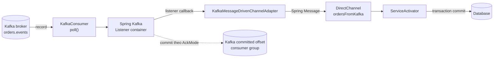
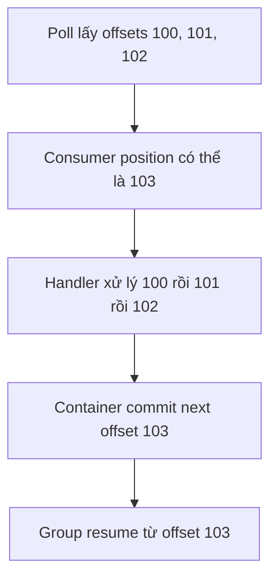
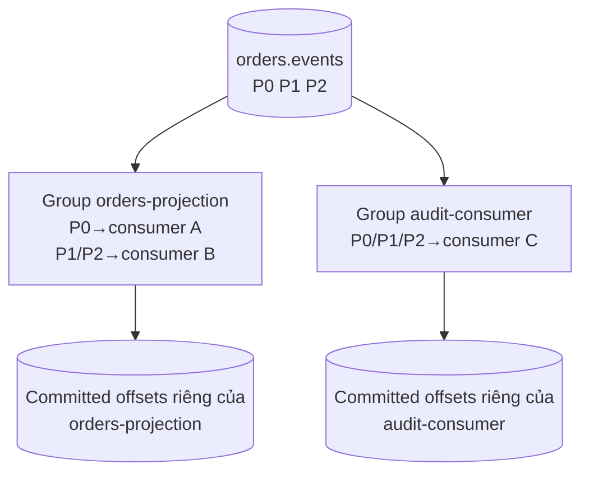
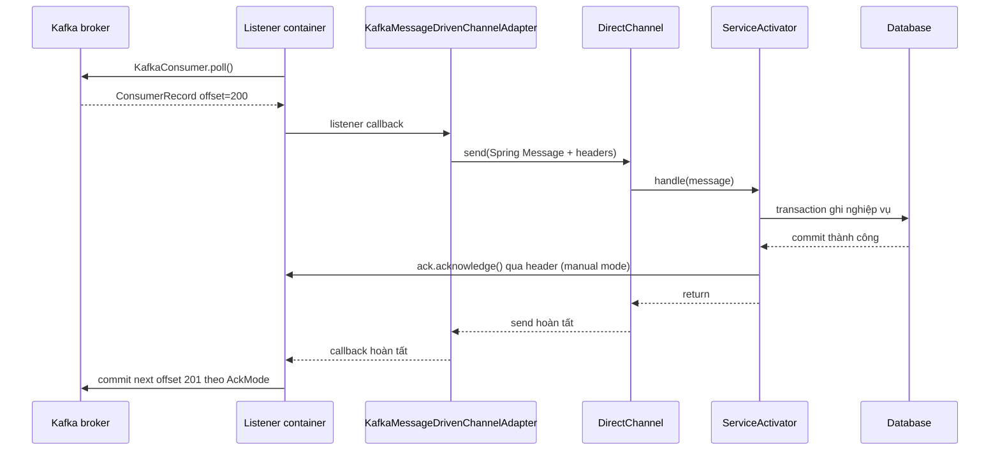
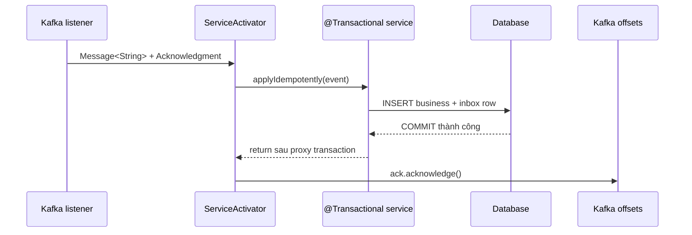
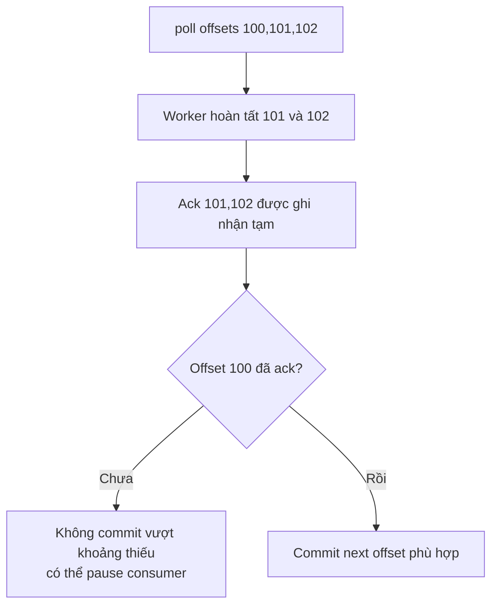
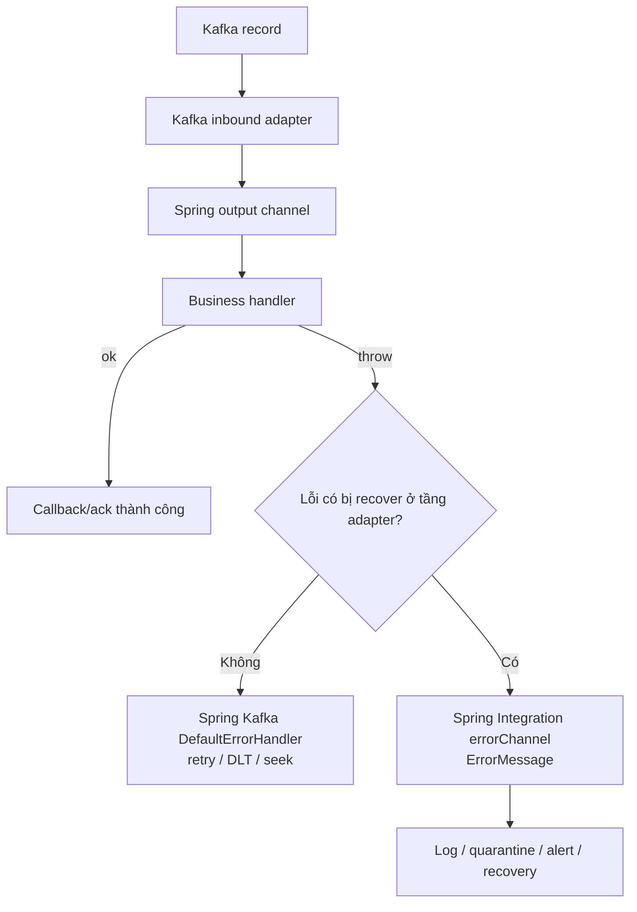
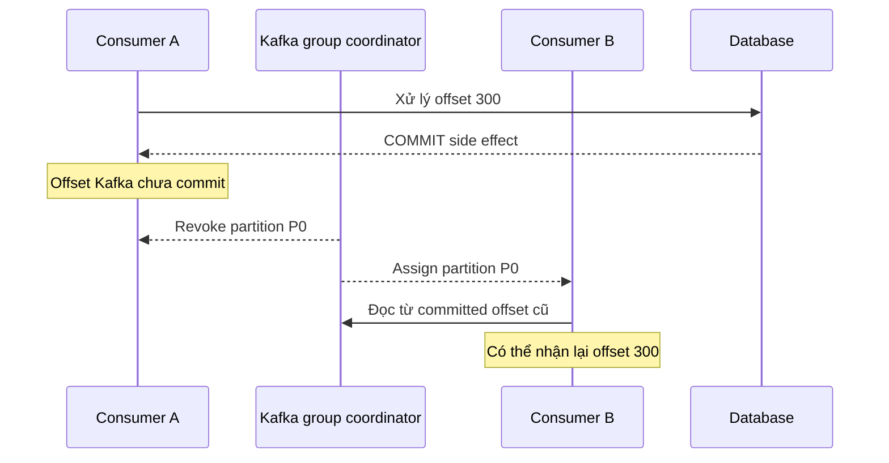

# Offset commit và acknowledgment

**Offset commit** và **acknowledgment** là hai khái niệm trọng yếu khi nhận dữ liệu từ Apache Kafka. Một Kafka consumer có thể **đã lấy record từ broker**, Spring Integration đã **gửi message vào channel**, nhưng hệ thống đích **chưa hoàn thành nghiệp vụ**. Nếu ghi nhận offset quá sớm, record có thể không được phát lại sau sự cố; nếu ghi nhận quá muộn, cùng record có thể được xử lý nhiều lần. Hiểu đúng hai cơ chế này giúp xây flow an toàn thay vì chỉ “đọc được Kafka message”.

Bài thuộc chương **Adapter Kafka** của module **SPRING_INTEGRATION_ADAPTERS**. Module hướng đến kết nối hệ thống ngoài bằng inbound/outbound adapter, gateway, poller và `MessageChannel`; thực hành với file, SFTP, HTTP, JMS, AMQP, Kafka và cơ sở dữ liệu, cùng việc kiểm soát hợp đồng message, lỗi và vòng đời kết nối. Bài này tập trung vào **consumer offset, acknowledgment và ranh giới xác nhận khi Kafka inbound message-driven adapter nối sang Spring Integration**.

> **Phân biệt ngay từ đầu:** Gọi `Acknowledgment.acknowledge()` là một **hành động thông báo cho Spring Kafka listener container**. Việc offset được **commit lên Kafka** có thể xảy ra ngay hoặc sau đó, tùy `AckMode` và thread. Commit offset cũng **không đồng nghĩa giao dịch database, HTTP hoặc SFTP đã commit**.

## 1. Mục tiêu học tập

Sau bài này, bạn có thể:

1. Phân biệt **record offset**, **consumer position**, **committed offset**, **consumer group**, **acknowledgment** và **business completion**.
2. Giải thích vì sao commit offset thường là **offset của record kế tiếp** chứ không phải offset cuối đã xử lý.
3. So sánh `enable.auto.commit=true` với container-managed commit của Spring Kafka.
4. Sử dụng đúng `AckMode.RECORD`, `BATCH`, `TIME`, `COUNT`, `COUNT_TIME`, `MANUAL` và `MANUAL_IMMEDIATE`.
5. Cấu hình `KafkaMessageDrivenChannelAdapter` cùng `ConcurrentMessageListenerContainer`, `DirectChannel` và manual acknowledgment.
6. Gọi `ack.acknowledge()` **sau khi** tác vụ nghiệp vụ bền vững hoàn tất; nhận biết lỗi khi ack trước database transaction commit.
7. Phân biệt `commitSync()`, `commitAsync()`, các chế độ commit trong container và acknowledgment lệch thứ tự.
8. Giải thích `nack`, retry/error handler, DLT và ảnh hưởng của recovery tới committed offset.
9. Phân tích các failure window sau crash, rebalance, shutdown, queue bất đồng bộ và Kafka transaction.
10. Quan sát committed offset/consumer lag bằng Kafka CLI và thiết kế kiểm thử idempotency, replay, backpressure.

## 2. Bối cảnh: từ Kafka record đến side effect



| Tầng | Câu hỏi | Thành phần chịu trách nhiệm |
|---|---|---|
| Kafka fetch | Record đã được đưa vào bộ nhớ consumer chưa? | `KafkaConsumer.poll()` |
| Adapter conversion | `ConsumerRecord` đã thành Spring `Message<?>` chưa? | `KafkaMessageDrivenChannelAdapter` và converter |
| Spring channel dispatch | Message đã được handler nhận hay chỉ enqueue? | `MessageChannel` và consumer endpoint |
| Business side effect | DB/HTTP/SFTP/JMS/AMQP đã thực thi và commit chưa? | Logic downstream, transaction/retry |
| Kafka acknowledgment | Listener/container có được báo record đã xử lý không? | `Acknowledgment` hoặc listener return theo AckMode |
| Kafka offset commit | Group đã lưu vị trí bắt đầu đọc tiếp chưa? | Spring Kafka container/Kafka client, group coordinator |

**Quan trọng:** Mỗi hàng có thể hoàn tất ở thời điểm khác nhau. Việc Kafka broker trả record **không** thể dùng thay cho kết quả transaction DB; và message gửi vào một `QueueChannel` thành công **không** tự xác nhận tác vụ downstream đã xong.

### 2.1. Message-driven khác polling adapter

- `KafkaMessageDrivenChannelAdapter` nhận callback từ **Spring Kafka listener container**. Kafka client vẫn gọi `poll()` nội bộ, nhưng không cần Spring Integration `@Poller`.
- `KafkaMessageSource` là nguồn dành cho **Spring Integration inbound polling adapter**; quyền điều khiển lịch poll và việc nhận message khác với container message-driven.
- Bài này dùng **message-driven adapter**. Không bê nguyên cách acknowledgment sang KafkaMessageSource hoặc adapter JMS/AMQP/SFTP rồi mặc định có cùng hợp đồng.

## 3. Địa chỉ record: topic, partition và offset

Kafka lưu các record trong từng partition theo thứ tự offset tăng dần:

```text
Topic: orders.events

Partition 0:
  offset 100 -> OrderCreated(ORD-10)
  offset 101 -> OrderPaid(ORD-10)
  offset 102 -> OrderShipped(ORD-10)

Partition 1:
  offset  85 -> OrderCreated(ORD-11)
  offset  86 -> OrderPaid(ORD-11)
```

Kafka **không có offset toàn cục cho cả topic**. Offset 100 ở partition 0 không thể so sánh như một đồng hồ thời gian duy nhất với offset 85 ở partition 1.

Một địa chỉ record cụ thể là **topic + partition + offset**. Với một consumer group, offset đã commit cũng được theo dõi theo topic/partition. Một group khác có thể commit vị trí khác trên cùng topic.

### 3.1. Consumer position khác committed offset

Giả sử Kafka consumer `poll()` trả các record offset 100, 101 và 102 từ `orders.events-0`.

- **Current position:** Vị trí consumer dự kiến lấy tiếp; sau poll, nó có thể đã tiến tới 103, **dù handler chưa hoàn tất**.
- **Committed offset:** Vị trí đã được group lưu để khôi phục sau restart/reassignment; ví dụ vẫn đang là 100.
- **Business processed offset:** Khái niệm do ứng dụng tự theo dõi về tiến độ side effect; Kafka không tự xác minh DB transaction.



Khi các record chưa hoàn thành, group có thể vẫn commit 100 trong khi consumer position đã là 103. Sau crash, consumer mới có thể đọc lại từ 100, 101, 102.

### 3.2. Vì sao commit offset 103 thay vì 102?

Kafka committed offset biểu diễn **vị trí bắt đầu đọc tiếp**. Nếu record offset 102 là record cuối đã xử lý thành công liên tục, vị trí tiếp theo là **103**.

| Record vừa xử lý | Committed next offset (điển hình) | Nghĩa |
|---:|---:|---|
| 0 | 1 | Có thể tiếp tục từ record 1 |
| 41 | 42 | Có thể tiếp tục từ record 42 |
| 102 | 103 | Có thể tiếp tục từ record 103 |

Điều này **không** có nghĩa record 103 đã được xử lý. Khi đọc output `CURRENT-OFFSET` từ Kafka CLI, tránh diễn giải “offset hiển thị 103” thành “business handler đã ghi DB cho record 103”.

### 3.3. Commit không xóa record

Commit offset chỉ lưu **tiến độ đọc của một consumer group**. Nó không xóa record khỏi Kafka topic, không giảm retention ngay và không tác động committed offset của group khác. Record có thể còn trong Kafka cho đến khi hết retention hoặc theo cơ chế compaction.

## 4. Consumer group và quyền sở hữu committed offset



Trong **consumer group truyền thống**, mỗi partition thường được giao cho **một consumer của group tại một thời điểm**. Các consumer có cùng `group.id` chia nhau đọc; hai group khác nhau theo dõi tiến độ riêng.

- Đổi `group.id` tức tạo logical subscriber mới, **không** tiếp tục committed offsets của group cũ.
- Tăng số pod hoặc `concurrency` có thể gây rebalance, khiến partition chuyển chủ.
- Nếu consumer mới tiếp quản một partition, nó dùng **committed offset phù hợp** để khởi động lại; những record xử lý nhưng chưa commit có thể phát lại.
- Nếu một group không có offset hợp lệ, `auto.offset.reset` quyết định chính sách bắt đầu, không phải `AckMode`.

### 4.1. `auto.offset.reset=earliest` không phải “replay mỗi lần restart”

Property `auto.offset.reset=earliest` có tác dụng khi không có committed offset hợp lệ (hoặc offset không còn hợp lệ theo trường hợp Kafka quy định). Nếu group đã commit offset 103 hợp lệ, restart cùng group thường tiếp tục từ 103, **không** tự đọc lại từ offset 0.

Không đổi group ID hoặc reset offsets production để “sửa lag” nếu chưa có kế hoạch replay và idempotency.

## 5. Auto commit của Kafka client khác container-managed commit

Kafka consumer client có cấu hình:

```properties
enable.auto.commit=true
auto.commit.interval.ms=5000
```

Khi `enable.auto.commit=true`, client tự commit định kỳ theo cơ chế Kafka. Điểm commit có thể phản ánh **những record consumer đã lấy/poll**, không phải tất cả side effect downstream đã được commit.

### 5.1. Vì sao auto commit có thể không phù hợp?

Giả sử consumer poll 100 record, adapter nhanh chóng đưa vào một queue RAM, còn DB handler xử lý chậm. Nếu Kafka auto commit tiến độ trước DB commit, JVM chết sẽ khiến:

```text
Kafka group offset đã tiến
Queue RAM biến mất khi JVM chết
DB chưa có record tương ứng
=> Nghiệp vụ có thể mất message
```

**Auto commit không bảo đảm business completion.** Với flow có side effect quan trọng, nên để Spring Kafka container quản lý offset và xác định chính sách phù hợp với ranh giới xử lý.

### 5.2. Spring Kafka mặc định thế nào?

Từ Spring Kafka 2.3, listener container đặt `enable.auto.commit=false` nếu ứng dụng không cấu hình tường minh property này. Khi auto commit bị tắt, container sử dụng các `AckMode` và chính sách commit của chính nó.

**AckMode mặc định của Spring Kafka listener container là `BATCH`**, không phải `RECORD`. Vì vậy không nên suy rằng mỗi `@KafkaListener` hoặc `KafkaMessageDrivenChannelAdapter` tự commit ngay sau từng record nếu chưa kiểm tra container config.

| Property/cấu hình | Lớp quyết định | Ý nghĩa |
|---|---|---|
| `enable.auto.commit` | Kafka consumer client | Client có tự commit offset định kỳ không |
| `auto.commit.interval.ms` | Kafka consumer client | Chu kỳ auto commit khi auto commit được bật |
| `ContainerProperties.AckMode` | Spring Kafka listener container | Điều kiện/tần suất container ghi offset |
| `syncCommits` | Spring Kafka listener container | Chọn `commitSync` hay `commitAsync` |
| `Acknowledgment.acknowledge()` | Listener/handler | Báo container record/batch đã được ứng dụng ack |
| `auto.offset.reset` | Kafka consumer client | Vị trí bắt đầu khi không có offset hợp lệ |
| `group.id` | Kafka consumer group | Namespace phân công partition và lưu tiến độ |

Với một container bạn **tự tạo bằng Java** rồi đưa vào Spring Integration, hãy đặt `AckMode` **trên chính `ContainerProperties` đó**. Property `spring.kafka.listener.ack-mode` thường tác động container factory do Spring Boot quản lý; không tự động thay đổi mọi container được tạo thủ công.

## 6. Bảy chế độ `AckMode` của Spring Kafka

Khi `enable.auto.commit=false` và **không dùng Kafka transaction**, Spring Kafka hỗ trợ những chính sách sau:

| `AckMode` | Khi nào container ghi offset? | Khi nào nên cân nhắc? |
|---|---|---|
| **`RECORD`** | Sau khi callback của một record trả về thành công | Cần commit bám sát xử lý từng record đồng bộ |
| **`BATCH`** | Sau khi tất cả record của một `poll()` được xử lý theo contract | Giảm số lần commit với traffic lớn |
| **`TIME`** | Tại điểm kiểm tra phù hợp sau xử lý record/poll khi đạt `ackTime` | Giới hạn tần suất commit theo thời gian |
| **`COUNT`** | Khi đủ số record được xử lý theo `ackCount` tại điểm commit phù hợp | Giảm overhead commit theo số lượng |
| **`COUNT_TIME`** | Khi đạt ngưỡng thời gian **hoặc** số record | Cân bằng throughput và khoảng lặp lại khi crash |
| **`MANUAL`** | Handler gọi `acknowledge()`; commit theo cơ chế tương tự `BATCH` | Ứng dụng tự quyết định thời điểm ack nhưng chấp nhận commit trì hoãn |
| **`MANUAL_IMMEDIATE`** | Cố thực hiện commit ngay khi `acknowledge()` trên **consumer thread** | Cần xác nhận từng record sau side effect với độ trễ commit thấp |

**Mặc định của container là `BATCH`.** `RECORD` và `BATCH` trong bảng là **AckMode của container**, không phải `KafkaMessageDrivenChannelAdapter.ListenerMode.record/batch`. Hai nhóm enum thuộc hai mục đích khác nhau.

### 6.1. Ví dụ `RECORD`

Giả sử poll trả các record `[100, 101, 102]`. Listener/handler chạy đồng bộ:

```text
Process 100 OK -> container commit next offset 101
Process 101 OK -> container commit next offset 102
Process 102 OK -> container commit next offset 103
```

Đây là mô hình lý tưởng để hiểu `RECORD` khi không có transaction và lỗi. Lỗi/recovery/rebalance có thể làm thời điểm commit thực tế thay đổi; commit không phải lệnh bảo đảm DB.

### 6.2. Ví dụ `BATCH`

```text
Poll trả [100, 101, 102]

Process 100 OK
Process 101 OK
Process 102 OK
=> container commit next offset 103 khi poll batch hoàn thành
```

Nếu crash sau record 101 nhưng trước khi batch được commit, record 100 và 101 có thể được phát lại. Vì vậy `BATCH` có thể giảm commit overhead nhưng **tăng số record cần replay** khi crash so với `RECORD`, tùy workload.

### 6.3. Ví dụ `TIME`, `COUNT` và `COUNT_TIME`

```java
// Các mảnh cấu hình thay thế nhau; không dùng cả ba AckMode cùng lúc.
ContainerProperties cp = new ContainerProperties("orders.events");

cp.setAckMode(ContainerProperties.AckMode.TIME);
cp.setAckTime(5_000L);

// Hoặc:
cp.setAckMode(ContainerProperties.AckMode.COUNT);
cp.setAckCount(100);

// Hoặc:
cp.setAckMode(ContainerProperties.AckMode.COUNT_TIME);
cp.setAckTime(5_000L);
cp.setAckCount(100);
```

Các ngưỡng **không tạo một transaction DB chung**. Đừng suy rằng `COUNT=100` nghĩa là Kafka listener luôn nhận một batch đúng 100 record; `max.poll.records` cũng là giới hạn, không bảo đảm kích thước mỗi poll.

### 6.4. `MANUAL` và `MANUAL_IMMEDIATE` khác nhau ở đâu?

`MANUAL`:

```text
Handler nhận record -> process thành công -> ack.acknowledge()
                                      |
                                      v
             Container xếp acknowledgment và commit theo
             semantics của BATCH khi các record liên quan đã xử lý
```

`MANUAL_IMMEDIATE`:

```text
Handler nhận record trên consumer thread
  -> process thành công
  -> ack.acknowledge()
  -> container thực hiện commit ngay theo cơ chế sync/async đã chọn
```

**Điều kiện:** `MANUAL_IMMEDIATE` có ngữ nghĩa commit tức thời khi ack được gọi **trên đúng consumer thread**. Nếu ack trên một thread khác, container có thể **xếp ack để xử lý sau**, nên không được quảng bá là “commit tức thì ở mọi thread”. Trộn ack trên consumer thread và worker thread làm thời điểm commit khó dự đoán; tài liệu Spring Kafka cảnh báo kết quả có thể không xác định theo cách dự kiến.

### 6.5. `acknowledge()` không tự bảo đảm commit đã thành công

Một lời gọi `acknowledge()` là tín hiệu cho framework. Commit thật còn phụ thuộc `AckMode`, `syncCommits`, consumer group, broker và exception. Nếu `syncCommits=true`, container có thể dùng `commitSync()`; nếu async, commit result được báo bằng callback.

Một commit failure phải được log/quan sát và có thể khiến record được nhận lại. Không coi việc method `acknowledge()` được thực thi là bằng chứng chắc chắn offset đã bền vững trên broker.

## 7. Đường đi chính xác trong Kafka inbound adapter



**Sơ đồ diễn giải thứ tự logic**, không phải khẳng định mọi commit xảy ra ở đúng vị trí vẽ. Với `MANUAL_IMMEDIATE` và commit đồng bộ, commit có thể được thực hiện ngay trong lời gọi `acknowledge()` trước khi handler trả về. Với `MANUAL`, commit có thể đến sau. Đối với `RECORD`, handler không cần gọi `acknowledge()`: container dựa trên callback thành công.

### 7.1. Kafka headers có liên quan

| Header | Vai trò |
|---|---|
| `KafkaHeaders.RECEIVED_TOPIC` | Topic đã nhận |
| `KafkaHeaders.RECEIVED_PARTITION` | Partition của record |
| `KafkaHeaders.OFFSET` | Offset **record vừa nhận**, không phải next committed offset |
| `KafkaHeaders.RECEIVED_KEY` | Kafka record key; có thể vắng nếu key null |
| `KafkaHeaders.ACKNOWLEDGMENT` | `Acknowledgment`, khả dụng khi container manual ack phù hợp |
| `KafkaHeaders.CONSUMER` | Có thể chứa Kafka consumer reference; **không thread-safe** |

`KafkaHeaders.ACKNOWLEDGMENT` không phải một con số offset. Đây là object có method `acknowledge()` và trong một số phiên bản còn có `nack(...)`/partial batch API.

**Không dùng `MessageHeaders.ID` làm Kafka offset** hoặc business event ID. Nó là message ID của Spring Messaging.

## 8. Ví dụ chạy được: Kafka adapter với `MANUAL_IMMEDIATE`

Bài thực hành nhận từng `String` record từ `orders.events`. Handler validate payload rồi gọi `acknowledge()`. Phần demo chưa ghi database; mục 10 sẽ đưa ra mô hình **ack sau DB transaction thật**.

### 8.1. Dependencies Maven

Dùng Java 17+ và một Spring Boot BOM tương thích với Spring Kafka/Spring Integration:

```xml
<dependency>
    <groupId>org.springframework.boot</groupId>
    <artifactId>spring-boot-starter-integration</artifactId>
</dependency>
<dependency>
    <groupId>org.springframework.integration</groupId>
    <artifactId>spring-integration-kafka</artifactId>
</dependency>
```

Không tự gán những phiên bản Spring Kafka/Spring Integration không tương thích. Demo dùng API đã có trong các nhánh Spring Kafka 3.x/4.x phổ biến; đối với dự án cụ thể cần kiểm tra BOM và Javadoc tương ứng.

### 8.2. application.properties

```properties
demo.kafka.bootstrap-servers=localhost:9092
demo.kafka.group-id=orders-manual-ack-demo
demo.kafka.concurrency=2
```

Kafka broker phải chạy và topic `orders.events` tồn tại; chỉ dùng group ID demo trên môi trường kiểm thử. Production cần TLS/SASL, ACL, topic provisioning và secret management phù hợp.

### 8.3. ConsumerFactory, listener container và inbound adapter

```java
package com.example.integration;

import java.util.HashMap;
import java.util.Map;

import org.apache.kafka.clients.consumer.ConsumerConfig;
import org.apache.kafka.common.serialization.StringDeserializer;

import org.springframework.beans.factory.annotation.Qualifier;
import org.springframework.beans.factory.annotation.Value;
import org.springframework.context.annotation.Bean;
import org.springframework.context.annotation.Configuration;
import org.springframework.integration.channel.DirectChannel;
import org.springframework.integration.config.EnableIntegration;
import org.springframework.integration.kafka.inbound.KafkaMessageDrivenChannelAdapter;
import org.springframework.kafka.core.ConsumerFactory;
import org.springframework.kafka.core.DefaultKafkaConsumerFactory;
import org.springframework.kafka.listener.ConcurrentMessageListenerContainer;
import org.springframework.kafka.listener.ContainerProperties;
import org.springframework.messaging.MessageChannel;

@Configuration
@EnableIntegration
public class OrdersManualAckConfig {

    @Bean("ordersConsumerFactory")
    ConsumerFactory<String, String> consumerFactory(
            @Value("${demo.kafka.bootstrap-servers}") String brokers,
            @Value("${demo.kafka.group-id}") String groupId) {

        Map<String, Object> config = new HashMap<>();
        config.put(ConsumerConfig.BOOTSTRAP_SERVERS_CONFIG, brokers);
        config.put(ConsumerConfig.GROUP_ID_CONFIG, groupId);
        config.put(ConsumerConfig.KEY_DESERIALIZER_CLASS_CONFIG,
                StringDeserializer.class);
        config.put(ConsumerConfig.VALUE_DESERIALIZER_CLASS_CONFIG,
                StringDeserializer.class);

        // Chọn container-managed acknowledgment, không auto commit.
        config.put(ConsumerConfig.ENABLE_AUTO_COMMIT_CONFIG, false);
        config.put(ConsumerConfig.AUTO_OFFSET_RESET_CONFIG, "earliest");

        return new DefaultKafkaConsumerFactory<>(config);
    }

    @Bean("ordersFromKafka")
    MessageChannel ordersFromKafka() {
        return new DirectChannel();
    }

    @Bean("ordersKafkaManualAckInbound")
    KafkaMessageDrivenChannelAdapter<String, String> ordersInbound(
            @Qualifier("ordersConsumerFactory")
                    ConsumerFactory<String, String> consumerFactory,
            @Qualifier("ordersFromKafka") MessageChannel output,
            @Value("${demo.kafka.concurrency}") int concurrency) {

        ContainerProperties cp =
                new ContainerProperties("orders.events");

        cp.setAckMode(
                ContainerProperties.AckMode.MANUAL_IMMEDIATE);
        cp.setSyncCommits(true);

        ConcurrentMessageListenerContainer<String, String> container =
                new ConcurrentMessageListenerContainer<>(
                        consumerFactory, cp);
        container.setConcurrency(concurrency);

        KafkaMessageDrivenChannelAdapter<String, String> adapter =
                new KafkaMessageDrivenChannelAdapter<>(
                        container,
                        KafkaMessageDrivenChannelAdapter.ListenerMode.record);

        adapter.setOutputChannel(output);
        return adapter;
    }
}
```

**Giải thích cấu hình:**

1. `ENABLE_AUTO_COMMIT_CONFIG=false` để Kafka client **không** tự commit theo timer.
2. `AckMode.MANUAL_IMMEDIATE` trao quyền ack cho handler; nếu handler không ack, thông thường không được phép coi record đã xử lý chỉ vì handler trả về.
3. `setSyncCommits(true)` chọn kiểu commit đồng bộ cho những commit container thực hiện; không biến DB commit thành một phần Kafka transaction.
4. `ListenerMode.record` là chế độ adapter gửi một Spring message cho một Kafka record.
5. `ContainerProperties("orders.events")` subscribe topic và để group coordinator phân công partition.
6. `concurrency=2` là tối đa hai Kafka consumer threads của container, không phải hai partition mới.
7. `ordersFromKafka` là **output channel của inbound adapter**, không phải Kafka topic và không phải input channel của outbound adapter.

Trong code, listener container được tạo **bên trong cấu hình adapter**. Không đăng ký thêm một container hoạt động độc lập trên cùng topic/group nếu không chủ đích tạo thêm consumer.

### 8.4. Service activator lấy acknowledgment từ header

```java
package com.example.integration;

import org.springframework.integration.annotation.ServiceActivator;
import org.springframework.kafka.support.Acknowledgment;
import org.springframework.kafka.support.KafkaHeaders;
import org.springframework.messaging.Message;
import org.springframework.stereotype.Component;

@Component
public class OrdersManualAckHandler {

    @ServiceActivator(inputChannel = "ordersFromKafka")
    public void process(Message<String> message) {

        String payload = message.getPayload();
        if (payload.isBlank()) {
            throw new IllegalArgumentException(
                    "Payload rỗng: không được ack như record hợp lệ");
        }

        Object topic = message.getHeaders()
                .get(KafkaHeaders.RECEIVED_TOPIC);
        Object partition = message.getHeaders()
                .get(KafkaHeaders.RECEIVED_PARTITION);
        Object offset = message.getHeaders()
                .get(KafkaHeaders.OFFSET);

        Acknowledgment ack = message.getHeaders().get(
                KafkaHeaders.ACKNOWLEDGMENT,
                Acknowledgment.class);

        if (ack == null) {
            throw new IllegalStateException(
                "Không có Acknowledgment: kiểm tra manual AckMode");
        }

        // DEMO: chỉ in log, chưa ghi DB; production cần durable effect.
        System.out.printf(
                "PROCESS %s at %s-%s@%s%n",
                payload, topic, partition, offset);

        // Vì DirectChannel xử lý đồng bộ, callback đang chạy
        // trên Kafka listener thread trong cấu hình demo.
        ack.acknowledge();
    }
}
```

Đặt `@SpringBootApplication` trong `com.example.integration` hoặc package cha để Spring quét các bean. Handler này minh họa **manual ack đúng API**, nhưng in log **không** phải một side effect bền vững. Khi chuyển sang production, thay nó bằng lời gọi một service transactional, chỉ ack **sau khi service đã return thành công và DB transaction đã commit**.

### 8.5. Kafka CLI thử nghiệm

```bash
kafka-topics.sh --bootstrap-server localhost:9092 \
  --create --if-not-exists \
  --topic orders.events --partitions 3 --replication-factor 1

kafka-console-producer.sh \
  --bootstrap-server localhost:9092 \
  --topic orders.events
```

Nhập từng dòng:

```text
evt-101|ORD-101|CREATED
evt-102|ORD-102|CREATED
evt-103|ORD-101|PAID
```

Dùng group ID demo mới sẽ đọc record từ điểm bắt đầu theo `auto.offset.reset`. **Không mặc định** offsets bắt đầu từ 0 hoặc record cùng orderId vào cùng partition nếu console producer không gửi Kafka key.

Quan sát group:

```bash
kafka-consumer-groups.sh \
  --bootstrap-server localhost:9092 \
  --describe --group orders-manual-ack-demo
```

Nếu handler chạy và ack thành công, `CURRENT-OFFSET` sẽ tiến theo commit. Nếu record invalid khiến handler ném exception, tình huống retry/seek/recovery phụ thuộc container error handler; cần quan sát thêm `LAG` và logs, không chỉ nhìn output của handler.

### 8.6. Cấu hình `AckMode.RECORD` thay thế

Để so sánh, có thể đổi **duy nhất** cấu hình:

```java
cp.setAckMode(ContainerProperties.AckMode.RECORD);
```

Khi dùng `RECORD`, **bỏ lời gọi manual ack** khỏi handler; container sẽ commit theo callback record thành công. Đừng giữ code bắt buộc `KafkaHeaders.ACKNOWLEDGMENT` khi listener không ở manual mode, vì header đó có thể không tồn tại.

## 9. Java DSL và `@KafkaListener`: đừng trộn nơi cấu hình

Spring Integration Java DSL có thể tạo inbound endpoint bằng:

```java
// Một hướng cấu hình thay thế bean adapter ở mục 8.
// Cần import org.springframework.integration.kafka.dsl.Kafka.
@Bean
IntegrationFlow kafkaOrdersFlow(ConsumerFactory<String, String> factory) {
    return IntegrationFlow
            .from(Kafka.messageDrivenChannelAdapter(
                    factory,
                    KafkaMessageDrivenChannelAdapter.ListenerMode.record,
                    "orders.events")
                .id("ordersDslManualAck")
                .configureListenerContainer(c -> c
                    .ackMode(ContainerProperties.AckMode.MANUAL_IMMEDIATE)))
            .channel("ordersFromKafka")
            .get();
}
```

Đoạn này minh họa **cấu hình listener container tại DSL endpoint** và là **phương án thay thế** Java bean adapter phía trên. Kiểm tra exact overload của DSL theo Spring Integration version khi áp dụng; không khởi chạy cả hai cùng topic/group nếu chỉ muốn một logical consumer.

Với Spring Kafka `@KafkaListener` thuần, ứng dụng có thể cấu hình `AckMode` qua `ConcurrentKafkaListenerContainerFactory.getContainerProperties().setAckMode(...)` hoặc property Spring Boot `spring.kafka.listener.ack-mode`. Đây **không tự động** áp dụng cho mọi `ContainerProperties` được tạo bằng `new` trong Spring Integration.

## 10. DB transaction và thời điểm ack đúng

Đây là phần **quan trọng nhất** khi Kafka inbound ghi vào database.

### 10.1. Một lỗi dễ mắc: ack bên trong transaction chưa commit

```java
// KHÔNG LÀM như sau:
@Transactional
@ServiceActivator(inputChannel = "ordersFromKafka")
public void process(Message<String> message) {
    jdbcTemplate.update("UPDATE orders ...");
    ack.acknowledge(); // Có thể commit Kafka trước khi DB transaction commit!
}
```

Phương thức được Spring transaction proxy quản lý thường chỉ **commit DB sau khi method body trả về**. Nếu gọi `ack.acknowledge()` bên trong method, ở `MANUAL_IMMEDIATE` Kafka offset có thể commit trước DB. Nếu DB transaction fail tại bước commit sau đó, record có thể đã được Kafka đánh dấu hoàn tất nhưng DB không có side effect tương ứng.

**Không dùng một annotation `@Transactional` như bằng chứng Kafka và JDBC đã commit atomically.** Hai tài nguyên có failure window riêng.

### 10.2. Cách an toàn hơn: gọi service transactional qua Spring proxy rồi ack



Trong mô hình này:

1. Handler là một Spring bean nhận Kafka message.
2. Nó gọi **một service bean khác** có public method `@Transactional` thông qua proxy Spring.
3. Service ghi business data và idempotency record **trong cùng DB transaction**.
4. Chỉ khi lời gọi service trả về sau transaction commit thành công, handler mới `ack.acknowledge()`.
5. Nếu service ném lỗi, handler **không ack** và để error policy của container xử lý.

Đây vẫn là **at-least-once**: crash sau DB commit trước Kafka commit vẫn có thể đọc lại record. Khóa idempotency giúp lần đọc lại không tạo side effect trùng.

### 10.3. Schema idempotency tối thiểu

Ví dụ PostgreSQL:

```sql
CREATE TABLE processed_events (
    event_id VARCHAR(128) PRIMARY KEY,
    processed_at TIMESTAMP NOT NULL DEFAULT CURRENT_TIMESTAMP
);

CREATE TABLE order_events (
    event_id VARCHAR(128) PRIMARY KEY,
    order_id VARCHAR(128) NOT NULL,
    event_type VARCHAR(64) NOT NULL
);
```

Service transactional có thể dùng một thao tác insert có unique constraint để claim event:

```java
package com.example.integration;

import org.springframework.jdbc.core.JdbcTemplate;
import org.springframework.stereotype.Service;
import org.springframework.transaction.annotation.Transactional;

@Service
public class OrderProjectionService {

    private final JdbcTemplate jdbc;

    public OrderProjectionService(JdbcTemplate jdbc) {
        this.jdbc = jdbc;
    }

    @Transactional
    public void applyIdempotently(
            String eventId, String orderId, String eventType) {

        // PostgreSQL: atomic insert nếu eventId chưa tồn tại.
        int inserted = jdbc.update(
                "INSERT INTO processed_events (event_id) VALUES (?) "
                + "ON CONFLICT (event_id) DO NOTHING",
                eventId);

        if (inserted == 0) {
            // Event đã được xử lý trước đó: no-op có chủ đích.
            return;
        }

        // Đây chỉ là ví dụ một business side effect.
        jdbc.update(
                "INSERT INTO order_events "
                + "(event_id, order_id, event_type) VALUES (?, ?, ?)",
                eventId, orderId, eventType);
    }
}
```

**Điều kiện chạy thực tế:** cần `spring-boot-starter-jdbc`, JDBC driver, datasource và SQL schema. SQL `ON CONFLICT` là **PostgreSQL-specific**; database khác cần cú pháp atomic upsert/unique constraint phù hợp.

### 10.4. Handler ack sau khi service transactional trả về

Thay phần in log ở handler mục 8 bằng logic sau:

```java
// Đoạn nằm trong @Component handler, đã inject
// OrderProjectionService projectionService.
@ServiceActivator(inputChannel = "ordersFromKafka")
public void persistThenAck(Message<String> message) {
    String[] fields = message.getPayload().split("\\|", 3);

    if (fields.length != 3
            || fields[0].isBlank()
            || fields[1].isBlank()
            || fields[2].isBlank()) {
        throw new IllegalArgumentException(
                "Expected eventId|orderId|eventType");
    }

    Acknowledgment ack = message.getHeaders().get(
            KafkaHeaders.ACKNOWLEDGMENT,
            Acknowledgment.class);
    if (ack == null) {
        throw new IllegalStateException(
                "Manual acknowledgment is not configured");
    }

    // Proxy @Transactional hoàn tất trước khi method return.
    projectionService.applyIdempotently(
            fields[0], fields[1], fields[2]);

    // Chỉ được ack sau commit nghiệp vụ thành công.
    ack.acknowledge();
}
```

Đây là **phương án thay thế** method `process` ở mục 8.4, không đặt hai `@ServiceActivator` trên cùng `DirectChannel` nếu muốn mỗi event chỉ có một handler nghiệp vụ. Trong class thật, cần inject `OrderProjectionService` qua constructor.

**Không tự gọi** `@Transactional` method nội bộ theo kiểu `this.applyIdempotently(...)` nếu kỳ vọng Spring proxy mở transaction; self-invocation có thể bypass proxy. Việc tách hai Spring beans làm rõ ranh giới transaction.

### 10.5. Crash window vẫn tồn tại

| Thời điểm chết | DB | Kafka committed offset | Sau restart |
|---|---|---|---|
| Trước DB commit | Rollback | Chưa ghi nhận hoàn tất | Record có thể được phát lại và xử lý mới |
| Sau DB commit, trước `ack()` | Đã commit | Có thể vẫn là offset cũ | Record có thể được phát lại; inbox nhận duplicate |
| Đang/đã `ack()` nhưng commit Kafka không chắc chắn | Đã commit | Chưa chắc đã ghi bền | Cần quan sát/retry an toàn, không dự đoán |
| Sau Kafka commit thành công | Đã commit | Đã tiến | Group thường đọc từ next offset |
| DB commit fail sau khi ack quá sớm (thiết kế sai) | Không có side effect | Có thể đã tiến | Rủi ro **mất nghiệp vụ** |

Vì thế thiết kế đáng tin cậy không chỉ là “ack sau DB” mà còn cần **idempotency**, observability và test crash/replay.

## 11. Commit đồng bộ và bất đồng bộ

Spring Kafka container có thuộc tính `syncCommits`:

```java
// Dùng với container đã tạo:
container.getContainerProperties().setSyncCommits(true);
```

Trong ví dụ mục 8, ta cấu hình trực tiếp `cp.setSyncCommits(true)` trước khi tạo container. Theo tài liệu Spring Kafka, mặc định thường là `true`.

### 11.1. `commitSync()`

- Consumer gửi commit offset và chờ kết quả thành công/thất bại theo timeout.
- Dễ quan sát lỗi ngay hơn trên call path phù hợp.
- Có thể tăng latency khi Kafka group coordinator/broker chậm.

### 11.2. `commitAsync()`

- Consumer gửi commit request mà không chặn đợi phản hồi như sync.
- Kết quả có thể đến sau qua callback; **không** được coi thành công ngay khi request được gửi.
- Với ứng dụng cần đối soát offset, phải quan sát commit callback, thứ tự và lỗi.

```java
// Snippet trong cấu hình ContainerProperties trước khi start:
cp.setSyncCommits(false);
cp.setCommitCallback((offsets, exception) -> {
    if (exception != null) {
        System.err.println("KAFKA COMMIT FAILED: " + exception);
    } else {
        System.out.println("COMMITTED OFFSETS: " + offsets);
    }
});
```

Với `syncCommits=true`, callback dành cho async commit không phải bằng chứng chính của commit đồng bộ. Khi sử dụng `commitAsync`, callback cần nhẹ, không gọi thao tác blocking dài trên consumer thread.

**Đừng nhầm:** “commit async” ở đây không giống “handler chạy async bằng `ExecutorChannel`”. Một thứ chọn cách Kafka client ghi offset; thứ kia làm thay đổi ranh giới kết thúc của Spring message dispatch.

## 12. Manual acknowledgment và thứ tự commit trong partition

Kafka group không lưu trạng thái “record 101 đã ack, record 100 chưa ack” như một bitmap bền vững chung. Nó lưu **committed next offset theo partition**. Vì vậy offset 102 không thể an toàn trở thành điểm resume nếu record 100 hoặc 101 vẫn chưa xử lý thành công.

```text
Partition 0:
  offset 100 -> PENDING
  offset 101 -> ACKED
  offset 102 -> ACKED

Không thể coi next offset 103 đã an toàn
khi record 100 vẫn chưa thành công.
```

### 12.1. Ack theo thứ tự trong flow đồng bộ

Với `DirectChannel` và handler xử lý tuần tự theo listener callback, thứ tự ack thường tương ứng thứ tự record trong partition. Đây là lựa chọn dễ phân tích nhất khi cần giữ ordering và transaction boundary rõ ràng.

### 12.2. `asyncAcks=true`: cho phép ack lệch thứ tự nhưng không commit qua lỗ hổng

Spring Kafka hỗ trợ:

```java
// Chỉ dùng với AckMode.MANUAL hoặc MANUAL_IMMEDIATE
// và khi đã thiết kế xử lý bất đồng bộ đúng ràng buộc.
cp.setAsyncAcks(true);
```

`asyncAcks=true` cho phép acknowledgment của các record từ một poll đến **không theo thứ tự**. Container **trì hoãn commit** cho đến khi những khoảng thiếu ack được lấp; nó có thể **pause consumer**, ngừng giao thêm record mới trong khi đợi các ack còn thiếu.



**Đánh đổi:** Hữu ích khi xử lý song song nhưng tăng khả năng duplicate sau crash; nếu một worker không bao giờ ack, consumer có thể tạm dừng lâu. Spring Kafka không cho dùng `nack()` khi `asyncAcks` được bật.

**Không được suy luận** `asyncAcks` làm `QueueChannel` RAM trở nên bền vững. Nếu offset chưa commit, record có thể replay; nếu acknowledgment bị gọi quá sớm, vẫn có thể mất business effect.

### 12.3. Ack từ worker thread có rủi ro gì?

- `KafkaConsumer` **không thread-safe**; không mang reference qua executor rồi gọi `commit`/`seek` tùy tiện.
- `MANUAL_IMMEDIATE` không còn nghĩa “commit ngay” khi ack từ thread khác; container có cơ chế xếp ack.
- Cần kiểm tra version, thứ tự, executor backpressure, shutdown và unfinished tasks.
- Nếu chọn xử lý bất đồng bộ, đảm bảo việc xác nhận dựa trên **side effect đã bền**, không chỉ callback được schedule.

## 13. Negative acknowledgment: `nack()` và redelivery

Một số phiên bản Spring Kafka cung cấp `Acknowledgment.nack(...)` để yêu cầu xử lý lại record hoặc phần còn lại của poll:

| Listener mode | API khái quát | Ý nghĩa |
|---|---|---|
| Record listener | `nack(sleep)` | Bỏ phần còn lại của poll, seek để phát lại record lỗi và phần chưa xử lý |
| Batch listener | `nack(index, sleep)` | Commit phần đã xử lý trước index theo policy, seek phát lại phần còn lại |

**Hạn chế quan trọng:**

1. `nack()` phải được gọi trên **consumer thread** chạy listener callback.
2. Không dùng `nack()` khi `asyncAcks=true`.
3. Nó có thể pause toàn bộ listener trong khoảng ngủ; độ phân giải liên quan `pollTimeout` của container.
4. Không biến `nack()` thành lệnh “rollback database” — DB transaction vẫn có ranh giới riêng.
5. Với batch listener, index và ý nghĩa partial commit phải được test trên đúng Spring Kafka version.

### 13.1. Khi nào dùng `nack` thay vì ném exception?

- `nack`: ứng dụng chủ động yêu cầu redelivery tại một điểm xử lý và chấp nhận cơ chế pause/seek của container.
- Exception: để `DefaultErrorHandler` hoặc transaction rollback processor áp dụng retry/backoff/recoverer theo policy.

Trong production, nên ưu tiên **một cơ chế retry được cấu hình tập trung** và có metric. Đừng phối hợp `nack`, adapter retry, container retry và business HTTP retry mà không kiểm soát tổng thời gian/attempts.

### 13.2. Partial batch acknowledgment

Từ các phiên bản Spring Kafka hỗ trợ (ví dụ 3.0.10+), `Acknowledgment.acknowledge(index)` có thể commit phần đầu một batch với điều kiện như:

- `AckMode.MANUAL_IMMEDIATE`.
- Gọi trên listener thread.
- Listener nhận `List` record thay vì `ConsumerRecords` raw.
- Index hợp lệ và tăng dần nếu gọi nhiều lần.

Đây là API nâng cao; cần xem **Javadoc phiên bản đang dùng**. Không áp dụng đoạn code record-mode của mục 8 rồi tự ý thêm index vào `acknowledge()` để “commit một record riêng” nếu không ở batch listener phù hợp.

## 14. Retry, error handler và committed offset

Một record có thể không được ack vì:

- Deserializer hoặc converter lỗi.
- Business validation fail.
- Database transaction rollback.
- HTTP/SFTP/JMS/AMQP đích timeout.
- Channel không có subscriber hoặc handler ném exception.
- Lỗi tại listener thread hoặc Kafka broker.

Với `DirectChannel` và handler đồng bộ, exception có thể lan ngược từ `@ServiceActivator` tới `KafkaMessageDrivenChannelAdapter` rồi Spring Kafka listener container **nếu không bị một tầng recovery bắt và suppress**.

### 14.1. Container `DefaultErrorHandler`

Một policy retry minh họa:

```java
import org.springframework.kafka.listener.DefaultErrorHandler;
import org.springframework.util.backoff.FixedBackOff;

// Chạy trước khi adapter/container được start.
// 1 lần đầu + 2 lần retry, khoảng 1 giây giữa retries.
container.setCommonErrorHandler(
        new DefaultErrorHandler(new FixedBackOff(1_000L, 2L)));
```

Đây **chưa phải DLT**. Khi hết retry, hành động phụ thuộc recoverer và các cấu hình commit/recovery của error handler. Đừng kết luận “handler ném exception thì offset vĩnh viễn không tiến” hoặc “retry xong chắc chắn DLT nhận record”.

### 14.2. Error channel của Spring Integration khác container error handler



Spring Integration adapter có thể có `retryTemplate`/`recoveryCallback`/`errorChannel`. Nếu recovery callback **xử lý xong và không ném lỗi**, Kafka container có thể thấy listener callback đã thành công, làm thay đổi khả năng retry và commit offset.

Điểm này đặc biệt quan trọng khi cùng một flow vừa có **manual ack** vừa có error channel: ai có trách nhiệm ack record đã bị reject hoặc chuyển DLT? Phải định nghĩa policy và kiểm thử committed offset cụ thể, không để record kẹt vô hạn vì thiếu ack, cũng không ack một record chưa được xử lý/quarantine bền vững.

### 14.3. DLT không tự xuất hiện từ một `ErrorMessage`

Muốn chuyển record hỏng vào Kafka dead-letter topic, cần:

1. Topic DLT được provision và producer có quyền ghi.
2. `DeadLetterPublishingRecoverer` hoặc flow recovery thực sự publish record.
3. Retry/backoff và phân loại permanent vs transient error.
4. Quy tắc **khi gửi DLT thất bại**; không báo recovery thành công nếu record chưa được lưu.
5. Chính sách commit offset nguồn **sau recovery bền vững**, tùy error handler, listener mode và AckMode.
6. Quy trình sửa payload và replay có **business idempotency**.

`DefaultErrorHandler` hỗ trợ cấu hình recovery/commit, ví dụ `ackAfterHandle` hoặc `commitRecovered` trong điều kiện thích hợp. **Không nên chỉnh những flag này theo một công thức chung**: `commitRecovered` có những điều kiện riêng (đặc biệt với `MANUAL_IMMEDIATE`). Kiểm tra Javadoc và đo committed offset trong test của dự án.

### 14.4. Phân loại retry

| Lỗi | Phương án thường phù hợp |
|---|---|
| Kafka bytes không deserialize được | ErrorHandlingDeserializer + error handler/quarantine/DLT |
| JSON hỏng không thể sửa | Retry ít hoặc không retry, lưu raw record để kiểm tra |
| Business validation sai vĩnh viễn | Reply reject/quarantine/DLT theo nghiệp vụ |
| DB/HTTP 503 tạm thời | Retry có giới hạn/backoff, không ack trước success |
| Event đã xử lý theo eventId | Idempotent no-op, ack theo policy |
| Publish DLT cũng lỗi | Báo recovery fail, giữ khả năng phát lại, alert |
| Unknown bug ở code handler | Alert, không tự skip vô hạn hoặc ack giả |

**Cảnh báo blocking:** Retry dài ngay trong listener callback có thể vượt `max.poll.interval.ms`, dẫn đến rebalance và thêm duplicate. Cần đánh giá tổng thời gian của retries cho tất cả record trong poll.

## 15. Rebalance: record đang xử lý có thể được giao lại



Trong cùng group, Kafka có thể chuyển partition khi:

- Scale out/in, rolling deployment.
- Consumer crash hoặc mất heartbeat/session.
- Xử lý block lâu, vượt `max.poll.interval.ms`.
- Topic partition/assignment strategy thay đổi.
- Rebalance do membership hoặc lỗi mạng.

Khi partition bị revoke, container có logic commit pending offsets theo chính sách. Nhưng nếu business transaction vừa commit và **Kafka offset chưa commit thành công**, consumer mới vẫn có thể nhận lại. **Idempotency là bắt buộc nếu side effect không được lặp**.

### 15.1. Commit khi revoke và partition lost

`ConsumerAwareRebalanceListener` có các callback như `onPartitionsAssigned`, `onPartitionsRevokedBeforeCommit`, `onPartitionsRevokedAfterCommit` và `onPartitionsLost`.

- Với **revoked**, callback còn có thể được gọi trong quá trình bàn giao để dọn state/flush theo contract.
- Với **lost**, consumer có thể đã mất quyền sở hữu partition; không nên tự commit như vẫn là chủ partition.
- Mọi callback chạy trong bối cảnh nhạy cảm của Kafka consumer thread; không thực hiện DB/HTTP blocking lâu.
- Không tự coi consumer position cao nhất là “business processed” nếu message vẫn nằm trong queue bất đồng bộ.

### 15.2. Static membership và timeout

`group.instance.id` (static membership) có thể giảm rebalance khi restart ngắn với ID ổn định/duy nhất, nhưng không loại bỏ duplicate. `session.timeout.ms` quá lớn có thể làm failover chậm khi pod chết thật; `max.poll.interval.ms` quá thấp có thể khiến handler lâu gây rebalance.

Tối ưu chúng dựa trên dữ liệu đo và SLA, không dùng các timeout này thay cho việc sửa architecture ack sai.

## 16. `DirectChannel`, `QueueChannel` và `ExecutorChannel`

Đây là phần **liên quan trực tiếp Spring Integration**: cùng một `AckMode` nhưng đổi channel có thể đổi ý nghĩa “listener callback thành công”.

### 16.1. `DirectChannel`: dispatch đồng bộ

```text
Kafka listener thread
  -> KafkaMessageDrivenChannelAdapter
  -> DirectChannel
  -> EventDrivenConsumer
  -> JDBC handler
  -> DB commit / exception
  -> return về Kafka listener
  -> ack hoặc container error policy
```

Với handler đồng bộ, callback phản ánh kết quả downstream tốt hơn. Đổi lại, DB/HTTP chậm chiếm listener thread, làm tăng consumer lag và nguy cơ `max.poll.interval.ms`.

### 16.2. `QueueChannel` RAM: enqueue khác business commit

```text
Kafka listener thread
  -> adapter.send()
  -> QueueChannel.enqueue(message)    [thành công]
  -> listener callback trả về
  -> với RECORD/BATCH, offset có thể tiến

Một thời điểm khác:
  -> PollingConsumer.dequeue(message)
  -> JDBC handler commit DB
```

Nếu Kafka offset đã commit **trước** khi JDBC xử lý nhưng JVM chết, queue RAM biến mất; Kafka group có thể **không phát lại** record. Đây là lỗi kiến trúc ở ranh giới ack/durability, không phải bug converter.

Giải pháp có thể là **durable message store**, transactional inbox/outbox, hoặc thiết kế manual ack gắn với kết quả downstream theo đúng ràng buộc thread/version. Cần kiểm thử crash giữa enqueue, dequeue, DB commit và Kafka commit.

### 16.3. `ExecutorChannel` và thứ tự hoàn tất

`ExecutorChannel` giao việc cho executor; handler có thể chạy muộn hoặc hoàn tất không theo thứ tự offset. `asyncAcks=true` cho phép quản lý ack lệch thứ tự ở một số trường hợp, nhưng không tự:

- Làm dữ liệu bền khi in-flight tasks mất sau crash.
- Giữ ordering nghiệp vụ theo customer/order.
- Đảm bảo thread nào cũng có thể gọi mọi method của KafkaConsumer.
- Kết hợp an toàn với `nack`.

Khi ordering theo aggregate quan trọng, chọn Kafka key ổn định, xử lý theo partition/key hoặc gắn sequence/version và thiết kế consumer chịu được out-of-order.

### 16.4. Fan-out nội bộ không có offset độc lập

`PublishSubscribeChannel` gửi một Spring message tới nhiều subscriber nội bộ, nhưng không tạo ra nhiều Kafka consumer groups. Nếu hai nhánh side effect có SLA/rollback khác nhau, cần quyết định **khi nào record được coi hoàn tất**, hoặc tách thành những consumer groups độc lập có committed offsets riêng.

## 17. Kafka transactions và giới hạn exactly-once

### 17.1. Kafka-only consume–transform–produce

Trong hệ sinh thái Kafka, producer transaction có thể nhóm:

1. Các Kafka records được publish.
2. Consumer offsets được gửi vào cùng Kafka transaction bằng cơ chế container/template phù hợp.

Consumer downstream với `isolation.level=read_committed` chỉ thấy committed transactional records theo protocol. Spring Kafka container transaction có semantics offset tương ứng record/batch listener.

**Nhưng:** Kafka transaction không tự bao gồm database, SFTP, HTTP hoặc JMS broker độc lập. Nếu Kafka transaction commit nhưng DB rollback (hoặc ngược lại), hệ thống ngoài Kafka vẫn có thể lệch.

### 17.2. Ví dụ failure window khi Kafka → DB

```text
Consumer đọc Kafka event
  -> DB transaction commit thành công
  -> Kafka offset commit thất bại / process crash
  -> Kafka phát lại event
```

Một `@Transactional` JDBC service và một Kafka transaction manager **không tự tạo XA transaction hoàn hảo** giữa Kafka/DB. Phối hợp transaction có thứ tự commit nhưng vẫn có failure window. Đối với Kafka → DB, thường dùng **idempotent consumer/inbox table**. Đối với DB → Kafka, thường dùng **transactional outbox**.

### 17.3. “At-most-once”, “at-least-once”, “exactly-once effect”

| Mô hình | Cách triển khai điển hình | Đánh đổi |
|---|---|---|
| At-most-once | Ack/commit trước khi hoàn tất nghiệp vụ | Ít duplicate nhưng có thể mất event khi crash |
| At-least-once | Side effect hoàn tất rồi commit offset | Có thể duplicate sau crash/retry |
| Exactly-once Kafka-only | Kafka transaction đúng contract, read_committed | Phạm vi giới hạn các thao tác Kafka |
| Effectively-once business effect | At-least-once + DB idempotency/unique key | Chịu replay mà không lặp side effect |

**Không tuyên bố exactly-once end-to-end xuyên JDBC/HTTP/SFTP chỉ vì dùng `AckMode.MANUAL_IMMEDIATE` hoặc Kafka producer idempotence.**

## 18. Mối quan hệ với các adapter khác trong module

| Inbound/outbound source | “Đã nhận” là gì? | Cần kiểm soát gì trước khi coi hoàn tất? |
|---|---|---|
| Kafka inbound | Kafka consumer poll ra record | Offset commit, ack, retry, idempotency |
| JMS/AMQP inbound | Broker giao message | Ack/nack/redelivery, transaction, DLQ |
| File/SFTP inbound | Poller tìm/tải file | File filter, remote/local metadata, claim/rename |
| HTTP inbound gateway | HTTP request đã vào handler | Response status, timeout, retry phía client |
| JDBC polling inbound | Query/claim được row | DB transaction/claim, duplicate |
| Kafka outbound | KafkaTemplate bắt đầu send | Broker ACK, publish failure callback/outbox |

Các giao thức có cùng khái niệm “xác nhận xử lý” nhưng **khác đối tượng được xác nhận**. Không gọi `Acknowledgment.acknowledge()` của Kafka như thể nó đã ack JMS message hoặc đánh dấu file SFTP xử lý xong.

Một flow xuyên hệ thống cần xác định ranh giới end-to-end:

```text
Kafka inbound -> Spring MessageChannel -> JDBC -> Kafka outbound
                      |                  |            |
                  dispatch          DB commit    Kafka send ACK
                      |
                Kafka input offset commit theo policy
```

Nếu cần phản hồi/commit có bảo đảm chặt, phải thiết kế transaction/outbox/inbox và idempotency ở từng biên.

## 19. Observability: đo đúng offset thay vì chỉ xem log “processed”

### 19.1. Kafka CLI đọc committed offset và lag

```bash
kafka-consumer-groups.sh \
  --bootstrap-server localhost:9092 \
  --describe --group orders-manual-ack-demo

kafka-consumer-groups.sh \
  --bootstrap-server localhost:9092 \
  --describe --group orders-manual-ack-demo \
  --members --verbose
```

Các trường thường thấy:

| Trường | Đọc thế nào |
|---|---|
| `GROUP` | Logical subscriber đang quan sát |
| `TOPIC`, `PARTITION` | Kafka record stream/đơn vị assignment |
| `CURRENT-OFFSET` | Vị trí **đã commit** của group theo topic/partition |
| `LOG-END-OFFSET` | Vị trí cuối log theo công cụ |
| `LAG` | Chênh lệch log end với committed offset |
| `CONSUMER-ID`, `CLIENT-ID`, `HOST` | Consumer member/client đang chạy |
| `ASSIGNMENT` | Partition đang giao cho member |

**Cảnh báo:** `LAG=0` không bảo đảm DB đã xử lý xong nếu offset được commit trước side effect hoặc message nằm trong queue RAM. Ngược lại, `LAG>0` không nhất thiết là lỗi: có thể handler đã commit DB nhưng Kafka offset chưa ghi nhận, hoặc group đang rebalance.

### 19.2. Những tín hiệu cần thu thập

- `records-polled`, `records-converted`, `records-dispatched`.
- `business-transaction-success` và `business-transaction-failure`.
- `ack-invocations` tách khỏi `offset-commit-success/failure`.
- Consumer lag theo topic/partition, committed offset và current position khi có thể.
- Container `isRunning`, `isPaused`, partition assignment, rebalance count.
- `DefaultErrorHandler` retry attempts, recovery/DLT count và thất bại publish DLT.
- Handler p95/p99 latency, DB connection pool, HTTP timeout, queue depth.
- Business duplicate count theo `eventId`.
- Số record chưa ack và thời gian pending khi dùng `asyncAcks`.

Một log `"PROCESS COMPLETED"` không chứng minh Kafka offset đã commit. Hãy ghi eventId, topic, partition, offset, transaction outcome và commit outcome vào những hệ thống observability thích hợp, tránh log payload nhạy cảm.

### 19.3. Các trạng thái dễ bị nhầm

| Hiện tượng | Có thể là gì? |
|---|---|
| Adapter `isRunning=true` nhưng không xử lý record | Chưa được assign partition, lag=0, bị pause hoặc lỗi broker |
| Handler log hai lần cùng topic-partition-offset | Redelivery do retry/rebalance/offset chưa commit |
| Handler log cùng eventId nhưng offset khác | Có thể business event được publish hai lần |
| Commit offset tiến nhưng DB thiếu dữ liệu | Ack sớm, queue bất đồng bộ, recovery skip |
| DB có event nhưng lag vẫn tăng | Consumer load lớn, commit chậm hoặc group đang rebalance |
| DLT có record nhưng group vẫn kẹt | Recovery/ack policy chưa xử lý committed offset đúng |
| `ack.acknowledge()` đã gọi nhưng CLI chưa tiến | `MANUAL` commit trì hoãn, async commit hoặc commit failure |

## 20. Quy trình xử lý sự cố

### Tình huống 1 — Record bị xử lý lặp sau restart

Kiểm tra `group.id`, committed offset, handler side effect, lần ack, commit errors, rebalance và retry. Nếu DB commit trước Kafka commit, replay là kết quả có thể dự đoán. Giải pháp là idempotency theo `eventId`, **không** phải “ack trước cho hết duplicate”.

### Tình huống 2 — Handler ném exception, lag không giảm

Xác định error handler có retry vô hạn hay recovery không; `max.poll.interval.ms` có đủ cho blocking processing không; record malformed có bị retry như lỗi tạm thời không; DLT có thật sự nhận dữ liệu hay chưa. Nếu dùng manual mode, xác định record được ack sau recovery như thế nào.

### Tình huống 3 — Offset tiến nhưng downstream mất message

Kiểm tra `QueueChannel`/`ExecutorChannel` và thời điểm listener callback kết thúc. Nếu message chỉ được enqueue trong RAM thì đây là vấn đề **durable handoff**. Đổi về `DirectChannel` trong lab để đối chiếu, sau đó thiết kế queue bền vững/ack đúng side effect.

### Tình huống 4 — Chạy `MANUAL_IMMEDIATE` mà offset chưa tiến ngay

Xác minh `enable.auto.commit=false`, ack header có mặt, ack gọi trên đúng listener thread, `syncCommits`, commit exception và group ownership. Nếu ack từ worker thread, ngữ nghĩa commit “immediate” có thể không còn.

### Tình huống 5 — Sau rebalance, một event được xử lý lại

Kiểm tra revoke/lost events, Kafka committed offset tại thời điểm chuyển partition và DB eventId. Không gọi KafkaConsumer commit từ thread không sở hữu consumer; không coi partition lost như revoked vẫn có quyền commit.

### Tình huống 6 — Manual ack làm container đứng lâu

Kiểm tra có record nào **không bao giờ được ack** không, nhất là với `asyncAcks=true`. Một pending ack có thể khiến container pause giao thêm records. Đánh giá cancellation/shutdown timeout, worker failure path và chiến lược recovery.

## 21. Sai lầm thường gặp

| Hiểu sai | Cách hiểu đúng |
|---|---|
| “Offset là số thứ tự toàn topic.” | Offset chỉ có nghĩa trong **một partition**. |
| “Commit offset 103 nghĩa là record 103 đã xử lý.” | Thường nghĩa là **đọc tiếp từ 103**. |
| “`poll()` trả về là đã xử lý nghiệp vụ.” | Poll có thể tiến trước DB transaction. |
| “`enable.auto.commit=true` an toàn cho mọi flow.” | Commit định kỳ có thể đi trước side effect. |
| “Spring Kafka mặc định `AckMode.RECORD`.” | Mặc định của container là **`BATCH`**. |
| “`ListenerMode.record` tự chọn `AckMode.RECORD`.” | Hai enum độc lập. |
| “`MANUAL` gọi ack là Kafka commit ngay.” | Có thể commit trì hoãn theo batch semantics. |
| “`MANUAL_IMMEDIATE` commit ngay cả khi ack từ worker thread.” | Ngữ nghĩa tức thời gắn với consumer thread. |
| “`acknowledge()` xóa record Kafka.” | Chỉ tín hiệu tiến độ; retention/compaction độc lập. |
| “`syncCommits=true` nghĩa JDBC và Kafka commit atomically.” | Chỉ chọn kiểu commit offset phía consumer. |
| “Đặt `@Transactional` trên handler và ack cuối method là an toàn.” | DB thường commit **sau** method body, có nguy cơ ack trước DB commit. |
| “`asyncAcks` cho phép bỏ qua record chưa ack.” | Container chờ lấp gap, có thể pause. |
| “`nack()` có thể gọi từ thread bất kỳ.” | Phải theo consumer thread contract. |
| “Có error channel thì Kafka luôn retry.” | Recovery có thể suppress exception. |
| “DLT sẽ tự có khi bật `DefaultErrorHandler`.” | Cần recoverer/template/topic/ACL và policy. |
| “`LAG=0` chứng minh nghiệp vụ DB hoàn tất.” | Offset có thể commit trước DB/queue. |
| “Kafka transaction bảo đảm exactly-once cho HTTP/DB.” | Chỉ có bảo đảm trong phạm vi resource/transaction được phối hợp đúng. |
| “Tăng concurrency sửa mọi vấn đề ack.” | Chỉ tăng consumer threads, không sửa failure window hoặc DB bottleneck. |

## 22. Bài tập thực hành

### Bài 1 — Tính next committed offset

Topic `orders.events` partition 0 có record offsets 10, 11, 12, 13. Consumer đã xử lý đến offset 12. Hãy xác định next committed offset hợp lý, consumer position có thể đang ở đâu và vì sao chúng khác nhau.

### Bài 2 — So sánh `RECORD` và `BATCH`

Dùng topic 3 partition và 100 record. Chạy hai lần với `AckMode.RECORD` và `AckMode.BATCH` trong môi trường riêng, ghi số lần commit, lag, throughput và số record có thể replay nếu crash giữa một poll.

### Bài 3 — Manual ack cơ bản

Chạy ví dụ mục 8, gửi 10 record. Ghi log topic, partition, offset ngay trước `ack.acknowledge()` và so sánh `CURRENT-OFFSET` bằng Kafka CLI. Giải thích vì sao một lần ack không đồng nghĩa Kafka topic bị xóa record.

### Bài 4 — Đổi `MANUAL_IMMEDIATE` sang `MANUAL`

Giữ cùng handler nhưng đổi AckMode. Quan sát thời gian `ack()` được gọi và thời điểm committed offset tiến. Giải thích khác biệt và ảnh hưởng tới replay khi crash.

### Bài 5 — Bẫy transaction chưa commit

Tạo handler `@Transactional` gọi ack bên trong method rồi giả lập lỗi ở DB commit. Sau đó tách service transactional sang bean khác và ack sau khi service trả về. Giải thích tại sao thiết kế thứ hai giảm nguy cơ mất event.

### Bài 6 — Inbox/idempotency

Triển khai `processed_events` và `order_events` theo mục 10. Gửi cùng `eventId` hai lần. Xác minh Kafka có thể có hai record nhưng DB chỉ có một business effect, không dựa vào Kafka offset như khóa nghiệp vụ.

### Bài 7 — Crash sau DB commit

Đặt điểm tiêm lỗi ngay sau `projectionService.applyIdempotently(...)` nhưng trước `ack.acknowledge()`. Khởi động lại consumer với cùng group ID. Xác minh record replay và unique constraint chặn tác dụng phụ trùng.

### Bài 8 — `QueueChannel` RAM

Thay output `DirectChannel` bằng `QueueChannel(100)` và thêm polling consumer xử lý chậm. Để Kafka offset commit sau enqueue rồi kill JVM trước DB write. Trình bày nguyên nhân mất message và phương án durable handoff.

### Bài 9 — `asyncAcks` và xử lý lệch thứ tự

Mô phỏng ba worker xử lý offsets 100, 101, 102 nhưng hoàn tất theo thứ tự 102, 101, 100. Với `asyncAcks=true`, quan sát cách container trì hoãn commit, pause và tăng khả năng redelivery sau crash.

### Bài 10 — `nack` trong record listener

Trên môi trường Spring Kafka version hỗ trợ, dùng manual ack và chủ động `nack` một record lỗi tạm thời trên consumer thread. Quan sát pause/seek/redelivery. So sánh với ném exception cho `DefaultErrorHandler`; xác minh không dùng `nack` khi `asyncAcks=true`.

### Bài 11 — Error handler và DLT

Cấu hình `DefaultErrorHandler` + `DeadLetterPublishingRecoverer` cho record không thể parse JSON. Kiểm tra record có trong DLT thật, committed offset nguồn và behavior khi DLT publish thất bại. Không chỉ dựa vào dòng log “recovered”.

### Bài 12 — Rebalance khi xử lý chậm

Cho handler block lâu, giảm `max.poll.interval.ms` trên môi trường lab rồi scale thêm instance cùng group. Quan sát revoke/assign, duplicate, DB transaction và committed offset. Thiết kế retry/backpressure giảm nguy cơ rebalance.

### Bài 13 — `commitSync` và `commitAsync`

Chạy `MANUAL_IMMEDIATE` với `syncCommits=true` rồi `false`; quan sát callback và thời điểm offset được ghi nhận. Giải thích tại sao “đã gửi commit request” chưa đủ để kết luận broker commit thành công.

### Bài 14 — Kafka-only transaction so với Kafka → DB

Thiết kế một flow Kafka → transformer → Kafka outbound dùng transaction, so sánh với Kafka → JDBC projection. Chỉ ra tài nguyên nào tham gia transaction và lý do vẫn cần business idempotency khi DB là đích.

### Bài 15 — Thiết kế production

Một topic có 12 partition, ba pod Spring Boot, mỗi pod concurrency 2; DB xử lý tối đa 400 record/giây. Chọn AckMode, channel, retry/DLT, idempotency, shutdown policy và dashboard. Giải thích bằng số liệu vì sao tăng concurrency không giải quyết DB bottleneck.

## 23. Câu hỏi tự kiểm tra

1. Offset của Kafka record có phải là số thứ tự toàn topic không?
2. Consumer position và committed offset khác nhau ở điều gì?
3. Vì sao commit offset thường là offset **kế tiếp**?
4. Một consumer group khác có dùng chung committed offsets của group hiện tại không?
5. `auto.offset.reset=earliest` có tự đọc lại từ đầu sau mọi lần restart không?
6. `enable.auto.commit=true` có bảo đảm DB commit xong không?
7. `AckMode` mặc định của Spring Kafka container là gì?
8. `AckMode.RECORD` khác `ListenerMode.record` như thế nào?
9. `BATCH` commit vào thời điểm nào?
10. `TIME`, `COUNT` và `COUNT_TIME` khác nhau ở điều kiện commit nào?
11. Tại sao `MANUAL` không đồng nghĩa commit ngay?
12. Với `MANUAL_IMMEDIATE`, việc gọi `ack()` từ worker thread khác listener có hậu quả gì?
13. `KafkaHeaders.ACKNOWLEDGMENT` có luôn tồn tại không?
14. Tại sao ack bên trong một method `@Transactional` có thể xảy ra trước DB commit?
15. Làm thế nào để ack sau khi service transactional thực sự trả về thành công?
16. Vì sao vẫn phải có idempotency khi đã ack sau DB commit?
17. `syncCommits` chọn cơ chế nào và không bảo đảm điều gì?
18. `asyncAcks=true` xử lý khoảng thiếu ack ra sao?
19. Có thể dùng `nack` với `asyncAcks` không?
20. Vì sao một `QueueChannel` RAM có thể làm mất nghiệp vụ dù Kafka lag bằng 0?
21. `DefaultErrorHandler` và Spring Integration `errorChannel` có giống nhau không?
22. DLT có được tạo chỉ bằng cách bật `AckMode.RECORD` không?
23. Rebalance có thể khiến một record đã ghi DB được phát lại trong tình huống nào?
24. Kafka transaction có tự phối hợp atomic với JDBC/HTTP/SFTP không?

## 24. Tổng kết

Kafka offset commit trả lời **“consumer group sẽ đọc tiếp từ đâu?”**; acknowledgment trả lời **“listener/container đã được báo tiến độ xử lý ra sao?”**. Chúng không tự trả lời **“DB/HTTP/SFTP hoặc nghiệp vụ đã hoàn tất bền vững chưa?”**.

```text
Kafka poll / ConsumerRecord
    -> Spring Kafka listener container
    -> KafkaMessageDrivenChannelAdapter
    -> Spring MessageChannel
    -> Business handler / DB transaction
    -> Acknowledgment (MANUAL / MANUAL_IMMEDIATE nếu dùng)
    -> Container commit offset theo AckMode
    -> Kafka consumer group resume từ next offset
```

Một thiết kế có độ tin cậy cần đồng thời chọn **AckMode**, bảo đảm **downstream side effect hoàn tất trước ack**, phân biệt commit sync/async, xử lý **retry/rebalance/DLT** và giữ **business idempotency** để chịu được crash ngay sau DB commit nhưng trước Kafka commit. Khi nối Kafka với file, SFTP, HTTP, JMS, AMQP hoặc cơ sở dữ liệu, luôn kiểm tra **ranh giới commit của từng hệ thống**, không đánh đồng chúng với Kafka acknowledgment.

## Tài liệu tham khảo

- [Spring Kafka Reference — Message Listener Containers: Committing Offsets](https://docs.spring.io/spring-kafka/reference/kafka/receiving-messages/message-listener-container.html)
- [Spring Kafka Reference — Manually Committing Offsets](https://docs.spring.io/spring-kafka/reference/kafka/receiving-messages/ooo-commits.html)
- [Spring Kafka Reference — Container Properties](https://docs.spring.io/spring-kafka/reference/kafka/container-props.html)
- [Spring Kafka Reference — Container Error Handlers](https://docs.spring.io/spring-kafka/reference/kafka/annotation-error-handling.html)
- [Spring Kafka Reference — Transactions](https://docs.spring.io/spring-kafka/reference/kafka/transactions.html)
- [Spring Kafka API — Acknowledgment](https://docs.spring.io/spring-kafka/api/org/springframework/kafka/support/Acknowledgment.html)
- [Spring Kafka API — ContainerProperties](https://docs.spring.io/spring-kafka/api/org/springframework/kafka/listener/ContainerProperties.html)
- [Spring Kafka API — KafkaHeaders](https://docs.spring.io/spring-kafka/api/org/springframework/kafka/support/KafkaHeaders.html)
- [Spring Integration Reference — Apache Kafka Support](https://docs.spring.io/spring-integration/reference/kafka.html)
- [Spring Integration API — KafkaMessageDrivenChannelAdapter](https://docs.spring.io/spring-integration/api/org/springframework/integration/kafka/inbound/KafkaMessageDrivenChannelAdapter.html)
- [Apache Kafka Documentation — Consumer Configuration](https://kafka.apache.org/44/configuration/consumer-configs/)
