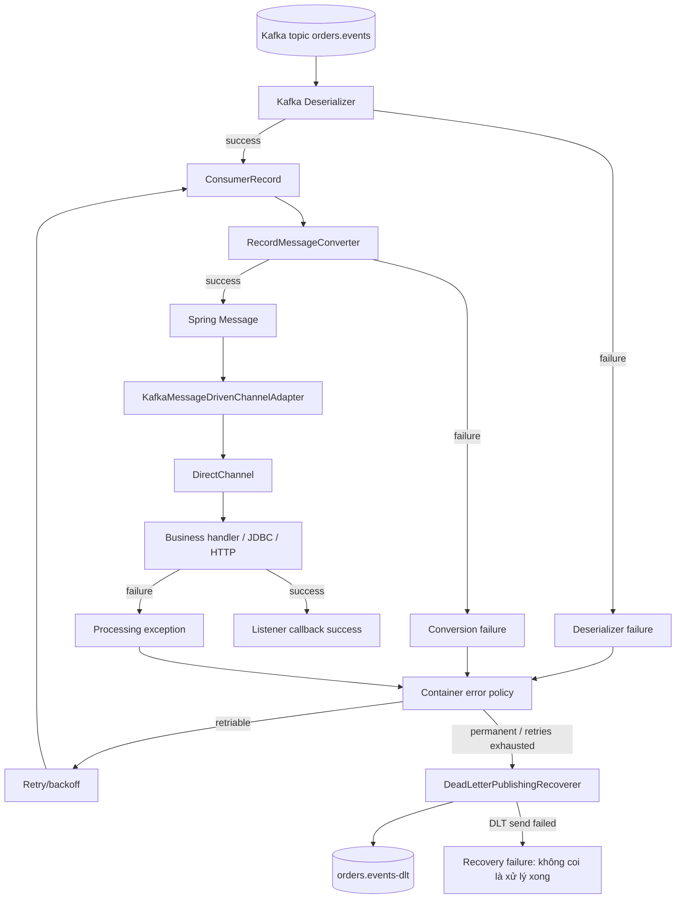
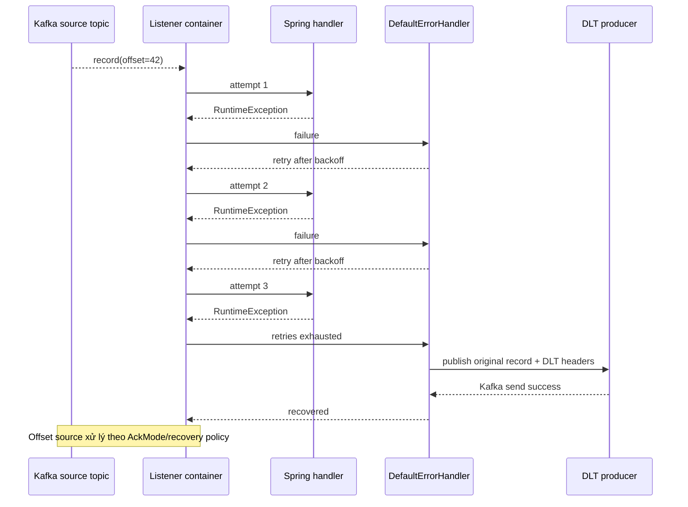
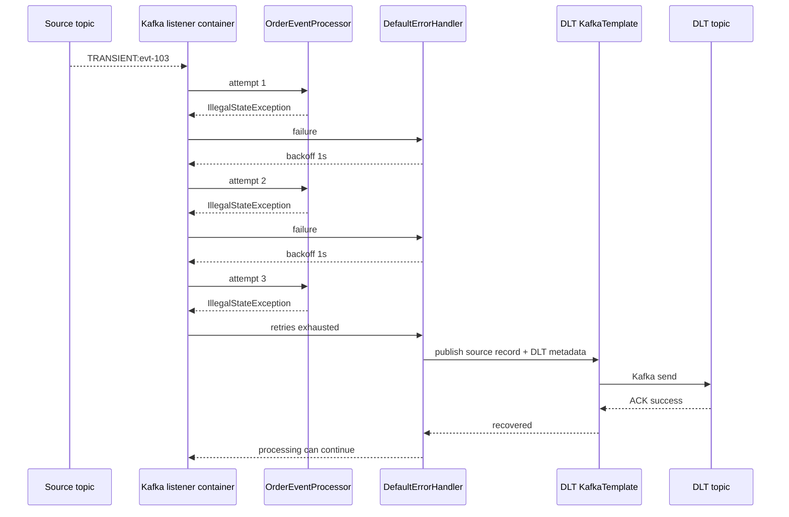
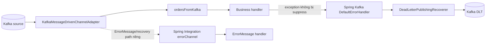
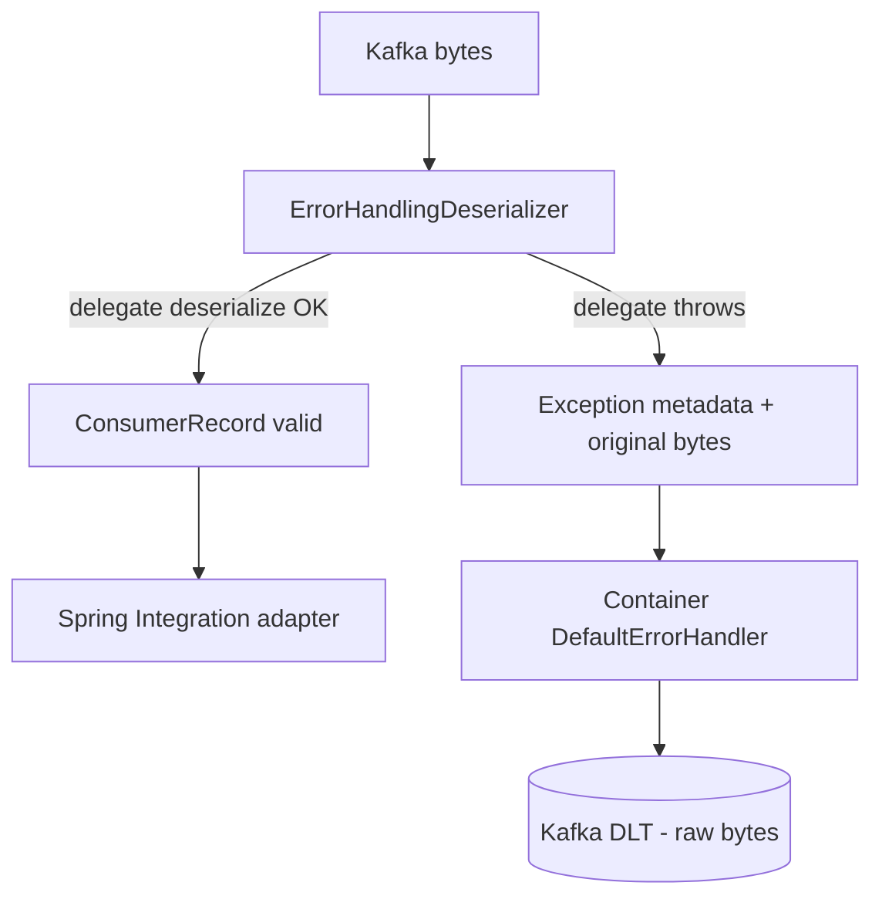
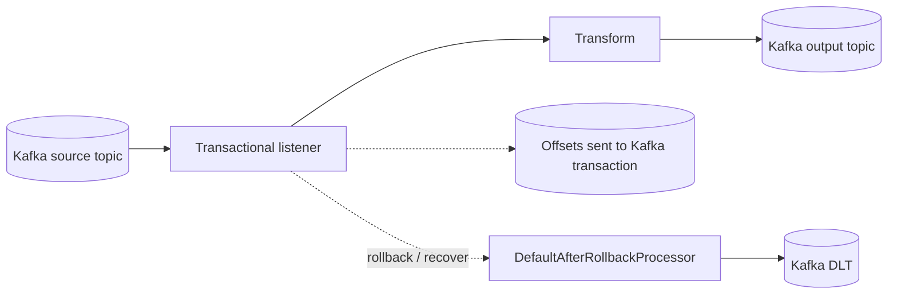
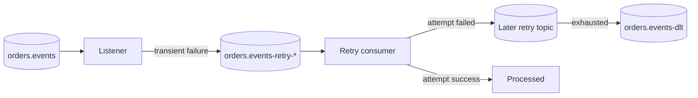
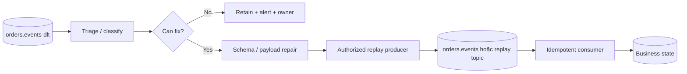

# Error handler và dead-letter topic

**Error handler** giúp Kafka consumer quyết định điều gì xảy ra khi một record không được xử lý thành công: thử lại, tạm dừng, chuyển sang nơi lưu lỗi hoặc tiếp tục đọc record kế tiếp. **Dead-letter topic (DLT)** là một topic Kafka dùng để giữ record không thể xử lý theo chính sách đã định, kèm metadata hỗ trợ điều tra và replay. Hai cơ chế phải được thiết kế cùng **offset commit, acknowledgment, idempotency, transaction và khả năng publish DLT thất bại**; nếu không, ứng dụng có thể âm thầm bỏ record hoặc tạo duplicate khi sự cố xảy ra.

Bài thuộc chương **Adapter Kafka** của module **SPRING_INTEGRATION_ADAPTERS**. Module sử dụng inbound/outbound adapter, gateway, poller và `MessageChannel` để nối file, SFTP, HTTP, JMS, AMQP, Kafka và cơ sở dữ liệu; đồng thời quản lý message contract, lỗi và vòng đời kết nối. Chủ đề này tập trung vào **Spring Kafka `DefaultErrorHandler` và `DeadLetterPublishingRecoverer` khi Kafka message-driven inbound adapter đưa record vào Spring Integration flow**.

> **Điểm cần nhớ:** Có một `ErrorMessage` trên Spring Integration `errorChannel` **không đồng nghĩa** Kafka record đã được publish vào DLT. Có record trong DLT **không đồng nghĩa** offset của topic nguồn đã commit atomically với DLT. Phải xác minh từng ranh giới bằng test.

## 1. Mục tiêu học tập

Sau bài học, bạn có thể:

1. Phân loại lỗi Kafka deserialization, message conversion, validation, business handler, network/DB và Kafka DLT producer.
2. Giải thích sự khác biệt giữa **Spring Kafka `CommonErrorHandler`** và **Spring Integration `errorChannel`**.
3. Cấu hình `DefaultErrorHandler` với `FixedBackOff`, exception classification và `DeadLetterPublishingRecoverer`.
4. Hiểu số lần retry, khoảng backoff, xử lý record lỗi và việc record khác tiếp tục được đọc.
5. Thiết kế DLT topic, phân vùng, serializer, retention, ACL và headers điều tra.
6. Cấu hình Spring Boot Java `ConsumerFactory`, `ConcurrentMessageListenerContainer` và `KafkaMessageDrivenChannelAdapter` với error handler ở **listener container**.
7. Dùng `ErrorHandlingDeserializer` cho deserializer lỗi và giữ nguyên raw bytes để quarantine đúng cách.
8. Đánh giá `ackAfterHandle`, `commitRecovered`, `AckMode.RECORD`, `MANUAL_IMMEDIATE`, crash/rebalance và duplicate DLT.
9. Phân biệt retry blocking trong container với non-blocking retry topics; biết giới hạn trong các hệ thống có Kafka transaction.
10. Thiết kế quy trình DLT triage/replay, phân quyền, metric, alert và bài kiểm thử đảm bảo không bỏ dữ liệu quan trọng.

## 2. Một record đi qua những tầng lỗi nào?



Sơ đồ mô tả **hướng xử lý mong muốn**, không khẳng định mọi lỗi đều luôn tự quay về container. Spring Integration có thể có `retryTemplate`, `recoveryCallback` hoặc `errorChannel` xử lý exception trước đó. Nếu một tầng đã nuốt exception, `DefaultErrorHandler` có thể **không được gọi**.

| Vị trí lỗi | Ví dụ | Ai thường nhìn thấy trước? |
|---|---|---|
| Broker/network/consumer | Topic ACL thiếu, timeout, mất broker, rebalance | Kafka consumer/container; không phải mọi lỗi có record để gửi DLT |
| **Deserializer** | JSON bytes hỏng, kiểu Java không hợp lệ | `Deserializer`/`ErrorHandlingDeserializer` |
| **Converter** | JSON string không convert thành DTO | Spring Kafka record converter / adapter |
| **Validation** | Order ID rỗng, schema version không hỗ trợ | Spring Integration filter/transformer/handler |
| **Business handler** | JDBC deadlock, HTTP 503, SFTP permission denied | Handler; có thể ném exception về listener |
| **DLT producer** | Không có ACL WRITE, topic thiếu partition, broker timeout | `DeadLetterPublishingRecoverer` |
| **Replay worker** | Event DLT đã cũ, schema không tương thích hiện tại | DLT consumer/replay pipeline |

**Không có DLT cho mọi loại lỗi:** nếu Kafka consumer chưa đọc được record vì broker hoặc quyền truy cập, `DeadLetterPublishingRecoverer` không có `ConsumerRecord` để publish. Vấn đề ấy cần alert/khôi phục hạ tầng, không phải “quăng lỗi connection vào DLT”.

## 3. Retry, recovery và DLT là ba hành động khác nhau



- **Retry:** Thử thực hiện lại đối với cùng dữ liệu, thường thích hợp với lỗi tạm thời như DB connection timeout.
- **Recovery:** Hành động được gọi khi không nên/không thể retry tiếp; có thể log, lưu kho lỗi, ghi DLT hoặc chấm dứt ứng dụng tùy policy.
- **Dead-letter topic:** Một **điểm đến bền vững ở Kafka**, chỉ được coi là đã nhận dữ liệu nếu producer publish thành công theo chính sách ACK.

Nếu recoverer mặc định của một error handler chỉ **ghi log**, record có thể bị coi đã recover dù không xuất hiện ở DLT. Muốn DLT, phải **cấu hình recoverer chuyên dụng**.

### 3.1. “Poison pill” là gì?

Một record luôn thất bại, ví dụ JSON không hợp lệ hoặc business ID vi phạm hợp đồng, có thể bị retry mãi tại cùng offset và chặn partition. Nó được gọi là **poison pill**. Policy thường là:

1. Phân loại permanent vs transient.
2. Không retry vô ích đối với permanent error.
3. Publish record/quarantine cùng metadata nguyên nhân.
4. Sau khi recovery được xác nhận, xử lý tiến độ đọc nguồn theo policy.
5. Cung cấp công cụ triage, sửa và replay.

Không dùng DLT như một “thùng rác tự xóa”: record lỗi vẫn có thể là bằng chứng giao dịch quan trọng.

## 4. Spring Kafka `DefaultErrorHandler`

`DefaultErrorHandler` là một implementation của `CommonErrorHandler` để xử lý lỗi listener trong Spring Kafka. Nó có thể retry record với backoff, seek/reset các record chưa hoàn tất, hoặc giao bản ghi lỗi cho `ConsumerRecordRecoverer`. Một số phiên bản hỗ trợ cách giữ record để resubmit thay vì seek trực tiếp (`seekAfterError=false`).

| Thành phần | Trách nhiệm |
|---|---|
| `CommonErrorHandler` | Contract lỗi được Spring Kafka listener container sử dụng |
| **`DefaultErrorHandler`** | Retry/recover record hoặc batch theo exception/backoff |
| `FixedBackOff` | Khoảng chờ cố định và số retry |
| `ExponentialBackOff` | Khoảng chờ tăng theo cấu hình |
| `ConsumerRecordRecoverer` | Xử lý record cuối cùng khi lỗi không được retry nữa |
| **`DeadLetterPublishingRecoverer`** | Triển khai recoverer gửi record lỗi sang topic Kafka |
| `RetryListener` | Quan sát failed delivery, recovered, recovery failed |
| `DefaultAfterRollbackProcessor` | Recovery trong mô hình listener container có Kafka transaction |
| `KafkaErrorSendingMessageRecoverer` | Recoverer tạo Spring Integration `ErrorMessage` theo contract |

### 4.1. Phân biệt với `ErrorHandler` thế hệ cũ

Một số bài viết cũ sử dụng `SeekToCurrentErrorHandler` hoặc `ErrorHandler` trước khi framework hợp nhất vào `CommonErrorHandler`. Với Spring Kafka 3.x/4.x, hướng triển khai nên dựa trên **`DefaultErrorHandler`** và API thuộc version hiện hành, không copy nguyên mã cũ.

### 4.2. Handler nào được áp dụng?

Nếu tự tạo `ConcurrentMessageListenerContainer`, đặt:

```java
container.setCommonErrorHandler(errorHandler);
```

Nếu dùng `@KafkaListener`, cấu hình trên `ConcurrentKafkaListenerContainerFactory`:

```java
factory.setCommonErrorHandler(errorHandler);
```

**Không nhầm lẫn:** Một bean tên `errorHandler` trong ApplicationContext **không đảm bảo** mọi listener container được tạo thủ công sẽ tự động dùng bean đó. Phải kiểm tra wiring thực tế.

## 5. Cấu hình số lần retry với `FixedBackOff`

Ví dụ:

```java
DefaultErrorHandler errorHandler = new DefaultErrorHandler(
        recoverer,
        new FixedBackOff(1_000L, 2L));
```

Ý nghĩa:

- `1_000L`: Khoảng cách backoff **1.000 ms**.
- `2L`: Có tối đa **hai retry sau lần xử lý ban đầu** đối với lỗi retryable.
- Tổng cộng có thể có **ba attempt** với một record, nếu lỗi giữ nguyên và không có cấu hình reset đặc biệt.
- Sau khi hết retry, `recoverer` được gọi để xử lý record.

```text
attempt 1 (ban đầu) -> FAIL
  sleep/backoff 1s
attempt 2            -> FAIL
  sleep/backoff 1s
attempt 3            -> FAIL
  -> recovery (ví dụ publish DLT)
```

**Chú ý:** `DefaultErrorHandler` có danh sách lỗi được xem là **fatal/not retryable** theo mặc định. Lỗi thuộc nhóm đó có thể **vào recoverer ngay từ lần đầu**, nên ba attempt không phải là chân lý cho tất cả exception.

### 5.1. Backoff phải phù hợp `max.poll.interval.ms`

Retry blocking dài chiếm đường listener hoặc điều phối lại record. Nếu tổng thời gian xử lý nhiều record trong poll cộng với backoff vượt `max.poll.interval.ms`, Kafka có thể làm group rebalance, gây thêm redelivery và giảm throughput.

Đối với vài giờ chờ hệ thống bên ngoài khôi phục, nên xem xét **retry topic/non-blocking retries** hoặc durable job queue thay vì ngủ trong consumer callback.

### 5.2. `seekAfterError=false` có thay đổi đảm bảo không?

Trong một số phiên bản hiện đại:

```java
errorHandler.setSeekAfterError(false);
```

Điều này cho phép container giữ các record chưa xử lý và resubmit sau poll để duy trì group liveness, thay vì seek mỗi lần. Đây là lựa chọn triển khai retry, **không** biến record thành exactly-once hay giải quyết DB commit atomicity.

## 6. Phân loại lỗi: retryable và not retryable

| Loại lỗi | Ví dụ | Policy đề xuất |
|---|---|---|
| **Transient** | DB connection reset, HTTP 503, broker phục hồi nhanh | Retry có giới hạn + backoff |
| **Permanent data error** | JSON sai cấu trúc, thiếu field bắt buộc | Không retry hoặc ít retry, DLT/quarantine |
| **Business rejection** | Đơn hàng không hợp lệ theo luật nghiệp vụ | Quyết định reply `REJECTED`/DLT theo contract |
| **Authorization** | Không có quyền ghi DB hoặc DLT | Alert và sửa cấu hình; retry vô hạn có thể vô ích |
| **Serialization mismatch** | Producer/consumer dùng schema không tương thích | Quarantine + kiểm tra deployment |
| **Developer bug** | `ClassCastException`, exception mapping | Báo động, tránh nuốt lỗi rồi commit sai |

Các lỗi không được retry theo mặc định thường gồm `DeserializationException`, `MessageConversionException`, `ConversionException`, `MethodArgumentResolutionException`, `NoSuchMethodException` và `ClassCastException`. Tập cụ thể tùy Spring Kafka version và cấu hình.

### 6.1. Đánh dấu ngoại lệ nghiệp vụ không retry

```java
errorHandler.addNotRetryableExceptions(
        InvalidOrderEventException.class);
```

Một exception ứng dụng có thể định nghĩa:

```java
package com.example.kafka;

public final class InvalidOrderEventException
        extends RuntimeException {

    public InvalidOrderEventException(String message) {
        super(message);
    }
}
```

Từ đó event không hợp lệ do handler ném `InvalidOrderEventException` có thể đi thẳng tới recoverer thay vì chờ hết retry/backoff.

**Chú ý exception wrapping:** Đôi khi lỗi thực được bọc trong `ListenerExecutionFailedException` hoặc `MessagingException`. Error handler có cơ chế phân loại/traversal cause chain tùy version; phải test lỗi được bọc, không chỉ test `new InvalidOrderEventException()`.

### 6.2. Không đánh đồng “lỗi đã được recover” với “nghiệp vụ thành công”

Recovery bằng DLT là **kết quả xử lý ngoại lệ**. Nó có nghĩa record được lưu cho điều tra theo policy, **không phải** đơn hàng đã được tạo hoặc đã ghi DB. Metrics/dashboard cần tách `processed_success` khỏi `recovered_to_dlt`.

## 7. `DeadLetterPublishingRecoverer`

`DeadLetterPublishingRecoverer` lấy `ConsumerRecord` bị lỗi và publish một `ProducerRecord` sang DLT bằng `KafkaTemplate` hoặc một tập template theo value type.

### 7.1. Quy ước destination mặc định

Với resolver mặc định:

```text
Nguồn: orders.events, partition 2, offset 42
          |
          v
DLT:    orders.events-dlt, partition 2
```

Topic đích dùng **hậu tố `-dlt`** (chữ thường), **không** phải lúc nào cũng là `.DLT` hay `-DLT`. Recoverer cố gửi cùng partition ban đầu. Vì vậy topic DLT phải có **ít nhất số partition tương ứng với topic nguồn**, nếu không cần custom resolver.

| Topic nguồn | Topic DLT mặc định | Yêu cầu |
|---|---|---|
| `orders.events` có 3 partition | `orders.events-dlt` | DLT ≥ 3 partition |
| `payments.commands` có 6 partition | `payments.commands-dlt` | DLT ≥ 6 partition |
| `inventory.changed` có 12 partition | `inventory.changed-dlt` | DLT ≥ 12 partition |

Nếu cố định một destination khác, resolver có thể trả `TopicPartition` tùy ý. Khi muốn để Kafka producer tự chọn partition, có thể trả **partition âm** như `-1` thay vì một partition không tồn tại.

### 7.2. Tại sao cùng partition hữu ích?

- Dễ đối chiếu nguồn và DLT bằng partition.
- Phân tích thứ tự lỗi theo từng partition.
- Triaging theo shard/tenant khi key-partitioning nhất quán.

Tuy vậy **DLT là topic khác**, offset DLT được cấp mới, không giữ offset gốc. Một DLT record có `offset=8` không có nghĩa Kafka source record cũng ở offset 8.

### 7.3. Tạo recoverer cơ bản

```java
DeadLetterPublishingRecoverer recoverer =
        new DeadLetterPublishingRecoverer(dltKafkaTemplate);

// Giúp không báo 'recovered' khi publish DLT fail.
// Có thể block trong lúc chờ producer send result.
recoverer.setFailIfSendResultIsError(true);
recoverer.setWaitForSendResultTimeout(
        Duration.ofSeconds(35));
```

Trong mã trên, `dltKafkaTemplate` là bean `KafkaTemplate<String,String>` được cấu hình tương thích record demo. `setFailIfSendResultIsError(true)` yêu cầu kiểm tra kết quả publish và ném lỗi nếu producer báo thất bại. Nếu không kiểm tra publish result, một callback có thể kết thúc **trước khi biết DLT đã được broker chấp nhận**, tùy cơ chế/framework và version.

`Duration.ofSeconds(35)` là ví dụ khi producer có `delivery.timeout.ms=30000` cộng dự phòng; production cần tune timeout theo SLA. Đừng đặt DLT wait timeout ngắn hơn producer delivery timeout rồi suy từ timeout rằng DLT chắc chắn không có record.

### 7.4. Custom destination resolver

Nếu có nhiều nhóm lỗi:

```java
DeadLetterPublishingRecoverer recoverer =
        new DeadLetterPublishingRecoverer(
            dltKafkaTemplate,
            (record, exception) ->
                new TopicPartition(
                    record.topic() + "-dlt",
                    -1)); // Để Kafka producer chọn partition.
```

Đây chỉ là ví dụ custom resolver giữ cùng DLT topic nhưng bỏ bắt buộc partition bằng nguồn. Nếu muốn route ra `orders.validation-dlt` và `orders.transient-dlt`, cần xác định wrapped root cause, allowlist destination và quyền ACL producer.

**Không** tùy ý lấy Kafka DLT topic từ payload hay header do đối tác không tin cậy cung cấp.

## 8. Headers và bằng chứng điều tra của DLT

DLT record thường giữ các original record headers và được gắn thêm metadata chuyên dụng của `DeadLetterPublishingRecoverer`.

| Header thường thấy | Ý nghĩa |
|---|---|
| `KafkaHeaders.DLT_ORIGINAL_TOPIC` | Tên topic nguồn |
| `KafkaHeaders.DLT_ORIGINAL_PARTITION` | Partition gốc |
| `KafkaHeaders.DLT_ORIGINAL_OFFSET` | Offset gốc |
| `KafkaHeaders.DLT_ORIGINAL_TIMESTAMP` | Timestamp gốc |
| `KafkaHeaders.DLT_ORIGINAL_TIMESTAMP_TYPE` | Loại timestamp gốc |
| `KafkaHeaders.DLT_ORIGINAL_CONSUMER_GROUP` | Consumer group đã xử lý lỗi khi hỗ trợ |
| `KafkaHeaders.DLT_EXCEPTION_FQCN` | Tên lớp exception tổng quát |
| `KafkaHeaders.DLT_EXCEPTION_CAUSE_FQCN` | Tên lớp nguyên nhân gốc khi có |
| `KafkaHeaders.DLT_EXCEPTION_MESSAGE` | Thông điệp exception |
| `KafkaHeaders.DLT_EXCEPTION_STACKTRACE` | Stack trace dùng cho chẩn đoán |
| `KafkaHeaders.DLT_KEY_EXCEPTION_FQCN` | Metadata lỗi deserialization Kafka key khi có |

**Payload và key gốc** thường được giữ nếu producer DLT serializer hỗ trợ kiểu tương ứng. DLT record có thể có **topic/partition/offset mới**, nhưng headers giúp truy vết record nguồn.

### 8.1. Metadata không phải business ID

- `topic + partition + offset`: định vị record nguồn.
- `eventId` hoặc `requestId` trong payload/header: nhận diện sự kiện nghiệp vụ, cần cho idempotency.
- `KafkaHeaders.DLT_ORIGINAL_OFFSET`: hỗ trợ audit/replay, không tự chống trùng khi business event bị publish lại ở offset khác.
- Spring `MessageHeaders.ID`: ID message nội bộ, không thay Kafka record identity.

### 8.2. Header có thể chứa dữ liệu nhạy cảm

Stack trace và exception message đôi khi chứa SQL, hostname, path, giá trị dữ liệu hoặc token. Khi publish DLT, hãy áp dụng Kafka ACL, retention, encryption/TLS và masking/logging policy. Đừng mở toàn bộ DLT cho những service chỉ cần đọc topic nghiệp vụ.

### 8.3. Kiểm soát tăng kích thước headers khi retry nhiều vòng

Kafka cho phép nhiều headers trùng tên. Khi replay DLT rồi lại phát lỗi sang DLT khác, có thể sinh nhiều original/exception headers, đặc biệt stacktrace rất dài.

`DeadLetterPublishingRecoverer` có các tùy chọn như `setAppendOriginalHeaders`, `setStripPreviousExceptionHeaders` và `excludeHeader(...)` trong các version hỗ trợ. Cần cân bằng việc giữ đủ forensic information với nguy cơ `RecordTooLargeException` và lộ dữ liệu nhạy cảm.

## 9. Môi trường lab và lựa chọn version

Ví dụ chính dùng **record listener với payload String**, tương thích theo hướng API phổ biến ở Spring Boot 3.x / Spring Integration 6.x / Spring Kafka 3.x. Trong ứng dụng sử dụng Boot 4.x / Spring Integration 7.x / Spring Kafka 4.x, phải dùng một BOM đồng bộ và kiểm tra thay đổi nhỏ ở API/import; không tự trộn các nhánh thư viện.

Thành phần:

- Kafka broker local tại `localhost:9092`.
- Topic `orders.events`: 3 partition.
- Topic `orders.events-dlt`: 3 partition.
- Spring Boot application nhận `orders.events` qua `KafkaMessageDrivenChannelAdapter`.
- Spring Kafka `DefaultErrorHandler` + `DeadLetterPublishingRecoverer` publish lỗi vào DLT.
- Handler thử nghiệm: trả thành công, ném lỗi permanent hoặc ném lỗi transient.

### 9.1. Dependencies Maven

Dùng Spring Boot BOM hoặc parent để quản lý version:

```xml
<dependency>
    <groupId>org.springframework.boot</groupId>
    <artifactId>spring-boot-starter-integration</artifactId>
</dependency>
<dependency>
    <groupId>org.springframework.integration</groupId>
    <artifactId>spring-integration-kafka</artifactId>
</dependency>
```

Những dependency Kafka client, Spring Kafka và Spring Messaging liên quan được chọn qua BOM. Nếu thêm JDBC để làm ví dụ idempotent DB, cần `spring-boot-starter-jdbc` và driver tương ứng; demo đầu tiên chỉ in log.

### 9.2. Tạo topic bằng Kafka CLI

```bash
kafka-topics.sh --bootstrap-server localhost:9092 \
  --create --if-not-exists --topic orders.events \
  --partitions 3 --replication-factor 1

kafka-topics.sh --bootstrap-server localhost:9092 \
  --create --if-not-exists --topic orders.events-dlt \
  --partitions 3 --replication-factor 1
```

Replication factor 1 chỉ dành cho lab một broker. Production cần replication factor, `min.insync.replicas`, retention/cleanup policy, topic ownership và ACL theo SLA.

### 9.3. application.properties

```properties
demo.kafka.bootstrap-servers=localhost:9092
demo.kafka.group-id=orders-dlt-demo
demo.kafka.concurrency=2
```

Không dùng group ID production cho phép thử gây lỗi/replay. `auto.offset.reset=earliest` ở ví dụ Java chỉ có tác dụng khi group/partition không có committed offset hợp lệ.

## 10. Cấu hình đầy đủ: ConsumerFactory và producer DLT

Một Spring `@Configuration` tạo Kafka consumer đọc dữ liệu và Kafka producer template **riêng cho DLT**.

```java
package com.example.kafka;

import java.util.HashMap;
import java.util.Map;

import org.apache.kafka.clients.consumer.ConsumerConfig;
import org.apache.kafka.clients.producer.ProducerConfig;
import org.apache.kafka.common.serialization.StringDeserializer;
import org.apache.kafka.common.serialization.StringSerializer;

import org.springframework.beans.factory.annotation.Value;
import org.springframework.beans.factory.annotation.Bean;
import org.springframework.context.annotation.Configuration;
import org.springframework.kafka.core.ConsumerFactory;
import org.springframework.kafka.core.DefaultKafkaConsumerFactory;
import org.springframework.kafka.core.DefaultKafkaProducerFactory;
import org.springframework.kafka.core.KafkaTemplate;
import org.springframework.kafka.core.ProducerFactory;

@Configuration
public class KafkaDltInfrastructure {

    @Bean("ordersConsumerFactory")
    public ConsumerFactory<String, String> ordersConsumerFactory(
            @Value("${demo.kafka.bootstrap-servers}") String brokers,
            @Value("${demo.kafka.group-id}") String groupId) {

        Map<String, Object> config = new HashMap<>();
        config.put(ConsumerConfig.BOOTSTRAP_SERVERS_CONFIG, brokers);
        config.put(ConsumerConfig.GROUP_ID_CONFIG, groupId);
        config.put(ConsumerConfig.KEY_DESERIALIZER_CLASS_CONFIG,
                StringDeserializer.class);
        config.put(ConsumerConfig.VALUE_DESERIALIZER_CLASS_CONFIG,
                StringDeserializer.class);
        config.put(ConsumerConfig.ENABLE_AUTO_COMMIT_CONFIG, false);
        config.put(ConsumerConfig.AUTO_OFFSET_RESET_CONFIG, "earliest");
        return new DefaultKafkaConsumerFactory<>(config);
    }

    @Bean("dltProducerFactory")
    public ProducerFactory<String, String> dltProducerFactory(
            @Value("${demo.kafka.bootstrap-servers}") String brokers) {

        Map<String, Object> config = new HashMap<>();
        config.put(ProducerConfig.BOOTSTRAP_SERVERS_CONFIG, brokers);
        config.put(ProducerConfig.KEY_SERIALIZER_CLASS_CONFIG,
                StringSerializer.class);
        config.put(ProducerConfig.VALUE_SERIALIZER_CLASS_CONFIG,
                StringSerializer.class);
        config.put(ProducerConfig.ACKS_CONFIG, "all");
        config.put(ProducerConfig.ENABLE_IDEMPOTENCE_CONFIG, true);
        config.put(ProducerConfig.DELIVERY_TIMEOUT_MS_CONFIG, 30_000);
        config.put(ProducerConfig.REQUEST_TIMEOUT_MS_CONFIG, 10_000);
        return new DefaultKafkaProducerFactory<>(config);
    }

    @Bean("dltKafkaTemplate")
    public KafkaTemplate<String, String> dltKafkaTemplate(
            ProducerFactory<String, String> dltProducerFactory) {
        return new KafkaTemplate<>(dltProducerFactory);
    }
}
```

**Vì sao tách DLT producer template?** Nó có thể dùng serializer, ACL, client ID, timeout/acks và metrics khác producer nghiệp vụ. Ví dụ demo dùng `StringSerializer` cả key/value vì consumer nhận `StringDeserializer` và handler ném exception sau đó. Với lỗi **deserialization raw bytes**, producer DLT này **chưa đủ**, sẽ được giải thích tại mục 15.

## 11. Cấu hình đầy đủ: listener container và `DefaultErrorHandler`

Đây là phần trung tâm của bài: đặt error handler trên **listener container** trước khi đưa nó vào Spring Integration Kafka inbound adapter.

```java
package com.example.kafka;

import java.time.Duration;

import org.springframework.beans.factory.annotation.Qualifier;
import org.springframework.beans.factory.annotation.Value;
import org.springframework.context.annotation.Bean;
import org.springframework.context.annotation.Configuration;

import org.springframework.integration.channel.DirectChannel;
import org.springframework.integration.config.EnableIntegration;
import org.springframework.integration.kafka.inbound.KafkaMessageDrivenChannelAdapter;

import org.springframework.kafka.core.ConsumerFactory;
import org.springframework.kafka.core.KafkaTemplate;
import org.springframework.kafka.listener.ConcurrentMessageListenerContainer;
import org.springframework.kafka.listener.ContainerProperties;
import org.springframework.kafka.listener.DefaultErrorHandler;
import org.springframework.kafka.listener.DeadLetterPublishingRecoverer;

import org.springframework.messaging.MessageChannel;
import org.springframework.util.backoff.FixedBackOff;

@Configuration
@EnableIntegration
public class OrdersKafkaDltFlowConfig {

    @Bean("ordersFromKafka")
    public MessageChannel ordersFromKafka() {
        return new DirectChannel();
    }

    @Bean("ordersKafkaInboundAdapter")
    public KafkaMessageDrivenChannelAdapter<String, String> adapter(
            @Qualifier("ordersConsumerFactory")
                ConsumerFactory<String, String> consumerFactory,
            @Qualifier("dltKafkaTemplate")
                KafkaTemplate<String, String> dltKafkaTemplate,
            @Qualifier("ordersFromKafka")
                MessageChannel ordersFromKafka,
            @Value("${demo.kafka.concurrency}") int concurrency) {

        ContainerProperties cp =
                new ContainerProperties("orders.events");
        cp.setAckMode(ContainerProperties.AckMode.RECORD);
        cp.setSyncCommits(true);

        ConcurrentMessageListenerContainer<String, String> container =
                new ConcurrentMessageListenerContainer<>(
                    consumerFactory, cp);
        container.setConcurrency(concurrency);

        // Default: sourceTopic-dlt, cùng partition.
        DeadLetterPublishingRecoverer recoverer =
                new DeadLetterPublishingRecoverer(dltKafkaTemplate);
        recoverer.setFailIfSendResultIsError(true);
        recoverer.setWaitForSendResultTimeout(
                Duration.ofSeconds(35));

        // 1 xử lý ban đầu + tối đa 2 lần retry, 1 giây/backoff.
        DefaultErrorHandler errorHandler =
                new DefaultErrorHandler(
                    recoverer, new FixedBackOff(1_000L, 2L));

        // Event không hợp lệ không thể tự sửa sau retry.
        errorHandler.addNotRetryableExceptions(
                InvalidOrderEventException.class);

        // Error handling của Kafka gắn ở LISTENER CONTAINER.
        container.setCommonErrorHandler(errorHandler);

        KafkaMessageDrivenChannelAdapter<String, String> adapter =
                new KafkaMessageDrivenChannelAdapter<>(
                    container,
                    KafkaMessageDrivenChannelAdapter.ListenerMode.record);

        adapter.setOutputChannel(ordersFromKafka);

        // Demo KHÔNG gắn adapter errorChannel/retryTemplate
        // để exception tới DefaultErrorHandler của container.
        return adapter;
    }
}
```

Các bean này cùng các class handler trong mục 12 cần nằm trong package mà `@SpringBootApplication` quét được, ví dụ `com.example.kafka`.

### 11.1. Vì sao chọn `DirectChannel`?

`DirectChannel` xử lý handler **đồng bộ** trong lời gọi dispatch của adapter. Khi handler ném exception và không bị một tầng khác suppress, exception có thể quay về Kafka listener container để `DefaultErrorHandler` retry/recover record.

Với `QueueChannel` hoặc `ExecutorChannel`, việc adapter gửi message thành công có thể chỉ nghĩa là **enqueue/schedule**, còn DB/HTTP side effect thất bại sau đó. Container có thể đã commit offset theo `AckMode.RECORD` trước khi exception xuất hiện. Không dùng flow async ở demo chính nếu chưa thiết kế durable handoff/ack boundary.

### 11.2. Vì sao `AckMode.RECORD`?

`AckMode.RECORD` giúp phân tích record callback: khi callback thành công, container có thể commit offset của record đã xử lý theo policy; khi lỗi và được error handler xử lý, **recovery/ack policy** quyết định tiến độ tiếp theo.

Không thể khẳng định “record vào DLT nên offset nguồn tự commit atomically”. Kafka producer gửi DLT và consumer offset commit là hai thao tác khác nhau khi không dùng Kafka transaction được phối hợp phù hợp.

### 11.3. Vì sao không đặt `adapter.setErrorChannel(...)`?

Ví dụ này cố ý để lỗi **lan về container**. Nếu adapter cấu hình recovery gửi `ErrorMessage` và kết thúc bình thường, container có thể không còn nhìn thấy exception và `DefaultErrorHandler` sẽ không thực hiện DLT recovery như kỳ vọng.

Điều đó **không có nghĩa `errorChannel` là sai**. Nó là cơ chế riêng để xây một chiến lược recovery nội bộ; phải chọn rõ ai sở hữu retry và ai chịu trách nhiệm đảm bảo kết quả/quarantine bền vững.

## 12. Handler để thử record thành công, lỗi permanent và transient

### 12.1. Service activator

```java
package com.example.kafka;

import org.springframework.integration.annotation.ServiceActivator;
import org.springframework.kafka.support.KafkaHeaders;
import org.springframework.messaging.Message;
import org.springframework.stereotype.Component;

@Component
public class OrderEventProcessor {

    @ServiceActivator(inputChannel = "ordersFromKafka")
    public void onEvent(Message<String> message) {

        String payload = message.getPayload();
        Object partition = message.getHeaders()
                .get(KafkaHeaders.RECEIVED_PARTITION);
        Object offset = message.getHeaders()
                .get(KafkaHeaders.OFFSET);

        System.out.printf(
                "PROCESS part=%s offset=%s value=%s%n",
                partition, offset, payload);

        if (payload.startsWith("INVALID:")) {
            throw new InvalidOrderEventException(
                    "Unsupported order event");
        }

        if (payload.startsWith("TRANSIENT:")) {
            throw new IllegalStateException(
                    "Simulated temporary database outage");
        }

        // Demo: chỉ in log; nghiệp vụ thực tế cần DB
        // transaction + idempotency theo eventId.
        System.out.println("BUSINESS SUCCESS: " + payload);
    }
}
```

### 12.2. Ba input cần thử

```text
OK:evt-101|ORD-101|CREATED
INVALID:evt-102|ORD-102|BROKEN
TRANSIENT:evt-103|ORD-103|CREATED
```

Kết quả **dự kiến** với code và cấu hình đã nêu:

| Input | Exception | Retry/recover |
|---|---|---|
| `OK:...` | Không | Handler hoàn tất, container quản lý offset |
| `INVALID:...` | `InvalidOrderEventException` | Not retryable → recoverer publish DLT sớm |
| `TRANSIENT:...` | `IllegalStateException` | Attempt ban đầu + tối đa 2 retries → DLT nếu vẫn lỗi |

Bài thử tạo exception ở **handler**, không cần deserialize JSON. Vì vậy `StringSerializer` trên DLT template tương thích dữ liệu lỗi ở ví dụ này.

### 12.3. Gửi thử qua Kafka CLI

```bash
kafka-console-producer.sh \
  --bootstrap-server localhost:9092 \
  --topic orders.events
```

Nhập từng dòng ở mục 12.2. DLT consumer để quan sát độc lập:

```bash
kafka-console-consumer.sh \
  --bootstrap-server localhost:9092 \
  --topic orders.events-dlt \
  --from-beginning \
  --group orders-dlt-inspector-demo
```

Để quan sát **native DLT headers**, có thể dùng consumer tool hỗ trợ header formatter, một `@KafkaListener` audit riêng hoặc consumer Java đọc `ConsumerRecord.headers()`. Console consumer mặc định thường chỉ in value, nên không chứng minh `DLT_ORIGINAL_OFFSET` hoặc error class đã được ghi đúng.

### 12.4. Phân biệt hai group

- `orders-dlt-demo` đọc **orders.events**.
- `orders-dlt-inspector-demo` đọc **orders.events-dlt**.

Hai group này có committed offsets độc lập. Đọc DLT không tự ghi lại source topic hay tự sửa lỗi nghiệp vụ.

## 13. Xác minh retry và DLT bằng timeline



**Bốn thứ cần đo riêng:**

1. `handler_attempt_count`: 1 hay 3, tùy classification.
2. `dlt_publish_success_count`: DLT đã nhận record được broker ACK?
3. `source_offset_commit`: offset nguồn đã tiến đến record kế tiếp chưa?
4. `business_effect`: DB/event processing thật có thành công không?

Nếu chỉ dựa vào dòng log `"recovered"` mà không xác minh producer result, source offset và dữ liệu DLT, bài thử chưa đủ.

### 13.1. Với record sau “poison pill” thì sao?

Khi record offset 42 luôn fail, error handler có thể retry nó và tạm dừng tiến độ partition. Sau khi record được recover đúng policy, các record chưa hoàn tất khác trong poll có thể được redeliver/tiếp tục. Không nên giả định mọi record thuộc partition ngay sau 42 luôn được xử lý trong lúc record 42 đang bị retry.

### 13.2. DLT không xóa record lỗi khỏi source

Record offset 42 vẫn nằm ở `orders.events` theo retention/compaction. Việc consumer group commit offset sau recovery chỉ làm nhóm đó **đọc tiếp** mà không quay lại offset 42 mặc định. Một group khác vẫn có thể nhận record ấy.

## 14. Error channel của Spring Integration vs Kafka container error handler



| Cơ chế | Tầng | Dữ liệu đầu vào | Có tự publish Kafka DLT? |
|---|---|---|---|
| Spring Kafka `DefaultErrorHandler` | Listener container | Exception + record/poll context | Chỉ nếu gắn recoverer publish DLT |
| `DeadLetterPublishingRecoverer` | Kafka recovery | Original `ConsumerRecord` + exception | **Có**, qua KafkaTemplate và destination policy |
| Spring Integration `errorChannel` | MessageChannel nội bộ | `ErrorMessage` chứa exception/failed message | **Không** |
| `ErrorMessageSendingRecoverer` | Spring Integration retry recovery | Lỗi sau retry + error channel | **Không**, trừ khi downstream flow tự publish |
| `KafkaErrorSendingMessageRecoverer` | Recovery bridge | Kafka record/error context | Gửi `ErrorMessage`, không mặc định Kafka DLT |
| Kafka DLT topic | Kafka broker | Record được publish bền theo ACK | Là kho lưu record lỗi, không phải error callback |

### 14.1. Khi chỉ log trên `errorChannel`

Giả sử:

```text
Kafka listener -> adapter -> DirectChannel -> handler THROW
                               |
                          adapter recovery
                               |
                      ErrorMessage -> logging
                               |
                      recovery callback return bình thường
```

Nếu recovery callback **kết thúc thành công**, container có thể xem callback đã được xử lý. Sau đó Kafka offset có thể tiến dù DLT chưa nhận record và business handler chưa hoàn tất.

**Do đó:** Nếu `errorChannel` là nơi lưu lỗi chính, phải có durable quarantine, policy retry và xác minh việc gửi/commit. Đừng coi một `LoggingHandler` là durable recovery.

### 14.2. `retryTemplate` của adapter có trùng container retry không?

`KafkaMessageDrivenChannelAdapter` có thể dùng `setRetryTemplate(...)` và `setRecoveryCallback(...)`; mặc định khi có error channel + retry template, framework có thể dùng `ErrorMessageSendingRecoverer`.

Nếu vừa bật adapter retry (3 lần) vừa container retry (3 lần), một Kafka record có thể kích hoạt **nhiều hơn ba lời gọi nghiệp vụ**, thậm chí tới 9 attempts trong điều kiện đơn giản. Khi còn HTTP client retry phía downstream, tổng số attempt càng lớn.

Nên xác định **một tầng chính sở hữu retry**. Với việc muốn DLT nguồn Kafka theo `ConsumerRecord` và offset, container `DefaultErrorHandler` thường là nơi rõ ràng để bắt đầu.

### 14.3. Khi nào `KafkaErrorSendingMessageRecoverer` hữu ích?

Nếu ứng dụng có một **Spring Integration flow chuyên xử lý `ErrorMessage`**, có thể dùng `KafkaErrorSendingMessageRecoverer` trong container error handler. Nó đưa lỗi vào Spring Integration error flow để xử lý bổ sung, nhưng **không tự biến error flow thành Kafka DLT**. Cần biết nếu downstream error flow return bình thường thì container xử lý offset theo kết quả recovery.

## 15. Lỗi deserialization: dùng `ErrorHandlingDeserializer`

Trong Kafka, deserializer chạy trước khi `KafkaMessageDrivenChannelAdapter` nhận Spring message. Với deserializer thất bại, handler `@ServiceActivator(inputChannel="ordersFromKafka")` thường **không thể bắt lỗi bằng cách nhìn payload String/DTO**: payload có thể chưa được tạo.

Spring Kafka cung cấp `ErrorHandlingDeserializer` để bọc delegate deserializer và ghi lại thông tin lỗi trong headers, giúp container nhận diện record sai và áp dụng error policy.

### 15.1. Đường đi khác với lỗi business



`ErrorHandlingDeserializer` thường ghi metadata như `ErrorHandlingDeserializer.VALUE_DESERIALIZER_EXCEPTION_HEADER` hoặc `KEY_DESERIALIZER_EXCEPTION_HEADER` khi delegate thất bại. Nội dung header có encoding/framework contract riêng, **không nên log hay deserialize thủ công từ nguồn không tin cậy**.

### 15.2. Ví dụ cấu hình cho JSON deserializer trong Spring Kafka 3.x

Đoạn sau là **phương án thay thế** cho String deserializer của demo, trong ứng dụng có DTO `OrderCreated` và Spring Kafka 3.x/Jackson 2:

```java
Map<String, Object> props = new HashMap<>();

props.put(ConsumerConfig.BOOTSTRAP_SERVERS_CONFIG, brokers);
props.put(ConsumerConfig.GROUP_ID_CONFIG, "orders-json-demo");

props.put(ConsumerConfig.KEY_DESERIALIZER_CLASS_CONFIG,
        StringDeserializer.class);
props.put(ConsumerConfig.VALUE_DESERIALIZER_CLASS_CONFIG,
        ErrorHandlingDeserializer.class);

props.put(
        ErrorHandlingDeserializer.VALUE_DESERIALIZER_CLASS,
        JsonDeserializer.class.getName());
props.put(
        JsonDeserializer.VALUE_DEFAULT_TYPE,
        OrderCreated.class.getName());
props.put(
        JsonDeserializer.TRUSTED_PACKAGES,
        "com.example.kafka");

props.put(ConsumerConfig.ENABLE_AUTO_COMMIT_CONFIG, false);
```

Imports cho nhánh Spring Kafka 3.x:

```java
import org.springframework.kafka.support.serializer.ErrorHandlingDeserializer;
import org.springframework.kafka.support.serializer.JsonDeserializer;
```

**Version note:** Spring Kafka 4.x/Jackson 3 giới thiệu những class JSON mới như `JacksonJsonDeserializer`; xem API theo BOM đang chạy. Không trộn `JsonDeserializer` đời Jackson 2 với `JacksonJsonDeserializer` đời Jackson 3 tùy tiện.

### 15.3. Tại sao demo String không tự bắt JSON malformed?

Với `StringDeserializer`, chuỗi `"{broken json"` vẫn có thể trở thành một `String` hợp lệ. Nó không thất bại ở deserializer chỉ vì cú pháp JSON sai. Lỗi phát sinh **sau đó**, ở JSON record converter, transformer hoặc handler đang parse JSON.

Vì vậy test “gửi JSON hỏng” phải xác định đang dùng loại deserializer/converter nào để biết expected exception và error path.

### 15.4. DLT cần serializer cho raw `byte[]`

Khi `ErrorHandlingDeserializer` nhận raw bytes không deserialize được, `DeadLetterPublishingRecoverer` có thể khôi phục `value()` từ raw bytes ban đầu để publish sang DLT. Nếu DLT `KafkaTemplate<String,String>` chỉ dùng `StringSerializer` thì **không thể serialize `byte[]` đó đúng cách**.

Những lựa chọn:

- Dùng một template dành riêng cho `byte[]` với `ByteArraySerializer`.
- Dùng nhiều Kafka templates theo **value class** để recoverer chọn đúng serializer.
- Dùng một `DelegatingByTypeSerializer` có mapping/producer factory phù hợp.
- Nếu **Kafka key** cũng deserialize lỗi, key DLT có thể là raw bytes; phải kiểm tra **key serializer** tương thích.

Ví dụ khái niệm về map các template mà API hỗ trợ:

```java
Map<Class<?>, KafkaOperations<?, ?>> templates =
        new LinkedHashMap<>();

templates.put(String.class, stringDltTemplate);
templates.put(byte[].class, rawBytesDltTemplate);

DeadLetterPublishingRecoverer recoverer =
        new DeadLetterPublishingRecoverer(templates);
```

Trong snippet này, `stringDltTemplate` và `rawBytesDltTemplate` là các bean đã cấu hình sẵn với serializer và ACL phù hợp; cần imports `KafkaOperations`, `LinkedHashMap`, `Map`. Đây **không** là đoạn có thể chạy độc lập khi chưa khai báo đủ producer factories.

**Tác động tới security:** DLT có thể chứa raw bytes/chứng cứ thất bại. Không giả định dữ liệu thô đã được validate, sạch PII hoặc an toàn để xuất sang dashboard.

## 16. Lỗi conversion khác lỗi deserialization

Một pipeline có thể dùng:

```text
Kafka bytes
  -> StringDeserializer
  -> ConsumerRecord<String, String> (value = JSON text)
  -> Jackson/JSON RecordMessageConverter
  -> Spring Message<OrderCreated>
  -> ServiceActivator
```

Nếu lỗi JSON xuất hiện trong **RecordMessageConverter**, nó xảy ra sau khi Kafka client đã tạo `ConsumerRecord`. Ngược lại, nếu lỗi xuất hiện trong **JsonDeserializer**, container cần ErrorHandlingDeserializer hoặc error path hỗ trợ lấy lại raw bytes.

| Lỗi | Thời điểm | Giải pháp bắt đầu |
|---|---|---|
| Invalid UTF-8 hoặc custom deserializer throw | Deserializer | ErrorHandlingDeserializer, container error policy |
| JSON không parse thành DTO ở converter | RecordMessageConverter | Container error policy; kiểm tra exception propagation |
| DTO parse được nhưng `orderId` rỗng | Validator/handler | Phân loại business invalid, DLT/reject |
| JDBC connection reset | Business handler | Retry transient + idempotency |
| JDBC unique constraint do duplicate `eventId` | Business handler | Idempotent no-op hoặc retry policy phù hợp |

Trong Spring Integration, lựa chọn `DirectChannel` giúp lỗi đồng bộ có cơ hội trở lại listener. Nếu người thiết kế chèn `QueueChannel` RAM giữa adapter và parser, container có thể commit offset trước khi JSON parse/DB hoàn tất; khi crash, message đã enqueue có thể mất.

## 17. Offset commit sau recovery: không được đoán

Khi handler lỗi, có ít nhất bốn mốc:

```text
1. Handler processing failed
2. Error handler retry (nếu có)
3. Recoverer publish DLT thành công (hoặc thất bại)
4. Container xử lý committed offset nguồn
```

**Sự khác biệt:** `DefaultErrorHandler` có `ackAfterHandle`; các chế độ acknowledgment như `RECORD`, `BATCH`, `MANUAL`, `MANUAL_IMMEDIATE` có semantics riêng. Không thể chỉ nhìn một flag rồi kết luận source offset đã commit bền.

### 17.1. `ackAfterHandle`

`DefaultErrorHandler` có thể chọn khi handle error thành công, container có nên ghi nhận offset của record recovered theo policy hay không:

```java
errorHandler.setAckAfterHandle(true);
```

Mặc định thường là `true` trong các version thông dụng. Dùng default hay override phải dựa vào **recovery có thật sự bền** không; nếu recoverer chỉ log thành công, bạn có thể bỏ qua record mà không có nơi lưu để điều tra.

### 17.2. `commitRecovered` và `MANUAL_IMMEDIATE`

Với `AckMode.MANUAL_IMMEDIATE`, `DefaultErrorHandler` có thể cấu hình:

```java
errorHandler.setCommitRecovered(true);
```

Theo tài liệu Spring Kafka, feature này có điều kiện tương ứng **AckMode.MANUAL_IMMEDIATE** và cách xử lý recovered record. Đừng bật trên mọi AckMode rồi giả định đúng; phải test offset/ack thực tế cùng error handler và transaction settings.

### 17.3. Không bao giờ mặc nhiên atomic giữa DLT và offset nguồn

Với **non-transactional** demo chính:

```text
DLT publish ACK success
   |
   | process crash ở đây
   v
Source offset chưa commit
   |
   v
Source record được phát lại
   |
   v
DLT có thể có duplicate record
```

Chính vì vậy, xử lý DLT/replay nên **idempotent theo source topic/partition/offset và business eventId**. Nếu recoverer publish thất bại, cần giữ khả năng retry, không ghi offset như thể đã quarantine thành công.

## 18. Khi publish DLT thất bại

Đây là failure mode cần đưa vào bài test production, không chỉ test handler fail.

| Tình huống | Kết quả/rủi ro | Cần làm |
|---|---|---|
| DLT topic chưa tồn tại | `UnknownTopicOrPartitionException`/timeout | Provision trước, kiểm tra naming |
| DLT ít partition hơn source | Default destination partition invalid | Tăng partition DLT hoặc custom resolver hợp lý |
| DLT producer thiếu WRITE ACL | `TopicAuthorizationException` | Sửa ACL/identity; alert |
| DLT producer serializer sai | `SerializationException` | Dùng template đúng type, đặc biệt raw byte[] |
| DLT broker unavailable | Send future fail/timeout | Throw recovery failure, retry theo policy |
| DLT record quá lớn vì headers | `RecordTooLargeException` | Kiểm soát stacktrace/headers, payload limits |
| DLT ACK đến sau deadline | Trạng thái publish chưa chắc chắn | Đối soát, idempotent DLT consumer |

### 18.1. Vì sao `setFailIfSendResultIsError(true)` quan trọng?

Nếu recoverer **không xác minh** kết quả publish, record có thể được báo đã recovered trong khi DLT write thất bại sau đó. Đặt `setFailIfSendResultIsError(true)` khiến recoverer chờ producer result và ném exception khi fail theo contract, nhờ vậy error handler có cơ hội không coi record đã được quarantine thành công.

Điều này có đánh đổi: thêm thời gian chờ vào đường consumer listener và tăng nguy cơ blocking khi Kafka broker chậm. Cần phối hợp producer timeout/backoff/max.poll.interval, topic replication và liveness.

### 18.2. Không chỉ tạo DLT topic rồi quên chính sách

Nếu không có chủ sở hữu vận hành, DLT tồn đọng nhiều tháng không ai xử lý; nếu retention quá ngắn, bằng chứng bị xóa trước khi điều tra. Cần dashboard, alert, quy trình phân công, SLA triage và replay an toàn.

## 19. Batch mode và partial failure

`KafkaMessageDrivenChannelAdapter.ListenerMode.batch` có thể tạo một Spring message chứa một **danh sách payload** từ các Kafka records của một lần poll. Lỗi trong batch khó hơn record mode vì đã xử lý bao nhiêu phần tử?

```text
Batch nhận offsets: 10, 11, 12, 13, 14
  10: DB commit OK
  11: DB commit OK
  12: JSON/business fail
  13: not processed
  14: not processed
```

Cần trả lời:

1. Làm sao xác định record 12 chính xác là record lỗi?
2. Có rollback DB changes của 10/11 không?
3. Có đưa riêng 12 vào DLT và xử lý 13/14 không?
4. Offset nào được ghi nhận sau recovery?
5. Nếu batch redeliver, business idempotency cho 10/11 ở đâu?

Spring Kafka có `BatchListenerFailedException` để biểu thị index/record lỗi trong một số batch listener contracts. Không dùng record-mode `DefaultErrorHandler` rồi tự giả định handler sẽ biết phần tử thứ 12 bị lỗi trong một `Message<List<DTO>>`.

Với **batch deserialization errors**, framework có các yêu cầu xử lý riêng: không mặc nhiên tự route từng record lỗi sang DLT như record listener. Cần kiểm tra headers/failed records và ném `BatchListenerFailedException` thích hợp để error handler biết record lỗi, hoặc dùng record mode khi ưu tiên đơn giản và chính xác hơn.

## 20. Kafka transactions và `DefaultAfterRollbackProcessor`

Trong mô hình Kafka transactional consumer→producer, `DefaultErrorHandler` không phải lúc nào cũng là recovery mechanism thích hợp. Spring Kafka có **`DefaultAfterRollbackProcessor`** để seek/recover các record sau rollback của listener transaction.

### 20.1. Kafka-only workflow



Với cấu hình Kafka transactions chuẩn, có thể đưa **Kafka produced records và source offsets** vào cùng Kafka transaction, giúp giảm failure windows trong phạm vi Kafka. Khi record không thể xử lý, after-rollback processor có thể recover và, với cấu hình thích hợp, publish DLT cùng offset tiến độ trong một transaction bổ sung.

**Nhưng:** DB/JDBC, SFTP, HTTP và JMS broker khác không tự tham gia atomic transaction Kafka. Không tuyên bố exactly-once end-to-end xuyên các hệ thống ấy chỉ nhờ Kafka transaction.

### 20.2. Khi nào dùng `DefaultAfterRollbackProcessor`?

Khi listener container đã được cấu hình Kafka transaction manager/producer, và yêu cầu rollback/retry theo semantics transaction Kafka. Cần kiểm tra contract `commitRecovered`, KafkaTemplate cho recoverer, producer fencing, transaction ID uniqueness và consumer `isolation.level=read_committed`.

**Không tự thêm** một `DefaultAfterRollbackProcessor` vào demo `AckMode.RECORD` non-transactional ở mục 11 và coi đó là cấu hình bắt buộc.

### 20.3. Business side effect vẫn cần idempotency

Nếu source event đã update DB nhưng Kafka output transaction rollback, record có thể được nhận lại. Hãy dùng DB inbox/unique constraint trên `eventId`, hoặc một chiến lược outbox/inbox phù hợp, để nhận lại không gây tác dụng phụ trùng.

## 21. Retry blocking vs non-blocking retry topics

### 21.1. Blocking retry của `DefaultErrorHandler`

```text
Source consumer nhận record
    -> handler error
    -> backoff/retry trên đường container
    -> success hoặc DLT
```

Thích hợp khi lỗi tạm thời phục hồi nhanh, thời gian retry ngắn, và cần giữ thứ tự tương đối theo partition. Điểm yếu: một poison pill có thể giữ tiến độ partition đến khi hết retry.

### 21.2. Non-blocking retry topics

Spring Kafka có thể dùng **retry topics** để chuyển record sang topic retry, đưa nó trở lại một consumer khác theo delay/backoff, rồi DLT nếu hết attempts.



**Trade-off:** Non-blocking retry giảm việc chặn source partition nhưng có thể **phá thứ tự xử lý cùng key**: record mới ở source có thể được xử lý trong khi record cũ còn đang chờ tại retry topic.

### 21.3. `@RetryableTopic` có dùng trực tiếp cho mọi IntegrationFlow?

`@RetryableTopic` là cơ chế Spring Kafka annotation-based retry-topic infrastructure cho `@KafkaListener` và các trường hợp được hỗ trợ. Không được mặc nhiên cho rằng chỉ cần thêm `@RetryableTopic` lên `@ServiceActivator` là nó cấu hình tự động Kafka retry topics cho `KafkaMessageDrivenChannelAdapter` đã tạo bằng `new`.

Muốn áp dụng non-blocking retry cho IntegrationFlow, phải thiết kế hệ thống retry/DLT topic và listener phù hợp hoặc kiểm chứng phiên bản framework có hỗ trợ mô hình tích hợp ấy. Đừng trộn retry non-blocking, container blocking retry và adapter RetryTemplate mà không có **một kế hoạch attempts/deadline tập trung**.

## 22. Replay record từ DLT an toàn

DLT là **quarantine**, không phải một queue có cơ chế tự sửa payload. Để replay, cần một quy trình rõ ràng:



### 22.1. Quy trình đề xuất

1. **Freeze/record evidence:** lưu source topic, partition, offset, group ID, eventId, raw payload và exception category theo chính sách bảo mật.
2. **Classify:** transient infrastructure, schema mismatch, invalid business input, code bug hay duplicate.
3. **Fix root cause:** sửa serializer, migration schema, logic handler, quyền DB hoặc dữ liệu nguồn.
4. **Choose destination:** replay vào source topic hoặc một replay topic riêng với consumer group/ACL phù hợp.
5. **Preserve business ID:** giữ `eventId`/`requestId` để idempotent consumer nhận lại an toàn.
6. **Bound rate:** giới hạn tốc độ replay, tránh tạo lag/sập DB.
7. **Track result:** mỗi record có trạng thái PENDING/REPLAYED/SUCCEEDED/REJECTED và số lần thử.
8. **Audit:** ai cho phép replay, khi nào, đã thay payload gì, link tới ticket xử lý.
9. **No silent deletion:** chỉ dọn DLT theo retention/approval sau khi có bằng chứng giải quyết.

### 22.2. DLT offset không phải offset của source

Record ở `orders.events-dlt` có Kafka offset **mới**. Nếu gửi lại vào `orders.events`, nó tiếp tục được gán **offset mới của source**, không trở lại vị trí cũ. Do đó replay có thể phá thứ tự lịch sử. Nếu domain yêu cầu ordering, phải dùng aggregate version/idempotency hoặc quy trình reconcile state.

### 22.3. Không replay mãi cùng poison pill

Nếu dữ liệu chưa sửa hoặc code consumer vẫn lỗi, replay sẽ quay lại DLT và tạo vòng lặp. Cần giới hạn `replayCount`/replay lineage, kiểm tra đã triển khai bản fix nào, và có khả năng đưa record vào trạng thái `NEEDS_MANUAL_INTERVENTION`.

## 23. Security, dữ liệu nhạy cảm và retention

| Vấn đề | Giải pháp |
|---|---|
| DLT có raw payload chứa PII | ACL riêng, encryption, masking, retention theo policy |
| Exception message chứa query/secret | Giảm stacktrace/header nhạy cảm; không log toàn bộ |
| Replay có thể ghi trùng DB | Business eventId + inbox/unique constraint |
| DLT producer được phép ghi mọi topic | Chỉ cấp WRITE vào DLT topic được phép |
| Client chọn topic tùy ý | Destination allowlist, validation và tenant isolation |
| DLT hết retention trước triage | Alert backlog age và thiết kế retention phù hợp |
| Người dùng tùy ý replay | RBAC, audit log, approval/feature flags |
| DLT topic cùng group với source topic | Thiết kế consumer group và ownership tách biệt |
| Mã độc trong raw value/header | Treat data as untrusted, không deserialize class từ headers tùy ý |

Đối với tổ chức có dữ liệu tài chính hoặc thông tin cá nhân, lỗi có thể chứa **dữ liệu nhạy cảm hơn cả record thành công** vì stacktrace và request context. Cần threat model riêng cho DLT.

## 24. Observability: metric nào cần có?

| Metric / log | Ý nghĩa |
|---|---|
| `kafka_consume_success_total` | Số record xử lý nghiệp vụ thành công |
| `kafka_handler_failure_total` | Số lần handler lỗi, phân loại exception |
| `kafka_retry_attempt_total` | Retry attempts thực tế |
| `kafka_dlt_publish_success_total` | Record được DLT producer ACK |
| `kafka_dlt_publish_failure_total` | Lỗi Kafka DLT producer |
| `kafka_dlt_backlog` / oldest age | DLT tồn đọng và thời gian chưa triage |
| `kafka_source_consumer_lag` | Số record chưa commit của source group |
| `kafka_source_commit_failure_total` | Commit offset lỗi dù handler/recovery đã xong |
| `kafka_rebalance_total` | Tần suất chuyển partition |
| `kafka_deserialization_error_total` | Raw bytes hoặc schema không decode được |
| `kafka_duplicate_event_total` | Business idempotency phát hiện duplicate |
| `kafka_replay_success/failure_total` | Kết quả replay từ DLT |

Đây là tên **gợi ý đặt metric nghiệp vụ**, không phải khẳng định Spring/Micrometer tự xuất sẵn tất cả meter với tên y hệt. Với các metrics framework có sẵn, đối chiếu `Micrometer/Actuator` và Kafka client instrumentation của phiên bản đang chạy.

### 24.1. Log nên chứa gì?

Nên log:

```text
eventId=evt-103
sourceTopic=orders.events
sourcePartition=2
sourceOffset=42
consumerGroup=orders-dlt-demo
exceptionClass=java.lang.IllegalStateException
deliveryAttempt=3
dltTopic=orders.events-dlt
dltPublishStatus=SUCCESS
```

Không log token, credentials, toàn bộ raw payload chứa PII hoặc SQL có parameters nhạy cảm. Một `eventId` không được coi là bảo mật nếu nó để lộ khách hàng hoặc dữ liệu cá nhân.

### 24.2. Không dùng `isRunning=true` làm bằng chứng flow khỏe

Adapter chạy có thể không nhận partition, consumer lag tăng, handler liên tục retry hoặc DLT producer thất bại. Health cần phối hợp assignment, lag, failure rate, DLT backlog, downstream DB và recent successful processing.

## 25. Chẩn đoán nhanh những lỗi thường gặp

| Triệu chứng | Nguyên nhân có thể | Nơi kiểm tra |
|---|---|---|
| Handler ném lỗi nhưng không có DLT record | Error channel đã swallow; recoverer chưa gắn; producer DLT fail | Adapter recovery, container error handler, KafkaTemplate result |
| DLT record có topic nhưng partition không hợp lệ | DLT ít partition hơn source | Topic metadata, default resolver |
| DLT không nhận raw JSON lỗi | Sai serializer, lỗi xảy ra trước record converter | ErrorHandlingDeserializer, bytes template |
| Một invalid record bị retry quá nhiều | Exception classification chưa đúng hoặc nhiều tầng retry | `RetryTemplate`, `DefaultErrorHandler`, HTTP retry |
| Một transient record vào DLT ngay lần đầu | Exception nằm trong fatal/not retryable | Exception cause chain, classifier |
| Consumer lag không giảm tại poison pill | Retry blocking hoặc DLT recoverer fail | Handler attempts, backoff, producer logs |
| Consumer lag giảm nhưng DB thiếu dữ liệu | Offset commit sau recovery chỉ log, queue async | AckMode/recovery, channel type |
| DLT có duplicate record | Crash sau DLT publish trước source offset commit | Source identifiers, replay/consumer dedup |
| DLT topic có record nhưng chưa ai xử lý | Chưa có owner/replay policy | DLT backlog age, alert |
| Kafka source còn record lỗi dù đã vào DLT | Record không bị xóa khi commit offset | Kafka retention/compaction |
| Batch lỗi khiến nhiều record bị replay | Không xác định phần tử lỗi | BatchListenerFailedException, idempotency |
| Transactional consumer không dùng đúng recovery | Dùng cơ chế non-tx thay vì after-rollback | Kafka transaction setup |
| JVM pause/rebalance liên tục | Retry blocking quá dài, DB chậm | `max.poll.interval.ms`, backoff, downstream p99 |
| Một topic DLT đọc được String nhưng fail byte[] | Serializer/deserializer mismatched | Raw/error cases, template mapping |
| Retry-topic làm thay đổi thứ tự sự kiện | Non-blocking retry topic processing | Event version, ordering requirements |

### 25.1. Chuỗi điều tra an toàn

1. Xác định record gốc: topic, partition, offset, key, eventId, wire format.
2. Phân loại **deserialization/conversion/validation/business/producer failure**.
3. Xác nhận `DefaultErrorHandler` **được gắn vào đúng container**.
4. Kiểm tra có `errorChannel` hoặc retry/recovery khác suppress exception trước container không.
5. Kiểm tra `FixedBackOff`, exception classifier và số attempt thực tế.
6. Kiểm tra Kafka DLT topic, partition count, serializer, ACL, producer success/error result.
7. Đối chiếu DLT record headers gốc với source record.
8. Kiểm tra source committed offset và lag sau recovery.
9. Nếu cần replay, sửa nguyên nhân và lập kế hoạch idempotent, có audit.
10. Sau mỗi thay đổi, kiểm thử crash window và xử lý dữ liệu thật trên môi trường cô lập.

## 26. Bài tập thực hành

### Bài 1 — Chạy luồng thành công và lỗi

Chạy cấu hình `KafkaDltInfrastructure`, `OrdersKafkaDltFlowConfig` và `OrderEventProcessor`. Gửi ba payload ở mục 12.2. Ghi nhận số handler attempts, số DLT record và trạng thái committed offset của group nguồn.

### Bài 2 — Permanent và transient classification

Gửi `INVALID:...` và `TRANSIENT:...`. Kiểm tra một loại đi DLT không retry, loại kia retry hai lần. Bỏ `addNotRetryableExceptions(...)` để xem kết quả thay đổi. Giải thích chi phí retry lỗi không thể tự sửa.

### Bài 3 — DLT partition mặc định

Tạo source topic ba partition nhưng DLT chỉ một partition trong môi trường lab riêng. Quan sát lỗi publish DLT cho source partition 1/2. Khôi phục bằng DLT có đủ partition hoặc custom resolver trả partition âm khi muốn producer chọn partition.

### Bài 4 — DLT producer thiếu ACL

Trong một Kafka cluster hỗ trợ ACL, thu hồi WRITE đối với DLT producer principal. Cho handler ném lỗi permanent. Xác minh `setFailIfSendResultIsError(true)` khiến recovery được báo thất bại thay vì im lặng skip record; quan sát lag và retry.

### Bài 5 — Sai serializer raw bytes

Dùng `ErrorHandlingDeserializer` với JSON deserializer và gửi JSON bytes hỏng. Cố dùng `StringSerializer` cho DLT để quan sát lỗi serialize; sau đó thêm byte[] template đúng và kiểm tra raw payload được lưu ở DLT.

### Bài 6 — Converter error hay deserializer error?

Dùng hai cấu hình:

- `StringDeserializer` + JSON record converter.
- `ErrorHandlingDeserializer` + JSON deserializer.

Gửi cùng JSON malformed. Xác định exception xuất hiện ở đâu và thành phần nào nhận error trước.

### Bài 7 — Error channel nuốt exception

Thêm adapter `errorChannel`/recovery callback cố ý log rồi return bình thường; kiểm tra liệu `DefaultErrorHandler` còn được gọi không và source offset có tiến không. Sau đó thay bằng policy để exception vẫn propagate tới container hoặc quarantine bền vững.

### Bài 8 — Chồng nhiều retry

Cấu hình adapter `RetryTemplate` và container `FixedBackOff(1s,2)` cùng tồn tại. Đếm tổng số lần gọi handler khi mỗi tầng retry ba lần. Từ kết quả thực tế, đề xuất chỉ một tầng sở hữu retry để tránh retry storm.

### Bài 9 — Crash sau DLT ACK

Tiêm lỗi sau khi producer DLT xác nhận nhưng trước source offset commit, sau đó restart. Quan sát record nguồn có thể được nhận lại và một DLT record trùng có thể xuất hiện. Thiết kế dedup bằng source topic/partition/offset kết hợp eventId.

### Bài 10 — AckMode khác nhau khi recovery

Thử `AckMode.RECORD` và `AckMode.MANUAL_IMMEDIATE` trên hai group thử nghiệm độc lập. Kiểm tra `ackAfterHandle`, `commitRecovered` và committed next offset thực tế. Không áp dụng `commitRecovered` mù quáng ngoài điều kiện version.

### Bài 11 — Batch partial failure

Nhận batch 20 record, cho record thứ 7 lỗi. Cấu hình handler/trình báo lỗi có index phù hợp và kiểm tra số record được retry hoặc DLT. Đảm bảo side effect đã commit cho phần đầu batch không bị lặp nhờ eventId.

### Bài 12 — DLT replay có version schema

Một record DLT tạo bởi producer schema v1; consumer hiện tại chỉ hiểu schema v2. Thiết kế bước migration payload, kiểm tra compatibility và replay sang topic riêng mà không phá ordering của các event mới.

### Bài 13 — Non-blocking retry topic

Xây một `@KafkaListener` độc lập trên môi trường lab có retry-topic support; so sánh retry blocking với non-blocking retry, đo throughput và tình huống record mới cùng orderId vượt record cũ đang chờ retry.

### Bài 14 — Kafka transaction và after-rollback recovery

Dùng Kafka transactional consume-transform-produce flow để kiểm tra behavior khi listener rollback. Phân tích `DefaultAfterRollbackProcessor` so với non-tx `DefaultErrorHandler`, Kafka read_committed và cách publish DLT/offset theo transaction.

### Bài 15 — Monitoring và security

Tạo dashboard với retry count, DLT publish success/failure, DLT backlog age, source lag và duplicate event rate. Review ACL và headers để bảo đảm DLT không làm lộ payload/token nhạy cảm cho service không có quyền.

### Bài 16 — Thiết kế vận hành production

Hệ thống Kafka 12 partition có 3 pods, mỗi pod concurrency 2. JDBC thỉnh thoảng timeout và có record schema sai. Thiết kế retry/backoff/classifier, DLT topic/partition/replication/retention, producer serializer, ack/commit policy, idempotent DB, triage/replay và lịch on-call. Giải thích failure window khi DLT ACK thành công nhưng source offset chưa commit.

## 27. Câu hỏi tự kiểm tra

1. `DefaultErrorHandler` nằm ở tầng Spring Kafka listener container hay Spring Integration `MessageChannel`?
2. `DeadLetterPublishingRecoverer` khác một `LoggingHandler` trên `errorChannel` ra sao?
3. Lỗi Kafka broker connection có nhất thiết đi vào DLT không?
4. `FixedBackOff(1000,2)` thường cho bao nhiêu lần xử lý đối với lỗi retryable?
5. Vì sao lỗi `ClassCastException` thường không nên retry nhiều lần?
6. DLT topic mặc định được đặt tên và chọn partition như thế nào?
7. Khi DLT ít partition hơn source, điều gì có thể xảy ra?
8. DLT record offset có bằng source record offset không?
9. Những metadata headers nào giúp xác định topic, partition, offset gốc?
10. `setFailIfSendResultIsError(true)` giúp ngăn kiểu sai sót nào?
11. Vì sao publish DLT thành công và commit source offset không tự atomically?
12. Tại sao một DLT consumer cần idempotency?
13. Với `StringDeserializer`, JSON malformed có luôn gây deserializer error không?
14. `ErrorHandlingDeserializer` giữ thông tin gì khi delegate deserialize lỗi?
15. Tại sao raw `byte[]` DLT không phù hợp template chỉ có `StringSerializer`?
16. `DefaultErrorHandler` có thấy exception đã bị adapter recovery callback suppress không?
17. DLT error record và Spring Integration `ErrorMessage` khác nhau như thế nào?
18. `AckMode.RECORD` khác `MANUAL_IMMEDIATE` khi xử lý recovered record ở đâu?
19. `commitRecovered` có nên bật trong mọi AckMode không?
20. Vì sao `QueueChannel` RAM có thể khiến source offset commit trước DB side effect?
21. `BatchListenerFailedException` giúp xác định điều gì trong batch mode?
22. `@RetryableTopic` có tự tạo retry topic cho mọi `@ServiceActivator` không?
23. Non-blocking retry có thể phá ordering theo key như thế nào?
24. Khi dùng Kafka transaction, `DefaultAfterRollbackProcessor` có vai trò gì?
25. Có thể claim exactly-once cho Kafka→JDBC chỉ nhờ transaction Kafka không?
26. Cần những metric nào để biết DLT chưa được ai triage?
27. Điều kiện nào phải hoàn thành trước khi replay một poison pill?
28. Vì sao phải giữ business `eventId` khi replay từ DLT?

## 28. Tổng kết

**Error handler** quyết định retry/recovery sau khi một Kafka record không thể xử lý; **dead-letter topic** giữ record đã được quarantine cùng ngữ cảnh điều tra. Spring Kafka `DefaultErrorHandler`, `DeadLetterPublishingRecoverer` và `ErrorHandlingDeserializer` hoạt động ở **Kafka listener/container boundary**, còn Spring Integration `errorChannel` là một **message channel nội bộ**. Chúng có thể phối hợp nhưng không tự thay thế nhau.

```text
Kafka source topic
    -> ConsumerFactory / listener container
    -> KafkaMessageDrivenChannelAdapter
    -> Spring MessageChannel (DirectChannel)
    -> Business handler
        -> SUCCESS: container ack/commit theo policy
        -> FAILURE: DefaultErrorHandler
            -> classify exception
            -> retry/backoff
            -> DeadLetterPublishingRecoverer
                -> Kafka DLT + original metadata
                -> success/failure của DLT producer
            -> xử lý source offset theo recovery policy

DLT -> triage -> sửa nguyên nhân -> authorized replay
    -> idempotent business consumer
```

Một triển khai có độ tin cậy phải kiểm chứng **exception thực sự về container**, **retry có giới hạn**, **DLT producer ghi thành công**, **source offset xử lý đúng sau recovery** và **consumer/replay có idempotency**. Với Kafka nối JDBC, HTTP, SFTP, JMS, AMQP hoặc file, còn phải bảo vệ failure window và transaction boundary của từng hệ thống, không chỉ cấu hình một DLT topic rồi mặc định an toàn.

## Tài liệu tham khảo

- [Spring Kafka Reference — Handling Exceptions, DefaultErrorHandler, DLT](https://docs.spring.io/spring-kafka/reference/kafka/annotation-error-handling.html)
- [Spring Kafka Reference — Message Listener Containers and AckMode](https://docs.spring.io/spring-kafka/reference/kafka/receiving-messages/message-listener-container.html)
- [Spring Kafka Reference — Serialization, Deserialization and Message Conversion](https://docs.spring.io/spring-kafka/reference/kafka/serdes.html)
- [Spring Kafka Reference — Non-Blocking Retries / Retry Topics](https://docs.spring.io/spring-kafka/reference/retrytopic.html)
- [Spring Kafka Reference — Transactions](https://docs.spring.io/spring-kafka/reference/kafka/transactions.html)
- [Spring Kafka API — DefaultErrorHandler](https://docs.spring.io/spring-kafka/api/org/springframework/kafka/listener/DefaultErrorHandler.html)
- [Spring Kafka API — DeadLetterPublishingRecoverer](https://docs.spring.io/spring-kafka/api/org/springframework/kafka/listener/DeadLetterPublishingRecoverer.html)
- [Spring Kafka API — ErrorHandlingDeserializer](https://docs.spring.io/spring-kafka/api/org/springframework/kafka/support/serializer/ErrorHandlingDeserializer.html)
- [Spring Integration Reference — Apache Kafka Support](https://docs.spring.io/spring-integration/reference/kafka.html)
- [Spring Integration API — KafkaMessageDrivenChannelAdapter](https://docs.spring.io/spring-integration/api/org/springframework/integration/kafka/inbound/KafkaMessageDrivenChannelAdapter.html)
- [Apache Kafka — Consumer Configuration](https://kafka.apache.org/documentation/#consumerconfigs)
