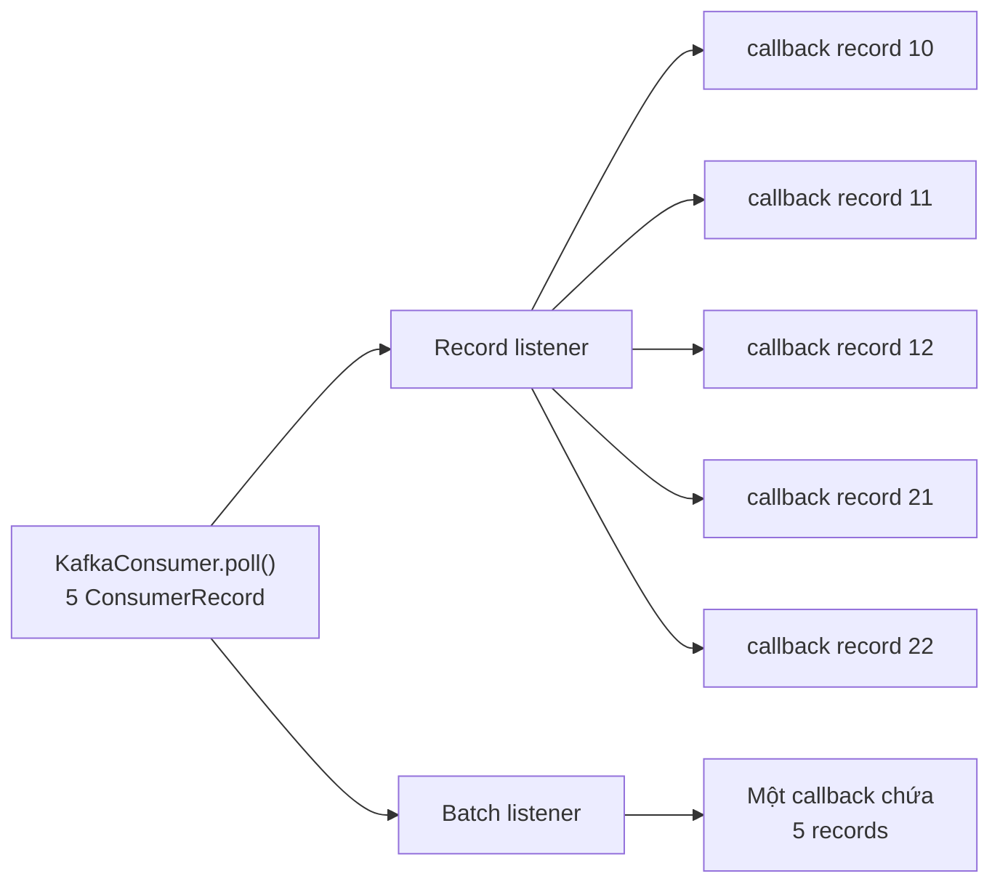
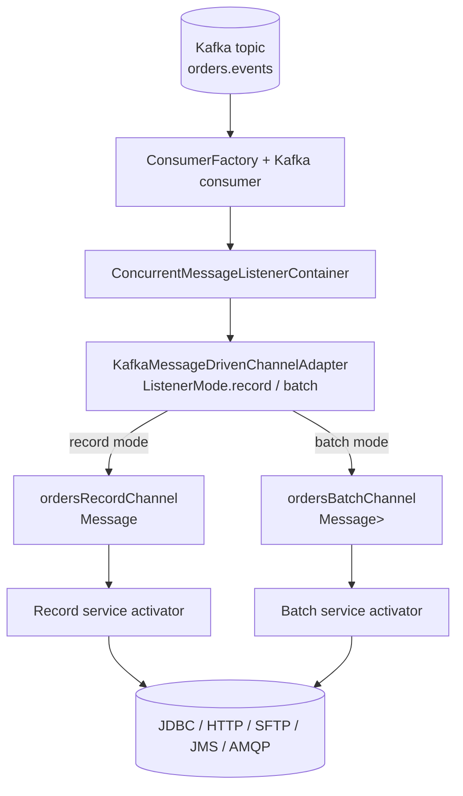
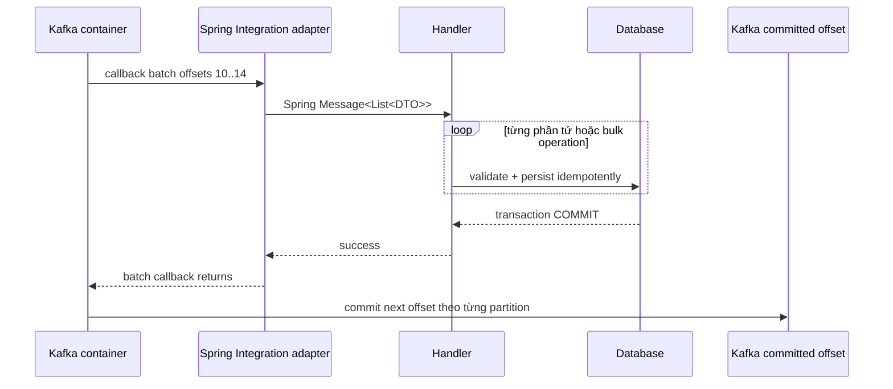
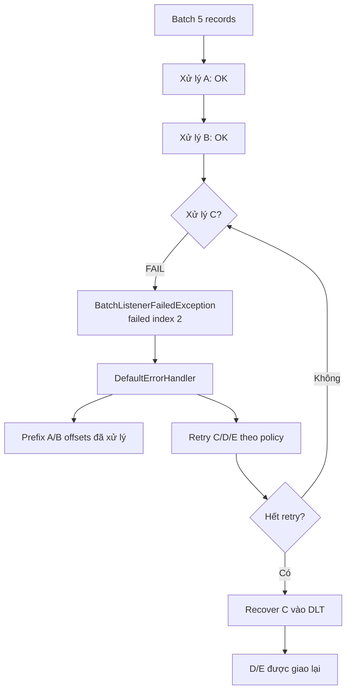

# Batch listener và record listener

**Record listener** nhận và xử lý từng Kafka `ConsumerRecord`, còn **batch listener** nhận một tập record từ một lần `KafkaConsumer.poll()` để xử lý theo nhóm. Cả hai cùng đọc topic Kafka nhưng khác **hợp đồng callback, kiểu payload Spring message, metadata headers, cách báo lỗi, acknowledgment và ranh giới hoàn tất nghiệp vụ**. Lựa chọn mode sai có thể khiến handler nhận `List` thay vì DTO, commit offset quá sớm hoặc phát lại cả batch chỉ vì một phần tử bị lỗi.

Bài thuộc chương **Adapter Kafka** của module **SPRING_INTEGRATION_ADAPTERS**. Module học cách kết nối các hệ thống ngoài bằng inbound/outbound adapter, gateway, poller và `MessageChannel`, thực hành file, SFTP, HTTP, JMS, AMQP, Kafka và cơ sở dữ liệu, đồng thời xử lý message contract, lỗi và vòng đời kết nối. Bài này tập trung vào **Kafka record listener và batch listener trong Spring Kafka và `KafkaMessageDrivenChannelAdapter` của Spring Integration**, từ thiết kế cho tới vận hành.

> **Ba phân biệt cốt lõi:** (1) `ListenerMode.record/batch` của Spring Integration **không phải** `AckMode.RECORD/BATCH` của listener container; (2) `max.poll.records` là **giới hạn tối đa record trả về trong một poll**, không phải kích thước batch cố định; (3) batch listener **không hỗ trợ `AckMode.RECORD`** vì callback nhận cả batch chứ không phải từng record.

## 1. Mục tiêu học tập

Sau bài này, bạn có thể:

1. Mô tả luồng `KafkaConsumer.poll() → MessageListenerContainer → KafkaMessageDrivenChannelAdapter → MessageChannel → MessageHandler` cho hai mode.
2. So sánh record/batch ở **đơn vị xử lý, kiểu payload, metadata, error recovery, acknowledgment, ordering và throughput**.
3. Cấu hình record và batch qua `KafkaMessageDrivenChannelAdapter.ListenerMode`, `ConcurrentMessageListenerContainer` và Java DSL.
4. Viết Spring `@ServiceActivator` nhận `Message<String>` hoặc `Message<List<String>>` với các header Kafka tương ứng.
5. Hiểu sự khác biệt giữa `RecordMessageConverter` và `BatchMessageConverter`; sử dụng `BatchMessagingMessageConverter` đúng mode.
6. Thiết kế `AckMode.RECORD` cho record và `AckMode.BATCH` hoặc manual modes cho batch.
7. Phân tích `BatchListenerFailedException`, batch fallback retry, recovery vào DLT và giới hạn non-blocking retries.
8. Xử lý bản ghi lỗi giữa batch mà không ghi trùng side effect DB sau redelivery.
9. Dự đoán ảnh hưởng của `max.poll.records`, concurrency, partition assignment, fetch tuning và slow handler.
10. Viết integration tests quan sát offset, lag, duplicate, crash window và lựa chọn mode theo SLA.

## 2. Cấu trúc Kafka poll và hai loại listener

Kafka consumer lấy một hoặc nhiều record qua `poll(Duration)`. Một poll có thể chứa record từ **nhiều partition** đã được giao cho chính consumer đó.

```text
Một consumer poll có thể trả:
  orders.events-0: offsets 10, 11, 12
  orders.events-2: offsets 21, 22

Tổng: 5 ConsumerRecord, đến từ 2 partition
```

**Record listener** được Spring Kafka container gọi lần lượt cho từng record; **batch listener** nhận tập record của lần poll trong một callback.



Đây là cách mô tả **số callback**, không phải bảo đảm thứ tự toàn cục giữa các partition. Trong một partition, Kafka có thứ tự offset; giữa nhiều partition không có đồng hồ thứ tự chung.

### 2.1. Bảng so sánh nhanh

| Tiêu chí | Record listener | Batch listener |
|---|---|---|
| Đầu vào listener | Một `ConsumerRecord<K,V>` | Tập `ConsumerRecord<K,V>` từ poll |
| Số callback cho 5 records | Thường 5 | Thường 1 |
| Spring Integration mode | `ListenerMode.record` | `ListenerMode.batch` |
| Payload Spring message | Một `V`/DTO | `List<V>`/`List<DTO>` |
| Header topic/partition/offset | Giá trị đơn | Các danh sách cùng chỉ số payload |
| Converter thường dùng | `RecordMessageConverter` | `BatchMessageConverter` |
| `AckMode.RECORD` | Hỗ trợ | **Không hỗ trợ** |
| `AckMode.BATCH` | Hỗ trợ | Hỗ trợ |
| Manual ack | Có thể ack một record | Có thể ack cả batch; partial ack có điều kiện |
| Error handling | Xác định record lỗi dễ | Phải xác định index/record lỗi hoặc fallback cả batch |
| DB operation | Từng bản ghi | Có thể gom nhiều rows/transaction |
| Tối ưu throughput | Hợp lý cho nghiệp vụ riêng từng event | Giảm một số callback và amortize batch DB calls |
| Rủi ro khi crash | Redelivery record chưa commit | Có thể phát lại nhiều record đã có side effect |
| Kiểu xử lý phù hợp | Validation/transaction độc lập, ordering quan trọng | Bulk insert, aggregate, ETL có idempotency |

### 2.2. Batch listener không tạo Kafka batch mới trên broker

Kafka producer có batching ở **phía gửi**; Kafka consumer đọc các record bằng `poll()`; batch listener chỉ đổi cách **container chuyển tập record cho code ứng dụng**. Nó không biến 100 Kafka records thành một Kafka record duy nhất và không làm broker commit 100 side effects như một transaction.

## 3. Đường đi trong Spring Integration

`KafkaMessageDrivenChannelAdapter<K,V>` là **Kafka inbound endpoint** nhưng là **Spring Integration message producer**: nó nhận Kafka record qua listener container rồi phát Spring `Message<?>` đến **output channel**.



- `ConsumerFactory` tạo Kafka consumer client, cấu hình group ID/deserializers/broker.
- `ConcurrentMessageListenerContainer` quản lý poll loop, concurrency, assignment, error/ack/commit.
- Adapter chọn `ListenerMode` và dùng converter tương ứng để tạo Spring message.
- `DirectChannel` giao message đồng bộ đến downstream consumer endpoint.
- `@ServiceActivator`/transformer/router thực hiện logic nghiệp vụ.
- Kafka offset chỉ được ghi nhận theo **container AckMode và error policy**, không phải do converter tự commit.

### 3.1. Đừng nhầm hai cặp enum

```java
// Chế độ Spring Integration: số Spring Messages / Kafka poll.
KafkaMessageDrivenChannelAdapter.ListenerMode.record
KafkaMessageDrivenChannelAdapter.ListenerMode.batch

// Chế độ Spring Kafka Container: khi nào ghi nhận/commit offset.
ContainerProperties.AckMode.RECORD
ContainerProperties.AckMode.BATCH
ContainerProperties.AckMode.MANUAL
ContainerProperties.AckMode.MANUAL_IMMEDIATE
```

| Kết hợp | Hợp lệ? | Diễn giải |
|---|---|---|
| `ListenerMode.record` + `AckMode.RECORD` | Có | Callback/message mỗi record, commit theo callback record thành công |
| `ListenerMode.record` + `AckMode.BATCH` | Có | Callback từng record, commit sau các record của poll hoàn tất |
| `ListenerMode.batch` + `AckMode.BATCH` | Có | Callback một batch, commit khi callback xử lý thành công |
| `ListenerMode.batch` + `AckMode.MANUAL` | Có, nếu ack đúng contract | Handler xác nhận batch, container commit theo manual semantics |
| `ListenerMode.batch` + `AckMode.MANUAL_IMMEDIATE` | Có, với điều kiện thread | Ack trên consumer thread; hỗ trợ partial batch ack trong version thích hợp |
| `ListenerMode.batch` + `AckMode.RECORD` | **Không** | Một callback không cho container xác nhận từng record như record listener |

## 4. Record listener: hợp đồng, ưu điểm và giới hạn

Với `ListenerMode.record`, mỗi `ConsumerRecord` sau converter thường thành một `Message<String>` hoặc `Message<OrderCreated>`. Header topic/partition/offset tương ứng **record duy nhất**.

```text
Kafka record: key=ORD-101, value=CREATED, partition=2, offset=42
        |
        v
Spring Message:
  payload: "CREATED"
  kafka_receivedTopic: "orders.events"
  kafka_receivedPartition: 2
  kafka_offset: 42
  kafka_receivedKey: "ORD-101"  (nếu key có giá trị)
```

### 4.1. Khi nào dùng record listener?

- Business logic mỗi record có giao dịch hoặc side effect độc lập.
- Cần phân loại validation error và retry/DLT theo từng event.
- Cần ghi DB theo eventId với idempotency đơn giản.
- Một record xấu không nên làm toàn batch phải thử lại.
- Event cần xử lý tuần tự theo aggregate key, tránh phức tạp về partial batch failure.
- Khối lượng xử lý vẫn đáp ứng SLA với throughput đo được.

### 4.2. Điểm đánh đổi

- Nhiều callback và dispatch Spring message hơn batch.
- Với `AckMode.RECORD`, có thể tăng commit overhead nếu traffic rất lớn.
- Nếu handler thực hiện một JDBC insert/HTTP request cho mỗi record, chi phí round-trip có thể cao hơn bulk operation.
- Handler blocking trên listener thread quá lâu vẫn gây consumer lag và `max.poll.interval.ms` risk.

### 4.3. Code snippet nhận record

```java
@ServiceActivator(inputChannel = "ordersRecordChannel")
public void processRecord(Message<String> message) {
    String value = message.getPayload();
    Object offset = message.getHeaders().get(KafkaHeaders.OFFSET);
    Object partition = message.getHeaders().get(
            KafkaHeaders.RECEIVED_PARTITION);

    if (value.startsWith("INVALID:")) {
        throw new IllegalArgumentException("Invalid event");
    }

    // Khi production: transaction + business idempotency.
    System.out.println(partition + "@" + offset + " : " + value);
}
```

Đây là snippet trong Spring component có imports `ServiceActivator`, `Message` và `KafkaHeaders`. Không được hiểu rằng `System.out.println` đồng nghĩa transaction nghiệp vụ đã bền vững.

## 5. Batch listener: một callback chứa nhiều record

Với `ListenerMode.batch`, converter có thể tạo `Message<List<String>>` từ một poll. Topic/partition/offset thường xuất hiện như **các danh sách đồng vị trí với payload**.

```text
Kafka poll:
  index 0: orders.events-0@40, key=ORD-101, value=CREATED
  index 1: orders.events-0@41, key=ORD-101, value=PAID
  index 2: orders.events-2@12, key=ORD-202, value=CREATED

Spring Message:
  payload = ["CREATED", "PAID", "CREATED"]

  headers:
    kafka_receivedTopic     = ["orders.events", "orders.events", "orders.events"]
    kafka_receivedPartition = [0, 0, 2]
    kafka_offset            = [40, 41, 12]
    kafka_receivedKey       = ["ORD-101", "ORD-101", "ORD-202"]  (nếu converter cung cấp)
```

**Ý nghĩa của index** rất quan trọng: `payload[2]` phải được ghép với `partition[2]` và `offset[2]`. Không lấy offset cuối batch rồi gán cho mọi record. Hãy kiểm tra converter và cách xử lý **null key**: metadata keys có thể có phần tử null hoặc được biểu diễn khác theo converter/version.

### 5.1. Vì sao batch có thể nhanh hơn?

- Chỉ một callback handler cho nhiều record.
- Giảm một phần overhead conversion/dispatch/validation theo entrypoint.
- Có thể dùng JDBC `batchUpdate` hoặc bulk request tới hệ thống đích.
- Có thể gom theo partition/aggregate để giảm calls.
- Nếu xử lý một transaction DB cho batch nhỏ, giảm số transaction overhead.

**Nhưng batch không tự nhanh hơn:** nếu handler vẫn loop rồi gọi từng HTTP request đồng bộ, throughput có thể không tăng, còn thời gian chiếm listener thread dài hơn.

### 5.2. Batch size có ổn định không?

Không. `max.poll.records=500` là **số record tối đa KafkaConsumer trả mỗi poll**; nó không yêu cầu poll luôn nhận 500. Một poll có thể trả 1, 17, 300 hoặc không có record, phụ thuộc traffic, assignment, consumer buffer, fetch, broker và poll cadence.

```text
max.poll.records=500
poll #1 -> 7 records
poll #2 -> 146 records
poll #3 -> 0 records
poll #4 -> 500 records
```

Đừng viết code yêu cầu batch luôn có 500 phần tử; cũng đừng dựa vào batch boundary để coi đó là một transaction Kafka hoặc business event chung.

### 5.3. Batch có thể trộn partition

Một poll có thể có record của nhiều partition. Nếu định nghĩa DB transaction “thành công toàn batch” thì nó gộp kết quả của các partition khác nhau, trong khi Kafka chỉ giữ committed offset **riêng cho từng partition**. Nên xử lý list metadata đúng index và cân nhắc nhóm theo `TopicPartition` khi có ordering/state riêng.

## 6. Thiết kế ứng dụng ví dụ: chọn một mode bằng property

Ví dụ Spring Boot dùng **một listener container và một adapter**; thay `demo.kafka.mode=record` hoặc `batch` để chuyển mode. Cách này tránh vô tình tạo hai Kafka consumers cạnh tranh cùng group/topic rồi nhầm là một số record “biến mất”.

Môi trường thử nghiệm:

- Java 17+; dùng Spring Boot BOM quản lý Spring Integration và Spring Kafka tương thích.
- Kafka broker `localhost:9092`, topic `orders.events` có ba partition.
- Value là `String`; converter không parse JSON trong ví dụ chính.
- Group ID thử nghiệm `orders-mode-demo` (đổi khi cần một phép thử đọc lại từ đầu).
- Record handler và batch handler nằm trong cùng Spring component, nhưng **chỉ channel của mode được chọn** nhận message.

### 6.1. Maven dependencies

Trong project Spring Boot có parent/BOM:

```xml
<dependency>
    <groupId>org.springframework.boot</groupId>
    <artifactId>spring-boot-starter-integration</artifactId>
</dependency>
<dependency>
    <groupId>org.springframework.integration</groupId>
    <artifactId>spring-integration-kafka</artifactId>
</dependency>
```

Không cần thêm các adapter JMS/AMQP/SFTP nếu bài demo chỉ dùng Kafka. Với một dự án thật dùng các hệ thống đích đó, cần thêm dependency tương ứng và kiểm thử transaction boundary độc lập.

### 6.2. application.properties

```properties
demo.kafka.bootstrap-servers=localhost:9092
demo.kafka.group-id=orders-mode-demo
demo.kafka.concurrency=2
demo.kafka.mode=record

# Dùng "batch" để bật batch listener; chỉ một mode hoạt động.
# demo.kafka.mode=batch
```

Không dùng group ID production cho phép thử restart/replay. Việc đổi mode **không tự reset Kafka committed offset**; muốn so sánh cùng dataset, dùng hai group ID demo riêng hoặc tạo kế hoạch reset offsets an toàn trên topic thử nghiệm.

## 7. Java config hoàn chỉnh: Kafka consumer và một adapter

Class dưới tạo `ConsumerFactory`, hai Spring `DirectChannel` và **một** `KafkaMessageDrivenChannelAdapter` theo property `demo.kafka.mode`.

```java
package com.example.kafka;

import java.util.HashMap;
import java.util.Map;

import org.apache.kafka.clients.consumer.ConsumerConfig;
import org.apache.kafka.common.serialization.StringDeserializer;
import org.springframework.beans.factory.annotation.Qualifier;
import org.springframework.beans.factory.annotation.Value;
import org.springframework.context.annotation.Bean;
import org.springframework.context.annotation.Configuration;
import org.springframework.integration.channel.DirectChannel;
import org.springframework.integration.config.EnableIntegration;
import org.springframework.integration.kafka.inbound.KafkaMessageDrivenChannelAdapter;
import org.springframework.kafka.core.ConsumerFactory;
import org.springframework.kafka.core.DefaultKafkaConsumerFactory;
import org.springframework.kafka.listener.ConcurrentMessageListenerContainer;
import org.springframework.kafka.listener.ContainerProperties;
import org.springframework.kafka.support.converter.BatchMessagingMessageConverter;
import org.springframework.kafka.support.converter.MessagingMessageConverter;
import org.springframework.messaging.MessageChannel;

@Configuration
@EnableIntegration
public class OrdersKafkaModeConfig {

    @Bean("ordersConsumerFactory")
    public ConsumerFactory<String, String> consumerFactory(
            @Value("${demo.kafka.bootstrap-servers}") String brokers,
            @Value("${demo.kafka.group-id}") String groupId) {

        Map<String, Object> p = new HashMap<>();
        p.put(ConsumerConfig.BOOTSTRAP_SERVERS_CONFIG, brokers);
        p.put(ConsumerConfig.GROUP_ID_CONFIG, groupId);
        p.put(ConsumerConfig.KEY_DESERIALIZER_CLASS_CONFIG,
                StringDeserializer.class);
        p.put(ConsumerConfig.VALUE_DESERIALIZER_CLASS_CONFIG,
                StringDeserializer.class);
        p.put(ConsumerConfig.ENABLE_AUTO_COMMIT_CONFIG, false);
        p.put(ConsumerConfig.AUTO_OFFSET_RESET_CONFIG, "earliest");

        // Chỉ là giới hạn tối đa mỗi poll, không phải size cố định.
        p.put(ConsumerConfig.MAX_POLL_RECORDS_CONFIG, 100);
        return new DefaultKafkaConsumerFactory<>(p);
    }

    @Bean("ordersRecordChannel")
    public MessageChannel ordersRecordChannel() {
        return new DirectChannel();
    }

    @Bean("ordersBatchChannel")
    public MessageChannel ordersBatchChannel() {
        return new DirectChannel();
    }

    @Bean("ordersKafkaInbound")
    public KafkaMessageDrivenChannelAdapter<String, String> ordersInbound(
            @Qualifier("ordersConsumerFactory")
                ConsumerFactory<String, String> consumerFactory,
            @Qualifier("ordersRecordChannel")
                MessageChannel recordChannel,
            @Qualifier("ordersBatchChannel")
                MessageChannel batchChannel,
            @Value("${demo.kafka.concurrency}") int concurrency,
            @Value("${demo.kafka.mode:record}") String mode) {

        boolean batch;
        if ("batch".equalsIgnoreCase(mode)) {
            batch = true;
        } else if ("record".equalsIgnoreCase(mode)) {
            batch = false;
        } else {
            throw new IllegalArgumentException(
                    "demo.kafka.mode must be record or batch");
        }

        ContainerProperties cp =
                new ContainerProperties("orders.events");
        cp.setAckMode(batch
                ? ContainerProperties.AckMode.BATCH
                : ContainerProperties.AckMode.RECORD);

        ConcurrentMessageListenerContainer<String, String> container =
                new ConcurrentMessageListenerContainer<>(
                        consumerFactory, cp);
        container.setConcurrency(concurrency);

        KafkaMessageDrivenChannelAdapter.ListenerMode listenerMode =
                batch
                ? KafkaMessageDrivenChannelAdapter.ListenerMode.batch
                : KafkaMessageDrivenChannelAdapter.ListenerMode.record;

        KafkaMessageDrivenChannelAdapter<String, String> adapter =
                new KafkaMessageDrivenChannelAdapter<>(
                        container, listenerMode);

        if (batch) {
            adapter.setBatchMessageConverter(
                    new BatchMessagingMessageConverter());
            adapter.setOutputChannel(batchChannel);
        } else {
            adapter.setRecordMessageConverter(
                    new MessagingMessageConverter());
            adapter.setOutputChannel(recordChannel);
        }
        return adapter;
    }
}
```

### 7.1. Đọc cấu hình theo thứ tự

1. `StringDeserializer` làm Kafka record value thành Java `String`.
2. `MAX_POLL_RECORDS_CONFIG=100` chỉ giới hạn số record một poll trả về.
3. `ContainerProperties("orders.events")` **subscribe** topic, Kafka phân công partition theo group.
4. `AckMode.RECORD` được chọn khi listener callback xử lý từng record; `AckMode.BATCH` được chọn khi callback chứa batch.
5. `setConcurrency(2)` tạo tối đa hai Kafka consumer con trong một JVM. Tổng concurrency across pods cùng group quyết định số members cạnh tranh assignment.
6. `ListenerMode.record` gắn `MessagingMessageConverter`; `ListenerMode.batch` gắn `BatchMessagingMessageConverter`.
7. Adapter phát tới **một trong hai Spring output channels**, không publish Kafka.
8. Handler dùng `DirectChannel` sẽ chạy đồng bộ trên Kafka listener thread theo luồng demo.
9. Không tạo thêm `@KafkaListener` trên cùng topic/group trong ứng dụng này trừ khi thật sự muốn chia partition.

**Điểm kỹ thuật:** `BatchMessagingMessageConverter` không bắt buộc trả Java `List<String>` khi đã cấu hình một converter custom có schema khác. Ví dụ chính dùng `StringDeserializer` và converter mặc định được chỉ định tường minh nên payload list sẽ chứa String theo contract demo. Nếu value có null/tombstone, phải thiết kế thêm chính sách `KafkaNull` trước khi ép kiểu String.

### 7.2. Cấu hình error handler cho lab

Demo giữ lại error handling mặc định của container để tập trung vào record/batch. **Không dùng mặc định đó như chính sách production**: khi hết retry/recovery, một lỗi có thể bị log rồi được coi đã recover mà **chưa lưu DLT** tùy version/config. Cần gắn `DefaultErrorHandler` và `DeadLetterPublishingRecoverer` hoặc durable quarantine với phân loại lỗi rõ ràng như mục 14.

## 8. Service activators: hai hợp đồng payload riêng

Class sau khai báo hai consumer endpoints; cả hai Spring channels đều có subscriber nhưng **chỉ một adapter** phát message trong mỗi lần chạy.

```java
package com.example.kafka;

import java.util.List;
import org.springframework.integration.annotation.ServiceActivator;
import org.springframework.kafka.support.KafkaHeaders;
import org.springframework.messaging.Message;
import org.springframework.stereotype.Component;

@Component
public class OrdersModeHandler {

    @ServiceActivator(inputChannel = "ordersRecordChannel")
    public void onRecord(Message<String> message) {
        String value = message.getPayload();

        Object topic = message.getHeaders()
                .get(KafkaHeaders.RECEIVED_TOPIC);
        Object partition = message.getHeaders()
                .get(KafkaHeaders.RECEIVED_PARTITION);
        Object offset = message.getHeaders()
                .get(KafkaHeaders.OFFSET);

        if (value.startsWith("INVALID:")) {
            throw new IllegalArgumentException(
                    "Invalid record: " + value);
        }

        System.out.printf(
                "RECORD topic=%s partition=%s offset=%s value=%s%n",
                topic, partition, offset, value);
    }

    @ServiceActivator(inputChannel = "ordersBatchChannel")
    public void onBatch(Message<List<String>> message) {
        List<String> values = message.getPayload();

        List<?> topics = (List<?>) message.getHeaders()
                .get(KafkaHeaders.RECEIVED_TOPIC);
        List<?> partitions = (List<?>) message.getHeaders()
                .get(KafkaHeaders.RECEIVED_PARTITION);
        List<?> offsets = (List<?>) message.getHeaders()
                .get(KafkaHeaders.OFFSET);

        if (topics == null || partitions == null || offsets == null
                || topics.size() != values.size()
                || partitions.size() != values.size()
                || offsets.size() != values.size()) {
            throw new IllegalStateException(
                    "Batch Kafka metadata does not match payload");
        }

        for (int i = 0; i < values.size(); i++) {
            String value = values.get(i);
            if (value.startsWith("INVALID:")) {
                // Demo dùng exception thường. Với partial recovery
                // phải thiết kế BatchListenerFailedException phù hợp.
                throw new IllegalArgumentException(
                        "Invalid batch index=" + i + " value=" + value);
            }
            System.out.printf(
                    "BATCH index=%d topic=%s part=%s offset=%s value=%s%n",
                    i, topics.get(i), partitions.get(i),
                    offsets.get(i), value);
        }
    }
}
```

**Các lưu ý về demo:**

- `@ServiceActivator` chỉ là **consumer endpoint bên trong Spring Integration**, không tạo Kafka consumer mới.
- `onBatch(...)` nhận một `Message<List<String>>`, không phải mỗi lần gọi đúng 100 record.
- Topic/partition/offset là **list**, và code kiểm tra độ dài trước khi ghép index.
- Cả hai handler chỉ in log, chưa làm JDBC/SFTP/HTTP side effect. Production phải có idempotency.
- Handler batch ví dụ ném `IllegalArgumentException` để thấy batch failure; nó **chưa đảm bảo recovery chính xác một record**. Phần 14 trình bày hướng dùng `BatchListenerFailedException` và kiểm thử exception propagation.

### 8.1. Vì sao không dùng `KafkaHeaders.RECEIVED_KEY` luôn?

Với record **không có key**, header `RECEIVED_KEY` có thể không tồn tại. Với batch, dạng metadata key có thể khác tùy converter, giá trị null và phiên bản. Không viết `message.getHeaders().get(KafkaHeaders.RECEIVED_KEY).toString()` không kiểm tra null. Nếu Kafka key là identity quan trọng, cần test đường producer–consumer thực tế.

## 9. Chạy thử hai mode với Kafka CLI

### 9.1. Tạo topic

```bash
kafka-topics.sh --bootstrap-server localhost:9092 \
  --create --if-not-exists \
  --topic orders.events --partitions 3 --replication-factor 1
```

Replication factor 1 chỉ dành cho lab một broker. Trong production, replication factor, `min.insync.replicas`, retention và ACL phải theo yêu cầu độ bền.

### 9.2. Gửi record

```bash
kafka-console-producer.sh \
  --bootstrap-server localhost:9092 \
  --topic orders.events
```

Nhập:

```text
evt-101|ORD-101|CREATED
evt-102|ORD-102|CREATED
evt-103|ORD-101|PAID
evt-104|ORD-202|CREATED
evt-105|ORD-202|SHIPPED
```

Không có Kafka key trong những record nhập kiểu này, nên không kết luận record cùng orderId sẽ tự cùng partition. Khi cần ordering theo aggregate, producer phải đặt **record key** tường minh.

### 9.3. Chạy record mode

Đặt `demo.kafka.mode=record`, chạy ứng dụng. Kết quả dự kiến:

```text
RECORD topic=orders.events partition=... offset=... value=evt-101|ORD-101|CREATED
RECORD topic=orders.events partition=... offset=... value=evt-102|ORD-102|CREATED
...
```

Có **một callback Spring service activator cho mỗi Kafka record** sau conversion. Một record lỗi có thể làm error handler retry/recover theo cấu hình container.

### 9.4. Chạy batch mode

Dừng ứng dụng, đổi `demo.kafka.mode=batch`. Để thấy lại record demo, dùng một group ID thử nghiệm khác hoặc tạo record mới; đừng quên group cũ đã commit offset. Kết quả:

```text
BATCH index=0 topic=orders.events part=... offset=... value=evt-106|ORD-301|CREATED
BATCH index=1 topic=orders.events part=... offset=... value=evt-107|ORD-302|CREATED
...
```

Số record trong từng batch phụ thuộc poll và traffic. Nếu gửi chậm từng dòng, có thể nhận nhiều batch chỉ 1 record, **không phải cấu hình batch hỏng**.

### 9.5. Quan sát committed offset và assignment

```bash
kafka-consumer-groups.sh \
  --bootstrap-server localhost:9092 \
  --describe --group orders-mode-demo

kafka-consumer-groups.sh \
  --bootstrap-server localhost:9092 \
  --describe --group orders-mode-demo \
  --members --verbose
```

Kết quả cung cấp committed offset, log end offset, lag và members/assignment. `CURRENT-OFFSET=43` thường nghĩa là group đọc tiếp từ offset 43, **không phải record 43 đã commit database**.

## 10. Java DSL cho hai mode

Spring Integration Java DSL có `Kafka.messageDrivenChannelAdapter(...)`, cho phép tạo inbound flow với mode tường minh.

### 10.1. Record mode DSL

```java
@Bean
IntegrationFlow recordKafkaFlow(ConsumerFactory<String, String> factory) {
    return IntegrationFlow
            .from(Kafka.messageDrivenChannelAdapter(
                    factory,
                    KafkaMessageDrivenChannelAdapter.ListenerMode.record,
                    "orders.events"))
            .channel("ordersRecordChannel")
            .get();
}
```

### 10.2. Batch mode DSL

```java
@Bean
IntegrationFlow batchKafkaFlow(ConsumerFactory<String, String> factory) {
    return IntegrationFlow
            .from(Kafka.messageDrivenChannelAdapter(
                    factory,
                    KafkaMessageDrivenChannelAdapter.ListenerMode.batch,
                    "orders.events"))
            .channel("ordersBatchChannel")
            .get();
}
```

Cần import `org.springframework.integration.dsl.IntegrationFlow`, `org.springframework.integration.kafka.dsl.Kafka`, `ConsumerFactory` và `KafkaMessageDrivenChannelAdapter`. **Đây là hai lựa chọn thay thế**, không đăng ký cùng lúc với adapter `@Bean` ở mục 7 khi chỉ muốn một consumer logic.

DSL builder cho phép tùy biến listener container thông qua các API tương ứng với phiên bản sử dụng. Đừng giả định mode batch tự chọn một `AckMode` chính xác cho mọi container; nếu có yêu cầu commit cụ thể, hãy cấu hình/kiểm tra `ContainerProperties` thật sự của container được sinh ra.

### 10.3. Ví dụ dùng container dựng sẵn

Khi cần toàn quyền về `AckMode`, error handler, concurrency và consumer group, có thể dùng overload DSL nhận container:

```java
ContainerProperties cp = new ContainerProperties("orders.events");
cp.setAckMode(ContainerProperties.AckMode.BATCH);

ConcurrentMessageListenerContainer<String, String> container =
        new ConcurrentMessageListenerContainer<>(factory, cp);
container.setConcurrency(2);

// Snippet trong method tạo flow, không chạy đồng thời với flow khác.
IntegrationFlow flow = IntegrationFlow.from(
        Kafka.messageDrivenChannelAdapter(
                container,
                KafkaMessageDrivenChannelAdapter.ListenerMode.batch))
        .channel("ordersBatchChannel")
        .get();
```

Đây là snippet với `factory` đã tồn tại trong scope. Dùng đúng **một nơi quản lý lifecycle container**, không tự start thêm một container độc lập cùng topic/group.

## 11. `@KafkaListener` so sánh với Spring Integration adapter

Spring Kafka thuần thường sử dụng `@KafkaListener` thay vì một IntegrationFlow. Đừng gộp hai cách đăng ký listener vô thức.

### 11.1. `@KafkaListener` record

```java
@KafkaListener(
        topics = "orders.events",
        groupId = "orders-annotation-record")
public void onRecord(String value) {
    System.out.println("record=" + value);
}
```

Phương thức này thường được gọi từng record theo container factory mặc định dành cho record listener.

### 11.2. `@KafkaListener` batch

```java
@Bean("batchKafkaListenerContainerFactory")
ConcurrentKafkaListenerContainerFactory<String, String> batchFactory(
        ConsumerFactory<String, String> consumerFactory) {

    ConcurrentKafkaListenerContainerFactory<String, String> f =
            new ConcurrentKafkaListenerContainerFactory<>();
    f.setConsumerFactory(consumerFactory);
    f.setBatchListener(true);
    f.getContainerProperties().setAckMode(
            ContainerProperties.AckMode.BATCH);
    return f;
}
```

Listener:

```java
@KafkaListener(
        topics = "orders.events",
        groupId = "orders-annotation-batch",
        containerFactory = "batchKafkaListenerContainerFactory")
public void onBatch(List<String> values) {
    for (String value : values) {
        System.out.println("batch value=" + value);
    }
}
```

Đoạn `@KafkaListener` cần `@EnableKafka` và một Spring configuration thích hợp; factory/listener ở đây là **phương án Spring Kafka thuần để đối chiếu**, không phải code chạy đồng thời với demo Spring Integration cùng group.

- Với Spring Kafka mới, `@KafkaListener(batch = "true")` cũng là một cách override batch setting của factory khi API version hỗ trợ.
- **`batchListener=true` trên container factory dành cho `@KafkaListener`**, không có nghĩa mọi `KafkaMessageDrivenChannelAdapter` độc lập dùng bean factory đó cũng được chuyển mode tự động.
- Non-blocking retry theo `@RetryableTopic` **không được hỗ trợ với batch listeners** theo tài liệu Spring Kafka.
- Batch method có thể nhận `List<ConsumerRecord<K,V>>` hoặc `ConsumerRecords<K,V>` nếu cần raw record metadata; khi nhận POJO List, các metadata có thể được cung cấp qua Kafka headers song song.

## 12. Converter: một `RecordMessageConverter` không phải `BatchMessageConverter`

`KafkaMessageDrivenChannelAdapter` hỗ trợ:

```java
adapter.setRecordMessageConverter(recordConverter);
adapter.setBatchMessageConverter(batchConverter);
```

Chỉ dùng setter tương ứng với mode đã chọn.

| Tầng | Record mode | Batch mode |
|---|---|---|
| Kafka deserializer | `StringDeserializer` → `String` | Vẫn là `StringDeserializer` cho từng record |
| Kafka listener callback | `ConsumerRecord<K,V>` | `ConsumerRecords<K,V>` / list |
| Converter Kafka | `RecordMessageConverter` | `BatchMessageConverter` |
| Spring message payload | `String`/DTO | `List<String>` / `List<DTO>` |
| Headers Kafka | Giá trị đơn | Các danh sách tương ứng index |
| Downstream handler | `Message<String>` | `Message<List<String>>` |
| Business validation | Từng record | Từng phần tử + chính sách batch |

### 12.1. `BatchMessagingMessageConverter`

`BatchMessagingMessageConverter` mặc định dựng Spring message từ list record. Nó có thể dùng `RecordMessageConverter` bên trong để chuyển từng value thành DTO khi cấu hình thích hợp.

```java
// Ví dụ ý tưởng khi records đã được StringDeserializer đọc.
// DTO OrderCreated do ứng dụng định nghĩa.
BatchMessagingMessageConverter batchConverter =
        new BatchMessagingMessageConverter(
                recordJsonMessageConverter);

adapter.setBatchMessageConverter(batchConverter);
adapter.setPayloadType(OrderCreated.class);
```

`recordJsonMessageConverter` là bean `RecordMessageConverter` tương thích JSON/DTO; tên class cụ thể thay đổi theo Spring Kafka/Jackson version. Với Spring Kafka 3.x/Jackson 2 thường gặp `StringJsonMessageConverter`; với Spring Kafka 4.x/Jackson 3 có `JacksonJsonMessageConverter` và các biến thể tương ứng. **Không trộn class của hai nhánh version**.

Ví dụ demo chính không cần JSON converter: Kafka value là `String` nên `new BatchMessagingMessageConverter()` đã phù hợp.

### 12.2. Conversion error ở vị trí thứ 7

Trong batch mode có converter JSON, một item hỏng có thể tạo payload null ở vị trí đó và một list `KafkaHeaders.CONVERSION_FAILURES` chứa exception theo index, tùy converter và Spring Kafka version. Đối với `@KafkaListener` batch POJO, có thể kiểm tra danh sách lỗi và ném `BatchListenerFailedException` chỉ rõ index.

**Điều kiện:** handler không được bỏ qua null payload chỉ vì vẫn còn 99 phần tử tốt. Phải định nghĩa record lỗi nào vào DLT, record nào commit và mọi side effect trước đó có idempotent hay không.

### 12.3. Kafka tombstone

Với compacted topic, `ConsumerRecord.value()==null` có thể là tombstone hợp lệ. Spring message không thể có payload Java null theo cách thông thường; framework/converter có thể sử dụng `KafkaNull`. Handler record hay batch đều phải có contract **xóa theo key** trước khi ép kiểu DTO/String và xử lý null/marker theo version.

## 13. AckMode, commit offset và các mốc hoàn tất

`enable.auto.commit=false` là lựa chọn phổ biến để Spring Kafka listener container quản lý offset. **Mặc định container AckMode là `BATCH`** nếu không cấu hình khác.

| AckMode | Record listener | Batch listener |
|---|---|---|
| `RECORD` | Commit sau callback từng record thành công | **Không hỗ trợ** |
| `BATCH` | Commit sau toàn bộ record trong một poll được xử lý theo contract | Commit sau callback batch thành công |
| `TIME`, `COUNT`, `COUNT_TIME` | Theo thời gian/số record đã xử lý | Theo ngưỡng thích hợp sau batch callback |
| `MANUAL` | Handler ack, commit theo semantics batch | Handler ack batch, commit theo semantics batch |
| `MANUAL_IMMEDIATE` | Ack ở consumer thread có thể commit ngay | Ack ở consumer thread, hỗ trợ partial batch ack có điều kiện |



**Commit offset không tự tạo DB transaction.** Nếu DB commit thành công nhưng offset chưa commit khi JVM crash, batch có thể được giao lại. Cần business `eventId`, unique constraint/inbox hoặc upsert idempotent.

### 13.1. Record mode với `AckMode.BATCH` có hợp lệ không?

Có. Listener vẫn nhận **từng record**, nhưng container trì hoãn commit tới khi các record của poll được xử lý. “Batch” trong `AckMode.BATCH` chỉ thời điểm commit, **không** biến Spring message thành `List`.

### 13.2. Vì sao batch mode không dùng `AckMode.RECORD`?

Batch callback chỉ trả về **một kết quả callback cho toàn bộ tập record**; container không thể dựa trên callback hoàn tất từng record để commit theo RECORD. Nếu cần xác nhận riêng từng record qua callback listener, dùng **record listener** hoặc các API partial batch acknowledgment có điều kiện.

### 13.3. Manual batch ack

Trong batch mode manual, `KafkaHeaders.ACKNOWLEDGMENT` có thể chứa một `Acknowledgment`. Đúng trình tự:

```java
// Snippet handler batch, chỉ dùng khi container cấu hình
// AckMode.MANUAL hoặc MANUAL_IMMEDIATE và có ack header.
Acknowledgment ack = message.getHeaders().get(
        KafkaHeaders.ACKNOWLEDGMENT, Acknowledgment.class);

if (ack == null) {
    throw new IllegalStateException("Missing batch Acknowledgment");
}

transactionalBatchService.processAndCommit(message.getPayload());
ack.acknowledge();   // sau khi DB transaction thật sự commit
```

`transactionalBatchService` là bean service có transaction được gọi **qua Spring proxy**. Không đặt `ack.acknowledge()` ở cuối **method `@Transactional` đang còn trong body** rồi tưởng DB đã commit: transaction thường commit khi proxy method return.

### 13.4. Partial batch acknowledgment

Ở các phiên bản Spring Kafka hỗ trợ (từ 3.0.10), `Acknowledgment.acknowledge(index)` có thể commit phần đầu batch. Điều kiện gồm `MANUAL_IMMEDIATE`, gọi **trên listener thread**, list-based batch listener, index hợp lệ và tăng dần giữa các lần gọi.

```text
Batch indices: [0,1,2,3,4]
Business process 0,1 OK; DB commit
ack.acknowledge(1)  -> xác nhận prefix qua index 1

Process 2,3,4 thành công; DB commit
ack.acknowledge()   -> xác nhận phần còn lại
```

Với Spring Integration adapter, phải kiểm tra `Acknowledgment` đã được gắn vào Spring message và kết quả theo đúng version. Không đưa acknowledgment object qua `ExecutorChannel` rồi gọi từ thread bất kỳ mà vẫn kỳ vọng immediate semantics.

### 13.5. Negative ack trong batch

`nack(index, sleep)` có thể commit phần đã xử lý trước index và seek để redeliver record lỗi cùng các record chưa hoàn tất, theo contract. Nó phải được gọi trên consumer thread; không được dùng khi `asyncAcks=true`. `nack()` không rollback DB transaction bên ngoài Kafka.

## 14. Lỗi một phần batch và `BatchListenerFailedException`

Đây là thách thức quan trọng nhất khi dùng batch listener: xử lý `[A,B,C,D,E]` mà C lỗi trong khi A/B đã có side effect.



### 14.1. Khi báo rõ record lỗi

Trong **Spring Kafka batch listener có hợp đồng hỗ trợ**, bạn có thể ném:

```java
throw new BatchListenerFailedException(
        "Cannot process batch item",
        cause,
        failedIndex);
```

`cause` là `Throwable`, `failedIndex` bắt đầu từ 0 trong danh sách batch. Tùy listener signature, có thể chỉ ra `ConsumerRecord` lỗi thay vì index.

Với `DefaultErrorHandler` được cấu hình tương thích, nó có thể commit phần trước record lỗi, retry phần chưa xử lý, recover record lỗi bằng DLT và tiếp tục các record còn lại. Đây là **semantics của Spring Kafka khi nhận diện được `BatchListenerFailedException`**, không phải cam kết tự động cho mọi exception từ bất kỳ Spring Integration handler nào.

### 14.2. Khi ném exception thông thường

Nếu batch listener ném `IllegalStateException` mà không cho biết phần tử nào lỗi, error handler có thể chuyển sang **fallback retry của cả batch**. Khi retries hết, recoverer có thể được gọi cho mỗi record trong batch, tùy error handler/version.

**Hậu quả:** Những record đã có side effect ở A/B có thể được xử lý lại. Business idempotency theo eventId là điều bắt buộc nếu không cho phép trùng.

### 14.3. Mẫu Spring Kafka `@KafkaListener` chỉ ra index

Ví dụ độc lập để minh họa contract rõ ràng:

```java
@KafkaListener(
        topics = "orders.events",
        groupId = "orders-batch-failure-demo",
        containerFactory = "batchKafkaListenerContainerFactory")
public void onBatch(List<String> values) {
    for (int i = 0; i < values.size(); i++) {
        try {
            processIdempotently(values.get(i));
        } catch (Exception ex) {
            throw new BatchListenerFailedException(
                    "Failed at index=" + i, ex, i);
        }
    }
}
```

`processIdempotently(...)` là method nghiệp vụ cần triển khai. `BatchListenerFailedException` import từ `org.springframework.kafka.listener.BatchListenerFailedException`. Cần gắn `DefaultErrorHandler`/recoverer phù hợp vào `batchKafkaListenerContainerFactory`, cùng DB idempotency.

### 14.4. Spring Integration `@ServiceActivator` có khác biệt gì?

Trong Spring Integration, exception có thể được bọc trong `MessagingException` hoặc được xử lý bởi adapter error channel/recovery callback trước khi quay về Kafka container. Nếu muốn tận dụng **partial batch recovery**, cần **integration test** chứng minh `DefaultErrorHandler` nhận diện được `BatchListenerFailedException` trong cause chain thực tế. Nếu lỗi bị suppress, container có thể không retry như bạn dự kiến.

Đừng đưa mọi exception handler thành công vào error channel chỉ để log rồi để Kafka commit; như thế record C có thể không còn được xử lý và không có DLT.

### 14.5. DLT cho batch

`DeadLetterPublishingRecoverer` có thể publish **record lỗi** sang topic DLT khi error handler biết chính xác record thất bại. Nếu chỉ nhận một exception tổng quát không có failed index, fallback batch handler có thể recover nhiều record. **Không mặc định** cả batch vào DLT hay chỉ C vào DLT nếu chưa test error handler và wrapped exception.

Kafka **non-blocking retry topic** theo `@RetryableTopic` hiện **không hỗ trợ batch listeners** trong các Spring Kafka versions được tài liệu mô tả. Muốn trì hoãn retry lâu, có thể phải thiết kế listener record riêng, retry queue/topic thủ công hoặc durable status store.

## 15. Database: per-record transaction hay one-batch transaction?

### 15.1. Record transaction

```text
Record A -> DB transaction A commit
Record B -> DB transaction B commit
Record C -> DB transaction C rollback
```

Ưu điểm là lỗi thường được cô lập theo event; nhược điểm là nhiều DB transactions/round-trips.

### 15.2. Batch transaction

```text
Batch [A,B,C] -> DB transaction duy nhất
  INSERT A
  INSERT B
  INSERT C
  COMMIT tất cả hoặc ROLLBACK tất cả
```

Ưu điểm là có thể giảm overhead, giữ atomicity trong phạm vi **một database transaction**. Nhược điểm là batch quá lớn giữ lock/connection lâu, tăng rủi ro timeout và cần retry cả batch nếu bất kỳ phần tử nào fail.

Nếu xử lý một batch bằng **nhiều DB transactions nhỏ** (chunk), mỗi chunk commit riêng; khi batch lỗi sau chunk đầu, các chunk đã commit có thể được xử lý lại. Cần idempotency.

### 15.3. Mô hình inbox/idempotency

```sql
CREATE TABLE processed_events (
    event_id VARCHAR(128) PRIMARY KEY,
    processed_at TIMESTAMP NOT NULL DEFAULT CURRENT_TIMESTAMP
);
```

Mỗi event có `eventId`; trong cùng một DB transaction với side effect, insert/check eventId theo unique constraint. Khi Kafka redelivery, eventId đã có sẽ được nhận diện, không ghi lại side effect.

```java
// Pseudocode theo PostgreSQL, nằm trong @Transactional service.
// Chạy trước business side effect trong CÙNG DB transaction.
int claimed = jdbc.update(
    "INSERT INTO processed_events(event_id) VALUES (?) "
    + "ON CONFLICT (event_id) DO NOTHING",
    eventId);

if (claimed == 0) {
    return; // event đã xử lý
}
jdbc.update("UPDATE orders SET status = ? WHERE order_id = ?",
        newStatus, orderId);
```

Chưa có thông tin schema đầy đủ nên đây là minh họa; production phải có validation, version/ordering, DB migration và quy tắc update phù hợp. Không dùng topic-partition-offset làm business ID duy nhất khi cùng event có thể được republish sang offset khác.

### 15.4. Kafka transaction có đủ không?

Kafka transaction có thể phối hợp Kafka producer records và source offsets trong phạm vi Kafka, nhưng **không** biến transaction JDBC, HTTP, SFTP, JMS hoặc AMQP thành atomic Kafka transaction. Với Kafka→JDBC, cần idempotent consumer/inbox; với JDBC→Kafka, cân nhắc transactional outbox.

## 16. Partition assignment, concurrency và ordering

`ConcurrentMessageListenerContainer.setConcurrency(3)` tạo Kafka consumer clients theo group; **không** tạo thêm partition. Với topic 2 partition và 6 consumers cùng group truyền thống, tối đa 2 consumers được giao partition của topic đó tại một thời điểm.

| Khái niệm | Điều thực sự kiểm soát |
|---|---|
| `group.id` | Logical subscriber và committed offsets |
| Số partition topic | Giới hạn mức song song ở cấp partition |
| `concurrency` | Số consumer clients trong container |
| `max.poll.records` | Số record tối đa poll trả cho một consumer |
| `ListenerMode` | Cách adapter dispatch record hay batch |
| `AckMode` | Cách container ghi nhận/commit offsets |
| `DirectChannel` | Dispatch Spring message đồng bộ đến handler |
| `ExecutorChannel` | Dispatch qua worker threads, có thể đổi thứ tự hoàn tất |

### 16.1. Ordering trong batch

Nếu một batch có records từ partition 0 và partition 2, không có thứ tự toàn cục giữa hai partition. Nhưng **trong từng partition**, record có thứ tự offset.

- Một handler loop theo thứ tự list có thể giữ thứ tự xử lý cho các record trong partition nếu không tách thread.
- Parallel processing từng item có thể **đảo thứ tự hoàn tất** ngay cả trong cùng partition.
- Khi producer key là `orderId`, cùng key thường cùng partition nếu partitioning nhất quán; nhưng tăng partitions có thể thay đổi mapping cho record mới.
- Nếu business yêu cầu sequence, dùng aggregate version, conflict detection hoặc sequential partition processing.

### 16.2. Batch lớn và `max.poll.interval.ms`

Một callback batch xử lý rất lâu có thể khiến Kafka consumer không gọi `poll()` kịp trước `max.poll.interval.ms`, kích hoạt rebalance. Cần giới hạn batch/chunk size, tối ưu downstream I/O, tăng hiệu quả bulk operations hoặc thiết kế durable async processing có acknowledgment chính xác.

**Không chỉ tăng timeout**: timeout quá lớn làm failover chậm hơn khi consumer thật sự kẹt, và không sửa sự cố DB đã commit nhưng Kafka offset chưa commit.

## 17. Fetch tuning, throughput và backpressure

Những property dễ nhầm:

| Property | Tác động | Không bảo đảm |
|---|---|---|
| `max.poll.records` | Giới hạn số record consumer poll trả về | Batch luôn đúng N phần tử |
| `fetch.min.bytes` | Broker cố đợi đủ dữ liệu trước trả fetch, trong giới hạn thời gian | Mỗi poll luôn có số record tương ứng byte target |
| `fetch.max.wait.ms` | Broker đợi tối đa cho điều kiện fetch size | Tổng processing latency dưới mức đó |
| `max.partition.fetch.bytes` | Giới hạn fetch dữ liệu theo partition (với ngoại lệ cho batch đầu) | Số records bằng nhau ở mọi partition |
| `max.poll.interval.ms` | Giới hạn thời gian giữa poll calls | Bảo đảm DB transaction hoàn tất |
| `concurrency` | Số Kafka consumer threads | Throughput tăng tuyến tính |
| `pollTimeout` của container | Thời gian chờ ở Kafka poll | Kafka business retry timeout |

### 17.1. Ước tính throughput đơn giản

Nếu handler gọi JDBC từng record mất 20 ms:

```text
Một consumer xử lý tuần tự, ước tính:
  1 / 0.020s = ~50 record/giây (chưa tính overhead)
```

Nếu gom 50 records vào một batch JDBC mất 100 ms, lý thuyết:

```text
50 / 0.100s = ~500 record/giây
```

Đây **chỉ là ví dụ tính nhẩm**, không phải benchmark của Spring Kafka. Kết quả thật phụ thuộc broker, payload, database locks, serialization, latency, concurrency và partition skew. Nếu DB tối đa 300 updates/giây, tăng Kafka concurrency hay batch size không làm DB vượt giới hạn bền vững.

### 17.2. Backpressure khi downstream chậm

Trong flow dùng `DirectChannel`, callback listener đang xử lý nên Kafka consumer khó poll tiếp; lag tăng nhưng ít nhất lỗi đồng bộ có cơ hội quay về container.

Nếu đổi sang `QueueChannel` RAM, callback có thể trả về ngay sau enqueue và container có thể commit offset **trước khi JDBC/HTTP hoàn tất**. JVM crash ở thời điểm đó có thể làm mất nghiệp vụ.

Đừng xem batch handler nhanh vì chỉ enqueue 100 messages vào RAM là một kết quả thành công. Cần durable handoff hoặc acknowledgment gắn với side effect bền vững.

### 17.3. Giới hạn tài nguyên cho batch

- Giới hạn `max.poll.records` theo thời gian xử lý p99 và memory.
- Đặt timeout/transaction size của JDBC/HTTP phù hợp.
- Khi bulk write, chunk đủ nhỏ để tránh lock quá lâu.
- Không giữ mọi batch của cả ngày trong RAM.
- Theo dõi GC, allocation, Kafka lag và DB connection pool.
- Với một batch có record quá lớn, payload có thể gây OOM/GC ngay cả khi số records ít; cần giới hạn kích thước ở producer/broker và kiểm tra payload.

## 18. Lifecycle và graceful shutdown

Dù record hay batch, adapter là endpoint có lifecycle; container cũng tham gia group/rebalance. Khi pod shutdown:

1. Ngừng nhận request mới hoặc upstream trigger nếu có.
2. Yêu cầu consumer/container dừng nhận thêm record theo policy.
3. Đợi in-flight handler và DB transaction hoàn tất trong deadline.
4. Ghi offset/ack khi đúng hợp đồng và còn sở hữu partition.
5. Đóng resources producer/consumer.
6. Nếu chưa có committed offset mới, chấp nhận replay và dùng idempotency.

Với batch, số record đang in-flight tại một callback có thể lớn hơn record mode. Graceful shutdown timeout và Kubernetes `terminationGracePeriodSeconds` phải phản ánh thời gian batch p99, không chỉ một record latency.

### 18.1. Pause khác stop

`KafkaMessageDrivenChannelAdapter` hỗ trợ pause/resume theo API version. Pause có thể giảm record delivery nhưng **không** đồng nghĩa batch đang xử lý đã hoàn tất, consumer đã commit hoặc JVM đã dừng. Stop có thể làm member rời group và partition được giao lại; record chưa commit có thể replay.

## 19. Giám sát và xử lý sự cố

| Triệu chứng | Giả thuyết | Kiểm tra |
|---|---|---|
| Batch handler nhận String thay vì List | Adapter chưa bật `ListenerMode.batch` hoặc converter sai | Mode, bean wiring, converter |
| Record handler nhận List | Đã bật batch nhưng dùng sai channel/handler | `ListenerMode`, service activator input |
| `AckMode.RECORD` với batch listener lỗi cấu hình | Batch callback không hỗ trợ record ack | ContainerProperties AckMode |
| Batch size liên tục 1 | Producer gửi chậm, traffic ít, fetch/poll cadence | Producer rate, poll sizes, `max.poll.records` |
| `max.poll.records=100` mà batch chỉ 17 | Max là giới hạn, không phải exact | Traffic/partition assignment |
| Một invalid record làm cả batch retry | Exception không có failed index | `BatchListenerFailedException`, cause chain |
| Partial retry không hoạt động trong SI flow | Exception bị wrap/suppress | MessageHandlingException, error channel, handler wiring |
| Một batch vào DLT nhiều record | Fallback batch recoverer | Exception class, DefaultErrorHandler version |
| DB có duplicate sau crash/rebalance | Side effect trước offset commit | eventId/unique constraint |
| Kafka lag=0 nhưng DB thiếu rows | Async queue, ack/commit sớm | Channel type, processing timeline |
| Batch processing > `max.poll.interval.ms` | Callback quá lâu | Batch p99, poll metrics, rebalance |
| Nhiều consumers rảnh | Concurrency vượt partition count | `--members --verbose` |
| Sai metadata trong bulk write | Không dùng list headers cùng index | List size/offset mapping |
| JSON DTO null giữa batch | Conversion error/tombstone | `CONVERSION_FAILURES`, converter |
| Non-blocking retry-topic không chạy | Batch listeners không hỗ trợ cơ chế annotation đó | `@RetryableTopic` restrictions |

### 19.1. Metrics hữu ích

- Record polls/second, records per poll, batch callback size p50/p95/p99.
- Handler success/error theo record và theo batch.
- Handler p95/p99 latency, JDBC batch duration, rows committed, rollback rate.
- Kafka committed offset/lag theo partition, rebalance count.
- Retry attempts, partial batch recoveries, DLT publishes và DLT backlog.
- Business duplicate detected theo `eventId`.
- Queue depth/executor active tasks nếu có async handoff.
- Consumer assignment, `isRunning`/`isPaused`, shutdown in-flight.
- Memory/GC, payload bytes và time spent deserializing/converting.

**LAG=0 không chứng minh DB đã xong** nếu offset commit sớm, đặc biệt khi batch được enqueue vào queue RAM. Cần đối chiếu business commit và acknowledgment.

### 19.2. Kiểm tra group bằng CLI

```bash
kafka-consumer-groups.sh \
  --bootstrap-server localhost:9092 \
  --describe --group orders-mode-demo

kafka-consumer-groups.sh \
  --bootstrap-server localhost:9092 \
  --describe --group orders-mode-demo \
  --members --verbose
```

Ghi lại `CURRENT-OFFSET`, `LOG-END-OFFSET`, `LAG`, `CLIENT-ID` và partition assignment. Nếu có nhiều group độc lập cùng subscribe topic, mỗi group có offsets riêng. Không tự reset offset production trong một bài đo hiệu năng.

## 20. Các lỗi thiết kế cần tránh

| Hiểu lầm | Thực tế |
|---|---|
| “Batch listener tức Kafka producer đã batch.” | Đây là cơ chế **nhận từ poll** ở consumer. |
| “`max.poll.records=500` thì callback luôn có 500 records.” | Chỉ là giới hạn tối đa. |
| “`ListenerMode.batch` chính là `AckMode.BATCH`.” | Mode message khác thời điểm commit. |
| “Batch listener hỗ trợ `AckMode.RECORD`.” | **Không hỗ trợ**. |
| “Record listener không thể dùng `AckMode.BATCH`.” | Có thể; callback record nhưng commit theo poll batch. |
| “Batch metadata chỉ có offset cuối cùng.” | Converter thường cung cấp list offset cùng index payload. |
| “Hai partition trong một batch có thứ tự toàn cục.” | Chỉ thứ tự trong từng partition. |
| “Batch callback thành công nghĩa mọi DB rows đã commit.” | Chỉ đúng nếu handler gắn với commit bền vững. |
| “Một lỗi giữa batch thì framework luôn biết index.” | Cần exception contract và test. |
| “Batch retry luôn chỉ phát lại record lỗi.” | Exception fallback có thể retry/recover cả batch. |
| “DLT được tự tạo khi handler batch throw.” | Cần recoverer/template/topic/ACL và policy. |
| “`@RetryableTopic` hỗ trợ batch listeners như record listeners.” | Không được hỗ trợ theo Spring Kafka docs. |
| “Manual ack ở cuối `@Transactional` method là sau DB commit.” | DB commit thường xảy ra sau method body return. |
| “Đổi sang `QueueChannel` sẽ an toàn hơn khi batch lớn.” | RAM queue có thể làm mất record khi offset commit trước DB. |
| “Kafka transaction tự bao DB/JMS/SFTP.” | Không có atomic transaction mặc định giữa các tài nguyên. |

## 21. Bài tập thực hành

### Bài 1 — Quan sát hai mode trên một topic

Chạy ứng dụng mẫu `record` và `batch` với group ID thử nghiệm khác nhau, gửi cùng 30 events. Ghi số lần gọi handler và record counts. Giải thích vì sao batch size không ổn định.

### Bài 2 — So sánh mode và AckMode

Tạo ma trận `record+RECORD`, `record+BATCH`, `batch+BATCH`, `batch+MANUAL`. Ghi kết quả callback/commit timing. Thử `batch+RECORD` trên môi trường test để xác nhận lý do không được hỗ trợ.

### Bài 3 — Metadata alignment

Gửi record tới ba partition, đảm bảo batch gồm nhiều partition. Trong batch handler in `payload[i]`, `topic[i]`, `partition[i]` và `offset[i]`. Bắt lỗi nếu list headers có kích thước khác payload.

### Bài 4 — Đổi value thành JSON DTO

Dùng `StringDeserializer + BatchMessagingMessageConverter` với một record JSON converter tương thích. Kiểm tra `List<OrderCreated>`, schema version, missing fields và conversion errors theo index. So sánh với record mode.

### Bài 5 — Commit DB trước ack

Tạo service có `@Transactional` để ghi batch idempotently; handler manual ack **sau khi service trả về**. Gây exception khi DB commit và xác minh không ack theo đường thành công. Diễn giải crash window sau DB commit trước Kafka commit.

### Bài 6 — Record thứ 7 bị lỗi

Cho batch 20 records; record index 6 bị validation lỗi. Dùng `BatchListenerFailedException` trong `@KafkaListener` batch độc lập và `DefaultErrorHandler` để kiểm thử partial handling. Với Spring Integration, chứng minh exception tương ứng thực sự đến container trước khi tin tưởng partial recovery.

### Bài 7 — Exception fallback toàn batch

Ném `IllegalStateException` khi record thứ 7 lỗi, không cung cấp failed index. Quan sát số lần A–F bị xử lý lại hoặc được recover; dùng eventId/unique constraint để tránh side effect trùng.

### Bài 8 — DLT cho batch failure

Cấu hình `DeadLetterPublishingRecoverer` và topic DLT đúng partition count. Thử một record lỗi với failed index và trường hợp full batch fallback; đối chiếu DLT topic/partition/original offset headers.

### Bài 9 — Producer gửi từng record chậm

Đặt `max.poll.records=500` nhưng producer gửi một event mỗi giây. Đo batch size phân phối. Thử điều chỉnh `fetch.min.bytes`/`fetch.max.wait.ms` trong lab, ghi trade-off latency vs throughput.

### Bài 10 — Concurrency lớn hơn partitions

Topic có 3 partitions, chạy 2 pods mỗi pod concurrency 4. Quan sát assignment và số consumer idle. Tăng batch size có giải quyết partition không có assignment không? Giải thích.

### Bài 11 — Hot partition, ordering

Gửi 90% events cùng Kafka key, quan sát consumer lag partition nóng. Cho batch handler xử lý song song từng item để đo throughput; chỉ ra rủi ro hoàn tất lệch thứ tự rồi đề xuất sequence/version hoặc xử lý tuần tự theo partition.

### Bài 12 — QueueChannel crash

Đổi `DirectChannel` thành `QueueChannel` RAM trong record rồi batch mode. Sau enqueue thành công nhưng trước JDBC commit, kill JVM. Ghi committed offset và chỉ ra dữ liệu có thể mất; đề xuất durable handoff.

### Bài 13 — Benchmark JDBC bulk operation

So sánh 1.000 individual inserts trong record mode với JDBC `batchUpdate` cho batch/chunk trong batch mode. Đo commit duration, TPS, DB locks, lag, GC và duplicate handling sau retry; chọn mode theo p99, không chỉ throughput trung bình.

### Bài 14 — Replay và idempotency

Trong batch mode, ghi DB thành công 10 events rồi crash trước Kafka offset commit. Restart group và kiểm tra số records được phát lại. Dùng inbox `processed_events` để xác minh business side effect không bị lặp.

### Bài 15 — Non-blocking retry limitation

Thiết kế một requirement phải chờ 30 phút khi downstream không sẵn sàng. Phân tích vì sao `@RetryableTopic` không hỗ trợ batch listener; đề xuất chuyển sang record listener với retry topics hoặc durable job queue/status store.

### Bài 16 — Production readiness review

Hệ thống Kafka 12 partitions, 3 pods với concurrency 2, mỗi JDBC bulk call 100 ms cho 40 rows; 1% record vi phạm schema. Xây phương án chọn record/batch, AckMode, error index, DLT, idempotency, memory limit, shutdown, metrics và failover. Nêu failure windows cần chaos test.

## 22. Câu hỏi tự kiểm tra

1. Kafka consumer `poll()` trả một record hay có thể nhiều record?
2. Record listener khác batch listener ở **đơn vị callback** nào?
3. `ListenerMode.record` có phải `AckMode.RECORD` không?
4. Có thể dùng `AckMode.BATCH` cùng record listener không?
5. Vì sao batch listener không hỗ trợ `AckMode.RECORD`?
6. `max.poll.records` có bắt buộc batch size bằng chính giá trị đó không?
7. Một batch có thể chứa record từ nhiều partition không?
8. `KafkaHeaders.OFFSET` trong batch mode có hình dạng thường gặp gì?
9. Nếu `payload[3]` là lỗi, metadata Kafka cần lấy ở index nào?
10. `BatchMessageConverter` và `RecordMessageConverter` khác nhau ở hợp đồng input?
11. `@ServiceActivator` batch có tạo một Kafka consumer group mới không?
12. `@KafkaListener(batch=true)` có làm các adapter độc lập tự bật batch không?
13. Lỗi JSON conversion trong batch có thể được ánh xạ bằng header nào?
14. `BatchListenerFailedException` giải quyết vấn đề gì?
15. Khi không chỉ rõ failed record, fallback error handling có thể làm gì?
16. Kafka DLT có bảo đảm mọi side effect trước record lỗi rollback không?
17. `@RetryableTopic` có hỗ trợ batch listeners không?
18. Khi batch handler trong `@Transactional` method gọi `ack()` ở cuối body, DB chắc chắn đã commit chưa?
19. Kafka committed offset thể hiện business success hay group resume position?
20. Vì sao cần idempotency nếu đã commit DB trước offset?
21. Điều gì xảy ra khi batch callback giữ poll thread quá lâu?
22. Tăng `concurrency` có tự tăng số partitions không?
23. Đổi `DirectChannel` sang `QueueChannel` ảnh hưởng callback và offset boundary thế nào?
24. Trong workload yêu cầu low latency từng event và strict per-key ordering, nên bắt đầu với mode nào?
25. Khi nào batch có thể mang lợi ích rõ nhất?
26. Metric nào cho biết batch mode đang gây nhiều retries/trùng?
27. Partial batch ack có những ràng buộc thread/AckMode nào?
28. Kafka transaction có tự động bao gồm JDBC/HTTP/SFTP/JMS/AMQP không?

## 23. Tổng kết

**Record listener** đơn giản hóa hợp đồng mỗi record: payload và metadata đơn, lỗi/ack theo record dễ truy vết. **Batch listener** giảm số callback, có thể tối ưu bulk I/O, nhưng cần xử lý **payload list, metadata list, partial failure, acknowledgment, idempotency và latency của một poll** cẩn thận.

```text
Kafka topic / partitions
    -> KafkaConsumer.poll()
    -> Spring Kafka listener container
    -> KafkaMessageDrivenChannelAdapter
         ListenerMode.record -> Message<V>
         ListenerMode.batch  -> Message<List<V>>
    -> Spring MessageChannel
    -> ServiceActivator / transformer / router
    -> JDBC, HTTP, SFTP, JMS, AMQP hoặc Kafka outbound
    -> AckMode + container error/recovery/offset policy
```

Lựa chọn mode cần dựa trên **SLA nghiệp vụ, transaction boundary, số partition, downstream capacity, dữ liệu lỗi và khả năng replay**. Batch **không** tự đảm bảo exactly-once hay fix retry; record **không** đồng nghĩa throughput thấp. Bắt đầu bằng một flow có message contract/offset/error policy rõ ràng, đo dữ liệu thật rồi tối ưu theo bằng chứng.

## Tài liệu tham khảo

- [Spring Integration Reference — Apache Kafka Support / Message-driven Channel Adapter](https://docs.spring.io/spring-integration/reference/kafka.html)
- [Spring Integration API — KafkaMessageDrivenChannelAdapter](https://docs.spring.io/spring-integration/api/org/springframework/integration/kafka/inbound/KafkaMessageDrivenChannelAdapter.html)
- [Spring Integration API — ListenerMode](https://docs.spring.io/spring-integration/api/org/springframework/integration/kafka/inbound/KafkaMessageDrivenChannelAdapter.ListenerMode.html)
- [Spring Kafka Reference — Message Listeners](https://docs.spring.io/spring-kafka/reference/kafka/receiving-messages/message-listeners.html)
- [Spring Kafka Reference — @KafkaListener Batch Listeners](https://docs.spring.io/spring-kafka/reference/kafka/receiving-messages/listener-annotation.html)
- [Spring Kafka Reference — Message Listener Containers / Committing Offsets](https://docs.spring.io/spring-kafka/reference/kafka/receiving-messages/message-listener-container.html)
- [Spring Kafka Reference — Batch Listener Error Handling / DLT](https://docs.spring.io/spring-kafka/reference/kafka/annotation-error-handling.html)
- [Spring Kafka Reference — Serialization and Message Conversion](https://docs.spring.io/spring-kafka/reference/kafka/serdes.html)
- [Spring Kafka API — BatchListenerFailedException](https://docs.spring.io/spring-kafka/api/org/springframework/kafka/listener/BatchListenerFailedException.html)
- [Spring Kafka API — BatchMessagingMessageConverter](https://docs.spring.io/spring-kafka/api/org/springframework/kafka/support/converter/BatchMessagingMessageConverter.html)
- [Apache Kafka — Consumer Configuration](https://kafka.apache.org/documentation/#consumerconfigs)
