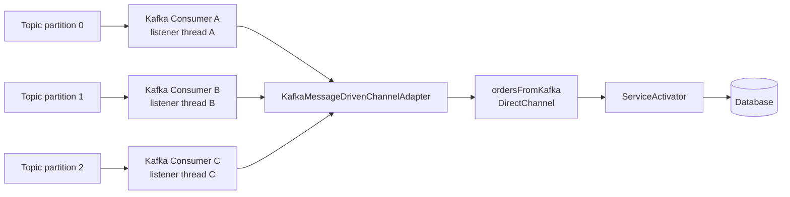
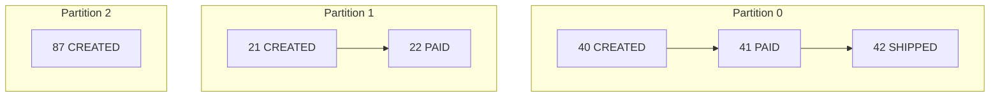
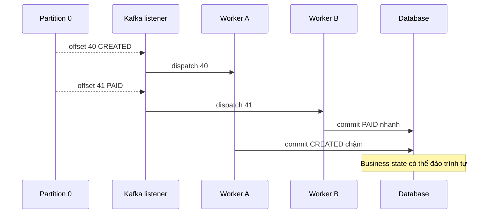
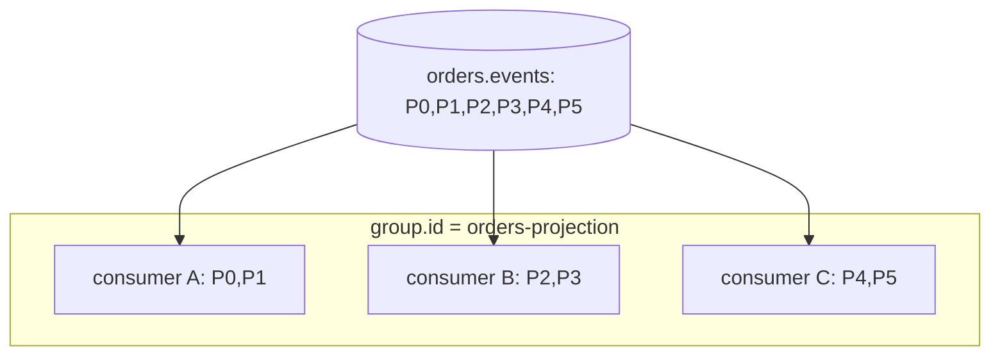
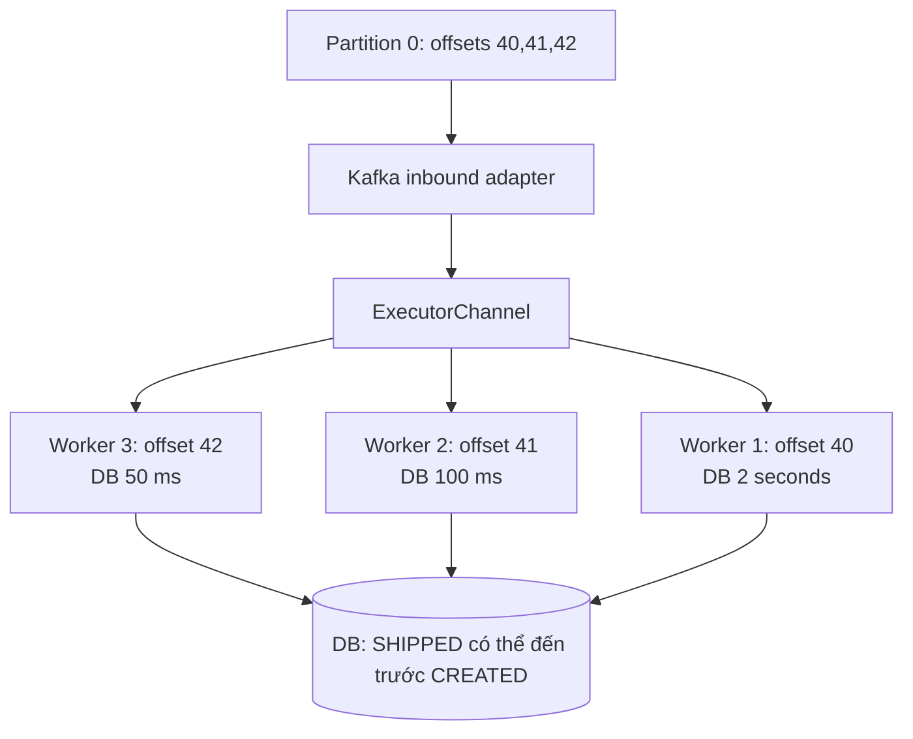
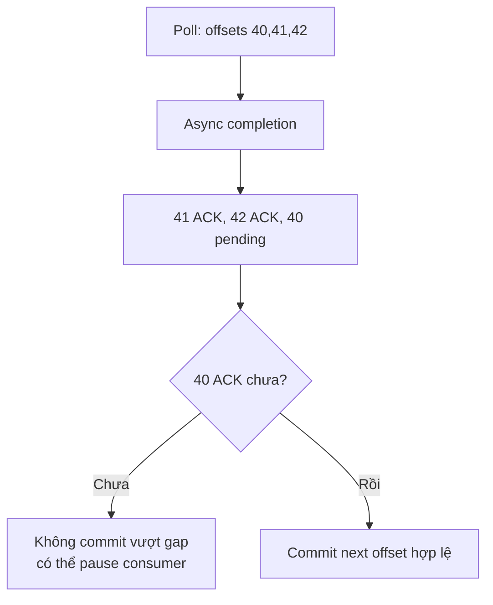
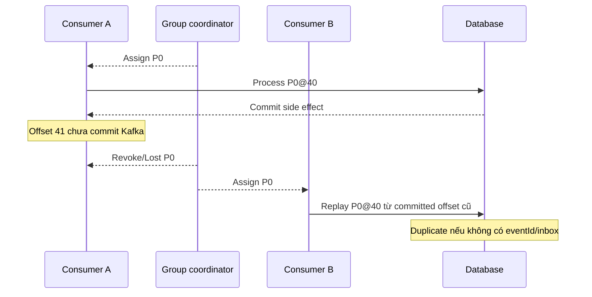
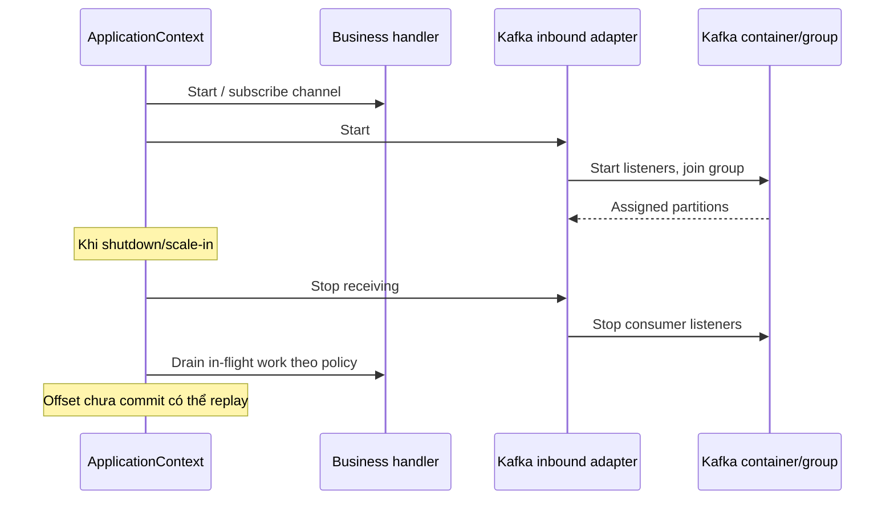

# Concurrency và thứ tự trong partition

**Concurrency** trong Kafka là khả năng nhiều consumer xử lý dữ liệu song song; **thứ tự trong partition** là thuộc tính Kafka lưu các record theo offset trong **một** partition. Hai điều này không mâu thuẫn: ta có thể tăng tổng throughput bằng cách xử lý **nhiều partition song song**, đồng thời giữ thứ tự trong mỗi partition. Vấn đề phát sinh khi ứng dụng hiểu sai đơn vị song song, gửi cùng một aggregate vào nhiều partition, hoặc đưa message sang nhiều worker threads khiến **thứ tự xử lý side effect** không còn giống thứ tự Kafka record.

Bài thuộc chương **Adapter Kafka** của module **SPRING_INTEGRATION_ADAPTERS**. Module hướng tới kết nối hệ thống ngoài qua inbound/outbound adapter, gateway, poller và `MessageChannel`; thực hành file, SFTP, HTTP, JMS, AMQP, Kafka, database và các vấn đề message contract, lỗi, lifecycle. Trọng tâm ở đây là Kafka consumer group, partition assignment, `ConcurrentMessageListenerContainer` và `KafkaMessageDrivenChannelAdapter`, đặc biệt khi Spring Integration nối Kafka inbound với JDBC/HTTP/SFTP/JMS/AMQP hoặc Kafka outbound.

> **Nguyên tắc:** Kafka bảo đảm các record trong **một partition log có thứ tự offset**. Nó **không** tự bảo đảm nhiều partition có thứ tự toàn cục, nhiều business producers phát event đúng thứ tự nghiệp vụ, hoặc các worker downstream hoàn tất side effect theo thứ tự. **Tăng `concurrency` không tạo thêm partition.**

## 1. Kết quả học tập

Sau bài này, bạn có thể:

1. Phân biệt số partition, số consumer trong group, `concurrency` trong một pod và số pod trong deployment.
2. Giải thích Kafka producer dùng key để chọn partition và giới hạn của thứ tự theo key.
3. Mô tả `ConcurrentMessageListenerContainer` tạo các listener container con, thread và assignment cho từng Kafka consumer.
4. Tính mức song song hữu dụng của một topic, nhận ra consumer idle và hot partition.
5. Cấu hình Spring Boot + Spring Integration Kafka inbound adapter với record mode và `DirectChannel`.
6. So sánh thứ tự khi dùng `DirectChannel` với `ExecutorChannel`, `QueueChannel` và `PublishSubscribeChannel`.
7. Hiểu `AckMode.RECORD`, manual acknowledgment, `asyncAcks` và quan hệ giữa ordering, redelivery và durability.
8. Dự đoán tác động của rebalance, rolling deployment, static membership, blocking handler và `max.poll.interval.ms`.
9. Dùng key/aggregate version, idempotency và database concurrency controls để bảo vệ thứ tự nghiệp vụ.
10. Quan sát per-partition lag, assignment, throughput, retry, reorder và kiểm thử crash/rebalance.

## 2. Bốn tầng concurrency khác nhau



| Tầng | Tài nguyên/quyết định | Loại song song |
|---|---|---|
| **Kafka topic** | Số `partitions` | Đơn vị log/ordering và phân chia tải |
| **Kafka consumer group** | Số consumer members cùng `group.id` | Nhiều consumers nhận các partitions riêng |
| **Spring Kafka container** | `ConcurrentMessageListenerContainer.setConcurrency(N)` | Tối đa N Kafka consumer con trong một container |
| **Spring Integration channel** | `DirectChannel`, `ExecutorChannel`, `QueueChannel` | Đồng bộ hoặc bất đồng bộ giữa adapter và business handler |
| **Business/storage** | JDBC pool, HTTP limits, SFTP sessions, service threads | Khả năng xử lý side effect thật |

Một hệ thống có thể có 12 partitions và 12 Kafka consumer threads nhưng **chỉ một JDBC connection** khả dụng. Khi đó bottleneck thực tế là JDBC; tăng thêm consumers thường làm tăng queueing, contention hoặc lag chứ không tự tăng throughput bền vững.

### 2.1. Thuật ngữ Kafka và Spring

| Thuật ngữ | Nghĩa | Không phải |
|---|---|---|
| `topic` | Dòng record logic gồm nhiều partition | Một hàng đợi có thứ tự toàn cục |
| `partition` | Log có thứ tự offset tăng dần | Một Java thread cố định suốt đời |
| `consumer` | Kafka client tham gia poll và assignment | Spring `MessageHandler` |
| `group.id` | Logical subscriber, group offsets và phân công partitions | ID của Spring message |
| `KafkaMessageListenerContainer` | Container nhận callback trên một Kafka consumer thread | Spring Integration PollingConsumer |
| `ConcurrentMessageListenerContainer` | Quản lý nhiều child listener containers | Tự tạo thêm Kafka partitions |
| `KafkaMessageDrivenChannelAdapter` | Kafka inbound → Spring `MessageChannel` | Kafka producer |
| `DirectChannel` | Dispatch handler đồng bộ trên caller thread | Durable queue |
| `ExecutorChannel` | Dispatch Spring message qua executor | Kafka partition assignment |
| `QueueChannel` | Queue message nội bộ, cần poller để tiêu thụ | Kafka log bền mặc định |

## 3. Kafka bảo đảm thứ tự chính xác ở đâu?

Ví dụ topic `orders.events` có ba partitions:

```text
Partition 0:
  offset 40: ORD-101 CREATED
  offset 41: ORD-101 PAID
  offset 42: ORD-101 SHIPPED

Partition 1:
  offset 21: ORD-202 CREATED
  offset 22: ORD-202 PAID

Partition 2:
  offset 87: ORD-303 CREATED
```

Trong **partition 0**, thứ tự log là `40 → 41 → 42`. Kafka không định nghĩa một thứ tự thời gian tuyệt đối giữa `P0@41` và `P1@22`.



**Các giới hạn cần nói rõ:**

1. Offset là **cục bộ theo partition**, không so sánh trực tiếp offset của hai partitions để xếp event.
2. Kafka ghi record vào partition log theo thứ tự đã được broker chấp nhận; đây không chắc là **thứ tự phát sinh nghiệp vụ** nếu nhiều producers gửi song song.
3. Khi consumer xử lý bằng một thread đồng bộ, callback cho từng partition có thể được thực thi theo thứ tự offset; nhưng side effect ngoài Kafka vẫn có thể thất bại, timeout hoặc được ứng dụng đẩy sang async workers.
4. Nếu record đã xử lý nhưng offset chưa commit, Kafka có thể phát lại sau crash/rebalance. **Nhận lại** không có nghĩa partition log bị đảo thứ tự.
5. Khi event cùng business entity đi qua **nhiều topic/partition**, Kafka không tự duy trì thứ tự chung giữa chúng.

### 3.1. Thứ tự nhận và thứ tự hoàn tất không đồng nghĩa



Trong ví dụ trên, **Kafka không hề vi phạm thứ tự log**. Chính `ExecutorChannel`/thread pool hoặc logic bất đồng bộ đã cho side effect của offset 41 hoàn tất trước offset 40.

## 4. Producer key và phân chia business aggregate

Kafka thường dùng **record key** để chọn partition. Với serializer/partitioner phù hợp và số partitions ổn định, cùng key thường đến cùng partition.

```java
// Snippet Java: biến kafkaTemplate được inject từ Spring Kafka.
kafkaTemplate.send(
        "orders.events",
        "ORD-101", // Kafka key: orderId
        "{\"eventId\":\"evt-100\",\"type\":\"CREATED\"}");

kafkaTemplate.send(
        "orders.events",
        "ORD-101",
        "{\"eventId\":\"evt-101\",\"type\":\"PAID\"}");
```

Dùng `orderId` làm key giúp các event cùng order có thể được tiêu thụ theo thứ tự partition trong **một group**, nếu producer gửi theo logic thứ tự, partitioning nhất quán và downstream giữ trình tự thực thi.

| Business event | Kafka key nên cân nhắc | Lý do |
|---|---|---|
| `OrderCreated/OrderPaid` | `orderId` | Giữ các thay đổi cùng order trên cùng partition |
| `AccountCredited/Debited` | `accountId` | Thứ tự cập nhật một tài khoản |
| `InventoryReserved/Released` | `skuId` hoặc `warehouseId+skuId` | Tránh cạnh tranh cập nhật cùng stock aggregate |
| `TenantCreated/Updated` | `tenantId` | Giữ ordering theo tenant khi cần |
| Telemetry độc lập | Key theo thiết bị hoặc null | Ưu tiên phân tán tải, chấp nhận contract riêng |

### 4.1. Không đặt Kafka key bằng eventId nếu muốn orderId ordering

Nếu mỗi event có một `eventId` khác nhau, hash(eventId) có thể phân chúng sang các partitions khác nhau; khi đó không còn bảo đảm cùng order được xử lý trong cùng partition.

Ngược lại, đặt **mọi** event của hệ thống vào một key cố định sẽ dồn vào **một hot partition**, khiến tăng số partitions/consumers không tăng throughput cho key ấy.

### 4.2. Thay đổi số partition có thể thay đổi key → partition

Nhiều partitioners dùng hash(key) với số partitions để quyết định destination. Khi **tăng partition count**, một key có thể được map sang partition khác ở các lần gửi sau. Khi đó các record cũ của key nằm ở partition A, record mới nằm ở partition B và **không có bảo đảm thứ tự liên partition**.

Không tăng partitions một cách tùy tiện trong hệ thống yêu cầu thứ tự chặt theo aggregate. Cần kiểm thử chiến lược phân vùng, chọn thời điểm migration, drain/cutover hoặc thiết kế aggregate version.

### 4.3. Idempotent producer khác business ordering

`enable.idempotence=true` giúp Kafka producer tránh một số duplicate/reorder do retry **trong phạm vi producer session và các điều kiện Kafka client**. Cấu hình liên quan gồm `acks=all`, `retries>0` và giới hạn `max.in.flight.requests.per.connection` phù hợp phiên bản (thường không lớn hơn 5 khi idempotence bật).

Tuy nhiên:

- Hai microservices độc lập cùng publish key `ORD-101` có thể tranh nhau gửi `PAID` trước `CREATED`.
- HTTP retry có thể phát cùng business event mới vào offset khác.
- Một transaction/outbox dispatcher có thể replay event cũ sau restart.
- Idempotent producer không thay `eventId`, aggregate version hoặc consumer inbox.

**Bảo đảm Kafka partition order** và **bảo đảm domain event order** là hai bài toán khác nhau.

## 5. Consumer group: partition chỉ có một owner trong group

Trong cơ chế consumer group truyền thống, Kafka giao mỗi partition cho tối đa một consumer thành viên của **cùng một group** tại một thời điểm.



Nhưng nếu có **hai consumer groups**:

```text
group orders-projection -> đọc P0..P5 theo offset riêng
group orders-audit      -> cũng đọc P0..P5 theo offset riêng
```

Hai groups **không chia tải cho cùng một logical subscriber**; chúng là hai logical subscribers độc lập, mỗi group có committed offsets riêng. Đó là mô hình đúng nếu một hệ thống làm projection DB còn hệ thống khác làm audit.

### 5.1. Mỗi partition có thể chuyển owner khi rebalance

Ownership không cố định vĩnh viễn: Kafka có thể chuyển P0 từ consumer A sang consumer B sau scale-out, restart, timeout hoặc rebalance. Khi chuyển, consumer mới tiếp tục từ committed offset theo policy; record đã có side effect nhưng chưa commit Kafka offset có thể được nhận lại.

**Không** giả định “một order chỉ được xử lý đúng một lần vì P0 chỉ có một consumer tại mỗi thời điểm”. At-least-once và failure windows vẫn tồn tại.

### 5.2. Trường hợp đặc biệt: explicit assignment

Nếu container được tạo bằng `ContainerProperties(new TopicPartitionOffset(...))`, ứng dụng có thể **gán partition tường minh** thay cho topic subscription và group coordinator assignment.

Khi đó nhiều instance có thể vô tình được cấu hình cùng một partition. Đây không phải một cách an toàn để “pin key” nếu chưa có ownership/failover orchestration riêng. Với đa số hệ thống cloud, nên dùng **topic subscription + group management**.

## 6. Tính toán concurrency hữu dụng

Giả sử topic có `P=12` partitions, triển khai `I=3` pods, mỗi pod `C=2` Kafka consumer threads.

```text
Tổng consumers lý thuyết = I × C = 3 × 2 = 6
Partition count của topic = 12
=> Có thể có 6 consumer members nhận 12 partitions
=> Trung bình ~2 partitions/consumer nếu assignment tương đối đều
```

Nếu scale lên `I=6` pods, mỗi pod `C=2`:

```text
I × C = 6 × 2 = 12 consumers
=> Có thể có 12 consumers sở hữu 12 partitions
=> Trung bình ~1 partition/consumer
```

Nếu tăng lên `I=8` pods, mỗi pod `C=2`:

```text
I × C = 16 consumers
P = 12 partitions
=> Tối đa 12 consumers có partition của topic này
=> Ít nhất 4 consumers không có partition của topic này
```

Đây là **ước lượng cho một topic**, khi tất cả consumer trong cùng group subscribe đúng topic đó. Với nhiều topic và một assignor cụ thể, phân bổ/idle members có thể khác; consumer không sở hữu partition **của topic này** vẫn có thể sở hữu partition topic khác.

### 6.1. Công thức thực dụng

```text
Consumers được tạo bởi deployment ≈ số pods × concurrency mỗi pod

Song song tối đa ở cấp partition của MỘT topic
    ≤ min(số consumers thuộc group, số partitions của topic)

Throughput bền vững cuối cùng
    ≤ min(Kafka ingest/consume capacity,
          downstream DB/HTTP/service capacity,
          network/CPU/schema cost,
          skew của hot partitions)
```

Công thức không tính được chính xác throughput khi partitions phân bố rất lệch. Một hot partition chiếm 80% traffic vẫn do **một consumer owner** xử lý; thêm consumers rảnh không chia được chính partition ấy thành nhiều owners trong cùng group.

### 6.2. Bảng capacity nhanh

| Partitions | Pods × concurrency | Consumer threads | Active consumers cho topic (tối đa) | Nhận xét |
|---:|---:|---:|---:|---|
| 3 | 1 × 1 | 1 | 1 | Một thread đọc cả ba partitions |
| 3 | 1 × 3 | 3 | 3 | Một partition/consumer nếu chia đều |
| 3 | 2 × 3 | 6 | 3 | Ba consumers dư cho topic này |
| 6 | 3 × 2 | 6 | 6 | Đạt giới hạn partition-level song song |
| 12 | 3 × 2 | 6 | 6 | Mỗi consumer có thể đọc nhiều partitions |
| 12 | 6 × 2 | 12 | 12 | Tối đa parallelism cho topic |
| 12 | 8 × 2 | 16 | 12 | Tăng thêm threads không tạo partitions |

## 7. `ConcurrentMessageListenerContainer` thực hiện concurrency ra sao?

`ConcurrentMessageListenerContainer<K,V>` tạo các `KafkaMessageListenerContainer` con. Mỗi child container sở hữu một Kafka consumer và chạy listener callback trên Kafka consumer thread tương ứng.

```text
ConcurrentMessageListenerContainer concurrency=3
 |
 +-- KafkaMessageListenerContainer child-0
 |       consumer-0 thread -> partitions P0,P3
 |
 +-- KafkaMessageListenerContainer child-1
 |       consumer-1 thread -> partitions P1,P4
 |
 +-- KafkaMessageListenerContainer child-2
         consumer-2 thread -> partitions P2,P5
```

**Assignment trong ví dụ là minh họa**; assignor có thể phân khác. Một child consumer nhận **nhiều partitions** và poll có thể trả record từ nhiều partitions.

### 7.1. Java API

```java
ContainerProperties cp = new ContainerProperties("orders.events");
cp.setAckMode(ContainerProperties.AckMode.RECORD);

ConcurrentMessageListenerContainer<String, String> container =
        new ConcurrentMessageListenerContainer<>(consumerFactory, cp);

// Ba Kafka consumers con (khi group/topic hỗ trợ).
container.setConcurrency(3);
```

Không viết `container.setConcurrency(3)` rồi mặc nhiên mong nhận 3 copies của mỗi record. Trong cùng group, Kafka phân partitions; mỗi record được một owner giao theo assignment, ngoại trừ retry/redelivery hoặc các cơ chế đọc khác.

### 7.2. Container không tạo ba business threads sau channel

Khi adapter dùng `DirectChannel`, handler chạy **trên chính thread listener đang dispatch**. Ba consumers có thể đồng thời gọi cùng một bean handler từ ba threads; vậy handler/its dependencies phải **thread-safe**.

Dù mỗi partition được giao cho một thread, một `@Component` có thể được gọi song song từ nhiều partitions. Không để mutable fields không đồng bộ như `currentOrderId`, `lastOffset` hoặc một `ArrayList` dùng chung trong singleton handler rồi tin rằng ordering theo partition sẽ bảo vệ chúng.

## 8. Ví dụ Spring Boot + Spring Integration hoàn chỉnh

Ta tạo một Kafka inbound flow đọc record từ `orders.events` với ba Kafka consumer threads tối đa, phát ra Spring `DirectChannel` và gọi service activator.

### 8.1. Dependencies

Java 17+; dùng một Spring Boot BOM quản lý Spring Kafka/Spring Integration tương thích:

```xml
<dependency>
    <groupId>org.springframework.boot</groupId>
    <artifactId>spring-boot-starter-integration</artifactId>
</dependency>
<dependency>
    <groupId>org.springframework.integration</groupId>
    <artifactId>spring-integration-kafka</artifactId>
</dependency>
```

Nếu lưu DB thật, bổ sung JDBC starter/driver hoặc Spring Data tương ứng. Đoạn demo handler chỉ log metadata, không yêu cầu database.

### 8.2. application.properties

```properties
demo.kafka.bootstrap-servers=localhost:9092
demo.kafka.group-id=orders-concurrency-demo
demo.kafka.concurrency=3
```

Brokers/topic/group của demo phải nằm trong môi trường lab; không chạy consumer group test cùng topic production nếu chưa có quyền và kế hoạch reset/replay.

### 8.3. Consumer factory và adapter

```java
package com.example.kafka;

import java.util.HashMap;
import java.util.Map;

import org.apache.kafka.clients.consumer.ConsumerConfig;
import org.apache.kafka.common.serialization.StringDeserializer;

import org.springframework.beans.factory.annotation.Qualifier;
import org.springframework.beans.factory.annotation.Value;
import org.springframework.context.annotation.Bean;
import org.springframework.context.annotation.Configuration;
import org.springframework.integration.channel.DirectChannel;
import org.springframework.integration.config.EnableIntegration;
import org.springframework.integration.kafka.inbound.KafkaMessageDrivenChannelAdapter;

import org.springframework.kafka.core.ConsumerFactory;
import org.springframework.kafka.core.DefaultKafkaConsumerFactory;
import org.springframework.kafka.listener.ConcurrentMessageListenerContainer;
import org.springframework.kafka.listener.ContainerProperties;

import org.springframework.messaging.MessageChannel;

@Configuration
@EnableIntegration
public class OrdersKafkaConcurrencyConfig {

    @Bean("ordersConsumerFactory")
    public ConsumerFactory<String, String> ordersConsumerFactory(
            @Value("${demo.kafka.bootstrap-servers}") String brokers,
            @Value("${demo.kafka.group-id}") String groupId) {

        Map<String, Object> props = new HashMap<>();
        props.put(ConsumerConfig.BOOTSTRAP_SERVERS_CONFIG, brokers);
        props.put(ConsumerConfig.GROUP_ID_CONFIG, groupId);
        props.put(ConsumerConfig.KEY_DESERIALIZER_CLASS_CONFIG,
                StringDeserializer.class);
        props.put(ConsumerConfig.VALUE_DESERIALIZER_CLASS_CONFIG,
                StringDeserializer.class);

        // Container-managed commits, không auto commit theo timer.
        props.put(ConsumerConfig.ENABLE_AUTO_COMMIT_CONFIG, false);
        props.put(ConsumerConfig.AUTO_OFFSET_RESET_CONFIG, "earliest");
        props.put(ConsumerConfig.MAX_POLL_RECORDS_CONFIG, 200);
        props.put(ConsumerConfig.CLIENT_ID_CONFIG, "orders-inbound");

        return new DefaultKafkaConsumerFactory<>(props);
    }

    @Bean("ordersFromKafka")
    public MessageChannel ordersFromKafka() {
        return new DirectChannel();
    }

    @Bean("ordersKafkaInboundAdapter")
    public KafkaMessageDrivenChannelAdapter<String, String> kafkaInbound(
            @Qualifier("ordersConsumerFactory")
                ConsumerFactory<String, String> factory,
            @Qualifier("ordersFromKafka")
                MessageChannel output,
            @Value("${demo.kafka.concurrency:3}") int concurrency) {

        ContainerProperties containerProps =
                new ContainerProperties("orders.events");
        containerProps.setAckMode(
                ContainerProperties.AckMode.RECORD);
        containerProps.setSyncCommits(true);

        ConcurrentMessageListenerContainer<String, String> container =
                new ConcurrentMessageListenerContainer<>(
                        factory, containerProps);
        container.setConcurrency(concurrency);

        KafkaMessageDrivenChannelAdapter<String, String> adapter =
                new KafkaMessageDrivenChannelAdapter<>(
                    container,
                    KafkaMessageDrivenChannelAdapter.ListenerMode.record);

        adapter.setOutputChannel(output);
        adapter.setAutoStartup(true);

        return adapter;
    }
}
```

### 8.4. Đọc từng quyết định

1. `ENABLE_AUTO_COMMIT_CONFIG=false`: không để Kafka client tự commit theo timer; container quản lý commit.
2. `AUTO_OFFSET_RESET_CONFIG=earliest`: chỉ ảnh hưởng khi **không có committed offset hợp lệ** hoặc theo điều kiện reset, không phát lại từ đầu mọi restart.
3. `MAX_POLL_RECORDS_CONFIG=200`: giới hạn một lần `poll()`, không tự sinh thêm threads.
4. `CLIENT_ID_CONFIG`: nhận diện Kafka client/metrics; concurrent children thường có suffix để phân biệt; không phải group ID.
5. `AckMode.RECORD`: container quyết định commit theo callback record thành công; không phải transaction DB.
6. `ListenerMode.record`: adapter phát một Spring message cho từng `ConsumerRecord`.
7. `concurrency`: số child Kafka consumers, **không** phải số Kafka partitions.
8. `DirectChannel`: handler synchronous; exception có cơ hội quay về Kafka container nếu không bị tầng khác recovery/suppress.
9. `ordersFromKafka` là **output channel của Kafka inbound adapter**, không phải Kafka topic.
10. `@EnableIntegration` kích hoạt các thành phần Spring Integration; cần thêm `@SpringBootApplication` trong package `com.example.kafka` hoặc package cha.

### 8.5. Service activator và thread identity

```java
package com.example.kafka;

import org.springframework.integration.annotation.ServiceActivator;
import org.springframework.kafka.support.KafkaHeaders;
import org.springframework.messaging.Message;
import org.springframework.stereotype.Component;

@Component
public class OrdersKafkaEventHandler {

    @ServiceActivator(inputChannel = "ordersFromKafka")
    public void onEvent(Message<String> message) {

        String payload = message.getPayload();

        String key = message.getHeaders().get(
                KafkaHeaders.RECEIVED_KEY, String.class);
        Object partition = message.getHeaders().get(
                KafkaHeaders.RECEIVED_PARTITION);
        Object offset = message.getHeaders().get(
                KafkaHeaders.OFFSET);

        if (payload.isBlank()) {
            throw new IllegalArgumentException(
                    "Empty event payload");
        }

        System.out.printf(
                "thread=%s key=%s part=%s offset=%s payload=%s%n",
                Thread.currentThread().getName(),
                key, partition, offset, payload);

        // Production: gọi service có @Transactional + idempotency.
    }
}
```

Ví dụ handler giữ **stateless**: mọi biến là local variables, không lưu `lastSeenOffset` trong field singleton. Log payload chỉ để học; production cần log có cấu trúc, giới hạn PII/token.

Với ba consumers và một handler bean, bạn sẽ thấy nhiều thread names gọi cùng method. **Trong một partition** vẫn có thứ tự Kafka record; thứ tự các dòng log **toàn topic** có thể xen kẽ giữa partitions.

## 9. Gửi Kafka record có key để quan sát ordering

Để đảm bảo events cùng order thường vào một partition, producer phải dùng key `orderId`.

### 9.1. Kafka console producer

```bash
kafka-topics.sh \
  --bootstrap-server localhost:9092 \
  --create --if-not-exists \
  --topic orders.events --partitions 6 --replication-factor 1

kafka-console-producer.sh \
  --bootstrap-server localhost:9092 \
  --topic orders.events \
  --property parse.key=true \
  --property key.separator=:
```

Nhập:

```text
ORD-101:evt-101|ORD-101|CREATED
ORD-202:evt-102|ORD-202|CREATED
ORD-101:evt-103|ORD-101|PAID
ORD-202:evt-104|ORD-202|PAID
ORD-101:evt-105|ORD-101|SHIPPED
```

Khi mọi event của cùng order được gửi tuần tự, producer partitioning ổn định và topic partitions không đổi, các record có `key=ORD-101` thường cùng partition.

**Không** đánh đồng việc nhập console bằng thứ tự dòng với bảo đảm tuyệt đối về business sequence khi ứng dụng thật dùng nhiều producer instances hoặc request threads song song.

### 9.2. Quan sát assignment bằng Kafka CLI

```bash
kafka-consumer-groups.sh \
  --bootstrap-server localhost:9092 \
  --describe --group orders-concurrency-demo

kafka-consumer-groups.sh \
  --bootstrap-server localhost:9092 \
  --describe --group orders-concurrency-demo \
  --members --verbose
```

Ghi lại group members, client IDs, assigned partitions, committed offset và lag. Khi group đang rebalance, assignment/lag hiển thị có thể tạm thời thay đổi.

### 9.3. Tăng/giảm concurrency trong lab

Chạy thử:

- `demo.kafka.concurrency=1`: một consumer thread đọc nhiều partitions.
- `demo.kafka.concurrency=3`: có thể chia sáu partitions cho ba consumers.
- `demo.kafka.concurrency=8`: với một topic sáu partitions, tối đa sáu consumers nhận assignment của topic; phần dư không xử lý được partition mới.

Nếu cần đo **cùng bộ record** ở mỗi lần chạy, dùng group IDs khác nhau hoặc reset offsets trên môi trường lab đã xác nhận; không tùy tiện reset production offsets.

## 10. Spring Integration `DirectChannel` giữ ordering như thế nào?

`DirectChannel` thực hiện dispatch **trên thread gọi `send()`**. Trong flow:

```text
Kafka consumer thread for P0
  -> KafkaMessageDrivenChannelAdapter
  -> DirectChannel.send(...)
  -> @ServiceActivator
  -> JDBC service (synchronous)
  -> return / exception
  -> Kafka listener callback kết thúc
  -> container AckMode/error policy
```

Nếu handler **không tách việc sang thread khác**, những callback record được cùng consumer xử lý nối tiếp; cùng partition có thứ tự dispatch và **completion theo callback**. Các partitions khác nhau có thể được xử lý song song qua những consumer threads khác.

### 10.1. Điều kiện còn thiếu để có thứ tự nghiệp vụ

- Producer cần phát events đúng causal/business sequence cho từng aggregate.
- Key và partition mapping phải nhất quán.
- Handler/DB transaction phải xử lý tuần tự theo callback mà không gửi việc async ẩn.
- Khi có retry/redelivery, side effect phải idempotent và chịu được duplicate.
- Nếu nhiều topics hoặc microservices làm thay đổi cùng aggregate, cần version/locking dù Kafka partition riêng có thứ tự.

Một `DirectChannel` không tự giải quyết optimistic locking, transaction rollback hoặc đồng bộ giữa hai producer services.

### 10.2. `DirectChannel` không có “một worker thread riêng”

Nó gọi handler trong caller thread, không phải một Spring global single-thread event loop. Với `concurrency=3`, **cùng handler bean** có thể được gọi song song bởi ba Kafka listener threads, mỗi thread đang xử lý partitions được giao cho mình.

Do đó, Spring `@Component` singleton nên **stateless hoặc thread-safe**. Với service có mutable cache, phải cân nhắc thread confinement theo partition/aggregate hoặc đồng bộ đúng cách, không mặc định một handler bean = một thread.

## 11. `ExecutorChannel` có thể phá thứ tự hoàn tất

`ExecutorChannel` chuyển việc xử lý sang một `Executor`:



Một listener nhận offsets `40,41,42` theo thứ tự, nhưng khi dispatch tới executor:

- `send()` có thể chỉ chứng minh **task đã được nhận**.
- Kafka listener callback có thể trả về trước khi JDBC/HTTP xong.
- Container có thể commit offset trước khi side effect hoàn tất, đặc biệt `AckMode.RECORD`/`BATCH`.
- Tasks cùng key có thể hoàn tất đảo thứ tự.
- Khi JVM chết, tasks chưa hoàn tất có thể mất nếu không có durable handoff.

### 11.1. Không sửa chỉ bằng pool size=1 trong mọi trường hợp

`ExecutorChannel` với một worker có thể giúp giữ thứ tự submission nội bộ nếu executor queue là FIFO, nhưng:

1. Nó vẫn **tách thread**, callback Kafka có thể trả về sớm.
2. Queue trong RAM vẫn không bền qua restart.
3. Một worker toàn cục chặn cả những partitions độc lập.
4. Khi nhiều producers gửi vào cùng executor, thứ tự submission không chứng minh thứ tự nghiệp vụ.

Nếu yêu cầu at-least-once với DB, cần **ack theo kết quả xử lý bền vững** hoặc một durable handoff với transaction rõ ràng.

### 11.2. Cách có parallelism nhưng giữ thứ tự theo key

Một kiến trúc có thể dùng `keyed executor`, mỗi aggregate key đi vào một serial lane:

```text
Order key ORD-101 -> lane A -> xử lý tuần tự
Order key ORD-202 -> lane B -> xử lý tuần tự
Order key ORD-303 -> lane C -> xử lý tuần tự
```

Tuy nhiên, lane theo key chỉ bảo vệ thứ tự **trong executor**. Nó **không tự gắn Kafka offset commit** với DB completion, không tự khôi phục task trong RAM khi crash và không ngăn producer phát sự kiện sai business version.

Cần một cơ chế **backpressure, durable queue hoặc ack barrier**, cùng integration tests restart/rebalance.

## 12. `QueueChannel`, `PublishSubscribeChannel` và tính bền vững

### 12.1. `QueueChannel`

```text
Kafka listener thread
  -> adapter.send(message)
  -> QueueChannel.enqueue(message) [thành công]
  -> callback trở về / offset có thể commit

Một thời điểm khác:
  -> PollingConsumer.dequeue()
  -> DB handler
```

Nếu `QueueChannel` chỉ dùng memory queue, crash sau Kafka offset commit nhưng trước DB transaction sẽ **mất message nghiệp vụ**, dù Kafka consumer lag có thể bằng 0.

**Không dùng RAM queue như durable handoff.** Nếu cần tách Kafka consumer với việc xử lý chậm, có thể dùng message store bền vững, một broker queue được vận hành đúng, hoặc cấu trúc inbox/outbox; mỗi cách phải bảo vệ cửa sổ commit offset so với enqueue/DB.

### 12.2. `PublishSubscribeChannel`

`PublishSubscribeChannel` cho phép fan-out một Spring message đến nhiều subscribers trong cùng process. Nhưng các subscriber nội bộ **không có Kafka committed offsets độc lập**.

Nếu một nhánh gửi HTTP và nhánh khác ghi JDBC, phải định nghĩa **cả hai nhánh hay chỉ một nhánh** quyết định Kafka record đã hoàn tất. Với async publish-subscribe, lỗi một subscriber có thể xuất hiện sau listener callback; cần chiến lược durability và recovery.

Nếu hai nhóm xử lý cần failure isolation và replay độc lập, dùng **hai Kafka consumer groups khác nhau** thường dễ quản lý hơn fan-out nội bộ khi yêu cầu độ bền cao.

## 13. Acknowledgment, offset và thứ tự

Kafka committed offset theo `topic + partition + group.id` biểu diễn **next offset để resume**. Nếu partition 0 có offsets `40,41,42` và đã xử lý thành công liên tục đến 42, committed next offset thường là 43.

### 13.1. `AckMode.RECORD`

Trong record listener đồng bộ, `AckMode.RECORD` commit theo callback record thành công:

```text
P0@40 -> handler hoàn tất -> container commit next offset 41
P0@41 -> handler hoàn tất -> container commit next offset 42
P0@42 -> handler hoàn tất -> container commit next offset 43
```

Các commit có thể thất bại hoặc bị ảnh hưởng retry/rebalance. Một callback thành công không chứng minh DB đã commit nếu handler chỉ enqueue việc async.

### 13.2. `AckMode.BATCH`

Dù `KafkaMessageDrivenChannelAdapter.ListenerMode.record` vẫn dispatch **từng** Spring message, container có thể dùng `AckMode.BATCH` để commit sau khi xử lý xong các record của một `poll()`.

**Mode adapter** và **AckMode container** là hai lựa chọn độc lập. Không suy rằng chọn record listener tự buộc Kafka container dùng `AckMode.RECORD`.

### 13.3. `MANUAL`, `MANUAL_IMMEDIATE`

Với manual ack, handler có thể lấy `Acknowledgment` từ `KafkaHeaders.ACKNOWLEDGMENT`:

```java
Acknowledgment ack = message.getHeaders().get(
        KafkaHeaders.ACKNOWLEDGMENT,
        Acknowledgment.class);

if (ack == null) {
    throw new IllegalStateException(
            "Manual AckMode required");
}

transactionalService.applyIdempotently(message.getPayload());
ack.acknowledge();
```

Snippets trên giả định `transactionalService` là **bean transactional khác**; `applyIdempotently()` commit DB trước khi return qua Spring transaction proxy. Không gọi `ack()` **trong thân method `@Transactional`** rồi mặc định DB đã commit, vì DB transaction thường commit **sau method body**.

`MANUAL_IMMEDIATE` có semantics commit ngay khi ack được gọi **trên Kafka listener/consumer thread**; ack từ worker thread khác có thể được container xếp xử lý sau. Không truyền `KafkaConsumer` object sang thread khác rồi gọi `commit/seek`; Kafka consumer không thread-safe.

### 13.4. `asyncAcks` và ack lệch thứ tự

Spring Kafka hỗ trợ `asyncAcks=true` (với manual ack modes) cho phép ack các record thuộc cùng poll **không theo thứ tự**, nhưng container **trì hoãn commit** cho tới khi các khoảng thiếu được ack; nó có thể pause consumer để chờ.



`asyncAcks` **không** cung cấp durable queue, không bảo đảm business ordering và làm tăng duplicate window khi crash. Tài liệu Spring Kafka không cho dùng `nack()` khi `asyncAcks` bật.

### 13.5. Không có “commit vượt lỗ hổng” an toàn

Nếu offset 40 chưa xử lý, 41 và 42 đã hoàn tất, committed next offset 43 sẽ làm Kafka group **bỏ qua 40** sau restart. Do đó mọi cơ chế parallel ack phải giữ đúng prefix progress từng partition.

Đây là lý do thiết kế song song hóa per-record mà không có offset barrier thường nguy hiểm dù nhìn qua throughput tăng.

## 14. Transaction và idempotency để bảo vệ thứ tự nghiệp vụ

Kafka giữ thứ tự log nhưng không thể atomically commit cùng lúc **Kafka offset và database** nếu chỉ dùng một JDBC transaction thông thường.

### 14.1. Failure windows

| Thời điểm | DB side effect | Kafka offset | Hậu quả |
|---|---|---|---|
| Trước handler bắt đầu | Chưa có | Chưa tiến | Có thể nhận lại |
| Sau DB commit, trước Kafka commit | Đã có | Cũ | Record có thể replay → cần idempotency |
| Sau Kafka commit, trước DB commit do ack sớm | Chưa chắc có | Đã tiến | **Có thể mất nghiệp vụ** |
| Sau cả hai commit | Đã có | Đã tiến | Bình thường, nhưng không đảm bảo atomic cho lần kế |
| Rebalance khi old consumer còn in-flight | Có thể cạnh tranh | Assignment đổi | Cần version/concurrency control |

### 14.2. Dùng business `eventId`

Một mô hình inbox tối thiểu:

```sql
CREATE TABLE processed_events (
    event_id VARCHAR(128) PRIMARY KEY,
    aggregate_id VARCHAR(128) NOT NULL,
    processed_at TIMESTAMP NOT NULL DEFAULT CURRENT_TIMESTAMP
);
```

Trong **cùng DB transaction** với side effect, insert `eventId` dưới unique constraint; khi Kafka redelivery, bỏ qua event đã xử lý. Tạo side effect có bảo vệ aggregate version nếu event cũ có thể đến trễ.

```java
// Pseudocode PostgreSQL trong @Transactional service.
int claimed = jdbc.update(
    "INSERT INTO processed_events(event_id, aggregate_id) "
    + "VALUES (?, ?) ON CONFLICT (event_id) DO NOTHING",
    eventId, orderId);

if (claimed == 0) {
    return; // duplicate đã commit trước đó
}
jdbc.update(
    "UPDATE orders SET status = ? WHERE order_id = ?",
    nextStatus, orderId);
```

Ở production, cập nhật order nên kiểm tra `version`/state transition hợp lệ thay vì update tự do: có thể một event `PAID` đến từ producer khác trước `CREATED` dù Kafka key đúng.

### 14.3. Version cho aggregate

```sql
-- Ý tưởng optimistic locking:
UPDATE orders
SET status = :new_status, version = :incoming_version
WHERE order_id = :order_id
  AND version = :incoming_version - 1;
```

Nếu affected rows = 0, có thể là duplicate, event out-of-order hoặc order chưa tồn tại; phải phân loại trước khi retry/DLT. Đây là SQL minh họa theo một aggregate version tăng từng bước, cần xử lý create/upsert và transaction isolation phù hợp.

### 14.4. Kafka transaction không tự bao database

Kafka transactional consume-transform-produce có thể phối hợp Kafka output records với source offsets trong một Kafka transaction. Nó **không** tự gộp JDBC, HTTP, SFTP, JMS hoặc AMQP vào một atomic transaction Kafka. Khi Kafka → DB, thường dùng idempotent consumer/inbox; khi DB → Kafka, cân nhắc transactional outbox.

## 15. Rebalance có ảnh hưởng ordering như thế nào?



Rebalance có thể xảy ra khi:

- Tăng/giảm số pod, rolling deploy.
- Consumer crash/network partition.
- Handler chậm vượt `max.poll.interval.ms`.
- Topic metadata hoặc assignor/group membership thay đổi.
- Client sử dụng static membership/config không nhất quán.

Kafka vẫn giữ thứ tự partition log, nhưng **business side effects** có thể bị duplicate hoặc tranh chấp khi consumer cũ chưa dừng hẳn mà consumer mới đã bắt đầu theo assignment mới.

### 15.1. `ConsumerAwareRebalanceListener`

Spring Kafka hỗ trợ callback:

- `onPartitionsAssigned(...)`: consumer vừa được giao partitions.
- `onPartitionsRevokedBeforeCommit(...)` / `onPartitionsRevokedAfterCommit(...)`: thông báo khi revoke.
- `onPartitionsLost(...)`: consumer đã mất quyền sở hữu partitions.

Không tự commit offsets của partition **đã lost** như thể consumer vẫn là owner. Callback không nên làm JDBC/HTTP blocking lâu. Khi có state local theo partition, cần cleanup/cache invalidation và metrics.

### 15.2. Cooperative và eager rebalance

- **Eager**: các members có thể phải revoke nhiều partitions cùng lúc trước khi assign lại.
- **Cooperative/incremental**: giảm phạm vi revoke không cần thiết, có thể cải thiện continuity khi thay đổi membership.
- Chiến lược cụ thể phụ thuộc group protocol, client/cluster version và assignment configs.

Không bật cooperative assignor rồi kết luận replay/duplicate không thể xảy ra. Offset commit, side effect và retry vẫn có failure windows.

### 15.3. Static membership

`group.instance.id` cho phép Kafka nhận diện một member ổn định qua restart ngắn; Spring Kafka concurrent container có quy tắc suffix cho child consumers khi cấu hình static membership phù hợp.

- ID phải **unique giữa members đang sống**; không copy cùng một ID cho mọi pod.
- Static membership có thể giảm rebalance không cần thiết nhưng có trade-off failover khi member chết.
- Không dùng nó thay idempotency, version checking hoặc graceful shutdown.

### 15.4. Đọc lại từ offset đã commit

Kafka group lưu **next committed offset** cho từng partition. Khi P0 đã xử lý offset 40 nhưng chưa commit next offset 41, consumer mới có thể đọc lại 40. Đó là redelivery bình thường trong at-least-once processing, **không phải Kafka đảo thứ tự log**.

## 16. Assignment strategies và nhiều topics

Trong classic consumer group protocol, một số assignors phổ biến:

| Assignor | Ý tưởng | Rủi ro/điểm cần quan sát |
|---|---|---|
| `RangeAssignor` | Chia range partitions theo topic | Với nhiều topics và nhiều consumers có thể để một số members idle dù tổng partitions lớn |
| `RoundRobinAssignor` | Chia partitions vòng tròn | Phân tán đều hơn trong nhiều trường hợp; có thể tăng partition movement |
| `StickyAssignor` | Giữ assignment ổn định khi rebalance | Cân bằng load và giảm movement |
| `CooperativeStickyAssignor` | Sticky + incremental cooperative | Giảm số partitions bị revoke đồng loạt |

**Ví dụ chính thức của Spring Kafka:** với ba topics, mỗi topic năm partitions và `concurrency=15`, cách chia theo từng topic của RangeAssignor có thể khiến chỉ **năm** consumers active, mỗi consumer có ba partitions, còn mười consumers idle. RoundRobinAssignor có thể phân bổ 15 partitions rộng hơn. Với Kafka `group.protocol=consumer` mới, server-side assignment và các setting liên quan khác classic; không áp các giả định assignor cũ một cách máy móc.

### 16.1. Cấu hình strategy trong consumer factory

```java
// Trong consumer config khi sử dụng classic group protocol
// và một Kafka client version hỗ trợ assignor này.
props.put(
    ConsumerConfig.PARTITION_ASSIGNMENT_STRATEGY_CONFIG,
    org.apache.kafka.clients.consumer.CooperativeStickyAssignor.class);
```

Đây là **một lựa chọn**: không mix nhiều assignors không tương thích giữa members trong cùng group khi rollout. Khi cần đổi strategy, có kế hoạch migration và quan sát rebalance/churn.

### 16.2. Mỗi group subscriber khác nhau có throughput riêng

Nếu Kafka topic `orders.events` có 12 partitions:

```text
group projection -> 6 consumers chia P0..P11
group audit      -> 3 consumers cũng đọc P0..P11
```

Đây không phải 9 consumers cùng tranh nhau 12 partitions của một group. Mỗi group có assignment và committed offsets độc lập; mỗi business event có thể được **cả hai nhóm** nhận. DLT/retry policy cũng cần riêng cho từng nhóm.

## 17. Hot partition và data skew

Giả sử topic 12 partitions, nhưng 70% traffic thuộc một `tenantId` duy nhất và producer dùng `tenantId` làm key:

```text
Partition 7: 70% records
11 partitions khác: tổng 30%
```

Dù tăng `concurrency` từ 6 lên 12, **consumer owner của partition 7** vẫn phải xử lý phần lớn tải đó. Per-partition lag có thể tăng trên P7 trong khi các consumers khác rảnh.

### 17.1. Cách nhận diện

- Consumer lag theo **partition**, không chỉ tổng lag.
- Record rate/bytes theo partition.
- Handler processing latency và số retry theo partition.
- Key frequency/top aggregates (được ẩn danh hoặc tổng hợp an toàn).
- Assignment distribution và CPU/DB utilization từng pod.
- Producer partitioning rules và thay đổi số partitions gần đây.

### 17.2. Các lựa chọn xử lý

| Cách | Lợi ích | Đánh đổi |
|---|---|---|
| Tối ưu DB/handler cho hot key | Nâng throughput không đổi ordering | Có thể bị giới hạn bởi một aggregate |
| Chọn key chi tiết hơn, ví dụ `tenant+orderId` | Phân tán tải hơn | Không giữ thứ tự trên toàn tenant |
| Split logic: per-order ordering thay vì per-tenant | Mở rộng parallelism | Cần xác nhận domain không yêu cầu tenant-total-order |
| Phân tách một topic riêng cho hot tenant | Tăng cô lập, quota/metrics rõ | Vận hành, ACL, routing phức tạp |
| Tăng partitions | Tăng song song cho **nhiều keys** | Có thể thay mapping key, gây rủi ro order |
| Buffer durable, batch DB writes | Chịu burst và giảm round-trips | Cần ack/durability đúng contract |
| Aggregate version + conflict control | Chịu eventual out-of-order | Logic reconciliation phức tạp |

**Không** giải hot key chỉ bằng `concurrency=100` khi key ấy chỉ nằm trong một partition.

## 18. Record vs batch listener ảnh hưởng concurrency

`KafkaMessageDrivenChannelAdapter.ListenerMode.record`: một Spring message cho một Kafka record. `ListenerMode.batch`: một Spring message có list payload cho một poll.

| Tiêu chí | Record | Batch |
|---|---|---|
| Handler input | `Message<String>`/DTO | `Message<List<String>>`/list DTO |
| Số callback adapter | Theo từng record | Theo poll batch |
| `AckMode.RECORD` | Hỗ trợ | Không hỗ trợ trong batch listener |
| `AckMode.BATCH` | Hỗ trợ | Hỗ trợ |
| Bulk DB I/O | Cần gom chủ động | Dễ gom, giảm overhead |
| Error handling | Có thể cô lập từng record | Partial batch failure phức tạp hơn |
| Ordering | Thuận lợi với direct synchronous | Cần giữ thứ tự từng phần tử/partition trong batch |
| Blocking interval | Một record handler | Có thể giữ consumer thread lâu theo cả batch |

### 18.1. Batch không tự đảm bảo throughput

Nếu một batch chứa 100 records, nhưng handler loop rồi gọi 100 HTTP requests chậm, callback có thể vượt `max.poll.interval.ms` và gây rebalance. Batch có ích khi downstream hỗ trợ **bulk operations bền vững** hoặc conversion/dispatch overhead là bottleneck được đo.

### 18.2. Partial batch failure

Khi record thứ 7 lỗi sau sáu record đã được ghi DB, cần quyết định retry toàn batch hay chỉ record lỗi. Spring Kafka có `BatchListenerFailedException` để chỉ ra index trong những listener contracts được hỗ trợ; phải kiểm tra nó có truyền qua Spring Integration adapter/error handling thực tế hay không.

DLT cho record lỗi không tự rollback sáu side effects trước đó. Batch processing vẫn cần business idempotency.

## 19. Lỗi, retry, DLT và thứ tự nghiệp vụ

Một `DefaultErrorHandler` với `FixedBackOff` có thể retry record lỗi trước khi cho partition tiếp tục, hoặc recover vào Kafka DLT sau khi hết retry:

```java
DefaultErrorHandler errorHandler =
        new DefaultErrorHandler(
            recoverer,
            new FixedBackOff(1_000L, 2L));

// Trong cấu hình listener container trước khi start.
container.setCommonErrorHandler(errorHandler);
```

`recoverer` là `ConsumerRecordRecoverer` được cấu hình riêng, ví dụ `DeadLetterPublishingRecoverer` với KafkaTemplate và DLT topic thật. Đoạn này không tự tạo DLT.

### 19.1. Retry blocking giúp giữ thứ tự ở mức nào?

Với record listener đồng bộ, nếu handler của P0@40 lỗi, việc retry blocking/seek có thể giữ tiến độ xử lý partition P0 chờ record 40. Điều này thuận lợi cho per-key ordering nhưng làm tăng lag nếu poison pill không được xử lý.

Sau khi record 40 **được recover vào DLT** và source group tiếp tục P0@41, nghiệp vụ có thể xử lý **record mới trước khi lỗi cũ được sửa/replay**. Vì vậy DLT cũng có thể làm đứt tính liên tục của **domain state transitions** dù Kafka source log vẫn có thứ tự.

### 19.2. Non-blocking retry topics có thể phá ordering

Khi đưa P0@40 sang retry topic và tiếp tục P0@41 ở source, 41 có thể xử lý trước 40. Spring Kafka có hệ sinh thái retry-topic cho những listener types được hỗ trợ; không mặc nhiên thêm `@RetryableTopic` vào `@ServiceActivator` và cho rằng IntegrationFlow đã có non-blocking retry đúng nghĩa.

Với aggregate cần ordering tuyệt đối, cân nhắc **block key/partition, phiên bản nghiệp vụ, quarantine toàn stream của key hoặc state machine xử lý out-of-order**.

### 19.3. Spring Integration error channel khác Kafka DLT

`errorChannel` nhận `ErrorMessage` nội bộ Spring Integration; nó không tự publish vào Kafka DLT. Nếu adapter recovery callback **nuốt exception**, Spring Kafka listener container có thể xem callback thành công và commit offset dù business handler chưa hoàn tất.

Thiết kế một nơi sở hữu retry/recovery rõ ràng: container `DefaultErrorHandler` hoặc flow recovery bền vững. Không bật cả adapter retry và container retry vô tội vạ.

## 20. `max.poll.interval.ms`, heartbeat và blocking handler

Kafka cần consumer tiếp tục poll trong giới hạn `max.poll.interval.ms`, theo semantics của group protocol/client. Với `DirectChannel`, handler chậm giữ listener thread, làm tăng khoảng cách giữa các poll.

```text
Tổng thời gian xử lý các records của một poll
    ≈ tổng handler latency + retry/backoff + conversion/dispatch overhead

Nếu quá lâu so với max.poll.interval.ms:
    consumer có thể bị coi không tiến triển
    -> rebalance / partition re-assignment
    -> redelivery/duplicate
```

### 20.1. Những cấu hình liên quan

| Config | Tác động | Sai lầm thường gặp |
|---|---|---|
| `max.poll.records` | Giới hạn số record trả mỗi poll | Nhầm với số partitions hoặc số threads |
| `max.poll.interval.ms` | Giới hạn thời gian giữa poll calls | Tăng vô hạn để che handler treo |
| `session.timeout.ms` | Consumer group membership failure detection | Nhầm với DB transaction timeout |
| `heartbeat.interval.ms` | Heartbeat cadence theo group protocol | Không phải business heartbeat |
| `fetch.min.bytes` | Fetch batching theo bytes | Không tạo partition parallelism |
| `fetch.max.wait.ms` | Broker wait cho fetch | Không bảo đảm callback latency |
| `concurrency` | Kafka consumers trong container | Không xử lý partition single-key song song |
| `pollTimeout` | Chờ poll trong listener container | Không phải Kafka producer timeout |

### 20.2. Chính sách giảm blocking

1. Đo p95/p99 handler time và max records per poll thực tế.
2. Tối ưu JDBC/HTTP/SFTP API, dùng connection pools, batch khi phù hợp.
3. Giới hạn retry attempts/backoff trên listener thread.
4. Đặt `max.poll.records` theo downstream capacity thay vì giữ mặc định một cách máy móc.
5. Chọn `max.poll.interval.ms` đủ cho workload p99 có dự phòng, không quá lớn làm trì hoãn phát hiện member kẹt.
6. Nếu async handoff, thiết kế **durability + acknowledgment + ordering barrier** trước.
7. Với hot partitions, xử lý skew/key design thay vì chỉ tăng concurrency.

## 21. Kiểm soát lifecycle và shutdown

`KafkaMessageDrivenChannelAdapter` là inbound endpoint có lifecycle; `ConcurrentMessageListenerContainer` tham gia Kafka group management. Startup/shutdown phải quan tâm đến downstream consumer và offset boundaries.

### 21.1. Trình tự đề xuất



- Downstream subscribers nên sẵn sàng trước khi adapter phát message (đặc biệt `DirectChannel`).
- Khi shutdown, ngừng nhận và đợi in-flight handlers/batch trong deadline.
- Đừng ack/commit một record chỉ vì shutdown đã bắt đầu.
- Khi consumer lost partition, không tự commit như vẫn là owner.
- Dùng business idempotency để chịu replay nếu restart giữa DB và Kafka offset commits.

### 21.2. Pause/resume

Adapter/container có API pause/resume để giảm delivery tạm thời. Pause **không** có nghĩa mọi tasks trong executor đã xong hoặc offset đã commit. Khi resume, theo dõi lag, backpressure và assignment, tránh tạo thác requests vào DB.

## 22. Observability: đo song song thực tế, không chỉ số threads

| Tín hiệu | Câu hỏi |
|---|---|
| Số partitions topic và assignment per consumer | Có bao nhiêu consumers thật sự sở hữu partitions? |
| Lag per topic-partition và max lag | Có hot partition đang kéo lùi hệ thống? |
| Consumer record rate per client ID | Consumers có thực sự tải đều? |
| Rebalance count/duration | Group có churn vì scale/restart/blocking? |
| Handler p95/p99 latency theo partition | Partition nào nghẽn? |
| DB transaction latency và pool utilization | Bottleneck có nằm ở database? |
| Retry count, error handler recovery, DLT backlog | Poison pill có chặn partition không? |
| Kafka commit offset failure | Có replay risk dù DB đã ghi? |
| Business duplicate eventId count | Record bị phát lại hoặc publisher gửi trùng? |
| Aggregate version conflicts/out-of-order count | Business ordering có bị vi phạm? |
| Executor queue depth/active tasks | Đang tách async và backlog ra sao? |
| Container running/paused/assigned | Listener có thật sự đang nhận? |

### 22.1. Mẫu log có tính chẩn đoán

```text
eventId=evt-101
aggregateId=ORD-101
topic=orders.events
partition=2
offset=42
groupId=orders-concurrency-demo
clientId=orders-inbound-1
listenerThread=orders-concurrent-container-0-C-1
businessVersion=3
dbCommit=SUCCESS
```

Tên client/thread ở đây chỉ là minh họa; runtime Spring Kafka có naming/suffix khác theo cấu hình. Không log raw payload nhạy cảm, token, credential hoặc thông tin cá nhân không cần thiết.

### 22.2. Consumer lag=0 không chứng minh business completion

Nếu source Kafka đã commit offset ngay sau enqueue vào `QueueChannel` RAM, group lag có thể bằng 0 nhưng DB vẫn chưa cập nhật. Phải kết hợp Kafka lag với business processed count, queue depth, pending acknowledgments và side effect success/failure.

## 23. Kiểm thử concurrency và ordering

### 23.1. Unit test mapping key

Với producer lựa chọn key từ `orderId`, unit test phải khẳng định mọi event cùng aggregate có cùng key; record metadata partition chỉ kiểm được bằng integration test nếu partitioner, serializer và partition count có thể thay đổi.

### 23.2. Kafka integration test

Với Testcontainers hoặc Kafka broker thử nghiệm:

1. Tạo topic 3 hoặc 6 partitions.
2. Tạo hai consumer instances cùng group hoặc một container `concurrency=3`.
3. Gửi nhiều events dùng Kafka key cố định cho một aggregate.
4. Kiểm tra callback mang topic/partition/offset tăng dần theo từng partition.
5. Đo interleaving giữa partitions nhưng **không** đòi thứ tự toàn topic.
6. Scale số consumer instances và ghi lại assignment mới.
7. Giả lập handler chậm, retry và rolling restart.
8. Với DB, dùng eventId/aggregate version để xác minh không có side effect duplicate/out-of-order.

### 23.3. Test phá ordering khi dùng executor

```text
P0@40: handler sleep 2 seconds
P0@41: handler sleep 100 milliseconds
P0@42: handler sleep 50 milliseconds
```

Chạy qua `DirectChannel` đồng bộ và ghi completion order; sau đó chuyển sang `ExecutorChannel` nhiều workers và ghi lại. Nếu test xuất hiện `42 → 41 → 40` ở DB, đó là bằng chứng **completion bị đảo do ứng dụng**, không phải Kafka log đảo.

### 23.4. Test crash window

- DB commit P0@40 xong nhưng Kafka committed next offset vẫn 40: restart có thể nhận lại 40.
- Kafka committed next offset đã 41 nhưng task JDBC ở queue RAM chưa xong: crash có thể làm mất business effect.
- Handler bị lỗi P0@40: xác định retry hay DLT, P0@41 có được xử lý trước khi 40 được recover không.
- Scale pod giữa DB commit và offset commit: test rebalance + idempotency.
- Tăng partitions: test mapping key mới và kiểm tra khả năng ordering theo aggregate version.

### 23.5. Test assignment và static membership

Khởi động nhiều pod cùng group với client IDs/instance IDs riêng, kiểm tra:

- Consumer members không trùng `group.instance.id`.
- Partitions assigned không bị duplicate ownership trong cùng group.
- Không có nhiều idle consumers bất ngờ do assignor/multiple topics.
- Rebalance không làm mất state chưa commit.
- Lag không tăng vô hạn khi một partition nóng.

## 24. Bài tập thiết kế hệ thống

### Tình huống A — Tám consumers, bốn partitions

Hệ thống có hai pods, mỗi pod `concurrency=4`, topic có bốn partitions. Giải thích tại sao chỉ tối đa bốn consumers làm việc với topic ấy. Đề xuất cấu hình ít threads hơn nếu không có topic nào khác trong group.

### Tình huống B — Cần giữ thứ tự mọi event của một order

Ba microservices cùng publish `OrderCreated`, `OrderPaid` và `OrderShipped`. Dùng `orderId` làm Kafka key có đủ không? Thiết kế `aggregateVersion`, outbox ordering/single-writer hoặc optimistic locking để xử lý sự kiện phát sai causal order.

### Tình huống C — Kafka → JDBC với p99=500 ms

Topic 12 partitions, ba pods mỗi pod concurrency 3, DB chỉ có sáu connections. Hãy chọn concurrency, JDBC pool, batching, retry và metrics; giải thích vì sao tăng thành concurrency 12/pod có thể làm DB nghẽn thay vì tăng throughput.

### Tình huống D — Một tenant tạo 80% traffic

Producer dùng `tenantId` làm key, group lag chỉ cao ở partition chứa tenant ấy. Chọn lại đơn vị ordering theo `tenantId+orderId` hay giữ order toàn tenant? Mô tả trade-off và kế hoạch migration key/partition không mất dữ liệu.

### Tình huống E — Fan-out qua Spring Integration

Một Kafka inbound adapter chuyển event đến JDBC và HTTP audit service. Hai nhánh có SLA khác nhau; một nhánh fail 10 phút. Nên dùng `PublishSubscribeChannel`, hai Kafka consumer groups, hay durable queue/outbox? Xác định khi nào Kafka offset được commit.

## 25. Các hiểu lầm cần tránh

| Hiểu lầm | Cách hiểu đúng |
|---|---|
| “Kafka bảo đảm thứ tự toàn topic.” | Chỉ có thứ tự offset **trong từng partition**. |
| “Tăng concurrency tự tạo thêm partitions.” | Không; partition count do Kafka topic quyết định. |
| “Mỗi Spring handler bean chỉ chạy một thread.” | Singleton handler có thể được gọi từ nhiều listener threads. |
| “Hai consumer groups cùng subscribe là chia tải một group.” | Hai groups có offsets/assignment độc lập. |
| “Cùng orderId trong payload chắc chắn cùng partition.” | Producer phải đặt Kafka **key** phù hợp. |
| “Cùng key luôn đảm bảo thứ tự nghiệp vụ.” | Multi-producer/async/replay có thể sai business sequence. |
| “Tăng partition không ảnh hưởng key ordering.” | Key→partition có thể đổi khi partition count tăng. |
| “Kafka không thể có duplicate nếu partition chỉ có một owner.” | At-least-once retry/rebalance vẫn có redelivery. |
| “`DirectChannel` chạy toàn ứng dụng trên một thread.” | Nó dùng **caller thread**; nhiều consumers có nhiều caller threads. |
| “`ExecutorChannel` tăng throughput mà vẫn giữ offset order.” | Worker completion có thể đảo; offset commit boundary cũng đổi. |
| “`QueueChannel` RAM bảo đảm message không mất.” | Crash sau Kafka commit có thể mất queued business event. |
| “`AckMode.RECORD` tương đương DB commit.” | Kafka offset không nằm trong JDBC transaction mặc định. |
| “`asyncAcks` làm ack lệch thứ tự an toàn tuyệt đối.” | Commit chờ gap, replay risk và queue durability vẫn còn. |
| “Static membership loại bỏ rebalance hoàn toàn.” | Nó chỉ có thể giảm những rebalance nhất định. |
| “CooperativeStickyAssignor đảm bảo exactly-once.” | Assignment policy không thay transaction/idempotency. |
| “Hot key xử lý nhanh hơn khi tăng concurrency.” | Một key ở một partition thường vẫn do một consumer xử lý. |
| “Consumer lag=0 chứng minh HTTP/JDBC đã xong.” | Callback có thể return sau async enqueue trước side effect. |
| “Kafka transaction tự bảo đảm JDBC commit.” | Không atomic xuyên JDBC/HTTP/JMS/SFTP mặc định. |

## 26. Bài tập thực hành

### Bài 1 — Đọc assignment thật

Tạo topic sáu partitions, chạy Spring adapter `concurrency=1`, sau đó 3, rồi 8. Dùng Kafka CLI `--members --verbose` để ghi assignment. Giải thích idle consumers khi concurrency vượt số partitions.

### Bài 2 — Hai pods cùng group

Chạy hai instances với cùng `group.id`, mỗi instance concurrency 2. Với sáu partitions, đo distribution và per-partition lag. Đối chiếu với hai groups **khác nhau** để thấy cùng Kafka record có thể đến cả hai logical subscribers.

### Bài 3 — Producer key và partition order

Gửi `CREATED/PAID/SHIPPED` cùng Kafka key `ORD-101`, ghi topic-partition-offset. Gửi một batch khác dùng eventId làm key; chứng minh ordering không còn được đảm bảo theo orderId.

### Bài 4 — Tăng số partitions

Trong Kafka lab, tăng partition count và đo partition mapping của một danh sách keys trước/sau. Giải thích rủi ro event cũ và mới cùng aggregate ở hai partitions; đề xuất migration plan.

### Bài 5 — Handler singleton thread safety

Cho handler dùng một `HashMap` mutable field chứa lastOffset theo partition rồi chạy concurrency=3. Kiểm tra race condition, sau đó thay bằng state management theo partition hoặc concurrent/DB-safe design. Vì sao thread-safety không đồng nghĩa business-order correctness?

### Bài 6 — `DirectChannel` so với `ExecutorChannel`

Gửi ba records cùng key, cho offset đầu xử lý chậm hơn. Ghi completion order ở DB/test sink. Dùng `DirectChannel` đồng bộ rồi `ExecutorChannel` ba workers; phân biệt dispatch order và completion order.

### Bài 7 — Queue RAM mất dữ liệu

Cho Kafka adapter enqueue vào `QueueChannel` rồi commit offset, dừng JVM trước downstream DB write. Xác minh Kafka lag và business DB; thiết kế durable handoff hoặc ack barrier có kiểm chứng.

### Bài 8 — Bảo vệ aggregate version

Tạo event `version=2` đến trước `version=1` từ hai producers. Viết optimistic lock/inbox behavior để không ghi trạng thái ngược, đồng thời tránh retry vô hạn.

### Bài 9 — Hot partition

Gửi 70% traffic với cùng key, còn lại phân bố ngẫu nhiên. Vẽ lag per partition; tăng concurrency và giải thích vì sao một partition vẫn là nút thắt. Thử key scheme theo orderId, so sánh trade-off.

### Bài 10 — Rebalance và duplicate

Tiêm crash sau DB commit nhưng trước Kafka commit, restart với một consumer khác cùng group. Kiểm tra `eventId` unique constraint làm side effect không lặp.

### Bài 11 — Retry làm chặn thứ tự

Cho handler P0@40 thất bại hai lần, P0@41 hợp lệ. Cấu hình `DefaultErrorHandler` retry giới hạn và DLT. Theo dõi lúc record 41 được xử lý, rồi replay record 40 từ DLT; giải thích business ordering implications.

### Bài 12 — Manual ack lệch thứ tự

Dùng `asyncAcks=true` với offsets 40,41,42 hoàn thành theo 42,41,40. Quan sát container pause/gap barrier và committed offset. Vì sao asyncAcks không tự tạo durable handoff?

### Bài 13 — Scale out với DB bottleneck

Từ 2 lên 8 pods, giữ topic sáu partitions và JDBC pool tổng 6 connections. Đo throughput/lag và DB wait time. Chọn scale level vừa đủ thay vì lấy số pods lớn nhất.

### Bài 14 — Hai topics và assignor

Cùng một group subscribe hai hoặc ba topics với nhiều partitions, đo RangeAssignor vs RoundRobinAssignor trong classic protocol. Quan sát idle consumers và partition movement. Lập kế hoạch rollout assignment strategy tránh churn không cần thiết.

### Bài 15 — Batch mode

Chuyển sang `ListenerMode.batch`, dùng `AckMode.BATCH` và list payload. Quan sát một batch có nhiều partitions và cách xử lý record lỗi giữa batch. Giải thích vì sao `AckMode.RECORD` không hỗ trợ batch listener.

### Bài 16 — Production architecture review

Topic 24 partitions, 4 pods với concurrency 4, 10% events thuộc một hot account, HTTP downstream p99=2s. Thiết kế key, concurrency, backpressure, retry, DLQ/DLT, idempotency, ordering/version, graceful shutdown, dashboard. Liệt kê crash windows và những metrics cần SLA cảnh báo.

## 27. Câu hỏi tự kiểm tra

1. Kafka đảm bảo thứ tự trong topic hay trong partition?
2. Offset 100 của P0 có thứ tự toàn cục với offset 90 của P1 không?
3. Kafka key có liên hệ gì với partitioner?
4. Vì sao dùng eventId làm key có thể không giữ orderId ordering?
5. Tăng số partitions ảnh hưởng key→partition mapping ra sao?
6. Idempotent producer có bảo đảm business event sequence từ nhiều producers không?
7. `ConcurrentMessageListenerContainer.setConcurrency(4)` tạo những gì?
8. Một child `KafkaMessageListenerContainer` có thể sở hữu nhiều partitions không?
9. Với topic 6 partitions và 10 consumers cùng group, tối đa bao nhiêu consumers active cho topic?
10. Với 3 pods × concurrency 2, có bao nhiêu Kafka consumer clients được tạo?
11. Trong Spring Integration, Kafka inbound adapter phát tới input hay output channel?
12. `DirectChannel` có tạo thread riêng cho mỗi message không?
13. Singleton `@ServiceActivator` có tự động thread-safe không?
14. `ExecutorChannel` ảnh hưởng business completion order như thế nào?
15. Vì sao `QueueChannel` RAM nguy hiểm khi Kafka offset commit trước DB write?
16. `PublishSubscribeChannel` có tạo committed offsets Kafka cho mỗi subscriber không?
17. `AckMode.RECORD` có đảm bảo JDBC commit atomic không?
18. Vì sao cần business `eventId`/inbox khi đã commit DB trước Kafka offset?
19. `asyncAcks` có cho phép commit vượt record chưa ack không?
20. Tại sao `nack()` không dùng với `asyncAcks=true`?
21. Partition reassignment/rebalance có thể gây duplicate ở side effect nào?
22. Static membership có ngăn mọi rebalance không?
23. Cooperative assignor khác eager về phạm vi revoke như thế nào?
24. Vì sao hot partition không được giải quyết chỉ bằng tăng concurrency?
25. `max.poll.interval.ms` liên quan handler blocking thế nào?
26. Nếu listener mode=batch, `AckMode.RECORD` có phù hợp không?
27. Khi retry topic cho phép record 41 vượt 40, nghiệp vụ phải làm gì?
28. Vì sao consumer lag=0 chưa chứng minh HTTP/JDBC đã hoàn tất?

## 28. Tổng kết

Kafka concurrency hiệu quả đến từ **nhiều partitions được phân cho nhiều consumers**; còn thứ tự được Kafka bảo đảm **trong từng partition log**. Spring `ConcurrentMessageListenerContainer` tăng số consumer threads, `KafkaMessageDrivenChannelAdapter` đưa records vào Spring Integration, và loại `MessageChannel` quyết định synchronous/async handoff. **Đừng gộp ba quyết định này thành một khái niệm concurrency duy nhất.**

```text
Producer (key=aggregateId, đúng domain sequence)
   -> Kafka topic partitions (ordered offsets per partition)
   -> Consumer group assignment
   -> ConcurrentMessageListenerContainer (N child consumers)
   -> KafkaMessageDrivenChannelAdapter
   -> DirectChannel -> synchronous MessageHandler
       -> idempotent DB transaction / version check
       -> Kafka container ACK/commit theo policy

Async ExecutorChannel/QueueChannel:
   -> cần durable handoff, offset barrier và ordering design riêng
```

Khi chọn `concurrency`, hãy bắt đầu bằng **số partition, key distribution, DB/HTTP capacity và SLA**. Sau đó kiểm thử **rebalance, retry, duplicate, hot partition, slow handler và crash window**. Chỉ khi thứ tự Kafka, thứ tự hoàn tất nghiệp vụ và acknowledgment được thiết kế nhất quán, luồng Kafka → JDBC/HTTP/SFTP/JMS/AMQP mới có khả năng phục hồi đáng tin cậy.

## Tài liệu tham khảo

- [Spring Kafka Reference — Message Listener Containers](https://docs.spring.io/spring-kafka/reference/kafka/receiving-messages/message-listener-container.html)
- [Spring Kafka Reference — Listener Container Properties](https://docs.spring.io/spring-kafka/reference/kafka/container-props.html)
- [Spring Kafka Reference — Committing Offsets and Asynchronous Acks](https://docs.spring.io/spring-kafka/reference/kafka/receiving-messages/ooo-commits.html)
- [Spring Kafka Reference — Handling Exceptions and Retry](https://docs.spring.io/spring-kafka/reference/kafka/annotation-error-handling.html)
- [Spring Kafka API — ConcurrentMessageListenerContainer](https://docs.spring.io/spring-kafka/api/org/springframework/kafka/listener/ConcurrentMessageListenerContainer.html)
- [Spring Kafka API — ConsumerAwareRebalanceListener](https://docs.spring.io/spring-kafka/api/org/springframework/kafka/listener/ConsumerAwareRebalanceListener.html)
- [Spring Integration Reference — Apache Kafka Support](https://docs.spring.io/spring-integration/reference/kafka.html)
- [Spring Integration API — KafkaMessageDrivenChannelAdapter](https://docs.spring.io/spring-integration/api/org/springframework/integration/kafka/inbound/KafkaMessageDrivenChannelAdapter.html)
- [Apache Kafka Documentation — Consumer Configuration](https://kafka.apache.org/documentation/#consumerconfigs)
- [Apache Kafka Documentation — Producer Configuration](https://kafka.apache.org/documentation/#producerconfigs)
