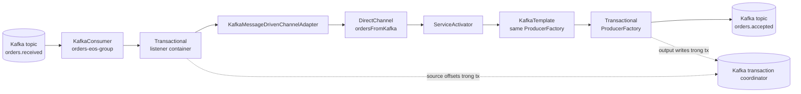
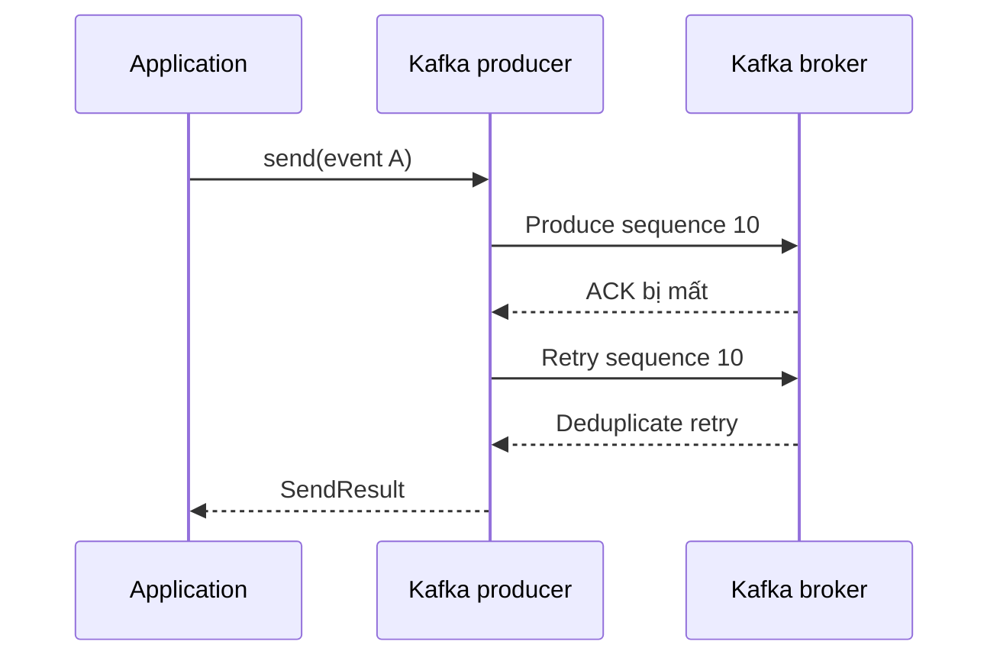
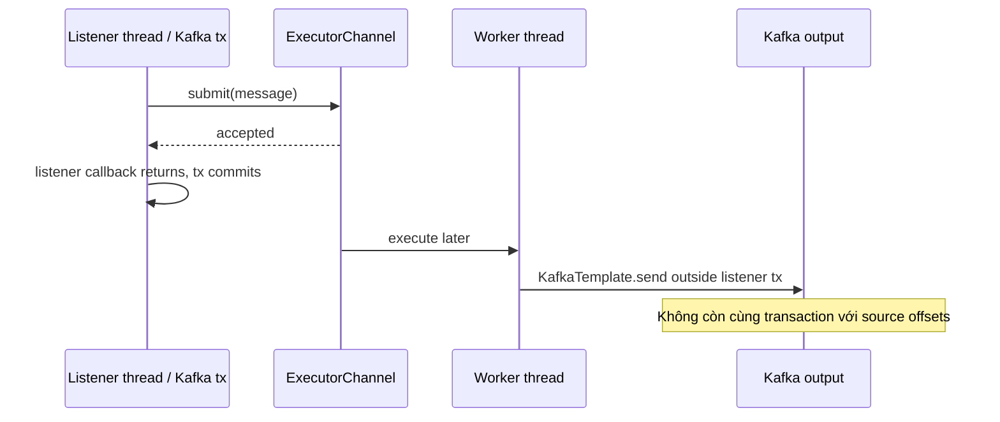
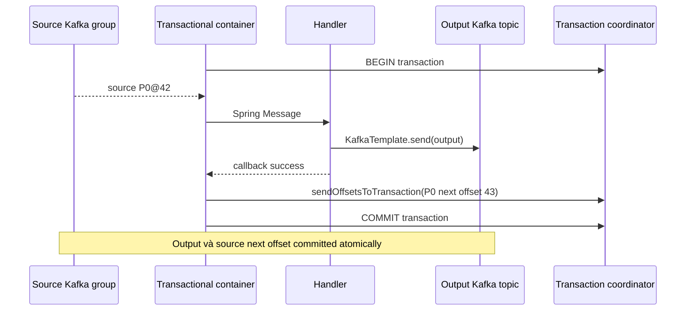
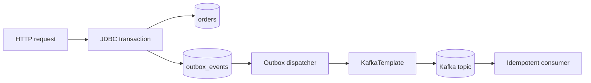

# Exactly-once và transaction producer

**Exactly-once semantics (EOS)** trong Kafka có phạm vi cụ thể: với một pipeline *consume → transform → produce*, Kafka có thể commit **những record ghi ra Kafka và consumer offsets của topic nguồn trong cùng một transaction**. Nó không có nghĩa mã Java được chạy đúng một lần, cũng không tự bao gồm JDBC, HTTP, SFTP, JMS hoặc AMQP. Những hệ thống bên ngoài Kafka cần **idempotency, inbox/outbox và cơ chế khôi phục riêng**.

Bài thuộc chương **Adapter Kafka** của module **SPRING_INTEGRATION_ADAPTERS**, nơi bạn kết nối các hệ thống ngoài bằng inbound/outbound adapter, gateway, poller và `MessageChannel`; thực hành luồng trao đổi qua file, SFTP, HTTP, JMS, AMQP, Kafka và cơ sở dữ liệu, tập trung vào message contract, lỗi và vòng đời kết nối. Chủ đề bài này là **producer idempotence, transactional producer, `KafkaTemplate`, `KafkaTransactionManager` và EOS khi kết hợp Kafka inbound/outbound trong Spring Integration**.

> **Cốt lõi:** `enable.idempotence=true` hạn chế trùng do producer retry; **Kafka transaction** gom Kafka writes thành một commit/abort; **Kafka EOS** cần đưa **source offsets vào transaction đó**; **exactly-once business effect** với database hoặc API bên ngoài vẫn cần thiết kế bổ sung.

## 1. Mục tiêu học tập

Sau bài học, bạn có thể:

1. Phân biệt at-most-once, at-least-once, idempotent producer, transactional producer, Kafka EOS và effectively-once business effect.
2. Giải thích `transactional.id`, producer fencing, `beginTransaction`, `commitTransaction`, `abortTransaction`, `sendOffsetsToTransaction`.
3. Tạo `DefaultKafkaProducerFactory` transactional, `KafkaTemplate` và `KafkaTransactionManager` dùng cùng một producer factory.
4. Gửi nhiều Kafka records trong một local Kafka transaction bằng `executeInTransaction`.
5. Sử dụng Spring `@Transactional` hoặc `TransactionTemplate` với KafkaTransactionManager đúng ranh giới.
6. Gắn KafkaTransactionManager vào `ConcurrentMessageListenerContainer` để tạo consumer-initiated Kafka transaction.
7. Kết nối `KafkaMessageDrivenChannelAdapter`, `DirectChannel`, service activator và Kafka output.
8. Hiểu `isolation.level=read_committed` và vì sao consumer có thể không nhìn thấy aborted records.
9. Phân tích Kafka transaction rollback, after-rollback retry, DLT và source offset recovery.
10. Đặt `transactionIdPrefix` duy nhất cho từng instance, quản lý cache/maxAge/concurrency và tránh producer fencing.
11. Phân biệt transaction đồng bộ với JDBC và atomic transaction thực sự; chọn inbox/outbox khi cần.
12. Kiểm thử commit/abort/crash/fencing và tính đúng đắn của EOS trong phạm vi Kafka.

## 2. Bảng phân biệt các mức bảo đảm

| Cơ chế | Bảo đảm chính | Không bảo đảm |
|---|---|---|
| At-most-once | Ưu tiên không phát lại record | Có thể mất side effect nếu ack sớm |
| At-least-once | Record có thể được nhận lại sau lỗi | Business handler có thể thực thi nhiều lần |
| Idempotent producer | Giảm duplicate từ Kafka producer retries cùng session/protocol | Hai lời gọi `send()` cùng eventId không bị gộp |
| Transactional producer | Kafka writes trong một transaction commit hoặc abort cùng nhau | Không tự commit source offsets |
| Kafka consume–transform–produce EOS | Kafka output và source offsets nằm trong một Kafka transaction | JDBC/HTTP/SFTP/JMS/AMQP không atomically commit theo Kafka |
| Business idempotency | Side effect không lặp khi cùng event được nhận lại | Không tự đảm bảo Kafka output/offset atomic |

**Đừng đánh đồng “exactly once” ở tầng transport và “exactly once” ở tầng nghiệp vụ.** Kafka EOS cho phép callback đọc/xử lý lặp lại, nhưng kết quả output Kafka và offset commit được kết hợp đúng protocol.

### 2.1. Một ví dụ có ba đích đến

```text
Kafka source: orders.received, P0@42, eventId=evt-101
      |
      v
Spring Integration handler:
  (A) transform thành OrderAccepted
  (B) publish orders.accepted [Kafka]
  (C) update orders table [JDBC]
  (D) lưu source group offset 43 [Kafka]
```

Với transactional Kafka listener, **(B) và (D)** có thể commit cùng transaction. **(C)** nằm trong transaction JDBC riêng; Kafka không tự hoàn tác DB khi Kafka transaction abort. Vì vậy, nếu DB đã commit rồi Kafka transaction rollback, record có thể đến lại và cần **eventId + unique constraint** để tránh lặp side effect.

## 3. Kiến trúc EOS trong Spring Integration



Đường thành công:

1. Listener container bắt đầu **Kafka transaction** trước khi gọi listener.
2. Inbound adapter chuyển `ConsumerRecord` thành Spring `Message<?>`.
3. `DirectChannel` dispatch handler **đồng bộ trên consumer thread**.
4. Handler gọi KafkaTemplate được tạo từ **cùng ProducerFactory** với KafkaTransactionManager.
5. Khi callback thành công, container đưa **next source offsets** vào Kafka transaction.
6. Container commit. `read_committed` consumer nhìn thấy output đã commit; source group offset tiến cùng transaction.

Đường lỗi: callback ném exception → Kafka transaction abort → offsets chưa commit qua transaction → record có thể được đọc lại theo after-rollback policy.

### 3.1. Input và output channel

- `KafkaMessageDrivenChannelAdapter` là **Kafka inbound**: nhận record rồi phát ra **Spring output channel**.
- `KafkaProducerMessageHandler` là **Kafka outbound**: nhận từ **Spring input channel** rồi gọi KafkaTemplate.
- `MessageChannel` là **đường nối nội bộ JVM**, không phải Kafka log hoặc transaction resource.
- `DirectChannel` bảo toàn thread/call stack; `ExecutorChannel`/`QueueChannel` tách thời điểm callback hoàn tất và có thể làm mất Kafka transaction context.

### 3.2. Không phải mọi Spring Integration flow đều transactional

`@ServiceActivator`, `IntegrationFlow` hoặc `DirectChannel` không tự bật Kafka transaction. Bạn cần một transactional producer factory, transaction manager hoặc `KafkaTemplate.executeInTransaction`, và **listener container phải được cấu hình transaction manager** nếu muốn source offsets vào cùng transaction.

## 4. Producer idempotence xử lý duplicate nào?

Kafka producer có thể retry khi ACK bị mất hoặc request timeout. `enable.idempotence=true` dùng producer identity/sequence để broker nhận biết một số duplicate do cùng producer retry.



Nhưng ứng dụng gọi hai lần:

```java
kafkaTemplate.send("orders.accepted", "ORD-101", "evt-101");
kafkaTemplate.send("orders.accepted", "ORD-101", "evt-101");
```

là **hai thao tác gửi nghiệp vụ khác nhau**. Producer idempotence không tự dedup theo payload/eventId, không xử lý duplicate do HTTP retry, scheduler replay hoặc outbox dispatcher gửi lại.

Các setting như `acks=all`, `retries` và `max.in.flight.requests.per.connection` phải tương thích yêu cầu Kafka client khi bật idempotence. Không kết hợp `acks=0` với transaction rồi kỳ vọng EOS.

## 5. Kafka producer transaction là gì?

Transactional producer nhóm nhiều Kafka records:

```text
initTransactions()
beginTransaction()
  send("orders.accepted", A)
  send("orders.audit", B)
commitTransaction()

Hoặc, khi có lỗi:
abortTransaction()
```

Một consumer `isolation.level=read_committed` không trả về các records thuộc transaction **đã abort**. Dữ liệu aborted có thể vẫn tồn tại bên trong Kafka log, nhưng không hiện như business records ở consumer isolation này.

| Thuật ngữ | Ý nghĩa |
|---|---|
| `transactional.id` | Identity logical producer transaction qua các phiên |
| Producer ID / epoch | Kafka quản lý session/sequence/fencing |
| Transaction coordinator | Broker quản lý trạng thái giao dịch |
| `initTransactions()` | Khởi tạo producer giao dịch, xử lý session cũ theo protocol |
| `beginTransaction()` | Bắt đầu Kafka transaction |
| `send()` | Ghi Kafka record trong transaction hiện hành |
| `sendOffsetsToTransaction()` | Đưa source consumer offsets/group metadata vào transaction |
| `commitTransaction()` | Commit output và offsets đã tham gia |
| `abortTransaction()` | Abort output và offsets chưa commit của transaction |
| `ProducerFencedException` | Producer cũ mất quyền tiếp tục session transaction |

### 5.1. Fencing chống zombie producer

Hai JVM dùng cùng `transactional.id` có thể đẩy nhau vào tình huống fencing khi JVM mới khởi tạo producer. Một producer bị fenced **không nên retry mãi bằng cùng instance**; cần đóng/recreate producer theo framework/lifecycle, kiểm tra cấu hình ID của pods.

### 5.2. `transactionIdPrefix` phải unique theo instance

`DefaultKafkaProducerFactory` thường tạo `transactional.id = transactionIdPrefix + suffix`. Trong Spring Kafka `EOSMode.V2`, prefix **không được trùng giữa các application instances sống cùng lúc**, kể cả consumer-initiated transactions.

Ví dụ sai trên ba pods:

```properties
spring.kafka.producer.transaction-id-prefix=orders-tx-
```

Ví dụ minh họa tốt hơn khi biến môi trường `HOSTNAME` là duy nhất:

```properties
spring.kafka.producer.transaction-id-prefix=orders-tx-${HOSTNAME}-
```

**Phải kiểm tra thực tế** deployment có cấp giá trị unique cho từng JVM/pod, kể cả rolling restart; không chỉ thêm một chuỗi suffix cố định `"-pod"`.

## 6. Điều kiện để dùng Kafka EOS

| Điều kiện | Tại sao quan trọng |
|---|---|
| Broker Kafka hỗ trợ transactions và EOS V2 | Spring Kafka 3.0+ chỉ hỗ trợ `EOSMode.V2`, broker Kafka ≥ 2.5 |
| Topics đã provision | Kafka producer/consumer cần topic/partition/ACL phù hợp |
| Producer transaction-capable | `DefaultKafkaProducerFactory.setTransactionIdPrefix(...)` |
| Unique transactional prefix | Tránh fencing giữa instances |
| `KafkaTemplate` cùng ProducerFactory | Join transaction đang bound vào thread |
| `KafkaTransactionManager` | Spring quản lý begin/commit/rollback |
| Kafka listener container gắn manager | Đưa source offsets vào cùng Kafka transaction |
| `enable.auto.commit=false` | Không để consumer tự commit offsets ngoài transaction |
| `isolation.level=read_committed` | Downstream chỉ xem committed transactional output |
| Đồng bộ handler qua `DirectChannel` | Không hoàn tất callback trước Kafka output |
| Recovery/replay policy | Lỗi có thể làm callback lặp; DLT cần thiết kế |
| Inbox/outbox cho hệ thống ngoài Kafka | Kafka không tự atomically commit JDBC/HTTP/SFTP |

Một Kafka cluster một broker trong **lab** có thể cần:

```properties
transaction.state.log.replication.factor=1
transaction.state.log.min.isr=1
```

Đây **không phải recommendation production**. Production nên cấu hình replication và `min.insync.replicas` phù hợp độ bền và vận hành.

## 7. Demo A — Spring Boot transactional ProducerFactory

Ví dụ dùng Java 17+ và bộ Spring Boot/Spring Kafka/Spring Integration tương thích. API `setKafkaAwareTransactionManager` ở ví dụ sau dành cho **Spring Kafka 3.2+ hoặc 4.x**; ứng dụng dùng nhánh cũ hơn cần tra đúng Javadoc, không trộn versions.

### 7.1. Dependencies Maven

```xml
<dependencies>
    <dependency>
        <groupId>org.springframework.boot</groupId>
        <artifactId>spring-boot-starter-integration</artifactId>
    </dependency>
    <dependency>
        <groupId>org.springframework.integration</groupId>
        <artifactId>spring-integration-kafka</artifactId>
    </dependency>
</dependencies>
```

Spring Boot BOM phải quản lý một bộ version tương thích. Không tự ghép Spring Kafka 4.x với Spring Boot 3.x hoặc Spring Integration không phù hợp.

### 7.2. application.properties

```properties
demo.kafka.bootstrap-servers=localhost:9092
demo.kafka.instance-id=local-1
demo.kafka.group-id=orders-eos-demo
demo.kafka.concurrency=2
```

`local-1` **chỉ dùng khi chạy một JVM demo**. Khi scale, mỗi instance cần ID riêng, tốt nhất do deployment cấp và được kiểm chứng không trùng.

### 7.3. Cấu hình đầy đủ Java

```java
package com.example.kafka;

import java.time.Duration;
import java.util.HashMap;
import java.util.Map;

import org.apache.kafka.clients.producer.ProducerConfig;
import org.apache.kafka.common.serialization.StringSerializer;
import org.springframework.beans.factory.annotation.Qualifier;
import org.springframework.beans.factory.annotation.Value;
import org.springframework.context.annotation.Bean;
import org.springframework.context.annotation.Configuration;
import org.springframework.kafka.core.DefaultKafkaProducerFactory;
import org.springframework.kafka.core.KafkaTemplate;
import org.springframework.kafka.core.ProducerFactory;
import org.springframework.kafka.transaction.KafkaTransactionManager;

@Configuration
public class OrdersKafkaProducerConfig {

    @Bean("ordersTxProducerFactory")
    public ProducerFactory<String, String> producerFactory(
            @Value("${demo.kafka.bootstrap-servers}") String brokers,
            @Value("${demo.kafka.instance-id}") String instanceId) {

        Map<String, Object> props = new HashMap<>();
        props.put(ProducerConfig.BOOTSTRAP_SERVERS_CONFIG, brokers);
        props.put(ProducerConfig.KEY_SERIALIZER_CLASS_CONFIG,
                StringSerializer.class);
        props.put(ProducerConfig.VALUE_SERIALIZER_CLASS_CONFIG,
                StringSerializer.class);
        props.put(ProducerConfig.ACKS_CONFIG, "all");
        props.put(ProducerConfig.ENABLE_IDEMPOTENCE_CONFIG, true);
        props.put(ProducerConfig.DELIVERY_TIMEOUT_MS_CONFIG, 30_000);
        props.put(ProducerConfig.REQUEST_TIMEOUT_MS_CONFIG, 10_000);

        DefaultKafkaProducerFactory<String, String> factory =
                new DefaultKafkaProducerFactory<>(props);

        factory.setTransactionIdPrefix(
                "orders-eos-" + instanceId + "-");
        // Giá trị lab: production phải so với broker expiry.
        factory.setMaxAge(Duration.ofMinutes(10));

        return factory;
    }

    @Bean("ordersTxKafkaTemplate")
    public KafkaTemplate<String, String> kafkaTemplate(
            @Qualifier("ordersTxProducerFactory")
            ProducerFactory<String, String> factory) {
        return new KafkaTemplate<>(factory);
    }

    @Bean("ordersKafkaTransactionManager")
    public KafkaTransactionManager<String, String> kafkaTxManager(
            @Qualifier("ordersTxProducerFactory")
            ProducerFactory<String, String> factory) {
        return new KafkaTransactionManager<>(factory);
    }
}
```

**Chính xác một factory chung** cho template và manager:

```text
ordersTxProducerFactory
   |               |
   v               v
KafkaTemplate    KafkaTransactionManager
```

Một KafkaTemplate dùng factory khác không tự tham gia transaction chỉ vì cùng bootstrap servers/topic.

### 7.4. Producer cache và `maxAge`

Khi transactional prefix được đặt, `DefaultKafkaProducerFactory` dùng cache các transactional producers. Trong Spring Kafka có `TransactionIdSuffixStrategy`/`DefaultTransactionIdSuffixStrategy(maxCache)` từ những version mới; nếu dùng fixed cache, cần capacity **≥ concurrency** của listener container, nhiều hơn khi có nested transactions.

`maxAge` giúp refresh transactional producer trước khi broker expire `transactional.id` của producer idle. Chọn maxAge thấp hơn `transactional.id.expiration.ms` thực tế và theo SLA; ví dụ 10 phút không phải mặc định production.

## 8. Demo B — KafkaTemplate local transaction

`KafkaTemplate.executeInTransaction(...)` phù hợp khi chỉ muốn nhóm Kafka writes mà **không có source offsets**.

```java
package com.example.kafka;

import org.springframework.beans.factory.annotation.Qualifier;
import org.springframework.kafka.core.KafkaTemplate;
import org.springframework.stereotype.Service;

@Service
public class OrdersTxPublisher {

    private final KafkaTemplate<String, String> template;

    public OrdersTxPublisher(
            @Qualifier("ordersTxKafkaTemplate")
            KafkaTemplate<String, String> template) {
        this.template = template;
    }

    public String publishPair(String orderId) {
        return template.executeInTransaction(operations -> {
            operations.send(
                    "orders.accepted", orderId, "ACCEPTED|" + orderId);
            operations.send(
                    "orders.audit", orderId, "AUDIT|" + orderId);
            return "Kafka callback finished";
        });
    }

    public void publishThenAbort(String orderId) {
        template.executeInTransaction(operations -> {
            operations.send(
                    "orders.accepted", orderId, "ACCEPTED|" + orderId);
            operations.send(
                    "orders.audit", orderId, "AUDIT|" + orderId);
            throw new IllegalStateException(
                    "Simulation: rollback Kafka transaction");
        });
    }
}
```

Nếu callback return bình thường, template commit Kafka transaction theo contract; nếu callback ném exception, transaction rollback. `read_committed` consumer không đọc hai records của transaction bị abort.

### 8.1. `send()` future ACK chưa phải transaction commit

Một `CompletableFuture<SendResult<K,V>>` có thể hoàn tất thành công khi broker ACK record, trong khi Kafka transaction vẫn đang mở và cuối cùng có thể abort. Không log `"business published"` chỉ vì future success khi chưa biết **transaction commit outcome**.

### 8.2. `executeInTransaction` không join outer transaction

Theo Spring Kafka, `executeInTransaction` tạo **một local transaction mới** ngay cả khi đã có KafkaTransactionManager/synchronized transaction đang hoạt động. Nó không phải một nested savepoint của transaction listener.

**Không dùng `executeInTransaction` bên trong consumer-initiated EOS handler nếu cần output tham gia cùng transaction chứa source offsets**. Hãy gọi `template.send(...)` trực tiếp trong context do listener container tạo.

## 9. KafkaTransactionManager và Spring `@Transactional`

`KafkaTransactionManager<K,V>` implement Spring `PlatformTransactionManager`. Có thể dùng `@Transactional("ordersKafkaTransactionManager")` hoặc `TransactionTemplate`.

```java
package com.example.kafka;

import org.springframework.beans.factory.annotation.Qualifier;
import org.springframework.kafka.core.KafkaTemplate;
import org.springframework.stereotype.Service;
import org.springframework.transaction.annotation.Transactional;

@Service
public class KafkaManagedPublisher {

    private final KafkaTemplate<String, String> template;

    public KafkaManagedPublisher(
            @Qualifier("ordersTxKafkaTemplate")
            KafkaTemplate<String, String> template) {
        this.template = template;
    }

    @Transactional("ordersKafkaTransactionManager")
    public void publish(String orderId, String value) {
        template.send("orders.accepted", orderId, value);
        template.send("orders.audit", orderId, "AUDIT|" + value);
    }
}
```

Nếu project có JDBC/JPA manager và Kafka manager, **chọn rõ manager**. `@Transactional` không nêu manager không tự điều phối atomic commit giữa hai resource managers.

### 9.1. Self-invocation và transaction proxy

Một lời gọi `this.publish(...)` từ method khác **trong cùng bean** có thể bypass Spring proxy, khiến transaction annotation không có tác dụng. Tách service bean hoặc dùng `TransactionTemplate` khi cần boundary tường minh.

### 9.2. TransactionTemplate

```java
// Snippet trong bean đã inject KafkaTransactionManager<String,String>
// và KafkaTemplate<String,String> dùng cùng ProducerFactory.
TransactionTemplate tx = new TransactionTemplate(kafkaTxManager);

tx.execute(status -> {
    kafkaTemplate.send(
            "orders.accepted", "ORD-101", "ACCEPTED|ORD-101");
    return null;
});
```

`TransactionTemplate` là Spring transaction API; không gọi thủ công `KafkaProducer.beginTransaction()/commitTransaction()` đồng thời với Spring manager nếu không có lý do và thiết kế rõ.

### 9.3. Send ngoài transaction

Transactional KafkaTemplate thông thường cần một transaction đang hoạt động (listener container, `@Transactional`, `TransactionTemplate` hoặc `executeInTransaction`). Nếu gọi ngoài transaction có thể ném `IllegalStateException`. Có tùy chọn `allowNonTransactional`, nhưng bật nó thay đổi guarantee: một số sends sẽ không còn nằm trong Kafka transaction.

## 10. Demo C — Consumer-initiated Kafka EOS với Spring Integration

Đây là phần tích hợp trực tiếp inbound adapter vào luồng Kafka→Kafka.

```text
orders.received (Kafka source topic)
    -> transactional Spring Kafka listener container
    -> KafkaMessageDrivenChannelAdapter
    -> DirectChannel("ordersFromKafka")
    -> ServiceActivator
    -> KafkaTemplate.send("orders.accepted", ...)
    -> container sendOffsetsToTransaction + commit
```

### 10.1. ConsumerFactory

```java
package com.example.kafka;

import java.util.HashMap;
import java.util.Map;

import org.apache.kafka.clients.consumer.ConsumerConfig;
import org.apache.kafka.common.serialization.StringDeserializer;
import org.springframework.beans.factory.annotation.Value;
import org.springframework.context.annotation.Bean;
import org.springframework.context.annotation.Configuration;
import org.springframework.kafka.core.ConsumerFactory;
import org.springframework.kafka.core.DefaultKafkaConsumerFactory;

@Configuration
public class OrdersEosConsumerConfig {

    @Bean("ordersEosConsumerFactory")
    public ConsumerFactory<String, String> consumerFactory(
            @Value("${demo.kafka.bootstrap-servers}") String brokers,
            @Value("${demo.kafka.group-id}") String groupId) {

        Map<String, Object> props = new HashMap<>();
        props.put(ConsumerConfig.BOOTSTRAP_SERVERS_CONFIG, brokers);
        props.put(ConsumerConfig.GROUP_ID_CONFIG, groupId);
        props.put(ConsumerConfig.KEY_DESERIALIZER_CLASS_CONFIG,
                StringDeserializer.class);
        props.put(ConsumerConfig.VALUE_DESERIALIZER_CLASS_CONFIG,
                StringDeserializer.class);
        props.put(ConsumerConfig.ENABLE_AUTO_COMMIT_CONFIG, false);
        props.put(ConsumerConfig.AUTO_OFFSET_RESET_CONFIG, "earliest");
        props.put(ConsumerConfig.ISOLATION_LEVEL_CONFIG,
                "read_committed");

        return new DefaultKafkaConsumerFactory<>(props);
    }
}
```

`read_committed` cũng phù hợp nếu input topic nhận transactional writes. Nó **không tự khiến source offset được commit transactionally**; listener container phải có transaction manager.

### 10.2. Kafka message-driven inbound adapter

```java
package com.example.kafka;

import org.springframework.beans.factory.annotation.Qualifier;
import org.springframework.beans.factory.annotation.Value;
import org.springframework.context.annotation.Bean;
import org.springframework.context.annotation.Configuration;
import org.springframework.integration.channel.DirectChannel;
import org.springframework.integration.config.EnableIntegration;
import org.springframework.integration.kafka.inbound.KafkaMessageDrivenChannelAdapter;
import org.springframework.kafka.core.ConsumerFactory;
import org.springframework.kafka.listener.ConcurrentMessageListenerContainer;
import org.springframework.kafka.listener.ContainerProperties;
import org.springframework.kafka.transaction.KafkaTransactionManager;
import org.springframework.messaging.MessageChannel;

@Configuration
@EnableIntegration
public class OrdersEosInboundConfig {

    @Bean("ordersFromKafka")
    public MessageChannel ordersFromKafka() {
        return new DirectChannel();
    }

    @Bean("ordersEosInboundAdapter")
    public KafkaMessageDrivenChannelAdapter<String, String> inbound(
            @Qualifier("ordersEosConsumerFactory")
            ConsumerFactory<String, String> consumerFactory,
            @Qualifier("ordersKafkaTransactionManager")
            KafkaTransactionManager<String, String> kafkaTxManager,
            @Qualifier("ordersFromKafka")
            MessageChannel output,
            @Value("${demo.kafka.concurrency:2}") int concurrency) {

        ContainerProperties cp =
                new ContainerProperties("orders.received");

        // Spring Kafka 3.2+ / 4.x.
        cp.setKafkaAwareTransactionManager(kafkaTxManager);

        ConcurrentMessageListenerContainer<String, String> container =
                new ConcurrentMessageListenerContainer<>(
                        consumerFactory, cp);
        container.setConcurrency(concurrency);

        KafkaMessageDrivenChannelAdapter<String, String> adapter =
                new KafkaMessageDrivenChannelAdapter<>(
                    container,
                    KafkaMessageDrivenChannelAdapter.ListenerMode.record);

        adapter.setOutputChannel(output);
        return adapter;
    }
}
```

Điểm cốt lõi:

- `setKafkaAwareTransactionManager` gắn manager vào **container tự tạo**, không chỉ khai báo bean ở ApplicationContext.
- Container bắt đầu Kafka transaction quanh callback listener.
- `ListenerMode.record` phát một Spring message/record.
- `DirectChannel` giữ handler trên Kafka listener thread.
- Không cần gọi manual `Acknowledgment.acknowledge()` để thay thế cơ chế offset transaction của container.
- Kafka `EOSMode.V2` được hỗ trợ ở Spring Kafka 3.0+; không copy cấu hình legacy EOS modes.
- Không gắn adapter recovery callback chỉ log rồi suppress exception nếu bạn kỳ vọng rollback.

### 10.3. ServiceActivator publish vào transaction hiện hành

```java
package com.example.kafka;

import org.springframework.beans.factory.annotation.Qualifier;
import org.springframework.integration.annotation.ServiceActivator;
import org.springframework.kafka.core.KafkaTemplate;
import org.springframework.kafka.support.KafkaHeaders;
import org.springframework.messaging.Message;
import org.springframework.stereotype.Component;

@Component
public class OrdersEosProcessor {

    private final KafkaTemplate<String, String> template;

    public OrdersEosProcessor(
            @Qualifier("ordersTxKafkaTemplate")
            KafkaTemplate<String, String> template) {
        this.template = template;
    }

    @ServiceActivator(inputChannel = "ordersFromKafka")
    public void handle(Message<String> incoming) {
        String value = incoming.getPayload();
        String orderId = incoming.getHeaders().get(
                KafkaHeaders.RECEIVED_KEY, String.class);

        if (orderId == null || orderId.isBlank()
                || value.isBlank()) {
            throw new IllegalArgumentException(
                    "Missing Kafka key or event value");
        }

        // Join Kafka transaction của listener container.
        // Không executeInTransaction() trong callback này.
        template.send(
                "orders.accepted",
                orderId,
                "ACCEPTED|" + value);
    }
}
```

Một `@SpringBootApplication` cùng package `com.example.kafka` hoặc package cha sẽ quét các beans. Demo dùng StringSerializer/StringDeserializer để tránh pha trộn JSON type mapping; production cần bổ sung schema, validation, ACL và idempotency.

### 10.4. Vì sao không `ExecutorChannel` hoặc `QueueChannel`?



`ExecutorChannel`/`QueueChannel` có thể trả về trước khi side effect hoàn tất, làm Kafka source offset commit trước output. Context Kafka transaction thường gắn với thread; async worker không tự tham gia đúng producer transaction. Để tách luồng, phải thiết kế **durable handoff, transaction barrier, ack/offset và replay** riêng.

## 11. Kafka outbound adapter tham gia transaction như thế nào?

Bên cạnh việc gọi KafkaTemplate trực tiếp, Spring Integration có `KafkaProducerMessageHandler` cho Kafka outbound adapter.

```java
@Bean("ordersTxOutboundHandler")
KafkaProducerMessageHandler<String, String> outboundHandler(
        @Qualifier("ordersTxKafkaTemplate")
        KafkaTemplate<String, String> template) {

    KafkaProducerMessageHandler<String, String> handler =
            new KafkaProducerMessageHandler<>(template);

    handler.setTopicExpression(
            new LiteralExpression("orders.accepted"));
    handler.setSync(true);
    return handler;
}
```

Cần imports:

```java
import org.springframework.expression.common.LiteralExpression;
import org.springframework.integration.kafka.outbound.KafkaProducerMessageHandler;
```

**Điều kiện:** Outbound handler được gọi trên **cùng listener transaction thread** qua DirectChannel và dùng cùng KafkaTemplate/ProducerFactory. `setSync(true)` chờ send result theo timeout; **send ACK khác transaction commit**.

### 11.1. Chuyển header key inbound sang outbound

Inbound record key thông thường là `KafkaHeaders.RECEIVED_KEY`; outbound handler thường cần `KafkaHeaders.KEY` hoặc key expression.

```java
Message<String> outgoing = MessageBuilder
        .withPayload("ACCEPTED|" + incoming.getPayload())
        .setHeader(
            KafkaHeaders.KEY,
            incoming.getHeaders().get(KafkaHeaders.RECEIVED_KEY))
        .build();
```

Cần imports `Message`, `MessageBuilder`, `KafkaHeaders`. Nếu contract đòi ordering theo `orderId`, validate key != null trước khi build message.

### 11.2. Java DSL để nối outbound adapter

```java
@Bean
IntegrationFlow ordersTxOutboundFlow(
        @Qualifier("ordersTxOutboundHandler")
        KafkaProducerMessageHandler<String, String> handler) {

    return IntegrationFlow.from("ordersToKafka")
            .handle(handler, e -> e.id("ordersTxOutboundEndpoint"))
            .get();
}
```

`ordersToKafka` phải là một Spring input channel đã đăng ký. Đây là **phương án thay thế** service activator tự gọi template ở mục 10.3, không đồng thời gửi cả hai nếu chỉ mong một output event. Import `org.springframework.integration.dsl.IntegrationFlow`.

## 12. `read_committed` và `read_uncommitted`

| Consumer isolation | Nhìn thấy gì? |
|---|---|
| `read_uncommitted` | Có thể đọc records thuộc transactions đã abort |
| `read_committed` | Chỉ trả user records từ committed transactions và non-transactional writes |

```mermaid
sequenceDiagram
  participant P as Producer
  participant K as Broker
  participant U as read_uncommitted
  participant C as read_committed
  P->>K: begin transaction; send A + B
  K-->>U: A/B có thể được đọc
  Note over C: A/B chưa visible
  P->>K: abort transaction
  Note over C: A/B không được trả về
```

Lưu ý:

- Transaction aborted có thể để lại offsets/control markers trong Kafka log; offsets mà ứng dụng nhìn thấy có thể không liên tục.
- Open transaction có thể ảnh hưởng **Last Stable Offset (LSO)** cho read_committed consumer.
- `read_committed` không loại bỏ business duplicate nếu cùng event được gửi trong hai **committed transactions riêng**.
- Consumer đọc committed data vẫn có thể retry xử lý vì lỗi trước khi source offset commit.

### 12.1. CLI kiểm tra output

```bash
kafka-console-consumer.sh \
  --bootstrap-server localhost:9092 \
  --topic orders.accepted \
  --from-beginning \
  --group orders-eos-inspector \
  --consumer-property isolation.level=read_committed
```

Dùng group inspector khác source group để không ảnh hưởng committed offsets nguồn.

## 13. Source offsets được commit trong Kafka transaction ra sao?



Nếu handler ném exception, transaction abort: **output chưa commit không visible cho read_committed**, source next offset cũng không commit qua transaction, nên record nguồn có thể được nhận lại.

### 13.1. Vì sao commit 43 thay vì 42?

Kafka lưu committed offset là **vị trí đọc tiếp**. Khi xử lý record P0@42, next offset là 43; không có nghĩa handler đã xử lý record 43.

### 13.2. EOS không có nghĩa method chạy đúng một lần

Khi transaction abort/rebalance, listener có thể xử lý record lại:

```text
PROCESS eventId=evt-101, attempt=1
  Kafka output send
  exception -> Kafka ABORT

PROCESS eventId=evt-101, attempt=2
  Kafka output send
  return OK -> Kafka COMMIT
```

Đây là hành vi phù hợp Kafka EOS: **read/process at-least-once**, nhưng đầu ra Kafka cùng source offset có transaction consistency.

### 13.3. Record mode và batch mode

Container transactional có semantics tương đương RECORD hoặc BATCH tùy listener type. Batch callback xử lý cả nhóm và khi thất bại cần after-rollback policy cho partial/fallback batch recovery. Đừng dùng `AckMode.RECORD` với batch listener hoặc kỳ vọng batch tự tạo DB transaction.

## 14. Lỗi và `DefaultAfterRollbackProcessor`

Với Kafka transactional listener, exception dẫn tới rollback. `DefaultAfterRollbackProcessor` xử lý seek/retry/recovery của records chưa hoàn tất. Nó khác `DefaultErrorHandler` dùng phổ biến khi listener **không** transactional.

| Tầng | Vai trò |
|---|---|
| `KafkaTransactionManager` | Begin/commit/rollback producer transaction |
| Kafka listener container | Callback, source offsets to transaction |
| `DefaultAfterRollbackProcessor` | Sau rollback: seek, redelivery, retry/recover |
| `DeadLetterPublishingRecoverer` | Publish failed record vào DLT qua KafkaTemplate |
| Spring Integration `errorChannel` | Kênh chứa `ErrorMessage` nội bộ, không tự là Kafka DLT |

### 14.1. Không nuốt exception trong error flow

Nếu `@ServiceActivator` ném exception nhưng một recovery callback/error channel trên adapter bắt lỗi rồi return thành công, container có thể thấy callback thành công và **commit transaction**. Chỉ log `ErrorMessage` không phải một durable recovery.

Hãy đảm bảo exception propagate khi cần rollback, hoặc recovery thật sự lưu vào DLT/durable quarantine theo một policy có kiểm chứng.

### 14.2. DLT recovery trong transaction

Muốn DLT publish và recovered source offsets cùng Kafka transaction, cần cấu hình transactional recoverer/`DefaultAfterRollbackProcessor`/`commitRecovered` theo đúng Spring Kafka version và producer factory.

**Không suy rằng mọi DLT + offset commit mặc nhiên atomic.** Nếu DLT producer ACK xong nhưng source offset chưa commit, restart có thể gửi DLT trùng. Nếu DLT producer fail, không đánh dấu record đã recover thành công.

### 14.3. Non-blocking retry topics

Spring Kafka tài liệu nêu **non-blocking retry topics không thể kết hợp với container transactions theo cùng cơ chế**. Không đặt `@RetryableTopic` lên một Spring Integration `@ServiceActivator` rồi mong Kafka transactional container tự hình thành retry topics.

Khi retry topic làm record 41 vượt record 40 cùng key, thứ tự nghiệp vụ cũng có thể bị thay đổi. Cần phân loại lỗi và xác định yêu cầu ordering.

## 15. DB-first và Kafka-first không phải atomic distributed commit

Giả sử API vừa cập nhật JDBC vừa gửi Kafka event.

### 15.1. DB-first synchronization

```text
BEGIN JDBC transaction
  UPDATE orders
  KafkaTemplate.send(...)
COMMIT JDBC
COMMIT Kafka
```

Nếu DB đã commit rồi Kafka commit thất bại, DB có state nhưng Kafka có thể không có event (hoặc kết quả chưa chắc chắn). Phải reconcile/compensate.

### 15.2. Kafka-first synchronization

```text
BEGIN Kafka transaction
  send Kafka event
  UPDATE orders trong JDBC transaction riêng
COMMIT Kafka
COMMIT JDBC
```

Nếu Kafka commit rồi DB commit fail, consumer có thể thấy event trong khi DB chưa có state.

### 15.3. Vì sao `@Transactional` không đủ?

Spring có thể **đồng bộ hai transactions theo thứ tự**, nhưng không biến chúng thành một atomic distributed XA transaction. Với nhiều managers, tên `@Transactional("...")` quyết định resource chính; nested manager/proxy cần thiết kế riêng.

| Failure window | Hệ quả | Cơ chế bảo vệ |
|---|---|---|
| DB commit, Kafka tx fail | DB state có nhưng event thiếu | Transactional outbox + reconciliation |
| Kafka tx commit, DB fail | Kafka event visible nhưng DB rollback | Inbox/state machine, đổi architecture |
| DB commit trước Kafka source offset | Kafka redeliver, JDBC side effect lặp | Idempotent inbox/unique key |
| DLT ACK trước source commit | DLT có thể bị republish sau crash | DLT dedup/source identity |
| HTTP/SFTP side effect trước Kafka tx abort | Side effect ngoài Kafka không rollback | Idempotency key, workflow/compensation |

## 16. Transactional outbox cho DB → Kafka



Quy trình:

1. Trong **một database transaction**, ghi order và outbox row mang `eventId`, key, payload, PENDING.
2. Dispatcher claim row, gửi event ra Kafka và quan sát producer ACK/transaction outcome.
3. Sau khi Kafka ACK/commit thành công, cập nhật trạng thái row `SENT`.
4. Crash sau Kafka commit trước `SENT` → có thể gửi lại cùng `eventId`.
5. Consumer downstream dùng inbox/unique constraint để bỏ qua duplicate business effect.

```sql
CREATE TABLE outbox_events (
    event_id VARCHAR(128) PRIMARY KEY,
    aggregate_id VARCHAR(128) NOT NULL,
    topic VARCHAR(255) NOT NULL,
    payload TEXT NOT NULL,
    status VARCHAR(20) NOT NULL,
    created_at TIMESTAMP NOT NULL DEFAULT CURRENT_TIMESTAMP
);
```

Schema ví dụ cần thêm claim lock, retry/backoff, attempt count, cleanup, index và audit. Kafka producer transaction không loại bỏ cửa sổ giữa Kafka commit và DB mark SENT, nên outbox **vẫn cần downstream idempotency**.

## 17. Inbox/idempotency cho Kafka → DB

Nếu consumer vừa nhận Kafka vừa gọi JDBC, một record có thể được xử lý lại sau Kafka transaction abort hoặc trước source offset commit.

```sql
CREATE TABLE processed_events (
    event_id VARCHAR(128) PRIMARY KEY,
    processed_at TIMESTAMP NOT NULL DEFAULT CURRENT_TIMESTAMP
);
```

Pseudocode trong **JDBC transaction**, ví dụ PostgreSQL:

```java
// Method do database transaction manager quản lý.
int claim = jdbc.update(
    "INSERT INTO processed_events(event_id) VALUES (?) "
    + "ON CONFLICT (event_id) DO NOTHING",
    eventId);

if (claim == 0) {
    return; // Đã xử lý eventId trước đó.
}

jdbc.update(
    "UPDATE orders SET status=? WHERE order_id=?",
    newStatus, orderId);
```

Giữ insert inbox và business update **trong cùng JDBC transaction**. Với Spring, gọi một service bean khác có `@Transactional("jdbcTransactionManager")` qua proxy rồi mới coi side effect đã commit; Kafka transaction vẫn độc lập.

**Không dùng topic-partition-offset làm khóa chống duplicate nghiệp vụ duy nhất** nếu cùng event có thể được republish ở offset mới. Dùng `eventId` hoặc business idempotency key.

## 18. Producer cache, concurrency và fencing khi scale

Topic 12 partitions, 3 pods, mỗi pod Kafka container `concurrency=2`:

```text
Tổng Kafka consumer threads = 3 × 2 = 6
Mỗi pod có thể có 2 Kafka listener transactions đang hoạt động
Mỗi pod cần transactional producers đủ cho concurrent transactions
transactionIdPrefix phải unique giữa cả 3 pods
```

| Trạng thái | Hệ quả |
|---|---|
| `maxCache < concurrency` với fixed suffix strategy | `NoProducerAvailableException` hoặc không đủ transactional producer |
| Nested `executeInTransaction` trong callback | Thêm transaction producer riêng, tăng cache pressure |
| Cùng prefix giữa hai pods | Producer fencing có thể xảy ra |
| Producer idle quá lâu | Broker expiry có thể khiến producer bị fenced |
| Transaction kéo dài | Giữ producer, tăng pool contention và timeout |
| Thay group/partition assignment | Record có thể replay sau rollback/rebalance |

Từ Spring Kafka 3.2, `DefaultTransactionIdSuffixStrategy(maxCache)` cho phép quản lý suffix IDs bằng pool. Khi dùng fixed cache, đặt ít nhất bằng concurrency và cộng capacity cho nested cases. Không đặt mọi pod cùng `transactionIdPrefix` chỉ để dễ theo dõi logs.

### 18.1. `maxAge` và broker expiration

`DefaultKafkaProducerFactory.setMaxAge(...)` giúp producer factory thay producer idle trước khi `transactional.id.expiration.ms` phía broker hết hạn. `ProducerFencedException` không phải lỗi nên retry vô hạn với cùng producer; cần đổi/đóng resource theo lifecycle.

### 18.2. Graceful shutdown

- Ngừng nhận thêm source records.
- Cho in-flight Kafka transactions commit/abort trong deadline.
- Không tự close producer đang được factory/cache quản lý.
- Theo dõi group rebalance/fencing/transaction commit errors.
- Khi crash không kịp commit, chấp nhận redelivery và dựa vào business idempotency.

## 19. Isolation, timeout và backpressure

| Property / yếu tố | Tác động |
|---|---|
| `isolation.level=read_committed` | Chỉ trả transactional committed user records |
| `transaction.timeout.ms` | Giới hạn Kafka transaction duration theo broker policy |
| `delivery.timeout.ms` | Tổng thời gian producer cố gửi một record |
| `request.timeout.ms` | Timeout chờ phản hồi một broker request |
| `max.poll.interval.ms` | Giới hạn khoảng giữa consumer poll calls |
| `max.poll.records` | Giới hạn records trong poll |
| `producer maxAge` | Refresh producers trước expiration của transactional ID |
| `concurrency` | Số child Kafka consumer threads trong container |
| `maxCache` | Capacity transactional IDs/producers khi fixed suffix strategy |

Một handler `DirectChannel` gọi JDBC/HTTP trong vài phút giữ Kafka transaction mở lâu, có thể chạm transaction timeout hoặc `max.poll.interval.ms` và dẫn tới rollback/rebalance. Không tăng vô hạn mọi timeout. Cân nhắc rút ngắn callback, tách side effect sang outbox/inbox, giữ số records per poll phù hợp downstream capacity.

## 20. Lỗi và chẩn đoán

| Triệu chứng | Nguyên nhân có thể | Kiểm tra |
|---|---|---|
| Transactional template `send` ném `IllegalStateException` | Gửi ngoài transaction | Container manager, `@Transactional`, `executeInTransaction` |
| Producer fenced | Prefix trùng hoặc phiên producer expired | Instance ID, broker coordinator, maxAge |
| `NoProducerAvailableException` | Transactional producer cache cạn | maxCache, concurrency, nested tx |
| Future send thành công nhưng output không visible | Transaction chưa commit hoặc đã abort | Transaction outcome, isolation |
| `read_uncommitted` thấy record, `read_committed` không | Aborted/open transaction | Isolation, LSO |
| Source offset tiến nhưng Kafka output thiếu | Output gửi ngoài container tx hoặc recovery swallow | ProducerFactory identity, thread, error path |
| Kafka output có duplicate | Producer send ngoài tx nguồn hoặc republish business | eventId, source committed offsets |
| DB update lặp dù Kafka EOS bật | JDBC ngoài Kafka transaction | Inbox, unique constraint |
| DLT duplicate | DLT commit không atomic với recovered source offset | AfterRollbackProcessor config, recovery result |
| Transaction timeout | Handler/retries quá lâu hoặc broker setting | Duration, Kafka client/broker logs |
| LAG=0 nhưng JDBC chưa xong | Async QueueChannel/ExecutorChannel | Callback boundary, queue durability |
| Topic chưa sẵn sàng/ACL lỗi | Topic/permission mismatch | KafkaAdmin/CLI, broker error |

### 20.1. Quy trình điều tra đúng lớp

1. Xác định source topic/group/partition/offset và output topic.
2. Kiểm tra producer factory có `transactionIdPrefix` và unique giữa instances không.
3. Kiểm tra KafkaTemplate dùng **chính** factory của manager.
4. Xác minh listener container **được gắn** manager, không chỉ có bean manager.
5. Kiểm tra giữa inbound và outbound có async channel hay `executeInTransaction` lồng thêm không.
6. Xác định handler exception có quay về container để rollback không.
7. Dùng consumer `read_committed` kiểm tra output, cùng source committed offset.
8. Nếu có JDBC/HTTP, kiểm tra business idempotency độc lập với Kafka commit outcome.

## 21. Kiểm thử transaction với Kafka broker thật

Mock `KafkaTemplate` không chứng minh Kafka EOS; cần Kafka test broker/cluster phù hợp (ví dụ Testcontainers hoặc embedded broker) và kiểm tra isolation/offsets.

### 21.1. Local commit

- Dùng `executeInTransaction` gửi A và B sang hai Kafka topics.
- Consumer `read_committed` chỉ nhận sau commit.
- Không suy rằng hai topics có thứ tự toàn cục.

### 21.2. Local abort

- Gửi A và B trong transaction, ném exception.
- Consumer `read_committed` không nhận A/B dưới dạng user records.
- `read_uncommitted` có thể nhận aborted records.

### 21.3. Container EOS

- Gửi source `orders.received P0@42`.
- Handler `KafkaTemplate.send` output, container commit.
- Đọc output bằng `read_committed`.
- Xác nhận source group đã commit **next offset 43**.
- Trong test khác, handler send rồi throw: output abort và source record có thể nhận lại.

### 21.4. Crash window

```text
Kafka source P0@42
  -> begin transaction
  -> output send scheduled
  -> kill JVM trước commit
  -> restart cùng group
  -> source redelivery
  -> chỉ một committed Kafka output của luồng hợp lệ visible
```

Dùng barrier/latch để tiêm lỗi và await có deadline; không chỉ `Thread.sleep` rồi khẳng định EOS.

### 21.5. JDBC không nằm trong EOS

Trong listener callback, commit DB rồi ném exception để Kafka tx abort. Sau retry, DB có thể bị gọi lại. Thêm inbox `processed_events(eventId UNIQUE)` và chứng minh business side effect không lặp.

### 21.6. Fencing, rebalance và cache

- Hai instances cùng literal prefix → xem producer fencing.
- Hai prefixes riêng → rolling restart, kiểm tra output/source.
- Fixed maxCache nhỏ hơn concurrency → quan sát pool exhaustion.
- DLT publisher failure → xác định recovered offset thật.
- Ngừng pod giữa Kafka send và commit → output read_committed không công bố output abort.

## 22. Kafka CLI cho lab

Tạo topics (single broker, chỉ cho lab):

```bash
kafka-topics.sh --bootstrap-server localhost:9092 \
  --create --if-not-exists \
  --topic orders.received --partitions 3 --replication-factor 1

kafka-topics.sh --bootstrap-server localhost:9092 \
  --create --if-not-exists \
  --topic orders.accepted --partitions 3 --replication-factor 1

kafka-topics.sh --bootstrap-server localhost:9092 \
  --create --if-not-exists \
  --topic orders.audit --partitions 3 --replication-factor 1
```

Gửi source keyed event:

```bash
kafka-console-producer.sh \
  --bootstrap-server localhost:9092 \
  --topic orders.received \
  --property parse.key=true \
  --property key.separator=:
```

Nhập:

```text
ORD-101:evt-101|ORD-101|CREATED
ORD-102:evt-102|ORD-102|CREATED
ORD-101:evt-103|ORD-101|PAID
```

Quan sát output:

```bash
kafka-console-consumer.sh \
  --bootstrap-server localhost:9092 \
  --topic orders.accepted --from-beginning \
  --group orders-output-inspector \
  --consumer-property isolation.level=read_committed
```

Kiểm tra source committed offsets:

```bash
kafka-consumer-groups.sh \
  --bootstrap-server localhost:9092 \
  --describe --group orders-eos-demo
```

Group inspector có committed offset riêng, không reset source group production. `CURRENT-OFFSET` là vị trí đọc tiếp, không phải bằng chứng JDBC/HTTP đã hoàn tất.

## 23. Observability và vận hành

| Metric/điểm quan sát | Câu hỏi |
|---|---|
| Producer transaction commit/abort count | Có rollback bất thường không? |
| Transaction commit latency p95/p99 | Coordinator/broker/handler có chậm? |
| Producer fenced events | Có trùng transactional IDs hoặc idle expiry? |
| Active transactional producer cache | Cache có đủ cho concurrency? |
| Source group lag theo partition | Consumer đang xử lý/retry đúng không? |
| Kafka output read_committed rate | Kafka output có visible sau commit? |
| AfterRollbackProcessor retry/DLT | Poison pill có được recover? |
| DLT backlog age | Lỗi có owner và SLA xử lý? |
| JDBC inbox duplicate count | External business effect đang replay bao nhiêu lần? |
| Outbox pending/retry age | DB→Kafka đang có events chưa publish? |
| Rebalance count và transaction duration | Rolling deploy làm tăng abort/retry? |
| Producer send errors/timeouts | Network/ACL/schema có vấn đề? |

Đây là **gợi ý metrics nghiệp vụ**, không phải khẳng định framework tự xuất mọi meter bằng đúng tên đó. Log eventId, source topic/partition/offset, transaction outcome, producer ID và commit state một cách bảo mật; không log raw tokens/PII.

## 24. Các sai lầm thường gặp

| Hiểu lầm | Cách hiểu đúng |
|---|---|
| “`enable.idempotence=true` là exactly-once toàn hệ thống.” | Chỉ giảm duplicate producer retries trong phạm vi Kafka. |
| “Transactional producer tự commit source offsets.” | Cần transactional listener container/`sendOffsetsToTransaction`. |
| “KafkaTemplate future success nghĩa tx commit.” | Send ACK khác transaction commit outcome. |
| “`read_committed` ngăn Java method chạy nhiều lần.” | Listener có thể retry/redeliver; read/process at-least-once. |
| “`executeInTransaction` join container tx.” | Nó mở local transaction mới, không nên dùng trong EOS handler cần chung source offsets. |
| “Có KafkaTransactionManager bean là container tự transactional.” | Container dựng thủ công phải được gắn manager. |
| “Một `@Transactional` gộp JDBC và Kafka atomically.” | Ordered commits vẫn có failure window. |
| “Các pods dùng chung prefix để dễ quản lý.” | Có thể làm producer fencing. |
| “`DirectChannel` là một Kafka transaction.” | Nó chỉ giữ synchronous dispatch/thread. |
| “`ExecutorChannel` giữ Kafka tx context qua thread pool.” | Không tự truyền đúng transaction bound vào listener thread. |
| “`QueueChannel` RAM giữ bền Kafka message.” | Crash sau callback có thể mất queued business work. |
| “Kafka transaction abort rollback HTTP/SFTP/JDBC.” | External side effect phải có idempotency/compensation. |
| “DLT record và source offset luôn atomic.” | Phải thiết kế transactional recoverer/after-rollback policy. |
| “LAG=0 nghĩa business DB đã xong.” | Source offset có thể tiến trước external side effect. |
| “Kafka EOS làm eventId không còn cần thiết.” | Business republish/replay vẫn có duplicate. |

## 25. Bài tập thực hành

### Bài 1 — Phân loại guarantees

Với bốn yêu cầu “producer retry không trùng”, “hai Kafka outputs commit cùng nhau”, “source offsets + outputs atomic”, “DB side effect không lặp”, hãy chọn idempotence, local transaction, Kafka EOS và business inbox.

### Bài 2 — Commit hai topics

Chạy `OrdersTxPublisher.publishPair`, dùng `read_committed` kiểm tra cả accepted và audit xuất hiện sau commit.

### Bài 3 — Abort transaction

Chạy `publishThenAbort`, so sánh `read_committed` và `read_uncommitted`. Giải thích vì sao output aborted không phải business event committed.

### Bài 4 — Producer fencing giữa pods

Chạy hai JVM cùng prefix, xem fencing; sửa bằng unique prefix và thử rolling restart.

### Bài 5 — Producer cache

Đặt `maxCache < concurrency` trên fixed suffix strategy, tái hiện thiếu producers; điều chỉnh cache có dự phòng nested transactions.

### Bài 6 — Sai ProducerFactory

Cho manager dùng factory A, template dùng factory B. Kiểm tra lỗi/transaction join và sửa dùng chung factory.

### Bài 7 — Container không có manager

Bỏ `cp.setKafkaAwareTransactionManager(...)` ở demo C. Kiểm tra transaction không được tạo như mong muốn và giải thích vì sao bean KafkaTransactionManager không tự áp vào container này.

### Bài 8 — Async channel

Đổi `DirectChannel` thành `ExecutorChannel`, cho worker delay. Theo dõi Kafka tx boundary và output; đề xuất durable handoff.

### Bài 9 — Outbound adapter

Thay template send trực tiếp bằng `KafkaProducerMessageHandler`, map `RECEIVED_KEY` thành `KEY`, giữ same factory + DirectChannel.

### Bài 10 — Exception sau send

Handler send output rồi throw. Kiểm tra rollback, source redelivery và output read_committed.

### Bài 11 — DLT trong transactional listener

Dùng `DefaultAfterRollbackProcessor` với recoverer phù hợp, test khi DLT publisher thành công/thất bại và committed source offsets.

### Bài 12 — DB side effect lặp

Commit JDBC rồi throw làm Kafka transaction abort, cho source replay; thêm inbox unique eventId và chứng minh không ghi trùng.

### Bài 13 — DB-first vs Kafka-first

Chèn failure ở giữa hai commit orders. Viết bảng divergence, recovery và reconciliation.

### Bài 14 — Transactional outbox

Ghi order+outbox cùng DB tx; sau Kafka ACK nhưng trước mark SENT thì crash, xem replay và downstream dedup.

### Bài 15 — Isolation

Gửi transactions commit/abort, quan sát LSO/offset gaps của `read_committed` và `read_uncommitted`.

### Bài 16 — Long-running transaction

Cho handler chậm, đo Kafka transaction timeout, `max.poll.interval.ms`, cache utilization; thiết kế ranh giới giao dịch ngắn hơn.

### Bài 17 — Scale out

Topic 12 partitions, 3 pods × concurrency 2: đề xuất prefix, cache, shutdown, retry và metrics; kiểm thử rebalance giữa transaction.

### Bài 18 — Production review

Hệ thống Kafka → JDBC + Kafka output + HTTP payment: xác định phần nào được Kafka EOS bảo vệ, nơi cần inbox/outbox/idempotency, retry/DLT, transaction timeout và 3 điểm crash chaos test.

## 26. Câu hỏi tự kiểm tra

1. Idempotent producer khác transactional producer ở đâu?
2. Vì sao hai lần `send()` cùng eventId có thể tạo duplicate?
3. `transactional.id` và `transactionIdPrefix` có ý nghĩa gì?
4. Vì sao mỗi pod cần transactional prefix unique?
5. `ProducerFencedException` biểu thị trạng thái nào?
6. `beginTransaction`, `commitTransaction` và `abortTransaction` xử lý gì?
7. `sendOffsetsToTransaction` thêm dữ liệu nào vào tx?
8. Spring Kafka 3.0+ chỉ dùng EOS mode nào?
9. EOS V2 yêu cầu Kafka broker ít nhất phiên bản nào?
10. `KafkaTemplate.executeInTransaction` có tự chứa source offsets không?
11. Có nên gọi `executeInTransaction` trong container transaction đang hoạt động không?
12. `KafkaTransactionManager` phải chia sẻ factory với template không?
13. Một container được tạo `new` có tự dùng manager bean trong context không?
14. `setKafkaAwareTransactionManager` cần đặt ở đâu?
15. Vì sao `DirectChannel` thích hợp cho Kafka EOS flow?
16. `ExecutorChannel` có giữ transaction context của consumer thread không?
17. `KafkaHeaders.RECEIVED_KEY` và `KafkaHeaders.KEY` khác nhau thế nào?
18. KafkaTemplate future success có là bằng chứng transaction commit không?
19. `read_committed` khác `read_uncommitted` thế nào?
20. Vì sao aborted output có thể làm offsets quan sát không liên tục?
21. Kafka EOS có bảo đảm service activator chỉ được gọi một lần không?
22. Handler exception trong transactional container dẫn tới điều gì?
23. `DefaultAfterRollbackProcessor` khác `DefaultErrorHandler` ở use case nào?
24. DLT và source offsets có luôn atomic không?
25. Một `@Transactional` có tự gộp JDBC và Kafka thành XA không?
26. Vì sao cần inbox cho Kafka→DB?
27. Vì sao cần outbox cho DB→Kafka?
28. Khi crash sau Kafka commit trước outbox mark SENT, điều gì xảy ra?
29. `maxCache` và `concurrency` có quan hệ gì?
30. `maxAge` giúp tránh lỗi producer nào?
31. Khi Kafka lag bằng 0, đã có thể khẳng định JDBC commit không?
32. Test nào thực sự chứng minh Kafka output và source offsets commit atomic?

## 27. Tổng kết

Kafka producer idempotence, Kafka producer transaction và Kafka consume–transform–produce EOS là **ba tầng bảo đảm khác nhau**. Để thực hiện Kafka EOS, cần transactional ProducerFactory, KafkaTemplate cùng factory, KafkaTransactionManager trên listener container, luồng xử lý synchronous qua DirectChannel và downstream consumer `read_committed`.

```text
Kafka source + consumer group
   -> Transactional listener container BEGIN
   -> KafkaMessageDrivenChannelAdapter
   -> DirectChannel
   -> ServiceActivator / KafkaProducerMessageHandler
   -> KafkaTemplate (same transactional ProducerFactory)
   -> send Kafka output
   -> listener callback returns successfully
   -> sendOffsetsToTransaction(next source offset)
   -> COMMIT Kafka transaction

Failure:
   -> ABORT transaction
   -> AfterRollbackProcessor / retry / DLT
   -> source record có thể redeliver
```

**Giới hạn cuối cùng:** Kafka không tự commit JDBC/HTTP/SFTP/JMS/AMQP cùng transaction. Muốn tác dụng phụ nghiệp vụ không lặp hoặc DB→Kafka không mất event, cần eventId/inbox, transactional outbox và kiểm thử crash windows. Xác minh bằng Kafka broker thật, output `read_committed`, source committed offsets và transaction outcome, không chỉ bằng log “send succeeded”.

## Tài liệu tham khảo

- [Spring Kafka Reference — Exactly Once Semantics](https://docs.spring.io/spring-kafka/reference/kafka/exactly-once.html)
- [Spring Kafka Reference — Transactions](https://docs.spring.io/spring-kafka/reference/kafka/transactions.html)
- [Spring Kafka Reference — Message Listener Containers](https://docs.spring.io/spring-kafka/reference/kafka/receiving-messages/message-listener-container.html)
- [Spring Kafka Reference — Error Handling / After-Rollback Processor](https://docs.spring.io/spring-kafka/reference/kafka/annotation-error-handling.html)
- [Spring Kafka API — KafkaTransactionManager](https://docs.spring.io/spring-kafka/api/org/springframework/kafka/transaction/KafkaTransactionManager.html)
- [Spring Kafka API — DefaultKafkaProducerFactory](https://docs.spring.io/spring-kafka/api/org/springframework/kafka/core/DefaultKafkaProducerFactory.html)
- [Spring Kafka API — KafkaTemplate](https://docs.spring.io/spring-kafka/api/org/springframework/kafka/core/KafkaTemplate.html)
- [Spring Kafka API — ContainerProperties](https://docs.spring.io/spring-kafka/api/org/springframework/kafka/listener/ContainerProperties.html)
- [Spring Integration Reference — Apache Kafka Support](https://docs.spring.io/spring-integration/reference/kafka.html)
- [Spring Integration API — KafkaMessageDrivenChannelAdapter](https://docs.spring.io/spring-integration/api/org/springframework/integration/kafka/inbound/KafkaMessageDrivenChannelAdapter.html)
- [Spring Integration API — KafkaProducerMessageHandler](https://docs.spring.io/spring-integration/api/org/springframework/integration/kafka/outbound/KafkaProducerMessageHandler.html)
- [Apache Kafka — Producer Configs](https://kafka.apache.org/documentation/#producerconfigs)
- [Apache Kafka — Consumer Configs](https://kafka.apache.org/documentation/#consumerconfigs)
- [Apache Kafka — Exactly-Once Semantics](https://kafka.apache.org/documentation/#semantics)
