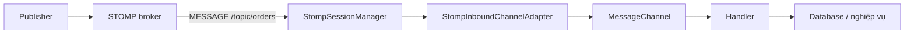
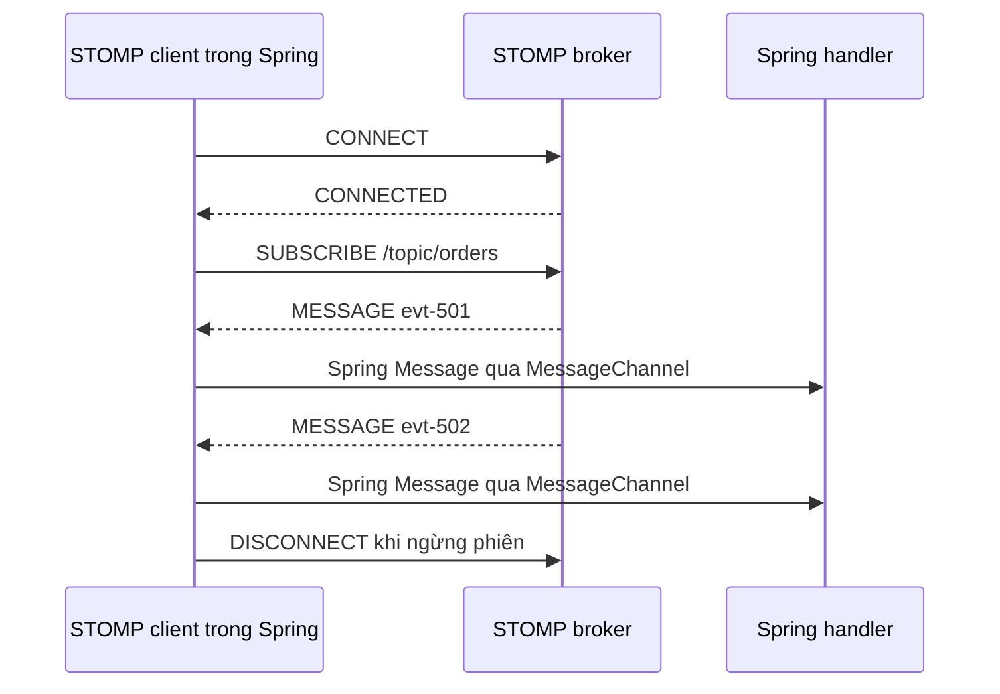

# STOMP inbound channel adapter trong Spring Integration

## 1. Bài toán và mục tiêu

Giả sử hệ thống bán hàng cần nhận sự kiện đơn hàng từ một broker hỗ trợ **STOMP**. Đối tác gửi sự kiện đến destination `/topic/orders`; ứng dụng Java cần đăng ký lắng nghe, nhận payload và headers rồi chuyển dữ liệu cho handler xác thực, ghi nhận đơn hàng và kiểm tra trùng lặp. Nếu từng service tự quản lý kết nối TCP/WebSocket, frame protocol, phiên STOMP và lỗi kết nối thì mã nguồn sẽ khó kiểm soát.

Trong module **SPRING_INTEGRATION_ADAPTERS**, các inbound/outbound adapter, gateway và `MessageChannel` kết nối hệ thống ngoài với luồng message nội bộ. **`StompInboundChannelAdapter`** là một inbound **message producer**: nó sử dụng một phiên STOMP để subscribe các destination và đưa frame `MESSAGE` nhận được thành Spring `Message<?>` vào `MessageChannel`. Handler tiếp theo có thể là service activator, transformer, filter, router hoặc một integration flow lớn hơn.



Sau bài học, bạn sẽ biết cách đọc frame STOMP, phân biệt subscription với poller, cấu hình STOMP client và session manager, tạo inbound adapter và handler, ánh xạ headers, quản lý destination và thiết kế kết nối, ACK, error flow, idempotency an toàn.

## 2. STOMP và vòng đời subscription

**STOMP** là giao thức truyền message theo frame, có thể được triển khai qua TCP hoặc WebSocket. Client kết nối đến broker, gửi `CONNECT`, nhận `CONNECTED` rồi gửi `SUBSCRIBE` tới một destination. Khi có dữ liệu, broker đẩy frame `MESSAGE` về session đã đăng ký.

Ví dụ frame nhận:

```text
MESSAGE
subscription:sub-0
message-id:evt-501
destination:/topic/orders
content-type:text/plain

orderId=501;status=CREATED
^@
```

`^@` biểu diễn byte NUL kết thúc frame STOMP; nó không phải hai ký tự cần gõ nguyên văn. Tên destination và headers cụ thể phụ thuộc broker, client và phiên bản giao thức.



| Khái niệm | Vai trò |
| --- | --- |
| `destination` | Đích subscribe/publish ở broker STOMP, ví dụ `/topic/orders`. |
| `StompClientSupport` | STOMP client ở lớp Spring Framework, quản lý giao thức và transport. |
| `StompSessionManager` | Quản lý `StompSession` và chia sẻ session cho các adapter. |
| `StompInboundChannelAdapter` | Nhận frame từ session rồi phát Spring `Message<?>`. |
| `MessageChannel` | Kênh bên trong ứng dụng, không phải broker destination. |
| `@ServiceActivator` | Handler nhận message sau adapter để chạy nghiệp vụ. |

### STOMP không phải một polling inbound adapter theo thời gian

Adapter STOMP nhận message theo **callback của subscription**. Nó không dùng một `TaskScheduler` định kỳ gọi `MessageSource.receive()` như adapter file, SFTP hoặc JDBC. Do đó:

- Không thêm `@Poller(fixedDelay = "5000")` vào `StompInboundChannelAdapter` để bắt broker gửi event mỗi 5 giây.
- `maxMessagesPerPoll` và `receiveTimeout` của polling consumer không điều khiển số frame broker tự đẩy qua subscription.
- Scheduler đặt trên STOMP client có thể phục vụ **heartbeat** và receipt timeout; đó không phải lịch quét dữ liệu từ broker.
- Nếu muốn giới hạn tốc độ nghiệp vụ, đặt queue/executor, bộ giới hạn tải hoặc consumer riêng ở phía sau adapter và thiết kế backpressure.

```text
File inbound (pull):  Trigger -> MessageSource.receive() -> MessageChannel
STOMP inbound (push): Broker MESSAGE -> Session callback -> MessageChannel
```

## 3. Chọn transport và quản lý session

Spring Framework hỗ trợ các STOMP client như:

- `ReactorNettyTcpStompClient`: STOMP trực tiếp qua TCP tới host và cổng mà broker cung cấp.
- `WebSocketStompClient`: STOMP chạy trên WebSocket; ứng dụng kết nối tới endpoint `ws://` hoặc `wss://` hợp lệ.

Ví dụ chính bên dưới dùng **STOMP/TCP**, không phải STOMP-over-WebSocket. Một broker chỉ bật WebSocket không thể được dùng với `ReactorNettyTcpStompClient` chỉ bằng cách truyền URL WebSocket vào tham số host.

`StompSessionManager` quản lý session dùng chung và tương tác với callback STOMP. Với TCP client, implementation thích hợp là `ReactorNettyTcpStompSessionManager`. Một session manager có thể được dùng cho inbound adapter, outbound adapter hoặc cả hai khi cùng kết nối broker tương ứng.

**Lưu ý:** session manager quản lý kết nối, không phải kho lưu trữ bền vững cho message nghiệp vụ và cũng không tự tạo semantics exactly-once.

## 4. Dependencies và điều kiện chạy thử

Trong dự án Spring Boot có BOM quản lý phiên bản tương thích:

```xml
<dependencies>
    <dependency>
        <groupId>org.springframework.boot</groupId>
        <artifactId>spring-boot-starter-integration</artifactId>
    </dependency>
    <dependency>
        <groupId>org.springframework.integration</groupId>
        <artifactId>spring-integration-stomp</artifactId>
    </dependency>
    <dependency>
        <groupId>io.projectreactor.netty</groupId>
        <artifactId>reactor-netty</artifactId>
    </dependency>
</dependencies>
```

Dependency Reactor Netty phù hợp với lựa chọn client TCP của ví dụ. Với WebSocket transport cần thêm thư viện và client WebSocket phù hợp. Không ghép tùy tiện Spring Framework và Spring Integration từ các BOM không tương thích.

Trước khi chạy ứng dụng, chuẩn bị:

1. Broker thực sự **bật STOMP/TCP**, ví dụ một endpoint thử nghiệm trên `127.0.0.1:61613`.
2. Destination `/topic/orders` theo cách broker quy định.
3. Quyền kết nối và `SUBSCRIBE` hợp lệ; nếu broker yêu cầu xác thực, cấu hình CONNECT headers.
4. Một STOMP publisher/client có thể gửi frame tới cùng destination.

Port `61613` thường xuất hiện ở ví dụ STOMP/TCP, nhưng **không phải tất cả broker mặc định nghe ở port này**.

## 5. Cấu hình STOMP inbound adapter bằng Java

Ví dụ dưới đây dùng Java 17, Spring Boot và Spring Integration, đồng thời tách vai trò client, session manager, adapter, output channel và handler.

```java
import java.nio.charset.StandardCharsets;

import org.springframework.beans.factory.annotation.Qualifier;
import org.springframework.context.annotation.Bean;
import org.springframework.context.annotation.Configuration;
import org.springframework.integration.annotation.ServiceActivator;
import org.springframework.integration.channel.DirectChannel;
import org.springframework.integration.config.EnableIntegration;
import org.springframework.integration.stomp.ReactorNettyTcpStompSessionManager;
import org.springframework.integration.stomp.StompSessionManager;
import org.springframework.integration.stomp.inbound.StompInboundChannelAdapter;
import org.springframework.integration.support.converter.PassThruMessageConverter;
import org.springframework.messaging.Message;
import org.springframework.messaging.MessageChannel;
import org.springframework.messaging.simp.stomp.ReactorNettyTcpStompClient;
import org.springframework.scheduling.concurrent.ThreadPoolTaskScheduler;

@Configuration
@EnableIntegration
public class StompInboundConfiguration {

    @Bean
    public ThreadPoolTaskScheduler stompScheduler() {
        ThreadPoolTaskScheduler scheduler = new ThreadPoolTaskScheduler();
        scheduler.setPoolSize(1);
        scheduler.setThreadNamePrefix("stomp-heartbeat-");
        return scheduler;
    }

    @Bean
    public ReactorNettyTcpStompClient stompClient(
            ThreadPoolTaskScheduler stompScheduler) {

        ReactorNettyTcpStompClient client =
            new ReactorNettyTcpStompClient("127.0.0.1", 61613);
        client.setMessageConverter(new PassThruMessageConverter());
        client.setTaskScheduler(stompScheduler);
        client.setReceiptTimeLimit(5000);
        return client;
    }

    @Bean
    public StompSessionManager stompSessionManager(
            ReactorNettyTcpStompClient stompClient) {

        ReactorNettyTcpStompSessionManager manager =
            new ReactorNettyTcpStompSessionManager(stompClient);
        manager.setAutoReceipt(true);
        return manager;
    }

    @Bean
    public MessageChannel stompInputChannel() {
        return new DirectChannel();
    }

    @Bean
    public StompInboundChannelAdapter stompInboundChannelAdapter(
            StompSessionManager stompSessionManager,
            @Qualifier("stompInputChannel") MessageChannel channel) {

        StompInboundChannelAdapter adapter =
            new StompInboundChannelAdapter(
                stompSessionManager, "/topic/orders"
            );
        adapter.setOutputChannel(channel);
        adapter.setPayloadType(String.class);
        return adapter;
    }

    @ServiceActivator(inputChannel = "stompInputChannel")
    public void handleOrder(Message<?> message) {
        Object payload = message.getPayload();
        String body = (payload instanceof byte[] bytes)
            ? new String(bytes, StandardCharsets.UTF_8)
            : String.valueOf(payload);

        System.out.printf(
            "Spring id=%s, body=%s%n",
            message.getHeaders().getId(), body
        );

        // TODO: validate schema, idempotency, persist and alert.
    }
}
```

### Diễn giải cấu hình

| Bean | Chức năng |
| --- | --- |
| `stompScheduler` | Cung cấp scheduler cho hoạt động STOMP client như heartbeat/receipt timeout. |
| `stompClient` | Kết nối đến broker bằng STOMP/TCP và cấu hình message conversion. |
| `stompSessionManager` | Quản lý session và các subscription của inbound/outbound adapter dùng chung. |
| `stompInputChannel` | `DirectChannel` nhận Spring message sau khi adapter chuyển đổi frame. |
| `stompInboundChannelAdapter` | Subscribe `/topic/orders` và gửi message vào channel. |
| `handleOrder` | Handler đồng bộ minh họa nhận payload và Spring message ID. |

Ví dụ dùng `PassThruMessageConverter` để phù hợp với đường xử lý Spring Messaging. Kiểu payload thực tế phụ thuộc converter, content-type và cấu hình `setPayloadType`; handler chấp nhận cả `String` và `byte[]` để minh họa. Trong ứng dụng thật, nên chốt hợp đồng (chẳng hạn JSON UTF-8), kiểm tra kiểu dữ liệu, không phụ thuộc `String.valueOf` để diễn giải các kiểu payload bất kỳ.

### Cấu hình môi trường

Thay giá trị hardcode cho môi trường production bằng cấu hình ứng dụng:

```yaml
app:
  stomp:
    host: "broker.internal.example"
    port: 61613
    destination: "/topic/orders"
```

Có thể bind các thuộc tính này qua `@ConfigurationProperties` hoặc `@Value` vào bean. Username, password, token và khóa riêng phải đến từ secret store hoặc biến môi trường được quản lý; không hardcode trong file đang commit.

**Không dùng `@InboundChannelAdapter` hoặc `@Poller` khác để bọc bean `StompInboundChannelAdapter`.** Nó đã là một endpoint message producer được Spring quản lý vòng đời.

## 6. Gửi và nhận frame thử nghiệm

Khi broker đang chạy, publisher có thể gửi frame:

```text
SEND
destination:/topic/orders
content-type:text/plain

orderId=501;status=CREATED
^@
```

Đây là minh họa frame, **không phải lệnh terminal hoàn chỉnh**. Client cần kết nối trước bằng STOMP và gửi ký tự NUL thật ở cuối. Khi subscribe thành công và message được broker phân phối, handler có thể ghi:

```text
Spring id=<spring-message-uuid>, body=orderId=501;status=CREATED
```

Phần ID trong log là ID của **Spring `MessageHeaders`**, không mặc nhiên trùng với header `message-id` của broker. Với xử lý nghiệp vụ, dùng `eventId`/business key ổn định để chống tạo đơn hàng trùng.

Thử các tình huống:

1. Broker không mở cổng: xem log kết nối và sự kiện lỗi session, không chỉ log handler.
2. Subscribe sai destination: client có thể kết nối nhưng không nhận event mong đợi.
3. Gửi frame hợp lệ: quan sát handler, headers và số message nhận.
4. Gửi payload không hợp lệ: xác minh error flow và chính sách quarantine.
5. Ngắt rồi mở lại broker: đo thời gian reconnect và việc subscribe lại.

## 7. Payload và ánh xạ header STOMP

Frame STOMP có command, header và body. Spring Integration cung cấp `StompHeaderMapper` và `IntegrationStompHeaders` để đưa metadata STOMP sang `MessageHeaders`; các header chuẩn thường có tiền tố **`stomp_`** khi nằm trong Spring message.

| STOMP frame | Ví dụ | Điều cần làm khi nhận |
| --- | --- | --- |
| `destination` | `/topic/orders` | Xác định loại sự kiện và chính sách định tuyến. |
| `message-id` | `evt-501` | Phân biệt với Spring message ID; xem broker contract. |
| `subscription` | `sub-0` | Hỗ trợ truy vết subscription nhận frame. |
| `content-type` | `application/json` | Chọn JSON parser/validator phù hợp. |
| Body | `{"orderId":501}` | Validate schema và business ID trước khi ghi DB. |

Đừng tin header custom do publisher đưa vào là thông tin đã xác thực. Các giá trị như tenant ID, correlation ID, event type hoặc business key cần được xác nhận với quyền truy cập broker và hợp đồng nghiệp vụ. Nếu tự cài đặt `HeaderMapper`, kiểm tra rằng các header STOMP chuẩn vẫn được map theo yêu cầu.

`StompInboundChannelAdapter#setPayloadType(String.class)` quy định kiểu payload đích mong muốn. Conversion cuối cùng phụ thuộc converter được đặt trên session; khi dùng custom JSON converter, cần kiểm thử body, charset, content-type và thông báo lỗi nếu conversion thất bại.

## 8. Subscribe nhiều destination và thay đổi khi đang chạy

Constructor inbound adapter có thể nhận nhiều destination:

```java
StompInboundChannelAdapter adapter =
    new StompInboundChannelAdapter(
        stompSessionManager,
        "/topic/orders",
        "/topic/payments"
    );
adapter.setOutputChannel(stompInputChannel);
```

Spring Integration có các managed operation:

```java
adapter.addDestination("/topic/returns");
adapter.removeDestination("/topic/payments");
```

Điều này cho phép cập nhật subscription **mà không nhất thiết tạo lại toàn bộ application context**, nhưng cần xác minh trạng thái session, quyền subscribe và việc broker đã chấp nhận lệnh. Không cung cấp một API công khai nhận destination tùy ý mà không có authentication, authorization và allowlist.

### Topic, queue và nhiều instance

| Kiểu đích | Xu hướng hành vi | Lưu ý |
| --- | --- | --- |
| Topic | Có thể fan-out message cho từng subscription độc lập. | Nhiều replica cùng subscribe có thể cùng xử lý một event. |
| Queue | Có thể phân phối message giữa nhiều consumer cạnh tranh. | Chi tiết phụ thuộc broker, ack mode và naming convention. |
| Durable subscription | Broker có thể giữ message khi subscriber tạm vắng. | Chỉ có nếu broker hỗ trợ và được cấu hình đúng. |

Không giả định đường dẫn bắt đầu bằng `/queue/` hoặc `/topic/` có semantics hoàn toàn giống nhau trên mọi broker. Hãy kiểm tra hướng dẫn destination của broker cụ thể.

## 9. Receipt, ACK/NACK và transaction nghiệp vụ

STOMP hỗ trợ các cơ chế xác nhận khác nhau, không nên đánh đồng:

| Cơ chế | Nó xác nhận điều gì? | Không bảo đảm |
| --- | --- | --- |
| `RECEIPT` | Broker trả lời một frame có yêu cầu receipt. | Handler đã commit DB thành công. |
| `ACK/NACK` | Client xác nhận/từ chối một delivery theo chế độ subscription và broker. | Transaction JDBC của ứng dụng tự động gắn với broker. |
| Business commit | Kết quả nghiệp vụ đã được ghi nhận thành công. | Broker không phát lại khi chưa có ack phù hợp. |

Ví dụ trên bật `manager.setAutoReceipt(true)`; cơ chế này có thể tạo receipt cho hoạt động STOMP như `SUBSCRIBE`. **Receipt của subscription không phải acknowledgement của đơn hàng đã được xử lý.**

STOMP có các kiểu ack như `auto`, `client` và `client-individual`. Nếu nghiệp vụ yêu cầu manual acknowledgement, cần kiểm tra contract broker và API/configuration của adapter hoặc `StompSession` ở phiên bản sử dụng. Không tự suy diễn có một `ackMode` property của inbound adapter giống hệt listener JMS hoặc AMQP.

Đặc biệt, với automatic acknowledgement, broker có thể coi frame đã được giao trước khi handler ghi DB thành công. Khi handler ném exception, **Spring Integration error channel không tự bảo đảm broker sẽ redeliver** message đó.

Chiến lược xử lý đáng tin cậy cần xác định event ID ổn định, lưu kết quả idempotent, cấu hình retry/quarantine và hiểu retention/redelivery của broker. Một subscription thành công không tạo **exactly-once end-to-end**.

## 10. Lỗi kết nối, lỗi dispatch và sự kiện STOMP

Có ít nhất hai nhóm lỗi:

**Lỗi kết nối/session:** broker ngừng hoạt động, CONNECT bị từ chối, heartbeat mất, phiên bị ngắt hoặc broker trả STOMP `ERROR`. Các lỗi bất đồng bộ này thường được theo dõi bằng trạng thái session manager và **`StompIntegrationEvent`** hoặc event chuyên biệt.

**Lỗi chuyển message vào flow:** payload không convert được, channel không thể gửi hoặc handler đồng bộ ném exception. Khi lỗi thuộc phạm vi adapter, `MessageProducerSupport` có thể đưa `ErrorMessage` tới error channel mà bạn cấu hình. Nếu lỗi xảy ra trong downstream worker sau `ExecutorChannel`, cần error flow riêng ở worker.

### Ví dụ error channel bổ sung

Thêm các thành phần sau vào class cấu hình ở mục 5; không tạo bean adapter thứ hai:

```java
import org.springframework.messaging.support.ErrorMessage;

@Bean
public MessageChannel stompErrors() {
    return new DirectChannel();
}

// Trong method tạo adapter, trước câu return:
adapter.setErrorChannel(stompErrors());

@ServiceActivator(inputChannel = "stompErrors")
public void onStompError(ErrorMessage error) {
    Throwable failure = error.getPayload();
    System.err.println(
        "STOMP inbound error: " + failure.getClass().getSimpleName()
    );
}
```

### Theo dõi sự kiện STOMP bất đồng bộ

```java
import org.springframework.context.event.EventListener;
import org.springframework.integration.stomp.event.StompIntegrationEvent;

@EventListener
public void onStompEvent(StompIntegrationEvent event) {
    System.out.println(
        "STOMP event: " + event.getClass().getSimpleName()
    );
}
```

Event giao thức và Spring business message **khác nhau**. Một `StompReceiptEvent` tích cực không phải event đơn hàng; lỗi kết nối không nhất thiết đi qua cùng `stompErrors` với lỗi converter/dispatch.

### Reconnect và resubscription

`StompSessionManager` có cơ chế quản lý kết nối/recovery tùy implementation. Tuy nhiên, không được giả định mọi lỗi sẽ được phục hồi ngay, không có message nào bị bỏ lỡ hoặc broker luôn redeliver sau khi reconnect. Cần giám sát:

- Lần kết nối thành công cuối và số lần reconnect.
- Subscription đang hoạt động, receipt khi yêu cầu và số frame nhận.
- Lỗi xác thực, heartbeat timeout và broker disconnect.
- Độ tuổi event chưa được xử lý, số event trùng và khoảng dữ liệu bị thiếu.

Nếu mất kết nối, khả năng replay phụ thuộc topic/queue, durability, retention và ack semantics. Với dữ liệu quan trọng, cần thêm cơ chế đối soát hoặc đọc bù.

## 11. Heartbeat, lifecycle và timeout

Trong STOMP, heartbeat giúp hai bên phát hiện kết nối không còn hoạt động theo hợp đồng. `ThreadPoolTaskScheduler` của client có thể hỗ trợ heartbeat và receipt timeout, nhưng **không phải poller định kỳ lấy message**.

| Thông số | Vai trò |
| --- | --- |
| Heartbeat interval | Giám sát sự sống của kết nối theo thỏa thuận client/broker. |
| Receipt time limit | Thời gian đợi frame `RECEIPT` khi đã yêu cầu receipt. |
| Adapter send timeout | Giới hạn chờ khi gửi Spring message đến channel có thể chặn. |
| Connection recovery interval | Điều tiết thử kết nối lại theo session manager/transport. |

Adapter có lifecycle `start()` và `stop()` được Spring quản lý. Dừng adapter không tự hủy mọi handler downstream đang chạy hoặc rollback các transaction đã commit. Khi shutdown, cần chính sách drain queue, giải phóng session, timeout và phục hồi message chưa được xử lý.

## 12. DirectChannel, ExecutorChannel và backpressure

Ví dụ dùng `DirectChannel` vì đường xử lý dễ quan sát. Tuy nhiên, handler chậm có thể giữ luồng nhận/dispatch lâu, ảnh hưởng throughput.

Khi dùng `ExecutorChannel` hoặc `QueueChannel`:

- Message có thể đã được channel nhận nhưng **nghiệp vụ chưa hoàn thành**.
- Exception trong worker async thường cần error flow/downstream retry riêng.
- Queue phải hữu hạn; cần đo queue depth, worker saturation và rejection.
- Message trong queue RAM có thể mất sau khi process crash nếu không có persistence.
- Nhiều worker có thể thay đổi thứ tự xử lý event.

```text
STOMP broker -> Inbound adapter -> ExecutorChannel -> Worker handler -> DB
                                     |
                                     +-> bounded queue, backpressure
                                     +-> error/retry/quarantine flow
```

Tăng concurrency chỉ khi có bằng chứng nguồn và DB đích chịu được tải, đồng thời handler hỗ trợ idempotency. Nếu phải giữ thứ tự theo `orderId`, cân nhắc xử lý tuần tự từng khóa hoặc phân vùng theo khóa.

## 13. Bảo mật và giới hạn dữ liệu

1. Dùng tài khoản broker có quyền **SUBSCRIBE** tối thiểu cần thiết; thông tin đăng nhập lấy từ secret manager.
2. Bật TLS phù hợp với transport: `wss://` cho WebSocket hoặc STOMP/TCP có TLS cấu hình đúng; xác minh chứng chỉ broker.
3. Kiểm tra quyền publisher và destination. CONNECT thành công không đồng nghĩa client được phép subscribe.
4. Giới hạn kích thước frame/payload; kiểm tra content-type, encoding và schema.
5. Không tin tùy ý các header custom như tenant ID, event type hay correlation ID.
6. Không ghi password, token, PII hoặc nguyên body nhạy cảm ra log production.
7. Sử dụng idempotency key ổn định và audit trail cho các event được commit.

## 14. Chẩn đoán vận hành

| Triệu chứng | Kiểm tra |
| --- | --- |
| Không kết nối | Port, STOMP listener, TLS, credentials và network. |
| CONNECTED nhưng không có message | Subscription, ACL, destination, publisher và broker routing. |
| Nhận message nhưng payload sai kiểu | Converter, `setPayloadType`, charset và content-type. |
| Mất message sau restart | Durable subscription, retention, ack mode và khả năng đọc bù. |
| Xử lý trùng | Redelivery, nhiều replica/topic subscription, idempotency. |
| Handler xử lý chậm | DirectChannel blocking, executor saturation, DB pool. |
| Lỗi chỉ xuất hiện ở worker | Error flow phía sau async boundary. |
| Heartbeat timeout | Scheduler, kết nối mạng/proxy, tải broker. |
| Add destination chưa có tác dụng | Trạng thái session, quyền subscribe và managed operation. |

Các chỉ số thiết yếu: số frame nhận trên từng destination, số Spring message đã gửi, số event commit nghiệp vụ, độ trễ nhận-to-commit, lỗi conversion/dispatch, kết nối lại, số subscription hoạt động, số event duplicate và backlog downstream.

## 15. Bài tập có đáp án

**Bài 1.** STOMP inbound adapter có cần `@Poller(fixedRate = "5000")` để nhận frame không?

**Đáp án:** Không. Broker đẩy frame qua subscription; adapter là message-driven.

**Bài 2.** `/topic/orders` và `stompInputChannel` có giống nhau không?

**Đáp án:** Không. Một bên là broker destination, bên kia là Spring MessageChannel nội bộ.

**Bài 3.** Client đã CONNECTED nhưng không có log handler. Đã chắc handler lỗi chưa?

**Đáp án:** Chưa. Cần kiểm tra subscription, ACL, routing, publisher và frame nhận.

**Bài 4.** Vì sao handler demo có thể nhận `String` hoặc `byte[]`?

**Đáp án:** Kiểu payload phụ thuộc converter, payload type và frame; production phải cố định contract.

**Bài 5.** Spring `MessageHeaders.ID` có luôn bằng header STOMP `message-id` không?

**Đáp án:** Không. Dùng event ID ổn định từ hợp đồng nghiệp vụ để chống xử lý trùng.

**Bài 6.** Muốn thêm `/topic/returns` trong lúc adapter hoạt động, dùng API nào?

**Đáp án:** `adapter.addDestination("/topic/returns")`, sau khi xác minh quyền và trạng thái session.

**Bài 7.** Nhận `RECEIPT` cho một `SUBSCRIBE` có chứng minh đơn hàng đã ghi DB không?

**Đáp án:** Không. Receipt giao thức khác hoàn toàn business commit.

**Bài 8.** Handler ném exception nhưng broker đã auto-ack frame. Error channel có tự yêu cầu phát lại không?

**Đáp án:** Không có bảo đảm. Cần ack/redelivery contract, retry và idempotency riêng.

**Bài 9.** Ba replica độc lập cùng subscribe topic có thể cùng nhận một event không?

**Đáp án:** Có thể tùy semantics broker. Cần xem fan-out và thiết kế phân phối/idempotency.

**Bài 10.** Handler downstream sau `ExecutorChannel` lỗi. Có thể chỉ dựa vào error channel của STOMP adapter không?

**Đáp án:** Không. Lỗi worker nằm sau async boundary và cần error flow riêng.

**Bài 11.** `ThreadPoolTaskScheduler` trong STOMP client có phải lịch polling dữ liệu không?

**Đáp án:** Không. Nó phục vụ hoạt động như heartbeat/receipt timeout; inbound nhận frame theo session callback.

## 16. Ghi nhớ

**`StompInboundChannelAdapter`** dùng `StompSessionManager` để duy trì STOMP session, subscribe các destination và chuyển frame broker gửi về thành `Message<?>` trên một `MessageChannel`. Đây là **message-driven inbound adapter**, không phải adapter đọc nguồn theo `@Poller`. Muốn vận hành đáng tin cậy, cần kiểm tra kết nối, subscription, headers/payload conversion, heartbeat, error events, ACK/NACK theo broker và transaction/idempotency của nghiệp vụ. **Broker delivery, STOMP receipt và DB commit là ba mốc khác nhau.**

## Tài liệu tham khảo

- [Spring Integration Reference — STOMP Support](https://docs.spring.io/spring-integration/reference/stomp.html)
- [Spring Integration API — StompInboundChannelAdapter](https://docs.spring.io/spring-integration/api/org/springframework/integration/stomp/inbound/StompInboundChannelAdapter.html)
- [Spring Integration API — StompSessionManager](https://docs.spring.io/spring-integration/api/org/springframework/integration/stomp/StompSessionManager.html)
