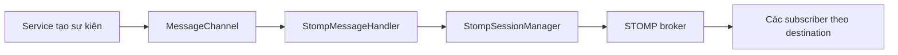
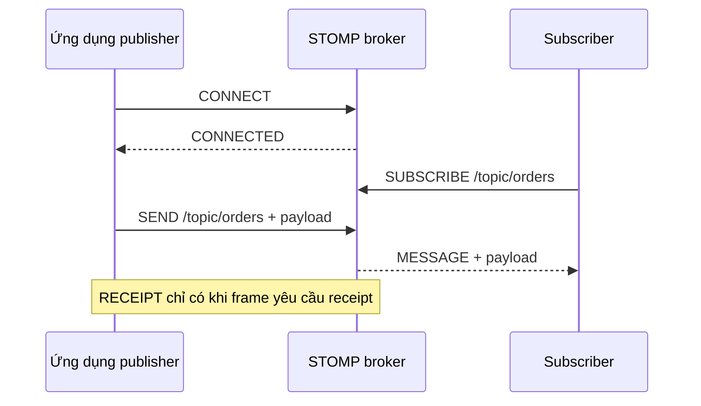
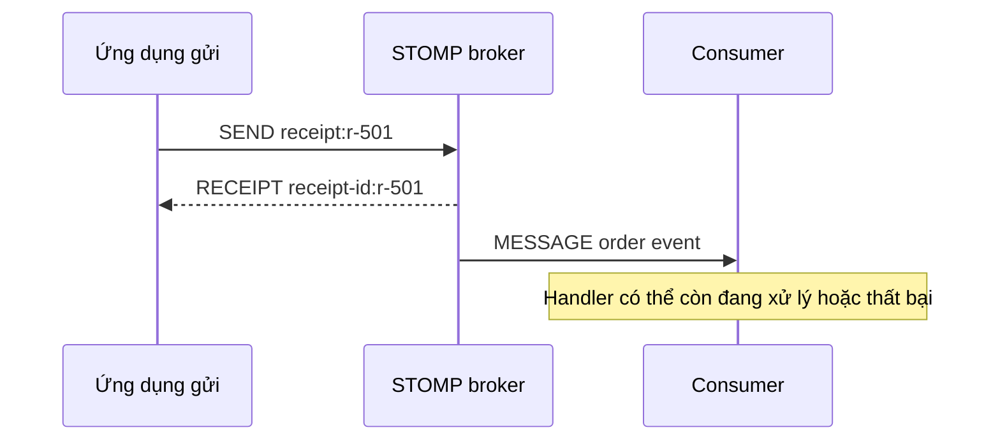
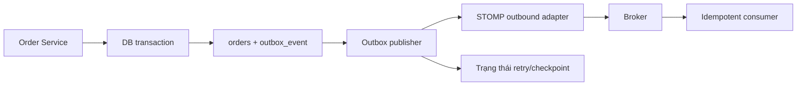

# STOMP outbound channel adapter trong Spring Integration

## 1. Bài toán: xuất message nội bộ ra STOMP broker

Một hệ thống thương mại điện tử lưu đơn hàng rồi cần thông báo trạng thái mới cho một ứng dụng theo dõi vận chuyển. Phần xử lý đơn hàng đã tạo Spring `Message` trong một integration flow; thay vì gọi trực tiếp từng client, ứng dụng cần phát sự kiện tới **STOMP broker** trên destination `/topic/orders`. Các client đã subscribe destination này sẽ nhận message theo quy tắc của broker.

Trong module **SPRING_INTEGRATION_ADAPTERS**, các inbound/outbound adapter, gateway, poller và `MessageChannel` kết nối dữ liệu giữa ứng dụng Spring và hệ thống ngoài. **STOMP outbound channel adapter** là điểm thoát của integration flow: nó lấy một Spring `Message<?>` từ input channel và dùng một `StompSession` để gửi frame `SEND` đến destination phía broker.

Spring Integration cung cấp class **`StompMessageHandler`** cho vai trò này. Handler có thể gửi tới một destination cố định hoặc tính destination theo từng message thông qua biểu thức SpEL. Một `StompSessionManager` phụ trách cung cấp và quản lý session được sử dụng để gửi.



**Sau bài học, bạn có thể:**

1. Phân biệt inbound và outbound STOMP, frame `SEND` và `MESSAGE`.
2. Tạo STOMP/TCP client, session manager, outbound `StompMessageHandler` và input `MessageChannel` bằng Java.
3. Gửi dữ liệu đến destination cố định hoặc chọn destination bằng SpEL từ message headers.
4. Hiểu header mapping, converter, `RECEIPT`, lỗi đồng bộ/bất đồng bộ, heartbeat và lifecycle.
5. Thiết kế xử lý retry, idempotency, transactional outbox, bảo mật và quan sát luồng gửi thực tế.

## 2. STOMP outbound khác gì STOMP inbound và poller?

STOMP (*Simple Text Oriented Messaging Protocol*) là giao thức trao đổi message theo frame, thường chạy trên TCP hoặc WebSocket. Một publisher dùng frame `SEND` với destination và payload; broker phân phối message đến những subscriber phù hợp, thường dưới dạng frame `MESSAGE`.



| Thành phần | Hướng dữ liệu | Cách hoạt động |
| --- | --- | --- |
| `StompInboundChannelAdapter` | Broker → ứng dụng | Subscribe destination, nhận frame `MESSAGE` và phát Spring message vào output channel. |
| `StompMessageHandler` | Ứng dụng → broker | Xử lý Spring message từ input channel và phát frame `SEND` tới destination. |
| File/SFTP/JDBC polling adapter | Nguồn ngoài → ứng dụng | Thường dùng `TaskScheduler` và `MessageSource.receive()` theo lịch. |
| STOMP client heartbeat | Trao đổi tín hiệu kiểm tra phiên | Giữ/giám sát kết nối STOMP, không phải poll dữ liệu nghiệp vụ. |

**STOMP outbound là một message handler, không phải polling endpoint.** Không cấu hình `@Poller` cho `StompMessageHandler` chỉ để “gửi mỗi 5 giây”. Nếu yêu cầu nghiệp vụ là định kỳ phát báo cáo, **nguồn phát sinh sự kiện** có thể dùng scheduler hoặc polling flow riêng; outbound STOMP handler chỉ nhận và gửi khi message được chuyển tới input channel.

## 3. Cấu trúc frame SEND và hợp đồng dữ liệu

Một frame STOMP gửi ra broker có dạng:

```text
SEND
destination:/topic/orders
content-type:application/json
receipt:send-501

{"eventId":"evt-501","orderId":501,"status":"CREATED"}
^@
```

`^@` biểu diễn byte NUL kết thúc frame theo giao thức STOMP, không phải hai ký tự văn bản thực cần thêm vào payload.

| Trường | Tác dụng | Lưu ý |
| --- | --- | --- |
| `SEND` | Lệnh gửi message đến broker. | Không tạo request-reply nghiệp vụ. |
| `destination` | Đích broker dùng để định tuyến. | Quy tắc `/topic/`, `/queue/` phụ thuộc broker. |
| `content-type` | Mô tả kiểu dữ liệu body. | Phải khớp cách converter và consumer xử lý. |
| `receipt` | Yêu cầu broker gửi `RECEIPT` cho frame tương ứng. | Receipt không phải xác nhận người nhận đã commit DB. |
| Body | Payload của sự kiện. | Xác thực schema, encoding, kích thước và event ID. |

Một Spring `Message<?>` có `payload` và `headers`, không phải raw STOMP frame. `StompMessageHandler` phối hợp với converter và `StompHeaderMapper` để chuyển chúng thành frame gửi qua session. Vì vậy đừng tự nối chuỗi `SEND\n...` trong handler nghiệp vụ khi đang dùng outbound adapter chuẩn.

### Hai định danh khác nhau

`MessageHeaders.ID` là ID của Spring message nội bộ, thường được tạo khi xây message. Một `eventId` như `evt-501` là định danh nghiệp vụ cần giữ ổn định qua retry. Broker còn có thể cấp ID riêng khi phân phối frame. **Không dùng Spring message ID mới tạo lại mỗi lần thử để chống trùng ở consumer**; hãy dùng event ID ổn định từ hợp đồng dữ liệu.

## 4. Các thành phần Spring Integration cần dùng

```text
Event publisher
     |
     |  Spring Message<String>
     v
stompOutboundChannel (DirectChannel)
     |
     v
@ServiceActivator -> StompMessageHandler
     |
     v
StompSessionManager -> STOMP client -> broker
```

**`StompMessageHandler`:** hiện thực `MessageHandler` của outbound adapter, nhận Spring message và gửi tới destination cấu hình. API quan trọng gồm `setDestination(String)`, `setDestinationExpression(Expression)`, `setHeaderMapper(...)` và `setConnectTimeout(long)`.

**`StompSessionManager`:** quản lý session dùng chung. Khi ứng dụng cần cả inbound và outbound với cùng broker, hai adapter có thể sử dụng một session manager phù hợp; nó không phải một durable queue.

**STOMP client:** kết nối broker. Có thể dùng `ReactorNettyTcpStompClient` cho STOMP/TCP hoặc `WebSocketStompClient` cho STOMP-over-WebSocket. Ví dụ này chọn TCP để tập trung vào outbound.

**`MessageChannel`:** nơi producer ứng dụng gửi message cho handler. `DirectChannel` chuyển đồng bộ, còn `ExecutorChannel`/`QueueChannel` có thể thêm ranh giới bất đồng bộ hoặc buffer nhưng cần chính sách lỗi và độ bền riêng.

**`@ServiceActivator`:** nối input channel với bean `MessageHandler`. Nó khác `@InboundChannelAdapter` vốn tạo điểm vào từ một source.

## 5. Ví dụ Java hoàn chỉnh: gửi sự kiện đơn hàng tới /topic/orders

### 5.1. Điều kiện và dependencies

Chuẩn bị một broker thực sự bật **STOMP/TCP** tại host/port bạn cấu hình và một client đang subscribe `/topic/orders` để quan sát message. Port `61613` thường được sử dụng cho STOMP/TCP trong ví dụ, nhưng không phải broker nào cũng bật sẵn.

Với Maven, Spring Boot BOM quản lý version tương thích:

```xml
<dependencies>
    <dependency>
        <groupId>org.springframework.boot</groupId>
        <artifactId>spring-boot-starter-integration</artifactId>
    </dependency>
    <dependency>
        <groupId>org.springframework.integration</groupId>
        <artifactId>spring-integration-stomp</artifactId>
    </dependency>
    <dependency>
        <groupId>io.projectreactor.netty</groupId>
        <artifactId>reactor-netty</artifactId>
    </dependency>
</dependencies>
```

Dependency Reactor Netty phục vụ client STOMP/TCP. Với WebSocket, chọn dependency/transport tương ứng. Không trộn ngẫu nhiên các version Spring Framework và Spring Integration khác thế hệ.

### 5.2. Cấu hình STOMP client, session manager và outbound handler

```java
import org.springframework.context.annotation.Bean;
import org.springframework.context.annotation.Configuration;
import org.springframework.integration.annotation.ServiceActivator;
import org.springframework.integration.channel.DirectChannel;
import org.springframework.integration.config.EnableIntegration;
import org.springframework.integration.stomp.ReactorNettyTcpStompSessionManager;
import org.springframework.integration.stomp.StompSessionManager;
import org.springframework.integration.stomp.outbound.StompMessageHandler;
import org.springframework.integration.support.converter.PassThruMessageConverter;
import org.springframework.messaging.MessageChannel;
import org.springframework.messaging.MessageHandler;
import org.springframework.messaging.simp.stomp.ReactorNettyTcpStompClient;
import org.springframework.scheduling.concurrent.ThreadPoolTaskScheduler;

@Configuration
@EnableIntegration
public class StompOrdersOutboundConfiguration {

    @Bean
    public ThreadPoolTaskScheduler stompScheduler() {
        ThreadPoolTaskScheduler scheduler = new ThreadPoolTaskScheduler();
        scheduler.setPoolSize(1);
        scheduler.setThreadNamePrefix("stomp-heartbeat-");
        return scheduler;
    }

    @Bean
    public ReactorNettyTcpStompClient stompClient(
            ThreadPoolTaskScheduler stompScheduler) {

        ReactorNettyTcpStompClient client =
            new ReactorNettyTcpStompClient("127.0.0.1", 61613);
        client.setMessageConverter(new PassThruMessageConverter());
        client.setTaskScheduler(stompScheduler);
        client.setReceiptTimeLimit(5000);
        return client;
    }

    @Bean
    public StompSessionManager stompSessionManager(
            ReactorNettyTcpStompClient stompClient) {

        ReactorNettyTcpStompSessionManager manager =
            new ReactorNettyTcpStompSessionManager(stompClient);
        manager.setAutoReceipt(true);
        return manager;
    }

    @Bean
    public MessageChannel stompOutboundChannel() {
        return new DirectChannel();
    }

    @Bean
    @ServiceActivator(inputChannel = "stompOutboundChannel")
    public MessageHandler stompMessageHandler(
            StompSessionManager stompSessionManager) {

        StompMessageHandler handler =
            new StompMessageHandler(stompSessionManager);
        handler.setDestination("/topic/orders");
        handler.setConnectTimeout(10000);
        return handler;
    }
}
```

**Giải thích:**

1. `stompClient()` tạo STOMP client chạy trên TCP, kết nối `127.0.0.1:61613`. `PassThruMessageConverter` hỗ trợ cách chuyển đổi message theo ví dụ chính thức.
2. `stompScheduler()` phục vụ tác vụ như heartbeat/receipt timeout của STOMP client, **không phải poller lấy dữ liệu**.
3. `stompSessionManager()` tạo session manager dùng chung; `setAutoReceipt(true)` yêu cầu tạo receipt header tự động khi gửi frame phù hợp.
4. `stompOutboundChannel()` trả `DirectChannel` để nhận message từ ứng dụng.
5. Method `@Bean @ServiceActivator` đăng ký một `StompMessageHandler` làm consumer của channel, gắn destination cố định `/topic/orders`.
6. `setConnectTimeout(10000)` giới hạn thời gian chờ **thiết lập session** (mili giây), không giới hạn thời gian consumer nghiệp vụ hoàn thành. Giá trị cần tương thích với recovery interval của session manager; API yêu cầu connect timeout lớn hơn recovery interval.

Đây là **cấu hình outbound đơn hướng**. Không cần tạo thêm `@OutboundChannelAdapter` khác quanh `StompMessageHandler`, cũng không cần `@Poller` chỉ để gửi STOMP message.

### 5.3. Service gửi Spring message vào outbound channel

Thêm một service để phát sự kiện theo hành động nghiệp vụ đã xác định:

```java
import org.springframework.beans.factory.annotation.Qualifier;
import org.springframework.messaging.MessageChannel;
import org.springframework.messaging.support.MessageBuilder;
import org.springframework.stereotype.Service;

@Service
public class OrderEventPublisher {

    private final MessageChannel stompOutboundChannel;

    public OrderEventPublisher(
            @Qualifier("stompOutboundChannel")
            MessageChannel stompOutboundChannel) {
        this.stompOutboundChannel = stompOutboundChannel;
    }

    public void orderCreated(long orderId, String eventId) {
        String json = """
            {"eventId":"%s","orderId":%d,"status":"CREATED"}
            """.formatted(eventId, orderId);

        boolean accepted = stompOutboundChannel.send(
            MessageBuilder.withPayload(json)
                .setHeader("contentType", "application/json")
                .setHeader("eventId", eventId)
                .build()
        );

        if (!accepted) {
            throw new IllegalStateException(
                "STOMP outbound channel did not accept the event"
            );
        }
    }
}
```

Trong ví dụ, chỉ gọi `orderCreated(...)` với `eventId` đã được tạo và kiểm tra bởi hệ thống nghiệp vụ, không lấy `eventId` tùy ý từ một request công khai. Java text blocks và `String.formatted` yêu cầu Java hiện đại, chẳng hạn Java 17.

Đoạn này sử dụng header `contentType` ở cấp Spring message để minh họa metadata; cách chuyển chính xác thành STOMP `content-type` phụ thuộc `StompHeaderMapper` và converter. Trong production, **kiểm thử frame thực tế ở broker** và cấu hình header STOMP chuẩn theo hợp đồng thay vì suy đoán chỉ từ tên header tự đặt.

**Ranh giới xác nhận:** `send()` trả `true` cho biết channel chấp nhận message theo hợp đồng của channel. Với `DirectChannel`, handler có thể đã được gọi đồng bộ; tuy nhiên kết quả này **không phải bằng chứng broker đã persist message** và càng không chứng minh subscriber đã xử lý xong.

### 5.4. Dữ liệu kỳ vọng phía broker

Khi handler có session và broker chấp nhận frame, message được gửi tới `/topic/orders`. Một subscriber phù hợp có thể nhận frame dạng:

```text
MESSAGE
destination:/topic/orders
content-type:application/json
message-id:<broker-defined-id>

{"eventId":"evt-501","orderId":501,"status":"CREATED"}
^@
```

Header và body trên là **minh họa**; định dạng `message-id`, metadata subscription và khả năng fan-out phụ thuộc broker. Một số broker có thể không phát message tới topic nếu chưa có subscriber và retention không được bật.

## 6. Destination cố định và destination động bằng SpEL

### 6.1. Destination cố định

Đối với tất cả message cùng loại, `handler.setDestination("/topic/orders")` là lựa chọn dễ kiểm soát. Broker ACL cần cho phép user gửi tới destination đó.

### 6.2. Destination động theo header

Khi nhiều loại sự kiện dùng cùng handler, Spring Integration hỗ trợ:

```java
import org.springframework.expression.spel.standard.SpelExpressionParser;
import org.springframework.integration.stomp.outbound.StompMessageHandler;

StompMessageHandler handler =
    new StompMessageHandler(stompSessionManager);
handler.setDestinationExpression(
    new SpelExpressionParser().parseExpression(
        "headers['targetStompDestination']"
    )
);
```

Đây là **phương án thay thế** `setDestination(...)`, không khai báo cả hai trên cùng handler. Biểu thức được đánh giá theo từng Spring message, ví dụ một message đã được đặt header:

```java
MessageBuilder.withPayload("{\"eventId\":\"evt-600\"}")
    .setHeader("targetStompDestination", "/topic/orders")
    .build();
```

**Cảnh báo bảo mật:** không để client bên ngoài tự đặt `targetStompDestination` rồi gửi thẳng vào STOMP handler. Một người gửi có thể cố chuyển event sang topic nhạy cảm hoặc làm lộ dữ liệu. Hãy ánh xạ **loại sự kiện đã validate** sang một allowlist destination:

| Loại sự kiện hợp lệ | Destination được phép |
| --- | --- |
| `ORDER_CREATED` | `/topic/orders` |
| `ORDER_SHIPPED` | `/topic/shipping` |
| `PAYMENT_CONFIRMED` | `/topic/payments` |

Tầng application tự chọn destination sau khi kiểm tra quyền, không thực thi SpEL do người dùng cung cấp. Nếu không cần định tuyến động, cấu hình destination tĩnh đơn giản và an toàn hơn.

### 6.3. Destination không thay thế routing nội bộ

`MessageChannel` và `destination` là hai lớp khác nhau:

- `stompOutboundChannel` chọn consumer **trong ứng dụng Spring**.
- `/topic/orders` chọn nơi broker **định tuyến frame sau khi gửi**.

Một Spring `HeaderValueRouter` có thể phân luồng nội bộ tới nhiều outbound handlers với destination tĩnh; ngược lại, một handler có destination expression có thể gửi nhiều loại sự kiện qua cùng channel. Hãy chọn kiến trúc nào dễ kiểm soát ACL, metrics và error flow hơn.

## 7. STOMP header mapping và message conversion

STOMP frame bao gồm headers được biểu diễn bởi `StompHeaders` ở Spring Framework. Spring Integration có `StompHeaderMapper` và `IntegrationStompHeaders`; các header STOMP chuẩn được map vào Spring MessageHeaders với tiền tố **`stomp_`** khi đi qua adapter.

| Spring message | STOMP frame | Cần kiểm tra |
| --- | --- | --- |
| `payload` | Body | Converter, encoding, kích thước và nội dung nhị phân/text. |
| Header destination hoặc destination expression | `destination` | Đúng ACL và tên destination của broker. |
| Header content type được map | `content-type` | JSON/text/binary, charset và schema thực tế. |
| Receipt header đã được map hoặc autoReceipt | `receipt` | Có yêu cầu receipt từ broker hay không. |
| Header custom được cho phép | Header STOMP tương ứng | Privacy, allowlist, tên header và tương thích broker. |

Khi sử dụng `mapped-headers` ở XML namespace, muốn giữ toàn bộ các STOMP headers chuẩn bên cạnh custom headers, tài liệu quy định cần token `STOMP_OUTBOUND_HEADERS` hoặc một `HeaderMapper` tự cấu hình. Khi dùng Java, có thể cung cấp mapper qua `handler.setHeaderMapper(...)`.

**Không nhầm `contentType` của Spring MessageHeaders với một tên header custom bất kỳ.** Hãy kiểm tra converter và mapping của phiên bản thư viện; STOMP cần frame hợp lệ theo broker, còn JSON schema là hợp đồng của subscriber.

### Kiểu payload

- `String`: thuận tiện cho thông điệp text/JSON; cần xác định UTF-8 và validate dữ liệu.
- `byte[]`: phù hợp payload binary khi client/converter hỗ trợ.
- Object Java: cần converter phù hợp trước khi gửi; không giả định Spring tự JSON-serialize mọi object.

Trong ví dụ người gửi tạo JSON string sẵn nên phần converter ít phức tạp; production có thể dùng một JSON serializer rõ ràng thay vì nối chuỗi thủ công để tránh injection hoặc sai escaping.

## 8. RECEIPT không phải xác nhận xử lý nghiệp vụ

STOMP cho phép một frame chứa header `receipt`. Nếu broker hỗ trợ, nó có thể trả frame `RECEIPT` tương ứng; Spring Integration xuất bản các **`StompReceiptEvent`** thông qua cơ chế application events.



Tùy broker, thứ tự thời gian và cách broker xử lý delivery có thể khác sơ đồ; phần quan trọng là **RECEIPT xác nhận một thao tác ở giao thức STOMP, không phải việc subscriber đã commit DB**.

### Bật receipt trên session

Trong ví dụ ở mục 5:

```java
manager.setAutoReceipt(true);
client.setReceiptTimeLimit(5000);
```

- `setAutoReceipt(true)` yêu cầu session tạo receipt header tự động cho các frame thích hợp.
- `setReceiptTimeLimit(5000)` đặt thời hạn chờ receipt **5 giây** trên STOMP client.
- `StompMessageHandler` chỉ gắn callback receipt khi frame gửi có receipt header; callback có thể phát event receipt tích cực hoặc tiêu cực khi hết hạn.

**Đừng đánh đồng ba mốc:**

1. **Channel accepted**: Spring channel đã nhận message từ publisher ứng dụng.
2. **Broker receipt**: broker phản hồi frame được yêu cầu receipt.
3. **Business committed**: subscriber đã xác thực và lưu thành công kết quả nghiệp vụ.

Muốn theo dõi mốc thứ ba, cần hợp đồng **acknowledgement nghiệp vụ riêng** (ví dụ một sự kiện phản hồi qua destination khác) hoặc tra trạng thái ở hệ thống đích. STOMP outbound channel adapter **không phải outbound gateway request-reply mặc định**.

### Đọc sự kiện giao thức

Có thể lắng nghe event STOMP bằng Spring application listener:

```java
import org.springframework.context.event.EventListener;
import org.springframework.integration.stomp.event.StompIntegrationEvent;

@EventListener
public void onStompEvent(StompIntegrationEvent event) {
    System.out.println(
        "STOMP event: " + event.getClass().getSimpleName()
    );
}
```

Spring Integration công bố `StompReceiptEvent` cho receipt callback và `StompExceptionEvent` cho một số lỗi kết nối/giao thức. Handler quản trị nên ghi nhận loại event, correlation/receipt ID nếu có, destination và thời điểm; không đưa event giao thức vào luồng tạo đơn hàng như một business event.

## 9. Lỗi đồng bộ và lỗi bất đồng bộ khi gửi STOMP

Một lời gọi gửi có thể gặp những lỗi khác nhau tùy giai đoạn:

| Giai đoạn | Ví dụ lỗi | Cách xử lý |
| --- | --- | --- |
| Trước gửi | Không có subscriber trên `DirectChannel`, payload không hợp lệ | Lỗi gửi nội bộ; validate sớm, kiểm tra channel/handler và cấu hình. |
| Thiết lập session | Broker không mở cổng, auth thất bại, quá connect timeout | Quan sát session manager, reconnect policy, cảnh báo và giới hạn retry. |
| Chuyển `SEND` | Converter/header mapping lỗi, session không sẵn sàng | Exception của `StompMessageHandler` có thể truyền về publisher đồng bộ. |
| Broker phản hồi `ERROR` | Destination bị từ chối hoặc frame không hợp lệ | Theo dõi `StompIntegrationEvent`/lỗi giao thức; cần action theo nguyên nhân. |
| Receipt timeout | Không nhận `RECEIPT` trong giới hạn | Ghi nhận receipt thất bại; trạng thái gửi có thể **chưa xác định**. |
| Downstream consumer | Consumer xử lý lỗi sau khi broker đã nhận | Outbound handler không tự biết; cần ack nghiệp vụ/retry theo contract ngoài. |

**Một lỗi bất đồng bộ không nhất thiết đi ngược về `MessageChannel.send()` ban đầu.** `StompMessageHandler` có thể đã trả quyền điều khiển trong lúc broker còn đang xử lý hoặc chờ receipt.

Với `DirectChannel`, các exception ném trong lúc handler thực hiện đồng bộ thường truyền về publisher. Nhưng việc gửi thành công trong call stack không chứng minh người nhận đã xử lý xong. Với `ExecutorChannel`, cả exception của handler gửi cũng có thể xuất hiện ở worker thay vì caller gốc.

### Phân biệt timeout

| Timeout | Công dụng |
| --- | --- |
| `StompMessageHandler#setConnectTimeout(...)` | Giới hạn chờ session được thiết lập; phải tương thích recovery interval. |
| STOMP client `receiptTimeLimit` | Chờ broker `RECEIPT` khi yêu cầu receipt. |
| TCP/WebSocket connect/read/heartbeat | Phát hiện sự cố mạng/session theo transport và cấu hình client. |
| `MessageChannel.send(..., timeout)` | Thời gian chờ khi gửi vào một channel có thể chặn; không phải timeout broker. |

Không lấy một con số “5 giây” áp vào mọi timeout rồi coi chúng là cùng một nghĩa.

## 10. Retry có thể gây gửi trùng: cần idempotency

Giả sử publisher gửi event `evt-501`. Broker đã nhận frame, nhưng kết nối bị ngắt trước khi publisher nhận receipt. Publisher thấy receipt timeout và thử lại. Broker hoặc subscriber có thể nhận **hai frame mang cùng event ID**.

```text
Publisher             Broker               Consumer
   |-- SEND evt-501 -->|                      |
   |                   |--- MESSAGE evt-501 ->|
   X  mất kết nối      |                      |
   |  receipt timeout  |                      |
   |-- RETRY evt-501 ->|                      |
   |                   |--- MESSAGE evt-501 ->|
```

Vì vậy:

- Giữ **eventId ổn định** qua các lần retry; không tạo ID mới cho cùng một sự kiện logic.
- Consumer ghi nhận event đã xử lý một cách idempotent, ví dụ unique constraint trên `eventId` trong transaction DB.
- Retry chỉ với lỗi được phân loại là tạm thời, có giới hạn số lần, exponential backoff và jitter khi phù hợp.
- Với lỗi permission/destination sai, retry liên tục thường không giúp.
- Nếu receipt timeout, trạng thái broker nhận frame có thể **không xác định**; retry phải được thiết kế cho khả năng phát trùng.

STOMP outbound adapter là thành phần truyền message, **không tự cung cấp exactly-once end-to-end** qua application DB, broker và consumer.

## 11. Transactional outbox: không gửi event rồi mới hy vọng commit DB

Một nghiệp vụ có hai bước:

1. Ghi đơn hàng vào database.
2. Phát `ORDER_CREATED` qua STOMP broker.

Nếu trong một method `@Transactional` ta vừa cập nhật DB vừa gọi outbound STOMP handler, transaction JDBC **không tự bao trùm** broker. Một số tình huống:

- Broker đã nhận `SEND`, nhưng DB rollback: người nhận thấy event cho đơn hàng chưa tồn tại.
- DB commit thành công, nhưng broker lỗi: đơn hàng tồn tại nhưng không có event.
- Gửi thành công nhưng receipt bị mất: retry có thể tạo event trùng.

Một giải pháp phổ biến khi cần độ tin cậy cao là **transactional outbox**:



**Nguyên tắc:**

1. Trong **một transaction DB**, lưu trạng thái đơn hàng và dòng outbox có `eventId` ổn định.
2. Một worker đọc outbox chưa phát, chuyển thành Spring message và đưa vào `stompOutboundChannel`.
3. Worker ghi nhận trạng thái gửi theo chính sách đã chọn (ví dụ chờ receipt nếu contract có hỗ trợ), kèm retry/backoff.
4. Consumer dùng `eventId` để xử lý idempotent; không suy ra receipt broker bằng business commit.
5. Nếu worker crash sau khi gửi nhưng trước khi đánh dấu outbox, event có thể gửi lại. **Idempotency ở consumer vẫn cần thiết.**

Outbox publisher có thể là một polling flow JDBC trong Spring Integration hoặc một background worker khác; đó là chỗ `Poller` có thể xuất hiện, **không phải trong `StompMessageHandler` outbound**.

## 12. Topic, queue và nhiều replica publisher

Đường dẫn STOMP destination phụ thuộc broker:

| Kiểu đích | Mô hình thường gặp | Cần xác minh |
| --- | --- | --- |
| `/topic/orders` | Fan-out tới những subscriber topic. | Retention và dữ liệu khi không có subscriber. |
| `/queue/order-events` | Phân phối message giữa các consumer cạnh tranh. | Ack/redelivery, durable queue và broker naming. |
| Destination động | Route theo loại event hoặc tenant. | Allowlist, ACL, dữ liệu sai đích và định danh event. |

Không giả định mọi broker diễn giải tiền tố `/topic/` hoặc `/queue/` như nhau. Một số broker yêu cầu khai báo queue/exchange hoặc có convention riêng.

Nhiều instance publisher có thể đồng thời gửi event đến cùng destination. Không có bảo đảm thứ tự tổng thể giữa các instance trừ khi kiến trúc và broker quy định rõ. Nếu cần ordering theo `orderId`, hãy cân nhắc partition/serializing theo khóa và khóa idempotency để xử lý phát lại.

## 13. Bảo mật và giới hạn tài nguyên

Một outbound adapter là đường để dữ liệu nội bộ đi **ra khỏi ứng dụng**. Do đó cần:

1. Dùng credential có quyền **SEND** tối thiểu trên destination cho phép, thay vì quyền quản trị broker.
2. Bật TLS phù hợp với transport (STOMP/TCP qua TLS hoặc STOMP-over-WebSocket `wss://`), kiểm tra chứng chỉ server.
3. Lấy username, password, token và chứng chỉ từ secret manager; không hardcode trong source code hoặc ghi ra log.
4. Dùng allowlist destination nếu route động; không tin header destination từ request bên ngoài.
5. Kiểm tra schema/size trước khi gửi; payload quá lớn có thể gây cạn tài nguyên client hoặc bị broker từ chối.
6. Che PII và business secret khi logging message hoặc STOMP frame.
7. Đặt timeouts, giới hạn retry, circuit breaker hoặc rate limiter thích hợp với hệ thống ngoài.
8. Theo dõi số kết nối, kích thước queue downstream, số receipt timeout và lỗi broker.

### Lifecycle và shutdown

`StompMessageHandler` có lifecycle `start()`, `stop()` và `isRunning()`. Session manager/transport cũng có vòng đời riêng. Khi dừng hoặc deploy lại, không nên coi `stop()` là bảo đảm mọi message đang bay trên mạng đã được broker và consumer xử lý. Nếu yêu cầu dữ liệu không mất, cần outbox/broker persistence và quy trình drain/recovery.

## 14. Quan sát và chẩn đoán

| Triệu chứng | Cần kiểm tra |
| --- | --- |
| `send()` báo lỗi ngay | Input channel, service activator, converter, trạng thái session. |
| Kết nối không được | Host/port, broker STOMP listener, auth, TLS, connect timeout. |
| Kết nối được nhưng broker từ chối frame | Destination ACL, frame headers/content type, broker `ERROR` events. |
| Không có receipt | Frame có yêu cầu receipt chưa, timeout, broker hỗ trợ và network. |
| Subscriber không nhận event | Destination routing, subscription, topic/queue semantics, retention. |
| Có event trùng | Retry sau receipt timeout, nhiều publisher, idempotency không đầy đủ. |
| DB có đơn hàng nhưng thiếu event | Transactional outbox/worker phát chưa chạy hoặc đang lỗi. |
| Event gửi rồi nhưng nghiệp vụ đích thất bại | Không có ack nghiệp vụ; thiết kế redelivery/recovery phía consumer. |
| Event phát không đúng thứ tự | Nhiều worker/replica, broker ordering contract và routing. |
| Worker queue đầy | Executor/channel capacity, tốc độ broker nhận, producer backpressure. |

**Các chỉ số nên có:** số message vào outbound channel, số lần handler thực thi, số frame đã gửi, số receipt tích cực/tiêu cực, số connection/reconnect, tỉ lệ broker `ERROR`, độ trễ từ business commit tới publish, số lần retry và tuổi outbox event cũ nhất chưa xác nhận.

Đo riêng **channel accepted**, **broker receipt** và **business processed**; chỉ có một counter “sent=true” không đủ để xác nhận hợp đồng giao message của toàn hệ thống.

## 15. Bài tập thực hành có đáp án

**Bài 1 — Hướng message.** `StompMessageHandler` dùng để nhận frame `MESSAGE` từ broker hay gửi frame `SEND` ra broker?

**Đáp án:** Gửi `SEND` ra broker từ Spring message nội bộ; inbound adapter mới subscribe và nhận `MESSAGE`.

**Bài 2 — Poller.** Có cần `@Poller(fixedRate = "5000")` trên `StompMessageHandler` để gửi khi có event không?

**Đáp án:** Không. Outbound handler chạy khi có Spring message đến input channel; scheduler có thể nằm ở nguồn phát event nếu nghiệp vụ cần.

**Bài 3 — Cấu hình cố định.** Phương thức nào của `StompMessageHandler` đặt destination tĩnh?

**Đáp án:** `setDestination("/topic/orders")`.

**Bài 4 — Destination động.** Muốn định tuyến theo header đã validate trên từng message, dùng API nào?

**Đáp án:** `setDestinationExpression(Expression)` với SpEL truy cập header phù hợp; nên có allowlist destination.

**Bài 5 — Ba thời điểm.** `MessageChannel.send()` trả `true` có chứng minh subscriber đã commit DB không?

**Đáp án:** Không. Đây chỉ là xác nhận ở mức channel; broker receipt và business commit phải theo dõi riêng.

**Bài 6 — Receipt.** Broker trả `RECEIPT` cho `SEND` có chứng minh một client đã lưu đơn hàng thành công không?

**Đáp án:** Không. Receipt xác nhận xử lý frame ở broker theo contract STOMP, không phải kết quả handler nghiệp vụ.

**Bài 7 — Timeout.** `setConnectTimeout(10000)` và `setReceiptTimeLimit(5000)` có cùng tác dụng không?

**Đáp án:** Không. Một giá trị giới hạn chờ thiết lập session, giá trị kia giới hạn chờ receipt khi yêu cầu receipt.

**Bài 8 — Retry tạo trùng.** Broker đã nhận event nhưng publisher không nhận receipt, sau đó gửi lại. Làm sao consumer tránh ghi trùng?

**Đáp án:** Giữ event ID ổn định và thực hiện idempotency/unique constraint theo ID trong transaction nghiệp vụ.

**Bài 9 — JDBC rollback.** Nếu gửi STOMP thành công rồi transaction JDBC rollback, broker có tự hủy frame SEND không?

**Đáp án:** Không. Transaction JDBC local không tự bao trùm broker; cân nhắc transactional outbox.

**Bài 10 — Topic không subscriber.** Gửi tới `/topic/orders` khi không có subscriber có bảo đảm event được lưu để subscriber nhận khi kết nối lại không?

**Đáp án:** Không có bảo đảm chung. Phụ thuộc broker, durable subscription và retention được cấu hình.

**Bài 11 — Async.** Đặt `ExecutorChannel` trước outbound handler khiến lỗi kết nối chắc chắn truyền về caller của `send()` ban đầu không?

**Đáp án:** Không. Handler chạy ở worker khác; cần error flow, retry và quan sát phía async.

**Bài 12 — Security.** Có nên dùng trực tiếp header destination do một HTTP client bất kỳ gửi để chọn topic STOMP đích không?

**Đáp án:** Không. Phải xác thực/ủy quyền và ánh xạ từ loại sự kiện hợp lệ sang destination trong allowlist.

## 16. Ghi nhớ

**STOMP outbound channel adapter** dùng `StompMessageHandler` để lấy Spring `Message<?>` từ input `MessageChannel` và gửi frame `SEND` qua `StompSession` do `StompSessionManager` quản lý. Destination có thể cố định bằng `setDestination(...)` hoặc được tính theo message bằng `setDestinationExpression(...)`. Outbound adapter không phải một poller định kỳ và cũng không tự tạo request-reply nghiệp vụ. Để phát sự kiện an toàn, hãy kiểm tra converter/headers, kết nối và receipt, giới hạn retry, bảo mật destination, dùng event ID ổn định và phối hợp transactional outbox với consumer idempotent khi cần độ tin cậy cao.

## Tài liệu tham khảo

- [Spring Integration Reference — STOMP Support](https://docs.spring.io/spring-integration/reference/stomp.html)
- [Spring Integration API — StompMessageHandler](https://docs.spring.io/spring-integration/api/org/springframework/integration/stomp/outbound/StompMessageHandler.html)
- [Spring Integration API — StompSessionManager](https://docs.spring.io/spring-integration/api/org/springframework/integration/stomp/StompSessionManager.html)
