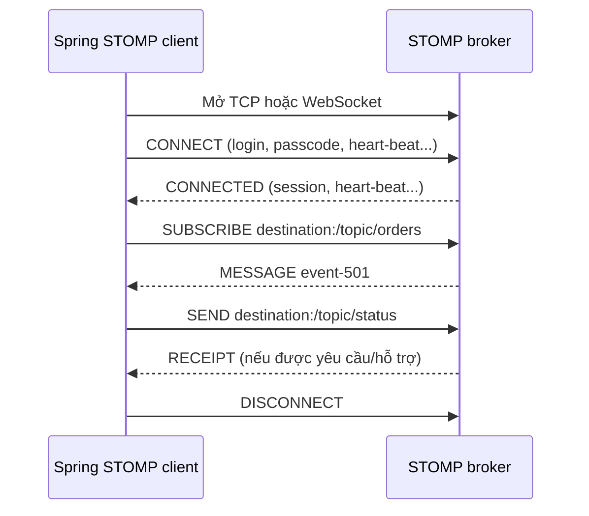
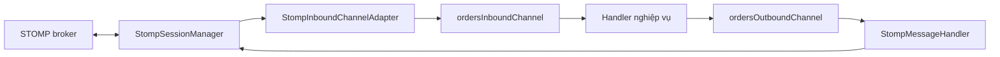

# STOMP client session trong Spring Integration

## 1. Vì sao phải hiểu session trước khi dùng STOMP adapter?

Một dịch vụ cần nhận các sự kiện đơn hàng từ STOMP broker và đồng thời phát sự kiện xử lý hoàn tất trở lại broker. Ta có thể tạo `StompInboundChannelAdapter` cho chiều nhận và `StompMessageHandler` cho chiều gửi. Tuy nhiên, cả hai đều cần một phiên kết nối với broker: kết nối TCP/WebSocket được thiết lập lúc nào, dùng thông tin đăng nhập nào, heartbeat ra sao, kết nối mất thì xử lý thế nào và lúc shutdown ai chịu trách nhiệm đóng session?

Trong module **SPRING_INTEGRATION_ADAPTERS**, adapter và `MessageChannel` kết nối hệ thống ngoài vào Spring Integration. Ở riêng **Adapter STOMP**, thành phần trung tâm cho vòng đời kết nối là **`StompSessionManager`**, còn **`StompSession`** là phiên giao thức đã kết nối để gửi frame `SEND`, đăng ký `SUBSCRIBE`, nhận `MESSAGE` và ngắt kết nối.

Bài học này đi sâu vào **STOMP client session** thay vì chỉ viết thêm một inbound hoặc outbound adapter. Hiểu session giúp bạn tránh các sai lầm như mở kết nối cho mỗi message, coi `isRunning()` đồng nghĩa broker đã sẵn sàng, hoặc tưởng rằng kết nối lại tự bảo đảm không mất event.

**Mục tiêu học tập**

1. Đọc đúng trình tự STOMP `CONNECT`, `CONNECTED`, `SUBSCRIBE`, `SEND`, `MESSAGE` và `DISCONNECT`.
2. Phân biệt Spring Framework `StompClientSupport`, `StompSession`, `StompSessionHandler` và Spring Integration `StompSessionManager`.
3. Cấu hình một session manager dùng chung cho inbound và outbound STOMP adapter.
4. Thiết lập STOMP CONNECT headers, heartbeat, receipt timeout và recovery interval.
5. Hiểu hai trạng thái `isRunning()` và `isConnected()`, cách nhận sự kiện lỗi/receipt và tác động của stop/restart.
6. Thiết kế bảo mật, idempotency, retry, monitoring và kiểm soát khả năng xử lý lại message trong production.

## 2. STOMP client session là gì?

STOMP (*Simple Text Oriented Messaging Protocol*) trao đổi dữ liệu bằng các **frame** gồm command, headers và body. Session là ngữ cảnh giao thức giữa một client và broker sau khi bắt tay kết nối thành công.



Ở đây:

- **Kết nối transport**: TCP socket hoặc WebSocket làm đường truyền dữ liệu.
- **STOMP session**: trạng thái giao thức sau `CONNECT`/`CONNECTED`, gồm thông tin negotiated heartbeat và các hoạt động gửi/nhận trong phiên.
- **Subscription**: đăng ký nhận message từ một destination **bên trong** session, không phải một session độc lập.
- **Spring `MessageChannel`**: đường truyền message **bên trong** ứng dụng; không phải STOMP destination hay STOMP session.

### Ví dụ frame CONNECT

```text
CONNECT
accept-version:1.2
host:broker.internal.example
login:app-client
passcode:<secret>
heart-beat:10000,10000

^@
```

`^@` minh họa byte NUL kết thúc frame; trong client thật, framework mã hóa frame chứ không cần ứng dụng tự nối chuỗi này. Giá trị `passcode` trong ví dụ chỉ là placeholder, **không** được đưa mật khẩu thật vào log hoặc tài liệu.

Broker phản hồi `CONNECTED` khi giao thức chấp nhận thiết lập session:

```text
CONNECTED
version:1.2
session:broker-session-id
heart-beat:10000,10000

^@
```

Các headers cụ thể và mức hỗ trợ phiên bản/heartbeat phụ thuộc broker. Một kết nối TCP mở thành công chưa đồng nghĩa STOMP session đã được chấp nhận; cần phân biệt thành công ở **transport** và thành công ở **STOMP CONNECT**.

## 3. Bốn lớp API dễ nhầm

| API | Package | Trách nhiệm |
| --- | --- | --- |
| `StompClientSupport` | Spring Framework `org.springframework.messaging.simp.stomp` | Client factory tạo `StompSession` và gửi các callback cho session handler. |
| `StompSession` | Spring Framework | Đại diện phiên STOMP đang dùng; có thể `send()`, `subscribe()` và `disconnect()`. |
| `StompSessionHandler` | Spring Framework | Nhận callback khi kết nối hoàn tất, lỗi transport, lỗi xử lý frame hoặc frame `ERROR`. |
| `StompSessionManager` | Spring Integration `org.springframework.integration.stomp` | Quản lý **một session dùng chung** và phân phối callback cho các handler của STOMP adapters. |

Spring Integration cung cấp:

- `AbstractStompSessionManager`: implementation nền, quản lý lifecycle và tổng hợp các `StompSessionHandler` đã đăng ký.
- `ReactorNettyTcpStompSessionManager`: session manager dùng với `ReactorNettyTcpStompClient` qua TCP.
- `WebSocketStompSessionManager`: session manager dùng với `WebSocketStompClient` qua WebSocket.

**Không nhầm hai phương thức `connect`:**

- Client Spring Framework tạo phiên từ transport và một `StompSessionHandler`.
- `StompSessionManager.connect(handler)` đăng ký một handler với cơ chế quản lý **session chung**, không mang nghĩa “hãy tạo một TCP connection hoàn toàn mới cho handler này”.

Tương tự, `StompSessionManager.disconnect(handler)` tháo handler khỏi quản lý session. Nó không nên bị dùng như một thao tác “đóng kết nối vật lý cho toàn bộ ứng dụng” một cách tùy tiện khi còn các adapter khác phụ thuộc session.

## 4. Vì sao Spring Integration dùng một StompSessionManager dùng chung?

Giả sử ứng dụng vừa nhận message từ `/topic/orders` vừa gửi kết quả tới `/topic/order-status`.



Thay vì để inbound adapter và outbound handler tự xây session riêng, Spring Integration có thể cho cả hai dùng cùng một `StompSessionManager`. Lợi ích:

1. Quản lý CONNECT/disconnect và reconnect tập trung.
2. Không nhân số phiên chỉ vì có nhiều adapter cùng kết nối một broker.
3. Cho phép chia sẻ session giữa các handler đã đăng ký với manager.
4. Đơn giản hóa cấu hình credentials, heartbeat và monitoring.
5. Duy trì chính sách lifecycle tương đối nhất quán giữa inbound và outbound.

**Đừng suy ra chia sẻ session là bảo đảm tài nguyên vô hạn.** Một session có thể chứa nhiều subscription và nhiều thao tác gửi; broker vẫn áp dụng quota, ACL, giới hạn frame/connection và chính sách backpressure. Nếu cần các mức cô lập khác nhau cho tenant, credentials, broker hoặc lưu lượng, có thể phải thiết kế session manager riêng có chủ đích.

### Bên trong AbstractStompSessionManager

Manager triển khai `SmartLifecycle`. Theo API, khi `start()` nó thực hiện quá trình kết nối, khi `stop()` nó quản lý `StompSession.disconnect()`. Các handler được đăng ký bằng `connect(handler)`/`disconnect(handler)` được tổng hợp để nhận callback từ session chung.

Ứng dụng bình thường nên để Spring và các adapter quản lý đăng ký handler/lifecycle thay vì tự gọi `start()`, `connect()` và `disconnect()` ở nhiều nơi không có điều phối.

## 5. STOMP/TCP và STOMP-over-WebSocket

| Tiêu chí | STOMP/TCP | STOMP-over-WebSocket |
| --- | --- | --- |
| Spring client | `ReactorNettyTcpStompClient` | `WebSocketStompClient` |
| Session manager | `ReactorNettyTcpStompSessionManager` | `WebSocketStompSessionManager` |
| Địa chỉ kết nối | Host/port TCP STOMP đã được broker bật | URL `ws://` hoặc `wss://` |
| Lớp transport | TCP, có thể thêm TLS theo client/broker | WebSocket handshake trên HTTP(S), sau đó trao đổi STOMP frame |
| Xác thực | STOMP CONNECT headers và cấu hình TLS/transport | Có thể cần **cả** HTTP/WebSocket handshake headers **và** STOMP CONNECT headers |

Không truyền trực tiếp URL `wss://` vào constructor `ReactorNettyTcpStompClient` rồi mong nó tự đổi thành WebSocket. Cũng không nhầm WebSocket handshake thành frame `CONNECT` STOMP: đây là **hai lớp** khác nhau.

Trong bài thực hành, ta dùng STOMP/TCP để giảm số thành phần và dễ theo dõi session.

## 6. Dependencies và yêu cầu thực hành

Với Spring Boot dựa trên BOM tương thích:

```xml
<dependencies>
    <dependency>
        <groupId>org.springframework.boot</groupId>
        <artifactId>spring-boot-starter-integration</artifactId>
    </dependency>
    <dependency>
        <groupId>org.springframework.integration</groupId>
        <artifactId>spring-integration-stomp</artifactId>
    </dependency>
    <dependency>
        <groupId>io.projectreactor.netty</groupId>
        <artifactId>reactor-netty</artifactId>
    </dependency>
</dependencies>
```

Đây là lựa chọn cho client TCP. Nếu dùng WebSocket, bổ sung dependency WebSocket/client phù hợp. Không tự ghép các version Spring Framework và Spring Integration không tương thích.

Chuẩn bị broker thử nghiệm bật STOMP/TCP ở `127.0.0.1:61613`, có destination `/topic/orders` và `/topic/order-status`. Cổng `61613` chỉ là cổng thường thấy trong ví dụ; không phải broker nào cũng bật sẵn. Nếu broker yêu cầu đăng nhập, dùng tài khoản thử nghiệm có quyền `SEND`/`SUBSCRIBE` phù hợp.

## 7. Ví dụ Java: một session manager cho cả inbound và outbound

Ví dụ này cấu hình:

- Một `ReactorNettyTcpStompClient` cùng scheduler phục vụ heartbeat/receipt.
- Một `ReactorNettyTcpStompSessionManager` quản lý phiên và tự yêu cầu receipt khi thích hợp.
- Một inbound adapter subscribe `/topic/orders`.
- Một outbound handler gửi đến `/topic/order-status`.
- Hai Spring `DirectChannel` độc lập, để không tạo vòng lặp tự động.

### 7.1. Cấu hình adapter và session manager

```java
import org.springframework.beans.factory.annotation.Qualifier;
import org.springframework.context.annotation.Bean;
import org.springframework.context.annotation.Configuration;
import org.springframework.integration.annotation.ServiceActivator;
import org.springframework.integration.channel.DirectChannel;
import org.springframework.integration.config.EnableIntegration;
import org.springframework.integration.stomp.ReactorNettyTcpStompSessionManager;
import org.springframework.integration.stomp.StompSessionManager;
import org.springframework.integration.stomp.inbound.StompInboundChannelAdapter;
import org.springframework.integration.stomp.outbound.StompMessageHandler;
import org.springframework.integration.support.converter.PassThruMessageConverter;
import org.springframework.messaging.Message;
import org.springframework.messaging.MessageChannel;
import org.springframework.messaging.MessageHandler;
import org.springframework.messaging.simp.stomp.ReactorNettyTcpStompClient;
import org.springframework.scheduling.concurrent.ThreadPoolTaskScheduler;

@Configuration
@EnableIntegration
public class SharedStompSessionConfiguration {

    @Bean
    public ThreadPoolTaskScheduler stompTaskScheduler() {
        ThreadPoolTaskScheduler scheduler = new ThreadPoolTaskScheduler();
        scheduler.setPoolSize(2);
        scheduler.setThreadNamePrefix("stomp-heartbeat-");
        return scheduler;
    }

    @Bean
    public ReactorNettyTcpStompClient stompClient(
            ThreadPoolTaskScheduler stompTaskScheduler) {
        ReactorNettyTcpStompClient client =
            new ReactorNettyTcpStompClient("127.0.0.1", 61613);
        client.setMessageConverter(new PassThruMessageConverter());
        client.setTaskScheduler(stompTaskScheduler);
        client.setReceiptTimeLimit(5000);
        return client;
    }

    @Bean
    public ReactorNettyTcpStompSessionManager stompSessionManager(
            ReactorNettyTcpStompClient stompClient) {
        ReactorNettyTcpStompSessionManager manager =
            new ReactorNettyTcpStompSessionManager(stompClient);
        manager.setRecoveryInterval(5000);
        manager.setAutoReceipt(true);
        return manager;
    }

    @Bean
    public MessageChannel ordersInboundChannel() {
        return new DirectChannel();
    }

    @Bean
    public MessageChannel ordersOutboundChannel() {
        return new DirectChannel();
    }

    @Bean
    public StompInboundChannelAdapter ordersInboundAdapter(
            StompSessionManager stompSessionManager,
            @Qualifier("ordersInboundChannel") MessageChannel input) {
        StompInboundChannelAdapter adapter =
            new StompInboundChannelAdapter(
                stompSessionManager, "/topic/orders"
            );
        adapter.setOutputChannel(input);
        adapter.setPayloadType(String.class);
        return adapter;
    }

    @Bean
    @ServiceActivator(inputChannel = "ordersOutboundChannel")
    public MessageHandler ordersOutboundHandler(
            StompSessionManager stompSessionManager) {
        StompMessageHandler handler =
            new StompMessageHandler(stompSessionManager);
        handler.setDestination("/topic/order-status");
        handler.setConnectTimeout(10000);
        return handler;
    }

    @ServiceActivator(inputChannel = "ordersInboundChannel")
    public void handleOrder(Message<?> message) {
        // Production: validate schema, check eventId, persist in DB.
        System.out.println("Incoming order event: " + message.getPayload());
    }
}
```

**Giải thích chi tiết:**

1. `stompClient` kết nối STOMP/TCP. `PassThruMessageConverter` giúp đi theo đường message converter phù hợp với adapter minh họa; hãy kiểm thử payload type thực tế trong môi trường ứng dụng.
2. `stompTaskScheduler` có thể phục vụ heartbeat và receipt timeout. Nó **không phải Spring Integration Poller** quét message mỗi 5 giây.
3. `stompSessionManager` quản lý session chung, nhận callback từ cả inbound và outbound.
4. `setRecoveryInterval(5000)` đặt khoảng thử khôi phục kết nối khoảng 5.000 ms khi mất kết nối; không có nghĩa message bị mất tự được broker gửi lại.
5. `setAutoReceipt(true)` yêu cầu receipt header tự động cho các frame phù hợp; receipt là xác nhận ở lớp giao thức, **không phải** việc handler đã commit DB.
6. Inbound adapter subscribe `/topic/orders` và gửi message vào `ordersInboundChannel`.
7. Outbound handler dùng chính manager đó để gửi tới `/topic/order-status`.
8. Handler inbound chỉ log; nó không tự gửi lại message vào outbound channel, tránh tạo vòng lặp. Muốn phản hồi sau khi xử lý thành công, application service sẽ gửi một **message trạng thái mới** có định danh và hợp đồng rõ ràng.

**Chú ý:** `setConnectTimeout(10000)` trên `StompMessageHandler` giới hạn thời gian đợi session sẵn sàng cho thao tác gửi; nó khác `setRecoveryInterval(5000)` trên manager. Cấu hình cần bảo đảm connect timeout lớn hơn recovery interval để có cơ hội kết nối lại khi cần.

### 7.2. Tạo một service gửi trạng thái qua outbound channel

```java
import org.springframework.beans.factory.annotation.Qualifier;
import org.springframework.messaging.MessageChannel;
import org.springframework.messaging.support.MessageBuilder;
import org.springframework.stereotype.Service;

@Service
public class OrderStatusPublisher {

    private final MessageChannel ordersOutboundChannel;

    public OrderStatusPublisher(
            @Qualifier("ordersOutboundChannel")
            MessageChannel ordersOutboundChannel) {
        this.ordersOutboundChannel = ordersOutboundChannel;
    }

    public void publishStatus(long orderId, String eventId) {
        String body = "orderId=" + orderId
            + ";status=PROCESSED;eventId=" + eventId;

        boolean accepted = ordersOutboundChannel.send(
            MessageBuilder.withPayload(body).build()
        );
        if (!accepted) {
            throw new IllegalStateException(
                "Outbound channel rejected order status"
            );
        }
    }
}
```

Trong ví dụ này, `MessageChannel.send()` thành công không bảo đảm broker đã nhận/persist frame hoặc consumer đã xử lý xong. Khi cần độ tin cậy cao, dùng durable outbox, retry có giới hạn và event ID ổn định.

## 8. Cấu hình CONNECT headers và bảo mật

Để broker cho phép session, client có thể cần `login`, `passcode`, `host` và chính sách heartbeat. `AbstractStompSessionManager` cung cấp `setConnectHeaders(StompHeaders)`.

Ví dụ phần cấu hình bổ sung:

```java
import org.springframework.messaging.simp.stomp.StompHeaders;

// Trong method tạo StompSessionManager:
StompHeaders headers = new StompHeaders();
headers.setLogin(username);
headers.setPasscode(password);
headers.setHost("broker.internal.example");
headers.setHeartbeat(new long[] {10_000L, 10_000L});

manager.setConnectHeaders(headers);
```

`username` và `password` trong ví dụ là **giá trị được inject từ cấu hình bí mật**, không phải biến mặc định của Spring; ứng dụng phải khai báo cách cung cấp chúng. Đối với broker không cần auth, có thể không cần hai trường này. Giá trị `host` của STOMP CONNECT cũng phải phù hợp virtual host mà broker yêu cầu; nó không nhất thiết giống tên TCP socket trong mọi broker.

**Bảo mật ba tầng:**

1. **Transport**: dùng TLS khi truyền credentials hoặc dữ liệu thật. Với WebSocket là `wss://`; với TCP cần client/transport STOMP hỗ trợ TLS đúng cách.
2. **STOMP CONNECT**: gửi credentials/virtual-host theo contract broker, không log `passcode`.
3. **Broker ACL**: tài khoản chỉ được `SUBSCRIBE`/`SEND` vào các destination cần thiết. CONNECT thành công không đồng nghĩa mọi destination đều được phép truy cập.

Nếu dùng STOMP-over-WebSocket, WebSocket handshake có thể cần HTTP headers hoặc token **riêng** với STOMP `CONNECT` headers. Không trộn hai lớp xác thực này.

## 9. Heartbeat: phiên có đang sống hay không?

STOMP hỗ trợ header `heart-beat` trong `CONNECT` và `CONNECTED`. Hai phía trao đổi khả năng gửi/nhận heartbeat và thỏa thuận nhịp theo giao thức. Chẳng hạn:

```text
Client: heart-beat:10000,10000
Broker: heart-beat:10000,10000
```

Theo semantics của STOMP, các con số thể hiện khoảng thời gian tối thiểu giữa hoạt động truyền/nhận mong muốn, tính bằng mili giây; nhịp thực tế phụ thuộc khả năng được hai phía công bố. Không coi đây là một lời hứa broker sẽ phát message nghiệp vụ mỗi 10 giây.

Heartbeat và polling là hai thứ khác nhau:

| Thuộc tính | Heartbeat STOMP | Poller Spring Integration |
| --- | --- | --- |
| Mục đích | Theo dõi sự sống của phiên khi ít traffic | Lấy dữ liệu từ một nguồn bằng `receive()` |
| Đơn vị | Nhịp tín hiệu ở tầng giao thức | Trigger fixed-rate/fixed-delay/cron |
| Khi không có business message | Vẫn có thể có heartbeat | Poller có thể nhận `null` |
| Đường dữ liệu | Kết nối STOMP | `MessageSource -> MessageChannel` |

Heartbeat giúp phát hiện kết nối hỏng, **không** bảo đảm mọi lỗi mạng đều được xác định tức thì. Proxy, load balancer, scheduler bị bão hòa hoặc broker quá tải có thể ảnh hưởng việc gửi/nhận heartbeat; cần cấu hình timeout và alert theo môi trường.

### Khi sử dụng WebSocketStompClient

Theo Spring Framework, `WebSocketStompClient` có thể được đặt `TaskScheduler` để hỗ trợ heartbeat và receipt timeout. Một ví dụ rút gọn:

```java
import org.springframework.messaging.simp.stomp.WebSocketStompClient;
import org.springframework.web.socket.client.standard.StandardWebSocketClient;

WebSocketStompClient client =
    new WebSocketStompClient(new StandardWebSocketClient());
client.setTaskScheduler(stompTaskScheduler);
```

Nếu chuyển hẳn sang WebSocket, session manager tương ứng có thể được tạo theo API:

```java
import org.springframework.integration.stomp.WebSocketStompSessionManager;

WebSocketStompSessionManager manager =
    new WebSocketStompSessionManager(
        client, "wss://broker.internal.example/stomp"
    );
```

Hai đoạn là **phương án lựa chọn khác**, không chạy đồng thời với TCP client cùng mục đích trong bài thực hành. WebSocket transport còn cần dependency `spring-websocket`/HTTP client phù hợp, cấu hình TLS và có thể cần handshake headers riêng.

## 10. Lifecycle: running khác connected

`AbstractStompSessionManager` triển khai `SmartLifecycle` và cung cấp:

- `setAutoStartup(boolean)`: quản lý có tự khởi động cùng application context hay không.
- `setPhase(int)`: thứ tự tương đối khi các bean lifecycle được Spring khởi động/dừng.
- `start()` và `stop()`: bắt đầu và kết thúc vòng đời manager.
- `isRunning()`: trạng thái lifecycle của manager.
- `isConnected()`: tình trạng session đã kết nối theo manager.
- `setRecoveryInterval(int)`: thời gian giữa các lần thử khôi phục kết nối.

**`isRunning()` không đồng nghĩa `isConnected()`.** Manager có thể vẫn đang ở trạng thái chạy/đang cố kết nối, trong khi broker mất mạng và chưa có session khả dụng. Ngược lại, ngay cả khi `isConnected() == true`, một subscription cụ thể vẫn có thể bị broker từ chối hoặc không có publisher gửi dữ liệu.

| Running | Connected | Diễn giải thông thường |
| --- | --- | --- |
| `false` | `false` | Manager chưa được start hoặc đã stop. |
| `true` | `false` | Manager hoạt động nhưng session chưa sẵn sàng hoặc đang reconnect. |
| `true` | `true` | Có STOMP session, nhưng chưa xác minh subscription và xử lý nghiệp vụ. |

Đây là cách diễn giải vận hành, không phải một state machine hợp đồng tuyệt đối cho mọi thời điểm; các trạng thái có thể thay đổi bất đồng bộ.

### Kiểm tra session manager trong ứng dụng

```java
import org.springframework.integration.stomp.StompSessionManager;
import org.springframework.stereotype.Component;

@Component
public class StompConnectionStatus {

    private final StompSessionManager sessionManager;

    public StompConnectionStatus(StompSessionManager sessionManager) {
        this.sessionManager = sessionManager;
    }

    public boolean isConnected() {
        return sessionManager.isConnected();
    }
}
```

Nếu cần kiểm tra cả lifecycle:

```java
import org.springframework.integration.stomp.ReactorNettyTcpStompSessionManager;

boolean running = manager.isRunning();
boolean connected = manager.isConnected();
```

Trong đoạn này, biến `manager` có kiểu `ReactorNettyTcpStompSessionManager` được inject ở nơi quản trị; đây không phải một API toàn cục tự có. Hãy dùng các giá trị này cho metric/health indicator có kiểm soát, không mở một REST endpoint quản trị cho bất kỳ người dùng nào gọi `start()` hoặc `stop()`.

### Stop/start và shutdown

Khi `stop()` được gọi, manager quản lý ngắt phiên; các adapter phụ thuộc session có thể không thể gửi/nhận tới khi session hoạt động trở lại. `stop()` không có nghĩa mọi worker downstream đã kết thúc hoặc transaction DB đã commit/rollback. Khi ứng dụng tắt:

1. Ngăn tạo thêm message gửi ra broker nếu cần.
2. Cho các worker đang xử lý cơ hội hoàn tất trong thời gian có giới hạn.
3. Lưu checkpoint/outbox/retry state ở nơi bền vững.
4. Ngắt session/transport có kiểm soát và theo dõi việc giải phóng tài nguyên.

Không dùng `manager.stop()` như cách thường xuyên “reset kết nối” khi gặp lỗi thoáng qua nếu recovery đã được thiết kế. Những lệnh lifecycle nên đi qua quy trình vận hành có audit.

## 11. Kết nối lại: recovery interval không phải retry nghiệp vụ

`AbstractStompSessionManager#setRecoveryInterval(5000)` thiết lập khoảng cách thử khôi phục session khi mất kết nối. Ví dụ:

```text
T0    : Broker mất kết nối
T0+5s : Manager có thể thử reconnect
T0+10s: Nếu vẫn lỗi, có thể tiếp tục theo recovery interval
T1    : Broker đã sẵn sàng, một lần CONNECT thành công
       : Adapter khôi phục subscription/khả năng gửi theo lifecycle của nó
```

Đây là mô hình **khái quát**, không bảo đảm lịch reconnect chính xác đến mili giây; quá trình kết nối có timeout, network jitter và chính sách của client. Quan trọng hơn:

- Reconnect **không tự khôi phục** các message đã bị broker xóa khi không có subscriber.
- Một `SEND` trước khi mạng ngắt có thể đã đến broker nhưng client không nhận receipt; gửi lại có thể phát trùng.
- Việc subscribe lại phụ thuộc adapter/session manager và broker. Phải xác minh số subscription hoạt động sau reconnect.
- Khi nhiều instance cùng mất kết nối, cố gắng reconnect đồng thời có thể tạo tải đột ngột; xem xét jitter/điều phối ở lớp vận hành nếu cần.
- Recovery interval điều khiển **kết nối**, không phải retry việc ghi DB, không xử lý dữ liệu sai schema và không thay thế dead-letter/quarantine.

Nếu dữ liệu có giá trị cao, cần chủ động kiểm tra retention, durable subscription, ack mode, idempotency, transactional outbox và khả năng đối soát sau gián đoạn.

## 12. Receipt, ACK/NACK và business commit

Ba sự kiện dưới đây có vai trò khác nhau:

| Cơ chế | Mốc được xác nhận | Không chứng minh điều gì |
| --- | --- | --- |
| `RECEIPT` | Broker phản hồi frame được client yêu cầu receipt, ví dụ `SEND` hoặc `SUBSCRIBE` | Subscriber đã lưu nghiệp vụ thành công. |
| `ACK/NACK` | Client nhận xác nhận hoặc từ chối delivery theo ack mode và broker | JDBC transaction tự bao trùm broker. |
| Business commit | Ứng dụng ghi DB và xác nhận nghiệp vụ đã hoàn tất | Không tự thay thế broker acknowledgement. |

`StompSession` hỗ trợ `setAutoReceipt(true)` và `Receiptable` cho các thao tác `send`/`subscribe`. Trong Spring Integration, `StompSessionManager#setAutoReceipt(true)` có thể kích hoạt yêu cầu receipt phù hợp cho session được quản lý. `StompClientSupport#setReceiptTimeLimit(5000)` giới hạn khoảng chờ receipt, không phải timeout xử lý của handler.

### Cơ chế receipt và callback

Trong một ví dụ dùng trực tiếp `StompSession` từ Spring Framework:

```java
import org.springframework.messaging.simp.stomp.StompSession;

// session là một StompSession đã kết nối.
StompSession.Receiptable receipt =
    session.send("/topic/order-status", "orderId=501;status=DONE");

receipt.addReceiptTask(
    () -> System.out.println("Broker accepted SEND with receipt")
);
receipt.addReceiptLostTask(
    () -> System.err.println("Receipt not observed before timeout")
);
```

Đoạn này chỉ minh họa API ở **lớp Spring Framework**, không thay thế `StompMessageHandler` trong flow Spring Integration. Phải yêu cầu `receipt` (bằng auto receipt hoặc header) và cấu hình scheduler/receipt timeout phù hợp thì callback mới phản ánh tình huống đợi receipt có ý nghĩa.

**Receipt timeout không đồng nghĩa broker chắc chắn chưa nhận frame.** Nếu broker đã nhận `SEND` nhưng `RECEIPT` bị mất, retry có thể tạo message trùng. Dùng event ID ổn định và consumer idempotent.

### ACK/NACK của subscription

STOMP có những kiểu ack phổ biến như `auto`, `client` và `client-individual`. Ack liên quan tới việc broker coi delivery đã được xác nhận, không đồng nghĩa handler của Spring Integration chắc chắn đã commit database.

Khi thiết kế manual acknowledgement, phải kiểm tra API và hợp đồng broker/adapters thực tế; không giả định một thuộc tính `ackMode` duy nhất tồn tại ở mọi STOMP inbound adapter hoặc tự tương đương JMS/AMQP acknowledgement.

## 13. StompSessionHandler và callback khi không dùng session manager

Ở Spring Framework, một client STOMP thuần có thể đăng ký `StompSessionHandler`. Handler nhận callback như:

- `afterConnected(StompSession session, StompHeaders connectedHeaders)`: phiên STOMP đã được thiết lập.
- `handleException(...)`: lỗi trong khi xử lý frame.
- `handleTransportError(...)`: lỗi transport, ví dụ mất kết nối.
- `handleFrame(...)`: có thể nhận frame `ERROR` ở handler tương ứng.

Ví dụ minh họa:

```java
import org.springframework.messaging.simp.stomp.StompHeaders;
import org.springframework.messaging.simp.stomp.StompSession;
import org.springframework.messaging.simp.stomp.StompSessionHandlerAdapter;

public class SimpleSessionObserver extends StompSessionHandlerAdapter {

    @Override
    public void afterConnected(
            StompSession session,
            StompHeaders connectedHeaders) {
        System.out.println("STOMP session ready: " + session.getSessionId());
    }

    @Override
    public void handleTransportError(
            StompSession session, Throwable exception) {
        System.err.println(
            "Transport failed: " + exception.getClass().getSimpleName()
        );
    }
}
```

Đây là **đường dùng trực tiếp Spring Framework STOMP client**. Khi xây flow Spring Integration bằng `StompSessionManager` và inbound/outbound adapter, không tự tạo thêm một client-session-connection riêng chỉ để nghe cùng một destination. Nếu cần quan sát toàn bộ flow, dùng Spring Integration events và trạng thái manager.

## 14. StompIntegrationEvent và quan sát sự cố phiên

Nhiều thao tác STOMP bất đồng bộ, nên Spring Integration cung cấp **`StompIntegrationEvent`** để công bố thông tin tới các Spring application listeners.

Ví dụ:

```java
import org.springframework.context.event.EventListener;
import org.springframework.integration.stomp.event.StompIntegrationEvent;
import org.springframework.stereotype.Component;

@Component
public class StompEventsObserver {

    @EventListener
    public void onStompEvent(StompIntegrationEvent event) {
        System.out.printf(
            "STOMP event type=%s%n",
            event.getClass().getSimpleName()
        );
    }
}
```

Các event điển hình:

- **`StompExceptionEvent`**: lỗi kết nối hoặc lỗi giao thức được các thành phần Spring Integration STOMP công bố.
- **`StompReceiptEvent`**: kết quả receipt tương ứng khi có yêu cầu receipt và callback thành công/hết hạn chờ.

**Không nhầm event giao thức với business message** nhận từ `/topic/orders`. Một `StompReceiptEvent` không phải sự kiện đơn hàng. Event handler không nên đưa thẳng sự kiện quản trị vào flow nghiệp vụ.

### Chỉ số monitoring nên có

| Chỉ số | Tại sao cần? |
| --- | --- |
| Manager `isRunning` và `isConnected` | Phân biệt lifecycle với khả năng kết nối broker. |
| Số lần CONNECT thành công, reconnect thất bại | Theo dõi độ ổn định network, credentials và broker. |
| Thời gian từ disconnect tới connected | Đo thời gian downtime thực tế, không chỉ cấu hình recovery interval. |
| Số subscription đang hoạt động | Session connected nhưng subscription chưa chắc hợp lệ. |
| Lần nhận event nghiệp vụ cuối cùng | Phân biệt broker im lặng với service không xử lý. |
| Số receipt positive/negative, timeout | Đánh giá hoạt động outbound, không đồng nhất với business commit. |
| Lỗi converter/handler, queue depth downstream | Phát hiện nghẽn xử lý sau STOMP session. |
| Độ tuổi message chưa commit và số event trùng | Giám sát khả năng phục hồi/đúng dữ liệu. |

Chỉ số `isConnected()` là hữu ích nhưng chưa đủ. Để đánh giá health thực, kết hợp trạng thái session, subscription, thông lượng frame và trạng thái downstream.

## 15. Vận hành nhiều instance và giới hạn tài nguyên

Một `StompSessionManager` quản lý session trong **một application context/JVM**; nó không đồng bộ session với manager của replica khác.

```text
Replica A -> StompSessionManager A -> STOMP session A
Replica B -> StompSessionManager B -> STOMP session B
Replica C -> StompSessionManager C -> STOMP session C
                                  |
                                  v
                              STOMP broker
```

Nếu ba replica cùng subscribe topic, broker có thể gửi cùng event cho cả ba. Nếu subscribe queue, broker có thể phân phối giữa consumer tùy broker và ack mode. Không suy ra một session manager trên mỗi replica tạo thành consumer group chung.

**Các rủi ro cần quản lý:**

1. Broker có giới hạn số kết nối và số subscription trên mỗi user/host.
2. Mỗi session có thể cần tài nguyên heartbeat/scheduler và buffer network.
3. Một adapter nhận nhiều destination có thể làm tổng lưu lượng tăng mạnh; hệ thống downstream cần bounded queue/backpressure.
4. Nhiều replica phát sự kiện có thể làm event đến không đúng thứ tự tổng thể; cần idempotency và partition theo khóa nếu thứ tự quan trọng.
5. Mất kết nối ở một replica không mặc nhiên khiến các replica khác thay thế mọi subscription/durable state.

Đừng tạo một `ReactorNettyTcpStompClient`/session manager mới cho **mỗi message gửi ra**. Hãy quản lý các bean có lifecycle và chia sẻ kết nối hợp lý theo broker, credentials, isolation boundary và tải.

## 16. Lỗi thường gặp và cách chẩn đoán

| Triệu chứng | Kiểm tra |
| --- | --- |
| TCP connection mở nhưng STOMP chưa connected | CONNECT headers, login/passcode, virtual host, STOMP version, broker ERROR. |
| Manager `isRunning=true`, `isConnected=false` | Broker không sẵn sàng, đang reconnect, network/TLS/credentials lỗi. |
| `isConnected=true` nhưng inbound không nhận message | Destination, ACL, SUBSCRIBE, publisher, topic/queue semantics. |
| Outbound SEND lỗi do session chưa sẵn sàng | Connect timeout, recovery interval, trạng thái manager và broker. |
| Reconnect liên tục | Broker quá tải, firewall/proxy, heartbeat mismatch, sai credentials. |
| Receipt không tới | Broker không hỗ trợ/không được yêu cầu, timeout hoặc network mất. |
| Nhiều event trùng sau reconnect | Broker redelivery, nhiều replica subscription, publisher retry. |
| Mất event khi client offline | Retention, durable subscription, ack mode, đối soát/replay. |
| Handler nghiệp vụ thất bại nhưng session vẫn connected | Error flow, transaction DB, idempotency và downstream retry. |
| Shutdown kéo dài | Worker/queue chưa hoàn tất, network timeout, lifecycle phase và drain policy. |

### Một tình huống xử lý sự cố

Ứng dụng log `isConnected=true` nhưng đã 10 phút không tạo đơn hàng nào. Đừng vội restart session manager. Hãy kiểm tra lần lượt:

1. Broker có thực sự phát event vào destination không?
2. Adapter đã subscribe đúng destination và có quyền nhận không?
3. Message đã đến output `MessageChannel` chưa, có lỗi conversion/filter/dispatch không?
4. Handler downstream có bị queue nghẽn hoặc DB timeout không?
5. Event có bị loại do idempotency key hoặc trạng thái đã xử lý không?

Như vậy tránh nhầm một lỗi nghiệp vụ với lỗi kết nối và tránh làm mất thêm dữ liệu bởi restart không cần thiết.

## 17. Bài tập có đáp án

**Bài 1 — Vai trò.** `StompClientSupport` và `StompSessionManager` khác nhau ra sao?

**Đáp án:** Client hỗ trợ thiết lập `StompSession` qua transport và callback; manager của Spring Integration quản lý **session chung** cho các handler/adapter và lifecycle/recovery.

**Bài 2 — CONNECTED.** Một TCP socket đã mở nhưng broker chưa trả `CONNECTED`. Có thể coi STOMP session sẵn sàng không?

**Đáp án:** Không. Cần hoàn tất bắt tay giao thức STOMP.

**Bài 3 — Inbound và outbound.** Hai adapter cùng broker có nhất thiết tạo hai manager riêng không?

**Đáp án:** Không. Có thể dùng chung một `StompSessionManager` phù hợp với broker, credentials và isolation requirements.

**Bài 4 — Recovery.** `setRecoveryInterval(5000)` có nghĩa mọi message đã mất khi broker offline tự được phát lại sau 5 giây không?

**Đáp án:** Không. Nó điều tiết reconnect, còn replay phụ thuộc broker, retention, subscription và ack.

**Bài 5 — Auto receipt.** `setAutoReceipt(true)` có nghĩa DB của consumer tự commit sau mỗi event không?

**Đáp án:** Không. Receipt là xác nhận giao thức cho frame phù hợp, không phải xác nhận nghiệp vụ.

**Bài 6 — Running vs connected.** Manager báo `isRunning() == true` và `isConnected() == false`. Có nhất thiết là code bị lỗi lifecycle không?

**Đáp án:** Không. Manager có thể đang hoạt động nhưng chưa thiết lập được session hoặc đang khôi phục kết nối.

**Bài 7 — Heartbeat.** Client và broker trao đổi heartbeat mỗi 10 giây. Điều này có buộc broker gửi `MESSAGE` nghiệp vụ mỗi 10 giây không?

**Đáp án:** Không. Heartbeat chỉ phục vụ kiểm tra kết nối ở tầng giao thức.

**Bài 8 — WebSocket.** Client STOMP/TCP có thể kết nối thẳng tới URL `wss://broker/stomp` chỉ bằng cách đổi tham số host không?

**Đáp án:** Không. Cần `WebSocketStompClient` và `WebSocketStompSessionManager` cùng cấu hình handshake/TLS phù hợp.

**Bài 9 — Ba replica.** Ba instance cùng subscribe `/topic/orders` có thể cùng nhận một event không?

**Đáp án:** Có thể. Phụ thuộc semantics broker; cần cơ chế phân phối và idempotency tương ứng.

**Bài 10 — Stop manager.** `stop()` có tự hoàn tất transaction DB của mọi handler downstream đang chạy không?

**Đáp án:** Không. Cần drain worker, timeout và recovery/transaction riêng.

**Bài 11 — Receipt timeout.** Một `SEND` đã đến broker, nhưng `RECEIPT` bị mất. Nếu client gửi lại, có thể gây trùng không?

**Đáp án:** Có. Nên dùng event ID ổn định, consumer idempotent và retry/backoff có giới hạn.

**Bài 12 — CONNECT headers.** Username và password có nên được ghi trực tiếp trong source code Java hoặc log CONNECT frame không?

**Đáp án:** Không. Đọc từ secret store và dùng TLS, giới hạn quyền truy cập và loại bỏ thông tin bí mật khỏi log.

## 18. Ghi nhớ

**STOMP client session** là phiên giao thức sau quá trình `CONNECT/CONNECTED`, nơi client có thể `SUBSCRIBE`, `SEND` và nhận các frame từ broker. Spring Framework cung cấp `StompClientSupport`, `StompSession` và callback `StompSessionHandler`; Spring Integration cung cấp **`StompSessionManager`** để quản lý phiên dùng chung cho `StompInboundChannelAdapter` và `StompMessageHandler`. `SmartLifecycle` quản lý start/stop, `isConnected()` cho biết session đang kết nối, `setRecoveryInterval(...)` điều tiết reconnect và heartbeat giúp phát hiện kết nối không hoạt động. Không cơ chế nào trong số đó tự bảo đảm broker replay message, handler commit DB hoặc exactly-once. Muốn tích hợp đáng tin cậy, cần bảo mật kết nối, kiểm soát subscription/ack, theo dõi receipt, triển khai idempotency và có chiến lược retry, lưu trạng thái, đối soát.

## Tài liệu tham khảo

- [Spring Integration Reference — STOMP Support](https://docs.spring.io/spring-integration/reference/stomp.html)
- [Spring Integration API — StompSessionManager](https://docs.spring.io/spring-integration/api/org/springframework/integration/stomp/StompSessionManager.html)
- [Spring Integration API — AbstractStompSessionManager](https://docs.spring.io/spring-integration/api/org/springframework/integration/stomp/AbstractStompSessionManager.html)
- [Spring Integration API — WebSocketStompSessionManager](https://docs.spring.io/spring-integration/api/org/springframework/integration/stomp/WebSocketStompSessionManager.html)
- [Spring Framework Reference — STOMP Client](https://docs.spring.io/spring-framework/reference/web/websocket/stomp/client.html)
