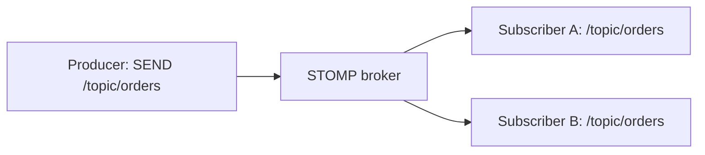
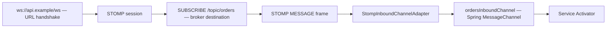
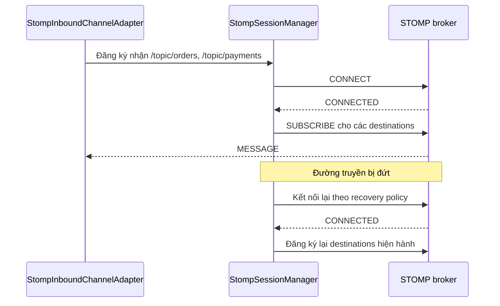

# Destination prefix và subscription trong Spring Integration STOMP

## 1. Bài toán: vì sao cùng một chuỗi destination lại cho kết quả khác nhau?

Một dịch vụ đặt hàng gửi sự kiện `ORDER_CREATED` tới destination `/topic/orders`. Ứng dụng Spring Integration dùng `StompInboundChannelAdapter` để subscribe, sau đó chuyển sự kiện vào một `MessageChannel` cho handler cập nhật dữ liệu. Mọi thứ chạy tốt trong môi trường thử nghiệm, nhưng sau khi đổi broker, subscriber không nhận được gì. Trong một trường hợp khác, đội phát triển lại gửi tới `/app/orders` và tưởng rằng broker sẽ phát sự kiện đó tới các subscriber `/topic/orders`.

Vấn đề thường không nằm ở nội dung JSON, mà ở **cách định nghĩa destination và prefix**: cái nào thuộc giao thức STOMP, cái nào do broker quyết định, cái nào là cơ chế định tuyến ứng dụng của Spring WebSocket, và subscription thực sự được đăng ký tại đâu?

Trong module **SPRING_INTEGRATION_ADAPTERS**, các inbound/outbound adapter kết nối hệ thống bên ngoài với `MessageChannel` thông qua hợp đồng message, kết nối và xử lý lỗi. Ở chương **Adapter STOMP**, `StompInboundChannelAdapter` subscribe destination để **nhận** frame từ broker, còn `StompMessageHandler` dùng destination để **gửi** frame ra broker. Nếu prefix bị hiểu sai, cả hai endpoint có thể chạy bình thường ở cấp Java nhưng không trao đổi đúng dữ liệu.

**Mục tiêu học tập:**

1. Hiểu `destination` là gì theo STOMP 1.2 và vì sao `/topic`, `/queue` không có ngữ nghĩa cố định trong bản thân giao thức.
2. Phân biệt broker destination prefix, Spring WebSocket `/app`, `/topic`, `/queue`, `/user` và URL kết nối WebSocket.
3. Viết cấu hình `StompInboundChannelAdapter` subscribe một hoặc nhiều destination, quản lý thay đổi subscription lúc ứng dụng chạy.
4. Dùng `StompMessageHandler` gửi tới đúng destination, tĩnh hoặc tính từ header được kiểm tra.
5. Hiểu `SUBSCRIBE`, subscription `id`, `UNSUBSCRIBE`, `MESSAGE.subscription`, `ack`, receipt và reconnect.
6. Thiết kế cấu hình, phân quyền, idempotency, giám sát và kiểm thử phù hợp với từng broker.

## 2. Destination là gì theo giao thức STOMP?

Theo STOMP 1.2, `destination` trong frame `SEND` hoặc `SUBSCRIBE` là một **chuỗi định danh đích** mà broker có trách nhiệm diễn giải. Giao thức yêu cầu header này trong hai loại frame, **nhưng không quy định** rằng mọi chuỗi bắt đầu bằng `/topic/` phải fan-out hay mọi chuỗi bắt đầu bằng `/queue/` phải có competing consumers.

Ví dụ hai frame:

```text
SEND
destination:/topic/orders
content-type:application/json

{"eventId":"evt-501","orderId":501}
^@
```

```text
SUBSCRIBE
id:orders-sub-1
destination:/topic/orders
ack:auto

^@
```

`^@` biểu diễn **byte NUL** kết thúc frame STOMP, không phải hai ký tự cần gửi nguyên văn. Khi ứng dụng dùng Spring Framework STOMP client, framework tạo frame đúng giao thức; không cần tự nối chuỗi bằng tay.

**Điểm cốt lõi:** `/topic/orders` là một **giá trị được chọn theo contract của broker hoặc ứng dụng**, không phải từ khóa được giao thức STOMP bắt buộc diễn giải thành một topic. Mỗi broker có thể có convention về tên destination, cơ chế tạo đích động, retention, delivery, quyền truy cập và subscription durability.

| Chuỗi ví dụ | Ý nghĩa có thể có | Điều bắt buộc phải xác minh |
| --- | --- | --- |
| `/topic/orders` | Topic/broadcast theo convention của broker | Broker có chấp nhận prefix này, có fan-out và retention không? |
| `/queue/order-jobs` | Queue với consumer cạnh tranh | Broker phân phối giữa subscriber như thế nào, ACK/redelivery ra sao? |
| `/app/orders` | Trong **Spring WebSocket server** được cấu hình, có thể chuyển vào application controller | Broker STOMP trực tiếp có hiểu `/app` không? Thường không thể giả định. |
| `/user/queue/updates` | Trong Spring WebSocket server, có thể là logical user destination | Có `UserDestinationMessageHandler`/user prefix và user session tương ứng không? |
| `orders.events` | Tên tùy ý được một broker chấp nhận | Broker có mapping hợp lệ, security ACL và định nghĩa delivery không? |

Tài liệu STOMP mô tả destination như một chuỗi mang tính **opaque** ở cấp giao thức; hãy ưu tiên tài liệu của broker và cấu hình server đang dùng khi thiết kế thực tế.

## 3. Bốn loại prefix dễ bị nhầm

### 3.1. Broker destination prefix

Một số broker quy ước tên dạng `/topic/...` hoặc `/queue/...` để phân biệt kiểu đích. Nhưng convention này **không phổ quát**; broker có thể yêu cầu một tên hoặc mapping khác.

Ví dụ khi broker hỗ trợ `/topic/orders`:



Sơ đồ mô phỏng **fan-out** khi broker đã được cấu hình cho topic; nó không phải bảo đảm từ tên `/topic` ở mọi triển khai. Đối với queue, broker có thể phát một message tới một consumer đang cạnh tranh, nhưng quy tắc chọn consumer, TTL, durable subscription và ack vẫn do broker quyết định.

### 3.2. Spring WebSocket application destination prefix

Nếu chính ứng dụng Spring làm **STOMP-over-WebSocket server**, có thể cấu hình:

```java
@Configuration
@EnableWebSocketMessageBroker
public class WebSocketBrokerConfig
        implements WebSocketMessageBrokerConfigurer {

    @Override
    public void registerStompEndpoints(
            StompEndpointRegistry registry) {
        registry.addEndpoint("/ws");
    }

    @Override
    public void configureMessageBroker(
            MessageBrokerRegistry registry) {
        registry.setApplicationDestinationPrefixes("/app");
        registry.enableSimpleBroker("/topic", "/queue");
    }
}
```

Với cấu hình **server-side** này:

- WebSocket handshake diễn ra tại URL như `ws://host:port/ws` (hoặc `wss://` qua TLS). `/ws` là **đường dẫn kết nối**, không phải destination để subscribe nghiệp vụ.
- Một STOMP `SEND destination:/app/orders` được Spring xử lý theo application destination routing, ví dụ tới method `@MessageMapping("/orders")`.
- Một STOMP `SUBSCRIBE destination:/topic/orders` được simple broker xử lý theo các prefix đã bật.
- `/app` thường là prefix cho client **gửi vào application handler**, không phải nơi client subscribe và kỳ vọng nhận message broadcast trực tiếp từ simple broker.

```java
@Controller
public class OrdersWebSocketController {

    @MessageMapping("/orders")
    @SendTo("/topic/orders")
    public OrderEvent handle(OrderCommand command) {
        // Validate và xử lý nghiệp vụ, rồi tạo event phản hồi.
        return new OrderEvent(command.orderId(), "ACCEPTED");
    }
}
```

Đây là **đoạn minh họa**: `OrderCommand` và `OrderEvent` là DTO do ứng dụng định nghĩa; cần import các annotation từ Spring Messaging/Spring WebSocket và cấu hình JSON converter. Phương thức `@SendTo` không biến mọi frame gửi tới `/app/orders` thành sự kiện thành công; kết quả còn phụ thuộc controller và xử lý nghiệp vụ.

### 3.3. Spring broker prefix

Trong `enableSimpleBroker("/topic", "/queue")`, Spring cấu hình các destination prefix mà **simple broker nội bộ** xử lý. Một cấu hình thay thế là `enableStompBrokerRelay("/topic", "/queue")` khi dùng broker relay để chuyển frame đến broker ngoài. Hai kiểu broker phải được cấu hình theo mục đích cụ thể, không bật bừa bãi cùng một routing prefix rồi mong cả hai cùng nhận.

**Phân biệt rõ:** `/topic` trong Spring WebSocket server là prefix được server chọn để định tuyến tới broker layer. `/topic` trong một STOMP broker ngoài là convention/contract của broker đó. Dù có thể trùng chữ, chúng **không tự động là cùng một hệ thống**.

### 3.4. User destination prefix

Spring WebSocket có `UserDestinationMessageHandler` để xử lý logical destination dạng `/user/...`. Ví dụ:

```text
Client subscribe: /user/queue/notifications
Server send:     /user/{username}/queue/notifications
```

Trong một ứng dụng Spring WebSocket cấu hình user destinations, các destination này có thể được biến đổi thành địa chỉ riêng cho user/session. **Không** được coi `/user` là khả năng mặc định của mọi broker STOMP độc lập. Nếu chỉ dùng Spring Integration TCP client kết nối trực tiếp broker, prefix `/user` có ý nghĩa hay không phụ thuộc chính broker và cách routing đã cấu hình.

## 4. Phân biệt endpoint URL, broker destination và Spring MessageChannel



| Thuộc tính | Được sử dụng ở đâu? | Ví dụ |
| --- | --- | --- |
| WebSocket endpoint | Kết nối transport giữa client và server | `wss://api.example/ws` |
| STOMP virtual host header | Frame `CONNECT`, chọn virtual host khi broker hỗ trợ | `host:broker.internal` |
| STOMP destination | Frame `SEND`, `SUBSCRIBE` và `MESSAGE` | `/topic/orders` |
| STOMP subscription ID | Nhận diện subscription **trong một session** | `orders-sub-1` |
| Spring `MessageChannel` | Đường truyền nội bộ sau adapter | `ordersInboundChannel` |
| Spring application prefix | Định tuyến trong **Spring WebSocket server** | `/app` |

Không dùng một biến `destination` duy nhất cho tất cả các khái niệm trên. Ví dụ, không truyền `wss://api.example/ws` vào `StompInboundChannelAdapter` với kỳ vọng nó kết nối đến WebSocket; adapter nhận **destination STOMP**, còn session manager/client chịu trách nhiệm URL/transport.

## 5. SUBSCRIBE, subscription ID và MESSAGE.subscription

### 5.1. Một session có thể có nhiều subscription

`SUBSCRIBE` yêu cầu hai header:

- `destination`: đích cần lắng nghe.
- `id`: định danh subscription duy nhất **trong cùng kết nối STOMP**.

Ví dụ:

```text
SUBSCRIBE
id:orders-0
destination:/topic/orders
ack:auto

^@

SUBSCRIBE
id:payments-0
destination:/topic/payments
ack:auto

^@
```

Khi broker phát sự kiện của subscription thứ nhất, frame có dạng:

```text
MESSAGE
subscription:orders-0
message-id:broker-evt-501
destination:/topic/orders
content-type:application/json

{"eventId":"evt-501","orderId":501}
^@
```

Header `subscription` trong frame `MESSAGE` giúp client liên hệ message với một `SUBSCRIBE id` trước đó. `message-id` là định danh message theo broker, **không** đồng nghĩa subscription ID hay Spring `MessageHeaders.ID`.

Trong Spring Framework, các subscription ID có thể được client/session tạo và quản lý. Với `StompInboundChannelAdapter`, hãy để adapter/session quản lý registration và giữ metadata subscription cần thiết; **không tự dựng thêm một subscription thủ công tới cùng destination** trừ khi thực sự cần luồng tiêu thụ khác.

### 5.2. Khi nào phải UNSUBSCRIBE?

Theo STOMP 1.2, `UNSUBSCRIBE` dùng **subscription id**:

```text
UNSUBSCRIBE
id:orders-0

^@
```

Sau khi broker thực hiện unsubscribe, phiên đó không còn nhận message từ subscription tương ứng. Nhưng:

- Không đồng nghĩa broker xóa destination.
- Không đồng nghĩa xóa các message đã được chuyển vào `MessageChannel` hoặc hàng đợi downstream.
- Không hoàn tác handler/DB transaction đã chạy.
- Không tự ngắt toàn bộ STOMP session nếu còn subscription khác.

Khi ứng dụng muốn thay đổi destinations, nên dùng API quản lý subscription của adapter thay vì tự gửi frame `UNSUBSCRIBE` mâu thuẫn với trạng thái trong adapter.

## 6. Ví dụ Spring Integration: subscribe nhiều destination

### 6.1. Các thành phần và dependency

Ví dụ dưới đây dùng Spring Integration với broker STOMP/TCP ở `127.0.0.1:61613`; destination được giả định broker hỗ trợ `/topic/orders` và `/topic/payments`.

```xml
<dependencies>
    <dependency>
        <groupId>org.springframework.boot</groupId>
        <artifactId>spring-boot-starter-integration</artifactId>
    </dependency>
    <dependency>
        <groupId>org.springframework.integration</groupId>
        <artifactId>spring-integration-stomp</artifactId>
    </dependency>
    <dependency>
        <groupId>io.projectreactor.netty</groupId>
        <artifactId>reactor-netty</artifactId>
    </dependency>
</dependencies>
```

Sử dụng Spring Boot BOM/Spring Integration BOM tương thích. Nếu dùng STOMP-over-WebSocket thay TCP, cần đổi client, session manager, endpoint URL và dependency transport tương ứng; không chỉ sửa chuỗi host.

### 6.2. Java configuration

```java
import java.nio.charset.StandardCharsets;

import org.springframework.beans.factory.annotation.Qualifier;
import org.springframework.context.annotation.Bean;
import org.springframework.context.annotation.Configuration;
import org.springframework.integration.annotation.ServiceActivator;
import org.springframework.integration.channel.DirectChannel;
import org.springframework.integration.config.EnableIntegration;
import org.springframework.integration.stomp.ReactorNettyTcpStompSessionManager;
import org.springframework.integration.stomp.StompSessionManager;
import org.springframework.integration.stomp.inbound.StompInboundChannelAdapter;
import org.springframework.integration.support.converter.PassThruMessageConverter;
import org.springframework.messaging.Message;
import org.springframework.messaging.MessageChannel;
import org.springframework.messaging.simp.stomp.ReactorNettyTcpStompClient;
import org.springframework.scheduling.concurrent.ThreadPoolTaskScheduler;

@Configuration
@EnableIntegration
public class MultiDestinationStompInboundConfig {

    @Bean
    public ThreadPoolTaskScheduler stompClientScheduler() {
        ThreadPoolTaskScheduler scheduler = new ThreadPoolTaskScheduler();
        scheduler.setPoolSize(2);
        scheduler.setThreadNamePrefix("stomp-client-");
        return scheduler;
    }

    @Bean
    public ReactorNettyTcpStompClient stompClient(
            ThreadPoolTaskScheduler stompClientScheduler) {
        ReactorNettyTcpStompClient client =
            new ReactorNettyTcpStompClient("127.0.0.1", 61613);
        client.setMessageConverter(new PassThruMessageConverter());
        client.setTaskScheduler(stompClientScheduler);
        client.setReceiptTimeLimit(5000);
        return client;
    }

    @Bean
    public StompSessionManager stompSessionManager(
            ReactorNettyTcpStompClient stompClient) {
        ReactorNettyTcpStompSessionManager manager =
            new ReactorNettyTcpStompSessionManager(stompClient);
        manager.setAutoReceipt(true);
        return manager;
    }

    @Bean
    public MessageChannel incomingBrokerEvents() {
        return new DirectChannel();
    }

    @Bean
    public StompInboundChannelAdapter brokerEventAdapter(
            StompSessionManager stompSessionManager,
            @Qualifier("incomingBrokerEvents") MessageChannel output) {

        StompInboundChannelAdapter adapter =
            new StompInboundChannelAdapter(
                stompSessionManager,
                "/topic/orders",
                "/topic/payments"
            );
        adapter.setOutputChannel(output);
        adapter.setPayloadType(String.class);
        return adapter;
    }

    @ServiceActivator(inputChannel = "incomingBrokerEvents")
    public void handleBrokerEvent(Message<?> message) {
        Object payload = message.getPayload();
        String body = (payload instanceof byte[] bytes)
            ? new String(bytes, StandardCharsets.UTF_8)
            : String.valueOf(payload);

        // TODO: đọc destination header do mapper cung cấp,
        // kiểm tra eventType/schema và định tuyến nghiệp vụ.
        System.out.printf(
            "Spring message=%s, body=%s%n",
            message.getHeaders().getId(), body
        );
    }
}
```

**Giải thích:**

1. `ReactorNettyTcpStompClient` tạo kết nối TCP đến broker. `ThreadPoolTaskScheduler` hỗ trợ STOMP heartbeat/receipt timeout, **không** phải Poller định kỳ gọi nguồn.
2. `StompSessionManager` quản lý phiên dùng chung.
3. `StompInboundChannelAdapter` đăng ký hai broker destinations trong cùng adapter.
4. `incomingBrokerEvents` là một `DirectChannel` **nội bộ**, không phải broker topic; tất cả message từ hai destinations đi vào cùng channel.
5. Handler cần xác định loại sự kiện từ **destination header đã được map** hoặc trường `eventType` trong payload. Không tự suy ra mọi payload đều là đơn hàng.
6. `setPayloadType(String.class)` diễn đạt kiểu đích mong muốn; kiểu payload nhận thực tế phụ thuộc converter và frame. Trong production, validate schema/charset thay vì in body tùy ý.

Ví dụ sử dụng Java 17 cho pattern matching `instanceof`. Trước khi chạy, bảo đảm broker thực sự chấp nhận hai destination và tài khoản client được phép `SUBSCRIBE`.

### 6.3. Hai subscription, một output channel

```text
Broker:
  /topic/orders ------+
                      +--> StompInboundChannelAdapter
  /topic/payments -----+             |
                                     v
                            incomingBrokerEvents
                                     |
                                     v
                              event handler/router
```

Hai destination khác nhau không bắt buộc tương ứng hai `MessageChannel` trong ứng dụng. Một inbound adapter có thể gom sự kiện về một channel rồi dùng router. Ngược lại, nếu hai loại dữ liệu có SLA, bảo mật, retry và retention khác nhau, có thể tách adapter/flow với quyền và metrics riêng.

## 7. Thêm hoặc bỏ subscription khi ứng dụng đang chạy

Spring Integration cung cấp managed operations ngay trên `StompInboundChannelAdapter`:

```java
adapter.addDestination("/topic/returns");
adapter.removeDestination("/topic/payments");
```

Khi adapter/session có khả năng hoạt động, các phương thức này cập nhật danh sách destination và thực hiện subscribe/unsubscribe tương ứng theo cơ chế của adapter.

### Tại sao nên dùng API của adapter?

`StompInboundChannelAdapter` sở hữu trạng thái danh sách destinations. Nếu ứng dụng tự lấy `StompSession` rồi gọi `subscribe(...)` hoặc gửi `UNSUBSCRIBE` cho subscription do adapter tạo mà không thông báo adapter, metadata quản lý subscription có thể lệch với broker. Sau reconnect, adapter có thể đăng ký lại theo danh sách nó đang giữ, gây khác biệt với trạng thái bạn tưởng đã thay đổi.

**Các bước quản trị nên thực hiện:**

1. Xác thực/ủy quyền yêu cầu thay đổi subscription.
2. Kiểm tra destination nằm trong **allowlist** và được broker hỗ trợ.
3. Gọi `addDestination(...)` hoặc `removeDestination(...)` trên **đúng bean adapter**.
4. Theo dõi lỗi `SUBSCRIBE`/`UNSUBSCRIBE`, subscription receipt nếu cấu hình và trạng thái nhận frame thực tế.
5. Ghi audit: instance, destination, người thay đổi, thời điểm, kết quả và lý do.

### Ví dụ service quản trị có danh sách cho phép

```java
import java.util.Set;

import org.springframework.stereotype.Service;
import org.springframework.integration.stomp.inbound.StompInboundChannelAdapter;

@Service
public class StompDestinationAdmin {

    private static final Set<String> ALLOWED = Set.of(
        "/topic/orders",
        "/topic/payments",
        "/topic/returns"
    );

    private final StompInboundChannelAdapter adapter;

    public StompDestinationAdmin(
            StompInboundChannelAdapter brokerEventAdapter) {
        this.adapter = brokerEventAdapter;
    }

    public void subscribe(String destination) {
        checkAllowed(destination);
        adapter.addDestination(destination);
    }

    public void unsubscribe(String destination) {
        checkAllowed(destination);
        adapter.removeDestination(destination);
    }

    private void checkAllowed(String destination) {
        if (!ALLOWED.contains(destination)) {
            throw new IllegalArgumentException(
                "Destination is not allowed"
            );
        }
    }
}
```

Đây là **service nội bộ**, không phải một HTTP API công khai. Với ứng dụng có nhiều bean `StompInboundChannelAdapter`, nên inject bằng `@Qualifier("brokerEventAdapter")` để tránh chọn nhầm instance. Ngoài allowlist, production cần xác thực quyền của người yêu cầu; kiểm tra chuỗi destination đơn thuần chưa đủ.

**Quan trọng:** `getDestinations()` hoặc việc một lệnh quản trị trả về không lỗi chỉ cho biết trạng thái cấu hình/đã yêu cầu thao tác. Điều đó **không bảo đảm broker đã hoàn tất subscription**, cũng không chứng minh một event cụ thể sẽ được lưu bền khi client offline.

## 8. Subscription receipt, ACK và mốc xử lý nghiệp vụ

STOMP 1.2 phân biệt những cơ chế sau:

| Cơ chế | Được sử dụng ở đâu? | Không bảo đảm |
| --- | --- | --- |
| `SUBSCRIBE id` | Định danh subscription trong một kết nối | Message đã được nghiệp vụ xử lý thành công |
| `RECEIPT` cho `SUBSCRIBE` | Broker phản hồi frame đăng ký khi client yêu cầu receipt | Broker sẽ lưu mọi event khi client offline |
| `MESSAGE.subscription` | Liên hệ frame với subscription đã đăng ký | Nó là business event ID hoặc message ID toàn cầu |
| `ACK/NACK` | Xác nhận/từ chối delivery trong chế độ manual acknowledgment | Transaction JDBC tự động gắn với broker |
| Business commit | Handler ghi nhận thay đổi trong DB | ACK đã được broker nhận nếu chưa gửi theo contract |

### Chế độ ACK của STOMP

Trong frame `SUBSCRIBE`, `ack` nhận các giá trị:

- `auto`: mặc định nếu không cung cấp header; server coi message đã giao khi gửi, client không cần gửi `ACK`.
- `client`: client gửi `ACK` và việc xác nhận có thể **cộng dồn** các message trước đó trong cùng subscription theo STOMP 1.2.
- `client-individual`: xác nhận từng message riêng, không cộng dồn các message trước đó.

Nếu dùng manual acknowledgment, frame `MESSAGE` có header `ack` để client dùng khi gửi `ACK`/`NACK`. Khi server nhận `NACK`, việc redelivery, discard hoặc dead-letter phụ thuộc broker.

**Không mặc định `StompInboundChannelAdapter` có một thuộc tính `ackMode` giống hoàn toàn listener JMS/AMQP.** Muốn thay đổi ack mode, cần kiểm tra cấu hình client/subscription và API được adapter/phiên bản hỗ trợ; nếu cần điều khiển ACK sau commit, phải thiết kế và kiểm chứng toàn bộ integration flow.

### Receipt không phải là ACK

`StompSessionManager#setAutoReceipt(true)` có thể yêu cầu receipt cho frame `SUBSCRIBE` theo hỗ trợ của manager; `StompInboundChannelAdapter` có thể phát `StompReceiptEvent` tương ứng. Receipt này cho biết broker **xử lý yêu cầu subscription ở lớp giao thức**, không có nghĩa handler nghiệp vụ đã xử lý các event sau đó.

Tương tự, receipt cho một frame `SEND` không phải xác nhận subscriber đã ghi DB xong. Với nguồn có giá trị cao, cần idempotency, durable storage/ack hợp đồng và cơ chế đối soát.

## 9. Định tuyến outbound destination: tĩnh và động

`StompMessageHandler` gửi Spring message ra broker. Destination có thể được cấu hình cố định:

```java
StompMessageHandler outboundHandler =
    new StompMessageHandler(stompSessionManager);
outboundHandler.setDestination("/topic/orders");
```

Hoặc được tính theo từng message:

```java
import org.springframework.expression.spel.standard.SpelExpressionParser;

outboundHandler.setDestinationExpression(
    new SpelExpressionParser().parseExpression(
        "headers['approvedDestination']"
    )
);
```

Đây là **hai phương án thay thế**; không dùng cả hai để cho rằng handler sẽ đồng thời gửi tới cả hai destination. Khi chọn destination động, hãy kiểm tra loại sự kiện và ánh xạ về một allowlist, ví dụ:

| `eventType` | Destination gửi |
| --- | --- |
| `ORDER_CREATED` | `/topic/orders` |
| `PAYMENT_CAPTURED` | `/topic/payments` |
| `ORDER_RETURNED` | `/topic/returns` |

Nếu một HTTP request bên ngoài được quyền đặt `approvedDestination` tùy ý, một client có thể khiến dữ liệu bị gửi đến destination không được phép. **Tầng nghiệp vụ phải chọn destination**, không tin trực tiếp header do nguồn không tin cậy cung cấp.

### Destination outbound khác application prefix

Giả sử client `SEND /app/orders` tới **Spring WebSocket server** đã cấu hình `setApplicationDestinationPrefixes("/app")`. Message được route tới application controller, nơi có thể phát event ra `/topic/orders`. Nhưng nếu một `StompMessageHandler` kết nối **trực tiếp vào broker TCP bên ngoài** và gửi tới `/app/orders`, broker đó không nhất thiết biết phải chuyển message tới Spring controller.

Do đó, trong sơ đồ kiến trúc phải ghi rõ **điểm kết nối và thành phần định tuyến**:

```text
Client WebSocket -> Spring WebSocket server:
  SEND /app/orders -> @MessageMapping -> broker /topic/orders

Spring Integration TCP client -> External STOMP broker:
  SEND /topic/orders -> broker routing -> subscribers
```

## 10. Reconnect, lifecycle và danh sách subscription

STOMP subscription sống **trong một session**. Khi session bị ngắt, subscription hiện hành không thể tiếp tục nhận frame trên kết nối đã mất. Sau khi khôi phục kết nối, adapter cần đăng ký lại những destination đang được cấu hình theo cơ chế lifecycle/session manager.



Sơ đồ thể hiện **hành vi cần thiết ở mức kiến trúc**; thời điểm thực tế và phạm vi resubscription phụ thuộc phiên bản Spring Integration, manager, adapter, broker và cấu hình lifecycle. Hãy kiểm thử reconnect cùng các subscription động.

**Đừng nhầm các trạng thái:**

- `StompSessionManager.isConnected() == true`: có session theo manager, **chưa chứng minh** mọi subscription đã được broker chấp thuận.
- `StompInboundChannelAdapter.isRunning() == true`: endpoint hoạt động về mặt lifecycle, **chưa chứng minh** broker đang gửi dữ liệu.
- `getDestinations()`: các destination adapter muốn quản lý, **không phải** số message đã được giao thành công.
- Handler vừa log message: dữ liệu đã tới ít nhất một bước xử lý, **chưa chứng minh** transaction DB hoàn tất nếu handler async.

### Điều gì xảy ra khi unsubscribe trong lúc đang có message?

`removeDestination(...)` yêu cầu ngừng subscription, nhưng có thể còn frame đang nằm trên network, callback đã được gọi hoặc message đã vào một queue nội bộ. Vì vậy:

1. Không xóa dữ liệu downstream chỉ vì unsubscribe.
2. Không coi unsubscribe là rollback nghiệp vụ.
3. Khi tạm dừng để bảo trì, đo các message in-flight và có chính sách drain/timeout.
4. Nếu cần đảm bảo không mất event trong thời gian vắng mặt, phải dùng durability/retention phù hợp với broker.

## 11. Topic, queue, durable subscription và nhiều replica

STOMP destination string tự nó **không bảo đảm durability**. Để nhận lại message sau restart, cần hiểu:

- Broker có lưu message khi subscriber offline hay không?
- Topic có hỗ trợ durable subscription không, và cần subscription identity/header nào?
- Queue có cạnh tranh giữa consumer hay gửi cho từng consumer?
- ACK mode có cho phép redelivery không, và khi nào message được xóa khỏi queue?
- TTL, dead-letter, max queue length và replay có được bật không?

### Ví dụ ba replica cùng subscribe

```text
                 /topic/orders
                      |
                    Broker
                 /    |     \
             Pod A   Pod B   Pod C
```

Nếu broker xử lý `/topic/orders` theo fan-out, cả ba pod có thể nhận **cùng một event**. Không thể dựa vào tên `/topic` và việc dùng chung code để giả định “chỉ một pod xử lý”. Nếu nghiệp vụ chỉ muốn một worker nhận mỗi job, cần dùng queue/competing-consumer semantics được broker hỗ trợ hoặc cơ chế phân vùng phù hợp.

Mỗi pod có `StompSessionManager` riêng, subscription ID chỉ cần duy nhất **trong từng session**, không phải một ID toàn cụm do Spring Integration tự điều phối.

**Để chống trùng:** dùng `eventId` hoặc business key bền vững, lưu idempotency record cùng transaction nghiệp vụ, và thiết kế retry sao cho event phát lại không tạo kết quả trùng. Spring `MessageHeaders.ID` có thể thay đổi qua các lần redelivery hoặc mỗi lần chuyển đổi message.

## 12. Bảo mật: prefix là convention, không phải quyền

Một số lỗi phổ biến:

- “Topic nào có tiền tố `/private` thì tự động riêng tư”: **không đúng** nếu broker ACL không bảo vệ.
- “Chỉ cần ẩn destination khỏi client”: **không đủ**, vì client có thể thử SUBSCRIBE/SEND tới tên đoán được.
- “`/user` tự bảo đảm phân quyền”: **không đúng** nếu server không xác thực user và không giới hạn quyền truy cập/session.
- “Prefix `/app` chỉ controller được phép gọi”: phải xác thực và phân quyền Spring WebSocket message handlers.

### Chính sách tối thiểu

1. Dùng account riêng cho publisher và subscriber khi có thể, cấp quyền `SEND`/`SUBSCRIBE` theo destination cụ thể.
2. Dùng TLS (`wss://` cho STOMP-over-WebSocket hoặc TLS phù hợp STOMP/TCP), xác minh chứng chỉ broker.
3. Không log CONNECT passcode, bearer token, header nhạy cảm hoặc body chứa PII.
4. Không nhận một destination name tùy ý từ người dùng rồi gửi vào `addDestination` hay `setDestinationExpression`.
5. Kiểm tra prefix hợp lệ nhưng **phải kết hợp kiểm tra full destination**, tenant và event type.
6. Giới hạn số subscription và tần suất thay đổi để tránh lạm dụng tài nguyên.
7. Có audit log cho thao tác subscribe/unsubscribe động và lỗi bị từ chối bởi ACL.

### Multi-tenant

Nếu có destination theo tenant như `/topic/tenant-42/orders`, không thể chỉ dựa vào chuỗi `tenant-42` trong header do client cung cấp. Cần xác minh tenant identity ở lớp xác thực, map sang destination được phép, kiểm tra broker ACL và tách luồng/credentials nếu yêu cầu cách ly nghiêm ngặt.

## 13. Quan sát và chẩn đoán sự cố destination

| Triệu chứng | Giả thuyết | Cách kiểm tra |
| --- | --- | --- |
| Kết nối STOMP thành công nhưng không nhận gì | Sai destination hoặc chưa SUBSCRIBE | Trace frame `SUBSCRIBE`, broker ACL và publisher destination. |
| Gửi `/app/orders` nhưng không có subscriber `/topic/orders` nhận | Dùng nhầm prefix application với broker destination | Kiểm tra có Spring WebSocket server và `@MessageMapping` hay không. |
| Topic gửi được nhưng queue không có event | Broker naming/routing convention khác | Kiểm tra tài liệu và cấu hình broker cụ thể. |
| Thêm destination động không thấy event | Chưa subscribe thành công, thiếu quyền, phiên mất kết nối | Đọc session events, receipt khi có, thử phát message mẫu. |
| Bỏ destination nhưng handler vẫn log vài event | Frame in-flight hoặc queue downstream còn dữ liệu | Đo thời điểm remove, queue depth và callback đã được gọi. |
| Sau reconnect nhận trùng message | Redelivery hoặc subscription mới cùng nhận dữ liệu | Kiểm tra eventId, broker semantics, idempotency. |
| Nhiều pod cùng xử lý | Topic fan-out hoặc nhiều subscription độc lập | Xác minh broker và thiết kế competing consumers nếu cần. |
| Thấy `MESSAGE.subscription` nhưng khác tên destination | Subscription ID không phải tên destination | Đối chiếu frame `SUBSCRIBE id` và header `destination`. |
| Broker trả `ERROR` khi subscribe | Destination không tồn tại, thiếu ACL hoặc header không hợp lệ | Xem lỗi broker, account và STOMP frame contract. |

**Các metric hữu ích:** số subscription theo destination/instance, số frame `MESSAGE` vào, số Spring message đã phát, lỗi `SUBSCRIBE/UNSUBSCRIBE`, thời gian kết nối lại, receipt success/timeout, số event được commit, độ trễ đến DB, độ tuổi dữ liệu chưa hoàn tất và số duplicate.

Chỉ theo dõi `isConnected()` là chưa đủ: session có thể khỏe nhưng destination không có publisher hoặc subscriber bị broker từ chối.

## 14. Kịch bản kiểm thử end-to-end

Một bài thực hành có thể dùng broker mà nhóm đã triển khai STOMP/TCP, publisher gửi frame và ứng dụng Java ở mục 6:

1. **Kiểm tra handshake:** xác nhận nhận `CONNECTED` và tài khoản có quyền `SUBSCRIBE`.
2. **Kiểm tra destination A:** gửi event thử tới `/topic/orders`; handler nhận và gắn loại `ORDER_CREATED`.
3. **Kiểm tra destination B:** gửi tới `/topic/payments`; handler nhận nhưng không diễn giải như đơn hàng.
4. **Kiểm tra prefix sai:** gửi tới một destination broker không route; quan sát broker phản hồi/đếm frame, không đoán chỉ từ tên.
5. **Thêm destination:** gọi service quản trị với `/topic/returns`, gửi event trả hàng và quan sát.
6. **Bỏ destination:** gọi `removeDestination("/topic/payments")`, kiểm tra các message mới sau unsubscribe không còn đi qua subscription đó. Đừng bỏ qua những message đã in-flight.
7. **Ngắt kết nối:** restart broker hoặc ngắt kết nối trong môi trường thử nghiệm; kiểm tra subscription sau reconnect.
8. **Kiểm tra ACK/retention:** gửi message khi client offline, xem broker có lưu và redeliver không theo cấu hình thực.
9. **Kiểm tra nhiều replica:** chạy hai instance và xem topic/queue phân phối theo semantics broker.
10. **Kiểm tra security:** dùng account thiếu quyền SUBSCRIBE và xác minh lỗi bị từ chối được ghi nhận/cảnh báo.

Làm các kiểm thử phá kết nối trên môi trường riêng, không thực hiện với dữ liệu thật hoặc broker đang phục vụ production.

## 15. Bài tập có đáp án

**Bài 1 — Ngữ nghĩa destination.** STOMP 1.2 có quy định `/topic` nhất thiết broadcast và `/queue` nhất thiết competing consumers không?

**Đáp án:** Không. `destination` là một chuỗi broker diễn giải; semantics cụ thể theo triển khai và cấu hình broker.

**Bài 2 — URL và destination.** `wss://example/ws` và `/topic/orders` có cùng vai trò không?

**Đáp án:** Không. URL là endpoint transport/WebSocket handshake; `/topic/orders` là destination trong frame STOMP.

**Bài 3 — Application prefix.** Với Spring WebSocket server có `setApplicationDestinationPrefixes("/app")`, `SEND /app/orders` thường được xử lý ở đâu?

**Đáp án:** Qua application message routing, ví dụ `@MessageMapping("/orders")`; không mặc nhiên phát trực tiếp tới subscriber `/topic/orders`.

**Bài 4 — SUBSCRIBE ID.** Hai subscription trên **cùng một STOMP session** có được dùng trùng `id` không?

**Đáp án:** Không. STOMP 1.2 yêu cầu các subscription ID khác nhau trong cùng kết nối.

**Bài 5 — MESSAGE.subscription.** Header `subscription:orders-0` là định danh event nghiệp vụ hay subscription?

**Đáp án:** Là subscription ID, dùng để liên hệ `MESSAGE` với frame `SUBSCRIBE` tương ứng.

**Bài 6 — UNSUBSCRIBE.** Khi bỏ subscription, frame `UNSUBSCRIBE` cần header nào?

**Đáp án:** Cần `id` trùng subscription ID đã đăng ký; không phải chỉ cần `destination`.

**Bài 7 — Java API.** Cách thêm `/topic/returns` vào inbound adapter khi đang chạy?

**Đáp án:** Dùng `StompInboundChannelAdapter#addDestination("/topic/returns")` và xác minh quyền/trạng thái subscribe.

**Bài 8 — Một adapter hai destination.** Hai destination nhận vào một `DirectChannel` có tự tạo hai Spring service activator khác nhau không?

**Đáp án:** Không. Cần thiết kế router hoặc handler dựa trên metadata/event type để xử lý đúng loại dữ liệu.

**Bài 9 — ACK.** `ack:auto` có bảo đảm Java handler đã commit DB trước khi broker coi message đã giao không?

**Đáp án:** Không. Ở chế độ auto, broker có thể coi message được giao ngay khi gửi; business commit là trách nhiệm riêng.

**Bài 10 — Receipt.** Nhận receipt của `SUBSCRIBE` có chứng minh sẽ không mất message khi ứng dụng offline không?

**Đáp án:** Không. Durability/retention và redelivery phụ thuộc broker, subscription contract và ack mode.

**Bài 11 — Prefix /user.** Một broker TCP ngoài có tự hiểu `/user/queue/notifications` là destination riêng cho người dùng chỉ vì Spring hỗ trợ `/user` không?

**Đáp án:** Không. Đó là tính năng routing của Spring WebSocket khi được cấu hình; broker ngoài phải có contract tương ứng mới hiểu.

**Bài 12 — Nhiều replica.** Hai pod subscribe topic cùng lúc có thể cùng xử lý một sự kiện không?

**Đáp án:** Có thể, theo cơ chế fan-out của topic broker. Cần idempotency hoặc cấu hình queue/competing-consumer khi muốn phân phối công việc.

**Bài 13 — Destination động.** Có nên dùng thẳng một header `targetDestination` lấy từ HTTP request chưa xác thực để định tuyến STOMP outbound?

**Đáp án:** Không. Phải xác thực/ủy quyền, validate event type và map vào allowlist destination.

**Bài 14 — Unsubscribe và in-flight.** Gọi `removeDestination` có tự xóa những message đã nằm trong queue downstream không?

**Đáp án:** Không. Đó là quản lý subscription, không phải hành động rollback hay xóa hàng đợi nội bộ.

## 16. Ghi nhớ

**Destination trong STOMP là chuỗi do broker hoặc server routing diễn giải, không phải kiểu topic/queue được giao thức mặc định bảo đảm.** STOMP `SUBSCRIBE` cần `destination` và `id` duy nhất trong session; frame `MESSAGE` chứa `subscription` liên hệ với subscription đã tạo, còn `UNSUBSCRIBE` dùng `id` để hủy subscription. Trong Spring Integration, `StompInboundChannelAdapter` có thể subscribe nhiều destination và hỗ trợ `addDestination()/removeDestination()` khi chạy; `StompMessageHandler` dùng destination cố định hoặc expression để gửi. Hãy phân biệt broker destination với WebSocket endpoint URL, Spring `MessageChannel`, prefix ứng dụng `/app`, broker prefix `/topic`/`/queue` và user routing `/user`. Để hệ thống đáng tin cậy, kết hợp ACL, kiểm tra subscription, retry, retention, ACK, idempotency, metrics và thử nghiệm theo broker thực tế.

## Tài liệu tham khảo

- [STOMP Protocol Specification 1.2](https://stomp.github.io/stomp-specification-1.2.html)
- [Spring Integration Reference — STOMP Support](https://docs.spring.io/spring-integration/reference/stomp.html)
- [Spring Integration API — StompInboundChannelAdapter](https://docs.spring.io/spring-integration/api/org/springframework/integration/stomp/inbound/StompInboundChannelAdapter.html)
- [Spring Framework — Enable STOMP](https://docs.spring.io/spring-framework/reference/web/websocket/stomp/enable.html)
- [Spring Framework — User Destinations](https://docs.spring.io/spring-framework/reference/web/websocket/stomp/user-destination.html)
