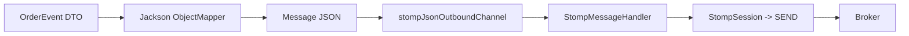
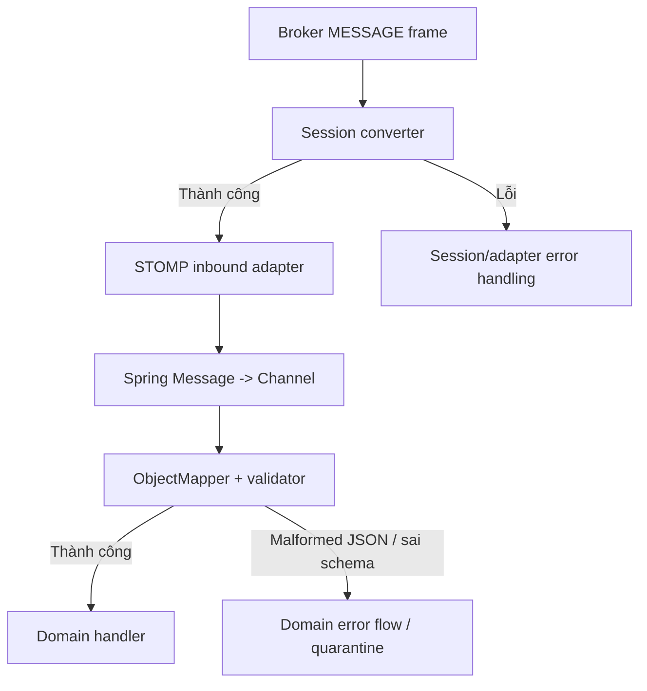

# Message converter cho STOMP trong Spring Integration

## 1. Bối cảnh: cùng một frame, vì sao payload nhận được có kiểu khác nhau?

Ứng dụng xử lý đơn hàng nhận một frame STOMP chứa JSON từ broker. Ở một cấu hình, handler đọc được chuỗi `String`; ở cấu hình khác, handler nhận `byte[]`; nếu chọn converter khác, dữ liệu có thể được khôi phục thành đối tượng Java. Khi gửi đi, một `OrderEvent` cũng không mặc nhiên biến thành JSON đúng hợp đồng. Tệ hơn, một frame có `content-type:application/json` vẫn có thể chứa JSON lỗi hoặc payload không phù hợp schema.

Trong module **SPRING_INTEGRATION_ADAPTERS**, các inbound/outbound adapter kết nối hệ thống ngoài với `MessageChannel`, gateway và luồng xử lý message. Riêng **STOMP**, Spring Framework cung cấp `StompClientSupport`/`StompSession` và cơ chế `MessageConverter`; Spring Integration bổ sung `StompInboundChannelAdapter`, `StompMessageHandler`, `StompHeaderMapper` cùng integration flow. Hiểu đúng vị trí chuyển đổi giúp ta nhận và gửi dữ liệu theo hợp đồng, xử lý lỗi đúng tầng và không làm mất thông tin header.

**Mục tiêu bài học:**

1. Phân biệt STOMP frame, Spring `Message<?>`, payload converter, header mapper và transformer nghiệp vụ.
2. Hiểu hướng chuyển đổi inbound/outbound của STOMP client khi dùng `MessageConverter`.
3. Cấu hình `PassThruMessageConverter` cho integration adapters; dùng `setPayloadType(...)` đúng mục đích.
4. Thiết kế đường JSON `byte[]/String → DTO` và `DTO → String/byte[]` với charset, content-type và validation.
5. Biết khi nào có thể dùng `StringMessageConverter` hoặc `MappingJackson2MessageConverter` ở STOMP client thuần, và vì sao không thay thế tùy tiện converter trong Spring Integration.
6. Chẩn đoán lỗi conversion, bảo toàn header, giới hạn payload, retry/idempotency và kiểm thử tương thích.

## 2. STOMP frame và Spring Message là hai mô hình khác nhau

Frame STOMP có **command, headers và body**. Ví dụ:

```text
MESSAGE
subscription:sub-orders-0
message-id:broker-501
destination:/topic/orders
content-type:application/json

{"eventId":"evt-501","orderId":501,"status":"CREATED"}
^@
```

`^@` biểu diễn byte NUL kết thúc frame theo STOMP; framework sẽ thực hiện mã hóa/giải mã, không nên nối nguyên văn ký hiệu này vào body. Payload chứa dấu tiếng Việt hoặc ký tự ngoài ASCII cần được xử lý theo **encoding** của hợp đồng, thường là UTF-8.

Sau khi chuyển thành Spring message, dữ liệu có dạng:

```java
Message<?> message = ...;
Object payload = message.getPayload();
MessageHeaders headers = message.getHeaders();
```

| Thành phần | STOMP wire protocol | Spring Messaging |
| --- | --- | --- |
| Thông điệp | Frame `MESSAGE`/`SEND` | `Message<?>` |
| Nội dung | Body bytes | `payload`: có thể là `String`, `byte[]` hoặc DTO |
| Metadata | `StompHeaders`: `destination`, `content-type`, `message-id`... | `MessageHeaders` |
| Định danh | `message-id` của broker hoặc `receipt-id` | `MessageHeaders.ID`; không mặc nhiên trùng broker ID |
| Hướng nhận | Broker gửi frame `MESSAGE` | STOMP adapter phát vào `MessageChannel` |
| Hướng gửi | Client phát frame `SEND` | Producer gửi Spring message tới outbound handler |

**Điểm quan trọng:** chuyển frame sang Spring message **khác** với chuyển JSON thành một đối tượng Java hợp lệ. Trường `content-type` có thể giúp chọn converter nhưng không tự đảm bảo payload hợp lệ, đủ field hay được phép xử lý.

## 3. Hai lớp chuyển đổi không được đánh đồng

### 3.1. MessageConverter ở STOMP client/session

Spring Framework cung cấp `MessageConverter` (giao diện `org.springframework.messaging.converter.MessageConverter`), được cấu hình trên `StompClientSupport`, ví dụ:

```java
stompClient.setMessageConverter(new PassThruMessageConverter());
```

Nó tham gia chuyển đổi giữa message/payload phía client và dạng mà `StompSession` sử dụng khi gửi hoặc nhận frame. Với STOMP client thuần, converter có thể chuyển `String` thành body text hoặc ánh xạ JSON sang DTO nếu converter và target type được cấu hình tương thích.

### 3.2. StompHeaderMapper ở Spring Integration adapter

`StompHeaderMapper` xử lý **header**, không phải JSON body. Nó ánh xạ `StompHeaders` và Spring `MessageHeaders` giữa hai phía adapter. Spring Integration dùng tiền tố **`stomp_`** cho các standard STOMP headers được đưa vào Spring message.

```text
Inbound:
Broker frame → STOMP client MessageConverter → adapter
                → StompHeaderMapper → Spring Message → MessageChannel
                                                 |
                                                 v
                                      JSON parser / transformer / handler

Outbound:
Domain event → JSON serializer → Spring Message → StompMessageHandler
                → StompHeaderMapper + session MessageConverter
                → SEND frame → broker
```

| Công cụ | Xử lý | Không chịu trách nhiệm |
| --- | --- | --- |
| `MessageConverter` của STOMP client | Biểu diễn payload/message khi đi qua session | Quyết định event được phép xử lý, transaction hoặc idempotency |
| `StompHeaderMapper` | Ánh xạ header STOMP ↔ Spring header | Parse JSON body thành business DTO |
| `setPayloadType(Class<?>)` trên inbound adapter | Chỉ định kiểu mục tiêu được yêu cầu khi nhận frame | Bảo đảm mọi converter biến được body thành kiểu đó |
| `ObjectMapper`/JSON transformer | Serialize/deserialize JSON và xử lý hợp đồng DTO | Quản lý STOMP session hoặc broker ACK |
| Validator nghiệp vụ | Kiểm tra ID, schema, trạng thái và quy tắc xử lý | Tự sửa frame malformed hoặc đảm bảo broker replay |

Nếu một event đã deserialize thành công nhưng bị từ chối do sai `status` hoặc thiếu quyền, đó là **lỗi dữ liệu/nghiệp vụ**, không nhất thiết là lỗi giao thức STOMP.

## 4. PassThruMessageConverter: lựa chọn cho Spring Integration STOMP adapters

Trong cấu hình tham chiếu chính thức của Spring Integration, `ReactorNettyTcpStompClient` được gắn:

```java
import org.springframework.integration.support.converter.PassThruMessageConverter;

stompClient.setMessageConverter(new PassThruMessageConverter());
```

`PassThruMessageConverter` có hợp đồng **trả lại Spring `Message` như nó đã có** trong cả hai hướng `toMessage` và `fromMessage`. Nó hữu ích khi adapter STOMP và các bước tiếp theo đều làm việc với Spring Messaging, tránh chuyển đổi thêm một lớp wrapper message không cần thiết.

Không nên hiểu “pass through” nghĩa là:

- JSON được parse thành `OrderEvent`.
- Một DTO Java tự được serialize thành JSON khi gửi.
- Mọi `Message<?>` đều có payload `String`.
- Charset, content-type, header custom và schema tự được kiểm tra.

Đây chỉ là một bộ chuyển đổi ở **tầng session**. Với dữ liệu JSON trong integration flow, một cách dễ kiểm soát là giữ payload dạng text/binary qua STOMP adapter, rồi **parse và validate trong handler/transformer**; chiều gửi **serialize trước khi chuyển tới `StompMessageHandler`**.

### Vì sao không lập tức thay bằng JSON converter?

Spring Framework hỗ trợ `MappingJackson2MessageConverter` cho những ngữ cảnh cần ánh xạ JSON. Nhưng `StompMessageHandler` của Spring Integration gửi **Spring `Message<?>`** qua session, và Spring Integration còn có header mapper riêng. Thay converter bằng JSON converter chỉ vì “payload là JSON” có thể khiến đường đi của wrapper/message headers thay đổi ngoài dự kiến.

Nếu muốn client dùng JSON converter trực tiếp, hãy **kiểm thử cả hai chiều** theo đúng phiên bản Spring Framework/Spring Integration, content-type, target payload class và headers. Không suy ra từ ví dụ `StompSession.send(Object)` thuần rằng mọi outbound channel adapter có cùng cách chuyển đổi.

## 5. setPayloadType và lựa chọn kiểu nhận

`StompInboundChannelAdapter` có API:

```java
StompInboundChannelAdapter adapter =
    new StompInboundChannelAdapter(
        stompSessionManager, "/topic/orders"
    );
adapter.setPayloadType(String.class);
adapter.setOutputChannel(stompInboundRawChannel);
```

`setPayloadType(String.class)` yêu cầu **kiểu payload mục tiêu** khi inbound STOMP frame được chuyển đổi. Theo tài liệu namespace, giá trị mặc định của `payload-type` là `java.lang.String`. Tuy nhiên **việc chuyển đổi thật sự phụ thuộc `MessageConverter` trên session**: nếu converter không hỗ trợ target type hoặc giữ nguyên message, adapter không thể tự biến mọi body thành DTO chỉ nhờ cấu hình payload type.

### So sánh ba cách nhận

| Mục tiêu | Cấu hình/chiến lược | Lưu ý |
| --- | --- | --- |
| Nhận JSON dưới dạng text | `setPayloadType(String.class)` và converter/session phù hợp | Phải xác định charset, kiểm tra `String` thực tế; parse JSON sau đó. |
| Giữ bytes để xử lý binary | Converter và target type tương thích `byte[]` | Không dùng `String.valueOf(byte[])`; chỉ decode khi có encoding rõ. |
| Nhận thẳng DTO | JSON converter + target type phù hợp | Cần đối chiếu converter, `content-type` và kiểu DTO; kiểm thử tính tương thích của adapter. |

Đối với luồng nhiều sự kiện có schema khác nhau trên cùng một destination, giữ payload text/binary rồi **route theo event type/version** trước khi deserialize thành DTO chuyên biệt thường dễ tiến hóa hơn việc ép tất cả frame vào một Java class.

## 6. Ví dụ end-to-end: STOMP inbound JSON → OrderEvent

Kịch bản: broker gửi JSON như:

```json
{"eventId":"evt-501","orderId":501,"status":"CREATED"}
```

Ứng dụng dùng `StompInboundChannelAdapter` subscribe `/topic/orders`, chuyển message vào `DirectChannel`, deserialize JSON bằng Jackson và kiểm tra hợp đồng. Ví dụ sử dụng Java 17, Spring Boot và một broker STOMP/TCP có thật tại `127.0.0.1:61613`.

### 6.1. Dependencies

Với Spring Boot BOM tương thích:

```xml
<dependencies>
    <dependency>
        <groupId>org.springframework.boot</groupId>
        <artifactId>spring-boot-starter-integration</artifactId>
    </dependency>
    <dependency>
        <groupId>org.springframework.integration</groupId>
        <artifactId>spring-integration-stomp</artifactId>
    </dependency>
    <dependency>
        <groupId>io.projectreactor.netty</groupId>
        <artifactId>reactor-netty</artifactId>
    </dependency>
    <dependency>
        <groupId>com.fasterxml.jackson.core</groupId>
        <artifactId>jackson-databind</artifactId>
    </dependency>
</dependencies>
```

Ví dụ sử dụng API Jackson 2 (`com.fasterxml.jackson.*`). Với stack sử dụng Jackson 3 hoặc Spring Boot khác thế hệ, cần điều chỉnh dependency, package và cấu hình converter đồng bộ với BOM hiện hành. Không gắn version riêng lẻ trái BOM.

### 6.2. DTO và Java configuration

DTO dữ liệu:

```java
public record OrderEvent(
        String eventId,
        long orderId,
        String status
) {}
```

Tạo Spring Integration configuration:

```java
import org.springframework.beans.factory.annotation.Qualifier;
import org.springframework.context.annotation.Bean;
import org.springframework.context.annotation.Configuration;
import org.springframework.integration.annotation.ServiceActivator;
import org.springframework.integration.channel.DirectChannel;
import org.springframework.integration.config.EnableIntegration;
import org.springframework.integration.stomp.ReactorNettyTcpStompSessionManager;
import org.springframework.integration.stomp.StompSessionManager;
import org.springframework.integration.stomp.inbound.StompInboundChannelAdapter;
import org.springframework.integration.support.converter.PassThruMessageConverter;
import org.springframework.messaging.MessageChannel;
import org.springframework.messaging.simp.stomp.ReactorNettyTcpStompClient;
import org.springframework.scheduling.concurrent.ThreadPoolTaskScheduler;

@Configuration
@EnableIntegration
public class StompJsonInboundConfiguration {

    @Bean
    public ThreadPoolTaskScheduler stompTaskScheduler() {
        ThreadPoolTaskScheduler scheduler = new ThreadPoolTaskScheduler();
        scheduler.setPoolSize(2);
        scheduler.setThreadNamePrefix("stomp-heartbeat-");
        return scheduler;
    }

    @Bean
    public ReactorNettyTcpStompClient stompClient(
            ThreadPoolTaskScheduler stompTaskScheduler) {
        ReactorNettyTcpStompClient client =
            new ReactorNettyTcpStompClient("127.0.0.1", 61613);
        client.setMessageConverter(new PassThruMessageConverter());
        client.setTaskScheduler(stompTaskScheduler);
        client.setReceiptTimeLimit(5000);
        return client;
    }

    @Bean
    public StompSessionManager stompSessionManager(
            ReactorNettyTcpStompClient stompClient) {
        ReactorNettyTcpStompSessionManager manager =
            new ReactorNettyTcpStompSessionManager(stompClient);
        manager.setAutoReceipt(true);
        return manager;
    }

    @Bean
    public MessageChannel stompInboundRawChannel() {
        return new DirectChannel();
    }

    @Bean
    public StompInboundChannelAdapter stompInboundAdapter(
            StompSessionManager stompSessionManager,
            @Qualifier("stompInboundRawChannel") MessageChannel channel) {
        StompInboundChannelAdapter adapter =
            new StompInboundChannelAdapter(
                stompSessionManager, "/topic/orders"
            );
        adapter.setOutputChannel(channel);
        adapter.setPayloadType(String.class);
        return adapter;
    }
}
```

**Giải thích:**

- `stompClient` cấu hình **session-level** `PassThruMessageConverter`.
- `stompSessionManager` quản lý một STOMP session cho adapter.
- `stompInboundAdapter` subscribe destination và phát Spring message vào `stompInboundRawChannel`.
- `setPayloadType(String.class)` mô tả kiểu inbound mong muốn; khi nhận phải kiểm tra converter và kiểu thật.
- `stompTaskScheduler` phục vụ heartbeat/receipt, **không phải Poller gọi `receive()`**.

### 6.3. Handler parse JSON, kiểm tra kiểu và quy tắc nghiệp vụ

```java
import java.nio.charset.StandardCharsets;

import com.fasterxml.jackson.core.JsonProcessingException;
import com.fasterxml.jackson.databind.ObjectMapper;
import org.springframework.integration.annotation.ServiceActivator;
import org.springframework.messaging.Message;
import org.springframework.stereotype.Component;

@Component
public class OrderEventReceiver {

    private final ObjectMapper objectMapper;

    public OrderEventReceiver(ObjectMapper objectMapper) {
        this.objectMapper = objectMapper;
    }

    @ServiceActivator(inputChannel = "stompInboundRawChannel")
    public void receive(Message<?> message) throws JsonProcessingException {
        Object payload = message.getPayload();
        String json;

        if (payload instanceof String text) {
            json = text;
        } else if (payload instanceof byte[] bytes) {
            json = new String(bytes, StandardCharsets.UTF_8);
        } else {
            throw new IllegalArgumentException(
                "Unsupported STOMP payload type: "
                    + payload.getClass().getName()
            );
        }

        if (json.length() > 16_384) {
            throw new IllegalArgumentException("Event body too large");
        }

        OrderEvent event =
            objectMapper.readValue(json, OrderEvent.class);

        if (event.eventId() == null
                || event.eventId().isBlank()
                || event.orderId() <= 0) {
            throw new IllegalArgumentException(
                "Invalid order event identity"
            );
        }
        if (!"CREATED".equals(event.status())
                && !"UPDATED".equals(event.status())) {
            throw new IllegalArgumentException(
                "Unsupported event status"
            );
        }

        // TODO: idempotency(eventId), persist, commit/ack theo contract.
        System.out.printf(
            "Accepted eventId=%s, orderId=%d%n",
            event.eventId(), event.orderId()
        );
    }
}
```

`ObjectMapper` ở đây do dependency/injection của ứng dụng cung cấp; có thể tạo bean riêng nếu Spring Boot không tự cấu hình. Handler được gọi từ `DirectChannel` nên exception của bước parse/validate có thể truyền theo đường gửi đồng bộ và cần error flow phù hợp.

**Vì sao vừa kiểm tra converter vừa validate?** JSON có thể đúng cú pháp nhưng thiếu `eventId`, chứa `orderId` không hợp lệ hoặc `status` mà hệ thống chưa hỗ trợ. Thành công ở bước `readValue` mới là **deserialize**, chưa phải **chấp nhận nghiệp vụ**.

**Giới hạn độ dài:** `json.length()` tính Java UTF-16 code units, không phải kích thước **frame bytes**. Production cần giới hạn số byte khi nhận từ transport/client và giới hạn payload trước parse, đặc biệt với Unicode và input không tin cậy.

## 7. Outbound: OrderEvent → JSON string → StompMessageHandler

Đường gửi nên có **serializer nghiệp vụ tường minh** để kiểm soát schema và event ID:



### 7.1. Khai báo outbound handler

Thêm bean vào cùng application context với `stompSessionManager` ở mục 6:

```java
import org.springframework.context.annotation.Bean;
import org.springframework.integration.annotation.ServiceActivator;
import org.springframework.integration.channel.DirectChannel;
import org.springframework.integration.stomp.StompSessionManager;
import org.springframework.integration.stomp.outbound.StompMessageHandler;
import org.springframework.messaging.MessageChannel;
import org.springframework.messaging.MessageHandler;

@Bean
public MessageChannel stompJsonOutboundChannel() {
    return new DirectChannel();
}

@Bean
@ServiceActivator(inputChannel = "stompJsonOutboundChannel")
public MessageHandler stompJsonOutboundHandler(
        StompSessionManager stompSessionManager) {
    StompMessageHandler handler =
        new StompMessageHandler(stompSessionManager);
    handler.setDestination("/topic/order-events");
    handler.setConnectTimeout(10_000);
    return handler;
}
```

Đoạn code là các method nằm trong một lớp `@Configuration`, không phải Java class có thể đứng độc lập nguyên xi ở top-level. Broker phải hỗ trợ destination `/topic/order-events` và tài khoản phải có quyền SEND.

### 7.2. Serialize một lần ở lớp nghiệp vụ

```java
import com.fasterxml.jackson.core.JsonProcessingException;
import com.fasterxml.jackson.databind.ObjectMapper;
import org.springframework.beans.factory.annotation.Qualifier;
import org.springframework.messaging.MessageChannel;
import org.springframework.messaging.support.MessageBuilder;
import org.springframework.stereotype.Service;

@Service
public class OrderEventPublisher {

    private final ObjectMapper objectMapper;
    private final MessageChannel stompJsonOutboundChannel;

    public OrderEventPublisher(
            ObjectMapper objectMapper,
            @Qualifier("stompJsonOutboundChannel")
            MessageChannel channel) {
        this.objectMapper = objectMapper;
        this.stompJsonOutboundChannel = channel;
    }

    public void publish(OrderEvent event)
            throws JsonProcessingException {
        if (event.eventId() == null || event.eventId().isBlank()) {
            throw new IllegalArgumentException("Missing eventId");
        }

        String json = objectMapper.writeValueAsString(event);
        boolean accepted = stompJsonOutboundChannel.send(
            MessageBuilder.withPayload(json).build()
        );

        if (!accepted) {
            throw new IllegalStateException(
                "Outbound channel did not accept event"
            );
        }
    }
}
```

Với `PassThruMessageConverter`, ví dụ **gửi JSON đã serialize** qua Spring message. Đừng đưa DTO chưa serialize tới một flow đang chờ `Message<String>` rồi mặc định nó sẽ tự thành JSON đúng cách.

Một lần `MessageChannel.send()` thành công **không chứng minh** broker đã lưu message hoặc consumer đã commit nghiệp vụ. Nếu cần chắc chắn hơn ở lớp giao thức, cấu hình STOMP receipt và theo dõi `StompReceiptEvent`; nếu cần bảo đảm nghiệp vụ, dùng ack/status riêng, transactional outbox và consumer idempotent.

## 8. Content-type, charset và content-length

### 8.1. Content-type là thông tin về body

Một frame gửi JSON nên có metadata phù hợp, chẳng hạn:

```text
SEND
destination:/topic/order-events
content-type:application/json

{"eventId":"evt-502","orderId":502,"status":"UPDATED"}
^@
```

Để cấu hình đúng `content-type` trong Spring Integration, cần dùng **STOMP header mapping** hoặc converter tương ứng. Không mặc định một header custom `contentType` do application tự đặt sẽ được map đúng thành STOMP `content-type`: hãy kiểm tra `StompHeaderMapper`, `IntegrationStompHeaders` và frame thực tế.

### 8.2. UTF-8 và byte length

Một chuỗi Java và body STOMP không có cùng cách đếm độ dài:

```java
String body = "{\"note\":\"Đã giao\"}";
byte[] utf8 = body.getBytes(StandardCharsets.UTF_8);

int javaUnits = body.length();
int wireBytes = utf8.length;
```

`content-length` của STOMP là **số byte** body, không phải `String.length()`. Với ký tự tiếng Việt, emoji hoặc ký tự đa byte, hai con số có thể khác nhau. Nếu tự viết converter/transport, không tự đặt `content-length` bằng số ký tự Java. Bình thường hãy để STOMP codec của Spring tính và mã hóa các frame.

Đối với payload chứa byte NUL hoặc binary, cần kiểm tra xử lý `content-length` đúng giao thức, vì cách xác định điểm kết thúc body khác với trường hợp text chỉ dựa vào NUL.

### 8.3. Content-type không phải bằng chứng dữ liệu an toàn

Một publisher có thể đặt `content-type:application/json` nhưng body vẫn là `{broken-json`. Broker không có trách nhiệm xác nhận JSON khớp hợp đồng nghiệp vụ. Consumer cần parse, schema validation, giới hạn độ sâu/kích thước, kiểm tra field bắt buộc và audit lỗi.

## 9. Khi nào dùng StringMessageConverter hoặc MappingJackson2MessageConverter?

Spring Framework STOMP client **thuần** có thể được cấu hình:

```java
import org.springframework.messaging.converter.StringMessageConverter;
import org.springframework.messaging.simp.stomp.WebSocketStompClient;
import org.springframework.web.socket.client.standard.StandardWebSocketClient;

WebSocketStompClient client =
    new WebSocketStompClient(new StandardWebSocketClient());
client.setMessageConverter(new StringMessageConverter());
```

Ví dụ này thuộc **Spring Framework client dùng STOMP trực tiếp**, không phải cấu hình `StompInboundChannelAdapter` trong mục 6. `StringMessageConverter` xử lý dạng text khi target type phù hợp. Cần cung cấp session handler, endpoint WebSocket và scheduler/heartbeat theo yêu cầu thực tế.

`MappingJackson2MessageConverter` có thể được dùng khi client/session và target payload type đã thiết kế để đọc/ghi JSON thành DTO. Ví dụ ở Spring Framework:

```java
import org.springframework.messaging.converter.MappingJackson2MessageConverter;

MappingJackson2MessageConverter jsonConverter =
    new MappingJackson2MessageConverter();

client.setMessageConverter(jsonConverter);
```

**Không cắm đoạn này vào `stompClient` dùng chung `PassThruMessageConverter` của ví dụ Spring Integration rồi kết luận mọi thứ vẫn hoạt động.** Trên STOMP session, converter nhận payload/message và target type của `StompFrameHandler`; trên integration adapters, framework còn chuyển Spring message/headers thông qua lớp adapter. Hãy chọn **một** chiến lược conversion, kiểm thử đúng payload và tránh serialize JSON hai lần.

### Một lỗi phổ biến: JSON bị encode hai lần

Giả sử đã có:

```text
{"eventId":"evt-503"}
```

Nếu ứng dụng đưa **chuỗi JSON đã serialize** vào JSON converter lần thứ hai như một string value, body có thể trở thành:

```json
"{\"eventId\":\"evt-503\"}"
```

Đó là JSON **string** chứa ký tự JSON, khác với JSON **object** mà consumer mong đợi. Lựa chọn rõ ràng:

- **Chiến lược A:** Serialize DTO thành JSON text bằng ObjectMapper rồi dùng đường adapter đã thiết kế cho text/pass-through.
- **Chiến lược B:** Gửi DTO cho một JSON converter được cấu hình đúng, không gọi `writeValueAsString` trước.

Đối với Spring Integration STOMP adapters, chiến lược A trong ví dụ giúp dễ xác minh từng bước. Với chiến lược B cần bài kiểm thử round-trip cho chính phiên bản thư viện đã chọn.

## 10. HeaderMapper: bảo toàn metadata STOMP và giới hạn header tùy chỉnh

`StompHeaderMapper` thực hiện:

| Hướng | Phương thức | Kết quả |
| --- | --- | --- |
| Inbound | `toHeaders(StompHeaders source)` | Spring `MessageHeaders` có các thông tin STOMP cần thiết. |
| Outbound | `fromHeaders(MessageHeaders headers, StompHeaders target)` | Các header được phép được đưa vào frame gửi. |

Spring Integration có các hằng `IntegrationStompHeaders` và dùng tiền tố `stomp_` cho header chuẩn. Các chi tiết về tên hằng, kiểu giá trị và converter nên kiểm tra trên Javadoc của phiên bản sử dụng; không tự suy ra giá trị Java class chỉ từ tên wire header có dấu gạch nối.

### Cấu hình mapper

Nếu muốn sử dụng mapper riêng:

```java
import org.springframework.integration.stomp.support.StompHeaderMapper;

StompHeaderMapper mapper = new StompHeaderMapper();

// Một trong các bean tương ứng:
inboundAdapter.setHeaderMapper(mapper);
// hoặc
outboundHandler.setHeaderMapper(mapper);
```

Đoạn minh họa yêu cầu biến `inboundAdapter` hoặc `outboundHandler` đã được tạo ở method cấu hình thực tế. **Không cần làm vậy nếu mapper mặc định đáp ứng yêu cầu**, vì Spring Integration đã cung cấp `StompHeaderMapper` mặc định cho adapters.

Khi chỉnh danh sách header cần ánh xạ, hãy lưu ý:

- XML namespace dùng `mapped-headers` hoặc `header-mapper`, **không đồng thời**.
- Nếu mở rộng `mapped-headers` cho header custom, cần giữ token `STOMP_INBOUND_HEADERS` hoặc `STOMP_OUTBOUND_HEADERS` để không vô tình loại các standard STOMP headers cần dùng.
- Không ánh xạ tất cả các header ứng dụng một cách không kiểm soát. Có thể vô tình đưa trace, tenant ID hoặc token nội bộ ra broker.
- Không coi header `message-id` của broker là idempotency key bền vững của domain; ưu tiên `eventId` do publisher định nghĩa theo contract.

### Header destination và ack không nằm trong payload

`destination`, `subscription`, `message-id`, `receipt` và `ack` là **metadata giao thức**. Nếu serializer chỉ làm việc với payload JSON, những header này không tự trở thành field JSON; ngược lại, field `eventId` trong JSON không tự hóa thành STOMP message-id.

Nếu nghiệp vụ muốn truyền `eventId` như một header custom, phải quy định mapping, cho phép header đó và kiểm tra consumer có nhận được nó. Đồng thời nên đặt event ID trong envelope nghiệp vụ hoặc cơ chế lưu bền để tránh phụ thuộc vào một header có thể bị drop.

## 11. Lỗi conversion xảy ra ở đâu?



| Giai đoạn | Ví dụ lỗi | Cần quan sát |
| --- | --- | --- |
| STOMP frame decode | Frame sai cấu trúc, body quá lớn | Connection/session events, codec errors. |
| `MessageConverter` của client | Không hỗ trợ target type hoặc content-type | Exception/conversion error tại STOMP callback/session. |
| `StompHeaderMapper` | Header không hợp lệ hoặc bị loại khi map | Wire frame so với Spring MessageHeaders, mapper configuration. |
| JSON deserialization | JSON sai cú pháp, kiểu field sai | `JsonProcessingException` tại transformer/handler. |
| Business validation | eventId rỗng, trạng thái không hỗ trợ | Domain error flow, dead-letter/quarantine. |
| Outbound serialize | DTO chứa dữ liệu không thể serialize | Serialize failure **trước** khi gọi outbound handler nếu dùng chiến lược A. |
| Outbound send | Broker không sẵn sàng, SEND bị từ chối | Session manager, STOMP `ERROR`, receipt timeout và retry. |

Một exception từ handler **đồng bộ** nối qua `DirectChannel` có thể đi ngược về adapter hoặc error handler của nguồn. Nếu đặt `ExecutorChannel` ở giữa, lỗi parse/validate xảy ra trên worker và cần **error flow phía downstream**. Không giả định mọi lỗi đều được đưa đến một error channel chung.

### Receipt và ACK không giải quyết lỗi chuyển đổi

`RECEIPT` (nếu yêu cầu) cho biết broker xử lý frame tương ứng theo hợp đồng STOMP; nó không xác nhận JSON đã deserialize hoặc DB đã commit. `ACK/NACK` ở inbound subscription là chính sách delivery theo broker; khi cần retry một event lỗi JSON, phải biết liệu broker đã coi frame là delivered hay chưa.

Với ack tự động, một event malformed có thể đã được broker coi là giao xong **trước khi** handler phát hiện lỗi. Không dựa vào việc “handler ném exception” để kết luận broker tự redeliver. Phải thiết kế dead-letter/quarantine và cơ chế đối soát phù hợp.

## 12. An toàn dữ liệu: giới hạn kích thước, encoding, schema và version

### 12.1. Giới hạn trước khi deserialize

JSON không đáng tin cậy có thể quá lớn hoặc gây tốn CPU/memory. Hãy giới hạn:

1. Kích thước body **theo byte** ở transport/STOMP client/broker khi có cấu hình hỗ trợ.
2. Độ dài payload nội bộ sau chuyển đổi.
3. Độ sâu nesting, số phần tử array và các ràng buộc parser nếu JSON library hỗ trợ.
4. Số lượng message in-flight cùng dung lượng queue/executor downstream.
5. Thời gian xử lý và số lần retry để tránh poison message làm nghẽn hệ thống.

Ở Spring Framework `WebSocketStompClient`, có cấu hình như `setInboundMessageSizeLimit(...)`; không suy ra API và default của STOMP/TCP client là giống hoàn toàn. Cần đối chiếu thư viện/transport đang chạy.

### 12.2. Schema version cho sự kiện

Ví dụ một envelope:

```json
{
  "schemaVersion": 2,
  "eventId": "evt-504",
  "eventType": "ORDER_UPDATED",
  "occurredAt": "2026-11-23T02:00:00Z",
  "payload": {
    "orderId": 504,
    "status": "SHIPPED"
  }
}
```

Nên định nghĩa version ở **hợp đồng nghiệp vụ**, vì một `MessageConverter` chỉ biết chuyển representation, không tự biết sự khác biệt giữa `schemaVersion=1` và `schemaVersion=2`. Có thể route/transform theo version rồi mới đưa vào handler tương ứng; với sự kiện không hỗ trợ, đưa vào quarantine và cảnh báo thay vì bỏ qua im lặng.

### 12.3. Bảo mật thông tin

Đừng log nguyên body, credentials, token, PII hoặc toàn bộ header frame production. Khi ghi lỗi deserialize, ưu tiên event ID, destination, content type, kích thước payload, tên exception và correlation ID được phép. Nếu cần giữ raw payload lỗi, lưu vào kho quarantine có mã hóa, kiểm soát quyền và retention rõ ràng.

## 13. Retry, idempotency và ranh giới transaction

Xét một outbound event:

```text
OrderEvent → serialize JSON → SEND → broker
                           |
                    mất kết nối trước RECEIPT
                           |
                       retry SEND
```

Broker có thể đã nhận frame lần đầu; gửi lại có thể tạo trùng. Vì vậy **JSON converter không giải quyết exactly-once**. Nên:

- Gán `eventId` ổn định và giữ nguyên qua các lần retry.
- Dùng consumer idempotent, ví dụ unique constraint hoặc inbox table theo `eventId`.
- Với DB và broker riêng, cân nhắc **transactional outbox** thay vì gửi STOMP trực tiếp trong transaction JDBC rồi tin rằng sẽ cùng rollback.
- Retry lỗi tạm thời (network, broker unavailable) với số lần giới hạn và backoff.
- Đưa payload sai schema hoặc business rule vào quarantine; retry y nguyên vô hạn không biến JSON lỗi thành JSON đúng.
- Ghi nhận rõ ba mốc: Spring channel accepted, STOMP broker receipt, business commit.

Nếu nhận message qua `ExecutorChannel`/queue RAM, `send()` thành công chỉ có nghĩa công việc được giao cho một tầng xử lý khác, chưa chứng minh JSON đã được parse hoặc DB đã commit. Cần theo dõi completion của handler và dữ liệu bền vững nếu không chấp nhận mất message khi ứng dụng restart.

## 14. Kiểm thử message converter theo hợp đồng

### 14.1. Ma trận kiểm thử

| Trường hợp | Đầu vào | Kết quả mong đợi |
| --- | --- | --- |
| JSON hợp lệ UTF-8 | `{"eventId":"evt-1","orderId":1,"status":"CREATED"}` | Deserialize thành `OrderEvent` hợp lệ. |
| JSON lỗi | `{"eventId":` | Lỗi parse có metric và recovery, không commit nghiệp vụ. |
| Sai kiểu dữ liệu | `"orderId":"abc"` | Converter/validator từ chối hoặc báo lỗi rõ ràng. |
| Thiếu ID | `"eventId":null` | Business validation từ chối. |
| Content-type không khớp | Ghi `application/json` nhưng body binary | Không xử lý như JSON hợp lệ chỉ vì header. |
| Unicode | `{"note":"Đã giao"}` | Round-trip UTF-8 không mất dấu. |
| Binary | Body chứa NUL | Không decode thành text tùy tiện; kiểm tra content-length. |
| JSON string bọc JSON | `"{\"eventId\":\"evt-1\"}"` | Không bị nhầm với JSON object. |
| Header standard | `destination`, `message-id` | Mapper giữ những header cần thiết. |
| Header nhạy cảm | `Authorization` hoặc `passcode` | Không phát tán sang broker/log khi không được phép. |
| Oversized payload | Body vượt giới hạn | Từ chối an toàn trước khi tốn tài nguyên quá mức. |
| Retry sau timeout | Một `eventId` gửi hai lần | Consumer không tạo nghiệp vụ trùng. |

### 14.2. Unit test JSON round-trip không cần broker

```java
import static org.junit.jupiter.api.Assertions.assertEquals;

import com.fasterxml.jackson.databind.ObjectMapper;
import org.junit.jupiter.api.Test;

class OrderEventJsonTest {

    private final ObjectMapper mapper = new ObjectMapper();

    @Test
    void serializeAndDeserializeOrderEvent() throws Exception {
        OrderEvent original =
            new OrderEvent("evt-501", 501L, "CREATED");

        String json = mapper.writeValueAsString(original);
        OrderEvent restored =
            mapper.readValue(json, OrderEvent.class);

        assertEquals(original, restored);
    }
}
```

Đoạn test cần JUnit Jupiter trong test dependencies. Nó chỉ kiểm tra **JSON serialization**, không kiểm tra STOMP wire framing, `StompHeaderMapper` hoặc adapter. Production nên có thêm integration test với broker thử nghiệm thực sự được bật STOMP.

### 14.3. Integration test với broker

Một bài kiểm thử tích hợp có thể:

1. Tạo broker thử nghiệm và một publisher/subscriber STOMP dùng cùng contract destination.
2. Gửi JSON hợp lệ qua `StompMessageHandler` tới broker, xác minh subscriber nhận payload và headers đúng.
3. Đưa frame vào `StompInboundChannelAdapter`, xác minh handler nhận payload đúng kiểu và parse DTO.
4. Gửi JSON sai và content-type không khớp; xác minh error flow, không ghi dữ liệu nghiệp vụ.
5. Gửi nội dung UTF-8 có dấu, payload lớn gần limit và body chứa byte đặc biệt.
6. Kiểm tra header `destination`, content-type và correlation/event ID qua một round-trip.
7. Ngắt kết nối trong lúc gửi; theo dõi receipt/error events và xác minh retry có thể tạo trùng nhưng idempotency vẫn đúng.

## 15. Lỗi thường gặp và hướng chẩn đoán

| Triệu chứng | Nguyên nhân thường gặp | Cách xử lý |
| --- | --- | --- |
| Handler nhận `byte[]` thay vì `String` | Converter/target type trên session khác mong đợi | Ghi nhận class payload, xem `setPayloadType` và cấu hình converter. |
| Handler nhận JSON text nhưng cần DTO | Chưa có bước deserialize nghiệp vụ | Dùng ObjectMapper/transformer, validate version/schema. |
| Body bị thêm dấu ngoặc kép và escape | JSON bị serialize hai lần | Chọn **một** bước serialize; kiểm thử raw frame. |
| Tiếng Việt bị sai dấu | Charset producer/consumer khác nhau | Chốt UTF-8, kiểm tra bytes và content-type. |
| Không thấy `stomp_*` headers | Header mapper cấu hình sai hoặc loại standard headers | Kiểm tra default mapper, mapped header names và hướng mapping. |
| `content-length` không đúng | Tự đếm Java chars thay vì byte length | Để STOMP codec xử lý hoặc tính bytes đúng hợp đồng. |
| JSON parse lỗi liên tục | Publisher gửi schema sai, payload không phải JSON hoặc poison event | Quarantine, thông báo contract, không retry vô hạn. |
| Lỗi chỉ hiện ở worker | Có `ExecutorChannel` hoặc async boundary | Thiết kế downstream error flow riêng. |
| `RECEIPT` thành công nhưng DB không có event | Receipt ở tầng broker, không phải business commit | Thêm confirmation nghiệp vụ, inbox/outbox và metrics. |
| Thay JSON converter gây mất metadata | Converter wrapper/header mismatch với integration adapter | Kiểm thử full flow, cân nhắc PassThru + transform tường minh. |

## 16. Bài tập có đáp án

**Bài 1 — Vai trò converter.** `PassThruMessageConverter` có tự deserialize một JSON string thành `OrderEvent` không?

**Đáp án:** Không. Nó chủ yếu trả Spring `Message` như hiện có; cần JSON parser/transformer ở tầng nghiệp vụ hoặc converter khác được cấu hình đúng.

**Bài 2 — Hai lớp.** `StompHeaderMapper` và `ObjectMapper` có cùng nhiệm vụ không?

**Đáp án:** Không. Header mapper ánh xạ metadata STOMP/Spring; ObjectMapper xử lý JSON payload.

**Bài 3 — Payload type.** Đặt `adapter.setPayloadType(String.class)` có bảo đảm mọi converter đều chuyển được body thành `String` không?

**Đáp án:** Không. Đây là target type; kết quả phụ thuộc converter/session và frame.

**Bài 4 — String và byte[].** Vì sao `String.valueOf(byte[])` không phù hợp để đọc một payload UTF-8?

**Đáp án:** Nó không giải mã bytes thành nội dung text; cần `new String(bytes, StandardCharsets.UTF_8)` khi contract xác nhận UTF-8.

**Bài 5 — Content-type.** Một frame ghi `content-type:application/json` nhưng body là JSON lỗi. Handler có được coi message hợp lệ không?

**Đáp án:** Không. Content-type là metadata; phải parse và validate schema.

**Bài 6 — Encode hai lần.** DTO đã được serialize thành chuỗi JSON, sau đó một JSON converter lại serialize chuỗi đó. Payload có thể bị biến thành gì?

**Đáp án:** Một JSON string có escape thay vì JSON object gốc; cần chọn một chiến lược serialize nhất quán.

**Bài 7 — Đếm content-length.** Java `"Đã giao".length()` có luôn bằng số UTF-8 bytes gửi qua STOMP không?

**Đáp án:** Không. STOMP content-length tính bytes, các ký tự Unicode có thể chiếm nhiều byte.

**Bài 8 — Mapper header.** Nếu cấu hình `mapped-headers` để chỉ map một custom header, chuyện gì có thể xảy ra với standard STOMP headers?

**Đáp án:** Chúng có thể bị loại; cần giữ các token `STOMP_INBOUND_HEADERS`/`STOMP_OUTBOUND_HEADERS` hoặc cấu hình mapper phù hợp.

**Bài 9 — Lỗi parse downstream.** `ExecutorChannel` đã nhận message, nhưng worker sau đó không parse được JSON. Lỗi có chắc truyền về inbound adapter không?

**Đáp án:** Không. Ranh giới async làm lỗi xuất hiện ở worker; cần error flow và retry/quarantine phù hợp.

**Bài 10 — Exactly-once.** Serialize JSON đúng và nhận STOMP `RECEIPT` có đảm bảo consumer đã commit DB đúng một lần không?

**Đáp án:** Không. Cần transaction/idempotency, ack nghiệp vụ và thiết kế xử lý retry.

**Bài 11 — Schema.** Payload hợp lệ về JSON nhưng `eventId` rỗng. Đó là lỗi syntax hay business validation?

**Đáp án:** Business validation; bước deserialize có thể thành công nhưng event bị từ chối.

**Bài 12 — Header định danh.** Có nên dùng Spring `MessageHeaders.ID` vừa được tạo để chống trùng event sau retry?

**Đáp án:** Không nên. Ưu tiên event ID ổn định theo hợp đồng nghiệp vụ và được giữ nguyên qua các lần phát lại.

**Bài 13 — Kiểm thử.** Test ObjectMapper round-trip chạy thành công có đủ chứng minh `StompInboundChannelAdapter` nhận frame STOMP đúng headers không?

**Đáp án:** Chưa. Cần integration test với broker, converter ở session và header mapper thực tế.

**Bài 14 — JSON converter.** Có nên thay `PassThruMessageConverter` bằng `MappingJackson2MessageConverter` trong ứng dụng Spring Integration mà không thử nghiệm không?

**Đáp án:** Không. Phải kiểm tra wrapper `Message<?>`, target type, headers và cả hai chiều trên phiên bản thư viện đang dùng.

## 17. Ghi nhớ

**Message converter cho STOMP** quyết định cách dữ liệu đi qua `StompSession`, nhưng Spring Integration còn có `StompHeaderMapper` để ánh xạ STOMP headers và `MessageChannel` để xử lý message nội bộ. Cấu hình tham chiếu của Spring Integration dùng `PassThruMessageConverter`, thích hợp khi adapter thao tác trên Spring `Message<?>`; để xử lý JSON đáng tin cậy, hãy deserialize/serialize ở bước transformer hoặc handler rõ ràng, validation sau parse và kiểm thử chính xác kiểu payload. `setPayloadType(...)` chỉ nêu target type, không bảo đảm converter hỗ trợ mọi frame. Khi gửi/nhận dữ liệu thực, phải đảm bảo content-type, UTF-8, byte length, mapped headers, payload size, error flow, retry/idempotency và kiểm thử end-to-end với broker.

## Tài liệu tham khảo

- [Spring Integration Reference — STOMP Support](https://docs.spring.io/spring-integration/reference/stomp.html)
- [Spring Integration API — PassThruMessageConverter](https://docs.spring.io/spring-integration/api/org/springframework/integration/support/converter/PassThruMessageConverter.html)
- [Spring Integration API — StompInboundChannelAdapter](https://docs.spring.io/spring-integration/api/org/springframework/integration/stomp/inbound/StompInboundChannelAdapter.html)
- [Spring Integration API — StompHeaderMapper](https://docs.spring.io/spring-integration/api/org/springframework/integration/stomp/support/StompHeaderMapper.html)
- [Spring Framework Reference — STOMP Client](https://docs.spring.io/spring-framework/reference/web/websocket/stomp/client.html)
