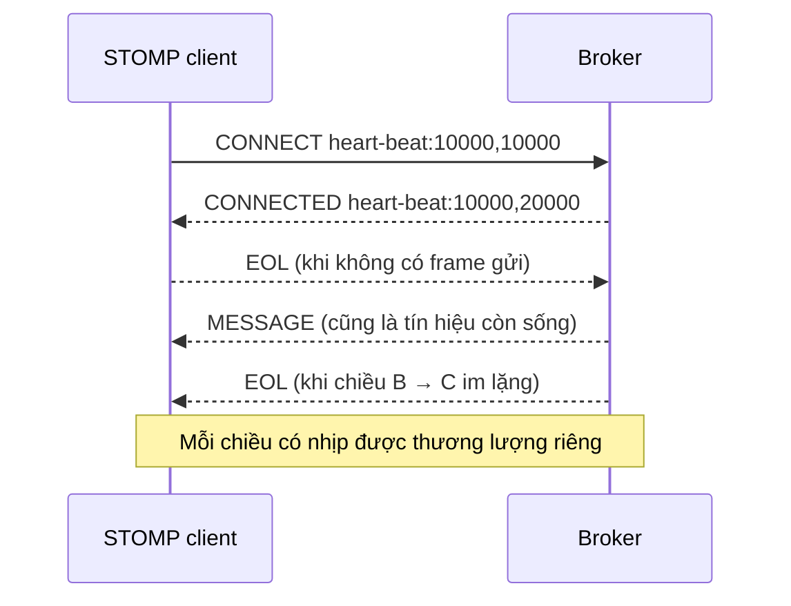
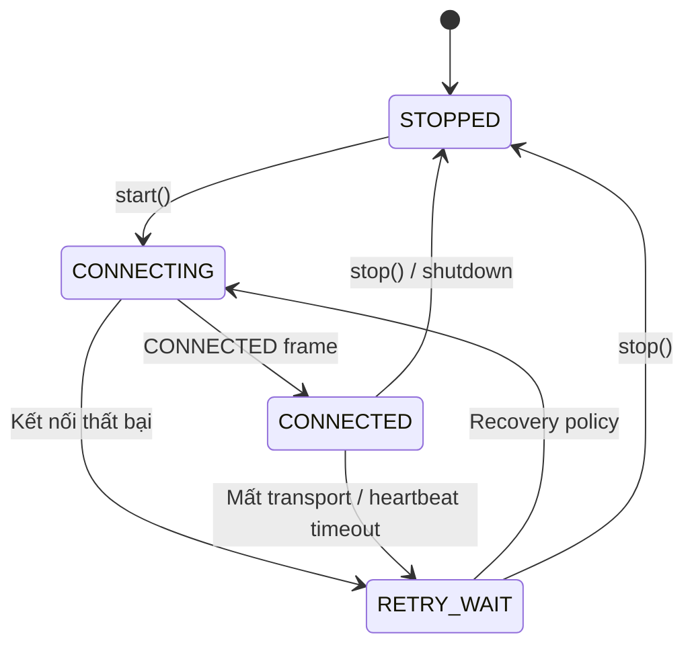
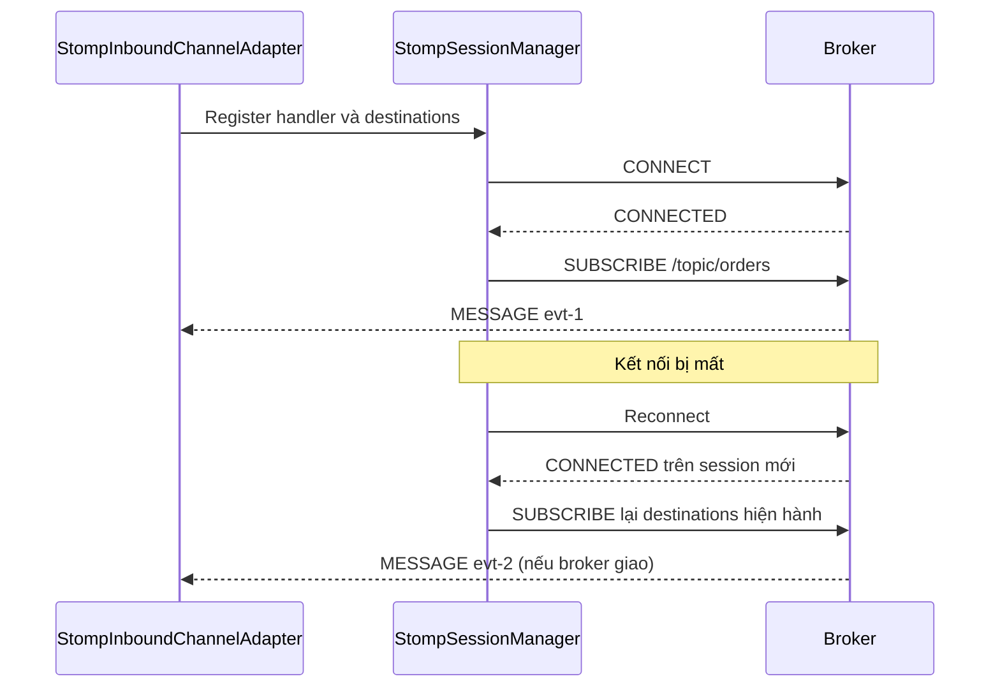

# Heart-beat và reconnect trong Spring Integration STOMP

## 1. Bài toán: kết nối vẫn có vẻ “mở” nhưng ứng dụng không còn nhận sự kiện

Ứng dụng Java subscribe `/topic/orders` qua STOMP để nhận sự kiện đơn hàng. Hệ thống hoạt động ổn định, nhưng một ngày kết nối mạng giữa ứng dụng và broker bị ngắt giữa chừng. Ứng dụng không nhìn thấy một frame `DISCONNECT` sạch sẽ, handler không còn nhận message, còn dashboard vẫn hiển thị tiến trình Java đang chạy.

Cần giải quyết ít nhất bốn vấn đề khác nhau:

1. **Phát hiện phiên không còn khỏe:** sau bao lâu thì client nhận biết đường truyền đã im lặng bất thường?
2. **Khôi phục phiên:** khi mất kết nối, client/manager thử thiết lập lại `CONNECT/CONNECTED` ra sao?
3. **Phục hồi subscription và khả năng gửi:** session mới có còn subscribe đúng destination; các message đang gửi dở ở phiên cũ được xử lý thế nào?
4. **Phục hồi nghiệp vụ:** nếu broker đã nhận `SEND` nhưng client mất `RECEIPT`, retry có thể gửi trùng không; nếu client offline thì message có được lưu lại không?

Trong module **SPRING_INTEGRATION_ADAPTERS**, các adapter và `MessageChannel` kết nối hệ thống ngoài với ứng dụng qua inbound/outbound adapter, gateway, poller và message contract. Với **Adapter STOMP**, Spring Framework cung cấp `StompClientSupport` cùng các client TCP/WebSocket; Spring Integration cung cấp `StompSessionManager` để quản lý session cho `StompInboundChannelAdapter` và `StompMessageHandler`. **Heart-beat** giúp theo dõi sự sống của kết nối; **reconnect** khôi phục session sau khi bị mất. Hai cơ chế phối hợp nhưng **không phải một cơ chế duy nhất**.

### Mục tiêu học tập

- Giải thích header `heart-beat:cx,cy` / `heart-beat:sx,sy` theo STOMP 1.2, công thức tính nhịp từng chiều và trường hợp dùng `0`.
- Phân biệt heartbeat, business `MESSAGE`, `RECEIPT`, TCP keepalive, WebSocket ping/pong và Spring Integration Poller.
- Cấu hình client scheduler, `setDefaultHeartbeat(...)` và `AbstractStompSessionManager#setRecoveryInterval(...)`.
- Theo dõi `isRunning()`, `isConnected()`, các `StompIntegrationEvent` và trạng thái subscription.
- Thiết kế retry, backpressure, idempotency, outbox/inbox, security, cảnh báo và kiểm thử mất kết nối.

## 2. Heart-beat là gì trong STOMP?

STOMP là giao thức message dạng frame. Khi mở session, client gửi `CONNECT` (hoặc `STOMP` với server hỗ trợ), broker trả `CONNECTED` nếu chấp nhận. Từ STOMP 1.1, hai phía có thể thương lượng heartbeat ngay trong quá trình bắt tay.

Ví dụ:

```text
CONNECT
accept-version:1.2
host:broker.example
heart-beat:10000,10000

^@
```

```text
CONNECTED
version:1.2
heart-beat:10000,20000

^@
```

`^@` biểu diễn byte NUL kết thúc frame STOMP; đó không phải hai ký tự cần gửi bằng tay. Header `heart-beat` gồm **hai số nguyên không âm** tính bằng **mili giây**. Nếu header không xuất hiện, theo STOMP 1.2, nó được coi tương đương `heart-beat:0,0`.

| Vị trí | Diễn giải |
| --- | --- |
| Số thứ nhất do **client** gửi: `cx` | Khả năng client có thể phát dữ liệu/heartbeat ra đường truyền. |
| Số thứ hai do **client** gửi: `cy` | Nhịp tối thiểu mà client muốn nhận dữ liệu từ server. |
| Số thứ nhất do **server** gửi: `sx` | Khả năng server có thể phát dữ liệu/heartbeat. |
| Số thứ hai do **server** gửi: `sy` | Nhịp tối thiểu mà server muốn nhận dữ liệu từ client. |

“Heartbeat mỗi 10 giây” **không có nghĩa** phải có một message đơn hàng mỗi 10 giây. Nếu không có frame nghiệp vụ để gửi, phía gửi có thể phát một **ký tự xuống dòng (EOL)** để thể hiện rằng kết nối vẫn còn sống. Khi đã có dữ liệu bình thường chạy trên kết nối, dữ liệu đó cũng là tín hiệu hoạt động; không cần phát heartbeat riêng cho từng khoảng đang có lưu lượng.



## 3. Cách tính heartbeat từng chiều theo STOMP 1.2

Đặt:

- `cx`: outgoing heartbeat client có thể cung cấp.
- `cy`: incoming heartbeat client muốn nhận.
- `sx`: outgoing heartbeat server có thể cung cấp.
- `sy`: incoming heartbeat server muốn nhận.

### 3.1. Chiều client → server

Nếu `cx == 0` **hoặc** `sy == 0` thì **không thương lượng heartbeat ở chiều client → server**. Nếu cả hai khác `0`, khoảng dự kiến:

```text
clientToServerPeriodMs = max(cx, sy)
```

### 3.2. Chiều server → client

Nếu `sx == 0` **hoặc** `cy == 0` thì **không thương lượng heartbeat ở chiều server → client**. Nếu cả hai khác `0`, khoảng dự kiến:

```text
serverToClientPeriodMs = max(sx, cy)
```

### 3.3. Ví dụ có số liệu

Giả sử:

```text
Client CONNECTED request: cx=10000, cy=20000
Broker CONNECTED reply:   sx=5000,  sy=15000
```

Khi đó:

- Client → server: `max(10000,15000) = 15000 ms`.
- Server → client: `max(5000,20000) = 20000 ms`.

| Cặp đề xuất | Client → server | Server → client |
| --- | --- | --- |
| Client `10000,10000`; server `10000,10000` | 10 giây | 10 giây |
| Client `10000,20000`; server `5000,15000` | 15 giây | 20 giây |
| Client `0,10000`; server `10000,10000` | **Tắt** | 10 giây |
| Client `10000,0`; server `10000,10000` | 10 giây | **Tắt** |
| Client `10000,10000`; server `0,0` | **Tắt** | **Tắt** |

**Đừng cộng hai số, lấy trung bình hoặc lấy `min(...)`.** Chọn `max(...)` để thỏa khả năng tối thiểu của phía gửi và nhu cầu nhận của phía bên kia.

### 3.4. Lỗi timeout không nên xảy ra chính xác tại ngưỡng

STOMP 1.2 quy định khi một chiều đã thương lượng nhịp `n`, phía gửi phải có dữ liệu đi qua trong khoảng `n`; phía nhận *có thể* coi đường truyền đã hỏng nếu không nhận dữ liệu trong một cửa sổ phù hợp, nhưng **nên có sai số dung sai** do lịch thread, network jitter, GC pause, CPU scheduling và delay.

Ví dụ, nếu mong đợi nhận dữ liệu khoảng mỗi 10 giây, **không** nên cấu hình hệ thống đánh dấu chết chỉ vì chậm vài mili giây ở mốc 10.000 ms. Ngưỡng liveness và alert thực tế phải xét thêm latency và khả năng vận hành của broker; không có một hệ số tolerance duy nhất đúng cho mọi ứng dụng.

## 4. Phân biệt heartbeat với các dạng “ping” và polling khác

| Cơ chế | Nằm ở lớp nào? | Đo/kiểm tra điều gì? |
| --- | --- | --- |
| **STOMP heartbeat** | STOMP protocol/session | Có dữ liệu trên kết nối theo nhịp đã thương lượng không? |
| **TCP keepalive** | TCP/OS | Phát hiện socket chết theo chính sách hệ điều hành; không biết subscription. |
| **WebSocket ping/pong** | WebSocket transport | Liveness của WebSocket connection; độc lập với nội dung frame STOMP. |
| **STOMP `RECEIPT`** | STOMP protocol | Broker phản hồi một frame client đã yêu cầu receipt. |
| **Spring Integration Poller** | Integration endpoint | Chủ động gọi `MessageSource.receive()` theo trigger fixed-delay/cron... |
| **Business heartbeat** | Hợp đồng ứng dụng | Sự kiện “tôi còn hoạt động” giữa các service/consumer nếu tự thiết kế. |

Một STOMP inbound adapter là **message-driven**: khi broker đã nhận `SUBSCRIBE`, frame `MESSAGE` được đẩy qua session. `TaskScheduler` đặt trên STOMP client hỗ trợ heartbeat và theo dõi receipt, **không** phải một poller quét broker mỗi vài giây.

**Kết nối khỏe không bảo đảm luồng nghiệp vụ khỏe**:

- Heartbeat vẫn tới nhưng subscriber đã bị từ chối quyền `SUBSCRIBE`.
- Session connected nhưng publisher đang gửi sang destination khác.
- Handler downstream bị nghẽn DB hoặc queue đầy trong khi kết nối vẫn còn sống.
- Broker chấp nhận frame nhưng consumer nghiệp vụ thất bại.

Do đó, liveness phải được theo dõi riêng với readiness và success rate của nghiệp vụ.

## 5. Spring Framework STOMP client và scheduler

Spring Framework cung cấp `StompClientSupport`, cùng các implementation thường gặp:

- `ReactorNettyTcpStompClient`: STOMP trực tiếp qua TCP đến host/port broker.
- `WebSocketStompClient`: STOMP qua WebSocket, sử dụng một `WebSocketClient` và URL `ws://` hoặc `wss://`.

Các cấu hình quan trọng:

```java
client.setDefaultHeartbeat(new long[] {10_000L, 10_000L});
client.setTaskScheduler(stompTaskScheduler);
client.setReceiptTimeLimit(5_000);
```

Ý nghĩa:

1. `setDefaultHeartbeat(...)` đặt header heartbeat mặc định dự kiến cho `CONNECT`: phần tử đầu là chiều client gửi, phần tử sau là chiều client muốn nhận, đều tính bằng ms.
2. `setTaskScheduler(...)` cung cấp scheduler để client xử lý heartbeat/receipt tracking khi transport cần. Một số transport có hỗ trợ heartbeat riêng; không suy ra mọi client vận hành giống hệt nhau.
3. `setReceiptTimeLimit(...)` đặt thời gian chờ STOMP `RECEIPT` **khi có yêu cầu receipt**; nó **không** thay heartbeat hoặc timeout nghiệp vụ.

### Khác biệt đáng nhớ với WebSocketStompClient

Theo API Spring Framework, `WebSocketStompClient` khởi tạo `defaultHeartbeat` bằng `0,0` khi chưa có scheduler; khi cấu hình `TaskScheduler`, client có thể chuyển default về nhịp ưu tiên `10000,10000`. Vì vậy một WebSocket STOMP client hoạt động nhưng không có heartbeat có thể xuất phát từ **cấu hình scheduler thiếu**, không hẳn do broker.

Ví dụ:

```java
import org.springframework.messaging.simp.stomp.WebSocketStompClient;
import org.springframework.web.socket.client.standard.StandardWebSocketClient;

WebSocketStompClient client =
    new WebSocketStompClient(new StandardWebSocketClient());
client.setTaskScheduler(stompTaskScheduler);
client.setDefaultHeartbeat(new long[] {10_000L, 10_000L});
```

Đây là **biến thể WebSocket**, không được dùng đồng thời với bean TCP bên dưới cho cùng luồng thử nghiệm. WebSocket cần đúng endpoint handshake, dependency WebSocket và cấu hình TLS/credentials riêng khi cần; chuyển từ STOMP/TCP sang WebSocket không phải chỉ thay URL.

## 6. Cấu hình hoàn chỉnh: heartbeat và reconnect cho STOMP/TCP

### 6.1. Kịch bản và dependencies

Ứng dụng kết nối đến broker STOMP/TCP tại `127.0.0.1:61613`, subscribe `/topic/orders` và có một outbound handler gửi `/topic/order-status`. Ta tạo **một `StompSessionManager` dùng chung** để quản lý session của cả hai adapter.

Với dự án Spring Boot dùng BOM thích hợp:

```xml
<dependencies>
    <dependency>
        <groupId>org.springframework.boot</groupId>
        <artifactId>spring-boot-starter-integration</artifactId>
    </dependency>
    <dependency>
        <groupId>org.springframework.integration</groupId>
        <artifactId>spring-integration-stomp</artifactId>
    </dependency>
    <dependency>
        <groupId>io.projectreactor.netty</groupId>
        <artifactId>reactor-netty</artifactId>
    </dependency>
</dependencies>
```

Chuẩn bị broker thực sự bật STOMP/TCP, cấp quyền `SUBSCRIBE` và `SEND` tới hai destination. `61613` là cổng ví dụ thường gặp, **không** được bảo đảm bật mặc định trên mọi broker. Các giá trị host, credentials, heartbeat và recovery interval cần thay bằng cấu hình môi trường thật.

### 6.2. Java configuration

```java
import org.springframework.beans.factory.annotation.Qualifier;
import org.springframework.context.annotation.Bean;
import org.springframework.context.annotation.Configuration;
import org.springframework.integration.annotation.ServiceActivator;
import org.springframework.integration.channel.DirectChannel;
import org.springframework.integration.config.EnableIntegration;
import org.springframework.integration.stomp.ReactorNettyTcpStompSessionManager;
import org.springframework.integration.stomp.StompSessionManager;
import org.springframework.integration.stomp.inbound.StompInboundChannelAdapter;
import org.springframework.integration.stomp.outbound.StompMessageHandler;
import org.springframework.integration.support.converter.PassThruMessageConverter;
import org.springframework.messaging.Message;
import org.springframework.messaging.MessageChannel;
import org.springframework.messaging.MessageHandler;
import org.springframework.messaging.simp.stomp.ReactorNettyTcpStompClient;
import org.springframework.scheduling.concurrent.ThreadPoolTaskScheduler;

@Configuration
@EnableIntegration
public class ResilientStompConfiguration {

    @Bean
    public ThreadPoolTaskScheduler stompTaskScheduler() {
        ThreadPoolTaskScheduler scheduler = new ThreadPoolTaskScheduler();
        scheduler.setPoolSize(2);
        scheduler.setThreadNamePrefix("stomp-session-");
        scheduler.setRemoveOnCancelPolicy(true);
        return scheduler;
    }

    @Bean
    public ReactorNettyTcpStompClient stompClient(
            ThreadPoolTaskScheduler stompTaskScheduler) {

        ReactorNettyTcpStompClient client =
            new ReactorNettyTcpStompClient("127.0.0.1", 61613);

        client.setTaskScheduler(stompTaskScheduler);
        client.setDefaultHeartbeat(
            new long[] {10_000L, 10_000L}
        );
        client.setReceiptTimeLimit(5_000);
        client.setMessageConverter(new PassThruMessageConverter());
        return client;
    }

    @Bean
    public ReactorNettyTcpStompSessionManager stompSessionManager(
            ReactorNettyTcpStompClient stompClient) {

        ReactorNettyTcpStompSessionManager manager =
            new ReactorNettyTcpStompSessionManager(stompClient);
        manager.setRecoveryInterval(5_000);
        manager.setAutoReceipt(true);
        return manager;
    }

    @Bean
    public MessageChannel stompOrdersInbound() {
        return new DirectChannel();
    }

    @Bean
    public MessageChannel stompStatusOutbound() {
        return new DirectChannel();
    }

    @Bean
    public StompInboundChannelAdapter stompOrdersAdapter(
            StompSessionManager stompSessionManager,
            @Qualifier("stompOrdersInbound") MessageChannel output) {

        StompInboundChannelAdapter adapter =
            new StompInboundChannelAdapter(
                stompSessionManager, "/topic/orders"
            );
        adapter.setOutputChannel(output);
        adapter.setPayloadType(String.class);
        return adapter;
    }

    @Bean
    @ServiceActivator(inputChannel = "stompStatusOutbound")
    public MessageHandler stompStatusHandler(
            StompSessionManager stompSessionManager) {

        StompMessageHandler handler =
            new StompMessageHandler(stompSessionManager);
        handler.setDestination("/topic/order-status");
        handler.setConnectTimeout(10_000);
        return handler;
    }

    @ServiceActivator(inputChannel = "stompOrdersInbound")
    public void receiveOrder(Message<?> message) {
        // Demo: chỉ log metadata, không ghi nguyên payload nhạy cảm.
        System.out.printf(
            "Received STOMP message id=%s%n",
            message.getHeaders().getId()
        );
        // TODO: validate, idempotency, DB commit, retry/quarantine.
    }
}
```

Đây là ví dụ **Java configuration đầy đủ về cấu trúc**, nhưng cần có broker thật và dependency phù hợp để chạy end-to-end. Nó không thực hiện publish dữ liệu tự động: một service có thể gửi Spring message đến `stompStatusOutbound`; inbound adapter nhận event từ broker theo subscription.

### 6.3. Giải thích từng thông số

| Cấu hình | Giá trị trong demo | Tác dụng |
| --- | --- | --- |
| `setDefaultHeartbeat` | `10000,10000` | Đề xuất khả năng gửi và yêu cầu nhận heartbeat 10 giây mỗi chiều trước khi thương lượng. |
| `stompTaskScheduler.setPoolSize` | `2` | Cung cấp luồng cho tác vụ scheduler của STOMP client; không phải hai consumer nghiệp vụ. |
| `setRecoveryInterval` | `5000 ms` | Đặt khoảng thử reconnect của session manager khi mất kết nối. |
| `setReceiptTimeLimit` | `5000 ms` | Đợi receipt của frame **đã yêu cầu receipt**, không thay được business acknowledgment. |
| `manager.setAutoReceipt` | `true` | Yêu cầu tự tạo receipt header khi session thực hiện thao tác phù hợp. |
| `handler.setConnectTimeout` | `10000 ms` | Giới hạn thời gian outbound handler chờ session được kết nối/sẵn sàng. |

**Không đồng nhất `recoveryInterval` và `heartbeat`.** Heartbeat góp phần phát hiện kết nối bị hỏng; sau khi manager/client nhận ra kết nối đã mất, recovery interval mới chi phối lịch thử lại theo implementation. `receiptTimeLimit` theo dõi một frame đã gửi; `connectTimeout` theo dõi khả năng lấy session dùng để gửi.

`setConnectTimeout(10_000)` trong demo được chọn **lớn hơn** `recoveryInterval(5_000)` để có khoảng chờ khả thi khi session đang kết nối lại. Nó không bảo đảm broker sẽ khả dụng trong 10 giây và cũng không tự kích hoạt retry nghiệp vụ.

### 6.4. Thông tin đăng nhập và STOMP CONNECT headers

Nếu broker yêu cầu virtual host hoặc credential, cấu hình `StompHeaders` cho **CONNECT** theo chính sách của broker:

```java
import org.springframework.messaging.simp.stomp.StompHeaders;

// Bổ sung trong bean stompSessionManager trước khi return:
StompHeaders connectHeaders = new StompHeaders();
connectHeaders.setHost("broker.internal.example");
connectHeaders.setLogin(username);
connectHeaders.setPasscode(password);
connectHeaders.setHeartbeat(new long[] {10_000L, 10_000L});
manager.setConnectHeaders(connectHeaders);
```

`username` và `password` là các biến phải được cấp bởi cấu hình bí mật do ứng dụng kiểm soát; ví dụ **không khai báo sẵn** các biến này trong method ở trên. Trên production, nên bind chúng từ secret store hoặc môi trường, không hardcode/log.

Nếu cung cấp `heart-beat` trong `connectHeaders`, hãy bảo đảm nó phù hợp với `setDefaultHeartbeat(...)` để tránh hai nơi cấu hình mâu thuẫn. Tùy phiên bản/implementation, giá trị CONNECT headers rõ ràng có thể có độ ưu tiên so với default của client; kiểm tra **frame CONNECT thực tế** khi cần.

## 7. STOMP session manager và quá trình reconnect

Spring Integration cung cấp `AbstractStompSessionManager` cùng các implementation như `ReactorNettyTcpStompSessionManager` và `WebSocketStompSessionManager`. Manager dùng `StompClientSupport` để tạo **một `StompSession` dùng chung** cho các `StompSessionHandler` do inbound/outbound adapter đăng ký.

`AbstractStompSessionManager` thực hiện `SmartLifecycle`:

- `start()`: đưa manager vào vòng đời hoạt động, khởi tạo quy trình kết nối.
- `stop()`: quản lý đóng `StompSession` đang có.
- `isRunning()`: tình trạng lifecycle, **không** đồng nghĩa kết nối khỏe.
- `isConnected()`: tình trạng session được manager xem là đã kết nối.
- `setRecoveryInterval(int)`: khoảng thời gian thử khôi phục kết nối tính bằng mili giây.
- `setAutoStartup(boolean)` và `setPhase(int)`: điều khiển tự khởi động và thứ tự lifecycle giữa các bean khi cần.



Sơ đồ là **mô hình khái niệm**; không phải tên state enum công khai hay một SLA được Spring Integration cam kết. Đường đi thực tế tùy transport, phiên bản client, sự kiện lỗi và vòng đời ứng dụng.

### 7.1. Heartbeat giúp phát hiện lỗi, recovery interval giúp thử kết nối lại

Ví dụ giả định một tình huống:

```text
T+00s  Client và broker đã CONNECTED, heartbeat hai chiều hoạt động
T+05s  Kết nối mạng bị ngắt nhưng socket chưa được OS báo lỗi
T+15s  Phía nhận đã quá thời gian kỳ vọng + tolerance, phát hiện im lặng
T+15s  Session được đánh dấu mất kết nối
T+20s  Session manager có thể thử CONNECT mới theo recoveryInterval=5s
T+...  Broker trở lại: CONNECT/CONNECTED thành công
T+...  Adapter khôi phục subscription theo lifecycle của nó
```

**Đây không phải timeline bảo đảm**: thời điểm phát hiện lỗi chịu ảnh hưởng của negotiated heartbeat, sai số scheduler, transport, proxy, socket và mạng. Nếu broker trả lỗi rõ ngay, hệ thống có thể phát hiện nhanh hơn; nếu thiếu heartbeat, một kết nối “nửa mở” có thể tồn tại lâu hơn.

### 7.2. Reconnect interval không phải exponential backoff

`setRecoveryInterval(5_000)` chỉ đặt một khoảng reconnect theo manager; **đừng coi đó là một chính sách exponential backoff, jitter, retry budget hay circuit breaker hoàn chỉnh**. Nếu nhiều instance cùng mất broker, các lần thử kết nối có thể dồn vào cùng thời điểm và gây tải lớn khi broker trở lại.

Khi cần điều tiết phức tạp hơn, có thể đặt cơ chế ở tầng vận hành, proxy, controller hoặc cấu hình reconnect được phiên bản client cụ thể hỗ trợ. Không tự suy đoán manager tự thêm jitter và giới hạn tổng số lần thử.

### 7.3. isRunning không bằng isConnected

| `isRunning()` | `isConnected()` | Cách hiểu vận hành |
| --- | --- | --- |
| `false` | `false` | Manager đã stop hoặc chưa start. |
| `true` | `false` | Manager đang hoạt động nhưng không có session khả dụng; có thể đang kết nối/retry. |
| `true` | `true` | Session connected; chưa chứng minh subscription và handler nghiệp vụ khỏe. |

Các trạng thái có thể thay đổi bất đồng bộ. Trong log/metrics, ghi timestamp và instance ID để tránh đọc một trạng thái cũ rồi kết luận hệ thống vẫn khỏe ở hiện tại.

## 8. Sau reconnect, subscription và message đang bay đi đâu?

STOMP `SUBSCRIBE` gắn với **một session**. Khi session cũ mất, subscription trong session đó không tự tồn tại trên socket mới. Inbound adapter phải được quản lý để đăng ký lại các destination của nó sau khi manager tạo được session mới.



Trong Spring Integration, session manager và adapter phối hợp quản lý subscription/handlers. **Hãy kiểm thử resubscription trên phiên bản đang dùng**, nhất là khi có `addDestination()/removeDestination()` động. `isConnected()==true` không chứng minh broker đã xác nhận **mọi** `SUBSCRIBE`.

### Topic và queue khi client offline

STOMP bản thân nó **không quy định** rằng `/topic` bắt buộc giữ message cho subscriber offline hoặc `/queue` bắt buộc redeliver. Ngữ nghĩa destination, durable subscription, retention, ACK/NACK và dead-letter phụ thuộc broker.

| Trường hợp | Điều có thể xảy ra | Cách bảo vệ |
| --- | --- | --- |
| Client mất kết nối, publisher vẫn gửi lên topic không durable | Các event khi không có subscription có thể không đến client sau reconnect | Dùng durable subscription/stream/replay nếu broker hỗ trợ, hoặc đối soát dữ liệu. |
| Consumer nhận frame rồi chết trước commit | Broker có thể redeliver hoặc không, tùy ack mode | Chọn ACK phù hợp, handler idempotent và checkpoint. |
| Client đang xử lý message khi session ngắt | Handler có thể tiếp tục hoặc thất bại riêng | Tách lifecycle và transaction; không giả định disconnect tự rollback DB. |
| Nhiều replica cùng subscribe topic | Có thể nhận cùng một event theo fan-out | Thiết kế routing/competing-consumer khi cần và chống trùng. |

**Reconnect chỉ khôi phục khả năng giao tiếp**, không phải bảo đảm dữ liệu không mất trong khoảng ngắt kết nối.

## 9. Outbound và RECEIPT khi mạng mất giữa chừng

Giả sử service gửi event `evt-501` qua `StompMessageHandler`:

```text
Publisher              Broker                  Consumer
    |-- SEND evt-501 ---->|                        |
    |                     |--- MESSAGE evt-501 --->|
    X  Mất kết nối        |                        |
    |  Không thấy RECEIPT |                        |
    |-- Retry evt-501 --->|                        |
    |                     |--- MESSAGE evt-501 --->|
```

Broker **có thể đã nhận lần đầu** dù client không thấy receipt. Nếu publisher retry y nguyên, consumer có thể nhận **hai delivery** mang cùng event ID. Ngược lại, nếu publisher không retry, có thể mất một event mà broker chưa kịp nhận. Đây là dạng **kết quả không xác định** ở ranh giới mạng.

### Ba mốc cần theo dõi riêng

| Mốc | Ý nghĩa |
| --- | --- |
| Spring `MessageChannel.send()` thành công | Channel/handler nhận message theo hợp đồng Spring; không tự chứng minh broker persist. |
| STOMP `RECEIPT` (nếu đã yêu cầu) | Broker phản hồi frame theo giao thức; không chứng minh consumer đã commit DB. |
| Business acknowledgment/commit | Hệ thống đích xử lý thành công theo hợp đồng riêng; không tự bảo đảm broker ngừng redelivery nếu ACK chưa đúng. |

`client.setReceiptTimeLimit(5_000)` chỉ có ý nghĩa khi frame được yêu cầu receipt. `manager.setAutoReceipt(true)` có thể tự gắn receipt header trên các thao tác session được hỗ trợ. Trong Spring Integration, kết quả receipt của outbound handler có thể được công bố qua `StompReceiptEvent`.

**Không retry vô hạn ngay khi receipt timeout:** broker có thể quá tải hoặc mạng đang chập chờn. Hãy dùng retry có giới hạn và backoff phù hợp với SLA, giữ **eventId ổn định** qua retry và triển khai consumer idempotent.

## 10. ACK/NACK, heartbeat và business timeout là ba lĩnh vực khác nhau

STOMP có các ack mode `auto`, `client` và `client-individual` cho subscription; `ACK/NACK` được dùng theo delivery contract của broker. Chúng **không phải** heartbeat:

- **Heartbeat:** “đường truyền có đang trao đổi dữ liệu theo nhịp thỏa thuận không?”
- **ACK/NACK:** “consumer đã xác nhận hoặc từ chối một delivery theo chế độ subscription chưa?”
- **Business timeout:** “nghiệp vụ đã xử lý và commit trong thời gian SLA chưa?”

Một client có thể heartbeat bình thường, nhưng handler bị treo 2 phút vì database. Broker có thể thấy kết nối còn sống trong khi nghiệp vụ đã vượt SLA. Ngược lại, một handler có thể đã commit thành công trước khi mạng mất, rồi broker redeliver frame: nếu không idempotent thì gây trùng.

### Transaction boundary

Transaction JDBC của handler **không tự bao trùm** STOMP broker. `StompSessionManager` quản lý kết nối, không tạo distributed transaction end-to-end. Với độ tin cậy cao:

1. Ghi dữ liệu và outbox event trong cùng transaction DB.
2. Worker phát outbox qua STOMP, theo dõi kết quả gửi/receipt theo contract.
3. Nếu crash hoặc timeout, gửi lại cùng `eventId`.
4. Consumer ghi nhận `eventId` đã xử lý trong một transaction idempotent.
5. Dùng quarantine/reconciliation cho trường hợp không thể phục hồi tự động.

## 11. Quan sát trạng thái, application events và health

Spring Integration cung cấp `StompIntegrationEvent` cho những sự kiện STOMP bất đồng bộ. Ví dụ, `StompExceptionEvent` có thể được công bố khi manager kết nối thất bại hoặc handler xử lý frame `ERROR`; `StompReceiptEvent` phản ánh kết quả callback receipt. Các event này **không phải** Spring business messages nhận từ topic.

### 11.1. Đọc trạng thái manager

```java
import org.springframework.integration.stomp.ReactorNettyTcpStompSessionManager;
import org.springframework.stereotype.Component;

@Component
public class StompConnectionSnapshot {

    private final ReactorNettyTcpStompSessionManager manager;

    public StompConnectionSnapshot(
            ReactorNettyTcpStompSessionManager manager) {
        this.manager = manager;
    }

    public boolean managerRunning() {
        return manager.isRunning();
    }

    public boolean transportConnected() {
        return manager.isConnected();
    }
}
```

Tên `transportConnected()` ở ví dụ chỉ là tên method quản trị; `isConnected()` phản ánh tình trạng **STOMP session** do manager theo dõi, không phải một probe TCP độc lập. Không suy ra `true` nghĩa subscription/DB consumer đã khỏe.

### 11.2. Nghe lỗi và receipt events

```java
import org.springframework.context.event.EventListener;
import org.springframework.integration.stomp.event.StompIntegrationEvent;
import org.springframework.stereotype.Component;

@Component
public class StompProtocolEventLogger {

    @EventListener
    public void onStompEvent(StompIntegrationEvent event) {
        System.out.printf(
            "STOMP protocol event: %s%n",
            event.getClass().getSimpleName()
        );
        // TODO: phân loại exception/receipt, cập nhật metrics.
    }
}
```

Nếu production cần metric chi tiết, phân loại event theo subtype và kiểm tra metadata an toàn của event thay vì chỉ đếm chung. Không in password/CONNECT frame hoặc payload chứa thông tin nhạy cảm vào log.

### 11.3. Liveness và readiness cần những tín hiệu khác nhau

| Tín hiệu | Cần trả lời |
| --- | --- |
| `manager.isRunning()` | Bean lifecycle có đang chạy không? |
| `manager.isConnected()` | Có session STOMP khả dụng theo manager không? |
| Thời gian CONNECTED gần nhất | Khi nào session được thiết lập thành công lần cuối? |
| Thời điểm disconnect và số reconnect attempts | Mạng/broker đang bất ổn ở mức nào? |
| Kết quả `SUBSCRIBE` và frame `MESSAGE` | Đã nhận sự kiện đúng destination chưa? |
| `RECEIPT` success/timeout/negative | Broker có phản hồi thao tác gửi yêu cầu receipt không? |
| Tuổi event chưa hoàn tất | Nghiệp vụ có đang chậm hoặc tồn backlog không? |
| Độ sâu queue/worker saturation | Downstream có đang gây backpressure không? |
| Tỷ lệ retry/trùng/quarantine | Khôi phục có gây lỗi dữ liệu không? |

Một readiness check có thể **không đạt** khi broker bắt buộc nhưng đang mất kết nối. Tuy nhiên không nên áp dụng chính sách kill/restart process chỉ vì `isConnected()==false` trong vài giây: có thể tạo một vòng restart dày đặc làm quá tải broker và khiến các flow độc lập cũng bị gián đoạn.

## 12. Kịch bản lỗi thường gặp và phương pháp xử lý

### 12.1. Broker dừng trước khi ứng dụng khởi động

Ứng dụng có thể khởi động các bean Spring nhưng session STOMP chưa sẵn sàng. `isRunning()` không nhất thiết đồng nghĩa `isConnected()`. Theo dõi exception event, recovery attempts, cấu hình auth/TLS và trạng thái broker.

**Không tự gửi hàng loạt outbound event vào một channel không durable rồi hy vọng session sẽ hồi phục kịp.** Nếu dữ liệu không được mất, đẩy vào outbox/queue bền vững trước khi chuyển sang STOMP handler.

### 12.2. Broker ngắt đường truyền nhưng không gửi DISCONNECT

STOMP heartbeat có thể góp phần phát hiện một kết nối im lặng bất thường. Thời điểm phát hiện còn phụ thuộc negotiated interval, tolerance, scheduler, transport và proxy. Nếu cả hai bên thỏa thuận `0,0` hoặc thư viện không có scheduler/heartbeat đúng, hệ thống có thể phải dựa vào lỗi network/transport muộn hơn.

### 12.3. Heartbeat timeout dù broker vẫn hoạt động

Có thể do:

- JVM pause/GC kéo dài hoặc thread scheduler bị bão hòa.
- Network jitter, load balancer/proxy đóng kết nối idle.
- Server quá tải và không phát heartbeat đúng nhịp.
- Giá trị mong đợi quá nhỏ so với thời gian thực thi/sai số mạng.
- Client và broker cấu hình `heart-beat` không tương thích hoặc một chiều bị vô hiệu.

Không nên chỉ tăng period vô hạn để “hết cảnh báo”. Cần đo tình trạng scheduler, RTT/jitter, broker load và xem trace CONNECT/CONNECTED.

### 12.4. Reconnect thành công nhưng không nhận message

Session mới có thể đã CONNECTED nhưng:

- Subscription chưa được đăng ký lại hoặc bị broker từ chối ACL.
- Destination đã đổi tên, không có publisher hoặc publisher đang gửi sang nơi khác.
- Subscription không durable nên event khi client offline đã mất.
- Message đã vào channel nhưng handler downstream bị filter/queue/DB chặn.

**Tách điều tra:** connection → subscription → frame received → Spring message → business commit.

### 12.5. Reconnect thành công nhưng outbound phát trùng

Tình huống thường gặp là đã gửi `SEND` thành công ở broker nhưng client mất receipt. Retry sau reconnect có thể tạo delivery trùng. Dùng `eventId` ổn định, unique constraint/idempotent consumer, retry budget và outbox. Không dùng Spring `MessageHeaders.ID` mới được tạo mỗi lần gửi lại làm khóa chống trùng.

### 12.6. Nhiều replica cùng reconnect

Nếu broker vừa được khởi động lại, hàng chục instance có thể đồng loạt kết nối mỗi 5 giây. Khoảng reconnect cố định có thể tạo **thundering herd**. Tùy hạ tầng, dùng giới hạn connection, cơ chế stagger/jitter ở orchestration hoặc transport được hỗ trợ; không khẳng định manager tự cung cấp backoff ngẫu nhiên.

## 13. TCP, WebSocket, proxy và TLS

Các transport có đường đi khác nhau:

```text
STOMP/TCP:
ReactorNettyTcpStompClient -> TCP (hoặc TLS) -> Broker STOMP port

STOMP/WebSocket:
WebSocketStompClient -> HTTP(S) handshake -> WebSocket -> STOMP frames
```

Với WebSocket, **HTTP/WebSocket handshake và STOMP CONNECT là hai giai đoạn**. Một proxy/load balancer có thể đóng kết nối không hoạt động ở lớp TCP/WebSocket trước khi heartbeat STOMP kịp giúp ích; cấu hình idle timeout nên được cân nhắc cùng nhịp heartbeat và thực tế của transport.

Đối với kết nối có credential hoặc dữ liệu nhạy cảm:

- Ưu tiên TLS, xác minh chứng chỉ và hostname của broker.
- Với WebSocket dùng `wss://` khi phù hợp; với STOMP/TCP dùng transport TCP có TLS được cấu hình đúng.
- Không ghi `login`, `passcode`, token hoặc header bí mật vào log debug của frame.
- Broker ACL phải giới hạn `SEND`/`SUBSCRIBE` theo destination, không chỉ xác thực ở `CONNECT`.

**Không tự động kết luận TLS làm heartbeat không cần thiết**: TLS mã hóa đường truyền, nhưng không bảo đảm broker hoặc client đang phản hồi đúng nhịp ứng dụng.

## 14. Vòng đời adapter, shutdown và backpressure

`StompSessionManager` có lifecycle riêng; `StompInboundChannelAdapter` và `StompMessageHandler` cũng được Spring quản lý. Khi application tắt:

1. Ngừng tiếp nhận/gửi event nghiệp vụ mới theo kế hoạch shutdown.
2. Cho worker đang xử lý cơ hội hoàn tất trong thời gian giới hạn.
3. Lưu trạng thái retry/outbox/inbox để khôi phục sau restart.
4. Đóng session/transport và giải phóng scheduler.

`stop()` **không tự commit hoặc rollback** mọi transaction của handler. Một inbound message đã được giao vào `ExecutorChannel` có thể còn nằm trong queue. Nếu queue nằm trong RAM, crash có thể làm mất công việc chưa hoàn tất.

| Topology | Khi broker mất kết nối | Điều cần chú ý |
| --- | --- | --- |
| Inbound → `DirectChannel` | Không có frame mới; handler chỉ xử lý phần đã nhận | Timeout của handler độc lập với heartbeat. |
| Inbound → `ExecutorChannel` | Worker đã nhận việc có thể vẫn chạy | Error handling downstream và queue/rejection. |
| Outbound `DirectChannel` → STOMP handler | Gửi có thể ném lỗi/chờ session | Catch/retry theo hợp đồng; không mất event quan trọng. |
| DB outbox → publisher → STOMP | Outbox tồn tại khi broker lỗi | Retry có giới hạn, event ID ổn định, backpressure. |

Không nên tăng thread pool vô hạn để xử lý lỗi reconnect. Pool lớn có thể làm nhiều request chờ session và tạo bão gửi khi broker trở lại; nên giới hạn worker và xác định tốc độ gửi bù.

## 15. Thực hành kiểm thử heartbeat và reconnect

Bài thực hành được thực hiện **trên broker thử nghiệm**, không ngắt mạng của hệ thống production.

### 15.1. Chuẩn bị

1. Chạy broker có hỗ trợ STOMP/TCP tại host/port demo hoặc chỉnh cấu hình cho đúng.
2. Cấp quyền subscribe `/topic/orders` và send `/topic/order-status`.
3. Khởi động ứng dụng dùng `ResilientStompConfiguration`.
4. Bật logging/metrics cho CONNECT, CONNECTED, session events và số frame nghiệp vụ, nhưng **không log credentials hoặc payload nhạy cảm**.
5. Có publisher/subscriber thử nghiệm để phát và quan sát event.

### 15.2. Ma trận kiểm thử

| Thí nghiệm | Hành động | Kỳ vọng cần xác minh |
| --- | --- | --- |
| Bình thường | Broker đang hoạt động, gửi vài event | Session connected, subscription đúng, handler nhận. |
| Idle | Không có business frame trong thời gian dài | Kết nối có thể vẫn sống nhờ negotiated heartbeat nếu được bật. |
| Broker dừng | Tắt broker trong môi trường test | Client phát hiện mất kết nối theo transport/heartbeat; manager chuyển sang recovery. |
| Broker khởi động lại | Bật broker lại | CONNECT/CONNECTED thành công, adapter subscribe lại; frame mới đến. |
| Tắt một chiều heartbeat | Thử cấu hình `0` theo contract test | Không mong đợi heartbeat ở chiều đã tắt; phương thức phát hiện lỗi có thể thay đổi. |
| Receipt timeout | Gửi yêu cầu receipt nhưng tạo lỗi mạng/gián đoạn phù hợp | Receipt không quan sát được; không kết luận frame chắc chắn chưa tới broker. |
| Gửi lại event | Phát lại cùng `eventId` | Consumer không tạo dữ liệu trùng nếu idempotency được thiết kế đúng. |
| Khi offline | Gửi event trong lúc subscriber tắt | Xác minh có/không replay theo retention/durable subscription của broker. |
| Load | Tạo backlog trước khi broker trở lại | Đo tốc độ catch-up và giới hạn queue/DB downstream. |
| Nhiều instance | Khởi động nhiều client, rồi restart broker | Đo reconnect concurrency, quota connection và duplicate delivery. |

### 15.3. Kiểm tra thực tế thời gian heartbeat

Giả sử trace `CONNECT` hiển thị `10000,20000` và `CONNECTED` hiển thị `5000,15000`. Theo công thức, dự kiến nhịp client → server là 15 giây và server → client là 20 giây. **Không** mong đợi một EOL đúng mốc tuyệt đối nếu có frame nghiệp vụ xen vào hoặc thread scheduler trễ.

Mục tiêu kiểm thử là xác nhận:

- Hai bên thực sự thương lượng heartbeat tương thích.
- Có lưu lượng STOMP/EOL khi cần, không để kết nối idle quá lâu so với ngưỡng.
- Lỗi im lặng được phát hiện và session manager thử reconnect.
- Subscription được tái lập, handler nhận frame mới.
- Dữ liệu đã nhận/gửi dở có cơ chế idempotency và recovery rõ ràng.

## 16. Checklist triển khai production

| Hạng mục | Câu hỏi kiểm tra |
| --- | --- |
| Negotiation | `CONNECT`/`CONNECTED` có đúng header `heart-beat` và giá trị đã tính từng chiều không? |
| Scheduler | STOMP client đã có scheduler/transport heartbeat phù hợp; thread pool có bị bão hòa không? |
| Timeouts | Heartbeat, receipt, connect, proxy idle timeout và business SLA được phân biệt rõ chưa? |
| Reconnect | Recovery interval bao nhiêu; có nguy cơ nhiều replica retry đồng loạt không? |
| Subscription | Sau reconnect đã đăng ký lại destination và có quyền `SUBSCRIBE` không? |
| Delivery | Broker bảo đảm gì khi client offline; có durable/retention/replay không? |
| Retry | Event ID có giữ nguyên khi gửi lại; có retry budget và backoff không? |
| Idempotency | Consumer có chống tạo dữ liệu trùng qua retry/redelivery không? |
| Backpressure | Queue/worker có giới hạn và có xử lý rejection, overload không? |
| Security | TLS/credentials/ACL, log redaction và rate limit đã phù hợp chưa? |
| Visibility | Có biết giờ CONNECTED cuối, số disconnect, receipt failures, tuổi event tồn không? |
| Shutdown | Có drain và ghi trạng thái outbox/inbox trước khi tắt không? |

## 17. Bài tập thực hành có đáp án

**Bài 1 — Hai chiều.** Client gửi `heart-beat:10000,20000`; broker trả `heart-beat:5000,15000`. Nhịp mỗi chiều?

**Đáp án:** Client → server là `max(10000,15000)=15000 ms`; server → client là `max(5000,20000)=20000 ms`.

**Bài 2 — Giá trị 0.** Client gửi `heart-beat:0,10000` và broker trả `10000,10000`. Chiều nào không có heartbeat đã thương lượng?

**Đáp án:** Chiều **client → server** tắt vì `cx=0`; chiều server → client dự kiến 10 giây.

**Bài 3 — Thiếu header.** Broker không gửi header `heart-beat` trong `CONNECTED`. Theo STOMP 1.2 phải hiểu thế nào?

**Đáp án:** Như `0,0`, tức broker không thương lượng gửi/nhận heartbeat ở cả hai chiều.

**Bài 4 — Có message đều.** Broker gửi frame nghiệp vụ mỗi 3 giây, heartbeat server → client thương lượng 10 giây. Có bắt buộc gửi thêm một EOL đúng mỗi 10 giây?

**Đáp án:** Không. Dữ liệu thường xuyên truyền qua đường kết nối đã là tín hiệu còn sống; EOL cần thiết khi không có frame để gửi.

**Bài 5 — Sai lệch thời gian.** Broker trễ vài mili giây so với mốc 10 giây. Client có nên kết luận chắc chắn kết nối chết ngay lập tức?

**Đáp án:** Không. Cần dung sai cho jitter và scheduler; STOMP khuyến nghị tolerance phù hợp.

**Bài 6 — Scheduler.** `ThreadPoolTaskScheduler` gắn với STOMP client có phải Spring Integration Poller gọi `MessageSource.receive()` không?

**Đáp án:** Không. Nó hỗ trợ heartbeat và receipt tracking của STOMP client; inbound nhận frame qua subscription.

**Bài 7 — WebSocket default.** Vì sao `WebSocketStompClient` có thể không gửi heartbeat như kỳ vọng khi không có `TaskScheduler`?

**Đáp án:** Theo Spring Framework, mặc định của WebSocket client có thể là `0,0` trước khi được cấu hình scheduler; cần cấu hình scheduler/default heartbeat đúng.

**Bài 8 — Recovery interval.** `setRecoveryInterval(5000)` có phải lệnh bảo broker phát lại mọi message đã gửi trong 5 giây mất kết nối không?

**Đáp án:** Không. Nó điều khiển nhịp thử reconnect; replay phụ thuộc broker, durability, subscription và ACK.

**Bài 9 — isRunning và isConnected.** Manager báo `isRunning()==true` nhưng `isConnected()==false`. Có nhất thiết ứng dụng lỗi vòng đời không?

**Đáp án:** Không. Manager có thể đang chạy và thực hiện reconnect trong khi session chưa sẵn sàng.

**Bài 10 — Session mới.** Sau reconnect `isConnected()==true` nhưng inbound không nhận message. Cần điều tra gì?

**Đáp án:** Kiểm tra `SUBSCRIBE`, ACL, destination, publisher, frame đã nhận, mapping và downstream handler; không chỉ xem trạng thái session.

**Bài 11 — Receipt timeout.** Broker đã nhận một `SEND` nhưng `RECEIPT` bị mất. Gửi lại có thể gây trùng?

**Đáp án:** Có. Dùng event ID ổn định, consumer idempotent và retry có giới hạn.

**Bài 12 — Nghiệp vụ chậm.** Heartbeat bình thường nhưng handler mất 120 giây để commit DB; có nghĩa SLA xử lý được bảo đảm không?

**Đáp án:** Không. Liveness của kết nối và thời gian xử lý nghiệp vụ là hai chỉ số riêng.

**Bài 13 — Multi-replica.** Nhiều pod cùng reconnect mỗi 5 giây khi broker khởi động lại có rủi ro gì?

**Đáp án:** Có thể tạo bão kết nối (*thundering herd*); nên xem quota, stagger/jitter ở cơ chế hỗ trợ và giám sát tải broker.

**Bài 14 — Security.** Chỉ cần heartbeat và reconnect, có thể bỏ TLS hoặc broker ACL không?

**Đáp án:** Không. Heartbeat/reconnect bảo vệ khả năng kết nối, không bảo vệ dữ liệu khỏi nghe lén, giả mạo hoặc gửi/subscribe trái phép.

**Bài 15 — Timeout.** `setReceiptTimeLimit(5000)` có thay thế `setRecoveryInterval(5000)` không?

**Đáp án:** Không. Receipt limit đo thời gian đợi một `RECEIPT`, recovery interval đo nhịp thử kết nối lại sau khi mất session.

## 18. Ghi nhớ

**Heart-beat** trong STOMP được thương lượng độc lập cho hai chiều bằng header `heart-beat:cx,cy` và `heart-beat:sx,sy`; nếu một phía liên quan khai báo `0` thì không có heartbeat ở chiều đó, còn nếu cả hai khác `0` thì dùng `max(...)` theo STOMP 1.2. Dữ liệu frame bình thường cũng thể hiện kết nối đang sống; không nên coi heartbeat là poller hay xác nhận nghiệp vụ. **Reconnect** trong Spring Integration được quản lý qua `StompSessionManager` và `setRecoveryInterval(...)`, giúp mở lại session sau sự cố. Nhưng session connected **không đồng nghĩa** subscription đúng, không bảo đảm broker replay message lúc client offline, và không chứng minh handler đã commit. Để vận hành an toàn, phải kết hợp scheduler/heartbeat phù hợp, timeout/dung sai, giám sát lỗi, resubscription, retry có giới hạn, outbox/inbox, idempotency, ACL và kiểm thử mất kết nối trên broker thực tế.

## Tài liệu tham khảo

- [STOMP Protocol Specification 1.2 — Heart-beating](https://stomp.github.io/stomp-specification-1.2.html#Heart-beating)
- [Spring Integration Reference — STOMP Support](https://docs.spring.io/spring-integration/reference/stomp.html)
- [Spring Integration API — AbstractStompSessionManager](https://docs.spring.io/spring-integration/api/org/springframework/integration/stomp/AbstractStompSessionManager.html)
- [Spring Integration API — ReactorNettyTcpStompSessionManager](https://docs.spring.io/spring-integration/api/org/springframework/integration/stomp/ReactorNettyTcpStompSessionManager.html)
- [Spring Framework API — StompClientSupport](https://docs.spring.io/spring-framework/docs/current/javadoc-api/org/springframework/messaging/simp/stomp/StompClientSupport.html)
- [Spring Framework API — WebSocketStompClient](https://docs.spring.io/spring-framework/docs/current/javadoc-api/org/springframework/web/socket/messaging/WebSocketStompClient.html)
