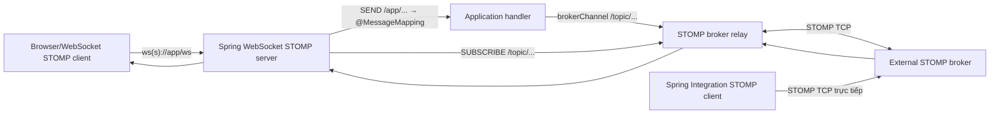
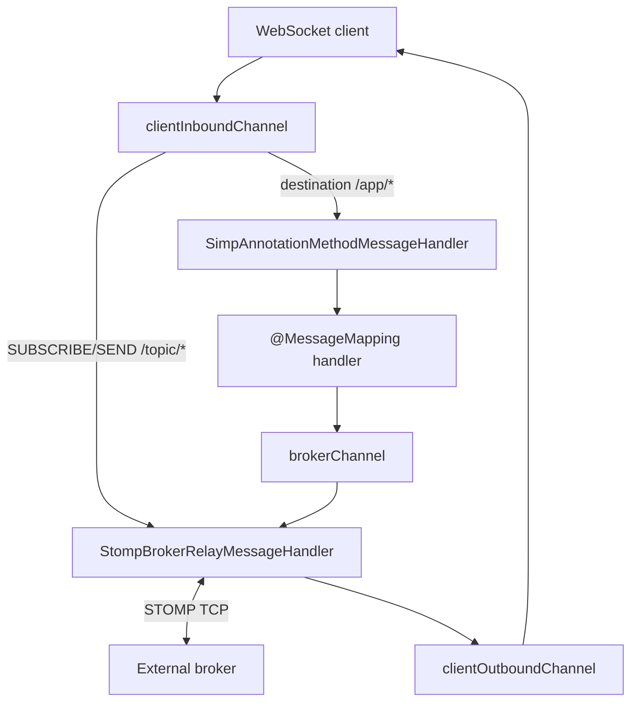
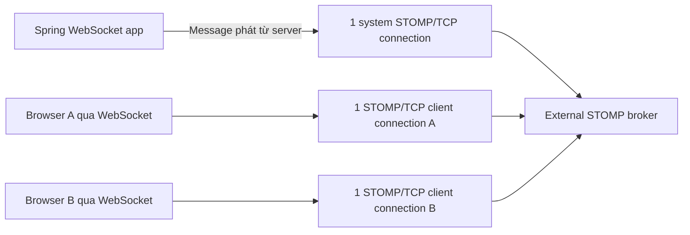
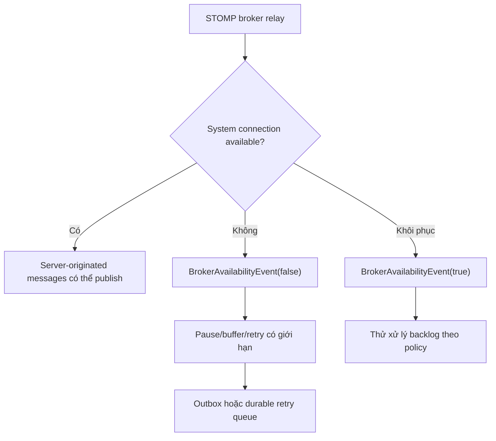

# Broker relay và application destination trong Spring Integration STOMP

## 1. Bài toán: /app/orders đi đâu, /topic/orders đi đâu?

Một nền tảng bán hàng có giao diện web cần gửi lệnh tạo đơn và nhận cập nhật thời gian thực. Trình duyệt kết nối tới ứng dụng Spring qua WebSocket, gửi một frame STOMP tới `/app/orders.create`, rồi subscribe `/topic/order-events` để xem thông báo. Phía sau ứng dụng là một STOMP broker độc lập, ví dụ RabbitMQ với STOMP plugin hoặc ActiveMQ/Artemis đã bật STOMP.

Nhóm phát triển có thể gặp hai hiểu nhầm:

- Đã bật **broker relay**, nên cho rằng **mọi** frame, kể cả `SEND /app/orders.create`, đều được chuyển thẳng sang broker.
- Đã cấu hình `StompMessageHandler` của **Spring Integration** gửi đến một broker STOMP qua TCP, nên cho rằng nó cũng tự đi qua `@MessageMapping("/orders.create")` của ứng dụng Spring WebSocket.

Cả hai suy luận đều không đúng về mặt kiến trúc. **Application destination** (thường là `/app`) được **Spring WebSocket STOMP server** dùng để định tuyến message tới mã ứng dụng. **Broker destination** (thường là `/topic` và `/queue`) được chuyển tới **simple broker hoặc broker relay** tùy cấu hình. Một **Spring Integration STOMP client** kết nối trực tiếp broker ngoài sẽ bỏ qua routing `/app` của Spring server.

Trong module **SPRING_INTEGRATION_ADAPTERS**, inbound/outbound adapter, gateway, poller và `MessageChannel` là các thành phần kết nối ứng dụng Java tới hệ thống ngoài. Bài này đặt các **STOMP adapters của Spring Integration** vào đúng bối cảnh **Spring WebSocket broker relay**, từ đó giúp thiết kế luồng command/event tránh đi sai destination, trùng message và lộ dữ liệu.

**Mục tiêu học tập:**

1. Phân biệt Spring WebSocket STOMP server, STOMP broker relay, external broker và Spring Integration STOMP client.
2. Hiểu `setApplicationDestinationPrefixes("/app")`, `enableStompBrokerRelay("/topic", "/queue")`, `@MessageMapping`, `@SendTo` và `SimpMessagingTemplate`.
3. Cấu hình broker relay qua TCP với thông tin system/client credential phù hợp, nhận `BrokerAvailabilityEvent`.
4. Nêu rõ vì sao Spring Integration `StompMessageHandler` gửi **trực tiếp broker** không kích hoạt controller `/app`; thực hành một client kết nối **WebSocket endpoint của ứng dụng** để dùng `/app`.
5. Biết user destination `/user`, authentication/authorization, ACK/receipt, giới hạn của relay, nhiều replica và cách kiểm thử.

## 2. Bốn thành phần cần phân định



| Thành phần | Giao diện chính | Trách nhiệm |
| --- | --- | --- |
| **Spring WebSocket STOMP server** | `@EnableWebSocketMessageBroker`, `WebSocketMessageBrokerConfigurer` | Nhận frame STOMP qua WebSocket, phân loại destination, đưa vào application handler/broker layer. |
| **Application destination** | `setApplicationDestinationPrefixes("/app")`, `@MessageMapping` | Gọi mã Java nghiệp vụ trong chính Spring WebSocket server. |
| **STOMP broker relay** | `enableStompBrokerRelay(...)` | Chuyển các frame broker-bound từ WebSocket/app sang broker ngoài qua TCP và chuyển kết quả về WebSocket client. |
| **External STOMP broker** | Listener STOMP/TCP + destination/ACL | Quản lý subscription, phân phối message, durability, ACK/redelivery theo khả năng broker. |
| **Spring Integration STOMP adapter** | `StompInboundChannelAdapter` / `StompMessageHandler` + `StompSessionManager` | Nhận/gửi Spring `Message<?>` như một **STOMP client**, có thể kết nối broker trực tiếp hoặc kết nối WebSocket STOMP endpoint tùy client. |

**Tầng server** trong ví dụ này thuộc Spring Framework WebSocket; nó **không phải** `StompInboundChannelAdapter`. Broker relay cũng **không phải** một Spring Integration inbound/outbound adapter, dù đều dùng message và STOMP.

### Ba loại “đường dẫn” khác nhau

| Đường dẫn | Ví dụ | Được diễn giải bởi |
| --- | --- | --- |
| URL kết nối WebSocket | `wss://api.example.com/ws` | HTTP/WebSocket handshake ở server/proxy. |
| Application destination | `/app/orders.create` | Spring WebSocket application routing, ví dụ `@MessageMapping("/orders.create")`. |
| Broker destination | `/topic/order-events` hoặc `/queue/jobs` | Broker handler/relay và external broker. |

Các chuỗi destination chỉ là **contract của ứng dụng và broker**, không phải những từ khóa STOMP 1.2 bắt buộc có cùng ngữ nghĩa ở mọi broker. Tài liệu broker phải quyết định chính xác cách tạo, phân phối và lưu các destination.

## 3. Dòng message trong Spring WebSocket

Khi Spring WebSocket nhận STOMP frame từ client, nó chuyển frame thành Spring `Message<?>` rồi đưa vào những channel server-side:

- `clientInboundChannel`: message đến từ WebSocket clients.
- `brokerChannel`: message được application gửi vào broker layer, ví dụ từ `SimpMessagingTemplate` hoặc một kết quả `@SendTo`.
- `clientOutboundChannel`: message từ broker/controller gửi về WebSocket clients.



### Ví dụ thứ nhất: lệnh nghiệp vụ

1. Browser `SEND destination:/app/orders.create` kèm JSON command.
2. Spring WebSocket đọc message từ `clientInboundChannel`.
3. Prefix `/app` được nhận diện và lược bỏ để ánh xạ phần `/orders.create` vào `@MessageMapping("/orders.create")`.
4. Handler validate và xử lý (ví dụ lưu DB), sau đó phát một event hoặc trả kết quả với `@SendTo("/topic/order-events")`.
5. Event đi vào `brokerChannel`, qua broker relay tới external broker; broker phát message cho các subscription phù hợp.

### Ví dụ thứ hai: subscription

1. Browser `SUBSCRIBE destination:/topic/order-events`.
2. Server thấy destination có broker prefix, relay gửi subscription sang broker ngoài.
3. Khi broker gửi `MESSAGE` phù hợp, relay chuyển về `clientOutboundChannel` và qua WebSocket tới browser.

**Không có bước `@MessageMapping` trong subscription chỉ vì message có payload JSON.** Routing phụ thuộc destination/command và server configuration, không phải tên DTO hoặc content-type.

## 4. /app, @MessageMapping và @SendTo

`setApplicationDestinationPrefixes("/app")` khai báo prefix cho những message **gửi tới application handler của Spring WebSocket server**. Ví dụ:

```java
@Controller
public class OrderCommandController {

    @MessageMapping("/orders.create")
    @SendTo("/topic/order-events")
    public OrderEvent create(OrderCommand command) {
        if (command.commandId() == null
                || command.commandId().isBlank()
                || command.orderId() <= 0) {
            throw new IllegalArgumentException("Invalid order command");
        }

        // Demo routing: chưa lưu DB hoặc kiểm soát idempotency.
        return new OrderEvent(
            command.commandId(),
            command.orderId(),
            "ACCEPTED"
        );
    }
}

record OrderCommand(String commandId, long orderId) {}
record OrderEvent(String eventId, long orderId, String status) {}
```

Đặt đoạn code trong cùng ứng dụng Spring WebSocket server. Các import:

```java
import org.springframework.stereotype.Controller;
import org.springframework.messaging.handler.annotation.MessageMapping;
import org.springframework.messaging.handler.annotation.SendTo;
```

Frame client `SEND /app/orders.create` được map vào method `create(...)`. **Client không gửi `/orders.create` trực tiếp cho handler khi đã chọn prefix `/app`.**

`@SendTo("/topic/order-events")` quy định đích phản hồi được phát tới broker layer. Đừng mặc định kết quả return của một `@MessageMapping` sẽ luôn tự đến destination bạn mong đợi, đặc biệt khi tên route thay đổi; khai báo `@SendTo` rõ giúp contract dễ kiểm thử.

Mã trên chỉ trình bày routing: **chưa có transaction DB, phân quyền, chống lặp command hay bảo đảm xử lý event**. Trong ứng dụng thực, command phải có authentication/authorization và một workflow nhất quán để commit dữ liệu trước khi công bố event.

### Application handler không phải một external broker consumer

Nếu một STOMP client gửi `SEND /app/orders.create` **trực tiếp** tới external broker qua port TCP, broker không tự biết Spring `@MessageMapping` là gì. Tên `/app` chỉ được Spring WebSocket server nhận diện khi frame thực sự **đi qua WebSocket endpoint của Spring** (hoặc một entrypoint được thiết kế tương đương).

Điều này vẫn đúng ngay cả khi Spring server có broker relay tới cùng broker: **relay không tự tạo đường vòng quay frame broker TCP vào application destination handler**.

## 5. Simple broker và broker relay: chọn đúng nhiệm vụ

Spring WebSocket cung cấp hai cách xử lý broker destinations thông dụng:

| Tiêu chí | `enableSimpleBroker(...)` | `enableStompBrokerRelay(...)` |
| --- | --- | --- |
| Nơi broker xử lý subscription | Simple broker tích hợp trong ứng dụng Spring, dùng bộ nhớ. | External broker có hỗ trợ STOMP, qua TCP relay. |
| Phạm vi triển khai | Phù hợp demo/ứng dụng đơn giản. | Có thể phục vụ kiến trúc lớn hơn với broker riêng. |
| Persistence/retention | Không mặc nhiên có durable messaging. | Phụ thuộc tính năng và cấu hình broker ngoài. |
| ACK, receipts và tính năng đầy đủ | Chỉ hỗ trợ một phần STOMP, không phải giải pháp ACK/receipt đầy đủ. | Phụ thuộc external broker và giao thức được relay. |
| Clustering | Simple broker không phải broker cluster bền vững. | Có thể dùng cluster của external broker theo hỗ trợ sản phẩm. |
| Kết nối ngoài | Không cần STOMP/TCP listener bên ngoài. | Cần endpoint STOMP/TCP, mạng, credentials và resource capacity. |
| Khi broker mất | Không có relay TCP broker ngoài. | Relay có thể mất connectivity; cần theo dõi availability và recovery. |

**Không bật cả hai như hai broker cạnh tranh xử lý cùng `/topic`/`/queue` trong một ví dụ** rồi giả định Spring sẽ phối hợp subscriptions. Chọn một mô hình tương ứng với yêu cầu.

**Broker relay không biến mọi thứ thành exactly-once.** Dù external broker hỗ trợ persistence, durable subscription, ACK/NACK hay dead-letter queue, cần chọn đúng destination, broker policy, subscription mode và idempotency/transaction nghiệp vụ.

## 6. Kết nối của broker relay: system và client không giống nhau

Spring Framework broker relay dùng hai nhóm kết nối tới external broker:



### 6.1. System connection

Relay duy trì một kết nối **system TCP** tới broker cho **message xuất phát từ các thành phần server-side** (ví dụ `SimpMessagingTemplate.convertAndSend` hoặc kết quả `@SendTo` qua broker channel). Tài liệu Spring Framework nhấn mạnh kết nối system này dành cho message phát từ ứng dụng, **không** dùng để nhận subscription message của mọi client.

Cấu hình STOMP `login`/`passcode` của system connection thông qua `setSystemLogin` và `setSystemPasscode`. Không dùng mặc định `guest/guest` cho production.

### 6.2. Client connections

Relay thiết lập một kết nối STOMP/TCP riêng tới broker cho **mỗi WebSocket client connection** đang được relay. Các kết nối đó sử dụng `setClientLogin`/`setClientPasscode` được cấu hình ở server relay.

**Quan trọng:** broker relay sẽ ghi `login`/`passcode` của relay lên CONNECT gửi tới broker thay cho các STOMP CONNECT credentials của WebSocket client. Spring WebSocket ứng dụng thường xác thực **người dùng cuối tại HTTP/WebSocket handshake** và phân quyền ở application/message layer; không coi client STOMP `login` gửi lên là bằng chứng định danh người dùng cuối.

### 6.3. Ước tính kết nối

Nếu một instance có 500 WebSocket clients trực tiếp và relay đang hoạt động, số kết nối STOMP/TCP do relay tạo tới broker có thể xấp xỉ:

```text
1 system connection + 500 client connections = 501 connections
```

Đây là **ước tính topology**, không phải số liệu đo thực. Reconnect, client chưa sẵn sàng, proxy, số instance và tài nguyên broker còn ảnh hưởng số lượng thực tế. Nếu có 4 instance cùng khoảng 500 WebSocket clients mỗi instance, tổng kết nối có thể tăng rất nhanh; cần kiểm tra broker max connections, TLS/CPU, file descriptors và giới hạn subscriptions.

### 6.4. BrokerAvailabilityEvent

Spring Framework công bố `BrokerAvailabilityEvent` khi kết nối **system** với broker mất hoặc được phục hồi. Event này rất hữu ích để tạm ngừng **server-originated publish** khi broker chưa sẵn sàng, nhưng **không** phải bằng chứng toàn bộ client connections/subscriptions đều khỏe.

Relay có cơ chế thử kết nối lại system connection, thường theo nhịp khoảng 5 giây theo tài liệu Spring Framework; nhịp đó không thay thế retry/backoff nghiệp vụ và không bảo đảm broker phát lại message đã mất.

## 7. Ví dụ server hoàn chỉnh: @EnableWebSocketMessageBroker + relay

### 7.1. Điều kiện

Ứng dụng Spring Boot làm **WebSocket STOMP server**. Một external broker bật STOMP/TCP trên `127.0.0.1:61613` và hỗ trợ destination `/topic/order-events`. Để chạy thực tế, cần broker listener, user/password, ACL và route phù hợp; việc thêm `spring-boot-starter-websocket` không tự cài đặt external broker.

Dependencies Maven minh họa khi dùng BOM Spring Boot tương thích:

```xml
<dependencies>
    <dependency>
        <groupId>org.springframework.boot</groupId>
        <artifactId>spring-boot-starter-websocket</artifactId>
    </dependency>
    <dependency>
        <groupId>io.projectreactor.netty</groupId>
        <artifactId>reactor-netty</artifactId>
    </dependency>
    <dependency>
        <groupId>io.netty</groupId>
        <artifactId>netty-all</artifactId>
    </dependency>
</dependencies>
```

Spring Framework reference liệt kê Reactor Netty và Netty cho kết nối TCP broker relay; kiểm tra dependency graph/BOM của phiên bản Boot trước khi khai báo thêm thành phần đã có sẵn. Nếu app này còn dùng Spring Integration flows thì thêm `spring-boot-starter-integration` và adapter STOMP tương ứng **khi thực sự cần**.

### 7.2. Cấu hình thông qua @ConfigurationProperties

Để không hardcode mật khẩu vào Java:

```java
import org.springframework.boot.context.properties.ConfigurationProperties;

@ConfigurationProperties(prefix = "app.stomp.relay")
public record RelaySettings(
    String host,
    int port,
    String clientLogin,
    String clientPasscode,
    String systemLogin,
    String systemPasscode
) {}
```

Java record ở đây yêu cầu môi trường hỗ trợ Java 17; cấu hình production nên lấy password từ secret store hoặc biến môi trường.

### 7.3. WebSocketBrokerConfig

```java
import org.springframework.boot.context.properties.EnableConfigurationProperties;
import org.springframework.context.annotation.Configuration;
import org.springframework.messaging.simp.config.MessageBrokerRegistry;
import org.springframework.web.socket.config.annotation.EnableWebSocketMessageBroker;
import org.springframework.web.socket.config.annotation.StompEndpointRegistry;
import org.springframework.web.socket.config.annotation.WebSocketMessageBrokerConfigurer;

@Configuration
@EnableWebSocketMessageBroker
@EnableConfigurationProperties(RelaySettings.class)
public class WebSocketBrokerConfig
        implements WebSocketMessageBrokerConfigurer {

    private final RelaySettings relay;

    public WebSocketBrokerConfig(RelaySettings relay) {
        this.relay = relay;
    }

    @Override
    public void registerStompEndpoints(StompEndpointRegistry registry) {
        registry.addEndpoint("/ws")
            .setAllowedOrigins("http://localhost:3000");
    }

    @Override
    public void configureMessageBroker(MessageBrokerRegistry registry) {
        registry.setApplicationDestinationPrefixes("/app");
        registry.setUserDestinationPrefix("/user");

        registry.enableStompBrokerRelay("/topic", "/queue")
            .setRelayHost(relay.host())
            .setRelayPort(relay.port())
            .setClientLogin(relay.clientLogin())
            .setClientPasscode(relay.clientPasscode())
            .setSystemLogin(relay.systemLogin())
            .setSystemPasscode(relay.systemPasscode())
            .setSystemHeartbeatSendInterval(10_000)
            .setSystemHeartbeatReceiveInterval(10_000);
    }
}
```

**Đọc cấu hình:**

1. `@EnableWebSocketMessageBroker` bật hạ tầng Spring WebSocket STOMP server và các channel cần thiết.
2. `registry.addEndpoint("/ws")` khai báo URL WebSocket handshake **của ứng dụng**; đây không phải broker destination.
3. `setAllowedOrigins("http://localhost:3000")` chỉ là origin cho demo giao diện ở localhost. Production phải dùng đúng danh sách origin đã phê duyệt và kiểm soát handshake authentication/CSRF; không tự mở `"*"` cho mọi nơi.
4. `setApplicationDestinationPrefixes("/app")` định tuyến message `/app/...` tới `@MessageMapping`.
5. `enableStompBrokerRelay("/topic", "/queue")` chuyển broker destinations phù hợp sang external broker.
6. `setRelayHost/Port` chọn STOMP/TCP listener ngoài; không phải cổng HTTP/WebSocket `8080`.
7. `clientLogin/clientPasscode` và `systemLogin/systemPasscode` phục vụ **hai nhóm kết nối relay** khác nhau.
8. System heartbeat intervals giúp kiểm tra sự sống kết nối system, **không phải poller định kỳ quét message**.

### 7.4. application.yml

```yaml
app:
  stomp:
    relay:
      host: 127.0.0.1
      port: 61613
      client-login: relay-client
      client-passcode: "${STOMP_RELAY_CLIENT_PASSWORD}"
      system-login: relay-system
      system-passcode: "${STOMP_RELAY_SYSTEM_PASSWORD}"
```

Các biến môi trường trên cần được cấp bằng secret manager hoặc cơ chế cấu hình bí mật phù hợp. Đây là **mẫu**, không phải lời khuyên ghi password thật trong repository. Kiểm tra broker cho phép từng account tương ứng `SEND/SUBSCRIBE` và virtual host nếu có.

Nếu broker cần STOMP `host` header (virtual host) khác hostname TCP, broker relay có tùy chọn `setVirtualHost(...)`. Chỉ bật khi broker contract yêu cầu; dùng sai virtual host có thể làm CONNECT bị từ chối dù socket tới đúng host/port.

### 7.5. Controller và DTO

Khai báo controller `OrderCommandController` cùng hai DTO ở mục 4 trong **cùng ứng dụng Spring WebSocket server**. Với cấu hình này:

```text
Browser SEND /app/orders.create
   -> OrderCommandController#create
   -> @SendTo /topic/order-events
   -> brokerChannel
   -> broker relay (system connection)
   -> external broker
   -> browser đã SUBSCRIBE /topic/order-events
```

**Ví dụ controller chưa ghi DB** và chưa chứng minh delivery bền vững. Trong ứng dụng thực, khi cần cả DB commit và broker publish đáng tin cậy, nên thiết kế transactional outbox/inbox hoặc recovery tương đương; không suy ra `@SendTo` tự tạo transaction xuyên DB/broker.

## 8. Gửi từ server bằng SimpMessagingTemplate và Spring Integration

Không phải event nào cũng bắt nguồn từ `@MessageMapping`. Một file inbound adapter, HTTP adapter, SFTP flow hoặc JDBC polling flow trong **cùng ứng dụng server** có thể nhận message từ hệ thống ngoài, xử lý nghiệp vụ, rồi phát cập nhật cho WebSocket subscribers thông qua `SimpMessagingTemplate`.

### 8.1. Phát trực tiếp từ service

```java
import org.springframework.messaging.simp.SimpMessagingTemplate;
import org.springframework.stereotype.Service;

@Service
public class OrderNotificationService {

    private final SimpMessagingTemplate template;

    public OrderNotificationService(SimpMessagingTemplate template) {
        this.template = template;
    }

    public void notifyAccepted(OrderEvent event) {
        template.convertAndSend("/topic/order-events", event);
    }
}
```

`convertAndSend` đưa message vào Spring broker messaging infrastructure. Với broker relay, message do **server phát** đi qua system connection tới broker. Thành công của method **không chứng minh** subscriber đã nhận hoặc commit xử lý.

### 8.2. Kết nối một Spring Integration flow với broker channel

Trong ứng dụng **có `spring-boot-starter-integration`**, có thể tạo service activator chuyển từ integration message channel sang WebSocket STOMP broker infrastructure:

```java
import org.springframework.context.annotation.Bean;
import org.springframework.context.annotation.Configuration;
import org.springframework.integration.annotation.ServiceActivator;
import org.springframework.integration.channel.DirectChannel;
import org.springframework.messaging.MessageChannel;
import org.springframework.messaging.simp.SimpMessagingTemplate;

@Configuration
public class IntegrationToWebSocketConfig {

    @Bean
    public MessageChannel approvedOrderEvents() {
        return new DirectChannel();
    }

    @Bean
    @ServiceActivator(inputChannel = "approvedOrderEvents")
    public org.springframework.messaging.MessageHandler broadcastHandler(
            SimpMessagingTemplate template) {
        return message -> template.convertAndSend(
            "/topic/order-events", message.getPayload()
        );
    }
}
```

Trong flow này, một adapter nguồn (file, SFTP, JDBC, HTTP, AMQP, Kafka...) **đã được cấu hình ở module tương ứng** có thể gửi `OrderEvent` đã validate vào `approvedOrderEvents`. `DirectChannel` gọi handler đồng bộ để hand off message cho `SimpMessagingTemplate`; nó **không** đồng bộ với việc consumer cuối cùng xử lý xong.

**Cần phân biệt:** `approvedOrderEvents` là Spring Integration `MessageChannel` do ứng dụng khai báo; `brokerChannel` là một channel thuộc hạ tầng **Spring WebSocket broker**. Chúng liên hệ qua handler/`SimpMessagingTemplate`, không phải cùng một bean.

Nếu message phải được phát **chỉ sau khi transaction DB commit**, phải sắp xếp transaction/outbox hoặc publish-after-commit phù hợp. Đừng gọi `convertAndSend` giữa transaction JDBC rồi giả định broker gửi sẽ rollback theo database.

## 9. Một client Spring Integration muốn gọi /app cần kết nối vào đâu?

Có **hai đường kết nối hoàn toàn khác nhau**.

### 9.1. Đi trực tiếp broker STOMP/TCP

```text
Spring Integration application
    -> ReactorNettyTcpStompClient(host=broker,port=61613)
    -> StompSessionManager
    -> StompMessageHandler(destination="/topic/order-events")
    -> External STOMP broker
```

Đường này **không qua Spring WebSocket server**, nên `SEND /app/orders.create` **không** tự gọi `@MessageMapping("/orders.create")`. Chỉ gửi tới các destination được broker trực tiếp hỗ trợ; ví dụ `/topic/order-events` nếu broker đã định nghĩa/cho phép.

Ưu điểm: giao tiếp server-to-broker thẳng, không thêm WebSocket hop. Hạn chế: không đi qua xử lý command/controller, authentication và policy ở Spring WebSocket server. Chọn khi nghiệp vụ thực sự là **publish trực tiếp tới broker**.

### 9.2. Kết nối WebSocket STOMP endpoint của ứng dụng

```text
Spring Integration application
    -> WebSocketStompClient("ws://app-host:8080/ws")
    -> WebSocketStompSessionManager
    -> StompMessageHandler(destination="/app/orders.create")
    -> Spring WebSocket server
    -> @MessageMapping("/orders.create")
```

Đường này có thể đưa command tới `@MessageMapping` vì frame thực sự đi qua **Spring WebSocket STOMP server**. Nó yêu cầu handshake/authentication hợp lệ; môi trường production cần `wss://`, kiểm soát token/session và quyền gửi `/app/orders.create`.

### 9.3. Cấu hình client Spring Integration qua WebSocket

Ví dụ dưới đây là **một ứng dụng Java client riêng** với server mục 7; không khai báo hai bean có cùng tên trong cùng application context khi ghép ví dụ. Dependencies client cần `spring-integration-stomp`, Spring WebSocket client và transport phù hợp.

```java
import org.springframework.beans.factory.annotation.Qualifier;
import org.springframework.context.annotation.Bean;
import org.springframework.context.annotation.Configuration;
import org.springframework.integration.annotation.ServiceActivator;
import org.springframework.integration.channel.DirectChannel;
import org.springframework.integration.config.EnableIntegration;
import org.springframework.integration.stomp.StompSessionManager;
import org.springframework.integration.stomp.WebSocketStompSessionManager;
import org.springframework.integration.stomp.outbound.StompMessageHandler;
import org.springframework.integration.support.converter.PassThruMessageConverter;
import org.springframework.messaging.MessageChannel;
import org.springframework.messaging.MessageHandler;
import org.springframework.messaging.simp.stomp.WebSocketStompClient;
import org.springframework.scheduling.concurrent.ThreadPoolTaskScheduler;
import org.springframework.web.socket.client.standard.StandardWebSocketClient;

@Configuration
@EnableIntegration
public class SpringIntegrationAppDestinationClientConfig {

    @Bean
    public ThreadPoolTaskScheduler stompClientScheduler() {
        ThreadPoolTaskScheduler scheduler = new ThreadPoolTaskScheduler();
        scheduler.setPoolSize(1);
        scheduler.setThreadNamePrefix("stomp-app-client-");
        return scheduler;
    }

    @Bean
    public StompSessionManager applicationStompSessionManager(
            ThreadPoolTaskScheduler stompClientScheduler) {
        WebSocketStompClient client =
            new WebSocketStompClient(new StandardWebSocketClient());
        client.setTaskScheduler(stompClientScheduler);
        client.setMessageConverter(new PassThruMessageConverter());

        return new WebSocketStompSessionManager(
            client, "ws://localhost:8080/ws"
        );
    }

    @Bean
    public MessageChannel appCommandOutbound() {
        return new DirectChannel();
    }

    @Bean
    @ServiceActivator(inputChannel = "appCommandOutbound")
    public MessageHandler appCommandStompHandler(
            @Qualifier("applicationStompSessionManager")
            StompSessionManager manager) {
        StompMessageHandler handler = new StompMessageHandler(manager);
        handler.setDestination("/app/orders.create");
        handler.setConnectTimeout(10_000);
        return handler;
    }
}
```

Ứng dụng client gửi một Spring message chứa JSON command phù hợp vào `appCommandOutbound`. STOMP handler gửi `SEND` qua WebSocket tới server. Server định tuyến `/app/orders.create` vào `@MessageMapping`. Ví dụ không tự tạo lệnh gửi để tránh gọi business endpoint ngẫu nhiên mỗi lần khởi động.

**Với server có xác thực**, `WebSocketStompSessionManager` hỗ trợ cấu hình `WebSocketHttpHeaders` cho handshake; lựa chọn cookie/token/session phải theo cơ chế bảo mật đang triển khai. Không cho rằng `login`/`passcode` ở frame STOMP gửi qua WebSocket được relay dùng để xác thực user cuối: relay đặt credentials tới broker theo cấu hình server.

## 10. Mẫu client WebSocket để kiểm tra /app → /topic

Với một dự án web đã cài `@stomp/stompjs`, ví dụ JavaScript:

```javascript
import { Client } from "@stomp/stompjs";

const client = new Client({
  brokerURL: "ws://localhost:8080/ws",
  reconnectDelay: 5000,
  onConnect: () => {
    client.subscribe("/topic/order-events", frame => {
      console.log("Order event:", JSON.parse(frame.body));
    });

    client.publish({
      destination: "/app/orders.create",
      body: JSON.stringify({
        commandId: "cmd-501",
        orderId: 501
      })
    });
  }
});

client.activate();
```

Đây là **demo**, không phải client production:

- URL `ws://` chỉ phù hợp môi trường thử nghiệm; production dùng `wss://`.
- `commandId` cần do hệ thống nghiệp vụ quản lý như idempotency key nếu có retry. Không chỉ tạo một ID mới cho mỗi lần reconnect rồi mặc định command cũ an toàn.
- `onConnect` có thể chạy lại sau reconnect, nên code minh họa **có thể publish lại command**, gây lặp nghiệp vụ. Production cần tách thao tác subscribe khi reconnect khỏi thao tác gửi command do người dùng chủ động, cùng trạng thái retry/idempotency.
- Broker và server phải thực sự cho phép subscription và command; authentication/authorization của handshake là bắt buộc khi xử lý dữ liệu thật.

## 11. /user destination là tính năng routing của Spring server

Spring WebSocket STOMP server có thể dùng `/user` cho **logical user destinations**.

```text
Client subscribe: /user/queue/notifications
Server send:      /user/{username}/queue/notifications
```

`UserDestinationMessageHandler` chuyển logical destination thành destination riêng cho session/user trước khi message đi tới broker, nhằm tránh các client cùng subscribe một logical tên nhưng nhận nhầm dữ liệu của nhau.

Gửi từ server:

```java
import org.springframework.messaging.simp.SimpMessagingTemplate;

// Chạy trong một service server đã xác thực và xác định username:
template.convertAndSendToUser(
    username,
    "/queue/notifications",
    new OrderEvent("evt-503", 503L, "SHIPPED")
);
```

Ở đây `username` phải có nguồn xác thực đáng tin cậy, không lấy bừa từ header do client kiểm soát. `/user` **không** là prefix mà mọi external broker TCP hiểu sẵn; client kết nối thẳng broker không mặc nhiên nhận được logic `UserDestinationMessageHandler` của Spring server.

Nếu nhiều instance Spring WebSocket server chạy song song, user có thể kết nối với một instance khác. Spring Framework có cấu hình `userDestinationBroadcast` và user registry broadcast tùy thiết kế để giúp giải quyết user destination xuyên server; **chưa cấu hình thì không nên giả định mọi server đều biết mọi user session**.

Broker ngoài cũng cần chính sách dọn các queue tạm dùng cho user/session khi không còn client, tránh orphaned queues.

## 12. Xác thực, phân quyền và broker credentials

### 12.1. HTTP handshake và STOMP CONNECT

Ở Spring WebSocket server, client bắt đầu bằng HTTP/WebSocket handshake. Spring Security có thể gắn `Principal` cho WebSocket session từ xác thực HTTP. Broker relay sử dụng **clientLogin/clientPasscode** đã cấu hình ở server khi thiết lập kết nối TCP đại diện WebSocket client; STOMP `login`/`passcode` do browser gửi không phải cơ sở phân quyền user cuối.

Nếu chỉ bảo vệ broker STOMP/TCP mà không bảo vệ WebSocket handshake hoặc message destinations, một client không đáng tin có thể gửi command tới application handler với quyền không phù hợp. **Cần bảo vệ cả hai lớp**:

1. Xác thực và kiểm soát origin/CSRF của WebSocket handshake.
2. Phân quyền gửi `SEND /app/...`, `SUBSCRIBE /topic/...`, `SUBSCRIBE /user/...` theo Principal, tenant và policy Spring Security.
3. Cấp quyền STOMP broker riêng cho system/client relay accounts, giới hạn destinations tại broker.
4. Bảo vệ STOMP/TCP relay bằng TLS và network access, giữ credential trong secret store.

### 12.2. Không dựa vào prefix để phân quyền

`/topic/private-orders` có tên “private” không làm nó tự động bí mật. Dù Spring WebSocket code chỉ cung cấp một `@MessageMapping`, browser vẫn có thể thử `SUBSCRIBE` một broker destination nếu message-security/broker ACL không chặn. Khi có thông tin tenant, cần xác thực quan hệ user–tenant trước khi publish hoặc subscribe.

Một policy gợi ý:

| Thao tác | Kiểm tra |
| --- | --- |
| `SEND /app/orders.create` | User đã đăng nhập, có quyền tạo đơn, commandId/tenant hợp lệ. |
| `SUBSCRIBE /topic/order-events` | Đúng phạm vi thông tin công khai hoặc scope được phê duyệt. |
| `SUBSCRIBE /user/queue/notifications` | User authenticated, không tự chọn username khác qua destination. |
| Server `convertAndSend` | Event đã validate, không phát PII ngoài destination dự kiến. |
| Relay → broker | Credentials riêng, TLS, broker ACL, quota. |

### 12.3. SSL/TLS và network boundary

- `wss://app/ws` bảo vệ kết nối **browser ↔ Spring server**.
- Kết nối **Spring broker relay ↔ external STOMP broker** là **một kết nối TCP riêng** và cần cơ chế TLS phù hợp với broker/transport khi có dữ liệu nhạy cảm; bật WSS ở biên không tự mã hóa hop relay này.
- Trình duyệt không nên kết nối trực tiếp tới cổng STOMP/TCP broker nội bộ nếu kiến trúc yêu cầu mọi command đi qua application policy.

## 13. Lỗi, broker availability và recovery



### 13.1. BrokerAvailabilityEvent

Theo Spring Framework, khi kết nối **system** với broker bị mất hoặc kết nối lại, framework công bố `BrokerAvailabilityEvent`. Có thể quan sát:

```java
import org.springframework.context.event.EventListener;
import org.springframework.messaging.simp.broker.BrokerAvailabilityEvent;
import org.springframework.stereotype.Component;

@Component
public class BrokerRelayAvailabilityObserver {

    private volatile boolean brokerAvailable;

    @EventListener
    public void onBrokerAvailability(BrokerAvailabilityEvent event) {
        brokerAvailable = event.isBrokerAvailable();
        System.out.println(
            "Broker relay system available=" + brokerAvailable
        );
    }

    public boolean isBrokerAvailable() {
        return brokerAvailable;
    }
}
```

Đây là tín hiệu hữu ích để cập nhật metric/readiness hoặc quyết định có submit message vào một pipeline không durable hay không. **Không** coi `true` là bằng chứng mọi WebSocket client connections, subscriptions, ACK và consumer DB đều khỏe. Không chỉ dựa vào biến boolean này để bảo đảm exactly-once hay replay.

### 13.2. Khi broker mất kết nối

Một hệ thống production nên quy định:

- Message nào có thể bỏ qua, message nào phải lưu bền.
- Publisher nào cần dừng/đệm khi system connection không sẵn sàng.
- Có retry budget, backoff và idempotency key ổn định hay không.
- Khi relay reconnect, client subscription có được phục hồi đúng broker contract không.
- Trạng thái đã commit ở DB và đã phát broker có thể lệch ra sao.

Broker relay có thể kết nối lại; nó **không tự phát lại** message nằm trong application memory đã bị mất khi process crash. Nếu DB và broker là hai tài nguyên riêng, transaction JDBC không tự rollback `SEND` đã thành công ngoài broker.

### 13.3. ACK/NACK, RECEIPT và business commit

| Mốc | Nó cho biết | Không cho biết |
| --- | --- | --- |
| `MessageChannel.send()` hoặc `SimpMessagingTemplate.convertAndSend()` | Message đã được gửi vào hạ tầng Spring theo cơ chế liên quan. | Broker đã persist hoặc subscriber đã commit. |
| `RECEIPT` của broker | Broker phản hồi một frame có yêu cầu receipt theo STOMP. | Người nhận đã xử lý nghiệp vụ thành công. |
| `ACK/NACK` | Consumer xác nhận/từ chối delivery theo subscription mode và broker. | DB transaction ở service khác tự được bao phủ. |
| Business commit | Nghiệp vụ đã ghi kết quả thành công. | Broker đã ngừng redelivery nếu chưa có ACK đúng. |

Trên môi trường có dữ liệu quan trọng, dùng event ID ổn định, consumer idempotent và thiết kế recovery/outbox/inbox. Không suy ra external broker relay tự bảo đảm “exactly-once từ browser đến DB”.

## 14. Nhiều instance, user sessions và thứ tự message

```text
Browser A ---> Spring WebSocket pod 1 ---\
                                          \
                                           External STOMP broker
                                          /
Browser B ---> Spring WebSocket pod 2 ---/
```

Các instance Spring có kết nối relay system và các client connections tương ứng. External broker có thể hỗ trợ cluster/durable destinations theo cấu hình, nhưng:

1. Các WebSocket sessions vẫn gắn với server instance cụ thể.
2. Logical user destination cần cơ chế giải quyết user sessions ở nhiều server khi phù hợp.
3. Thứ tự xử lý message có thể bị ảnh hưởng bởi `clientInboundChannel` và `clientOutboundChannel` chạy trên executor nhiều luồng.
4. Broker fan-out/queue semantics khác nhau theo destination và subscription.
5. Nếu hai publisher phát trùng một event, relay không tự deduplicate.

Spring Framework hỗ trợ tùy chọn `setPreservePublishOrder(true)` trên `MessageBrokerRegistry` khi cần giữ thứ tự publish trong **một client session**; điều này có overhead và **không tạo thứ tự toàn cục giữa nhiều pod hay nhiều publisher**.

Nếu cần thứ tự nhận frame từ một client, Spring Framework cũng có `setPreserveReceiveOrder(true)` ở `StompEndpointRegistry`. Cân nhắc chi phí và yêu cầu nghiệp vụ trước khi bật; các tuỳ chọn này không thay thế idempotency hoặc ordering ở broker/DB.

## 15. Thực hành kiểm thử end-to-end

### 15.1. Chuẩn bị

1. Chạy external broker có hỗ trợ STOMP/TCP, xác nhận `host/port` và user ACL cho `/topic/order-events`.
2. Đặt các secret cấu hình relay vào biến môi trường; chạy Spring WebSocket server theo mục 7.
3. Đảm bảo WebSocket endpoint `/ws` hoạt động với client và origin hợp lệ.
4. Kết nối client STOMPJS ở mục 10 hoặc Spring Integration WebSocket STOMP client ở mục 9.3.
5. Thu thập log/metric **không chứa passcode** của handshake, broker availability, subscriptions và business events.

### 15.2. Ma trận kiểm thử

| Bước | Tác động | Kết quả cần xác nhận |
| --- | --- | --- |
| 1 | Browser `SUBSCRIBE /topic/order-events` | Broker relay chuyển subscription tới broker và nhận message phù hợp. |
| 2 | Browser `SEND /app/orders.create` | `@MessageMapping("/orders.create")` được gọi. |
| 3 | Controller return event với `@SendTo` | Event đi qua broker layer tới destination `/topic/order-events`. |
| 4 | Spring Integration WebSocket client gửi `/app/orders.create` | Server application handler được gọi khi handshake/auth hợp lệ. |
| 5 | Spring Integration TCP client gửi `/app/orders.create` thẳng broker | **Không** mong đợi Spring `@MessageMapping` được gọi. |
| 6 | Server code `SimpMessagingTemplate.convertAndSend` | Event đi từ server qua relay system connection. |
| 7 | Tắt broker ngoài trong môi trường test | `BrokerAvailabilityEvent(false)`, quan sát retry/behavior. |
| 8 | Bật lại broker | Relay reconnect, broker availability và subscription được kiểm tra lại. |
| 9 | Không có subscriber hoặc subscriber offline | Đánh giá retention/durability theo broker; không suy ra broker luôn lưu event. |
| 10 | Nhiều server instances | Kiểm tra user destination, routing, ordering và connection capacity. |
| 11 | Client không có quyền `SEND/SUBSCRIBE` | Server message authorization/broker ACL từ chối đúng thao tác. |
| 12 | Event gửi hai lần cùng ID | Consumer idempotent không tạo tác động nghiệp vụ trùng. |

**Không thử ngắt broker production để kiểm chứng logic.** Dùng broker test với dữ liệu giả và có khả năng khởi động lại; đo cả nguồn, broker, client và DB nếu có.

### 15.3. Phân biệt lỗi destination

Nếu browser `SEND /app/orders.create` nhưng controller không chạy, kiểm tra: handshake, authentication, message authorization, application prefix, `@MessageMapping` và dữ liệu convert.

Nếu controller chạy mà browser không nhận event, kiểm tra: `@SendTo`, `brokerChannel`, availability relay, destination/ACL broker và `SUBSCRIBE` của browser.

Nếu Spring Integration TCP client gửi `/app/orders.create` nhưng không thấy controller, **đó là kết quả phù hợp với topology direct-to-broker** chứ chưa chắc framework lỗi. Đổi điểm kết nối sang Spring WebSocket endpoint hoặc thiết kế một gateway/API ứng dụng phù hợp.

## 16. Quan sát và chẩn đoán vận hành

| Triệu chứng | Giả thuyết | Hướng xử lý |
| --- | --- | --- |
| WebSocket CONNECTED nhưng không nhận event | Sai `/topic`, chưa subscribe hoặc broker unavailable | Kiểm tra frame `SUBSCRIBE`, broker ACL, relay system/client status. |
| `@MessageMapping` không chạy | Client gửi tới `/topic` hoặc kết nối trực tiếp broker | Xác minh `/app` và đúng WebSocket server endpoint. |
| Controller được gọi nhưng không có MESSAGE | Relay không sẵn sàng, `@SendTo` sai, broker routing khác | Đo `brokerChannel`, availability và destination. |
| Browser gửi `login` nhưng broker nhận credential khác | Relay ghi đè bằng client credentials cấu hình | Xem server-side authentication và relay configuration. |
| Server-originated event lỗi | System connection mất hoặc thiếu quyền SEND | Nghe `BrokerAvailabilityEvent`, kiểm tra system user/ACL. |
| Một số client không nhận, số khác vẫn nhận | Client connection/subscription riêng bị lỗi | Đo WebSocket session, broker TCP connections per client. |
| Event lặp lại sau reconnect | Client tự publish lại trong onConnect, broker redelivery | Giữ command/event ID và xử lý idempotent. |
| Rò rỉ thông báo giữa các user | Dùng chung topic hoặc thiếu auth/user routing | Kiểm tra `/user`, Principal, ACL và message authorization. |
| Broker từ chối TCP CONNECT | Sai relay host/port, virtual host hoặc credential | Kiểm tra STOMP listener, network/TLS và logs đã che secret. |
| Nhiều pod nhưng user notifications thiếu | User session ở pod khác | Đánh giá user registry/broadcast và định tuyến theo user. |
| Lẫn thứ tự cập nhật trạng thái | Executor trên inbound/outbound channel hoặc nhiều publishers | Dùng ordering khi cần, partition theo khóa và version event. |

### Chỉ số cần đo

Nên giám sát số WebSocket sessions, số TCP connections tới broker (system/client), `BrokerAvailabilityEvent`, số reconnect và thời gian hồi phục, subscription count, số frame `SEND/MESSAGE`, lỗi xác thực/ACL, queue/executor depth, độ tuổi event chưa phát, receipt timeout, số message đã commit ở consumer và duplicate count.

Một metric `isConnected` của **Spring Integration `StompSessionManager`** không thay cho broker relay availability của **Spring WebSocket server**: đó là **hai kết nối và hai lớp hạ tầng khác nhau**.

## 17. Bài tập có đáp án

**Bài 1 — Route /app.** Browser gửi `SEND /app/orders.create` tới Spring WebSocket server cấu hình `setApplicationDestinationPrefixes("/app")`. Thành phần nào xử lý?

**Đáp án:** Spring application message handling, ví dụ method `@MessageMapping("/orders.create")`; không mặc định chuyển thẳng frame `/app` tới external broker.

**Bài 2 — Route /topic.** Browser `SUBSCRIBE /topic/order-events` khi server bật `enableStompBrokerRelay("/topic", "/queue")`. Subscription được xử lý ở đâu?

**Đáp án:** Broker relay chuyển yêu cầu tới external STOMP broker; sự kiện phù hợp được relay về browser.

**Bài 3 — Hai cổng.** `ws://app:8080/ws` và `broker:61613` có cùng vai trò không?

**Đáp án:** Không. Một bên là WebSocket handshake endpoint của Spring server, bên kia là STOMP/TCP listener của broker ngoài.

**Bài 4 — System connection.** System TCP connection trong relay dùng để nhận mọi event cho WebSocket clients phải không?

**Đáp án:** Không. Nó phục vụ message **phát từ server-side application**; relay dùng các TCP connections khác đại diện các WebSocket clients.

**Bài 5 — Client credential.** Browser gửi `login:alice` trong STOMP CONNECT qua relay. Broker có tự dùng credential này để xác thực alice không?

**Đáp án:** Không mặc nhiên. Relay đặt `clientLogin/clientPasscode` từ server khi kết nối broker; user cuối thường được xác thực từ HTTP/WebSocket session.

**Bài 6 — Spring Integration TCP.** `StompMessageHandler` trong một service dùng TCP client kết nối trực tiếp broker, gửi tới `/app/orders.create`. Controller có chắc được gọi?

**Đáp án:** Không. Đường đi bypass Spring WebSocket server; broker không biết `@MessageMapping` trừ khi có routing tự định nghĩa khác.

**Bài 7 — Spring Integration WebSocket.** Muốn dùng Spring Integration client để gọi `@MessageMapping`, kết nối tới đâu?

**Đáp án:** Dùng `WebSocketStompClient` và `WebSocketStompSessionManager` kết nối tới **WebSocket endpoint của ứng dụng Spring**, rồi gửi `/app/orders.create`.

**Bài 8 — BrokerAvailabilityEvent.** Event báo broker available có chứng minh tất cả subscriber đã commit message thành công không?

**Đáp án:** Không. Nó phản ánh availability của system connection tới broker, không phải kết quả nghiệp vụ cuối cùng.

**Bài 9 — Simple vs relay.** Vì sao dự án cần durable messaging/cluster thường dùng external broker thay vì simple broker?

**Đáp án:** Simple broker giữ subscription trong bộ nhớ và hỗ trợ một phần STOMP; external broker có thể có durability, ACK, cluster và policy phong phú hơn khi cấu hình đúng.

**Bài 10 — Spring Integration flow.** Một `Message<File>` đã được handler parse thành `OrderEvent` trong Spring Integration. Thành phần nào có thể phát event vào broker layer của Spring WebSocket server cùng JVM?

**Đáp án:** Một handler gọi `SimpMessagingTemplate.convertAndSend("/topic/order-events", event)` hoặc cơ chế server-side broker messaging tương đương.

**Bài 11 — User destinations.** Client subscribe `/user/queue/notifications`. External broker TCP có mặc nhiên hiểu prefix `/user` không?

**Đáp án:** Không. Spring `UserDestinationMessageHandler` xử lý logical prefix trên server trước khi chuyển sang broker destinations thực.

**Bài 12 — Ranh giới bảo mật.** Bật WSS ở phía browser có tự mã hóa TCP hop giữa relay và external broker không?

**Đáp án:** Không. Đây là hai hop riêng; TLS/ACL của external broker phải được cấu hình phù hợp.

**Bài 13 — Reconnect lặp lệnh.** Code client publish `/app/orders.create` ngay trong `onConnect`. Nếu mạng mất rồi reconnect, điều gì có thể xảy ra?

**Đáp án:** Command có thể được gửi lại; nếu không có idempotency, hệ thống có thể tạo nghiệp vụ trùng. Nên tách subscribe lifecycle khỏi hành động publish do user chủ động.

**Bài 14 — Thứ tự.** `setPreservePublishOrder(true)` có bảo đảm thứ tự tuyệt đối giữa các publisher trên nhiều pod không?

**Đáp án:** Không. Tùy chọn tập trung vào thứ tự publish trong một client session; ordering toàn hệ thống cần thiết kế riêng.

**Bài 15 — Broker message nhận ở đâu?** `StompInboundChannelAdapter` kết nối trực tiếp external broker nhận `/topic/orders` có phải một `@MessageMapping` server-side không?

**Đáp án:** Không. Nó là một STOMP client-side message producer của Spring Integration, nhận broker frames và phát Spring `Message<?>` vào output `MessageChannel`.

## 18. Ghi nhớ

**Broker relay** là hạ tầng **Spring WebSocket STOMP server** dùng để chuyển các broker destinations như `/topic`, `/queue` tới một **external STOMP broker**; **application destination** như `/app` được Spring server đưa vào `@MessageMapping`. Relay sử dụng một TCP **system connection** cho message server-originated và một TCP **client connection** cho từng WebSocket client; các credentials của relay khác với xác thực Principal tại HTTP/WebSocket handshake. **Spring Integration `StompMessageHandler`/`StompInboundChannelAdapter` là STOMP clients**: kết nối trực tiếp broker sẽ bỏ qua `/app`, còn kết nối qua `WebSocketStompClient` tới Spring `/ws` có thể sử dụng application routing. Để vận hành an toàn cần phân biệt destination và transport, xác thực/ủy quyền nhiều lớp, quan sát `BrokerAvailabilityEvent`, bảo vệ user destinations, kiểm soát retry và dùng idempotency/outbox khi cần độ tin cậy end-to-end.

## Tài liệu tham khảo

- [Spring Framework — Flow of Messages](https://docs.spring.io/spring-framework/reference/web/websocket/stomp/message-flow.html)
- [Spring Framework — External Broker](https://docs.spring.io/spring-framework/reference/web/websocket/stomp/handle-broker-relay.html)
- [Spring Framework — Connecting to a Broker](https://docs.spring.io/spring-framework/reference/web/websocket/stomp/handle-broker-relay-configure.html)
- [Spring Framework — Authentication](https://docs.spring.io/spring-framework/reference/web/websocket/stomp/authentication.html)
- [Spring Framework — User Destinations](https://docs.spring.io/spring-framework/reference/web/websocket/stomp/user-destination.html)
- [Spring Integration — STOMP Support](https://docs.spring.io/spring-integration/reference/stomp.html)
- [Spring Integration API — WebSocketStompSessionManager](https://docs.spring.io/spring-integration/api/org/springframework/integration/stomp/WebSocketStompSessionManager.html)
