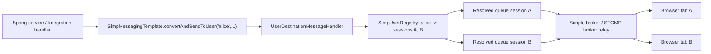
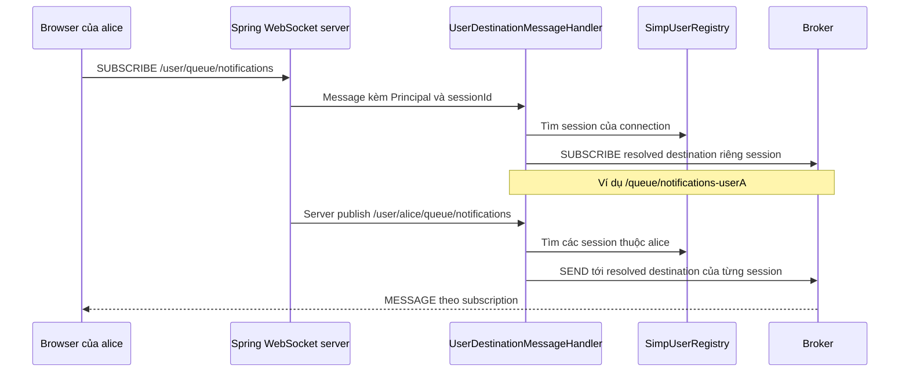

# User destination và session mapping trong Spring Integration STOMP

## 1. Bài toán: thông báo đúng người, đúng phiên, không lộ dữ liệu

Ứng dụng đặt hàng nhận sự kiện từ nhiều nguồn (HTTP, file, Kafka, JMS...) qua Spring Integration, xử lý xong thì phải báo kết quả cho khách hàng đang mở giao diện web. Hai khách hàng cùng subscribe kênh thông báo: nếu ứng dụng phát tới `/topic/order-updates`, cả hai có thể nhận một sự kiện chứa dữ liệu chỉ dành cho một người. Nếu ứng dụng tự tạo `/queue/user-alice` bằng cách nối chuỗi username, nguy cơ va chạm tên, sai quyền và phụ thuộc broker sẽ tăng. Khi một người mở **hai tab**, gửi tới user có nghĩa là tab nào sẽ nhận? Khi một tab mất kết nối rồi nối lại, session cũ còn hợp lệ không?

Spring Framework WebSocket STOMP giải quyết phần **định tuyến theo user/session** bằng **user destinations**. Client có thể subscribe một địa chỉ logic như `/user/queue/notifications`, còn server chuyển địa chỉ đó thành **destination thực riêng của mỗi WebSocket/STOMP session**. Thành phần điều phối là `UserDestinationMessageHandler` cùng `SimpUserRegistry` và `UserDestinationResolver`.

Trong module **SPRING_INTEGRATION_ADAPTERS**, các inbound/outbound adapter, gateway, poller và `MessageChannel` nối nguồn ngoài vào luồng xử lý nội bộ. Bài này giải thích **cách nối kết quả của Spring Integration vào Spring WebSocket user destinations**, đồng thời phân biệt tính năng server-side này với `StompInboundChannelAdapter`/`StompMessageHandler` vốn đóng vai trò **STOMP client**.

**Mục tiêu học tập**

1. Phân biệt `/user` logical destination, broker destination thực, WebSocket session ID, subscription ID và `Principal`.
2. Hiểu quy tắc client `SUBSCRIBE /user/queue/...`, server `convertAndSendToUser(...)` và `@SendToUser`.
3. Phân biệt **gửi cho tất cả session** của một user với **chỉ session đã gửi command**, gồm cả trường hợp user ẩn danh.
4. Cấu hình Spring WebSocket STOMP server, quan sát `SimpUserRegistry` và lifecycle events.
5. Kết nối một Spring Integration flow với `SimpMessagingTemplate` mà không để header không tin cậy quyết định người nhận.
6. Thiết kế multi-instance routing, broker relay, authorization, reconnect, offline delivery, idempotency và kiểm thử.

## 2. Bốn loại định danh không được đánh đồng

Giả sử một user đã đăng nhập tên `alice`, mở hai tab trình duyệt. Mỗi tab mở một WebSocket connection và tạo một STOMP session riêng.

```text
Principal: alice
   |
   +-- WebSocket/STOMP session A: s-a123
   |      +-- SUBSCRIBE id:sub-0
   |          destination:/user/queue/notifications
   |
   +-- WebSocket/STOMP session B: s-b456
          +-- SUBSCRIBE id:sub-0
              destination:/user/queue/notifications
```

Hai subscription có thể cùng ID `sub-0` vì subscription ID chỉ cần duy nhất **trong một STOMP session**, không phải toàn hệ thống. Tuy nhiên chúng tương ứng **hai đăng ký khác nhau**, gắn với hai connection/session khác nhau.

| Định danh | Ví dụ | Thuộc tầng nào? | Ý nghĩa |
| --- | --- | --- | --- |
| User identity / `Principal.getName()` | `alice` | Authentication của server | Người dùng đang đăng nhập, có thể có nhiều session. |
| WebSocket/STOMP session ID | `s-a123` | Spring WebSocket server | Một kết nối/phiên giao thức, thay đổi khi reconnect. |
| Subscription ID | `sub-0` | STOMP `SUBSCRIBE` | Nhận diện một subscription trong **session** tương ứng. |
| Logical user destination | `/user/queue/notifications` | Spring user destination routing | Tên ổn định để client subscribe, không kèm ID phiên. |
| Resolved broker destination | Ví dụ `/queue/notifications-user<s-a123>` | Broker layer, do Spring tạo | Destination gắn với một session cụ thể. |
| Domain event ID | `evt-501` | Contract nghiệp vụ | ID ổn định phục vụ trace/idempotency qua retry. |

Tên `/queue/notifications-user<s-a123>` chỉ là **minh họa**; định dạng hậu tố thực tế do Spring resolver và broker configuration quyết định. Không hardcode tên resolved destination hoặc suy đoán session ID từ suffix.

**Điểm quan trọng:** `username` không phải `sessionId`; `sessionId` không phải `subscriptionId`; cả ba cũng không phải `MessageHeaders.ID` hay `message-id` của STOMP broker.

## 3. /user/ có ý nghĩa ở đâu?

Trong **Spring WebSocket STOMP server** đã cấu hình user destinations:

- Client **subscribe** `/user/queue/notifications`.
- Server có thể **publish** tới một user bằng `SimpMessagingTemplate.convertAndSendToUser("alice", "/queue/notifications", payload)`.
- Spring tạo message có logical route tương đương `/user/alice/queue/notifications`, rồi `UserDestinationMessageHandler` quyết định các session đích.
- Một broker destination thực được tạo tương ứng từng session đã đăng ký, ví dụ các đích private gắn với session A/B.



User destination mapping là tính năng **Spring WebSocket server-side**, không phải quy tắc mặc định của giao thức STOMP 1.2. Nếu `StompMessageHandler` của **Spring Integration** kết nối thẳng external broker TCP và gửi `SEND /user/alice/queue/notifications`, external broker **không mặc nhiên** gọi được `UserDestinationMessageHandler` của một ứng dụng Spring khác.

### So sánh bốn chuỗi thường gặp

| Đường dẫn | Ai sử dụng? | Vai trò |
| --- | --- | --- |
| `wss://api.example/ws` | STOMP-over-WebSocket client | URL HTTP/WebSocket handshake. |
| `/app/orders.confirm` | Client gửi lệnh tới Spring WebSocket server | Application destination, ánh xạ `@MessageMapping`. |
| `/user/queue/notifications` | Client subscribe qua Spring WebSocket server | Logical user destination, server gắn với session của client. |
| `/topic/events` hoặc `/queue/jobs` | Broker layer | Broker destination theo convention/configuration. |

Các prefix như `/topic` và `/queue` **không có semantics cố định do STOMP bắt buộc**; broker quyết định fan-out, competing consumer, retention và ACK. `/user` cần được Spring server nhận diện và xử lý trước khi đi vào broker.

## 4. Đường đi khi client SUBSCRIBE user destination

Giả sử `alice` đăng nhập và browser gửi:

```text
SUBSCRIBE
id:notifications-0
destination:/user/queue/notifications
ack:auto

^@
```

`^@` biểu diễn byte NUL kết thúc frame STOMP, không phải hai ký tự ứng dụng cần gửi. Spring xử lý yêu cầu theo trình tự khái niệm:



Một vài lưu ý:

1. **Không yêu cầu browser biết username trong destination subscribe.** Browser thường chỉ dùng `/user/queue/notifications`.
2. User identity và session ID do **server xác lập**, không lấy từ một header custom tùy ý của browser.
3. `UserDestinationMessageHandler` cần được cấu hình để xử lý `/user`, thay vì để broker nhận trực tiếp prefix logic này.
4. Một subscription hợp lệ không chứng minh message đã được xử lý ở database; ACK, transaction và idempotency là trách nhiệm riêng.

## 5. @SendToUser: một user có nhiều tab sẽ nhận như thế nào?

Spring cho phép method `@MessageMapping` trả về kết quả riêng cho người gửi thông qua `@SendToUser`.

### 5.1. Mặc định: các session cùng user có thể nhận

```java
@Controller
public class OrderViewController {

    @MessageMapping("/orders.view")
    @SendToUser("/queue/order-view")
    public OrderViewResult view(
            OrderViewRequest request,
            java.security.Principal principal) {
        if (principal == null) {
            throw new SecurityException("Authentication required");
        }

        // DEMO: phải kiểm tra principal có quyền xem orderId.
        return new OrderViewResult(
            request.orderId(), "RECEIVED", principal.getName()
        );
    }
}

record OrderViewRequest(long orderId) {}
record OrderViewResult(long orderId, String state, String owner) {}
```

Các annotation/import chính:

```java
import org.springframework.stereotype.Controller;
import org.springframework.messaging.handler.annotation.MessageMapping;
import org.springframework.messaging.simp.annotation.SendToUser;
```

Nếu `alice` có hai session và **cả hai đều đã subscribe** `/user/queue/order-view`, `@SendToUser` với giá trị mặc định `broadcast=true` có thể gửi kết quả tới **cả hai session của alice**. Đây là lựa chọn phù hợp cho sự kiện “đơn hàng của tôi đã đổi trạng thái” khi tất cả thiết bị/tabs cần biết.

**Quan trọng về quyền:** ví dụ chỉ thể hiện cách route, không phải ví dụ authorization đầy đủ. Không được truy vấn hoặc công bố trạng thái đơn hàng cho `principal` chỉ vì `request.orderId` có vẻ hợp lệ; phải kiểm tra quyền sở hữu theo dữ liệu server.

### 5.2. Chỉ session đã gửi lệnh: broadcast=false

Khi kết quả là phản hồi cho **một tab vừa gửi command**, không muốn tab khác nhận:

```java
@MessageMapping("/orders.preview")
@SendToUser(value = "/queue/previews", broadcast = false)
public OrderViewResult preview(OrderViewRequest request) {
    // DEMO: thực tế kiểm tra user, tenant và quyền xem trước.
    return new OrderViewResult(
        request.orderId(), "PREVIEW", "current-session"
    );
}
```

`broadcast=false` yêu cầu chỉ đưa response tới **session đã gửi message** thay vì mọi session cùng user.

| Nhu cầu | Lựa chọn thường phù hợp |
| --- | --- |
| Trạng thái đơn hàng mới cần hiển thị trên điện thoại và hai tab | `@SendToUser` mặc định hoặc `convertAndSendToUser` gửi user-wide. |
| Kết quả validate form chỉ dành cho tab vừa submit | `@SendToUser(broadcast=false)`. |
| Error do command cụ thể phát sinh | `@MessageExceptionHandler` kết hợp `@SendToUser(broadcast=false)`. |
| Sự kiện đã được DB commit từ background worker | `SimpMessagingTemplate.convertAndSendToUser(...)`. |

### 5.3. User chưa đăng nhập có sử dụng /user được không?

Theo Spring Framework, **anonymous WebSocket session** vẫn có thể subscribe user destination. Trong trường hợp không có authenticated user, `@SendToUser` chỉ nhắm tới **session gửi message**, tương đương `broadcast=false`.

Điều đó **không biến user destination thành cơ chế xác thực**. Nếu dữ liệu riêng tư, phải yêu cầu xác thực/ủy quyền trước khi xử lý business command hoặc subscribe dữ liệu nhạy cảm. Đừng suy luận “có prefix /user thì chỉ người đã đăng nhập mới vào được”.

## 6. SimpMessagingTemplate: gửi notification từ một service bất kỳ

Không phải notification nào cũng là return value của `@MessageMapping`. Một worker xử lý file, sự kiện Kafka, đơn hàng từ HTTP, hoặc Spring Integration `ServiceActivator` có thể tạo notification sau khi nghiệp vụ thành công.

Spring cung cấp `SimpMessagingTemplate` với method:

```java
template.convertAndSendToUser(
    "alice",
    "/queue/notifications",
    new UserNotification("evt-501", "Đơn hàng đã xác nhận")
);
```

**Chú ý:** truyền **tên user** (`Principal.getName()` đã được xác định đáng tin cậy) và **destination không có prefix `/user`** vào `convertAndSendToUser`. Không tự ghép string `"/user/alice/queue/notifications"` rồi đưa nó làm tham số destination của method này.

### 6.1. Dịch vụ publish

```java
import org.springframework.messaging.simp.SimpMessagingTemplate;
import org.springframework.stereotype.Service;

@Service
public class PrivateNotificationService {

    private final SimpMessagingTemplate messagingTemplate;

    public PrivateNotificationService(
            SimpMessagingTemplate messagingTemplate) {
        this.messagingTemplate = messagingTemplate;
    }

    public void publishToUser(
            String verifiedRecipient,
            String eventId,
            String messageText) {
        if (verifiedRecipient == null || verifiedRecipient.isBlank()) {
            throw new IllegalArgumentException(
                "Missing authenticated recipient"
            );
        }
        if (eventId == null || eventId.isBlank()) {
            throw new IllegalArgumentException("Missing eventId");
        }

        messagingTemplate.convertAndSendToUser(
            verifiedRecipient,
            "/queue/notifications",
            new UserNotification(eventId, messageText)
        );
    }
}

record UserNotification(String eventId, String text) {}
```

Tên tham số `verifiedRecipient` nhắc người viết code về **tiền điều kiện bảo mật**: chính service gọi phải xác nhận người nhận từ thông tin server-side có thẩm quyền (ví dụ bảng owner của đơn hàng). Bản thân một tham số kiểu `String` không tự chứng minh danh tính được xác thực.

### 6.2. Gửi đến user offline

`convertAndSendToUser(...)` **không phải hộp thư lưu bền**. Nếu user không có session phù hợp, message có thể không được chuyển cho ai; không được mặc định nó sẽ đợi đến khi user đăng nhập trở lại.

Khi notification là dữ liệu quan trọng:

1. Lưu event/notification vào database hoặc outbox bền vững.
2. Dùng STOMP như **đường push khi user đang online**.
3. Cho client gọi API lấy notification chưa đọc sau login/reconnect.
4. Dedupe theo `eventId` và duy trì read/unread state độc lập session ID.

## 7. Ví dụ hoàn chỉnh: Spring WebSocket STOMP server hỗ trợ /user

### 7.1. Dependencies

Với Spring Boot BOM quản lý version tương thích:

```xml
<dependencies>
    <dependency>
        <groupId>org.springframework.boot</groupId>
        <artifactId>spring-boot-starter-websocket</artifactId>
    </dependency>
    <dependency>
        <groupId>org.springframework.boot</groupId>
        <artifactId>spring-boot-starter-integration</artifactId>
    </dependency>
</dependencies>
```

`spring-boot-starter-websocket` tạo hạ tầng Spring WebSocket STOMP server. `spring-boot-starter-integration` chỉ cần nếu ứng dụng dùng thêm Integration flow/`@ServiceActivator`. Với production nên bổ sung Spring Security và lưu trữ DB theo nhu cầu. **Không cần external STOMP broker để chạy demo dùng simple broker**, nhưng simple broker không thay thế broker bền vững cho tải lớn.

### 7.2. Java configuration

```java
import org.springframework.context.annotation.Configuration;
import org.springframework.messaging.simp.config.MessageBrokerRegistry;
import org.springframework.web.socket.config.annotation.EnableWebSocketMessageBroker;
import org.springframework.web.socket.config.annotation.StompEndpointRegistry;
import org.springframework.web.socket.config.annotation.WebSocketMessageBrokerConfigurer;

@Configuration
@EnableWebSocketMessageBroker
public class UserDestinationWebSocketConfig
        implements WebSocketMessageBrokerConfigurer {

    @Override
    public void registerStompEndpoints(StompEndpointRegistry registry) {
        registry.addEndpoint("/ws")
            .setAllowedOrigins("http://localhost:3000");
    }

    @Override
    public void configureMessageBroker(MessageBrokerRegistry registry) {
        registry.setApplicationDestinationPrefixes("/app");
        registry.setUserDestinationPrefix("/user");
        registry.enableSimpleBroker("/topic", "/queue");
    }
}
```

Giải thích:

1. `/ws` là URL WebSocket handshake của ứng dụng, ví dụ `ws://localhost:8080/ws`; **không phải** STOMP destination.
2. `/app` đưa command tới `@MessageMapping` (method mapping không cần chứa lại tiền tố `/app`).
3. `/user` được nhận diện bởi `UserDestinationMessageHandler` trước khi chuyển tiếp message tới broker.
4. `/queue` là broker prefix cho những resolved destinations session-specific. `/topic` phục vụ broadcast công khai, không được dùng thay user destination cho dữ liệu riêng.
5. `setAllowedOrigins("http://localhost:3000")` chỉ là origin phục vụ demo local. Production cần danh sách origin chính xác, authentication và message-level authorization.

**Không cấu hình broker xử lý trực tiếp `/user`** khi bạn muốn Spring làm user destination mapping. Nếu prefix chồng lấn sai, broker có thể nhận một logical `/user/...` chưa được resolver dịch thành destination riêng.

### 7.3. Controller gửi về đúng session

Đưa controller dưới đây vào **cùng ứng dụng server**:

```java
import java.security.Principal;

import org.springframework.messaging.handler.annotation.MessageMapping;
import org.springframework.messaging.simp.annotation.SendToUser;
import org.springframework.stereotype.Controller;

@Controller
public class UserNotificationController {

    @MessageMapping("/notifications.ping")
    @SendToUser(
        value = "/queue/notifications",
        broadcast = false
    )
    public UserNotification ping(
            PingCommand command,
            Principal principal) {

        if (principal == null) {
            throw new SecurityException("Login required");
        }
        if (command.requestId() == null
                || command.requestId().isBlank()) {
            throw new IllegalArgumentException("Missing requestId");
        }

        return new UserNotification(
            command.requestId(),
            "Ping accepted"
        );
    }
}

record PingCommand(String requestId) {}
```

Đây là ví dụ **request/reply minh họa**, không có database. Nếu client gửi `SEND /app/notifications.ping` và đã subscribe `/user/queue/notifications`, response được gửi tới **session của client đã gọi** do `broadcast=false`. Vẫn cần security configuration thực tế: kiểm tra `Principal` trong handler không thay thế việc chặn `CONNECT/SUBSCRIBE/SEND` không được phép trên Spring Security message channel.

### 7.4. Service gửi notification user-wide

Sử dụng `PrivateNotificationService` của mục 6 trong cùng application context. Khi một sự kiện đã xác minh có người nhận `alice`, gọi:

```java
privateNotificationService.publishToUser(
    "alice",
    "evt-502",
    "Đơn hàng 502 đã giao"
);
```

Method ở trên dành cho **dịch vụ backend đáng tin cậy**, không phải một REST endpoint nhận username từ user tùy ý. Khi có cả tab A và B của alice subscribe, cả hai có thể được nhận cùng một user-wide notification.

## 8. Client JavaScript: một logical subscription cho mỗi tab

Với một frontend đã cài `@stomp/stompjs`, hai tab có thể dùng cùng code:

```javascript
import { Client } from "@stomp/stompjs";

const client = new Client({
  brokerURL: "ws://localhost:8080/ws",
  reconnectDelay: 5000,
  onConnect: () => {
    client.subscribe("/user/queue/notifications", frame => {
      const event = JSON.parse(frame.body);
      console.log("Notification:", event.eventId);
    });
  }
});

client.activate();

function ping() {
  client.publish({
    destination: "/app/notifications.ping",
    body: JSON.stringify({ requestId: "req-701" })
  });
}
```

**Hai điểm thiết kế quan trọng:**

- Gửi `SUBSCRIBE` trong `onConnect` để session mới sau reconnect đăng ký lại. **Không** gửi lại lệnh nghiệp vụ trong `onConnect` một cách mặc định; callback này có thể chạy nhiều lần và tạo command trùng.
- Mỗi tab có một session riêng, dù hai tab cùng dùng browser/account. `@SendToUser(broadcast=false)` phản hồi đúng tab phát lệnh; `convertAndSendToUser("alice", ...)` có thể tới cả hai tab.

Code demo dùng `ws://`; production dùng `wss://`, cookie/token/authorization theo cơ chế đã thiết kế, tránh ghi dữ liệu riêng tư vào console và tránh hardcode message IDs nếu cần theo dõi retry.

### Ma trận nhận message

| Đối tượng | Subscribe | Server publish | Kỳ vọng |
| --- | --- | --- | --- |
| Tab A của alice | `/user/queue/notifications` | `@SendToUser(broadcast=false)` từ command tab A | Tab A nhận; tab B không nhận response đó. |
| Tab B của alice | `/user/queue/notifications` | `convertAndSendToUser("alice",...)` | Tab A và tab B có thể đều nhận nếu còn subscribed. |
| Tab C của bob | `/user/queue/notifications` | `convertAndSendToUser("alice",...)` | Tab C **không** thuộc user alice nên không là đích hợp lệ. |
| Tab A của alice sau reconnect | Subscription cũ đã mất cùng session cũ | Client subscribe lại sau `CONNECTED` | Nhận các event **mới** theo broker/retention; không bảo đảm replay cũ. |

## 9. SimpUserRegistry: user → session → subscription

`SimpUserRegistry` cho phép server quan sát user đang kết nối và các session/subscription liên quan. API đáng chú ý:

```java
SimpUser user = simpUserRegistry.getUser("alice");
int userCount = simpUserRegistry.getUserCount();
Set<SimpUser> users = simpUserRegistry.getUsers();
```

Nếu user tồn tại, có thể gọi `user.getSessions()` rồi mỗi `SimpSession.getSubscriptions()` để theo dõi trạng thái subscription.

### 9.1. Ví dụ snapshot an toàn

```java
import java.util.Set;

import org.springframework.messaging.simp.user.SimpSession;
import org.springframework.messaging.simp.user.SimpUser;
import org.springframework.messaging.simp.user.SimpUserRegistry;
import org.springframework.stereotype.Component;

@Component
public class ActiveStompSessions {

    private final SimpUserRegistry registry;

    public ActiveStompSessions(SimpUserRegistry registry) {
        this.registry = registry;
    }

    public int activeUserCount() {
        return registry.getUserCount();
    }

    public int sessionCountFor(String trustedUsername) {
        SimpUser user = registry.getUser(trustedUsername);
        if (user == null) {
            return 0;
        }
        return user.getSessions().size();
    }

    public long subscriptionCountFor(String trustedUsername) {
        SimpUser user = registry.getUser(trustedUsername);
        if (user == null) {
            return 0L;
        }
        return user.getSessions().stream()
            .mapToLong(session -> session.getSubscriptions().size())
            .sum();
    }
}
```

Trong production, **không mở public endpoint cho phép client truy vấn danh sách user/session**. Registry có thể tiết lộ sự hiện diện, thói quen kết nối và thông tin nội bộ của người khác. Nếu cần dashboard, tổng hợp metric hoặc bắt buộc kiểm soát quyền quản trị.

### 9.2. Registry là trạng thái gần thời gian thực, không phải source of truth

SimpUserRegistry mang tính **runtime/ephemeral**:

- Một WebSocket session có thể vừa ngắt trước khi snapshot được đọc.
- User có thể chưa subscribe ngay cả khi `getUser(...)` không null.
- Một session có thể reconnect và nhận ID mới, khiến mapping thay đổi.
- Trong triển khai nhiều server, registry local có thể không biết user nằm trên node khác nếu chưa có broadcast/coordination.
- Không dùng registry làm cơ sở duy nhất để quyết định người dùng có quyền đọc đơn hàng hoặc đã nhận một event.

Một user mở hai tab thường được đếm là **một user** nhưng **hai session**. Subscription count có thể lớn hơn session count, vì một session subscribe nhiều destinations.

## 10. Lifecycle events và session mapping

Spring WebSocket STOMP server công bố events trong application context:

| Event | Khi nào | Giá trị trong chẩn đoán |
| --- | --- | --- |
| `SessionConnectEvent` | Nhận STOMP `CONNECT` | Bắt đầu handshake, chứa metadata session/user nếu có. |
| `SessionConnectedEvent` | Nhận `CONNECTED` từ broker/server | Session đã thiết lập thành công ở tầng STOMP. |
| `SessionSubscribeEvent` | Nhận `SUBSCRIBE` | Biết session yêu cầu subscription nào. |
| `SessionUnsubscribeEvent` | Nhận `UNSUBSCRIBE` | Subscription đã được yêu cầu tháo. |
| `SessionDisconnectEvent` | STOMP/WebSocket session kết thúc | Dọn trạng thái liên quan session, phát metric. |
| `BrokerAvailabilityEvent` | Broker layer (đặc biệt broker relay) đổi trạng thái | Phát hiện broker system connection mất/khôi phục. |

**`SessionDisconnectEvent` có thể được phát nhiều lần cho cùng session.** Callback cleanup phải idempotent, không giảm counter nhiều lần hoặc xóa dữ liệu user vĩnh viễn chỉ vì một phiên đã đóng.

### 10.1. Quan sát subscription/disconnect

```java
import org.springframework.context.event.EventListener;
import org.springframework.messaging.simp.stomp.StompHeaderAccessor;
import org.springframework.stereotype.Component;
import org.springframework.web.socket.messaging.SessionConnectedEvent;
import org.springframework.web.socket.messaging.SessionDisconnectEvent;
import org.springframework.web.socket.messaging.SessionSubscribeEvent;

@Component
public class UserSessionLifecycleLogger {

    @EventListener
    public void onConnected(SessionConnectedEvent event) {
        String user = event.getUser() == null
            ? "<anonymous>" : event.getUser().getName();
        System.out.println("STOMP connected, user=" + user);
    }

    @EventListener
    public void onSubscribe(SessionSubscribeEvent event) {
        StompHeaderAccessor headers =
            StompHeaderAccessor.wrap(event.getMessage());
        System.out.println(
            "STOMP SUBSCRIBE destination=" + headers.getDestination()
        );
    }

    @EventListener
    public void onDisconnect(SessionDisconnectEvent event) {
        // Một session có thể có nhiều disconnect events.
        System.out.println("STOMP session disconnected");
    }
}
```

Ví dụ cố ý chỉ log thông tin tối thiểu. Production không nên in đầy đủ session ID, token hoặc dữ liệu cá nhân trong log không bảo vệ. Nếu duy trì bảng online presence của riêng ứng dụng, nên dùng set/lease có TTL hoặc cập nhật idempotent thay vì chỉ tăng/giảm counter theo event.

### 10.2. Mapping vòng đời điển hình

```text
T0: alice đăng nhập, mở tab A
    session A được tạo, SUBSCRIBE /user/queue/notifications

T1: alice mở tab B
    session B được tạo, SUBSCRIBE cùng logical destination

T2: server gửi convertAndSendToUser("alice", ...)
    A và B có thể cùng nhận

T3: tab A disconnect
    session A hết hiệu lực; session B còn sống

T4: tab A reconnect
    một session mới A' được tạo; cần SUBSCRIBE lại
```

**Không dùng session ID làm khóa định danh nghiệp vụ lâu dài.** Event ID, user ID và trạng thái notification phải độc lập với ID session thay đổi qua reconnect.

## 11. Broker relay và resolved destinations

Trong ứng dụng demo, `registry.enableSimpleBroker("/topic", "/queue")` phù hợp để học routing, nhưng đơn giản và không đảm bảo lưu bền như một broker chuyên dụng.

Khi dùng external broker:

```java
@Override
public void configureMessageBroker(MessageBrokerRegistry registry) {
    registry.setApplicationDestinationPrefixes("/app");
    registry.setUserDestinationPrefix("/user");

    registry.enableStompBrokerRelay("/topic", "/queue")
        .setRelayHost("broker.internal.example")
        .setRelayPort(61613)
        .setClientLogin("relay-client")
        .setClientPasscode(clientSecret)
        .setSystemLogin("relay-system")
        .setSystemPasscode(systemSecret);
}
```

Đây là **cấu hình thay thế** simple broker; `clientSecret` và `systemSecret` phải đến từ secret manager/config injection của ứng dụng, không phải biến mặc định có sẵn. Không bật simple broker và broker relay cho cùng prefix rồi giả định chúng tự phối hợp.

Khi client subscribe `/user/queue/notifications`, Spring server dịch thành **broker destination riêng cho session**, sau đó relay gửi subscription đến external broker theo convention nó hỗ trợ. Vì mỗi session có đích riêng, broker ngoài có thể tạo các queue/consumer tài nguyên ngắn hạn.

### 11.1. Dọn tài nguyên sau session disconnect

Với external broker, cần xác minh tài nguyên resolved destination được **xóa hoặc hết hạn** khi session ngắt:

- RabbitMQ có mô hình destination/queue auto-delete khi sử dụng đúng convention, ví dụ `/exchange/amq.direct/...`.
- Một số broker khác có chính sách purge inactive queues/destinations.
- Không áp đặt cách đặt tên và auto-delete của RabbitMQ lên ActiveMQ, Artemis hoặc broker khác.

Nếu không có cleanup, số session tăng/giảm liên tục có thể tạo nhiều queue không còn client, chiếm tài nguyên và làm metric sai.

### 11.2. STOMP session và business delivery

Một resolved queue có thể nhận frame `MESSAGE` nhưng client mất mạng trước khi xử lý xong. Kết quả redelivery phụ thuộc broker, ack mode (`auto`, `client`, `client-individual`) và durability. Spring user destination **không tự thêm ACK nghiệp vụ** hoặc transaction JDBC cho consumer.

## 12. Nhiều server instance: user có thể đang ở node khác

Giả sử Spring WebSocket app chạy hai pod:

```text
Browser alice → WebSocket server B
                    |
                    +-- local SimpUserRegistry B: alice/session-b

Backend notification → WebSocket server A
                          |
                          +-- local registry A: không có alice
```

Nếu A chỉ biết registry local, một user-targeted message có thể **không được resolve** ở A dù alice đang online tại B.

### 12.1. Hai cơ chế broadcast khác nhau

Khi dùng broker relay, Spring Framework hỗ trợ các cấu hình trên **`StompBrokerRelayRegistration`**:

```java
registry.enableStompBrokerRelay("/topic", "/queue")
    .setRelayHost("broker.internal.example")
    .setRelayPort(61613)
    .setUserDestinationBroadcast(
        "/topic/unresolved-user-destination"
    )
    .setUserRegistryBroadcast(
        "/topic/simp-user-registry"
    );
```

Hai hàm có mục đích riêng:

| Cấu hình | Tác dụng |
| --- | --- |
| `setUserDestinationBroadcast(...)` | Broadcast **user messages chưa resolve được** trên node hiện tại để node khác có cơ hội xử lý. |
| `setUserRegistryBroadcast(...)` | Broadcast dữ liệu **registry user/session** từ mỗi server, giúp các instance biết hơn về user đang kết nối trên node khác. |

Đoạn trên là **phần bổ sung/biến thể** của broker relay configuration, không phải một ứng dụng độc lập có thể chạy mà thiếu credentials và các bean xung quanh. Hai destination nội bộ phải được external broker cho phép và cần tách biệt khỏi kênh thông báo công khai cho browser.

**Bảo mật:** tuyệt đối không để client không tin cậy subscribe được các topic nội bộ chứa registry hoặc unresolved messages nếu có thông tin riêng tư. Phải cấu hình broker ACL và Spring message authorization chặt chẽ.

### 12.2. Không có exactly-once chỉ vì đã broadcast

User registry broadcast và unresolved destination broadcast hỗ trợ định tuyến khi có nhiều server, nhưng không tự tạo:

- Transaction phân tán giữa các pod.
- Lưu bền thông báo cho user đang offline.
- Bảo đảm gửi đúng một lần nếu retry/reconnect.
- Kiểm tra quyền user truy cập dữ liệu.
- Đồng bộ tức thời tuyệt đối: registry là trạng thái phân tán có độ trễ cập nhật.

Các hệ thống critical cần bảng notification/inbox hoặc transactional outbox và cơ chế client lấy bù qua API.

## 13. Kết nối từ Spring Integration flow tới user destinations

Một Spring Integration `MessageChannel` có thể nhận kết quả đã xử lý của inbound adapters (file, SFTP, HTTP, Kafka, JMS, AMQP...). Sau validation/authorization, handler có thể gọi `SimpMessagingTemplate` để gửi notification cho user đang kết nối trên **Spring WebSocket server trong cùng app context**.

```mermaid
flowchart LR
    EXT["Nguồn ngoài"] --> AD["Spring Integration inbound adapter"]
    AD --> C["MessageChannel"]
    C --> V["Validate + nghiệp vụ/DB commit"]
    V --> N["Verified notification message"]
    N --> SA["@ServiceActivator"]
    SA --> T["SimpMessagingTemplate"]
    T --> U["UserDestinationMessageHandler"]
    U --> BR["Broker"]
    BR --> W["Đúng WebSocket sessions"]
```



### 13.1. Ví dụ handler bridge

```java
import org.springframework.context.annotation.Bean;
import org.springframework.context.annotation.Configuration;
import org.springframework.integration.annotation.ServiceActivator;
import org.springframework.integration.channel.DirectChannel;
import org.springframework.messaging.MessageChannel;
import org.springframework.messaging.simp.SimpMessagingTemplate;

@Configuration
public class IntegrationUserNotificationBridge {

    @Bean
    public MessageChannel verifiedNotifications() {
        return new DirectChannel();
    }

    @Bean
    @ServiceActivator(inputChannel = "verifiedNotifications")
    public org.springframework.messaging.MessageHandler userNotifier(
            SimpMessagingTemplate messagingTemplate) {

        return message -> {
            VerifiedNotification event =
                (VerifiedNotification) message.getPayload();

            if (event.recipientUser() == null
                    || event.recipientUser().isBlank()) {
                throw new IllegalArgumentException(
                    "Recipient must be verified by backend"
                );
            }

            messagingTemplate.convertAndSendToUser(
                event.recipientUser(),
                "/queue/notifications",
                new UserNotification(event.eventId(), event.text())
            );
        };
    }
}

record VerifiedNotification(
    String recipientUser,
    String eventId,
    String text
) {}
```

**Lưu ý về trách nhiệm:** tên record `VerifiedNotification` chỉ là tên kiểu Java; **không đủ để tin cậy dữ liệu**. Một service có quyền truy cập nguồn user/order phải xác thực người nhận và tạo message này. Nếu nhận `recipientUser` trực tiếp từ HTTP header hoặc STOMP frame của client thì có nguy cơ phát dữ liệu của khách hàng A sang khách hàng B.

### 13.2. Không nối user destination thẳng với STOMP TCP outbound adapter

So sánh:

```text
Đúng khi dùng Spring WebSocket user routing:
  Integration handler → SimpMessagingTemplate
    → /user/alice/queue/notifications
    → UserDestinationMessageHandler → broker resolved destination

Không tương đương:
  Integration StompMessageHandler(TCP broker, "/user/alice/...")
    → external STOMP broker
    → không tự chạy Spring UserDestinationMessageHandler ở server khác
```

Nếu một **Spring Integration client** ở JVM khác phải dùng application/user destination routing của Spring WebSocket server, nó cần kết nối qua **WebSocket STOMP endpoint** đã cấu hình (ví dụ `WebSocketStompClient` + `WebSocketStompSessionManager`) và có authentication hợp lệ. Kết nối trực tiếp broker bằng TCP có thể chỉ dùng resolved destination theo broker contract, nhưng không thể tự nhận dạng user/session từ Spring server.

### 13.3. Khi gửi sau transaction DB

`convertAndSendToUser` không tự tham gia transaction JDBC. Nếu push được gửi **trước khi DB commit** rồi DB rollback, client có thể thấy thông báo cho một giao dịch thất bại.

Giải pháp theo mức bảo đảm:

- Demo đơn giản: publish sau khi nghiệp vụ hoàn tất hợp lệ.
- Có transaction DB: cân nhắc publish-after-commit, nhưng vẫn xử lý tình huống crash sau commit trước publish.
- Cần độ tin cậy cao: **transactional outbox** lưu notification cùng thay đổi DB, worker phát sau, client idempotent theo `eventId`.
- User offline: notification tồn tại trong DB và client đọc bù khi kết nối trở lại.

## 14. Authentication và authorization: /user không phải khóa bảo mật

### 14.1. Principal được gắn khi nào?

Với Spring WebSocket STOMP server, handshake bắt đầu từ HTTP. Khi Spring Security đã xác thực HTTP request/session, `Principal` có thể được gắn với WebSocket/STOMP session và được đưa vào các message xử lý trong ứng dụng. Spring WebSocket mặc định **không coi STOMP `login`/`passcode` gửi qua browser là nguồn xác thực người dùng cuối** như khi client kết nối trực tiếp STOMP/TCP broker.

Điều đó có nghĩa:

- `Principal.getName()` nên đến từ cơ chế authentication server, không phải một header `username` tùy ý.
- WebSocket session của cùng user có thể có nhiều kết nối tab/thiết bị.
- Khi session được đăng xuất/thu hồi, cần có policy đóng/giới hạn quyền và không phát dữ liệu nhạy cảm cho phiên không hợp lệ.
- Khi dùng token trong STOMP CONNECT, phải thiết kế `ChannelInterceptor` và security context đúng cách; không tự mặc định Spring sẽ xác thực mọi token đó.

### 14.2. Các quyền tối thiểu phải kiểm tra

| Hành động | Kiểm soát |
| --- | --- |
| WebSocket handshake `/ws` | Authentication, origin, CSRF và cấu hình cookie/token phù hợp. |
| `SEND /app/orders.view` | User có quyền xem orderId/tenant được yêu cầu. |
| `SUBSCRIBE /user/queue/notifications` | Chỉ session được phép; không cho phép subscribe tùy ý đích private của người khác. |
| `SUBSCRIBE /queue/notifications-user...` | Ngăn browser đoán/tự subscribe resolved broker destination. |
| `convertAndSendToUser` | Người nhận được xác minh từ backend, không lấy trực tiếp từ request của người gửi. |
| Broadcast destinations nội bộ nhiều pod | Chỉ application/broker relay được quyền gửi/nhận. |

**Đặc biệt:** resolved destination là một **chuỗi broker destination**, không phải cơ chế bảo mật. Nếu browser được phép subscribe bừa các `/queue/...` và đoán tên đích của session khác, dữ liệu có thể bị lộ. Cần phân quyền theo message ở Spring và broker ACL đúng topology.

### 14.3. Xử lý user name có ký tự đặc biệt

User name có thể chứa dấu phân cách hoặc ký tự ảnh hưởng đến destination. `SimpMessagingTemplate` và `UserDestinationResolver` thực hiện các bước cần thiết để biểu diễn tên user trong logical destination theo API của Spring; đừng tự nối raw username vào đường dẫn STOMP hoặc tự encode tùy tiện trong business service. Với identity provider, nên chuẩn hóa principal name thành một định danh ổn định, không phụ thuộc display name của người dùng.

## 15. Tính bền vững, ACK, retry và idempotency

User destination hỗ trợ **định tuyến tới session**, không phải một hợp đồng phát event đúng một lần.

| Sự kiện | Rủi ro | Biện pháp |
| --- | --- | --- |
| User offline lúc notification được phát | Không có session nhận, push có thể mất | Lưu notification DB, client fetch bù. |
| Browser vừa disconnect sau khi server publish | Frame có thể không tới hoặc chưa được ứng dụng xử lý | ACK/retention theo broker, trạng thái đã đọc ở backend. |
| Server phát lại sau timeout | Hai event cùng ID xuất hiện | Deduplicate theo `eventId` ở client/DB. |
| Hai session cùng user | Cùng một thông báo tới hai tab | Đó có thể là chủ đích; UI cần idempotent. |
| `@SendToUser(broadcast=false)` từ tab A | Tab B không nhận | Dùng cho phản hồi phiên, không dùng cho event cần cập nhật mọi thiết bị. |
| Broker relay reconnect | Subscription/client connections cần thiết lập lại | Theo dõi disconnect/reconnect, subscribe lại và đọc bù. |

**ACK/NACK của STOMP** và `RECEIPT` khác với **business acknowledgment**:

- `RECEIPT` (khi client yêu cầu) chỉ xác nhận broker xử lý frame tương ứng, không chứng minh notification đã hiển thị.
- `ACK/NACK` của subscription phụ thuộc ack mode/broker, không tự bảo đảm DB transaction.
- `readAt` hoặc `deliveredAt` của hệ thống notification phải là trạng thái nghiệp vụ được cập nhật và kiểm chứng độc lập.

Không dùng `SessionConnectedEvent` hoặc `SimpUserRegistry.getUser(...) != null` để mặc định người dùng đã đọc hoặc nhìn thấy notification.

## 16. Quan sát, chẩn đoán và kiểm thử

### 16.1. Các metric nên thu thập

| Chỉ số | Câu hỏi |
| --- | --- |
| Số authenticated users đang kết nối | Có bao nhiêu Principal đang online? |
| Số sessions trên một user (phân phối) | Nhiều tab/thiết bị có tạo tải bất thường không? |
| Subscriptions theo logical destination | Client đã subscribe đúng `/user/queue/notifications` chưa? |
| Số user-targeted sends | Backend phát bao nhiêu notification? |
| Số unresolved user destinations | Có user trên pod khác hay user offline? |
| Broker relay availability/reconnect | System connection và client sessions có vấn đề gì? |
| Queue/destination resource count ở broker | Resolved private destinations có bị rò rỉ sau disconnect không? |
| Thời gian DB commit → push | Notification bị chậm do queue hay broker? |
| Số event bị gửi trùng/đọc bù | Retry/reconnect có làm UI lặp không? |

### 16.2. Troubleshooting theo triệu chứng

| Triệu chứng | Nguyên nhân thường gặp | Hướng điều tra |
| --- | --- | --- |
| Cả alice và bob đều nhận notification của alice | Dùng `/topic` công khai hoặc route không kiểm tra recipient | Chuyển sang user destination, kiểm tra Principal và policy. |
| Chỉ tab A nhận, tab B không nhận | Dùng `@SendToUser(broadcast=false)` hoặc B chưa subscribe | Xác định event session-specific hay user-wide. |
| `convertAndSendToUser("alice",...)` không tới ai | Username không khớp `Principal.getName()` hoặc user offline | Kiểm tra registry, auth, subscription, read-back. |
| Client subscribe `/user/alice/queue/...` | Nhầm subscribe URL với server-side publish URL | Client phải subscribe `/user/queue/...`. |
| Server báo CONNECTED nhưng notification không đến | SUBSCRIBE chưa thành công, broker relay lỗi hoặc handler nghẽn | Kiểm tra subscription events, queue và broker availability. |
| Sau reconnect nhận trùng thông báo | Client publish/subscribe lại, server retry | Giữ `eventId` ổn định, idempotency/read state. |
| Hai pod, gửi user-targeted chỉ hoạt động cùng pod | Registry local thiếu session ở pod khác | Cấu hình broker relay broadcast phù hợp. |
| Broker tạo vô số private queues | Không có auto-delete/purge inactive destinations | Kiểm tra broker-specific user destination convention và cleanup. |
| `SessionDisconnectEvent` làm số online âm | Event disconnect trùng hoặc đếm sai | Dọn trạng thái idempotent, ưu tiên snapshot/lease. |
| Data leak từ một resolved destination | Broker ACL/message authorization lỏng | Chặn subscription không hợp lệ và không tin prefix như quyền. |

### 16.3. Ma trận kiểm thử end-to-end

Trên môi trường thử nghiệm có hai user `alice` và `bob`:

1. Alice mở hai tab, mỗi tab `SUBSCRIBE /user/queue/notifications`.
2. Bob mở một tab và subscribe **cùng logical destination**.
3. Backend `convertAndSendToUser("alice", ...)`: hai tab alice có thể nhận; tab bob không được nhận.
4. Tab A của alice `SEND /app/notifications.ping`: với `@SendToUser(broadcast=false)` chỉ A nhận response.
5. Tắt tab A; backend gửi tiếp cho alice: tab B vẫn nhận, tab A đã đóng không được coi còn online.
6. Reconnect tab A: client subscribe lại; so sánh session ID mới với cũ.
7. Ngắt một replica trong test cluster: user destinations chưa resolve có được broadcast/resolve đúng ở node khác không?
8. Thử subscribe trực tiếp một resolved broker queue của user khác bằng client thiếu quyền: phải bị từ chối.
9. Gửi cùng eventId hai lần: notification store/UI không tạo hai trạng thái nghiệp vụ khác nhau.
10. Gửi khi alice offline: xác nhận API read-back có dữ liệu nếu nghiệp vụ yêu cầu lưu bền.

Không thực hiện thử phá kết nối, đổi ACL hay thao tác broker trong môi trường production đang phục vụ người dùng thật.

## 17. Bài tập thực hành có đáp án

**Bài 1 — URL subscribe.** Alice muốn nhận notification riêng từ Spring WebSocket server. Browser nên subscribe `/user/queue/notifications` hay `/user/alice/queue/notifications`?

**Đáp án:** `/user/queue/notifications`. User/session được Spring xác định theo kết nối và Principal, không cần client đưa username vào logical subscription.

**Bài 2 — Tên người nhận.** Để gửi từ server tới alice, gọi `convertAndSendToUser` với những tham số destination nào?

**Đáp án:** `convertAndSendToUser("alice", "/queue/notifications", payload)`; không truyền `/user/alice/...` làm destination thứ hai.

**Bài 3 — Hai tab.** Alice có tab A và B cùng subscribe. `@SendToUser` mặc định có thể gửi tới cả hai không?

**Đáp án:** Có. Mặc định broadcast tới những session được subscribe của user; dùng `broadcast=false` khi chỉ muốn session đã gửi command nhận.

**Bài 4 — Session-specific reply.** Một validation error chỉ dành cho tab gửi request. Cấu hình annotation nào phù hợp?

**Đáp án:** `@SendToUser(value="/queue/errors", broadcast=false)`, có thể gắn với `@MessageExceptionHandler`.

**Bài 5 — Anonymous.** Session chưa có Principal được xác thực có thể subscribe `/user/queue/...` không?

**Đáp án:** Có thể. `@SendToUser` khi đó hoạt động như `broadcast=false`, không phải một cơ chế xác thực hoặc quyền mặc định.

**Bài 6 — Registry.** `getUserCount()` trả 1 nhưng một user có hai tab, có mâu thuẫn không?

**Đáp án:** Không. Một user có thể có nhiều sessions; dùng `SimpUser.getSessions()` để thấy các session.

**Bài 7 — STOMP subscription ID.** Hai tab cùng dùng `id:sub-0` trong `SUBSCRIBE`. Có mặc nhiên vi phạm giao thức không?

**Đáp án:** Không, vì subscription ID phải duy nhất **trong từng STOMP session**, không phải giữa mọi session.

**Bài 8 — Reconnect.** Sau khi tab A reconnect, có thể dùng lại session ID cũ để định tuyến notification không?

**Đáp án:** Không nên. Session mới có ID riêng; dùng authenticated user mapping và subscription mới, không giữ session ID như business identity.

**Bài 9 — Direct broker.** Một Spring Integration `StompMessageHandler` nối trực tiếp broker TCP gửi tới `/user/alice/queue/notifications`. Có chắc Spring server sẽ resolve user destination không?

**Đáp án:** Không. Nó bypass `UserDestinationMessageHandler` của Spring WebSocket server, trừ khi có routing khác được thiết kế rõ.

**Bài 10 — Multi-node.** User đang kết nối tới pod B, publisher chạy ở pod A. Hai cấu hình broker relay nào hữu ích để hỗ trợ định tuyến?

**Đáp án:** `setUserDestinationBroadcast(...)` cho unresolved user messages và `setUserRegistryBroadcast(...)` để chia sẻ registry; cần ACL cho destinations nội bộ.

**Bài 11 — Durable notification.** `convertAndSendToUser(...)` khi alice offline có bảo đảm notification còn đó lúc login không?

**Đáp án:** Không. Cần lưu DB/outbox và API đọc bù nếu hợp đồng đòi hỏi.

**Bài 12 — Authorization.** User destination có tự ngăn client đoán và subscribe trực tiếp một broker resolved queue của người khác không?

**Đáp án:** Không. Phải bảo vệ broker ACL, STOMP message authorization, authentication và quyền theo tenant/user.

**Bài 13 — Cleanup.** `SessionDisconnectEvent` được phát hai lần, handler cleanup trừ counter hai lần. Cách xử lý?

**Đáp án:** Cleanup idempotent, dựa trên session key/lease hoặc registry snapshot; không giả định event disconnect đúng một lần.

**Bài 14 — Broker relay.** External broker có tự xóa mọi private queue sau disconnect trên tất cả broker không?

**Đáp án:** Không. Phải kiểm tra chính sách auto-delete/purge và convention của broker cụ thể.

**Bài 15 — Transaction.** Handler Spring Integration gửi notification rồi JDBC transaction rollback. User có thể đã thấy event không tồn tại không?

**Đáp án:** Có. STOMP publish không tự rollback cùng DB; nên publish-after-commit hoặc dùng transactional outbox tùy yêu cầu.

## 18. Ghi nhớ

**User destination** trong Spring WebSocket STOMP là một **logical route** như `/user/queue/notifications`; `UserDestinationMessageHandler` dùng `Principal`, session và `SimpUserRegistry` để chuyển nó thành **destination riêng cho từng session** trước khi tới broker. Client subscribe bằng đường dẫn logic không chứa username; server gửi theo user qua `SimpMessagingTemplate.convertAndSendToUser(...)` hoặc `@SendToUser`. `broadcast=false` chỉ trả cho session vừa gửi command, còn user-wide notification có thể tới nhiều tab của cùng user. **Không nhầm mapping này với một STOMP broker TCP độc lập hoặc Spring Integration `StompMessageHandler` kết nối trực tiếp broker**. Để triển khai an toàn, cần authorization theo người dùng/tenant, quản lý session lifecycle, multi-server registry/broadcast, broker queue cleanup, retry/idempotency và nguồn thông báo bền vững cho user offline.

## Tài liệu tham khảo

- [Spring Framework — User Destinations](https://docs.spring.io/spring-framework/reference/web/websocket/stomp/user-destination.html)
- [Spring Framework — Enable STOMP](https://docs.spring.io/spring-framework/reference/web/websocket/stomp/enable.html)
- [Spring Framework — Authentication](https://docs.spring.io/spring-framework/reference/web/websocket/stomp/authentication.html)
- [Spring Framework — ApplicationContext Events](https://docs.spring.io/spring-framework/reference/web/websocket/stomp/application-context-events.html)
- [Spring Framework API — SimpUserRegistry](https://docs.spring.io/spring-framework/docs/current/javadoc-api/org/springframework/messaging/simp/user/SimpUserRegistry.html)
- [Spring Framework API — StompBrokerRelayRegistration](https://docs.spring.io/spring-framework/docs/current/javadoc-api/org/springframework/messaging/simp/config/StompBrokerRelayRegistration.html)
- [Spring Integration Reference — STOMP Support](https://docs.spring.io/spring-integration/reference/stomp.html)
