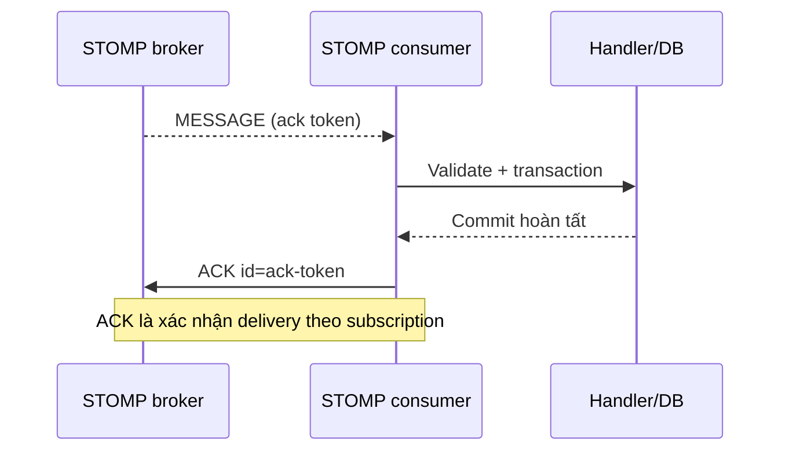
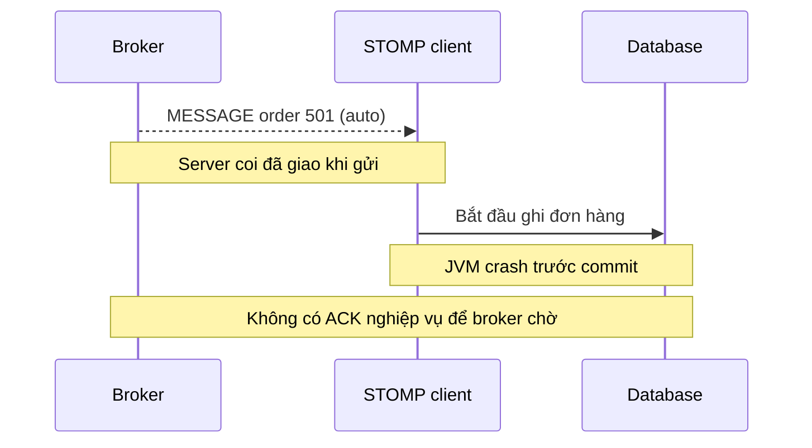
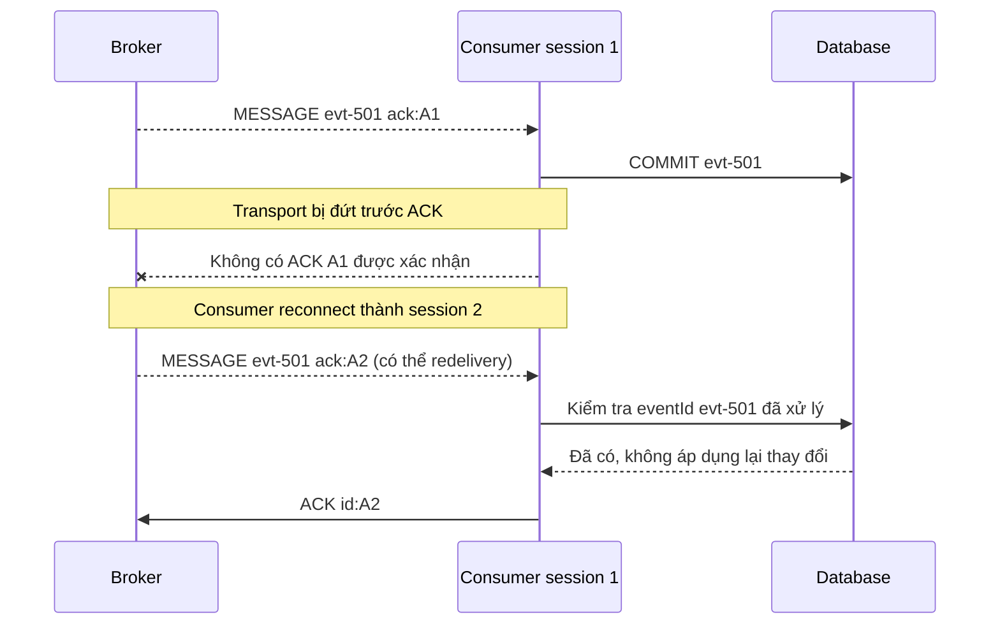

# ACK, NACK và subscription mode trong Spring Integration STOMP

## 1. Bài toán: nhận được MESSAGE chưa có nghĩa xử lý thành công

Một ứng dụng Java nhận sự kiện `ORDER_CREATED` từ STOMP broker, kiểm tra dữ liệu rồi lưu vào database. Broker gửi frame `MESSAGE`, nhưng ngay khi handler đang cập nhật database thì ứng dụng gặp lỗi hoặc bị dừng. Liệu broker có gửi lại message? Nếu handler đã commit DB nhưng `ACK` không đến broker, chuyện gì xảy ra? Nếu ba message đến liên tục, gửi `ACK` cho message thứ ba có vô tình xác nhận hai message trước không?

Đây là những câu hỏi về **acknowledgement**, không phải chỉ về kết nối. Trong module **SPRING_INTEGRATION_ADAPTERS**, inbound adapter, outbound adapter, gateway, poller và `MessageChannel` nối hệ thống ngoài với luồng dữ liệu nội bộ. Riêng STOMP, adapter nhận frame qua subscription; **chế độ ACK của subscription** quyết định khi nào broker xem một delivery đã được consumer xác nhận.

STOMP 1.2 định nghĩa ba chế độ subscription: **`auto`**, **`client`** và **`client-individual`**. Khi manual acknowledgement được bật, consumer gửi `ACK` hoặc `NACK`. Tuy nhiên, ACK của STOMP không tự tạo transaction chung với JDBC, không giải quyết exactly-once và không thay thế việc validate payload, xử lý retry hoặc lưu idempotency key.

**Mục tiêu bài học**

1. Giải thích sự khác biệt giữa `auto`, `client` (cumulative) và `client-individual` (per-message).
2. Viết đúng `SUBSCRIBE`, `MESSAGE`, `ACK`, `NACK` theo **STOMP 1.2**, nhất là quan hệ `MESSAGE.ack` và `ACK.id`.
3. Hiểu `NACK`, disconnect, redelivery, dead-letter và điểm nào do **broker** quyết định.
4. Phân biệt `StompInboundChannelAdapter` của Spring Integration với thao tác manual ACK của Spring Framework `StompSession`.
5. Đưa frame từ một STOMP client vào `MessageChannel`, chỉ ACK sau khi downstream **đồng bộ** xử lý thành công.
6. Thiết kế ranh giới transaction, async handoff, idempotency, observability và kiểm thử lỗi.

## 2. Bức tranh tổng thể: ba mốc xác nhận khác nhau



| Mốc | Ai biết? | Ý nghĩa | Không đảm bảo |
| --- | --- | --- | --- |
| Broker gửi `MESSAGE` | Broker/client STOMP | Frame đã được phát tới session qua transport | Handler đã đọc, validate hoặc commit DB |
| Handler commit nghiệp vụ | Ứng dụng và DB | Thay đổi nghiệp vụ đã được lưu theo transaction của DB | Broker đã nhận `ACK` |
| Broker nhận/xử lý `ACK` | Broker | Delivery được xác nhận theo mode của subscription | Một transaction xuyên broker + DB đã xảy ra |
| Broker trả `RECEIPT` cho frame có yêu cầu | Broker/client | Broker đã xử lý frame được yêu cầu receipt | Mọi subscriber đã hoàn tất nghiệp vụ |

Một message có thể được xử lý **ít nhất một lần** và bị redeliver khi ACK thất lạc; ngược lại, ở chế độ auto, broker có thể đánh dấu đã giao trước lúc ứng dụng xử lý xong. Vì vậy không thể lấy duy nhất cờ “handler được gọi” hay “STOMP session connected” làm bằng chứng dữ liệu đã được xử lý bền vững.

## 3. ACK mode nằm trên SUBSCRIBE, không phải trên từng SEND

Trong STOMP 1.2, client gửi frame `SUBSCRIBE` với hai header bắt buộc: `id` và `destination`. Header `ack` là tùy chọn; nếu bỏ qua thì mặc định **`auto`**.

```text
SUBSCRIBE
id:orders-sub-1
destination:/queue/orders
ack:client-individual

^@
```

`^@` biểu diễn byte NUL kết thúc frame, không phải hai ký tự thật cần gửi nguyên văn. Tên `/queue/orders` chỉ là convention trong một số broker; STOMP **không chuẩn hóa** rằng mọi destination có prefix `/queue` đều có cùng semantics.

| Mode trên SUBSCRIBE | Khi nào broker xem đã xử lý? | Có gửi `ACK/NACK`? | Rủi ro/công dụng |
| --- | --- | --- | --- |
| `auto` (mặc định) | Broker giả định message được nhận khi đã gửi | Không cần; không nên gửi manual ACK cho delivery auto | Đơn giản, nhưng mất kết nối/crash sau delivery có thể mất cơ hội xử lý |
| `client` | Khi client gửi ACK cho delivery phù hợp | Có | **Cumulative**: ACK một message còn xác nhận những message đã gửi trước đó trên subscription |
| `client-individual` | Khi client gửi ACK cho chính delivery đó | Có | **Individual**: hợp với xử lý bất đồng bộ/không theo thứ tự, nhưng vẫn cần broker và idempotency |

ACK mode là **thuộc tính của subscription**. Một STOMP session có thể có nhiều subscription với mode khác nhau, và `id` subscription phải duy nhất **trong cùng session**. Nếu thêm một subscription thứ hai ở session khác, việc trùng tên subscription ID không mặc nhiên vi phạm giao thức.

### Không có một mode tên NONE trong STOMP 1.2

Đừng chép cấu hình từ JMS hoặc Spring Integration AMQP sang STOMP:

- AMQP có các chế độ container `AUTO`, `MANUAL`, `NONE` theo API riêng.
- JMS có session acknowledgement và transacted session theo hợp đồng JMS.
- **STOMP 1.2 chỉ quy định `auto`, `client`, `client-individual`** ở header `ack` của `SUBSCRIBE`.

Nếu đọc một ví dụ `AcknowledgmentCallback.Status.REQUEUE` hoặc `basicAck(deliveryTag)`, đó là API của adapter/giao thức khác, **không phải API tự có** trong STOMP inbound channel adapter.

## 4. Mode auto: nhanh, đơn giản nhưng dễ hiểu sai về độ tin cậy

```text
SUBSCRIBE
id:orders-auto
destination:/queue/orders
ack:auto

^@
```

Khi broker gửi `MESSAGE` tới subscription này, nó **giả định message đã được client nhận** theo semantics `auto`. Nếu JVM chết trước khi ghi DB, không thể kết luận broker sẽ redeliver chỉ vì Spring handler chưa chạy xong.



Chế độ `auto` có thể phù hợp cho thông báo có thể mất (ví dụ một cập nhật UI có khả năng đồng bộ lại từ API). Nhưng với yêu cầu **đơn hàng không được bỏ sót**, phải đánh giá lại delivery semantics, durability, ack mode và khả năng đối soát.

**Quan trọng:** “Không cần gửi ACK” không đồng nghĩa “Spring Integration đã xử lý xong”. Nếu handler ném exception ở `DirectChannel` hoặc worker sau `ExecutorChannel` bị lỗi, broker có thể đã đánh dấu delivery ở chế độ auto.

## 5. Mode client: ACK cộng dồn (cumulative)

Trong `client` mode, `ACK` của một message xác nhận **message đó và tất cả message trước đó đã được gửi tới cùng subscription mà chưa được xác nhận**.

Giả sử broker gửi lần lượt M1, M2, M3:

```text
SUBSCRIBE ack:client

Broker ----> M1 (ack-token A1) ----> Consumer
Broker ----> M2 (ack-token A2) ----> Consumer
Broker ----> M3 (ack-token A3) ----> Consumer

Consumer ----> ACK id:A3 ----> Broker

Hiệu lực cumulative: M1 + M2 + M3 được xác nhận
```

| Thứ tự | Kết quả nghiệp vụ | Nếu gửi ACK cho M3 |
| --- | --- | --- |
| M1 | Đã commit DB | Được xác nhận |
| M2 | **Đang xử lý hoặc thất bại** | **Cũng có thể bị xác nhận** |
| M3 | Đã commit DB | Được xác nhận |

Nếu xử lý M3 hoàn tất nhanh hơn M2 và ACK M3 trước, ta có thể **đánh dấu đã tiêu thụ cả M2 dù M2 chưa thành công**. Do đó, `client` mode thường thích hợp với **xử lý tuần tự và ACK theo thứ tự đã xử lý thành công**, chứ không phải ACK độc lập từ nhiều worker chạy song song.

Phạm vi cumulative là các message trước đó của **cùng subscription**, không phải mọi subscription hoặc mọi session đang dùng broker.

### NACK trong client mode cũng có thể cộng dồn

STOMP 1.2 quy định khi `ack:client`, `NACK` có thể áp dụng đến message chỉ định **và những message trước đó trên subscription chưa ACK/NACK**. Đừng mặc định `NACK` cho M3 chỉ từ chối riêng M3. Hậu quả phân phối lại hay đưa vào dead-letter còn tùy broker.

## 6. Mode client-individual: ACK/NACK từng delivery

```text
SUBSCRIBE
id:orders-individual
destination:/queue/orders
ack:client-individual

^@
```

Giả sử:

```text
M1 (A1): đã commit nhanh  -> ACK id:A1
M2 (A2): DB tạm lỗi       -> chưa ACK / hoặc NACK id:A2
M3 (A3): đã commit nhanh  -> ACK id:A3
```

ACK M3 **không** xác nhận M2. Đây là lợi thế lớn khi thời gian xử lý khác nhau, có xử lý song song hoặc muốn phân biệt poison message. Tuy nhiên:

- Broker vẫn có thể giới hạn số delivery chưa được ACK (prefetch/credit riêng của broker).
- Message thất bại chưa ACK có thể tiếp tục ở trạng thái in-flight cho tới khi broker quyết định, session kết thúc hoặc timeout/recovery phù hợp.
- Redelivery và retention phụ thuộc broker/queue/subscription; STOMP không bảo đảm mọi trường hợp NACK đều tự **requeue=true**.
- Cần idempotency vì ACK có thể thất lạc sau DB commit.

### Khi nào chọn mode nào?

| Tình huống | Hướng cân nhắc |
| --- | --- |
| UI real-time, thông tin có thể đọc bù từ HTTP | `auto` có thể đơn giản hơn nếu cho phép mất push |
| Xử lý tuần tự tuyệt đối, ACK sau cả batch liên tục | `client` có thể dùng, nhưng phải quản lý thứ tự và cumulative ACK |
| Mỗi đơn hàng xử lý độc lập, thời gian DB khác nhau | `client-individual` thường dễ kiểm soát lỗi theo delivery |
| Cần transaction DB + broker cùng atomic | Không mode nào tự cung cấp; cần outbox/inbox/idempotency |
| Message lỗi cố định cần dead-letter | ACK mode kết hợp broker-specific DLQ/retry policy; không chỉ chọn mode |

## 7. STOMP 1.2: MESSAGE.ack khác MESSAGE.message-id

Đây là lỗi rất thường gặp. Với một subscription yêu cầu manual acknowledgement, STOMP 1.2 quy định broker phải gửi **header `ack`** trong frame `MESSAGE`.

```text
MESSAGE
subscription:orders-individual
message-id:broker-msg-501
ack:ack-delivery-abc123
destination:/queue/orders
content-type:application/json

{"eventId":"evt-501","orderId":501}
^@
```

Khi xử lý thành công:

```text
ACK
id:ack-delivery-abc123

^@
```

Khi xử lý thất bại và muốn từ chối delivery:

```text
NACK
id:ack-delivery-abc123

^@
```

| Header | Giá trị ví dụ | Chức năng |
| --- | --- | --- |
| `SUBSCRIBE.id` | `orders-individual` | Định danh subscription trong session |
| `MESSAGE.subscription` | `orders-individual` | Frame này đến từ subscription nào |
| `MESSAGE.message-id` | `broker-msg-501` | Định danh message do broker cấp |
| **`MESSAGE.ack`** | **`ack-delivery-abc123`** | **Token delivery dùng cho ACK/NACK ở STOMP 1.2** |
| **`ACK.id` / `NACK.id`** | **`ack-delivery-abc123`** | **Bắt buộc khớp MESSAGE.ack** |
| Business `eventId` | `evt-501` | Khóa ổn định ứng dụng dùng cho idempotency |

**Không sử dụng `message-id`, `subscription` hoặc Spring `MessageHeaders.ID` thay cho `MESSAGE.ack` khi tạo `ACK.id` trên STOMP 1.2.** Các token có thể trông giống nhau ở một broker nhưng không được dựa vào sự trùng hợp đó.

### Khác biệt với STOMP 1.1

STOMP 1.2 thay đổi cú pháp ACK/NACK so với STOMP 1.1. Ở 1.1, định danh message và subscription trong frame acknowledgement được biểu diễn khác; ở 1.2, **`ACK/NACK.id` liên kết trực tiếp với `MESSAGE.ack`**.

Khi phát triển client đa phiên bản, phải xem `CONNECTED.version` và API phiên bản Spring Framework/broker. Một unit test chỉ so sánh `message-id` với `ACK.id` có thể **qua mặt lỗi ở broker thử nghiệm** nhưng thất bại khi chuyển sang broker thực hỗ trợ STOMP 1.2 chặt chẽ.

## 8. NACK nghĩa là từ chối delivery, không chỉ định cách xử lý tiếp

STOMP `NACK` nói rằng client **không tiêu thụ message thành công**. Sau đó server có thể:

- Gửi lại cùng message cho subscriber khác hoặc cùng consumer sau một khoảng thời gian.
- Đưa message vào dead-letter destination/queue nếu có chính sách.
- Loại bỏ message nếu chính sách broker quy định.
- Giữ message và tiếp tục áp dụng giới hạn retry/max attempts.

**Không có một header chuẩn `requeue:true` được STOMP 1.2 bắt buộc hiểu trên mọi broker.** Các tham số như prefetch, max delivery count, dead-letter exchange, retry delay hoặc poison-message handling là khả năng mở rộng của broker và phải đọc đúng tài liệu sản phẩm.

### Chọn chiến lược với lỗi tạm thời và lỗi vĩnh viễn

| Loại lỗi | Ví dụ | Cách tiếp cận |
| --- | --- | --- |
| Tạm thời | DB connection timeout, downstream HTTP 503 | Retry có giới hạn/backoff; có thể giữ chưa ACK, NACK hoặc ngắt session tùy broker contract |
| Vĩnh viễn/poison | JSON sai schema, thiếu eventId, status không hợp lệ | Quarantine/DLQ với lý do lỗi; tránh NACK rồi lặp vô hạn |
| Đã xử lý trước đó | eventId đã được commit | Coi idempotent success rồi ACK delivery hiện tại |
| Không rõ đã commit chưa | JVM crash giữa DB commit và ACK | Consumer cần idempotency để redelivery không tạo nghiệp vụ trùng |
| Thiếu quyền hoặc subscription lỗi | Broker ERROR/ACL | Sửa cấu hình/quyền, không retry message nghiệp vụ vô hạn |

Nếu broker xử lý NACK bằng **gửi lại ngay**, một poison message có thể tạo vòng lặp rất nhanh, tăng CPU và làm nghẽn các message tốt. Cần cấu hình broker DLQ/retry budget hoặc ứng dụng quarantine rồi ACK sau khi lưu an toàn.

## 9. Spring Integration STOMP adapter: điểm cần kiểm tra về ACK mode

Spring Integration cung cấp `StompInboundChannelAdapter`, một `MessageProducerSupport` subscribe các destinations và phát `Message<?>` vào output `MessageChannel`. Ví dụ mặc định:

```java
@Bean
public StompInboundChannelAdapter stompInboundAdapter(
        StompSessionManager stompSessionManager,
        @Qualifier("ordersInboundChannel") MessageChannel channel) {

    StompInboundChannelAdapter adapter =
        new StompInboundChannelAdapter(
            stompSessionManager, "/queue/orders"
        );
    adapter.setOutputChannel(channel);
    adapter.setPayloadType(String.class);
    return adapter;
}
```

API public của `StompInboundChannelAdapter` bao gồm constructor nhận destinations, `setPayloadType`, `setHeaderMapper`, `addDestination`/`removeDestination` và API lỗi/lifecycle từ `MessageProducerSupport`. **Không có một setter `setAckMode(...)` được công bố trực tiếp** trên adapter trong Javadoc hiện hành.

Do đó không nên viết cấu hình giả:

```java
// SAI: không phải API công khai của StompInboundChannelAdapter.
// adapter.setAckMode("client-individual");
// adapter.setManualAcks(true);
```

**Hai cấp độ thao tác khác nhau:**

1. **STOMP inbound adapter thông thường:** dùng API cao cấp để subscribe/convert/forward; kiểm tra semantics subscription mặc định của phiên bản và broker. Không mặc định có token manual ACK được đưa vào business message.
2. **Client Spring Framework `StompSession`:** có `subscribe(StompHeaders, StompFrameHandler)` để đặt header `ack` theo subscription và `acknowledge(StompHeaders, boolean)` để phát ACK/NACK. Đây là đường minh họa khi bài toán cần điều khiển manual ACK có chủ đích.

Nếu dự án muốn dùng **Spring Integration flow và manual ACK cùng lúc**, cần xây một integration bridge/adapter riêng hoặc một thành phần extension có kiểm soát để mang ACK token và gắn ACK sau commit. Không đơn giản sao chép cấu hình `MANUAL` của RabbitMQ/JMS sang STOMP adapter.

## 10. Ví dụ A — inbound STOMP adapter thông thường

Đây là ví dụ dùng Spring Integration STOMP adapter và `DirectChannel`. Nó cho thấy **đường đi message**, không phải implementation manual ACK.

### 10.1. Dependencies

Với dự án Spring Boot có BOM quản lý phiên bản phù hợp:

```xml
<dependencies>
    <dependency>
        <groupId>org.springframework.boot</groupId>
        <artifactId>spring-boot-starter-integration</artifactId>
    </dependency>
    <dependency>
        <groupId>org.springframework.integration</groupId>
        <artifactId>spring-integration-stomp</artifactId>
    </dependency>
    <dependency>
        <groupId>io.projectreactor.netty</groupId>
        <artifactId>reactor-netty</artifactId>
    </dependency>
</dependencies>
```

Chuẩn bị một broker thật có STOMP/TCP tại `127.0.0.1:61613` và quyền `SUBSCRIBE` vào `/queue/orders`. Port chỉ là ví dụ phổ biến, **không phải mọi broker tự bật cổng này**. Để kiểm tra manual ACK, broker phải hỗ trợ ACK, không dùng simple broker của Spring WebSocket như một giả định về đầy đủ chức năng STOMP.

### 10.2. Cấu hình Java

```java
import org.springframework.beans.factory.annotation.Qualifier;
import org.springframework.context.annotation.Bean;
import org.springframework.context.annotation.Configuration;
import org.springframework.integration.annotation.ServiceActivator;
import org.springframework.integration.channel.DirectChannel;
import org.springframework.integration.config.EnableIntegration;
import org.springframework.integration.stomp.ReactorNettyTcpStompSessionManager;
import org.springframework.integration.stomp.StompSessionManager;
import org.springframework.integration.stomp.inbound.StompInboundChannelAdapter;
import org.springframework.integration.support.converter.PassThruMessageConverter;
import org.springframework.messaging.Message;
import org.springframework.messaging.MessageChannel;
import org.springframework.messaging.simp.stomp.ReactorNettyTcpStompClient;
import org.springframework.scheduling.concurrent.ThreadPoolTaskScheduler;

@Configuration
@EnableIntegration
public class StompDefaultInboundConfiguration {

    @Bean
    public ThreadPoolTaskScheduler stompTaskScheduler() {
        ThreadPoolTaskScheduler scheduler = new ThreadPoolTaskScheduler();
        scheduler.setPoolSize(2);
        scheduler.setThreadNamePrefix("stomp-");
        return scheduler;
    }

    @Bean
    public ReactorNettyTcpStompClient stompClient(
            ThreadPoolTaskScheduler stompTaskScheduler) {
        ReactorNettyTcpStompClient client =
            new ReactorNettyTcpStompClient("127.0.0.1", 61613);
        client.setTaskScheduler(stompTaskScheduler);
        client.setMessageConverter(new PassThruMessageConverter());
        return client;
    }

    @Bean
    public StompSessionManager stompSessionManager(
            ReactorNettyTcpStompClient stompClient) {
        ReactorNettyTcpStompSessionManager manager =
            new ReactorNettyTcpStompSessionManager(stompClient);
        manager.setRecoveryInterval(5_000);
        return manager;
    }

    @Bean
    public MessageChannel ordersInboundChannel() {
        return new DirectChannel();
    }

    @Bean
    public StompInboundChannelAdapter ordersAdapter(
            StompSessionManager stompSessionManager,
            @Qualifier("ordersInboundChannel") MessageChannel channel) {
        StompInboundChannelAdapter adapter =
            new StompInboundChannelAdapter(
                stompSessionManager, "/queue/orders"
            );
        adapter.setOutputChannel(channel);
        adapter.setPayloadType(String.class);
        return adapter;
    }

    @ServiceActivator(inputChannel = "ordersInboundChannel")
    public void handleOrder(Message<?> message) {
        // Demo: chưa có DB, ACK manual hoặc idempotency.
        System.out.println("Received: " + message.getHeaders().getId());
    }
}
```

**Lưu ý:**

- `StompSessionManager` quản lý session và reconnect; không phải STOMP transaction manager hay durable queue.
- `setPayloadType(String.class)` là target payload type; kiểu thực tế còn tùy session converter.
- `DirectChannel` gọi handler đồng bộ nhưng **không tự tạo manual ACK**.
- `MessageHeaders.ID` của Spring message không phải STOMP `MESSAGE.ack`; nó không thể dùng làm token xác nhận broker.
- `setRecoveryInterval(5_000)` quản lý nhịp thử reconnect, **không** tự phát lại message đã mất khi subscriber offline.

Nếu cần phân biệt lỗi nhận frame, mapping header và lỗi handler, cấu hình error channel ở endpoint; nhưng **error channel không tự đổi chế độ ACK của STOMP broker**.

## 11. Ví dụ B — manual ACK với StompSession, sau một DirectChannel đồng bộ

Khi cần `client-individual` chính xác, ví dụ này dùng **Spring Framework STOMP client** để tạo `SUBSCRIBE` có header `ack`. Sau khi nhận frame, client gửi payload vào **Spring Integration `DirectChannel`**, chờ handler đồng bộ trả về, rồi ACK. Nếu handler lỗi, ví dụ phát NACK; kết quả redelivery/DLQ vẫn theo broker.

```text
External STOMP broker
   -> MESSAGE (ack token)
   -> StompFrameHandler.handleFrame
   -> ordersForProcessing (DirectChannel)
   -> Service Activator (đồng bộ)
   -> handler trả thành công -> ACK
   -> handler ném lỗi        -> NACK
```

**Đây là một luồng thay thế**, không chạy đồng thời với `StompInboundChannelAdapter` mục 10 trên cùng queue khi bạn đang cố quan sát một consumer duy nhất. Nếu cùng chạy, hai subscriber có thể cạnh tranh nhận message tùy broker.

### 11.1. Cấu hình client và Integration channel

Sử dụng dependencies ở mục 10, cộng thêm `StringMessageConverter` có sẵn trong Spring Messaging:

```java
import org.springframework.boot.ApplicationRunner;
import org.springframework.context.annotation.Bean;
import org.springframework.context.annotation.Configuration;
import org.springframework.integration.annotation.ServiceActivator;
import org.springframework.integration.channel.DirectChannel;
import org.springframework.messaging.MessageChannel;
import org.springframework.messaging.MessageHandler;
import org.springframework.messaging.converter.StringMessageConverter;
import org.springframework.messaging.simp.stomp.ReactorNettyTcpStompClient;
import org.springframework.scheduling.concurrent.ThreadPoolTaskScheduler;

@Configuration
public class ManualAckStompConfiguration {

    @Bean
    public ThreadPoolTaskScheduler manualAckScheduler() {
        ThreadPoolTaskScheduler scheduler = new ThreadPoolTaskScheduler();
        scheduler.setPoolSize(2);
        scheduler.setThreadNamePrefix("manual-stomp-");
        return scheduler;
    }

    @Bean(destroyMethod = "shutdown")
    public ReactorNettyTcpStompClient manualAckStompClient(
            ThreadPoolTaskScheduler manualAckScheduler) {
        ReactorNettyTcpStompClient client =
            new ReactorNettyTcpStompClient("127.0.0.1", 61613);
        client.setTaskScheduler(manualAckScheduler);
        client.setMessageConverter(new StringMessageConverter());
        return client;
    }

    @Bean
    public MessageChannel ordersForProcessing() {
        return new DirectChannel();
    }

    @Bean
    @ServiceActivator(inputChannel = "ordersForProcessing")
    public MessageHandler synchronousOrderHandler() {
        return message -> {
            String body = (String) message.getPayload();
            if (!body.contains("eventId=")) {
                throw new IllegalArgumentException("Missing eventId");
            }
            // Demo: giả lập xử lý thành công, chưa persist.
            System.out.println("Processed order: " + body);
        };
    }

    @Bean
    public ApplicationRunner manualAckConnection(
            ReactorNettyTcpStompClient manualAckStompClient,
            ManualAckSessionHandler sessionHandler) {
        return args -> manualAckStompClient.connectAsync(sessionHandler)
            .whenComplete((session, error) -> {
                if (error != null) {
                    System.err.println(
                        "STOMP connect failed: " + error.getMessage()
                    );
                }
            });
    }
}
```

`ApplicationRunner` kết nối **một lần trong demo**. `connectAsync(...)` không đồng nghĩa tự thiết lập toàn bộ reconnect/resubscribe loop production. Cần bổ sung recovery/lifecycle management khi dùng thực tế. Dùng một application context riêng hoặc cấu hình profile để không khởi tạo hai client cạnh tranh từ mục 10 và 11.

### 11.2. Session handler tự tạo subscription mode

```java
import java.lang.reflect.Type;
import java.util.UUID;

import org.springframework.beans.factory.annotation.Qualifier;
import org.springframework.messaging.MessageChannel;
import org.springframework.messaging.support.MessageBuilder;
import org.springframework.messaging.simp.stomp.StompFrameHandler;
import org.springframework.messaging.simp.stomp.StompHeaders;
import org.springframework.messaging.simp.stomp.StompSession;
import org.springframework.messaging.simp.stomp.StompSessionHandlerAdapter;
import org.springframework.stereotype.Component;

@Component
public class ManualAckSessionHandler extends StompSessionHandlerAdapter {

    private final MessageChannel ordersForProcessing;

    public ManualAckSessionHandler(
            @Qualifier("ordersForProcessing")
            MessageChannel ordersForProcessing) {
        this.ordersForProcessing = ordersForProcessing;
    }

    @Override
    public void afterConnected(
            StompSession session, StompHeaders connectedHeaders) {

        StompHeaders subscribe = new StompHeaders();
        subscribe.setDestination("/queue/orders");
        subscribe.setId("orders-" + UUID.randomUUID());
        subscribe.setAck("client-individual");

        session.subscribe(subscribe, new StompFrameHandler() {

            @Override
            public Type getPayloadType(StompHeaders headers) {
                return String.class;
            }

            @Override
            public void handleFrame(
                    StompHeaders headers, Object payload) {
                String token = headers.getAck();

                if (token == null || token.isBlank()) {
                    // STOMP 1.2 manual mode yêu cầu MESSAGE.ack.
                    System.err.println("Missing STOMP ACK token");
                    session.disconnect();
                    return;
                }

                StompHeaders ackHeaders = new StompHeaders();
                ackHeaders.setId(token); // ACK.id == MESSAGE.ack

                try {
                    if (!(payload instanceof String body)) {
                        throw new IllegalArgumentException(
                            "Expected text STOMP payload"
                        );
                    }

                    boolean accepted = ordersForProcessing.send(
                        MessageBuilder.withPayload(body).build()
                    );
                    if (!accepted) {
                        throw new IllegalStateException(
                            "Message channel rejected payload"
                        );
                    }

                    // Chỉ sau khi DirectChannel handler đã trả về.
                    session.acknowledge(ackHeaders, true);  // ACK
                } catch (RuntimeException failure) {
                    // Demo: NACK mọi lỗi; xem cảnh báo poison loop bên dưới.
                    System.err.println(
                        "Processing failed: "
                            + failure.getClass().getSimpleName()
                    );
                    session.acknowledge(ackHeaders, false); // NACK
                }
            }
        });
    }

    @Override
    public void handleTransportError(
            StompSession session, Throwable exception) {
        System.err.println(
            "STOMP transport error: " + exception.getMessage()
        );
        // TODO: production reconnect/backoff, resubscribe và alert.
    }
}
```

**Giải thích quan trọng của ví dụ:**

1. `subscribe.setAck("client-individual")` gắn ACK mode **cho subscription**, không phải cho mọi session toàn cục.
2. `StompFrameHandler#getPayloadType` khai báo cần `String`; `StringMessageConverter` ở client thực hiện conversion phù hợp.
3. `headers.getAck()` lấy **token của delivery theo STOMP 1.2**. `ackHeaders.setId(token)` tạo đúng `ACK.id`/`NACK.id`.
4. `session.acknowledge(ackHeaders, true)` gửi ACK; `false` gửi NACK. Đây là API **Spring Framework StompSession**, không phải setter trên `StompInboundChannelAdapter`.
5. `ordersForProcessing` là `DirectChannel`, nên handler đồng bộ trong ví dụ chạy trước khi `send()` trả về. **Không** đổi ngay thành `ExecutorChannel` rồi vẫn nghĩ ACK chỉ được gửi sau DB commit.
6. Handler demo chỉ in console, nên ACK sau đây chỉ xác nhận **xử lý demo hoàn tất**, chưa phải durable business commit. Trong production, thay bằng service transaction thật và bảo đảm commit đã hoàn tất trước khi trả về.
7. Catch NACK tất cả exception chỉ để minh họa API. Nếu broker redeliver ngay, payload sai cố định có thể bị NACK vô hạn. Cần phân loại lỗi, retry có giới hạn và broker-specific DLQ/quarantine.

### 11.3. Nếu dùng STOMP 1.1 thì sao?

Code trên chủ ý tuân thủ STOMP **1.2**. Nếu broker/client thương lượng STOMP 1.1, phần `ACK` sử dụng định danh theo phiên bản cũ. Hãy kiểm tra `CONNECTED.version` và behavior của thư viện trước khi tái sử dụng code cho hệ thống không chỉ hỗ trợ 1.2.

### 11.4. Cảnh báo về callback và quản lý lỗi

`StompFrameHandler.handleFrame` có thể được gọi bởi thread callback của STOMP client. Nếu việc ghi DB kéo dài:

- Thread callback có thể bị giữ lâu, ảnh hưởng xử lý frame/heartbeat tùy transport.
- Lỗi ghi DB cần được chuyển thành kết quả nghiệp vụ có thể phân loại, không đơn thuần NACK mọi lỗi.
- Không giữ `StompSession` hoặc ACK token lâu hơn lifecycle cần thiết nếu session đã disconnect; token ACK thuộc delivery/session hiện hành.
- Khi connection mất giữa DB commit và gửi ACK, message có thể được broker phát lại: handler **bắt buộc idempotent**.

Muốn tránh giữ callback thread, có thể chuyển sang worker async **nhưng phải mang theo token, session binding và chỉ ACK theo completion thật**; thiết kế này phức tạp hơn và cần xử lý trường hợp session đổi khi worker còn đang chạy.

## 12. ACK sau transaction DB: điều kiện cần nhưng chưa đủ

Giả sử một handler JDBC/ORM:

```java
@Service
public class OrderPersistenceService {

    private final ProcessedEventRepository processedEvents;
    private final OrdersRepository orders;

    public OrderPersistenceService(
            ProcessedEventRepository processedEvents,
            OrdersRepository orders) {
        this.processedEvents = processedEvents;
        this.orders = orders;
    }

    @Transactional
    public void apply(OrderEvent event) {
        if (processedEvents.existsByEventId(event.eventId())) {
            return; // Xử lý lại cùng eventId là idempotent success.
        }

        orders.applyEvent(event);
        processedEvents.save(event.eventId());
    }
}
```

Đây là **mã phác thảo tầng persistence**, trong đó `OrderEvent`, `OrdersRepository` và `ProcessedEventRepository` là các kiểu do ứng dụng định nghĩa; không phải entity/repository Spring Integration dựng sẵn. Production cần **unique constraint** trên `eventId` (và quy trình xử lý race khi nhiều consumer cùng thấy chưa tồn tại), vì kiểm tra `existsByEventId` đơn độc không chống được hai transaction song song.

Một handler đồng bộ nên gọi `OrderPersistenceService.apply(...)` qua Spring proxy và **đợi transaction commit thành công** rồi mới trả về client STOMP để gửi ACK. Ví dụ trình tự:

```text
STOMP MESSAGE evt-501
   |
   v
Validate JSON -> business event ID
   |
   v
BEGIN JDBC transaction
   |
   +-> Update order
   +-> Insert processed_event(eventId UNIQUE)
   |
   v
COMMIT JDBC transaction thành công
   |
   v
ACK id=<MESSAGE.ack>
```

### Khoảng trống giữa COMMIT và ACK

```text
DB COMMIT ---------- crash ----------> ACK chưa tới broker
```

Sau khi khôi phục, broker **có thể** redeliver message tùy ack/retention policy. Nếu handler không idempotent, một đơn hàng có thể bị ghi/sửa hai lần. **Giải pháp:** giữ event ID ổn định và xử lý idempotent trong transaction DB. Khi nhận lại event đã ghi dấu, trả thành công để ACK delivery mới.

Với mục tiêu “không bỏ sót”, manual ACK phải đi cùng durability và redelivery của broker; nếu source là topic không lưu message cho client offline, chỉ chọn `client-individual` chưa đủ.

## 13. Async boundary: ACK quá sớm là một lỗi thiết kế phổ biến

Một inbound handler dùng:

```text
STOMP frame -> ExecutorChannel -> Worker -> DB
```

Nếu callback gửi vào `ExecutorChannel` rồi lập tức `ACK` vì `send()` trả `true`, kết quả thường chỉ có nghĩa **task đã được xếp vào executor**, không phải worker đã commit DB. Worker có thể thất bại sau đó, nhưng broker đã nhận ACK.

| Channel/Topology | `send()` trả về khi nào? | ACK sau `send()` có chứng minh DB commit? |
| --- | --- | --- |
| `DirectChannel` + handler xử lý DB đồng bộ | Handler đã trả về (với giao dịch được commit trước khi trả về) | Có thể bảo đảm đã hoàn thành bước đồng bộ, nếu topology đúng và không nuốt lỗi |
| `ExecutorChannel` | Công việc được giao cho executor | **Không** |
| `QueueChannel` | Message được đặt vào queue (nếu thành công) | **Không** |
| `PublishSubscribeChannel` có async executor | Công việc có thể được giao cho nhiều subscriber bất đồng bộ | **Không** |
| Channel qua broker/queue bền vững khác | Được nhận theo contract của tầng trung gian | Chỉ theo contract tầng trung gian, chưa phải consumer cuối |

### Nếu thực sự cần xử lý song song?

Một thiết kế tiến hơn cần:

1. Gắn **delivery token** vào một envelope nội bộ, cùng `sessionId`/connection generation và business `eventId`.
2. Worker xử lý và commit DB, trả về completion event rõ ràng.
3. Thành phần điều phối ACK trên **đúng STOMP session hiện hành**, không dùng token của session cũ sau reconnect.
4. Có timeout và giới hạn số in-flight messages, queue capacity, retry policy, DLQ.
5. Dùng `client-individual` nếu completion có thể không theo thứ tự; tránh cumulative ACK của `client`.
6. Khi ACK không thể gửi vì session đã mất, để broker policy quyết định redelivery và dựa vào idempotency.

Ví dụ B dùng đồng bộ để làm rõ tính đúng đắn của ranh giới ACK; nó không phải một worker pool production sẵn sàng scale.

## 14. STOMP transaction khác với transaction JDBC

STOMP 1.2 còn có các frame:

```text
BEGIN
transaction:tx-501

^@
```

Sau đó một ACK hoặc NACK có thể mang:

```text
ACK
id:ack-delivery-abc123
transaction:tx-501

^@
```

Rồi:

```text
COMMIT
transaction:tx-501

^@
```

Hoặc:

```text
ABORT
transaction:tx-501

^@
```

**Đây là transaction của phiên STOMP tại broker**, có thể nhóm các thao tác SEND/ACK/NACK theo broker semantics. Nó **không tự bao gồm** một transaction JDBC của Spring, một lời gọi HTTP hay một Kafka consumer offset. Nếu cần tính nguyên tử qua DB + broker, phải thiết kế consistency pattern (inbox/outbox, replay, saga...) thay vì chỉ dùng frame `BEGIN/COMMIT`.

Với các ví dụ `StompSession` ở mục 11, ứng dụng đang gửi ACK/NACK trực tiếp; không mặc định transaction frame được tự sinh khi method Spring `@Transactional` chạy.

## 15. RECEIPT khác ACK/NACK

Một frame client STOMP có thể yêu cầu broker xác nhận thao tác đã được xử lý bằng header `receipt`, chẳng hạn:

```text
ACK
id:ack-delivery-abc123
receipt:r-ack-501

^@
```

Broker có thể trả:

```text
RECEIPT
receipt-id:r-ack-501

^@
```

**Phân biệt:**

- `ACK`/`NACK` là **quyết định xác nhận hoặc từ chối delivery** do consumer gửi.
- `RECEIPT` là **phản hồi của broker cho một frame đã yêu cầu receipt**, có thể áp dụng cho `SUBSCRIBE`, `SEND`, `ACK` hoặc frame khác theo spec.
- `StompSession.Receiptable` của Spring Framework dùng để theo dõi receipt callback.
- `receiptTimeLimit` chỉ là thời hạn chờ receipt; receipt timeout không chứng minh broker chắc chắn chưa nhận ACK.

Vì vậy, nếu DB đã commit, client gửi ACK nhưng mất kết nối trước khi nhận `RECEIPT`, không nên phát lại **một thay đổi nghiệp vụ mới với eventId mới**. Hãy để recovery/redelivery dựa trên **cùng eventId** và cơ chế idempotent.

### Vì sao receipt không giải quyết exactly-once?

Receipt có thể bị thất lạc trên mạng. Ngay cả khi nhận được receipt của ACK, nó chỉ xác nhận broker đã xử lý ACK; nó không chứng minh kết quả nghiệp vụ của một service khác hoặc database được commit với độ nguyên tử xuyên hệ thống.

## 16. Vòng đời subscription, reconnect và message chưa ACK

STOMP subscription thuộc **một session**. Khi session ngắt:

- Subscription cũ không còn tiếp tục nhận message trên connection đã hỏng.
- Client phải kết nối lại và `SUBSCRIBE` (đúng mode và destination) trên session mới.
- Các token `MESSAGE.ack` của session cũ không nên được tái sử dụng trên session mới.
- Broker có thể redeliver các message chưa được ACK nếu queue/durability và chính sách hỗ trợ.
- Message đã ở trong downstream worker vẫn có thể tiếp tục xử lý dù session đã ngắt, tạo race với việc broker redeliver trên session mới.



Lưu ý **ack token A1 và A2 có thể khác nhau** dù cùng một business event `evt-501`. Vì thế cần tách broker delivery identity khỏi idempotency identity.

### Không mặc định Spring Integration STOMP tự reconnect + replay an toàn

`StompSessionManager` có recovery interval cho kết nối; adapter có cơ chế subscribe destinations theo lifecycle. Nhưng reconnect **không định nghĩa** trạng thái retry nghiệp vụ hoặc bền vững của broker. Khi triển khai nhiều replica, mỗi replica có session riêng, các subscription có thể chia sẻ queue hoặc nhận fan-out tùy broker.

## 17. Bảo mật và giới hạn tải của manual acknowledgement

Manual ACK giữ delivery “chưa hoàn tất” cho tới khi broker nhận ACK/NACK. Nếu mỗi worker nhận không giới hạn message, số lượng in-flight có thể tăng nhanh và làm broker hoặc ứng dụng cạn bộ nhớ.

**Quy tắc vận hành:**

1. Giới hạn prefetch/credit/pending deliveries theo **khả năng broker hỗ trợ**; STOMP 1.2 không chuẩn hóa một header prefetch chung.
2. Dùng bounded queues/executors và thiết kế backpressure nếu tách callback khỏi handler.
3. Không log payload nhạy cảm hoặc ACK token cùng credentials trong logs công khai.
4. Bảo đảm CONNECT dùng TLS, credentials từ secret store và broker ACL cho đúng destination.
5. Đặt thời hạn cho poison messages và số lần retry; tránh vòng lặp NACK vô hạn.
6. Tách metric “delivery received”, “business commit”, “ACK sent”, “broker receipt” và “redelivery”.
7. Bảo vệ event IDs và tenant IDs, không tin một header/payload chưa được xác thực chỉ vì đến từ STOMP client.

Đối với hệ thống xử lý dữ liệu cho nhiều tenant, ACL của broker và quyền nghiệp vụ tại database đều cần thiết. `client-individual` chỉ quy định cách ACK, **không** ngăn subscriber trái phép nhận dữ liệu.

## 18. Monitoring và chẩn đoán

| Tín hiệu | Kiểm tra điều gì? |
| --- | --- |
| `CONNECTED` / session manager `isConnected` | STOMP session đã sẵn sàng hay đang reconnect? |
| `SUBSCRIBE.id` và `ack` mode | Đúng destination và mode theo hợp đồng không? |
| `MESSAGE.ack` có tồn tại | Broker có phát manual-ACK token trên STOMP 1.2 không? |
| `ACK/NACK` count | Ứng dụng gửi quyết định xác nhận/từ chối bao nhiêu lần? |
| ACK/NACK receipt (nếu yêu cầu) | Broker phản hồi thao tác ở tầng giao thức chưa? |
| In-flight / unacked deliveries | Đang tồn backlog chưa xác nhận hay không? |
| Redelivery / DLQ count | Có nhiều lỗi, poison messages hoặc crash sau commit? |
| DB commit / idempotency hit | Business event đã được áp dụng đúng một lần không? |
| Queue depth / worker saturation | Callback/worker có bị nghẽn hay ACK quá sớm? |
| Oldest unacked age | Có delivery kẹt lâu vượt SLA không? |

### Một số lỗi thường gặp

**Lỗi 1 — ACK không có tác dụng:** kiểm tra `SUBSCRIBE.ack`, `MESSAGE.ack`, và bảo đảm `ACK.id` bằng token tương ứng của STOMP 1.2, không phải `MESSAGE.message-id`.

**Lỗi 2 — Message bị mất khi DB lỗi:** có thể đang dùng `auto`, hoặc ACK quá sớm sau khi enqueue vào `ExecutorChannel`.

**Lỗi 3 — ACK M3 làm mất M2:** đang dùng `client` cumulative trong khi xử lý song song và completion không theo thứ tự; cân nhắc `client-individual`.

**Lỗi 4 — NACK gây vòng lặp vô hạn:** broker retry ngay poison message; cấu hình DLQ/max attempts/quarantine.

**Lỗi 5 — Sau reconnect nhận trùng:** message đã commit nhưng ACK thất lạc; xử lý idempotent bằng eventId ổn định.

**Lỗi 6 — Đọc docs AMQP rồi gọi `setAcknowledgeMode(MANUAL)` trên STOMP:** nhầm API giao thức. Kiểm tra Javadoc hiện hành của `StompInboundChannelAdapter` và `StompSession`.

**Lỗi 7 — Có receipt của SUBSCRIBE nhưng handler vẫn không nhận event:** subscription có thể hợp lệ nhưng source chưa phát, destination sai hoặc converter/handler lỗi. Receipt không chứng minh business success.

## 19. Kịch bản kiểm thử end-to-end

Chỉ chạy trên **broker thử nghiệm hỗ trợ đầy đủ STOMP 1.2 ACK/NACK**, không dùng môi trường production để cố ý ngắt kết nối hoặc đẩy poison message.

1. **Baseline `auto`:** subscribe queue, cho handler crash trước commit; quan sát broker có redelivery không theo contract thực.
2. **`client-individual` ACK:** nhận event hợp lệ, xử lý đồng bộ xong, gửi `ACK.id` đúng token; xác minh unacked count giảm.
3. **`client` cumulative:** đưa M1, M2, M3, ACK M3; kiểm tra M1/M2 được xác nhận theo spec.
4. **Individual out-of-order:** M1 thành công, M2 lỗi, M3 thành công; ACK M3, xác minh M2 vẫn chưa được xác nhận.
5. **Sai ACK token:** cố gửi `ACK.id` bằng `message-id` thay vì `MESSAGE.ack`; broker hỗ trợ STOMP 1.2 chặt chẽ có thể từ chối/ERROR.
6. **NACK poison:** gửi payload sai schema; xác minh DLQ/retry limit hoạt động, tránh lặp vô hạn.
7. **Crash sau DB commit:** mô phỏng commit thành công nhưng ACK chưa tới broker; sau reconnect, kiểm tra idempotency.
8. **ExecutorChannel:** thử ACK sau enqueue rồi cho worker lỗi; quan sát vì sao cách làm này không an toàn.
9. **Receipt timeout:** yêu cầu receipt của ACK và gây network fault, xác minh kết quả không chắc chắn và quy trình recovery.
10. **Hai consumer cùng queue:** xem broker phân phối message theo queue semantics và ack policy.
11. **Hai consumer trên topic:** xem có fan-out và durability theo broker không.
12. **Security:** tài khoản không có quyền SUBSCRIBE/SEND phải bị từ chối; không coi ACK mode là một lớp authorization.
13. **Load:** theo dõi pending ACK, queue depth, latency DB, timeout và tốc độ khôi phục.

### Ma trận dự kiến khi crash

| Thời điểm crash | `auto` | Manual ACK + durable broker |
| --- | --- | --- |
| Trước khi frame được nhận | Phụ thuộc broker retention/destination | Phụ thuộc broker retention/destination |
| Sau `MESSAGE` nhưng trước xử lý | Có thể mất delivery | Có thể được redeliver nếu broker giữ unacked |
| Sau DB commit nhưng trước ACK | Không có ack nghiệp vụ để đối chiếu | Có thể redeliver; cần idempotency |
| Sau broker nhận ACK | Broker coi delivery đã được xác nhận | Không dự kiến redelivery delivery đó theo policy bình thường |

Đây là **mô hình hệ quả chung**, không thay cho tài liệu broker. STOMP spec dùng diễn đạt broker **MAY redeliver** khi kết nối mất trước ACK, vì vậy phải kiểm thử đúng broker và các tùy chọn durability, prefetch, timeout, redelivery.

## 20. Bài tập có đáp án

**Bài 1 — Giá trị mặc định.** Nếu `SUBSCRIBE` không có header `ack`, mode nào được STOMP 1.2 dùng?

**Đáp án:** `auto`. Client không cần gửi ACK cho các message từ subscription đó.

**Bài 2 — Mode nhận độc lập.** Hệ thống xử lý nhiều message song song, completion có thể đảo thứ tự. Mode nào thường dễ kiểm soát ACK nhất?

**Đáp án:** `client-individual`, vì mỗi ACK/NACK áp dụng cho một delivery, không cộng dồn các message trước.

**Bài 3 — Cumulative ACK.** M1, M2, M3 chưa ACK trong cùng subscription `client`. Gửi ACK cho M3 ảnh hưởng message nào?

**Đáp án:** M1, M2 và M3 theo nghĩa cumulative. Nếu M2 chưa commit, ACK M3 là nguy hiểm.

**Bài 4 — Cumulative NACK.** Trong mode `client`, NACK M3 có mặc nhiên chỉ từ chối M3?

**Đáp án:** Không. NACK có tính cumulative với các message trước chưa ACK/NACK trên subscription theo STOMP 1.2.

**Bài 5 — STOMP 1.2 token.** Frame `MESSAGE` có `message-id:broker-7` và `ack:token-42`. `ACK.id` phải là gì?

**Đáp án:** `token-42`, không phải `broker-7`.

**Bài 6 — Phân biệt subscription.** `MESSAGE.subscription` có phải ACK token không?

**Đáp án:** Không. Nó liên hệ frame với `SUBSCRIBE.id`. Manual ACK dùng `MESSAGE.ack` theo STOMP 1.2.

**Bài 7 — NACK.** Gửi `NACK` có bảo đảm message được broker requeue ngay không?

**Đáp án:** Không. Retry, requeue, discard và DLQ là broker-specific.

**Bài 8 — API Spring.** Method `setAckMode("client-individual")` có được công bố trên `StompInboundChannelAdapter` trong Javadoc hiện hành không?

**Đáp án:** Không. Để điều khiển subscription ACK mode, ví dụ có thể dùng `StompSession.subscribe(StompHeaders, StompFrameHandler)` của Spring Framework hoặc thiết kế extension có kiểm chứng.

**Bài 9 — Lệnh Java.** `session.acknowledge(headers, true)` và `session.acknowledge(headers, false)` tạo frame gì?

**Đáp án:** `true` gửi ACK, `false` gửi NACK.

**Bài 10 — DirectChannel.** Handler đồng bộ trong `DirectChannel` đã commit DB rồi trả về. ACK ngay sau `send()` có hợp lý hơn ACK trước handler không?

**Đáp án:** Có, nếu topology bảo đảm method chỉ trả về sau commit và không nuốt exception. Nhưng vẫn cần idempotency vì khoảng trống commit–ACK.

**Bài 11 — ExecutorChannel.** `ExecutorChannel.send()` trả `true` có nghĩa DB đã commit xong?

**Đáp án:** Không. Nó thường chỉ có nghĩa công việc đã được nhận để xử lý bất đồng bộ.

**Bài 12 — Crash sau commit.** DB lưu event thành công nhưng broker chưa nhận ACK, sau reconnect broker redeliver. Làm sao tránh ghi trùng?

**Đáp án:** Dùng `eventId` ổn định, unique constraint/inbox record và xử lý idempotent trong DB transaction.

**Bài 13 — Transaction.** `@Transactional` JDBC có tự tạo STOMP `BEGIN/COMMIT` và ghép broker vào transaction không?

**Đáp án:** Không. STOMP transaction và JDBC transaction là hai phạm vi khác nhau.

**Bài 14 — Receipt.** Nhận `RECEIPT` của ACK có đồng nghĩa mọi downstream consumer đã commit DB không?

**Đáp án:** Không. Receipt chỉ xác nhận broker xử lý frame ACK được yêu cầu receipt.

**Bài 15 — Poison message.** NACK một payload sai schema liên tục khiến broker redeliver mãi. Cần làm gì?

**Đáp án:** Xác định lỗi vĩnh viễn, cấu hình max delivery attempts/DLQ hoặc quarantine bền vững rồi ACK theo policy, cảnh báo đội vận hành.

**Bài 16 — Reconnect.** Có được giữ ACK token của session cũ để xác nhận frame trên session mới không?

**Đáp án:** Không nên. Token gắn với delivery/session; chỉ ACK bằng token hợp lệ của delivery trên session hiện tại.

**Bài 17 — Exactly-once.** Chỉ bật `client-individual` đã đủ đảm bảo mỗi event được lưu đúng một lần chưa?

**Đáp án:** Chưa. Cần broker durability/redelivery, idempotency, transaction boundary và recovery phù hợp.

## 21. Ghi nhớ

Trong **STOMP 1.2**, header `ack` của `SUBSCRIBE` chọn một trong ba mode: **`auto`** (broker coi đã giao khi gửi), **`client`** (ACK/NACK **cộng dồn**) hoặc **`client-individual`** (ACK/NACK **từng delivery**). Với hai mode manual, `MESSAGE` phải có **`ack` token**, và `ACK/NACK.id` phải khớp token đó — **không** dùng `message-id`, `subscription` hoặc Spring `MessageHeaders.ID` để thay thế. Spring Integration `StompInboundChannelAdapter` tập trung vào nhận frame và chuyển `Message<?>`, không có setter `ackMode` public trên API hiện hành; khi cần manual ACK chính xác, có thể dùng `StompSession`/`StompFrameHandler` của Spring Framework và xây bridge vào `MessageChannel` có kiểm soát. **ACK sau commit vẫn không tạo exactly-once** vì có thể crash giữa DB commit và ACK; hãy kết hợp idempotency, broker-specific redelivery/DLQ, retry/backoff, giới hạn in-flight và monitoring.

## Tài liệu tham khảo

- [STOMP Protocol Specification 1.2 — SUBSCRIBE, ACK, NACK, MESSAGE](https://stomp.github.io/stomp-specification-1.2.html)
- [Spring Integration Reference — STOMP Support](https://docs.spring.io/spring-integration/reference/stomp.html)
- [Spring Integration API — StompInboundChannelAdapter](https://docs.spring.io/spring-integration/api/org/springframework/integration/stomp/inbound/StompInboundChannelAdapter.html)
- [Spring Framework API — StompSession](https://docs.spring.io/spring-framework/docs/current/javadoc-api/org/springframework/messaging/simp/stomp/StompSession.html)
- [Spring Framework API — StompHeaders](https://docs.spring.io/spring-framework/docs/current/javadoc-api/org/springframework/messaging/simp/stomp/StompHeaders.html)
- [Spring Framework API — StompFrameHandler](https://docs.spring.io/spring-framework/docs/current/javadoc-api/org/springframework/messaging/simp/stomp/StompFrameHandler.html)
