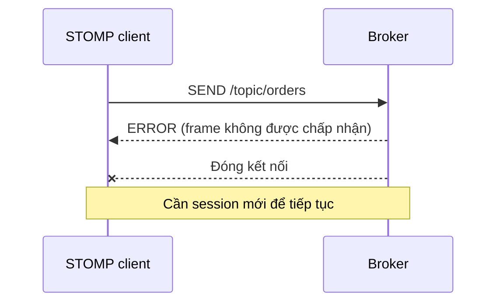
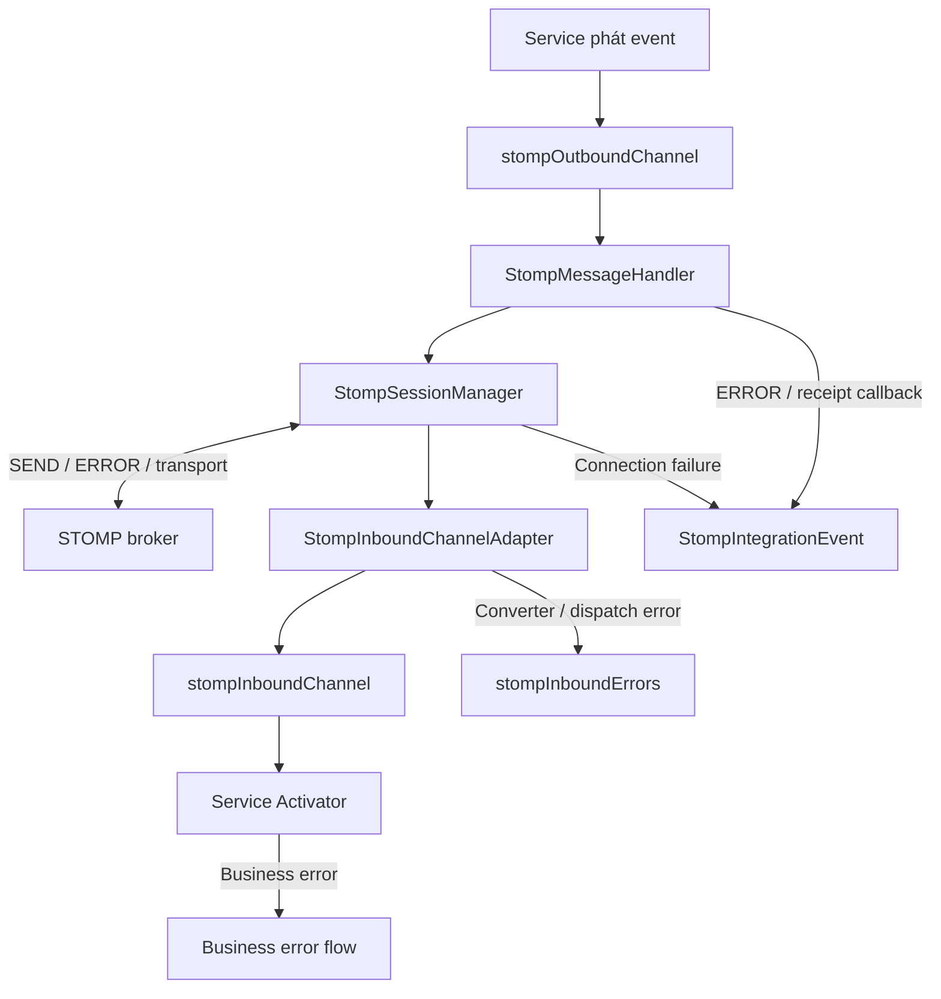
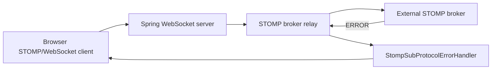
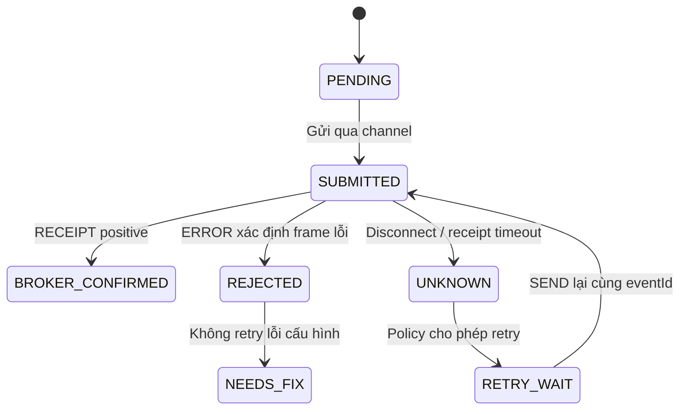

# Xử lý frame lỗi từ broker trong Spring Integration STOMP

## 1. Bài toán: broker trả ERROR sau khi ứng dụng đã gọi send()

Một ứng dụng quản lý đơn hàng dùng `StompMessageHandler` gửi sự kiện `ORDER_CREATED` tới STOMP broker. Lời gọi `MessageChannel.send()` có thể trả về trong khi broker vẫn đang kiểm tra destination, quyền gửi hoặc tính hợp lệ của frame. Sau đó broker trả một frame `ERROR`: chẳng hạn account không có quyền gửi tới `/topic/orders`, thiếu header bắt buộc hoặc không hỗ trợ phiên bản STOMP được đề nghị. Kết nối bị đóng và luồng gửi tiếp theo bắt đầu gặp lỗi session.

Trong module **SPRING_INTEGRATION_ADAPTERS**, các inbound/outbound adapter, gateway, poller và `MessageChannel` kết nối hệ thống ngoài với luồng xử lý Spring. **STOMP outbound adapter** đưa Spring message ra broker, còn **STOMP inbound adapter** nhận các frame `MESSAGE` từ subscription. **Frame `ERROR` không phải message nghiệp vụ thông thường**: nó là tín hiệu lỗi ở tầng giao thức, có thể xuất hiện bất đồng bộ và theo STOMP 1.2 phải được tiếp nối bằng việc đóng kết nối từ phía server.

Bài học tập trung vào **xử lý frame lỗi từ broker** và ranh giới chính xác giữa protocol error, transport error, conversion error và business error. Việc xử lý đúng giúp tránh hai lỗi nghiêm trọng: tự động gửi lại mãi một frame không hợp lệ và coi một lỗi không rõ trạng thái giao message là bằng chứng message chắc chắn chưa đến broker.

**Mục tiêu**

1. Đọc frame `ERROR` theo STOMP 1.2: `message`, `receipt-id`, `content-type`, body và đóng kết nối.
2. Phân biệt `ERROR` với `RECEIPT` timeout, lỗi TCP/WebSocket, lỗi `MessageConverter` và lỗi `ServiceActivator`.
3. Dùng `StompExceptionEvent`, `StompIntegrationEvent`, `StompSessionHandlerAdapter` và error channel đúng phạm vi.
4. Xây cấu hình Spring Integration STOMP inbound/outbound và listener sự kiện để giám sát lỗi bất đồng bộ.
5. Phân loại lỗi vĩnh viễn/tạm thời/không rõ kết quả, áp dụng reconnect, retry có giới hạn, idempotency và outbox.
6. Thiết kế logging an toàn, correlation ID, metrics, kiểm thử lỗi broker và runbook vận hành.

## 2. STOMP ERROR frame trông như thế nào?

STOMP là giao thức theo frame gồm command, headers, dòng trống và body. Một broker có thể gửi:

```text
ERROR
message:destination is not permitted
receipt-id:send-501
content-type:text/plain

Permission denied for requested destination
^@
```

`^@` biểu diễn byte NUL kết thúc frame. Body và các header trên chỉ là **ví dụ minh họa**; văn bản lỗi, mã lỗi, tên destination, nội dung chi tiết và khả năng trả `receipt-id` phụ thuộc broker.

### Các trường và ý nghĩa

| Thành phần | Ví dụ | Điều cần hiểu |
| --- | --- | --- |
| Command `ERROR` | `ERROR` | Server báo lỗi giao thức/xử lý yêu cầu; không phải một frame `MESSAGE` từ subscription. |
| Header `message` | `destination is not permitted` | Mô tả ngắn; **SHOULD** có theo STOMP 1.2 nhưng có thể thiếu. |
| Header `receipt-id` | `send-501` | Có thể liên hệ với header `receipt` của frame client gây lỗi; không phải lúc nào cũng có. |
| Header `content-type` | `text/plain` | Chỉ định dạng body nếu hiện diện; không khẳng định body luôn là text an toàn để log. |
| Header `content-length` | Số byte | Nếu body có NUL, header length phải được dùng theo framing rules. |
| Body | Thông báo chi tiết | Có thể trống hoặc chứa trích đoạn frame gây lỗi, credentials hoặc dữ liệu nhạy cảm. |

**Không có một mã lỗi STOMP chuẩn duy nhất tương đương HTTP status 400/401/403/503.** Broker có thể bổ sung vendor-specific headers hoặc nội dung `message` khác nhau. Logic retry không nên chỉ so chuỗi tiếng Anh “not permitted” hoặc “temporarily unavailable”.

### Ví dụ một ERROR liên quan frame gửi bị từ chối

Client đã phát:

```text
SEND
destination:/topic/orders
receipt:send-501
content-type:application/json

{"eventId":"evt-501","orderId":501}
^@
```

Broker có thể trả `ERROR receipt-id:send-501` để chỉ ra lỗi liên quan frame này. Tuy nhiên **không được suy luận mọi ERROR đều có receipt-id**, hoặc chỉ những frame yêu cầu receipt mới có thể gặp ERROR. `receipt` giúp correlation nhưng không tự tạo cơ chế request-reply nghiệp vụ.

## 3. Quy tắc quan trọng nhất: ERROR thường kết thúc phiên

Theo **STOMP Protocol Specification 1.2**, nếu server gửi frame `ERROR` thì **MUST đóng kết nối ngay sau khi gửi frame**.



Hệ quả thực tế:

1. Không tiếp tục sử dụng `StompSession` cũ để gửi thêm frame sau khi đã nhận ERROR và transport bị đóng.
2. Mọi subscription thuộc session cũ cần được thiết lập lại trên session mới theo lifecycle/reconnect.
3. `StompSessionManager` có thể thử kết nối lại, nhưng **không** biến frame sai thành frame đúng.
4. Các thao tác `SEND` đang bay trên mạng có thể ở trạng thái không rõ đã được broker chấp nhận hay chưa.
5. Client phải quan sát cả **ERROR frame** và **transport disconnect**, không xem một trong hai là đầy đủ mọi trường hợp.

### Connection lingering: có thể không nhìn thấy ERROR

STOMP 1.2 cũng nêu vấn đề server đóng socket quá nhanh sau khi phát frame. Một client có thể **không nhận được ERROR hoặc RECEIPT cuối cùng** dù broker đã cố gửi, vì TCP reset, network failure hoặc frame chưa kịp được client đọc.

```text
Client ---- SEND ----> Broker
Broker ---- ERROR ---> mạng / socket reset
Client chỉ thấy ConnectionLostException
```

**Không thấy ERROR trong log không chứng minh broker không từ chối yêu cầu.** Cần kết hợp trace đã được che thông tin nhạy cảm, log broker, correlation IDs, receipt events và trạng thái session.

## 4. Các nguyên nhân broker có thể gửi ERROR

| Giai đoạn | Ví dụ | Hướng sửa đúng |
| --- | --- | --- |
| `CONNECT` | Sai `login/passcode`, virtual host không hợp lệ | Kiểm tra secret, broker vhost, ACL; không retry nhanh vô hạn cùng credential sai. |
| `CONNECT` | Không có STOMP protocol version chung | Cấu hình `accept-version`/client-broker tương thích. |
| `SEND` | Thiếu `destination` hoặc frame malformed | Sửa producer, codec hoặc header mapping. |
| `SEND` | Không có quyền gửi destination | Sửa broker ACL/route; không tự đổi sang destination rộng hơn để “cho chạy”. |
| `SUBSCRIBE` | Destination không tồn tại/không được phép, thiếu `id` | Kiểm tra broker naming, subscription/ACL và frame. |
| `ACK/NACK` | Sai ACK token theo STOMP 1.2 hoặc dùng sai session | Dùng `MESSAGE.ack` làm `ACK/NACK.id`, kiểm tra subscription mode và phiên. |
| `BEGIN/COMMIT` | Transaction ID sai/không hợp lệ | Sửa luồng STOMP transaction riêng biệt với JDBC. |
| Bất kỳ frame | Frame vượt giới hạn số header/body | Giới hạn payload trước gửi và đúng chính sách broker. |
| Broker quota | Vượt số connection/subscription/pending message | Điều tiết tải, backpressure, quotas; xem mã/headers vendor-specific. |
| Broker nội bộ lỗi | Plugin lỗi, không tạo queue/route | Kiểm tra broker health, policy và phục hồi hạ tầng. |

**Không phải mọi trường hợp trên đều luôn phát sinh frame `ERROR`.** Broker có thể từ chối kết nối ở transport, ngắt ngay socket hoặc đưa ra hành vi riêng ngoài STOMP spec. Quy tắc phân loại cần dựa trên sự kiện quan sát được và contract của broker đang dùng.

### Vì sao không thể phân loại chỉ bằng câu message?

Một broker trả `message:Access denied`; broker khác trả `message:Not authorized`, thậm chí một reverse proxy có thể đóng socket không có frame STOMP. Thông báo dạng text có thể đổi theo version hoặc cấu hình. Nên ưu tiên:

- **Loại thao tác** đang làm (`CONNECT`, `SUBSCRIBE`, `SEND`, `ACK`).
- **Nguồn tín hiệu** (ERROR từ broker, exception transport, receipt timeout, application error).
- **Correlation ID/receipt ID**, destination đã được allowlist, event ID.
- **Mã vendor-specific** khi broker có contract rõ ràng.
- Broker logs/metrics do đội hạ tầng sở hữu.

## 5. ERROR khác các lỗi khác như thế nào?

| Tình huống | Nó biểu thị điều gì? | Cách quan sát ở Spring |
| --- | --- | --- |
| Broker `ERROR` | Broker báo frame/hoạt động không được chấp nhận và chuẩn bị đóng kết nối | `StompSessionHandler.handleFrame` ở client trực tiếp; xử lý ERROR trong `StompMessageHandler`/events của Spring Integration. |
| STOMP `RECEIPT` timeout | Không nhận được frame receipt trong thời hạn | `StompReceiptEvent` hoặc `StompSession.Receiptable` callback, nếu đã yêu cầu receipt. |
| TCP/WebSocket bị ngắt | Kết nối transport lỗi hoặc đóng | `handleTransportError` ở client trực tiếp, manager reconnect/event lỗi. |
| Session `CONNECT` thất bại | Không có phiên STOMP khả dụng | `StompExceptionEvent` của session manager, lỗi kết nối/transport. |
| Conversion/codec exception | Parser không decode frame, converter không tạo payload hợp lệ | `handleException` hoặc callback/error flow theo client/adapter. |
| Handler nghiệp vụ lỗi | JSON/schema sai, DB timeout, service activator ném exception | Spring Integration error channel, downstream retry/quarantine. |
| Business rejection hợp lệ | Đơn hàng bị từ chối do quy tắc nghiệp vụ | Domain event/response riêng, **không cần** trả STOMP ERROR để diễn đạt mọi trường hợp. |

### ERROR và NACK hoàn toàn khác nhau

`NACK` là **frame client gửi** để từ chối một delivery trên subscription `ack:client` hoặc `ack:client-individual`. `ERROR` là **frame server gửi** để thông báo lỗi, thường kéo theo đóng kết nối. Gửi NACK không giống gửi ERROR; broker không bắt buộc trả ERROR mỗi khi consumer NACK.

### ERROR và RECEIPT âm tính không đồng nghĩa

Khi `RECEIPT` bị timeout, một frame có thể đã tới broker nhưng phản hồi bị mất. Khi broker trả `ERROR` có `receipt-id` khớp, client có bằng chứng broker đã báo một lỗi liên quan thao tác đó. **Cả hai vẫn cần xử lý idempotency và trạng thái không rõ ràng** đối với các frame khác đang in-flight trên cùng session.

## 6. Kiến trúc Spring Integration STOMP và đường lỗi



Cần phân biệt ba kênh quan sát:

1. **STOMP protocol/application events:** `StompExceptionEvent` và `StompReceiptEvent` giúp nhận tín hiệu bất đồng bộ từ session manager và outbound handler.
2. **Spring Integration error channel:** nhận `ErrorMessage` khi một endpoint đưa lỗi message dispatch/conversion vào error flow được cấu hình. **Không mặc định** mọi broker ERROR đi vào đây.
3. **Log/metrics từ broker và transport:** hữu ích khi socket đóng trước khi client kịp đọc ERROR.

`StompSessionManager` quản lý **một STOMP session dùng chung** cho inbound/outbound adapters trong cùng application context. Không tạo session manager mới cho mỗi event; mỗi manager không phải một durable queue hay transaction manager.

## 7. Bắt frame ERROR ở Spring Framework STOMP client thuần

Với client trực tiếp (`ReactorNettyTcpStompClient` hoặc `WebSocketStompClient`), Spring Framework dùng `StompSessionHandler`. `StompSessionHandlerAdapter` có:

- `handleFrame(StompHeaders headers, Object payload)`: xử lý **STOMP ERROR frame** ở session handler.
- `handleException(StompSession, StompCommand, StompHeaders, byte[], Throwable)`: exception khi xử lý/decode/convert frame hoặc callback.
- `handleTransportError(StompSession, Throwable)`: lỗi kết nối/network/codec transport.
- `afterConnected(StompSession, StompHeaders)`: session đã nhận `CONNECTED` và có thể thao tác.

### 7.1. Một observer an toàn

```java
import org.springframework.messaging.simp.stomp.StompCommand;
import org.springframework.messaging.simp.stomp.StompHeaders;
import org.springframework.messaging.simp.stomp.StompSession;
import org.springframework.messaging.simp.stomp.StompSessionHandlerAdapter;

public final class BrokerErrorSessionObserver
        extends StompSessionHandlerAdapter {

    @Override
    public void afterConnected(
            StompSession session, StompHeaders connectedHeaders) {
        System.out.println("STOMP session CONNECTED");
    }

    @Override
    public void handleFrame(StompHeaders headers, Object payload) {
        // StompSessionHandlerAdapter xử lý ERROR frame qua method này.
        String reason = headers.getFirst("message");
        String receiptId = headers.getReceiptId();

        // Chỉ log dữ liệu ngắn và đã được sanitise.
        System.err.printf(
            "Broker ERROR: hasMessage=%s, hasReceiptId=%s%n",
            reason != null, receiptId != null
        );
        // TODO: phân loại theo context thao tác, correlation,
        // cập nhật metrics và ngừng gửi vào session cũ.
    }

    @Override
    public void handleException(
            StompSession session,
            StompCommand command,
            StompHeaders headers,
            byte[] payload,
            Throwable exception) {

        System.err.println(
            "STOMP frame processing failure: "
                + exception.getClass().getSimpleName()
        );
        // Không in raw payload/headers một cách không kiểm soát.
    }

    @Override
    public void handleTransportError(
            StompSession session, Throwable exception) {

        System.err.println(
            "STOMP transport failure: "
                + exception.getClass().getSimpleName()
        );
        // TODO: reconnect/recovery theo policy, không reconnect vô hạn nóng.
    }
}
```

`StompSessionHandlerAdapter#getPayloadType(...)` mặc định yêu cầu `String` cho body của STOMP ERROR. Nếu converter/session không hỗ trợ kiểu này, cần cấu hình conversion và kiểm thử phù hợp. `payload` vẫn có thể `null` nếu server không gửi body.

**Cảnh báo bảo mật:** server có thể đưa cả frame gây lỗi vào body của `ERROR`, bao gồm token hoặc dữ liệu khách hàng. Vì vậy không viết `System.err.println(payload)` hay `log.error("headers={}", headers)` trong ứng dụng thật.

### 7.2. Ví dụ tạo client riêng để quan sát ERROR

Đoạn sau dành cho **ứng dụng thử nghiệm dùng Spring Framework STOMP client**, không chạy đồng thời với session manager của các adapter trên cùng client connection:

```java
import org.springframework.messaging.converter.StringMessageConverter;
import org.springframework.messaging.simp.stomp.ReactorNettyTcpStompClient;
import org.springframework.scheduling.concurrent.ThreadPoolTaskScheduler;

ThreadPoolTaskScheduler scheduler = new ThreadPoolTaskScheduler();
scheduler.setPoolSize(1);
scheduler.initialize();

ReactorNettyTcpStompClient client =
    new ReactorNettyTcpStompClient("127.0.0.1", 61613);
client.setMessageConverter(new StringMessageConverter());
client.setTaskScheduler(scheduler);

client.connectAsync(new BrokerErrorSessionObserver())
    .whenComplete((session, error) -> {
        if (error != null) {
            System.err.println(
                "CONNECT failed: " + error.getClass().getSimpleName()
            );
        }
    });
```

Đây là snippet để đặt trong một thành phần có lifecycle thực tế, không phải một class Java top-level hoàn chỉnh. Production cần quản lý `scheduler`/`client.shutdown()` và reconnect, tránh tạo scheduler mới mỗi lần nhận frame. Nếu broker chỉ bật WebSocket, cần dùng `WebSocketStompClient` với handshake URL `ws(s)://` tương ứng.

### Lỗi trước CONNECTED

Không phải mọi lỗi connect đều có một `StompSession` để callback `handleFrame` nhận ERROR. Nếu broker từ chối TCP/TLS, trả frame chưa kịp đọc hoặc kết nối không hoàn tất, `connectAsync(...)` có thể hoàn tất thất bại và/hoặc `handleTransportError` được gọi. Vì vậy phải theo dõi **cả future kết nối** và các callbacks; không chỉ đặt breakpoint ở `handleFrame`.

## 8. Spring Integration: StompExceptionEvent và StompReceiptEvent

Spring Integration phát **`StompIntegrationEvent`** qua Spring application event mechanism để báo các hoạt động bất đồng bộ.

Theo reference:

- `AbstractStompSessionManager` phát **`StompExceptionEvent`** khi kết nối với broker thất bại.
- `StompMessageHandler` xử lý frame **`ERROR`** trả về đối với các outbound messages bị broker từ chối.
- `StompMessageHandler` phát **`StompReceiptEvent`** cho callback `StompSession.Receiptable` khi có yêu cầu receipt, với trạng thái nhận được hoặc mất receipt.

Điểm thiết kế: **không phải mọi event ERROR đều được gắn vào một Spring `Message<?>` nghiệp vụ vừa được gửi**. Lỗi có thể đến sau khi caller đã rời call stack.

### 8.1. Listener nhận sự kiện STOMP

```java
import org.springframework.context.event.EventListener;
import org.springframework.integration.stomp.event.StompExceptionEvent;
import org.springframework.integration.stomp.event.StompReceiptEvent;
import org.springframework.stereotype.Component;

@Component
public class StompProtocolEvents {

    @EventListener
    public void onException(StompExceptionEvent event) {
        Throwable cause = event.getCause();
        String causeType =
            cause == null ? "unknown" : cause.getClass().getSimpleName();

        System.err.printf(
            "STOMP exception event; causeType=%s%n", causeType
        );
        // TODO: metric + correlation từ ngữ cảnh đã tin cậy.
    }

    @EventListener
    public void onReceipt(StompReceiptEvent event) {
        System.out.println("STOMP receipt callback event observed");
        // TODO: phân loại successful/lost receipt
        // theo API phiên bản sử dụng và lưu trạng thái gửi.
    }
}
```

`StompExceptionEvent#getCause()` là API kế thừa từ `IntegrationEvent`. Với `StompReceiptEvent`, ví dụ cố ý không đoán tên getter của phiên bản đang dùng; ứng dụng thật phải đọc Javadoc để lấy receipt ID/trạng thái dương-âm và liên hệ vào pending-send registry.

### 8.2. Vì sao @EventListener không thay transaction?

Spring application events là tín hiệu **trong process**, không phải log giao dịch bền vững. Nếu process crash, event đang đợi hoặc chưa được xử lý có thể mất. Nếu gửi STOMP là bước quan trọng, lưu **outbox/pending-send state** trong DB rồi dùng event listener cho alert/metrics; không dùng listener làm nguồn duy nhất quyết định event đã được gửi hay chưa.

## 9. Cấu hình Java: một STOMP session manager cho inbound và outbound

Ví dụ dùng Spring Boot + Spring Integration, STOMP/TCP broker thử nghiệm ở `127.0.0.1:61613`, một outbound handler gửi `/topic/orders` và một inbound adapter subscribe `/topic/order-status`.

### 9.1. Dependencies

```xml
<dependencies>
    <dependency>
        <groupId>org.springframework.boot</groupId>
        <artifactId>spring-boot-starter-integration</artifactId>
    </dependency>
    <dependency>
        <groupId>org.springframework.integration</groupId>
        <artifactId>spring-integration-stomp</artifactId>
    </dependency>
    <dependency>
        <groupId>io.projectreactor.netty</groupId>
        <artifactId>reactor-netty</artifactId>
    </dependency>
</dependencies>
```

Dùng BOM quản lý các version tương thích. Cổng `61613` chỉ là giá trị thường thấy trong ví dụ STOMP/TCP; broker phải bật listener và ACL tương ứng.

### 9.2. Beans và channels

```java
import org.springframework.beans.factory.annotation.Qualifier;
import org.springframework.context.annotation.Bean;
import org.springframework.context.annotation.Configuration;
import org.springframework.integration.annotation.ServiceActivator;
import org.springframework.integration.channel.DirectChannel;
import org.springframework.integration.config.EnableIntegration;
import org.springframework.integration.stomp.ReactorNettyTcpStompSessionManager;
import org.springframework.integration.stomp.StompSessionManager;
import org.springframework.integration.stomp.inbound.StompInboundChannelAdapter;
import org.springframework.integration.stomp.outbound.StompMessageHandler;
import org.springframework.integration.support.converter.PassThruMessageConverter;
import org.springframework.messaging.Message;
import org.springframework.messaging.MessageChannel;
import org.springframework.messaging.MessageHandler;
import org.springframework.messaging.support.ErrorMessage;
import org.springframework.messaging.simp.stomp.ReactorNettyTcpStompClient;
import org.springframework.scheduling.concurrent.ThreadPoolTaskScheduler;

@Configuration
@EnableIntegration
public class StompBrokerErrorConfiguration {

    @Bean
    public ThreadPoolTaskScheduler stompScheduler() {
        ThreadPoolTaskScheduler scheduler = new ThreadPoolTaskScheduler();
        scheduler.setPoolSize(2);
        scheduler.setThreadNamePrefix("stomp-session-");
        return scheduler;
    }

    @Bean
    public ReactorNettyTcpStompClient stompClient(
            ThreadPoolTaskScheduler stompScheduler) {

        ReactorNettyTcpStompClient client =
            new ReactorNettyTcpStompClient("127.0.0.1", 61613);
        client.setTaskScheduler(stompScheduler);
        client.setMessageConverter(new PassThruMessageConverter());
        client.setReceiptTimeLimit(5_000);
        return client;
    }

    @Bean
    public ReactorNettyTcpStompSessionManager stompSessionManager(
            ReactorNettyTcpStompClient stompClient) {

        ReactorNettyTcpStompSessionManager manager =
            new ReactorNettyTcpStompSessionManager(stompClient);
        manager.setRecoveryInterval(5_000);
        manager.setAutoReceipt(true);
        return manager;
    }

    @Bean
    public MessageChannel stompOutboundChannel() {
        return new DirectChannel();
    }

    @Bean
    public MessageChannel stompInboundChannel() {
        return new DirectChannel();
    }

    @Bean
    public MessageChannel stompInboundErrors() {
        return new DirectChannel();
    }

    @Bean
    @ServiceActivator(inputChannel = "stompOutboundChannel")
    public MessageHandler stompOutboundHandler(
            StompSessionManager stompSessionManager) {

        StompMessageHandler handler =
            new StompMessageHandler(stompSessionManager);
        handler.setDestination("/topic/orders");
        handler.setConnectTimeout(10_000);
        return handler;
    }

    @Bean
    public StompInboundChannelAdapter stompInboundAdapter(
            StompSessionManager stompSessionManager,
            @Qualifier("stompInboundChannel") MessageChannel output,
            @Qualifier("stompInboundErrors") MessageChannel errors) {

        StompInboundChannelAdapter adapter =
            new StompInboundChannelAdapter(
                stompSessionManager, "/topic/order-status"
            );
        adapter.setOutputChannel(output);
        adapter.setErrorChannel(errors);
        adapter.setPayloadType(String.class);
        return adapter;
    }

    @ServiceActivator(inputChannel = "stompInboundChannel")
    public void onStatus(Message<?> message) {
        System.out.printf(
            "Received status; springMessageId=%s%n",
            message.getHeaders().getId()
        );
        // TODO: validate payload/schema, idempotency and DB transaction.
    }

    @ServiceActivator(inputChannel = "stompInboundErrors")
    public void onInboundProcessingError(ErrorMessage error) {
        System.err.println(
            "Inbound dispatch error: "
                + error.getPayload().getClass().getSimpleName()
        );
        // TODO: metrics/quarantine theo loại lỗi.
    }
}
```

**Lưu ý quan trọng:**

- Bean `stompInboundErrors` được cấu hình cho lỗi ở **đường inbound producer/dispatch**. Nó **không thay thế `StompExceptionEvent` hoặc callback broker `ERROR` của outbound handler**.
- `StompMessageHandler` là endpoint **outbound**, không phải Spring Integration gateway request-reply; một broker ERROR có thể tới bất đồng bộ sau khi handler đã gửi.
- `setAutoReceipt(true)` yêu cầu receipt cho thao tác hỗ trợ; `setReceiptTimeLimit(5_000)` quy định timeout **khi có receipt được yêu cầu**.
- `setRecoveryInterval(5_000)` dành cho retry **thiết lập session**, không phải retry một payload bị broker từ chối vì sai destination.
- `setConnectTimeout(10_000)` giới hạn chờ session của outbound handler; cần lớn hơn recovery interval theo contract API.
- `PassThruMessageConverter` thuộc tầng STOMP client; không tự deserialize JSON thành một DTO hợp lệ.

### 9.3. Gửi event qua outbound channel

```java
import org.springframework.beans.factory.annotation.Qualifier;
import org.springframework.messaging.MessageChannel;
import org.springframework.messaging.support.MessageBuilder;
import org.springframework.stereotype.Service;

@Service
public class OrderEventPublisher {

    private final MessageChannel channel;

    public OrderEventPublisher(
            @Qualifier("stompOutboundChannel") MessageChannel channel) {
        this.channel = channel;
    }

    public void publishJson(String validatedJson, String eventId) {
        if (eventId == null || eventId.isBlank()) {
            throw new IllegalArgumentException("Missing eventId");
        }

        boolean accepted = channel.send(
            MessageBuilder.withPayload(validatedJson).build()
        );

        if (!accepted) {
            throw new IllegalStateException(
                "Outbound channel rejected event"
            );
        }

        // Chỉ có nghĩa Spring channel đã chấp nhận theo topology.
        // Broker receipt và business commit cần theo dõi riêng.
    }
}
```

`validatedJson` và `eventId` phải được ứng dụng tạo/validate từ hợp đồng đáng tin, không lấy raw text chưa xác thực rồi gửi bừa tới broker. Trong code demo, `eventId` chưa được mang sang message body/headers; production cần bảo đảm nó nằm trong **envelope** bền vững để dùng trong retry và idempotency, không chỉ truyền vào method.

### Đừng coi send() thành công là có thể xóa outbox

Trong topology `DirectChannel`, `send()` có thể gọi handler đồng bộ; tuy nhiên sau khi method trả về, broker vẫn có thể từ chối `SEND` và phát `ERROR`. Nếu sử dụng `ExecutorChannel`, `send()` càng có thể chỉ là xác nhận đã enqueue công việc. Chỉ xóa outbox khi đã đạt **mốc xác nhận do contract của hệ thống định nghĩa**, chẳng hạn broker receipt nếu broker hỗ trợ và lưu trạng thái thành công phù hợp; vẫn phải chấp nhận khả năng retry gây trùng.

## 10. Error channel không phải kênh chứa mọi frame ERROR

Spring Integration có khái niệm `errorChannel` dùng để chuyển `ErrorMessage` khi một message producer/endpoint phát sinh lỗi và error handling được cấu hình. Ví dụ inbound có thể thất bại khi convert payload hoặc gửi Spring message vào `DirectChannel`, khiến error channel nhận một `ErrorMessage`.

**Nhưng broker `ERROR` là frame giao thức**, thường đến theo callback của STOMP session, độc lập với lời gọi Java đã tạo yêu cầu. Không có quy tắc chung nói rằng “mọi frame ERROR đều tự xuất hiện ở `stompInboundErrors`”.

```text
Broker -> STOMP ERROR -> Session callback / integration event

Broker -> STOMP MESSAGE -> Inbound adapter -> MessageChannel
                                  |
                                  +-- Processing failure -> ErrorMessage
```

| Câu hỏi | Kiểm tra |
| --- | --- |
| Broker có từ chối SEND không? | STOMP ERROR event, broker logs, receipt/correlation. |
| Inbound adapter đã nhận MESSAGE chưa? | Frame counter, subscription, output channel metrics. |
| Payload đã được convert thành Spring Message chưa? | Converter/mapper errors. |
| Handler có ném exception không? | ErrorMessage/error channel và downstream logs. |
| DB đã commit chưa? | Transaction outcome, idempotency store, business metrics. |

### DirectChannel và ExecutorChannel khác nhau

`DirectChannel` gọi subscriber **đồng bộ** trong thread gửi message. Nếu một downstream handler ném exception, nó có thể quay ngược vào adapter/producer và được xử lý theo error flow tương ứng.

`ExecutorChannel` tạo **ranh giới bất đồng bộ**: message có thể đã được channel nhận nhưng worker chưa commit DB. Lỗi trong worker cần error flow **ở phía worker**, không nên đợi `StompMessageHandler` hay inbound adapter tự biết kết quả.

Không dùng broker ERROR để báo cho client mọi lỗi business validation: nếu ứng dụng đang làm **Spring WebSocket STOMP server**, các lỗi nghiệp vụ có thể được trả qua application response/error destination phù hợp thay vì bắt toàn bộ connection bị đóng vì một frame ERROR.

## 11. Xử lý lỗi ở Spring WebSocket broker relay là một topology khác

Trong một ứng dụng `@EnableWebSocketMessageBroker` có `enableStompBrokerRelay(...)`, WebSocket clients kết nối tới **Spring server**, còn broker relay nối TCP tới external broker. Spring Framework cung cấp `StompSubProtocolErrorHandler` để tùy biến frame ERROR **phát từ server/relay về WebSocket client**.



Hai method chính:

- `handleClientMessageProcessingError(Message<byte[]> clientMessage, Throwable ex)`: tạo hoặc chặn ERROR khi server không xử lý được message đến từ client.
- `handleErrorMessageToClient(Message<byte[]> errorMessage)`: chỉnh hoặc chặn message ERROR mà server/relay định gửi về client, kể cả lỗi từ broker ngoài.

Theo STOMP, nếu **đã phát ERROR frame**, connection phải được đóng. Nếu không muốn làm mất session cho một lỗi nghiệp vụ recoverable, một error handler có thể chọn **không gửi ERROR** (trả `null`) và thông báo bằng một application destination khác theo cơ chế đáng tin cậy phù hợp.

### Cảnh báo khi dùng error handler của server

Không nên lọc mọi frame ERROR để “giữ WebSocket online” mà không quản lý trạng thái broker connection thực tế. Khi broker đã đóng session do vi phạm giao thức, một handler trả `null` cho frame gửi tới browser **không tự hồi sinh phiên broker bị lỗi**.

Một application error payload nên có cấu trúc đã kiểm soát, ví dụ:

```json
{
  "errorCode": "ORDER_VALIDATION_FAILED",
  "requestId": "req-501",
  "retryable": false
}
```

Đây là **schema nghiệp vụ**, không phải standard body của STOMP `ERROR`. Cần tránh đưa internal exception stacktrace, SQL, broker credentials hoặc nội dung đơn hàng nhạy cảm ra client.

## 12. Correlation: liên kết SEND, receipt và lỗi

Một yêu cầu cần truy vết từ lúc phát tới lúc biết kết quả:

```text
businessEventId = evt-501
outboxRecordId  = outbox-991
stompDestination = /topic/orders
stompReceiptId  = send-501
sessionGeneration = 17

SEND receipt:send-501
       |
       +-> RECEIPT receipt-id:send-501
       |
       +-> ERROR receipt-id:send-501
       |
       +-> Disconnect / timeout, trạng thái chưa xác định
```

| Định danh | Dùng cho | Không nên dùng thay |
| --- | --- | --- |
| `eventId` | Khóa nghiệp vụ ổn định qua retry/redelivery | STOMP receipt id trong từng lần gửi |
| `receipt` / `receipt-id` | Correlation của một thao tác STOMP yêu cầu receipt | Business transaction id hoặc ACK sau DB commit |
| `StompSession` / connection generation | Biết phiên nào thực hiện thao tác | Event ID bền vững |
| `MessageHeaders.ID` | Trace Spring message trong process | Broker message-id hoặc event ID |
| Broker `message-id` | Nhận diện frame MESSAGE do broker giao | STOMP `ACK.id` trong 1.2 nếu frame có token `ack` khác |

**Không có bảo đảm ERROR luôn mang receipt-id**; nếu broker đã đóng connection trước khi response tới client, cũng không có event để match. Pending-send registry phải có trạng thái **UNKNOWN** và deadline, thay vì kết luận mọi timeout là `NOT_SENT`.

### Trạng thái phát event minh họa



Đây là state machine **do ứng dụng thiết kế**, không phải API Spring Integration dựng sẵn. Một số broker có thể xác nhận receipt nhưng không bảo đảm retention cho subscriber; `BROKER_CONFIRMED` vẫn **khác** `BUSINESS_COMMITTED`.

## 13. Phân loại lỗi và chính sách retry an toàn

| Nhóm lỗi | Ví dụ | Retry tức thì? | Hướng xử lý |
| --- | --- | --- | --- |
| **Cấu hình vĩnh viễn** | Sai username/password, vhost, destination, STOMP version | **Không** | Dừng/giảm gửi, cảnh báo, sửa config/ACL rồi triển khai lại. |
| **Payload vĩnh viễn** | JSON sai schema, thiếu header, frame vượt limit | **Không** | Validate trước gửi, quarantine/DLQ và sửa publisher. |
| **Hạ tầng tạm thời** | Broker unavailable, network timeout, khởi động lại | **Không retry nóng** | Reconnect theo manager, retry có giới hạn/backoff, theo dõi quota. |
| **Không rõ đã gửi** | Mất connection trước receipt, response thất lạc | Retry cẩn trọng | Cùng event ID, consumer idempotent, tra trạng thái/đối soát. |
| **Business rejection** | Đơn hàng đã hủy hoặc không được phép | Không dùng ERROR làm retry signal mặc định | Business response/quarantine theo quy trình nghiệp vụ. |
| **Downstream worker lỗi** | DB deadlock, handler async thất bại | Theo business retry policy | Error flow worker, idempotency và commit checkpoint. |

### Không tạo vòng lặp reconnect + replay payload lỗi

```text
SEND sai destination
   -> Broker ERROR
   -> Broker close connection
   -> Session manager reconnect
   -> Application tự gửi lại frame sai
   -> Broker ERROR
   -> ...
```

Nếu không phân loại lỗi, hệ thống có thể tự tạo **reconnect storm**, làm broker quá tải, tăng log và khóa tài khoản. Với credential/ACL sai, phải sửa cấu hình hoặc quyền; reconnect nhanh hơn không giải quyết nguyên nhân.

### Có cần circuit breaker?

Khi broker lỗi kéo dài, nên có chính sách giới hạn tốc độ publish, bounded queue, retry budget, backoff/circuit breaker tại **lớp gửi nghiệp vụ**. `setRecoveryInterval(...)` của `StompSessionManager` chỉ quản lý khoảng reconnect; không phải circuit breaker cho từng event và không tự thêm jitter/backoff lũy tiến.

## 14. Transaction, ACK và thông điệp đã commit

Giả sử một service cập nhật DB và gửi STOMP `SEND` trong cùng method:

```text
BEGIN JDBC
  -> UPDATE orders
  -> SEND STOMP event
COMMIT JDBC
```

Transaction JDBC không tự bao trùm broker. Trường hợp broker trả `ERROR` vì thiếu quyền sau khi DB commit sẽ khiến đơn hàng đã đổi nhưng sự kiện không được phát. Ngược lại, broker nhận sự kiện trước khi DB rollback cũng có thể gây sai lệch.

**Transactional outbox** là một cách giảm rủi ro:

1. Ghi cập nhật đơn hàng và outbox event có `eventId` bền vững trong **một transaction DB**.
2. Worker đọc event chưa phát, gửi qua `StompMessageHandler`.
3. Theo dõi kết quả gửi theo receipt/correlation (nếu hỗ trợ) và error events.
4. Với trạng thái chưa chắc chắn, retry cùng `eventId` theo hạn mức/đối soát.
5. Consumer phải idempotent vì broker có thể đã nhận bản gửi đầu trước khi client mất receipt.

**STOMP ERROR không phải ACK/NACK của một delivery inbound.** Trong STOMP 1.2, manual ACK dùng `MESSAGE.ack` làm `ACK/NACK.id` trên một subscription có `ack:client` hoặc `ack:client-individual`. Lỗi business/DB sau khi nhận message không tự tạo broker ERROR; cần quyết định ACK/NACK hoặc error flow theo hợp đồng delivery.

### Receipt của SEND không xác nhận DB consumer

Một `RECEIPT` được broker trả sau `SEND` có ý nghĩa broker đã xử lý frame theo STOMP, nhưng **không chứng minh** subscriber đã commit DB. Nếu yêu cầu ack nghiệp vụ, cần một message phản hồi riêng, trạng thái trong DB hoặc API reconciliation.

## 15. Lỗi payload/headers và giới hạn tài nguyên

Một broker có thể từ chối:

- Frame có header thiếu/sai cú pháp.
- Header quá dài hoặc quá nhiều.
- Body vượt kích thước cho phép.
- `content-length` không đúng số **byte** của payload.
- Binary body chứa NUL nhưng framing không hợp lệ.
- Content-type/encoding không phù hợp converter hoặc policy của broker.
- Destination không nằm trong allowlist hoặc user không có quyền.

### Validate trước khi gửi

```java
import java.nio.charset.StandardCharsets;

public final class StompPayloadGuard {

    private static final int MAX_BYTES = 64 * 1024;

    public static void validate(String json) {
        if (json == null || json.isBlank()) {
            throw new IllegalArgumentException("Empty event payload");
        }

        int bodyBytes = json.getBytes(StandardCharsets.UTF_8).length;
        if (bodyBytes > MAX_BYTES) {
            throw new IllegalArgumentException("Event body too large");
        }
    }
}
```

Đây chỉ là **bộ kiểm tra kích thước của ứng dụng**. Nó chưa bảo đảm JSON schema đúng, headers hợp lệ hoặc broker limit tương ứng. Việc giới hạn frame thật cần cấu hình ở transport/client/broker và có thể khác nhau giữa STOMP/TCP và STOMP-over-WebSocket.

Không dùng `String.length()` làm `content-length`: STOMP tính **byte length**. Framework STOMP codec thường đảm nhận framing; không tự dựng frame trừ khi triển khai protocol client riêng.

## 16. Logging và bảo vệ dữ liệu khi broker báo ERROR

Body ERROR có thể bao gồm **bản sao frame lỗi**, ví dụ payload chứa PII, token, SQL hoặc thông tin tài khoản. Headers hoặc stacktrace của exception có thể có `login`/`passcode` hoặc credentials vận hành. Vì vậy:

1. Không log raw `ERROR` body/headers theo mặc định.
2. Không ghi `StompHeaders.toString()` hoặc toàn bộ Spring `Message<?>` vào log sản xuất nếu chưa kiểm tra masking.
3. Log **nhóm lỗi**, protocol command, destination đã allowlist, instance ID, correlation ID và status session — không log secret.
4. Chỉ lưu raw frame lỗi vào kho quarantine có mã hóa, quyền truy cập hạn chế, retention và audit rõ ràng khi thật sự cần.
5. Chuẩn hóa/khoanh vùng các ký tự điều khiển CR/LF trong broker `message` để tránh log injection.
6. Giới hạn độ dài/error-event rate; nếu broker lỗi liên tục, tránh tạo log storm.
7. Tránh gửi nguyên exception từ broker về browser nếu Spring WebSocket server đang làm broker relay.

### Sự kiện không đáng tin cậy

Ngay cả khi thông báo đến từ broker nội bộ, nội dung lỗi có thể chứa phần **payload/header do publisher bên ngoài đưa vào**. Hãy coi nó là dữ liệu cần sanitization, không phải chỉ dẫn thao tác. Không sử dụng chuỗi error message như script/SQL/command cần chạy tự động.

### Ví dụ log có kiểm soát

```text
2026-11-23T02:00:00Z level=ERROR component=stomp-outbound
category=ACL_DENIED destination=/topic/orders
receiptCorrelation=send-501 sessionState=DISCONNECTED
eventId=evt-501 action=NEEDS_OPERATOR_FIX
```

Đây là log minh họa với các trường được **ứng dụng tự xây** sau khi phân loại; STOMP broker không mặc nhiên phát `category=ACL_DENIED`.

## 17. Monitoring, cảnh báo và runbook

### 17.1. Chỉ số nên thu thập

| Metric | Ý nghĩa |
| --- | --- |
| Số STOMP `ERROR` theo nhóm/nguyên nhân | Phát hiện broker reject frame; cần lưu phiên/command liên quan nếu có. |
| Số `StompExceptionEvent` | Theo dõi lỗi kết nối/session. |
| `isRunning()`, `isConnected()` của manager | Phân biệt lifecycle với trạng thái session. |
| CONNECT failures / reconnect attempts | Phát hiện auth/network/broker outage. |
| Receipt positive/negative/timeout | Theo dõi khả năng xác nhận thao tác STOMP. |
| Outbox pending/unknown/failed age | Nhìn thấy event chưa phát thành công theo contract. |
| Business commit vs broker receipt | Tách độ tin cậy giao thức khỏi outcome nghiệp vụ. |
| Subscription active / last MESSAGE | Xác minh inbound sau reconnect. |
| Error-channel messages / DLQ count | Đo lỗi converter và downstream handler. |
| Queue depth/executor saturation | Phát hiện backpressure, tránh ngập broker khi recovery. |

### 17.2. Runbook theo thứ tự chẩn đoán

1. **Xác định điểm xảy ra lỗi:** CONNECT, SUBSCRIBE, SEND, ACK/NACK hay handler sau adapter.
2. **Kiểm tra trạng thái session:** running/connected, thời điểm disconnect, reconnect attempts.
3. **Xác định tín hiệu có/không có:** broker ERROR, negative receipt, transport error, business error channel.
4. **Khớp correlation:** `receipt-id` nếu có, event ID/outbox ID, destination allowlist và phiên.
5. **Đọc broker logs** trong phạm vi quyền quản trị, che thông tin nhạy cảm.
6. **Phân loại nguyên nhân:** cấu hình vĩnh viễn, schema, ACL, network tạm thời hoặc trạng thái gửi chưa rõ.
7. **Chọn hành động:** sửa cấu hình/quyền, quarantine, reconnect có kiểm soát, retry theo hạn mức, hoặc đối soát.
8. **Theo dõi phục hồi:** subscription sau reconnect, backlog, duplicate events và consumer business commit.
9. **Ghi incident timeline** từ Spring app + broker + DB, không kết luận chỉ từ một log line.

### 17.3. Cảnh báo nào cần ưu tiên?

- Lỗi broker `ERROR` tăng đột biến, nhất là `CONNECT`/`SUBSCRIBE`.
- Reconnect storm hoặc số session connected gần bằng 0.
- Outbox event tuổi cao, hàng đợi gửi bù tăng.
- Receipt timeout tăng kéo dài, không có broker confirmation.
- Broker ACL/config drift khiến event không thể gửi.
- Lỗi có thể làm lộ data giữa tenants/destinations hoặc credentials trong log.

Không nên restart toàn bộ ứng dụng chỉ vì một message `ERROR` do payload sai; phải phân loại để tránh restart loop và mất thêm công việc in-flight.

## 18. Kịch bản kiểm thử tích hợp broker

Chỉ dùng **broker thử nghiệm** với account/destination riêng. STOMP `ERROR` thường kéo theo đóng kết nối nên cần reset/reconnect sau mỗi case.

| Case | Tác động | Kết quả cần xác minh |
| --- | --- | --- |
| 1. Baseline | Kết nối đúng credential, SEND hợp lệ | Có CONNECTED; không có ERROR; receiver nhận event. |
| 2. Sai login | CONNECT với password sai | Có lỗi connect, có thể nhận ERROR hoặc chỉ transport close; không retry nóng vô hạn. |
| 3. Sai vhost | CONNECT có host không hợp lệ | Broker từ chối, metrics phân loại cấu hình. |
| 4. Sai version | Đề nghị protocol version không hỗ trợ | Broker phản hồi ERROR khi tuân thủ spec; session không CONNECTED. |
| 5. Thiếu destination | Gửi frame SEND malformed từ client test có kiểm soát | ERROR rồi close theo STOMP 1.2; không lặp thử nghiệm trên session cũ. |
| 6. Sai ACL SEND | Account không có quyền destination | Broker reject; correlation/alert đúng, không auto retry mãi. |
| 7. Sai ACL SUBSCRIBE | Không được phép subscribe topic | ERROR hoặc close; sau reconnect không có subscription giả thành công. |
| 8. ACK sai token | Manual ACK không khớp `MESSAGE.ack` | Broker xử lý lỗi theo contract; không coi business commit là broker ACK. |
| 9. Receipt timeout | Mất reply giữa broker và client | Pending event thành UNKNOWN, retry idempotent, không kết luận NOT_SENT. |
| 10. ERROR bị mất do reset | Broker đóng quá nhanh sau ERROR | Client vẫn phát hiện transport failure, không phụ thuộc chỉ handleFrame. |
| 11. Conversion failure | Broker gửi JSON malformed tới inbound | Downstream error flow/quarantine; không nhầm broker ERROR. |
| 12. Handler async thất bại | Dùng `ExecutorChannel` và cho worker lỗi | Error flow downstream nhận lỗi, không coi outbound ERR event. |
| 13. Reconnect | Broker restart sau ERROR | Manager kết nối lại, destinations được subscribe đúng, không tự phát lại payload sai. |
| 14. Poison payload | Gửi message vượt contract | Validate/quarantine, retry budget, không log raw PII. |
| 15. Nhiều replica | Cùng broker reject do ACL/config | Giới hạn bão reconnect, metrics theo instance và broker. |

Trong test lỗi frame malformed, nên dùng **STOMP test client thô hoặc công cụ hỗ trợ gửi frame tùy chỉnh**, không sửa encoder production chỉ để tạo lỗi. Tránh dùng dữ liệu thật hoặc ngắt broker production để “kiểm chứng”.

### Checklist chứng minh recovery

```text
[ ] Xác định lỗi đến từ ERROR, transport, receipt hay business handler
[ ] Phân loại lỗi vĩnh viễn/tạm thời/không rõ kết quả
[ ] Không log nguyên broker frame hoặc thông tin bí mật
[ ] Khi ERROR, session cũ được coi không còn dùng được
[ ] Reconnect có giới hạn và có quan sát
[ ] Subscription đã được đăng ký lại và broker chấp thuận
[ ] Pending SEND có eventId và trạng thái durable
[ ] Retry không phát sinh nghiệp vụ trùng nhờ idempotency
[ ] Đã đo backlog, receipt timeouts và business commit
[ ] Có alert và runbook cho auth/ACL/config drift
```

## 19. Bài tập có đáp án

**Bài 1 — Semantics.** Theo STOMP 1.2, broker phải làm gì sau khi gửi frame `ERROR`?

**Đáp án:** Đóng connection ngay sau khi gửi ERROR. Client không nên tiếp tục gửi bằng session cũ.

**Bài 2 — Header.** Frame ERROR bắt buộc phải có `message` hoặc `receipt-id` không?

**Đáp án:** Không. `message` là SHOULD, `receipt-id` là tùy trường hợp và thường giúp correlation nếu frame gây lỗi có `receipt`.

**Bài 3 — Không thấy ERROR.** Client chỉ nhận `ConnectionLostException`. Có kết luận broker không hề trả ERROR được không?

**Đáp án:** Không. Broker có thể đóng socket trước khi client đọc kịp ERROR; cũng có thể lỗi transport trước khi broker tạo frame.

**Bài 4 — Xác định nguồn lỗi.** Handler Java parse JSON thất bại sau khi nhận `MESSAGE`. Đó có nhất thiết là broker ERROR không?

**Đáp án:** Không. Đây là conversion/business error; xử lý qua error flow downstream, không mặc định broker đã phát ERROR.

**Bài 5 — NACK.** `NACK` và `ERROR` đều do broker gửi để báo lỗi?

**Đáp án:** Không. `NACK` do consumer gửi để từ chối delivery trong manual-ack mode; `ERROR` do server gửi và yêu cầu đóng connection.

**Bài 6 — Receipt timeout.** Không nhận `RECEIPT` sau một `SEND`, chắc chắn broker chưa nhận payload?

**Đáp án:** Không. Receipt có thể thất lạc dù SEND đã được broker chấp nhận; trạng thái có thể UNKNOWN.

**Bài 7 — Correlation.** `ERROR.receipt-id=send-501` nên được so với trường nào?

**Đáp án:** Với `receipt` của frame client `SEND`/`SUBSCRIBE` tương ứng, nếu tồn tại; không phải business eventId mặc định.

**Bài 8 — API callback.** Spring Framework callback nào của `StompSessionHandlerAdapter` được dùng để nhận ERROR frame?

**Đáp án:** `handleFrame(StompHeaders, Object)`; phân biệt `handleException` cho lỗi xử lý frame và `handleTransportError` cho lỗi transport.

**Bài 9 — Integration event.** `AbstractStompSessionManager` có thể phát event nào khi kết nối broker thất bại?

**Đáp án:** `StompExceptionEvent`.

**Bài 10 — Error channel.** Cấu hình `adapter.setErrorChannel(errors)` có bảo đảm mọi STOMP ERROR outbound đi tới channel đó?

**Đáp án:** Không. Nó dành cho lỗi endpoint/message producer tương ứng; protocol ERROR và receipt của outbound cần quan sát qua session callbacks/events.

**Bài 11 — Recovery.** Thấy ERROR do sai password, có nên giảm `recoveryInterval` từ 5 giây xuống 100 ms để nhanh khỏi?

**Đáp án:** Không. Cần sửa credential/configuration và giới hạn reconnect; retry nóng có thể gây bão lỗi.

**Bài 12 — Lỗi không rõ kết quả.** Broker đóng kết nối giữa nhiều `SEND` không có receipt. Có thể đánh dấu tất cả là `NOT_SENT`?

**Đáp án:** Không. Một số frame có thể đã đến broker; phải giữ trạng thái UNKNOWN và idempotent retry/đối soát.

**Bài 13 — Browser.** Trả STOMP ERROR cho mọi lỗi validate của `@MessageMapping` có hệ quả gì?

**Đáp án:** Theo giao thức, ERROR kéo theo đóng connection; với lỗi nghiệp vụ recoverable, nên cân nhắc application error message riêng.

**Bài 14 — WebSocket relay.** `StompSubProtocolErrorHandler` có giúp tùy biến lỗi phát về WebSocket client không?

**Đáp án:** Có. Nó có hooks cho client-processing errors và broker relay error messages; nhưng trả `null` không sửa phiên broker đã hỏng.

**Bài 15 — Idempotency.** Lỗi transport sau khi broker đã nhận SEND nhưng client chưa nhận receipt có thể tạo trùng khi retry?

**Đáp án:** Có. Dùng eventId ổn định, consumer idempotent và outbox.

**Bài 16 — Bảo mật.** Có nên log toàn bộ body ERROR để chẩn đoán lỗi ACL?

**Đáp án:** Không mặc định. Body có thể chứa bản sao frame yêu cầu, credentials và PII; cần masking/redaction, giới hạn và kho log phù hợp.

**Bài 17 — Content length.** Một payload tiếng Việt có `String.length()` ký tự; có luôn bằng `content-length` của STOMP frame không?

**Đáp án:** Không. Content length là **số byte**, thường phụ thuộc UTF-8 encoding; nên để STOMP codec xử lý.

**Bài 18 — Async.** `ExecutorChannel.send()` trả `true` có chứng minh worker đã ghi DB thành công?

**Đáp án:** Không. Nó có thể chỉ xác nhận công việc đã được đưa vào executor; lỗi worker cần quan sát ở error flow downstream.

**Bài 19 — Ranh giới transaction.** Spring `@Transactional` bao quanh `MessageChannel.send()` có khiến broker SEND tự rollback cùng JDBC transaction không?

**Đáp án:** Không. Cần consistency pattern như outbox/inbox và retry idempotent.

**Bài 20 — Ghi nhớ.** Ba nguồn tín hiệu nào nên kết hợp để chẩn đoán broker không chấp nhận message?

**Đáp án:** STOMP `ERROR`/`StompExceptionEvent` nếu có, receipt/timeout, và transport/broker logs; bổ sung eventId/outbox/DB để xác nhận outcome nghiệp vụ.

## 20. Ghi nhớ

**STOMP `ERROR` là frame do broker/server gửi để thông báo lỗi; theo STOMP 1.2, server phải đóng connection ngay sau khi gửi ERROR.** Frame có thể có `message`, `receipt-id` và body, nhưng **client có thể không nhận được ERROR trước khi connection đóng**. Spring Framework cho phép STOMP client quan sát lỗi qua `StompSessionHandlerAdapter.handleFrame`, `handleException` và `handleTransportError`. Spring Integration có **`StompExceptionEvent`**, **`StompReceiptEvent`**, session manager và error channel, nhưng mỗi cơ chế phản ánh **một loại lỗi khác nhau**; không thể đồng nhất broker ERROR với business handler exception hay receipt timeout. Khi broker từ chối frame, phải phân loại lỗi cấu hình, payload, hạ tầng và trạng thái gửi không rõ; tránh retry nóng cùng frame lỗi, theo dõi correlation/receipt, reconnect có kiểm soát và dùng outbox + idempotency để chống mất/trùng event. Logging luôn phải che thông tin nhạy cảm vì body ERROR có thể chứa cả frame yêu cầu.

## Tài liệu tham khảo

- [STOMP Protocol Specification 1.2 — ERROR Frames](https://stomp.github.io/stomp-specification-1.2.html#ERROR)
- [Spring Integration Reference — STOMP Support and Integration Events](https://docs.spring.io/spring-integration/reference/stomp.html)
- [Spring Integration API — StompMessageHandler](https://docs.spring.io/spring-integration/api/org/springframework/integration/stomp/outbound/StompMessageHandler.html)
- [Spring Integration API — StompExceptionEvent](https://docs.spring.io/spring-integration/api/org/springframework/integration/stomp/event/StompExceptionEvent.html)
- [Spring Framework Reference — STOMP Client Error Handling](https://docs.spring.io/spring-framework/reference/web/websocket/stomp/client.html)
- [Spring Framework API — StompSessionHandlerAdapter](https://docs.spring.io/spring-framework/docs/current/javadoc-api/org/springframework/messaging/simp/stomp/StompSessionHandlerAdapter.html)
- [Spring Framework API — StompSubProtocolErrorHandler](https://docs.spring.io/spring-framework/docs/current/javadoc-api/org/springframework/web/socket/messaging/StompSubProtocolErrorHandler.html)
