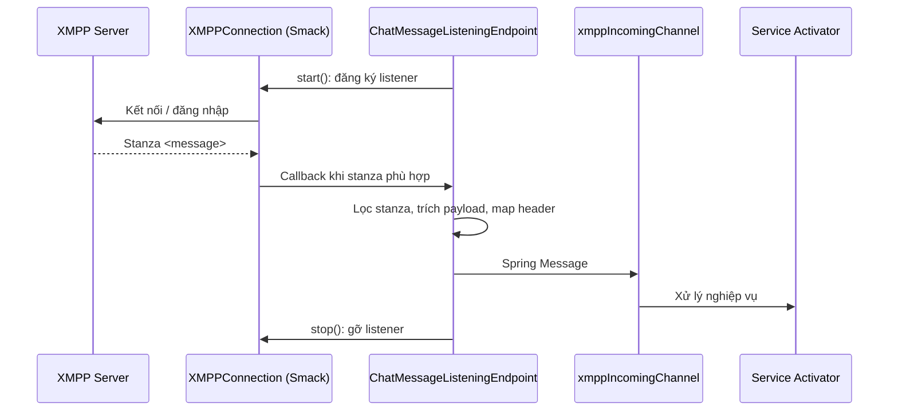
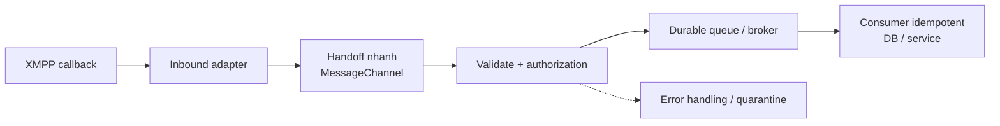

# XMPP message inbound adapter

## 1. Bối cảnh và mục tiêu

Module **SPRING_INTEGRATION_ADAPTERS** hướng dẫn kết nối các hệ thống ngoài vào Spring Integration bằng inbound/outbound adapter, gateway, poller và `MessageChannel`, đồng thời quản lý hợp đồng message, lỗi và vòng đời kết nối. Trong chương **Adapter XMPP**, bài này giải thích cách **nhận tin nhắn XMPP** từ một tài khoản đã đăng nhập và đưa chúng vào luồng xử lý Java.

Giả sử hệ thống giám sát gửi cảnh báo đến một bot:

```text
monitor@example.org --- XMPP chat ---> integration-bot@example.org
                                          |
                                          v
                                  XMPP inbound adapter
                                          |
                                          v
                                   MessageChannel
                                          |
                                          v
                             Validate / DB / JMS / Kafka
```

Ứng dụng đăng nhập XMPP bằng `integration-bot@example.org`. Khi một stanza tin nhắn phù hợp đến, adapter chuyển nó thành **Spring Integration Message** và đưa tới channel để hệ thống xử lý. Đây là mô hình **event-driven**, không phải poll máy chủ mỗi vài giây.

Sau bài học, bạn có thể:

- Phân biệt XMPP **message inbound adapter**, outbound adapter, presence adapter và inbound gateway.
- Cấu hình `XmppConnectionFactoryBean`, `ChatMessageListeningEndpoint` và `MessageChannel`.
- Sử dụng `StanzaFilter` để chọn stanza, `payload-expression` để trích nội dung.
- Đọc các header như `XmppHeaders.FROM`, `TO`, `SUBJECT`, `THREAD` và `TYPE`.
- Quản lý kết nối, đăng nhập, TLS/SASL, lifecycle, reconnect và lỗi downstream.
- Thiết kế xử lý bất đồng bộ, bảo vệ consumer, chống trùng và phương án khôi phục khi mất kết nối.

## 2. XMPP, stanza và địa chỉ JID

**XMPP (Extensible Messaging and Presence Protocol)** là một giao thức dựa trên XML dùng trong trao đổi tin nhắn, theo dõi trạng thái hiện diện (presence) và nhiều khả năng mở rộng theo XEP. Một ứng dụng kết nối tới server XMPP (ví dụ Openfire, ejabberd), xác thực rồi nhận stanza qua một phiên kết nối.

| Loại stanza | Mục đích | Trong Spring Integration |
| --- | --- | --- |
| `<message>` | Truyền nội dung chat, thông báo, cảnh báo | XMPP **message inbound channel adapter** |
| `<presence>` | Online/away, subscription, sự kiện roster | XMPP **presence inbound channel adapter** |
| `<iq>` | Trao đổi request/result ở tầng giao thức XMPP | Không tự chuyển thành message chat thông thường |

Một stanza mẫu:

```xml
<message
    from="monitor@example.org/worker-1"
    to="integration-bot@example.org/spring-integration"
    type="chat"
    id="alert-1001">
    <body>ALERT disk usage high</body>
</message>
```

`from` và `to` chứa **JID (Jabber ID)**. Phần trước dấu `/` là **bare JID** (ví dụ `monitor@example.org`), còn phần sau dấu `/` là **resource** định danh một client/phiên cụ thể. Một tài khoản có thể đăng nhập từ nhiều resource, và quy tắc phân phối message có thể phụ thuộc server.

Loại message còn có thể là `normal`, `groupchat`, `headline` hoặc `error`. Không nên mặc định inbound message adapter phải biến tất cả các loại thành cùng một command nghiệp vụ.

## 3. Kiến trúc event-driven và vòng đời endpoint

Lớp triển khai inbound message trong Spring Integration là `org.springframework.integration.xmpp.inbound.ChatMessageListeningEndpoint`. Endpoint sử dụng một `org.jivesoftware.smack.XMPPConnection`, đăng ký stanza listener khi khởi động, chuyển message phù hợp vào channel, và gỡ listener khi dừng.



**XMPP message inbound là event-driven**, do đó không cần `@Poller` để gọi `receive()`. Ngược lại, File inbound adapter dùng poller để quét thư mục. Nếu downstream dùng `QueueChannel` thì một consumer **ở phía sau** có thể cần poller riêng, nhưng đó không phải cơ chế nhận stanza từ XMPP.

Các thành phần chính:

| Thành phần | Trách nhiệm | Điều cần lưu ý |
| --- | --- | --- |
| `XmppConnectionFactoryBean` | Tạo và quản lý XMPP connection dựa trên Smack | Login, lifecycle, reconnect, TLS |
| `ChatMessageListeningEndpoint` | Đăng ký listener, nhận stanza, tạo Spring Message | Không tự là giao dịch request–reply |
| `StanzaFilter` | Chọn stanza có được nhận vào listener hay không | Phải tránh nhận loại không hỗ trợ |
| `payload-expression` | Trích dữ liệu từ Smack `Message` bằng SpEL | Có thể ra null nếu body/extension vắng mặt |
| `DefaultXmppHeaderMapper` | Map thuộc tính XMPP sang headers | Header ứng dụng tự tạo không tự được map hết |
| `MessageChannel` | Chuyển message sang endpoint xử lý | DirectChannel có thể chạy đồng bộ trong callback |

Phân biệt với **presence**: để nhận thay đổi trạng thái người dùng, dùng `PresenceListeningEndpoint` hoặc `<int-xmpp:presence-inbound-channel-adapter>`; không dùng luồng chat như thể mọi stanza là presence.

## 4. Dependency và môi trường thử nghiệm

Ví dụ dùng Java 17+, Spring Boot với dependency management tương thích Spring Integration. Maven:

```xml
<dependencies>
    <dependency>
        <groupId>org.springframework.boot</groupId>
        <artifactId>spring-boot-starter-integration</artifactId>
    </dependency>
    <dependency>
        <groupId>org.springframework.integration</groupId>
        <artifactId>spring-integration-xmpp</artifactId>
    </dependency>
</dependencies>
```

Module `spring-integration-xmpp` tích hợp thư viện **Smack**. Nếu không dùng BOM Spring Boot, cần chọn rõ các phiên bản tương thích; không bê nguyên mã API Smack 3.x vào dự án dùng Spring Integration 6.x/7.x.

Chuẩn bị server XMPP phục vụ test (ví dụ Openfire/ejabberd) và hai tài khoản:

- Bên nhận: `integration-bot@example.org`.
- Bên gửi: `monitor@example.org`.

Ví dụ `application.yml`:

```yaml
app:
  xmpp:
    host: ${XMPP_HOST:xmpp.internal.example.org}
    port: ${XMPP_PORT:5222}
    domain: ${XMPP_DOMAIN:example.org}
    user: ${XMPP_USER:integration-bot}
    password: ${XMPP_PASSWORD}
```

`host` là hostname máy chủ, còn `domain` là **miền dịch vụ XMPP** của tài khoản; chúng không nhất thiết giống nhau. Trong ví dụ, tên `example.org` chỉ là địa chỉ minh họa và phải thay bằng server được cấu hình thật.

**Không ghi password vào repository hay log.** Cung cấp `XMPP_PASSWORD` qua secret manager hoặc environment variable. Trong production, cấu hình TLS có kiểm tra chứng chỉ/hostname, SASL được server hỗ trợ và chính sách mạng phù hợp; không vô hiệu hóa TLS validation chỉ để kết nối thành công.

## 5. Java configuration hoàn chỉnh cho inbound message

Ví dụ này tạo connection factory, channel, inbound endpoint và một consumer quan sát dữ liệu nhận được. `StanzaFilter` chỉ nhận chat/normal message có body không rỗng. `payload-expression="body"` chuyển body từ Smack message thành payload `String`.

```java
import org.jivesoftware.smack.XMPPConnection;
import org.jivesoftware.smack.packet.Message;

import org.springframework.beans.factory.annotation.Qualifier;
import org.springframework.beans.factory.annotation.Value;
import org.springframework.context.annotation.Bean;
import org.springframework.context.annotation.Configuration;
import org.springframework.expression.spel.standard.SpelExpressionParser;
import org.springframework.integration.annotation.ServiceActivator;
import org.springframework.integration.channel.DirectChannel;
import org.springframework.integration.config.EnableIntegration;
import org.springframework.integration.xmpp.XmppHeaders;
import org.springframework.integration.xmpp.config.XmppConnectionFactoryBean;
import org.springframework.integration.xmpp.inbound.ChatMessageListeningEndpoint;
import org.springframework.messaging.MessageChannel;

@Configuration
@EnableIntegration
public class XmppInboundConfig {

    @Bean(name = "xmppConnection")
    public XmppConnectionFactoryBean xmppConnection(
            @Value("${app.xmpp.host}") String host,
            @Value("${app.xmpp.domain}") String domain,
            @Value("${app.xmpp.port:5222}") int port,
            @Value("${app.xmpp.user}") String user,
            @Value("${app.xmpp.password}") String password) {

        XmppConnectionFactoryBean factory =
                new XmppConnectionFactoryBean();
        factory.setHost(host);
        factory.setServiceName(domain);
        factory.setPort(port);
        factory.setUser(user);
        factory.setPassword(password);
        factory.setResource("spring-integration-inbound");
        return factory;
    }

    @Bean
    public MessageChannel xmppIncomingChannel() {
        return new DirectChannel();
    }

    @Bean
    public ChatMessageListeningEndpoint xmppInboundAdapter(
            XMPPConnection xmppConnection,
            @Qualifier("xmppIncomingChannel") MessageChannel channel) {

        ChatMessageListeningEndpoint endpoint =
                new ChatMessageListeningEndpoint(xmppConnection);
        endpoint.setOutputChannel(channel);

        // Chọn chat hoặc normal message có body.
        endpoint.setStanzaFilter(stanza ->
                stanza instanceof Message msg
                && (msg.getType() == Message.Type.chat
                    || msg.getType() == Message.Type.normal)
                && msg.getBody() != null
                && !msg.getBody().isBlank());

        endpoint.setPayloadExpression(
                new SpelExpressionParser().parseExpression("body")
        );
        endpoint.setAutoStartup(true);
        return endpoint;
    }

    @ServiceActivator(inputChannel = "xmppIncomingChannel")
    public void receiveChat(
            org.springframework.messaging.Message<String> incoming) {

        String body = incoming.getPayload();
        Object from = incoming.getHeaders().get(XmppHeaders.FROM);
        Object thread = incoming.getHeaders().get(XmppHeaders.THREAD);
        Object type = incoming.getHeaders().get(XmppHeaders.TYPE);

        System.out.printf(
                "XMPP from=%s thread=%s type=%s body=%s%n",
                from, thread, type, body
        );

        // Production: validate sender/body, ghi event ID và
        // chuyển tới một consumer / kho dữ liệu phù hợp.
    }
}
```

Class phải nằm trong phạm vi component scan của `@SpringBootApplication` hoặc được import vào Spring context. Ví dụ **không tự chạy nếu chưa có XMPP server và tài khoản thực**. Phần bean `xmppConnection` trả về một Spring `FactoryBean<XMPPConnection>`; Spring sử dụng đối tượng connection được factory tạo để truyền vào endpoint.

### Giải thích những thiết lập quan trọng

1. `setHost` chọn máy chủ; `setServiceName` là miền dịch vụ XMPP; `setUser`, `setPassword` và `setResource` xác định thông tin client.
2. `new ChatMessageListeningEndpoint(xmppConnection)` gắn listener vào đúng kết nối đã quản lý.
3. `setOutputChannel` nối nguồn XMPP với `xmppIncomingChannel`; thiếu subscriber hoặc cấu hình channel sai thì message có thể không đến consumer.
4. `setStanzaFilter` loại `presence`, `iq`, message không có body và các loại message khác. Có thể mở rộng để xử lý kiểu stanza khác theo hợp đồng.
5. `setPayloadExpression("body")` lấy `getBody()` từ Smack `Message`, tránh đẩy nguyên đối tượng Smack xuống consumer text.
6. `setAutoStartup(true)` cho phép endpoint tự chạy theo lifecycle của Spring; **trạng thái bean đang chạy không chứng minh connection đã authenticated**.
7. `@ServiceActivator` nhận `Message<String>` và các header XMPP; ví dụ chỉ log, không ghi DB hoặc gửi ACK cho phía ngoài.

**Đừng đặt logic xử lý nặng trực tiếp vào callback**: `DirectChannel` thường chuyển lời gọi trên chính thread phía phát message. Nếu parser/DB chậm, listener của Smack có thể bị ảnh hưởng. Cần cân nhắc handoff nhanh tới một queue/broker có giới hạn tải và độ bền phù hợp.

## 6. XML namespace: cách cấu hình tương đương

Spring Integration hỗ trợ khai báo XMPP inbound adapter qua XML. Ví dụ dưới dùng cùng thông tin kết nối và channel với Java config:

```xml
<beans xmlns="http://www.springframework.org/schema/beans"
       xmlns:xsi="http://www.w3.org/2001/XMLSchema-instance"
       xmlns:int="http://www.springframework.org/schema/integration"
       xmlns:int-xmpp="http://www.springframework.org/schema/integration/xmpp"
       xsi:schemaLocation="
           http://www.springframework.org/schema/beans
           https://www.springframework.org/schema/beans/spring-beans.xsd
           http://www.springframework.org/schema/integration
           https://www.springframework.org/schema/integration/spring-integration.xsd
           http://www.springframework.org/schema/integration/xmpp
           https://www.springframework.org/schema/integration/xmpp/spring-integration-xmpp.xsd">

    <int:channel id="xmppIncoming"/>

    <int-xmpp:xmpp-connection id="xmppConnection"
                              user="${app.xmpp.user}"
                              password="${app.xmpp.password}"
                              host="${app.xmpp.host}"
                              port="${app.xmpp.port}"
                              resource="spring-integration-inbound"/>

    <int-xmpp:inbound-channel-adapter
        id="xmppInboundAdapter"
        channel="xmppIncoming"
        xmpp-connection="xmppConnection"
        payload-expression="body"
        auto-startup="true"/>
</beans>
```

Đây là **phương án thay thế** Java configuration, không phải yêu cầu chạy đồng thời hai adapter. Trong cấu hình XML trên, thêm một `service-activator` hoặc IntegrationFlow để xử lý message từ `xmppIncoming`. Các placeholder `${...}` được Spring property resolution xử lý khi chạy trong context đã cấu hình.

Với xác thực TLS/SASL nâng cao, custom truststore hoặc chính sách roster, nên xây dựng `XMPPTCPConnectionConfiguration` rồi cung cấp cho `XmppConnectionFactoryBean` qua `setConnectionConfiguration(...)`. Tránh sao chép các ví dụ `org.jivesoftware.smack.ConnectionConfiguration` rất cũ mà chưa kiểm tra phiên bản Smack sử dụng.

## 7. StanzaFilter khác với payload-expression như thế nào?

Đây là hai bước riêng:

- **`StanzaFilter`**: quyết định stanza XMPP nào được listener xem xét; thực hiện trước khi message được chuyển đến channel.
- **`payload-expression`**: từ stanza đã được chọn, biểu thức SpEL xác định payload của Spring Integration message.

Ví dụ chỉ nhận message chat:

```java
endpoint.setStanzaFilter(stanza ->
        stanza instanceof org.jivesoftware.smack.packet.Message msg
        && msg.getType()
                == org.jivesoftware.smack.packet.Message.Type.chat
        && msg.getBody() != null);
```

Nếu producer có thể gửi `normal`, cần mở rộng filter tương ứng. Nếu hệ thống sử dụng room chat (MUC), không mặc định endpoint xử lý mọi stanza room/groupchat bằng cấu hình chat trực tiếp; phải kiểm tra hỗ trợ Smack/XMPP server và cơ chế join room của ứng dụng.

### Khi filter loại stanza thì sao?

Stanza không được chấp nhận sẽ **không đi vào channel**. Bên gửi không tự nhận một thông báo “nghiệp vụ từ chối”, vì đây là inbound **channel adapter một chiều**, không phải request–reply gateway. Nếu cần báo lỗi trở lại cho bên gửi, thiết kế một outbound XMPP adapter và hợp đồng phản hồi rõ ràng.

### SpEL đọc gì từ stanza?

Biểu thức `body` đánh giá trên `org.jivesoftware.smack.packet.Message`, không phải Spring `Message<String>`. Các biến thể:

| Expression | Dữ liệu cần lấy | Điều kiện |
| --- | --- | --- |
| `body` | Nội dung body chat | Stanza có body |
| `subject` | Subject nếu có | Có thể null |
| `getExtension('custom:notification:v1')` | Một extension của XMPP message | Cần provider/namespace tương thích |
| `#extension` | Extension duy nhất trong evaluation context | Chỉ tồn tại trong trường hợp hỗ trợ, khi có đúng một extension |

Ví dụ trích extension bằng XML:

```xml
<int-xmpp:inbound-channel-adapter
    id="extensionInbound"
    channel="xmppIncoming"
    xmpp-connection="xmppConnection"
    payload-expression="getExtension('custom:notification:v1')"/>
```

Đây là **đoạn minh họa**: application phải cấu hình Smack `ProviderManager`/`ExtensionElementProvider` tương ứng khi muốn parse extension riêng. Không mặc định extension nào cũng có trường `json` hoặc thuộc tính được ánh xạ như nhau.

**Bảo vệ payload null:** stanza `<message>` có thể không có body. Filter ở Java config chủ động loại các message như vậy để tránh tạo payload null. Nếu trích extension, kiểm tra sự tồn tại của extension trước khi truyền đến downstream.

## 8. XMPP MessageHeaders và giá trị nghiệp vụ

`DefaultXmppHeaderMapper` mặc định map các thuộc tính chuẩn giữa Smack message và Spring headers. Hằng số trong API hiện đại thuộc `org.springframework.integration.xmpp.XmppHeaders`:

| Hằng số | Tên header | Ý nghĩa |
| --- | --- | --- |
| `XmppHeaders.FROM` | `xmpp_from` | JID của sender |
| `XmppHeaders.TO` | `xmpp_to` | JID của recipient |
| `XmppHeaders.SUBJECT` | `xmpp_subject` | Subject nếu stanza có |
| `XmppHeaders.THREAD` | `xmpp_thread` | Thread của cuộc trao đổi |
| `XmppHeaders.TYPE` | `xmpp_type` | Loại message, ví dụ chat/normal |
| `XmppHeaders.CHAT` | `xmpp_chat` | Header ngữ cảnh chat, tùy endpoint |

Một message trong Spring Integration có thể được biểu diễn ở mức khái niệm:

```text
payload = "ALERT disk usage high"
headers:
  xmpp_from   = "monitor@example.org/worker-1"
  xmpp_to     = "integration-bot@example.org/spring-integration"
  xmpp_type   = chat
  xmpp_thread = <co the khong co>
  id          = <Spring Message ID>
  timestamp   = <Spring Message timestamp>
```

Không giả định mọi header đều tồn tại hoặc luôn có kiểu `String`: các JID có thể được biểu diễn dưới dạng object của thư viện Smack. Tại ranh giới lưu database, nên chuẩn hóa JID, validate kiểu dữ liệu, tránh log thông tin nhạy cảm.

**Header tự định nghĩa không tự map tất cả** vào XMPP message. `DefaultXmppHeaderMapper` có các thiết lập `requestHeaderNames` và `replyHeaderNames` để kiểm soát tên header được map. Không bật wildcard cho mọi header nếu có nguy cơ đưa internal data hoặc secrets ra mạng.

**`MessageHeaders.ID` không phải XMPP stanza ID**. Muốn chống xử lý trùng, hãy xây dựng event ID của hợp đồng nghiệp vụ (hoặc sử dụng stanza ID đã được xác thực trong bối cảnh phù hợp), không chỉ dựa trên ID Spring tạo khi nhận message.

## 9. Thực hành end-to-end với hai tài khoản

Chuẩn bị XMPP server và hai tài khoản **chỉ dành cho test**:

- `integration-bot@example.org` đăng nhập trong ứng dụng Java.
- `monitor@example.org` đăng nhập qua một XMPP client khác.

Thực hiện:

1. Cung cấp cấu hình host, port, domain, user và password qua cơ chế secrets.
2. Khởi động Spring Boot; kiểm tra connection đã đăng nhập và listener đang hoạt động.
3. Từ client `monitor@example.org`, gửi một message loại `chat` có body `ALERT disk usage high` đến `integration-bot@example.org`.
4. Quan sát log của `receiveChat` để thấy body và một số headers.
5. Gửi một message loại `headline` hoặc message không có body; filter trong ví dụ không chuyển chúng vào channel.
6. Dừng ứng dụng, gửi message trong lúc bot offline rồi chạy lại. Kiểm tra server có lưu/trả message hay không thay vì giả định replay.
7. Thử tạm ngắt kết nối trên mạng test và cho reconnect; đối chiếu số message gửi, nhận, bị lặp hoặc mất.

Kết quả minh họa:

```text
XMPP from=monitor@example.org/worker-1
     thread=null
     type=chat
     body=ALERT disk usage high
```

Đây là **kết quả dự kiến**, không phải log của một lần chạy đã được thực hiện trong bài. Kiểu JID, resource và header `thread` có thể thay đổi theo thực tế.

## 10. Reconnect, offline message và độ tin cậy

Kết nối XMPP có lifecycle riêng. Spring Integration cung cấp hỗ trợ reconnect/đăng nhập lại khi connection stale theo trạng thái đã xác thực trước đó, nhưng **không được suy ra rằng mọi message đã bỏ lỡ trong khoảng mất mạng sẽ được phát lại tự động**.

| Tình huống | Hệ quả | Cách kiểm tra |
| --- | --- | --- |
| Sai host/domain hoặc mật khẩu | Không đăng nhập được | Log cấu hình, DNS, SASL, account |
| TLS/certificate không hợp lệ | Handshake thất bại | Truststore, CA, hostname validation |
| Server cắt connection | Inbound ngừng nhận trong thời gian gián đoạn | Reconnect và health check |
| App restart | Phiên và resource thay đổi | Offline message/session semantics |
| Server phân phối cho resource khác | Bot không thấy tin nhắn như mong đợi | Quy tắc JID resource, priority |
| Sender gửi lại message | Có thể nhận lặp | Event ID/idempotent consumer |
| Consumer tắc nghẽn | Callback bị chậm, message backlog | Bounded queue, broker, metric |

Khả năng phục hồi stanza sau reconnect phụ thuộc server và tính năng được bật, như lưu **offline message** hoặc XMPP Stream Management (XEP-0198) nếu cả hai phía hỗ trợ/cấu hình. Không mặc định các cơ chế đó bảo đảm exactly-once end-to-end.

### Không nhầm reconnect với replay

Reconnect đưa client trở lại trạng thái có thể nhận message mới. Replay đòi hỏi server hoặc một nguồn bền vững thực sự **còn lưu** dữ liệu trong lúc connection mất. Nếu xử lý cảnh báo/đơn hàng quan trọng, hãy gắn event ID bền vững, xác nhận trạng thái xử lý và thiết kế một nguồn replay/ACK có chủ đích.

## 11. Xử lý lỗi, backpressure và consumer chậm

Ví dụ dùng `DirectChannel`, thường khiến consumer thực thi trong thread phát message. Vì adapter nhận stanza qua callback, một handler thực hiện nhiều thao tác chậm (ghi DB, HTTP) có thể kéo dài thời gian xử lý callback.

Một kiến trúc phù hợp với khối lượng lớn:



`ExecutorChannel`/`QueueChannel` có thể tách thread, nhưng **hàng đợi trong bộ nhớ không tự durable** và vẫn cần giới hạn dung lượng, chính sách backpressure, kiểm soát shutdown và lỗi đầy queue. Nếu phải bảo vệ message qua crash, dùng queue/broker bền vững thích hợp trước công việc nghiệp vụ lâu dài.

`ChatMessageListeningEndpoint` kế thừa `MessageProducerSupport`, nên có error channel. Tuy nhiên, exception ở consumer **không tự chuyển thành XMPP negative acknowledgement** khiến server chắc chắn gửi lại stanza. Phải xác minh semantics thực tế của adapter/Smack và thiết kế error handling có ghi nhận sự kiện.

Nên phân nhóm lỗi:

1. **Kết nối/auth**: DNS, TLS, SASL, session bị ngắt.
2. **Payload/schema**: thiếu body, sai JSON, vượt giới hạn kích thước.
3. **Authorization**: JID không được phép yêu cầu hành động.
4. **Downstream**: database/broker không sẵn sàng, HTTP callback lỗi.
5. **Duplicate**: event ID đã có trong kho trạng thái.

Với lỗi dữ liệu vĩnh viễn, đưa vào đường cách ly hoặc audit thay vì retry vô hạn. Với lỗi tạm thời, dùng retry hữu hạn với backoff và trạng thái bền vững để không phụ thuộc vào việc server XMPP có tự gửi lại hay không.

## 12. Bảo mật: sender, TLS và nội dung không đáng tin cậy

Đừng coi mỗi stanza chat nhận được là một lệnh ứng dụng hợp lệ. Những kiểm soát tối thiểu:

- Bật TLS với **xác minh certificate/hostname**, dùng SASL mạnh theo khả năng server.
- Tài khoản bot có quyền tối thiểu; password/token nằm trong secret manager.
- Kiểm soát sender theo bare/full JID **đúng hợp đồng**, và kiểm tra quyền nghiệp vụ riêng. Resource có thể thay đổi.
- Validate schema/độ dài nội dung, không thực thi shell/SQL lấy trực tiếp từ body.
- Có event ID, unique constraint hoặc state machine để chống nhập trùng.
- Hạn chế log body, stanza, thông tin user; không log password.
- Giám sát session, reconnect, số stanza nhận, số bị filter, số lỗi và thời gian xử lý.

Ví dụ hợp đồng JSON **nằm trong body XMPP**:

```json
{
  "eventId": "evt-20261123-1001",
  "type": "ALERT",
  "source": "monitoring",
  "severity": "WARN",
  "message": "Disk usage high"
}
```

Đây là định dạng **do hai ứng dụng tự thỏa thuận**, không phải JSON mà XMPP inbound adapter tự tạo. Consumer cần parse và validate, xác định tài khoản gửi có quyền tạo loại event đó, rồi lưu event ID để có thể retry/reconcile.

## 13. So sánh với các adapter khác trong module

| Nguồn inbound | Cách nhận | Trọng tâm độ tin cậy |
| --- | --- | --- |
| **XMPP message inbound** | Listener trên XMPPConnection | Stanza/JID, session/reconnect, replay không mặc định |
| XMPP presence inbound | Sự kiện roster/presence | Trạng thái hiện diện |
| File inbound | Poll filesystem hoặc scanner | File readiness, accept-once |
| SFTP inbound | Poll/tải file từ remote | Filter remote/local, kết nối |
| HTTP inbound gateway | Request/response | Timeout, reply, HTTP status |
| JMS/AMQP inbound | Broker consumer | ACK, redelivery, transaction |
| Kafka inbound | Consumer/partition | Offset, ordering, commit |

**Không áp dụng cấu hình poller của File inbound vào XMPP inbound**, và cũng không mặc định ACK/offset của broker áp dụng cho một callback nhận stanza XMPP. Khi kết nối sang các endpoint khác, cần giữ hợp đồng payload/header/error rõ ràng.

## 14. Troubleshooting

| Triệu chứng | Nguyên nhân có thể | Hướng xử lý |
| --- | --- | --- |
| Adapter không chạy | Thiếu `spring-integration-xmpp`, bean XMPP không tạo | Kiểm tra dependency, context và log startup |
| Connection mở nhưng chưa authenticated | Sai user/domain/password/SASL | Kiểm tra tài khoản và cấu hình server |
| TLS không kết nối | Truststore, CA, hostname sai | Xác minh chứng chỉ, không tắt TLS validation |
| Không nhận tin nhắn | Sai JID/resource hoặc filter loại stanza | Kiểm tra recipient, loại stanza, body |
| Đã nhận stanza nhưng consumer không chạy | Channel thiếu subscriber hoặc endpoint dừng | Kiểm tra `outputChannel` và `@ServiceActivator` |
| Payload null/SpEL lỗi | Body/extension vắng mặt | Lọc trước hoặc đổi biểu thức phù hợp |
| Header `xmpp_from` trống | Stanza thiếu trường hoặc custom mapper | Quan sát mapping và payload đầu vào |
| Mất message lúc offline | Server không lưu hoặc không replay | Quy ước event ID và cơ chế bền vững |
| Trùng message sau reconnect | Sender/server redeliver hoặc gửi lại | Dedup/idempotent consumer |
| Consumer chậm | Dùng DirectChannel với I/O lâu | Handoff nhanh và bounded queue/broker |

## 15. Bài tập thực hành

1. **Nhận chat:** chạy config Java với hai tài khoản test, gửi message loại `chat` và ghi nhận body + sender.
2. **Đổi filter:** chỉ nhận `Message.Type.chat`, thử `normal` và `headline`; giải thích sự khác biệt.
3. **Payload-expression:** thay `body` bằng `subject` với stanza có subject; xử lý tình huống null.
4. **XMPP headers:** xem `FROM`, `TO`, `THREAD` và `TYPE`; phân biệt bare/full JID.
5. **Extension riêng:** cấu hình provider và SpEL trích extension có namespace nội bộ.
6. **Authorization:** giới hạn sender được phép gửi sự kiện `ALERT`; từ chối lệnh thiếu quyền.
7. **Ngắt mạng:** ngắt rồi reconnect trong test, xem message nào được server replay hoặc bỏ lỡ.
8. **Lỗi downstream:** giả lập database timeout và thiết kế queue bền vững trước bước ghi DB.
9. **Chống trùng:** gửi cùng `eventId` hai lần, dùng unique constraint/state store ngăn nhập trùng.
10. **So sánh adapter:** giải thích vì sao XMPP inbound không cần poller nhưng File inbound cần nguồn quét.

### Câu hỏi tự kiểm tra

**Q1. XMPP message inbound nhận bằng poller hay listener?**  
Listener được đăng ký trên `XMPPConnection`; endpoint có lifecycle và hoạt động theo sự kiện.

**Q2. Java class của inbound endpoint là gì?**  
`ChatMessageListeningEndpoint`.

**Q3. Khác biệt giữa `StanzaFilter` và `payload-expression`?**  
Filter chọn stanza được nhận, expression trích nội dung làm Spring message payload.

**Q4. Header nào thường chứa địa chỉ sender?**  
`XmppHeaders.FROM` (`xmpp_from`), nhưng phải kiểm tra quyền sender riêng.

**Q5. Reconnect thành công có bảo đảm mọi tin nhắn đã mất được replay không?**  
Không. Điều đó phụ thuộc server, phiên và các tính năng được cấu hình.

**Q6. Có nên dùng message adapter để nhận presence thay cho presence adapter?**  
Không. Dùng endpoint presence dành riêng cho sự kiện hiện diện.

**Q7. Lỗi database có tự khiến XMPP server gửi lại stanza không?**  
Không có bảo đảm; cần error handling, lưu trữ và retry/idempotency riêng.

## 16. Ghi nhớ

**XMPP message inbound adapter** đưa stanza chat từ một tài khoản XMPP vào Spring Integration bằng `XMPPConnection` và `ChatMessageListeningEndpoint`. Nó **event-driven**: khi chạy, đăng ký stanza listener; khi dừng, gỡ listener. `StanzaFilter` chọn stanza, `payload-expression` tạo payload và `DefaultXmppHeaderMapper` chuyển các trường XMPP chuẩn thành headers để downstream xử lý qua `MessageChannel`.

Để vận hành đáng tin cậy, cần quản lý TLS/SASL, tài khoản và kết nối, reconnect, quyền sender, cấu trúc payload, consumer chậm, lỗi và idempotency. **Nhận stanza không đồng nghĩa downstream đã commit; reconnect không tự là replay hay exactly-once.**

### Tài liệu tham khảo

- [Spring Integration Reference — XMPP Support](https://docs.spring.io/spring-integration/reference/xmpp.html)
- [Spring Integration API — ChatMessageListeningEndpoint](https://docs.spring.io/spring-integration/docs/6.5.x/api/org/springframework/integration/xmpp/inbound/ChatMessageListeningEndpoint.html)
- [Spring Integration API — XmppConnectionFactoryBean](https://docs.spring.io/spring-integration/docs/6.5.x/api/org/springframework/integration/xmpp/config/XmppConnectionFactoryBean.html)
- [Spring Integration API — XmppHeaders](https://docs.spring.io/spring-integration/docs/6.5.x/api/org/springframework/integration/xmpp/XmppHeaders.html)
- [Spring Integration API — DefaultXmppHeaderMapper](https://docs.spring.io/spring-integration/docs/6.5.x/api/org/springframework/integration/xmpp/support/DefaultXmppHeaderMapper.html)
- [XMPP Standards Foundation — XMPP Core](https://xmpp.org/rfcs/rfc6120.html)
