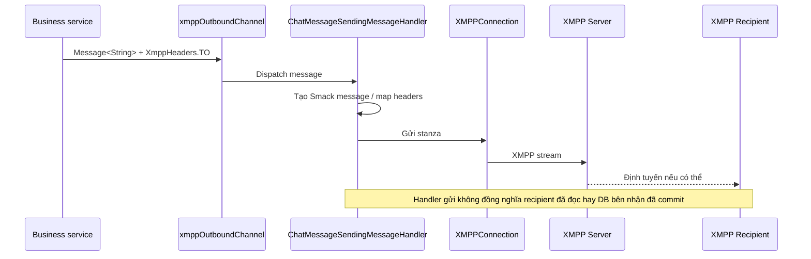

# XMPP message outbound adapter

## 1. Tình huống và mục tiêu bài học

Module **SPRING_INTEGRATION_ADAPTERS** hướng dẫn kết nối các hệ thống ngoài bằng inbound/outbound adapter, gateway, poller và `MessageChannel`. Trong chương **Adapter XMPP**, sau khi ứng dụng nhận dữ liệu từ file, HTTP, JMS, AMQP, Kafka hoặc cơ sở dữ liệu, một yêu cầu thực tế là **gửi thông báo đến tài khoản XMPP của nhân viên hoặc hệ thống khác**.

Giả sử ứng dụng nhập đơn hàng từ file CSV. Khi có một lô dữ liệu lỗi, nó cần gửi thông báo cho người trực vận hành qua XMPP:

```text
File / HTTP / Database event
           |
           v
    Service Activator
    tạo chuỗi thông báo
           |
           v
    xmppOutboundChannel
           |
           v
    XMPP message outbound adapter
           |
           v
     XMPP Server (TCP/TLS)
           |
           v
    operator@example.org
```

Ứng dụng đăng nhập bằng tài khoản `integration-bot@example.org`, tạo `Message<String>` có **payload là nội dung chat** và **header là JID người nhận**, rồi chuyển message cho XMPP outbound adapter.

Sau bài này, bạn có thể:

- Giải thích vai trò của **XMPP message outbound channel adapter** và phân biệt với inbound adapter, presence adapter và request–reply gateway.
- Dùng `ChatMessageSendingMessageHandler` với `XmppConnectionFactoryBean` và `MessageChannel`.
- Đặt địa chỉ người nhận qua **`XmppHeaders.TO`** và biết vì sao không nên sao chép hằng số `CHAT_TO` từ tài liệu cũ.
- Hiểu payload `String`, payload Smack `Message` và khả năng gửi XMPP extension.
- Ánh xạ header `FROM`, `TO`, `SUBJECT`, `THREAD`, `TYPE` và kiểm tra JID người nhận.
- Quản lý kết nối, TLS/SASL, lỗi gửi, retry, idempotency, giới hạn tải và xác nhận giao hàng.
- Thực hành gửi một tin nhắn giữa hai tài khoản thử nghiệm.

## 2. Tổng quan giao thức và cơ chế gửi

**XMPP (Extensible Messaging and Presence Protocol)** là giao thức trao đổi thông tin dựa trên XML. Một client mở kết nối tới XMPP server, xác thực tài khoản rồi gửi **stanza** đến một JID (Jabber ID).

Một stanza message minh họa:

```xml
<message
    from="integration-bot@example.org/si"
    to="operator@example.org"
    type="chat"
    id="alert-1001">
    <body>ALERT: import batch failed</body>
</message>
```

Địa chỉ `operator@example.org` là **bare JID**; một **full JID** có thể thêm resource, ví dụ `operator@example.org/laptop`. Server XMPP quyết định cách định tuyến giữa các resource của cùng tài khoản theo đặc tính và cấu hình của nó. Một bare JID không đồng nghĩa người nhận đang online hoặc đang đọc trên một thiết bị cụ thể.

| Loại stanza | Mục đích | Endpoint Spring Integration |
| --- | --- | --- |
| `<message>` | Nội dung chat/thông báo | **XMPP message outbound adapter** |
| `<presence>` | Công bố trạng thái hiện diện | XMPP presence outbound adapter |
| `<iq>` | Trao đổi request/result của giao thức | Không dùng message outbound adapter như IQ gateway mặc định |



Điểm mấu chốt: **outbound channel adapter là endpoint một chiều**. Nó không tạo reply message như gateway. Gọi `MessageChannel.send(...)` thành công thường chỉ cho thấy bước chuyển nội bộ đã được chấp nhận/xử lý theo semantics của channel; không phải một **ACK nghiệp vụ** hoặc biên nhận người dùng đã đọc tin.

## 3. Những thành phần cần thiết

Spring Integration XMPP dựa trên thư viện **Smack**. Một outbound flow cơ bản có các thành phần:

| Thành phần | Vai trò | Ghi chú |
| --- | --- | --- |
| `XmppConnectionFactoryBean` | Tạo/quản lý `XMPPConnection` cho tài khoản bot | Cần host, domain, port, user, password và TLS phù hợp |
| `MessageChannel` | Nhận event nội bộ cần gửi | Có thể được gọi bởi service activator, router, scheduler hoặc luồng khác |
| `ChatMessageSendingMessageHandler` | Chuyển Spring message thành XMPP chat message và gửi đi | Endpoint **outbound**, không phát reply |
| `XmppHeaders.TO` | Header chỉ định **JID người nhận** | Với payload text, cần có giá trị hợp lệ |
| `DefaultXmppHeaderMapper` | Chuyển các header chuẩn thành trường XMPP stanza | Không tự gửi mọi header riêng của ứng dụng |
| `XMPPConnection` | Tương tác với server XMPP qua phiên Smack | Phải kết nối và xác thực trước khi gửi |

**Không cần poller trên một `DirectChannel` đầu vào của outbound adapter.** Handler được gọi khi có message gửi tới channel. Nếu sử dụng `QueueChannel` hoặc `PollableChannel`, consumer endpoint có thể cần poller để lấy message; đó là cách tiêu thụ channel, **không phải cách XMPP server được poll**.

### Phân biệt outbound với các kiểu endpoint khác

- **Message inbound adapter:** đăng ký listener trên kết nối XMPP và chuyển stanza nhận được thành Spring message.
- **Message outbound adapter:** nhận Spring message, gửi stanza ra XMPP; không tự cung cấp reply payload.
- **Presence outbound adapter:** xuất trạng thái hiện diện của tài khoản, không dùng để gửi nội dung chat.
- **Request–reply:** nếu ứng dụng muốn nhận câu trả lời trong cùng một workflow, phải xây dựng **correlation ID, inbound listener và logic timeout** riêng. Việc gửi chat outbound không tự biến thành một gateway đồng bộ.

## 4. Hợp đồng tối thiểu: String payload và header TO

Một thông báo outbound tối thiểu theo API Spring Integration 6.x:

```java
import org.springframework.integration.xmpp.XmppHeaders;
import org.springframework.messaging.Message;
import org.springframework.messaging.support.MessageBuilder;

Message<String> outbound = MessageBuilder
        .withPayload("Hello from Spring Integration")
        .setHeader(XmppHeaders.TO, "operator@example.org")
        .build();
```

Trong đó:

1. **Payload** là chuỗi nội dung chat cần gửi.
2. **`XmppHeaders.TO`** xác định JID nhận message.
3. Connection đã được cấu hình để biết tài khoản gửi và server.
4. `ChatMessageSendingMessageHandler` chuyển message vào Smack và thực hiện gửi stanza.

### Chú ý khác biệt giữa tài liệu cũ và API hiện hành

Một số đoạn trong trang Reference XMPP vẫn minh họa **`XmppHeaders.CHAT_TO`**. Hằng số cũ này đã được **deprecated** từ lâu và không còn nằm trong bảng hằng số của API 6.x. Với các phiên bản hiện đại, **sử dụng `XmppHeaders.TO`** (header có giá trị chuỗi `xmpp_to`).

Không tự tạo một header tên `chatTo` hoặc `recipient` rồi kỳ vọng handler hiểu nó. Nếu business event có trường `recipient`, bước transformer/header enricher phải chuyển trường đó thành `XmppHeaders.TO` trước outbound adapter.

### Các header XMPP thường dùng

| Hằng số | Key trong Spring message | Dùng để |
| --- | --- | --- |
| `XmppHeaders.TO` | `xmpp_to` | Chọn người nhận |
| `XmppHeaders.FROM` | `xmpp_from` | Thông tin sender trong stanza khi được hỗ trợ |
| `XmppHeaders.SUBJECT` | `xmpp_subject` | Tiêu đề message nếu có |
| `XmppHeaders.THREAD` | `xmpp_thread` | Liên hệ các message cùng thread/hội thoại |
| `XmppHeaders.TYPE` | `xmpp_type` | Kiểu message như chat, normal |

`XmppHeaders.CHAT` (key `xmpp_chat`) là header có trong API, nhưng **không phải địa chỉ nhận**. Nó liên quan tới ngữ cảnh chat của một số endpoint. Khi chỉ cần gửi chuỗi, đừng thay `TO` bằng `CHAT`.

Lưu ý kiểu dữ liệu: header có thể chứa `String`, enum của Smack hoặc đối tượng JID tùy mapping và đường đi message. Với kết nối tới hệ thống ngoài, hãy xác thực giá trị và dùng đúng kiểu mà phiên bản Smack đang chạy chấp nhận.

## 5. Chuẩn bị Spring Boot và máy chủ XMPP

Ví dụ dùng Java 17+ và phiên bản Spring Integration 6.x tương thích với Spring Boot. Khai báo dependencies Maven (phiên bản do BOM của Spring Boot quản lý):

```xml
<dependencies>
    <dependency>
        <groupId>org.springframework.boot</groupId>
        <artifactId>spring-boot-starter-integration</artifactId>
    </dependency>
    <dependency>
        <groupId>org.springframework.integration</groupId>
        <artifactId>spring-integration-xmpp</artifactId>
    </dependency>
</dependencies>
```

Chuẩn bị server XMPP ở môi trường thử nghiệm, ví dụ Openfire hoặc ejabberd, với:

- Tài khoản gửi: `integration-bot@example.org`.
- Tài khoản nhận: `operator@example.org`.
- Host thực tế, domain XMPP, port kết nối client và chính sách TLS/SASL.

Ví dụ `application.yml`:

```yaml
app:
  xmpp:
    host: ${XMPP_HOST:xmpp.internal.example.org}
    port: ${XMPP_PORT:5222}
    domain: ${XMPP_DOMAIN:example.org}
    user: ${XMPP_USER:integration-bot}
    password: ${XMPP_PASSWORD}
    recipient: ${XMPP_RECIPIENT:operator@example.org}
```

`host` là máy chủ TCP thực tế; `domain` là miền dịch vụ XMPP của JID và không nhất thiết giống host. Các giá trị `example.org` và `xmpp.internal.example.org` chỉ là ví dụ, phải thay bằng thông số máy chủ test.

Không đưa password hoặc token vào Git. Với production, dùng secret manager, cấu hình TLS với **kiểm tra certificate/hostname**, cơ chế SASL phù hợp và quyền tối thiểu cho tài khoản bot. Nếu server cho phép tự động chấp nhận subscription của roster, hãy xem lại chính sách này thay vì áp dụng mặc định vô điều kiện cho tài khoản có quyền cao.

## 6. Ví dụ Java end-to-end: gửi một thông báo chat

Code sau cấu hình connection factory, `DirectChannel`, XMPP outbound handler và một `ApplicationRunner` gửi **một message test** sau khi ứng dụng khởi động. Các import và phần cấu hình được viết theo API Spring Integration 6.x. Cần có máy chủ và tài khoản hợp lệ để chạy thực tế.

```java
import org.jivesoftware.smack.XMPPConnection;

import org.springframework.beans.factory.annotation.Qualifier;
import org.springframework.beans.factory.annotation.Value;
import org.springframework.boot.ApplicationRunner;
import org.springframework.context.annotation.Bean;
import org.springframework.context.annotation.Configuration;
import org.springframework.integration.annotation.ServiceActivator;
import org.springframework.integration.channel.DirectChannel;
import org.springframework.integration.config.EnableIntegration;
import org.springframework.integration.xmpp.XmppHeaders;
import org.springframework.integration.xmpp.config.XmppConnectionFactoryBean;
import org.springframework.integration.xmpp.outbound.ChatMessageSendingMessageHandler;
import org.springframework.messaging.Message;
import org.springframework.messaging.MessageChannel;
import org.springframework.messaging.support.MessageBuilder;

@Configuration
@EnableIntegration
public class XmppOutboundConfig {

    @Bean(name = "xmppConnection")
    public XmppConnectionFactoryBean xmppConnection(
            @Value("${app.xmpp.host}") String host,
            @Value("${app.xmpp.domain}") String domain,
            @Value("${app.xmpp.port:5222}") int port,
            @Value("${app.xmpp.user}") String user,
            @Value("${app.xmpp.password}") String password) {

        XmppConnectionFactoryBean factory =
                new XmppConnectionFactoryBean();
        factory.setHost(host);
        factory.setServiceName(domain);
        factory.setPort(port);
        factory.setUser(user);
        factory.setPassword(password);
        factory.setResource("spring-integration-outbound");
        return factory;
    }

    @Bean
    public MessageChannel xmppOutboundChannel() {
        return new DirectChannel();
    }

    @Bean
    @ServiceActivator(inputChannel = "xmppOutboundChannel")
    public ChatMessageSendingMessageHandler xmppSender(
            XMPPConnection xmppConnection) {

        return new ChatMessageSendingMessageHandler(xmppConnection);
    }

    @Bean
    public ApplicationRunner sendSample(
            @Qualifier("xmppOutboundChannel") MessageChannel channel,
            XMPPConnection xmppConnection,
            @Value("${app.xmpp.recipient}") String recipient) {

        return args -> {
            // Không cố gửi khi chưa xác thực thành công.
            if (!xmppConnection.isAuthenticated()) {
                throw new IllegalStateException(
                        "XMPP connection is not authenticated"
                );
            }
            if (recipient == null || recipient.isBlank()) {
                throw new IllegalArgumentException(
                        "Recipient JID is required"
                );
            }

            Message<String> outbound = MessageBuilder
                    .withPayload("ALERT: import batch failed")
                    .setHeader(XmppHeaders.TO, recipient)
                    .build();

            boolean sentToChannel = channel.send(outbound);
            if (!sentToChannel) {
                throw new IllegalStateException(
                        "xmppOutboundChannel rejected message"
                );
            }
        };
    }
}
```

Đặt class này trong phạm vi component scan của `@SpringBootApplication` hoặc import vào Spring context. Spring quản lý bean `XmppConnectionFactoryBean` và cung cấp `XMPPConnection` đã được tạo cho handler.

### Phân tích luồng khi chạy

1. Spring tạo connection factory, sử dụng host/domain/user/password và quản lý lifecycle kết nối.
2. `ApplicationRunner` chạy **một lần khi khởi động ứng dụng**. Nó chỉ là nguồn sự kiện demo; trong production thường thay bằng service, integration flow hoặc event listener của nghiệp vụ.
3. Chương trình kiểm tra `isAuthenticated()` trước khi gửi. Nếu kết nối lỗi hoặc chưa xác thực, không cố tạo message gửi.
4. `MessageBuilder` tạo `Message<String>` với `XmppHeaders.TO` chứa JID người nhận.
5. `DirectChannel` chuyển message tới `ChatMessageSendingMessageHandler`.
6. Handler sử dụng Smack và connection đã cấu hình để gửi XMPP stanza.

**Không nhầm `sentToChannel=true` với đã giao tới người dùng.** Với `DirectChannel`, ngoại lệ gửi có thể ném về caller khi handler thực thi; nhưng kể cả khi không có exception, trạng thái cuối ở server/recipient vẫn phụ thuộc XMPP.

### Vì sao không dùng @Poller?

Nguồn `ApplicationRunner` tự gửi message vào `DirectChannel`. Handler được kích hoạt ngay khi channel có message. Không có một `MessageSource` cần lấy dữ liệu theo chu kỳ. Nếu thay DirectChannel bằng QueueChannel, endpoint consuming queue sẽ cần poller; cấu hình đó chỉ thay đổi cách chuyển nội bộ, không biến outbound XMPP thành một bộ quét server.

## 7. Cấu hình XML namespace tương đương

Với dự án dùng XML, Spring Integration hỗ trợ `<int-xmpp:outbound-channel-adapter>`:

```xml
<beans xmlns="http://www.springframework.org/schema/beans"
       xmlns:xsi="http://www.w3.org/2001/XMLSchema-instance"
       xmlns:int="http://www.springframework.org/schema/integration"
       xmlns:int-xmpp="http://www.springframework.org/schema/integration/xmpp"
       xsi:schemaLocation="
           http://www.springframework.org/schema/beans
           https://www.springframework.org/schema/beans/spring-beans.xsd
           http://www.springframework.org/schema/integration
           https://www.springframework.org/schema/integration/spring-integration.xsd
           http://www.springframework.org/schema/integration/xmpp
           https://www.springframework.org/schema/integration/xmpp/spring-integration-xmpp.xsd">

    <int:channel id="xmppOutboundChannel"/>

    <int-xmpp:xmpp-connection
        id="xmppConnection"
        host="${app.xmpp.host}"
        port="${app.xmpp.port}"
        user="${app.xmpp.user}"
        password="${app.xmpp.password}"
        resource="spring-integration-outbound"/>

    <int-xmpp:outbound-channel-adapter
        id="xmppOutboundAdapter"
        channel="xmppOutboundChannel"
        xmpp-connection="xmppConnection"/>
</beans>
```

Đây là một **phương án thay thế** Java config; không triển khai đồng thời hai outbound handler cho cùng channel nếu không cố ý gửi hai tin. XML mẫu khai báo **đích nhận message** nhưng bạn vẫn cần một producer gửi `Message<String>` vào `xmppOutboundChannel` với header `XmppHeaders.TO` phù hợp. Các placeholder phải được giải quyết bởi Spring environment.

Trang Reference cũng minh họa `<int-xmpp:header-enricher>` với phần tử `<int-xmpp:chat-to>` để đặt người nhận. Khi sử dụng ví dụ lịch sử này, cần kiểm tra schema/version tương ứng; đối với **Java API hiện đại**, tránh dùng hằng số `CHAT_TO` cũ, dùng `XmppHeaders.TO`.

## 8. Kiểm soát người nhận và header mapping

Một lỗi nghiêm trọng là lấy địa chỉ người nhận từ một event không đáng tin cậy rồi gửi thẳng sang XMPP. Ví dụ một HTTP request có trường `recipient` do client tùy ý nhập; nếu ứng dụng tin hoàn toàn, bot có thể bị lợi dụng để gửi nội dung nhạy cảm hoặc spam tới tài khoản ngoài tổ chức.

### Bước enrich/validate recipient

Thay vì cho input ngoài quyết định JID, một service có thể ánh xạ **nhóm nhận nội bộ** sang JID được phép:

```java
import java.util.Map;

import org.springframework.integration.xmpp.XmppHeaders;
import org.springframework.messaging.Message;
import org.springframework.messaging.support.MessageBuilder;

public class AlertMessageFactory {

    private final Map<String, String> recipients = Map.of(
            "OPS", "operator@example.org",
            "SUPPORT", "support@example.org"
    );

    public Message<String> build(String team, String body) {
        String jid = recipients.get(team);
        if (jid == null) {
            throw new IllegalArgumentException("Unknown receiver team");
        }
        if (body == null || body.isBlank() || body.length() > 4000) {
            throw new IllegalArgumentException("Invalid chat body");
        }
        return MessageBuilder.withPayload(body)
                .setHeader(XmppHeaders.TO, jid)
                .build();
    }
}
```

Đây là ví dụ **builder ở tầng ứng dụng**, chưa phải một Spring bean endpoint. Nó cho thấy **khóa nghiệp vụ** (OPS/SUPPORT) được chuyển thành JID từ whitelist. Trong production, nên thêm kiểm tra domain cho phép, normalized JID, phân quyền và giới hạn tốc độ. Không dùng regex tùy tiện thay thế toàn bộ validation JID theo chuẩn của thư viện Smack.

### DefaultXmppHeaderMapper

`DefaultXmppHeaderMapper` map các trường chuẩn từ Spring message sang XMPP stanza, trong đó có `XmppHeaders.TO`, `FROM`, `SUBJECT`, `THREAD` và `TYPE`.

Ví dụ đặt thread ID để liên hệ các message:

```java
Message<String> notification = MessageBuilder
        .withPayload("ALERT: batch 42 failed")
        .setHeader(XmppHeaders.TO, "operator@example.org")
        .setHeader(XmppHeaders.THREAD, "batch-42")
        .build();
```

`THREAD` là metadata hội thoại, **không bảo đảm recipient phản hồi tự động**. Nếu muốn liên hệ reply với request, hãy gắn ID nghiệp vụ trong body hoặc extension và xử lý tại một **inbound** listener riêng.

Mặc định, những header tự định nghĩa như `tenantId`, `internalAuthToken` hoặc `traceContext` không tự được map hết sang stanza. Mapper có cơ chế cấu hình `requestHeaderNames`/`replyHeaderNames`; không bật wildcard cho tất cả headers khi nội dung có thể đi ra mạng, tránh lộ dữ liệu nội bộ.

### Không giả mạo FROM để thay danh tính kết nối

Danh tính của tài khoản gửi trên XMPP gắn với **phiên đã được server xác thực**. Đặt `XmppHeaders.FROM` trong Spring message không tự cho phép client gửi giả danh bất kỳ JID nào; server thường áp dụng quy tắc xác thực và định tuyến riêng. Hãy quản lý bot identity bằng connection factory/tài khoản thực và chỉ dùng FROM theo semantics được server cho phép.

## 9. Các kiểu payload và XMPP extension

`ChatMessageSendingMessageHandler` hỗ trợ ít nhất các kiểu payload phổ biến:

| Payload | Ý nghĩa | Cần lưu ý |
| --- | --- | --- |
| `String` | Nội dung `body` của tin nhắn chat | Cần header `XmppHeaders.TO` |
| Smack `org.jivesoftware.smack.packet.Message` | Stanza đã được chuẩn bị ở tầng Smack | Ứng dụng phải cấu hình các thuộc tính và địa chỉ nhận nhất quán |
| Extension phù hợp Smack/XEP | Dữ liệu có cấu trúc gắn vào stanza | Có thể cần `ExtensionElementProvider`, provider registry và namespace đúng |

Từ Spring Integration 4.3, handler có khả năng **gửi extension** qua `setExtensionProvider(...)`. Nó cho phép tạo đối tượng extension từ payload cho từng message; tùy XEP, body string có thể là JSON hoặc XML và được đưa vào extension thay vì trường `body` thông thường.

Ví dụ thiết lập ở cấp bean (mô tả, không tự định nghĩa một provider giả):

```java
// Smack provider phai duoc tao theo XEP/namespace su dung.
// ChatMessageSendingMessageHandler handler = ...;
// handler.setExtensionProvider(customExtensionProvider);
```

Với extension riêng, không đủ chỉ gửi một String và ghi `contentType=application/json` trong header. Phải có **XMPP extension element** phù hợp và cấu hình `ProviderManager`/`ExtensionElementProvider` ở phía nhận để parse. Smack và API của `XmlElement`/`ExtensionElement` thay đổi theo phiên bản; không trộn code từ Smack cũ vào dependency hiện tại mà chưa kiểm tra.

**Tin nhắn XMPP chat không mặc định là một API JSON-RPC.** Nếu body chứa JSON:

```json
{
  "eventId": "evt-42",
  "type": "IMPORT_FAILED",
  "batchId": "batch-42",
  "message": "Validation rejected 7 records"
}
```

thì đó là **quy ước của hai ứng dụng**, không tự trở thành một XEP riêng. Consumer bên nhận vẫn phải parse JSON, validate schema và kiểm tra event ID.

## 10. Gửi thành công, đã giao tới server và đã được đọc là ba việc khác nhau

Một lời gọi `MessageChannel.send(...)` có thể hoàn tất, nhưng ý nghĩa của nó phụ thuộc vào từng tầng:

| Mốc | Điều có thể kết luận | Điều **chưa** chứng minh |
| --- | --- | --- |
| Event được đưa vào `xmppOutboundChannel` | Endpoint nội bộ đã được gọi/đã chấp nhận theo channel | Server đã nhận stanza |
| Smack xử lý xong lời gọi gửi | Client đã thực hiện bước gửi theo API mà không báo lỗi | Recipient đang online hoặc đã nhận |
| XMPP server định tuyến message | Server đã xử lý stanza theo chính sách của nó | Thiết bị người nhận đã hiển thị/đọc |
| Có delivery receipt tùy XEP | Một bên đã phát receipt theo quy tắc áp dụng | Nghiệp vụ downstream đã commit |
| Có ACK nghiệp vụ chứa event ID | Đối tác xác nhận kết quả theo hợp đồng riêng | Giao dịch trên mọi hệ thống là nguyên tử |

XMPP có những cơ chế tùy chọn như **Stream Management (XEP-0198)** và **Message Delivery Receipts (XEP-0184)**. Chúng có phạm vi đảm bảo khác nhau, phụ thuộc cả client lẫn server và cấu hình giao thức. **Outbound adapter không tự biến những cơ chế này thành ACK nghiệp vụ end-to-end**.

Đặc biệt, `message id` của stanza, `MessageHeaders.ID` của Spring và `eventId` nghiệp vụ là **ba loại định danh khác nhau**. Nếu hệ thống cần chống thông báo trùng hoặc đối chiếu ACK, hãy định nghĩa `eventId`/`correlationId` bền vững trong hợp đồng ứng dụng.

## 11. Lỗi gửi, reconnect và retry

Các lỗi có thể xảy ra trước, trong hoặc sau khi handler gọi Smack:

| Tình huống | Hệ quả | Hướng xử lý |
| --- | --- | --- |
| Không kết nối/không đăng nhập | Không thể gửi stanza | Kiểm tra host/domain, tài khoản, TLS/SASL |
| Server ngắt kết nối giữa lúc gửi | Trạng thái gửi có thể không rõ ràng | Đối chiếu event ID, retry idempotent |
| JID người nhận không hợp lệ | Mapper/Smack/server có thể từ chối | Validate recipient trước outbound adapter |
| Server không thể phân phối tới người nhận | Có thể không nhận được xác nhận như mong đợi | Thiết kế receipt/ACK nếu nghiệp vụ yêu cầu |
| Consumer nhận nhưng xử lý lỗi | Người gửi có thể không biết lỗi | ACK nghiệp vụ và đường replay riêng |
| Gửi lại sau timeout | Có thể tạo bản tin trùng ở bên nhận | Dedup theo event ID |
| Queue nội bộ đầy | Producer bị block hoặc message bị từ chối | Bounded queue, backpressure, metric |
| Restart khi message chỉ có trong RAM | Có thể mất message chưa gửi | Outbox bền vững hoặc broker trước adapter |

### Vì sao không retry vô hạn trực tiếp?

Khi mất kết nối đúng sau lúc bytes đã gửi ra mạng nhưng trước khi ứng dụng nhận kết quả, **không biết chắc phía server đã nhận stanza hay chưa**. Nếu gửi lại lập tức, có thể tạo hai tin. Nếu bỏ qua, có thể mất thông báo. Đây là tình huống **at-least-once + dedup** cần được thiết kế:

1. Mỗi thông báo có một `eventId`/`deliveryId` duy nhất.
2. Ghi sự kiện vào kho bền vững trước khi yêu cầu gửi.
3. Sau khi gọi adapter, lưu trạng thái attempt, thời điểm và lỗi.
4. Chỉ xác nhận **COMPLETED** nếu hợp đồng ACK đã thỏa mãn; nếu chỉ cần best-effort, công bố rõ giới hạn.
5. Khi retry, gửi lại **cùng eventId** để recipient có thể nhận ra thông báo đã xử lý.
6. Đặt timeout, backoff, giới hạn số lần thử và đường xử lý thủ công.

Vì `DirectChannel` có thể chạy handler ngay trong thread gửi, retry đồng bộ nhiều lần sẽ giữ thread nghiệp vụ lâu và gây nghẽn. Khi cần throughput hoặc độ bền, đưa sự kiện vào **broker/queue bền vững** và dùng consumer outbound có backpressure/rate limit.

### Reconnect không tự có nghĩa replay

Kết nối Smack có thể đăng nhập lại sau gián đoạn theo lifecycle/configuration. Tuy nhiên, **khả năng phục hồi các message đã gửi hoặc đang chờ** còn phụ thuộc client, server và XEP được bật. Kết nối lại chỉ cho biết bot có thể tiếp tục giao tiếp; nó không thay thế việc lưu outbound event chưa hoàn tất trong ứng dụng.

## 12. Quản lý lifecycle và vận hành

Nên theo dõi:

- Trạng thái connection: connected/authenticated, lần reconnect gần nhất, số lỗi login/TLS.
- Số message được đề nghị gửi, số lần gửi thành công ở cấp handler và số lỗi.
- Số lượng message đang chờ trong buffer/broker, độ trễ từ event đến lần gửi đầu.
- Số lần retry, tỷ lệ duplicate theo event ID và số message chưa có ACK nghiệp vụ.
- Rate limit của XMPP server, thời gian gửi, kích thước body và resource count.

Khi shutdown, ứng dụng cần **ngừng nhận event mới**, xử lý/đánh dấu các message đang chờ, rồi đóng connection có kiểm soát. Nếu hàng đợi chỉ ở trong RAM, chưa chắc message được gửi trước lúc JVM dừng. Không xem `@PreDestroy` hoặc một lần gọi `disconnect()` là bảo đảm delivery nếu chưa quản lý trạng thái và timeout.

### Bảo mật khi gửi

| Rủi ro | Biện pháp |
| --- | --- |
| Bot gửi sang JID do bên ngoài tự nhập | Whitelist recipient/domain và kiểm tra authorization |
| Lộ password bot | Secret manager, không commit source hoặc in log |
| Kết nối TLS không xác thực | Bật xác minh CA/hostname, không bỏ qua TLS validation |
| Message body chứa dữ liệu cá nhân/nhạy cảm | Data minimization, phân quyền người nhận, masking log |
| Spam hoặc lạm dụng bot | Rate limit và quota theo team/event |
| Header nội bộ bị map ra XMPP | Chỉ map những header đã được phê duyệt |
| Tin nhắn bị giả mạo ở tầng ứng dụng | Kiểm tra sender, event ID và authorization ở bên nhận |

XMPP **TLS giữa client và server** không tự bảo đảm **mã hóa đầu-cuối giữa hai người dùng**. Nếu thông báo có thông tin nhạy cảm, hãy đánh giá chính sách lưu trữ của server, client nhận, yêu cầu mã hóa đầu-cuối hoặc thay thế bằng cơ chế thông báo phù hợp với phân loại dữ liệu.

## 13. Thực hành end-to-end

Thực hiện trên XMPP server thử nghiệm với hai tài khoản đã chuẩn bị:

1. Khởi động một XMPP client, đăng nhập bằng `operator@example.org`; xác minh có thể nhận chat.
2. Cung cấp các biến môi trường `XMPP_HOST`, `XMPP_DOMAIN`, `XMPP_USER`, `XMPP_PASSWORD`, `XMPP_RECIPIENT`.
3. Chạy Spring Boot với `XmppOutboundConfig`. Xác minh bot `integration-bot@example.org` đã đăng nhập.
4. Quan sát một tin `ALERT: import batch failed` trên client của operator.
5. Đổi `app.xmpp.recipient` sang một JID test khác; quan sát message được định tuyến đúng.
6. Dùng `AlertMessageFactory` để thử nhóm `OPS`/`SUPPORT` và giá trị không có trong whitelist.
7. Ngắt kết nối mạng trong môi trường test; ghi nhận exception, thời gian reconnect và cách một message chưa xác nhận được retry.
8. Gửi hai lần một JSON body có cùng `eventId`; thiết kế consumer bên nhận bỏ qua sự kiện trùng.
9. Tắt client operator, thử gửi message rồi đăng nhập lại; kết quả tùy thuộc lưu trữ offline và chính sách server, không mặc định nhận lại.
10. Thử thêm `XmppHeaders.THREAD` rồi dùng một inbound adapter để quan sát thread ID khi nhận phản hồi.

**Kết quả kỳ vọng**, không phải kết quả đã chạy trong bài:

```text
Bot: integration-bot@example.org/spring-integration-outbound
Recipient: operator@example.org
Body: ALERT: import batch failed
```

Không dùng tài khoản hoặc dữ liệu người thật trong các phép thử lỗi, spam/rate limit hay ngắt kết nối.

## 14. Troubleshooting

| Hiện tượng | Nguyên nhân thường gặp | Kiểm tra |
| --- | --- | --- |
| IDE báo không có `XmppHeaders.CHAT_TO` | Ví dụ tham khảo cũ, API hiện tại đã bỏ hằng số | Dùng `XmppHeaders.TO` |
| ApplicationRunner lỗi “not authenticated” | Factory chưa login hoặc cấu hình kết nối sai | Host/domain, user, password, TLS và startup lifecycle |
| Handler báo thiếu recipient | Message chưa có `xmpp_to` hoặc giá trị không hợp lệ | Kiểm tra `XmppHeaders.TO` |
| Không ai nhận message dù không có exception | Sai JID/resource, offline policy, server routing | Kiểm tra server log, bare/full JID và account test |
| Tin bị gửi hai lần | Hai handler cùng subscribe channel, hoặc retry | Kiểm tra bean/channel, event ID và retry policy |
| App treo khi server chậm | DirectChannel xử lý gửi đồng bộ, socket/queue bị nghẽn | Timeout, bounded queue, bulkhead và metrics |
| Tin gửi sau reconnect bị mất/lặp | Không quản lý trạng thái outbound | Durable outbox, event ID, replay và dedup |
| Không gửi được extension | Provider/namespace Smack sai | Kiểm tra phiên bản, `ExtensionElementProvider`, XEP |
| Header `SUBJECT`/`THREAD` không đến nơi | Header mapper hoặc server/client không hỗ trợ như mong đợi | Kiểm tra stanza thực tế và message nhận |
| TLS handshake thất bại | Chứng chỉ, hostname hoặc truststore sai | Sửa truststore/CA, không tắt xác minh |

## 15. Câu hỏi và bài tập tự luyện

1. **Gửi String:** tạo `Message<String>` có `XmppHeaders.TO` rồi gửi vào `xmppOutboundChannel`. Xác minh tin xuất hiện ở client test.
2. **Đổi recipient:** đưa vào một mã nhóm thay vì JID; dùng whitelist để ánh xạ và từ chối mã không hợp lệ.
3. **Header cũ:** giải thích vì sao ví dụ `CHAT_TO` trong tài liệu lịch sử không phù hợp với API 6.x.
4. **Header THREAD:** gửi hai thông báo cùng thread ID; giải thích tại sao vẫn cần event ID để nhận diện nghiệp vụ.
5. **Smack Message payload:** thiết kế một stanza có subject/body và địa chỉ nhận, rồi so sánh với String payload sử dụng header mapper.
6. **Extension:** mô tả cách cấu hình `ExtensionElementProvider` và provider phía nhận cho một XEP nội bộ.
7. **Mất mạng:** cắt kết nối trong test và mô tả những khoảng không chắc chắn về việc server đã nhận message.
8. **Retry/idempotency:** lập bảng các trạng thái `PENDING → SENDING → DELIVERED/FAILED`, xác định điều kiện “delivered” dựa trên ACK nào.
9. **Backpressure:** thay DirectChannel bằng một kênh có buffer giới hạn và đề xuất cách giám sát khi server chậm.
10. **Bảo mật:** giải thích vì sao không cho một HTTP request quyết định JID bất kỳ và vì sao TLS không phải luôn là mã hóa đầu-cuối.

### Tự kiểm tra nhanh

**Q1. Class xử lý outbound chat trong Spring Integration là gì?**  
`ChatMessageSendingMessageHandler`.

**Q2. Payload tối thiểu và header bắt buộc khi gửi chat text là gì?**  
Payload `String` và header `XmppHeaders.TO` chứa JID người nhận hợp lệ.

**Q3. Outbound channel adapter có tự trả message reply không?**  
Không. Đây là endpoint gửi một chiều; reply nghiệp vụ cần thiết kế inbound flow và correlation riêng.

**Q4. `MessageChannel.send(...)` thành công có chứng minh recipient đã đọc không?**  
Không. Nó không xác nhận người nhận đã xem hoặc xử lý thông báo.

**Q5. `XmppHeaders.THREAD` có phải ACK không?**  
Không. Nó là metadata liên hệ hội thoại; việc xác nhận giao hàng/xử lý là hợp đồng khác.

**Q6. Vì sao retry một stanza sau timeout có thể tạo bản tin trùng?**  
Vì server có thể đã nhận stanza trước khi caller nhận được kết quả. Cần event ID và cơ chế dedup.

**Q7. Có cần `@Poller` cho outbound handler nối với DirectChannel không?**  
Không. Message đến channel thì handler được gọi trực tiếp.

## 16. Ghi nhớ

**XMPP message outbound adapter** sử dụng `ChatMessageSendingMessageHandler` để chuyển Spring Integration message thành chat stanza và gửi qua `XMPPConnection` do `XmppConnectionFactoryBean` quản lý. Với payload text, hợp đồng tối thiểu là **`String` + `XmppHeaders.TO`**. Các header như `SUBJECT`, `THREAD`, `TYPE` được mapper hỗ trợ tùy ngữ cảnh; các extension XMPP cần provider/namespace tương thích.

Đây là **outbound channel adapter một chiều**: gửi message không chứng minh người nhận đã đọc, không tự là ACK nghiệp vụ, không có transaction chung với database hoặc broker. Độ tin cậy thực tế cần kết nối TLS/SASL an toàn, kiểm soát JID người nhận, error handling, retry hữu hạn, sự kiện có ID bền vững, trạng thái outbound và khả năng dedup ở bên nhận.

### Tài liệu tham khảo

- [Spring Integration Reference — XMPP Support](https://docs.spring.io/spring-integration/reference/xmpp.html)
- [Spring Integration API 6.5 — ChatMessageSendingMessageHandler](https://www.springframework.org/spring-integration/docs/6.5.0/api/org/springframework/integration/xmpp/outbound/ChatMessageSendingMessageHandler.html)
- [Spring Integration API 6.5 — XmppHeaders](https://docs.spring.io/spring-integration/docs/6.5.0/api/org/springframework/integration/xmpp/XmppHeaders.html)
- [Spring Integration API 6.5 — DefaultXmppHeaderMapper](https://docs.spring.io/spring-integration/docs/6.5.0/api/org/springframework/integration/xmpp/support/DefaultXmppHeaderMapper.html)
- [Spring Integration API 6.5 — XmppConnectionFactoryBean](https://docs.spring.io/spring-integration/docs/6.5.0/api/org/springframework/integration/xmpp/config/XmppConnectionFactoryBean.html)
- [Spring Integration migration 2.0 → 2.1 — Deprecated CHAT_TO](https://github.com/spring-projects/spring-integration/wiki/Spring-Integration-2.0-to-2.1-Migration-Guide)
- [XMPP Standards Foundation — RFC 6120](https://xmpp.org/rfcs/rfc6120.html)
