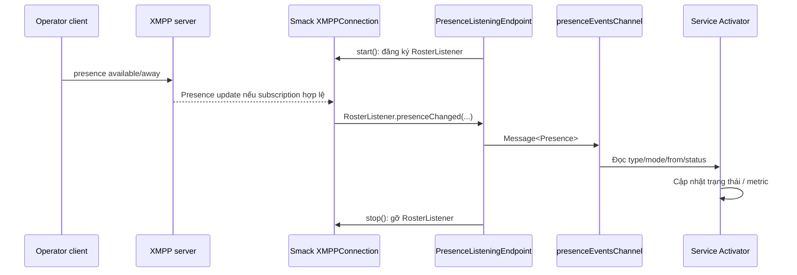
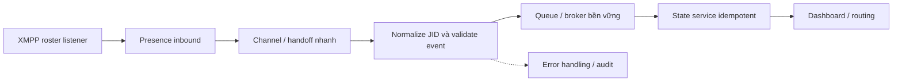

# XMPP presence inbound adapter

## 1. Bối cảnh và mục tiêu

Module **SPRING_INTEGRATION_ADAPTERS** tập trung vào việc nối hệ thống ngoài với Spring Integration thông qua inbound/outbound adapter, gateway, poller và `MessageChannel`; qua đó thực hành hợp đồng message, xử lý lỗi và vòng đời kết nối. Trong chương **Adapter XMPP**, ngoài việc trao đổi nội dung chat, ứng dụng còn có thể **nhận sự kiện hiện diện (presence)** để biết một liên hệ XMPP đang trực tuyến, vắng mặt hoặc không sẵn sàng.

Ví dụ, một hệ thống vận hành có tài khoản `ops-bot@example.org`, được phép theo dõi trạng thái của `operator@example.org`. Khi operator đăng nhập, chuyển sang trạng thái không làm phiền hoặc đăng xuất, ứng dụng có thể cập nhật dashboard hoặc quyết định **có nên gửi thêm cảnh báo qua XMPP**.

```text
operator@example.org/laptop
         |
         | presence available / away / unavailable
         v
    XMPP server
         |
         v
  XMPPConnection (ops-bot)
         |
         v
  PresenceListeningEndpoint
         |
         v
  presenceEventsChannel
         |
         v
  Service Activator -> Presence state / dashboard
```

Sau bài học, bạn có thể:

- Phân biệt **presence inbound** với **message inbound**, presence outbound và gateway.
- Giải thích `Roster`, **presence subscription**, `RosterListener` và các sự kiện `available`, `unavailable`, `away`, `dnd`.
- Cấu hình `XmppConnectionFactoryBean`, `PresenceListeningEndpoint` và `MessageChannel`.
- Đọc payload `org.jivesoftware.smack.packet.Presence`: `getFrom()`, `getType()`, `getMode()`, `getStatus()`, `getPriority()`.
- Hiểu sự khác biệt giữa **full JID** và **bare JID** khi cùng người dùng có nhiều thiết bị.
- Thiết kế lưu trạng thái, chống sự kiện lặp, xử lý reconnect, lỗi consumer, quyền riêng tư và bảo mật.
- Thực hành kiểm chứng trạng thái presence với hai tài khoản XMPP test.

## 2. XMPP presence là gì?

**XMPP (Extensible Messaging and Presence Protocol)** dựa trên các XML stanza. Ba nhóm stanza căn bản là:

| Nhóm stanza | Chức năng | Ví dụ |
| --- | --- | --- |
| `<message>` | Gửi nội dung chat/thông báo | `<body>Import finished</body>` |
| `<presence>` | Công bố trạng thái hiện diện hoặc trao đổi yêu cầu theo dõi | Trực tuyến, vắng mặt, offline |
| `<iq>` | Yêu cầu/phản hồi ở tầng giao thức | Truy vấn đặc tính, roster, cấu hình |

Presence thông thường trông như:

```xml
<presence from="operator@example.org/laptop"
          to="ops-bot@example.org/spring-integration">
    <show>away</show>
    <status>Đang trong cuộc họp</status>
    <priority>5</priority>
</presence>
```

Khi một thiết bị ngắt phiên, server có thể gửi:

```xml
<presence from="operator@example.org/laptop"
          to="ops-bot@example.org/spring-integration"
          type="unavailable"/>
```

Các thuộc tính có ý nghĩa khác nhau:

- `from`: JID của nguồn; có thể chứa **resource** (`/laptop`).
- `type`: trạng thái giao thức như `available`, `unavailable` hoặc loại subscription.
- `show`: chế độ hiện diện như `away`, `dnd`, `xa` khi có `type=available`.
- `status`: thông điệp tự do do người dùng cung cấp, có thể vắng mặt.
- `priority`: mức ưu tiên tương đối của resource khi XMPP server định tuyến; **không phải độ ưu tiên xử lý của doanh nghiệp**.

Không có thuộc tính `type` trong stanza sẵn sàng là điều bình thường; nó thường biểu thị **available**. Thẻ `<show>` là thông tin bổ sung cho trạng thái available, không thay `type`.

## 3. Roster và quyền được xem sự hiện diện

**Roster** là danh sách liên hệ XMPP của tài khoản đã đăng nhập, được quản lý cùng các thông tin subscription. Presence inbound adapter nhận các thay đổi từ những liên hệ mà tài khoản **được quyền theo dõi theo chính sách của server**. Chỉ biết một JID hoặc thêm JID vào một danh sách ở ứng dụng **không tự cấp quyền xem presence**.

Để `ops-bot@example.org` thấy presence của `operator@example.org`, thường cần:

1. Tài khoản bot có entry phù hợp trong roster.
2. Operator hoặc chính sách máy chủ cho phép bot subscribe presence.
3. Client bot đã đăng nhập và roster được tải/đăng ký đúng cách.
4. Operator phát presence và server chuyển sự kiện tới tài khoản được phép.

Trong nhiều triển khai XMPP, **subscription có hướng**: quyền “A xem B” không tự động đồng nghĩa “B xem A”. Một liên hệ trong roster chưa chắc đã cung cấp presence nếu subscription chưa được chấp thuận.

### Subscription mode và quyền riêng tư

`XmppConnectionFactoryBean` có `setSubscriptionMode(...)` để cấu hình cách Smack phản ứng với yêu cầu subscription đến:

| `Roster.SubscriptionMode` | Ý nghĩa | Khuyến nghị |
| --- | --- | --- |
| `accept_all` | Tự động chấp nhận mọi yêu cầu subscribe/unsubscribe theo cơ chế Smack | Chỉ dùng khi đây là chính sách chủ đích trong môi trường tin cậy |
| `reject_all` | Tự động từ chối yêu cầu mới | Phù hợp bot chỉ theo dõi một roster đã được cấp quyền từ trước |
| `manual` | Không tự xử lý; ứng dụng phải xây dựng luồng duyệt yêu cầu | Phù hợp khi có quy trình phê duyệt liên hệ |

Một số phiên bản của **Spring Integration connection factory** chọn `accept_all` làm mặc định, dù mặc định độc lập của Smack Roster có thể khác. **Không dựa vào mặc định của thư viện để quyết định chính sách riêng tư**; đặt tường minh chế độ mong muốn.

Trong ví dụ Java, bot sử dụng `reject_all` và giả định quyền subscribe với operator **đã được thiết lập trên server hoặc qua một client quản trị**. Nếu chưa có quyền, adapter có thể hoạt động bình thường nhưng không thấy sự kiện.

## 4. PresenceListeningEndpoint và cơ chế event-driven

Lớp Java tương ứng là `org.springframework.integration.xmpp.inbound.PresenceListeningEndpoint`. Tài liệu chính thức mô tả cơ chế:

1. Endpoint dùng một `org.jivesoftware.smack.XMPPConnection` đã được xác thực.
2. Khi `start()`, endpoint đăng ký `RosterListener` để theo dõi sự thay đổi presence.
3. Khi nhận sự kiện phù hợp, nó gửi **Spring `Message<Presence>`** tới `outputChannel`.
4. Khi `stop()`, endpoint gỡ listener khỏi roster.



**Endpoint này không phải polling inbound adapter.** Không thêm `@Poller` để quét XMPP server; callback được kích hoạt khi Smack nhận cập nhật roster/presence. Nếu dùng `QueueChannel` ở downstream, một consumer đọc queue có thể cần poller, nhưng đó là bước **sau** inbound adapter.

| Thành phần | Vai trò | Không bảo đảm |
| --- | --- | --- |
| `XmppConnectionFactoryBean` | Khởi tạo, đăng nhập, quản lý kết nối Smack | Không tự cho phép xem mọi liên hệ |
| `PresenceListeningEndpoint` | Nghe cập nhật presence từ roster, phát message | Không bảo đảm luôn có snapshot đầy đủ mọi resource |
| `MessageChannel` | Chuyển event cho downstream | Không tự lưu bền event qua crash |
| `Service Activator` | Chuyển presence thành trạng thái ứng dụng | Không tự biết lúc nào nên hết hạn trạng thái cũ |
| Lớp trạng thái/DB | Ghi current state, thời gian quan sát, nguồn | Không tự khôi phục event bị mất khi offline |

Điểm khác biệt so với message inbound là **payload**: presence adapter chuyển **đối tượng `Presence` của Smack**, không mặc định là `String` body chat.

## 5. Presence.Type và Presence.Mode: hai khái niệm cần tách riêng

`org.jivesoftware.smack.packet.Presence` cung cấp `getType()` và `getMode()`.

### Presence.Type

| Giá trị | Ý nghĩa ở tầng XMPP | Cách hiểu ở ứng dụng |
| --- | --- | --- |
| `available` | Resource đang công bố có thể hiện diện | Một resource đang online; không chứng minh con người sẵn sàng trả lời |
| `unavailable` | Resource rút trạng thái hiện diện | Resource cụ thể không còn online |
| `subscribe` | Yêu cầu được nhận presence của bên kia | Sự kiện liên quan quyền theo dõi, không phải online |
| `subscribed` | Chấp thuận yêu cầu subscription | Quyền được cấp; không đồng nghĩa online |
| `unsubscribe` / `unsubscribed` | Yêu cầu/hủy cấp quyền xem presence | Cần cập nhật chính sách liên hệ và quyền |
| `error` | Lỗi giao thức presence | Cần xử lý riêng và kiểm tra server |

**Lưu ý:** Đây là **các loại stanza presence của giao thức**. Presence inbound endpoint dựa trên `RosterListener` và chủ yếu phản ánh các cập nhật presence cho roster; **không mặc định rằng mọi stanza subscribe/subscribed đều được adapter phát qua channel**. Nếu ứng dụng phải xử lý yêu cầu subscription, hãy dùng khả năng quản lý roster/subscription của Smack tương ứng.

### Presence.Mode

`Mode` bổ sung trạng thái khi `Type.available`:

| Giá trị | Cách diễn giải trong UI | Có tự đồng nghĩa offline? |
| --- | --- | --- |
| `available` hoặc không cung cấp mode | Online/thông thường | Không |
| `chat` | Muốn trao đổi/chat | Không |
| `away` | Tạm vắng | Không |
| `xa` | Vắng lâu (extended away) | Không |
| `dnd` | Không muốn bị làm phiền | Không |

`getStatus()` là chuỗi tự do có thể bằng `null`; **không dùng status text để thay cho `Type` hoặc `Mode`**. Thông điệp “đang trong cuộc họp” không có tính chuẩn hóa và có thể không phản ánh trạng thái tức thời.

Ví dụ logic xử lý:

```java
Presence.Type type = presence.getType();

if (type == Presence.Type.available) {
    // Resource dang hien dien; xem them getMode().
}
else if (type == Presence.Type.unavailable) {
    // Chi resource cua stanza nay rut presence.
}
else {
    // Subscription/error stanza neu chung xuat hien o luong khac.
}
```

## 6. Cấu hình Java 17+ với Spring Boot

Ví dụ sử dụng Spring Boot và Spring Integration XMPP 6.x tương thích. Maven:

```xml
<dependencies>
    <dependency>
        <groupId>org.springframework.boot</groupId>
        <artifactId>spring-boot-starter-integration</artifactId>
    </dependency>
    <dependency>
        <groupId>org.springframework.integration</groupId>
        <artifactId>spring-integration-xmpp</artifactId>
    </dependency>
</dependencies>
```

Nếu không dùng BOM Spring Boot, khai báo phiên bản các dependency tương thích, đặc biệt là Spring Integration và Smack. Không trộn ví dụ API Smack 3.x với module hiện đại.

`application.yml`:

```yaml
app:
  xmpp:
    host: ${XMPP_HOST:xmpp.internal.example.org}
    port: ${XMPP_PORT:5222}
    domain: ${XMPP_DOMAIN:example.org}
    user: ${XMPP_USER:ops-bot}
    password: ${XMPP_PASSWORD}
```

`host` là máy chủ kết nối; `domain` là miền dịch vụ XMPP tương ứng với tài khoản. Chúng **không nhất thiết trùng nhau**. Ví dụ không có tài khoản hoặc máy chủ thực, vì thế cần thay bằng môi trường test đã cấu hình. `XMPP_PASSWORD` phải lấy từ môi trường/secret manager, không lưu vào Git.

### 6.1. Cấu hình connection, endpoint và consumer

```java
import org.jivesoftware.smack.XMPPConnection;
import org.jivesoftware.smack.packet.Presence;
import org.jivesoftware.smack.roster.Roster;

import org.springframework.beans.factory.annotation.Qualifier;
import org.springframework.beans.factory.annotation.Value;
import org.springframework.context.annotation.Bean;
import org.springframework.context.annotation.Configuration;
import org.springframework.integration.annotation.ServiceActivator;
import org.springframework.integration.channel.DirectChannel;
import org.springframework.integration.config.EnableIntegration;
import org.springframework.integration.xmpp.config.XmppConnectionFactoryBean;
import org.springframework.integration.xmpp.inbound.PresenceListeningEndpoint;
import org.springframework.messaging.Message;
import org.springframework.messaging.MessageChannel;

@Configuration
@EnableIntegration
public class XmppPresenceInboundConfig {

    @Bean(name = "xmppConnection")
    public XmppConnectionFactoryBean xmppConnection(
            @Value("${app.xmpp.host}") String host,
            @Value("${app.xmpp.domain}") String domain,
            @Value("${app.xmpp.port:5222}") int port,
            @Value("${app.xmpp.user}") String user,
            @Value("${app.xmpp.password}") String password) {

        XmppConnectionFactoryBean factory =
                new XmppConnectionFactoryBean();
        factory.setHost(host);
        factory.setServiceName(domain);
        factory.setPort(port);
        factory.setUser(user);
        factory.setPassword(password);
        factory.setResource("presence-monitor");

        // Chi su dung roster da duoc cap quyen tu truoc.
        factory.setSubscriptionMode(Roster.SubscriptionMode.reject_all);
        return factory;
    }

    @Bean
    public MessageChannel presenceEventsChannel() {
        return new DirectChannel();
    }

    @Bean
    public PresenceListeningEndpoint presenceInboundAdapter(
            XMPPConnection xmppConnection,
            @Qualifier("presenceEventsChannel") MessageChannel channel) {

        PresenceListeningEndpoint endpoint =
                new PresenceListeningEndpoint(xmppConnection);
        endpoint.setOutputChannel(channel);
        endpoint.setAutoStartup(true);
        return endpoint;
    }

    @ServiceActivator(inputChannel = "presenceEventsChannel")
    public void onPresence(Message<Presence> event) {
        Presence presence = event.getPayload();
        String from = presence.getFrom() == null
                ? "(unknown)"
                : presence.getFrom().toString();

        Presence.Type type = presence.getType();
        Presence.Mode mode = presence.getMode();
        String status = presence.getStatus();
        int priority = presence.getPriority();

        if (type == Presence.Type.available) {
            System.out.printf(
                    "ONLINE from=%s mode=%s priority=%d status=%s%n",
                    from, mode, priority, status
            );
        }
        else if (type == Presence.Type.unavailable) {
            System.out.printf("OFFLINE resource=%s%n", from);
        }
        else {
            System.out.printf(
                    "OTHER presence from=%s type=%s%n",
                    from, type
            );
        }

        // Production: normalize JID, validate contact duoc phep,
        // va cap nhat current-state kem observedAt / event ID.
    }
}
```

Lớp cần nằm trong vùng component scan của `@SpringBootApplication` hoặc được import vào context. Cấu hình trên giả định liên hệ operator **đã cho phép** tài khoản bot subscribe presence. Với `reject_all`, yêu cầu đăng ký mới tới bot bị từ chối; nó **không tự tạo** subscription từ bot tới operator.

Trong thực tế cần bổ sung thiết lập TLS/SASL đúng chính sách máy chủ, CA/truststore phù hợp và xác thực hostname. Đừng tắt kiểm tra chứng chỉ để làm cho demo kết nối được.

### 6.2. Giải thích ví dụ

| Dòng cấu hình | Tác dụng |
| --- | --- |
| `XmppConnectionFactoryBean` | Tạo và quản lý `XMPPConnection` cho `ops-bot` |
| `setServiceName(domain)` | Chỉ định miền dịch vụ XMPP, khác `host` TCP nếu cần |
| `setSubscriptionMode(reject_all)` | Không tự chấp nhận yêu cầu subscription mới |
| `new PresenceListeningEndpoint(connection)` | Tạo endpoint nhận sự kiện presence của roster |
| `setOutputChannel(channel)` | Đưa `Message<Presence>` vào luồng Spring Integration |
| `setAutoStartup(true)` | Đăng ký listener theo lifecycle khi ứng dụng khởi động |
| `@ServiceActivator` | Đọc `Presence`, ghi log test hoặc cập nhật trạng thái ứng dụng |

**Không dùng `ChatMessageListeningEndpoint`** cho ví dụ này: endpoint đó nhận **chat message**, với payload và header mapping riêng. Presence inbound sử dụng `PresenceListeningEndpoint` và payload Smack `Presence`.

## 7. Cấu hình XML namespace tương đương

Nếu dự án dùng XML, Spring Integration cung cấp `<int-xmpp:presence-inbound-channel-adapter>`:

```xml
<beans xmlns="http://www.springframework.org/schema/beans"
       xmlns:xsi="http://www.w3.org/2001/XMLSchema-instance"
       xmlns:int="http://www.springframework.org/schema/integration"
       xmlns:int-xmpp="http://www.springframework.org/schema/integration/xmpp"
       xsi:schemaLocation="
           http://www.springframework.org/schema/beans
           https://www.springframework.org/schema/beans/spring-beans.xsd
           http://www.springframework.org/schema/integration
           https://www.springframework.org/schema/integration/spring-integration.xsd
           http://www.springframework.org/schema/integration/xmpp
           https://www.springframework.org/schema/integration/xmpp/spring-integration-xmpp.xsd">

    <int:channel id="presenceEvents"/>

    <int-xmpp:xmpp-connection
        id="xmppConnection"
        host="${app.xmpp.host}"
        port="${app.xmpp.port}"
        user="${app.xmpp.user}"
        password="${app.xmpp.password}"
        resource="presence-monitor"
        subscription-mode="reject_all"/>

    <int-xmpp:presence-inbound-channel-adapter
        id="presenceInboundAdapter"
        channel="presenceEvents"
        xmpp-connection="xmppConnection"
        auto-startup="true"/>
</beans>
```

Đây là **cách khai báo thay thế** Java config; không chạy đồng thời hai presence inbound adapter chỉ để kiểm thử một flow. Ví dụ XML chưa khai báo service activator: cần thêm consumer cho channel `presenceEvents` mới có xử lý nghiệp vụ. Các placeholder chỉ hoạt động khi XML được nạp trong Spring context có property resolution tương ứng.

Tài liệu chính thức cũng dùng `auto-startup="false"` để minh họa endpoint không tự bắt đầu. Với cấu hình đó, cần gọi `start()` thông qua lifecycle sau khi connection/ứng dụng đã sẵn sàng, nếu không sẽ không nhận event.

## 8. Nhận một sự kiện presence không có nghĩa đã biết trạng thái đầy đủ

Một vấn đề thực tế là **event stream** và **current-state snapshot** khác nhau:

- Presence inbound phản ánh **những cập nhật** mà roster listener nhận được.
- Nó không phải một endpoint truy vấn trả về trạng thái tổng hợp của mọi liên hệ ngay lập tức.
- Một event có thể bị bỏ lỡ khi app offline, reconnect hoặc listener chưa chạy.
- Trạng thái lưu trong DB/cache có thể đã cũ dù kết nối vừa được khôi phục.

Ví dụ:

```text
10:00  operator/laptop  available  -> bot quan sat
10:05  bot mat mang
10:06  operator/laptop  unavailable -> bot KHONG quan sat
10:10  bot reconnect
```

Nếu chỉ dựa vào sự kiện cuối cùng đã lưu lúc 10:00, dashboard có thể vẫn hiển thị **online** sau 10:10 dù operator thực tế đã offline. Cần một chiến lược **reconciliation**:

1. Đánh dấu trạng thái cache `UNKNOWN` trong lúc connection không đáng tin cậy.
2. Khi reconnect, yêu cầu hoặc đọc lại trạng thái roster phù hợp với API Smack/server, tùy quyền subscription.
3. Ghi `observedAt` và thời điểm phiên/kết nối vào dữ liệu.
4. Đặt TTL hoặc chính sách làm cũ trạng thái để không hiển thị dữ liệu vĩnh viễn.
5. Xử lý event cập nhật muộn hoặc trùng với chính sách phiên bản.

**Không coi `unavailable` là bằng chứng người dùng cố ý logout**; nó cũng có thể xuất hiện do mạng, client crash hoặc server đóng session.

## 9. Full JID, bare JID và nhiều resource

Đây là lỗi logic thường gặp nhất khi xây dashboard presence.

```text
operator@example.org/laptop   available
operator@example.org/phone    available
operator@example.org/laptop   unavailable
```

Nếu lấy event thứ ba rồi cập nhật **bare JID** `operator@example.org` thành offline, bạn có thể báo sai. Người dùng vẫn có thể online qua resource `/phone`.

### Quy tắc xử lý theo resource

| Cấp độ | Ví dụ key | Ý nghĩa |
| --- | --- | --- |
| **Full JID** | `operator@example.org/laptop` | Một client/resource cụ thể |
| **Bare JID** | `operator@example.org` | Tài khoản liên hệ, có thể nhiều resource |
| Event ID hoặc phiên | `session/version/observedAt` | Dùng đối chiếu cập nhật, tránh event cũ ghi đè |

Chiến lược lưu trạng thái khuyến nghị:

1. Lưu presence theo **full JID** để biết resource nào còn hoạt động.
2. Khi một resource `unavailable`, chỉ xóa/đánh dấu resource đó offline.
3. Tính account `AVAILABLE` nếu còn **ít nhất một resource** đang available, theo quyền subscription và độ mới của snapshot.
4. Nếu mất kết nối hoặc roster state không chắc chắn, trả `UNKNOWN` thay vì khẳng định offline.
5. Đặt chính sách khi resource đổi tên, server restart hoặc một resource im lặng quá lâu.

Smack hỗ trợ phân tích JID qua API JID/JidCreate; không nên dùng thao tác cắt chuỗi dấu `/` làm chuẩn hóa chính thức trong một hệ thống XMPP phức tạp. Ứng dụng có thể lưu `presence.getFrom()` dưới dạng đối tượng JID hoặc chuẩn hóa với thư viện JID của Smack trước khi ghi database.

### Mode DND có phải offline không?

Không. `Presence.Type.available` kết hợp `Presence.Mode.dnd` vẫn biểu thị tài khoản/resource có hiện diện, nhưng đang yêu cầu **không làm phiền**. Chính sách gửi cảnh báo có thể phân loại:

- `available/chat`: gửi chat bình thường khi hợp đồng cho phép.
- `away/xa`: ưu tiên thông báo không khẩn cấp hoặc chờ một thời gian.
- `dnd`: tránh thông báo thông thường; escalation khi sự kiện khẩn cấp phải theo quy tắc nghiệp vụ.
- `unavailable` hoặc `UNKNOWN`: chuyển qua email/JMS/AMQP/Kafka hoặc hệ thống trực ca khác nếu cần.

Đây là **chính sách minh họa của ứng dụng**, không phải hành vi tự có của XMPP presence adapter.

## 10. Thực hành với hai tài khoản XMPP

Chuẩn bị môi trường thử nghiệm có server Openfire, ejabberd hoặc một XMPP server hỗ trợ roster/presence, với tài khoản `ops-bot@example.org` và `operator@example.org`.

### Các bước

1. **Thiết lập roster và subscription:** tạo quan hệ để bot được phép thấy presence của operator. Kiểm tra trạng thái subscribe trên server/client; không mặc định có quyền.
2. **Đăng nhập bot:** chạy Spring Boot với cấu hình mục 6. Kiểm tra connection được xác thực và endpoint đang running.
3. **Operator online:** đăng nhập `operator@example.org/laptop` trên một XMPP client. Quan sát `Presence.Type.available` được chuyển vào `presenceEventsChannel`.
4. **Chuyển sang away:** thay trạng thái XMPP client thành away, kiểm tra `getMode()` và `getStatus()`.
5. **Chuyển sang DND:** cập nhật client thành dnd và kiểm tra vẫn có `Type.available` nếu server gửi mode tương ứng.
6. **Đăng xuất một resource:** quan sát event `unavailable` của resource đó.
7. **Hai resource:** đăng nhập cùng operator từ laptop và phone; đăng xuất laptop nhưng vẫn giữ phone, xác minh logic account-level không báo offline sai.
8. **Ngắt kết nối bot:** trong môi trường test, tạm ngắt mạng rồi reconnect; so sánh event stream với trạng thái thực và kiểm chứng cơ chế resync.
9. **Không có quyền subscription:** thử một liên hệ chưa cấp quyền. Xác nhận không suy ra offline chỉ vì không nhận event.
10. **Thay consumer chậm:** thêm xử lý DB giả lập, quan sát độ trễ và đề xuất handoff qua queue/broker khi cần.

### Log dự kiến (minh họa)

```text
ONLINE from=operator@example.org/laptop mode=available priority=5 status=null
ONLINE from=operator@example.org/laptop mode=away priority=5 status=Đang họp
ONLINE from=operator@example.org/phone mode=chat priority=0 status=null
OFFLINE resource=operator@example.org/laptop
```

Đây là **kết quả dự kiến**, không phải một lần test thực tế. Nội dung, priority, mode và thứ tự event còn phụ thuộc XMPP client/server. Một số client có thể không gửi `status` hoặc `mode` như ví dụ.

## 11. Consumer chậm, lỗi và backpressure

`PresenceListeningEndpoint` phát message khi Smack gọi roster listener. Với `DirectChannel`, consumer thường chạy **đồng bộ trong lời gọi gửi message** từ adapter. Nếu consumer ghi DB chậm, gọi HTTP lâu hoặc ném exception không kiểm soát, đường nhận sự kiện có thể bị ảnh hưởng.

Kiến trúc cho xử lý nặng:



Lưu ý:

- `ExecutorChannel` hoặc `QueueChannel` có thể tách thread, nhưng hàng đợi **chỉ trong RAM** không tự bền vững khi crash.
- Có thể dùng JMS/AMQP/Kafka để lưu sự kiện và xử lý sau, nhưng phải kiểm soát giao dịch gửi, retry, key, ordering và khả năng lặp.
- Trạng thái presence thay đổi nhanh; nếu downstream quá tải, cân nhắc **coalescing** các sự kiện theo resource nhưng vẫn phải giữ logic thứ tự và trạng thái mới nhất.
- Không đưa mọi trạng thái cũ vào queue vô hạn, khiến dashboard cập nhật trễ nhiều phút.
- Khi consumer gặp lỗi, adapter không tự gửi một XMPP NACK nghiệp vụ khiến server đảm bảo replay; cần retry/lưu lỗi ở tầng ứng dụng.

### Lưu trạng thái an toàn

Một record ứng dụng có thể chứa:

```text
bareJid           = operator@example.org
fullJid           = operator@example.org/laptop
presenceType      = available
presenceMode      = away
observedAt        = 2026-11-23T09:30:00Z
connectionEpoch   = 42
isAuthoritative   = true
```

`connectionEpoch` và `isAuthoritative` là **metadata do ứng dụng tự định nghĩa**, không phải field có sẵn trong Smack `Presence`. Chúng giúp phân biệt dữ liệu từ phiên cũ sau reconnect với sự kiện mới.

Khi cập nhật DB, có thể dùng khóa `(account, fullJid)` cùng version hoặc timestamp có kiểm soát để tránh update cũ ghi đè update mới. Nếu dùng nhiều instance, cần quản lý ownership của connection/roster và trạng thái chia sẻ thay vì chỉ dùng map local từng pod.

## 12. Reconnect, roster snapshot và giới hạn đáng tin cậy

Connection factory của Spring Integration hỗ trợ cơ chế reconnect/login phù hợp trong các trường hợp kết nối bị stale. Tuy nhiên, **reconnect không phải là cam kết replay đầy đủ mọi sự kiện presence đã xảy ra trong lúc offline**.

| Sự cố | Triệu chứng | Hướng xử lý |
| --- | --- | --- |
| Sai host/domain/port | Không đăng nhập được | DNS, tài khoản, cổng, cấu hình server |
| TLS/SASL lỗi | Connection bị từ chối | Truststore/CA, hostname và cơ chế auth |
| Roster chưa được tải | Không có event của contact mong đợi | Kiểm tra quyền subscription và roster loading |
| Bot mất kết nối | Dashboard giữ trạng thái cũ | Đánh dấu UNKNOWN, resync khi reconnect |
| Operator đổi resource | Cùng bare JID có full JID mới | Lưu state theo resource |
| Bản tin presence đến lặp | Update/metric lặp | Idempotent state transitions, so sánh phiên bản |
| Server mất phiên | Có unavailable/available liên tiếp | Debounce phù hợp, không nhầm business event |
| Nhiều pod cùng login | Event phân phối theo resource/server | Một ingress rõ ownership hoặc hợp nhất trạng thái |
| Consumer bị nghẽn | Event đến trễ hoặc lỗi | Bounded queue, metric, bulkhead và timeout |

Nếu cần current-state chính xác hơn, khi hệ thống khởi động và sau reconnect nên thực hiện **reconciliation bằng Smack Roster API** tương ứng với quyền đã cấp, không chỉ đợi event tiếp theo. Cần kiểm chứng behavior của XMPP server và phiên bản Smack; không mặc định adapter tự phát toàn bộ roster state khi start.

Ngoài ra, presence có tính **tạm thời**. “Online ở 09:00” không phải bằng chứng user còn online ở 09:30. Thiết kế TTL, heartbeat hoặc chính sách đánh dấu state không chắc chắn theo nhu cầu nghiệp vụ.

## 13. Bảo mật và quyền riêng tư

Presence là thông tin hành vi của người dùng. Việc theo dõi thời điểm trực tuyến, vắng mặt hoặc đang trong cuộc họp có thể nhạy cảm trong ngữ cảnh vận hành. Hệ thống cần hạn chế thu thập, hiển thị và lưu trữ dữ liệu này.

Các nguyên tắc:

1. **Subscription hợp lệ:** chỉ nhận presence của những tài khoản đã cấp quyền theo chính sách server; không cố bypass roster.
2. **Không auto-accept bừa bãi:** đặt `subscription-mode` tường minh; cân nhắc `reject_all` hoặc `manual` trong production.
3. **TLS và SASL:** xác minh certificate/hostname và áp dụng cơ chế auth phù hợp; không vô hiệu hóa TLS trong production.
4. **Secret management:** giữ password bot trong môi trường/secret manager, không đưa vào tài liệu, repository hoặc log.
5. **Data minimization:** chỉ lưu JID/trạng thái/thời gian thực sự cần; giới hạn thời gian retention.
6. **Authorization:** không cho mọi người dùng hệ thống xem bảng theo dõi presence của toàn bộ tổ chức.
7. **Không tin status text:** trường `getStatus()` là input tự do; escape khi hiển thị HTML, không dùng làm lệnh shell/SQL.
8. **Audit:** ghi nhận thay đổi quyền subscription và truy cập dữ liệu presence theo yêu cầu kiểm toán.

**Presence không phải định danh xác thực của một người bên ngoài ứng dụng.** Một resource đang available không chứng minh một cá nhân đang trực tiếp sử dụng thiết bị, cũng không thể thay thế các cơ chế xác thực/ủy quyền cho nghiệp vụ quan trọng.

## 14. So sánh với các adapter khác

| Endpoint | Payload phổ biến | Cách nhận/phát | Mục đích |
| --- | --- | --- | --- |
| **XMPP presence inbound** | Smack `Presence` | `RosterListener` event-driven | Nhận thay đổi trạng thái liên hệ |
| XMPP presence outbound | Smack `Presence` | Gửi stanza qua connection | Công bố trạng thái tài khoản bot |
| XMPP message inbound | Smack `Message` hoặc payload từ SpEL | Stanza listener | Nhận body chat/extension |
| XMPP message outbound | `String` / Smack `Message` | Gửi stanza | Gửi tin nhắn chat |
| File inbound | `File` | Poll scanner hoặc watch strategy | Nhận file |
| HTTP inbound gateway | Request payload | HTTP request/response | Phục vụ lời gọi đồng bộ |
| JMS/AMQP inbound | Message broker | Listener/ACK | Nhận message từ queue |
| Kafka inbound | Record và offset | Consumer poll | Tiêu thụ stream theo partition |

Không coi presence inbound là một **event log có replay** giống Kafka, cũng không dùng `@Poller` như khi đọc file. Việc chọn `MessageChannel`, chuyển đổi payload và xử lý lỗi phải phù hợp semantics của nguồn.

## 15. Troubleshooting

| Biểu hiện | Nguyên nhân có thể | Hướng kiểm tra |
| --- | --- | --- |
| Endpoint chạy nhưng không có event | Bot không được cấp quyền subscribe | Kiểm tra roster, subscription và server log |
| Không thấy trạng thái của operator | Operator offline hoặc presence đang gửi cho resource khác | Kiểm tra bare/full JID và trạng thái server |
| Bot không đăng nhập | Sai domain, password, SASL hoặc TLS | Kết nối, truststore, host/port |
| Consumer lỗi kiểu payload | Xử lý như `String` thay vì `Presence` | Dùng `Message<Presence>` hoặc transformer rõ ràng |
| UI hiện OFFLINE khi một thiết bị tắt | Gộp bare JID sai | Lưu trạng thái theo từng full JID |
| UI hiện ONLINE mãi sau mất mạng | Chỉ lưu event cuối | UNKNOWN/TTL và reconciliation |
| Không thấy subscription request trong channel | Roster listener chủ yếu báo presence changes | Dùng Smack subscription API riêng nếu cần |
| Handler chậm khiến luồng nhận tắc | DirectChannel xử lý DB/HTTP đồng bộ | Handoff nhanh sang queue/broker có giới hạn |
| Có sự kiện trùng | Server hoặc connection phát lại/cập nhật lặp | Idempotency và thứ tự event |
| Lộ thông tin trạng thái | Log quá chi tiết hoặc API không kiểm soát quyền | Masking, authorization, retention |

## 16. Bài tập thực hành

1. **Dựng XMPP test:** tạo bot và operator; thiết lập roster/subscription trước khi chạy code.
2. **Nhận event online:** đăng nhập operator và log `Presence.Type`, `Mode`, `From`, `Status`.
3. **Thử away/dnd:** chuyển chế độ client, giải thích tại sao `Type.available` có thể giữ nguyên.
4. **Thử unavailable:** logout một resource, xác minh downstream chỉ đánh dấu resource đó offline.
5. **Hai thiết bị:** giữ `/phone` online khi `/laptop` logout, kiểm tra tài khoản vẫn được tính available.
6. **Không có quyền:** thử một JID chưa subscribe; không tự suy luận liên hệ offline vì không nhận event.
7. **Phân biệt presence/chat:** gửi `<message>` chứa body rồi cho biết vì sao không nên mong presence adapter nhận nó.
8. **Restart/reconnect:** ngắt connection trong môi trường test, đối chiếu state cache với roster sau login lại.
9. **Chuyển sang queue:** thêm một downstream queue hoặc broker, giải thích backpressure và cách giữ sự kiện mới nhất.
10. **Bảo mật:** thay `accept_all` thành `reject_all` hoặc `manual` và mô tả quy trình duyệt subscription phù hợp.

### Câu hỏi tự kiểm tra

**Q1. Lớp Java của XMPP presence inbound là gì?**  
`PresenceListeningEndpoint`.

**Q2. Payload gửi xuống channel là String body hay đối tượng Presence?**  
Là đối tượng Smack `org.jivesoftware.smack.packet.Presence`.

**Q3. Inbound adapter nhận presence bằng poller hay listener?**  
Bằng `RosterListener` trên kết nối XMPP; đây là luồng event-driven.

**Q4. `available` và `away` có cùng ý nghĩa không?**  
Không. `available` là `Presence.Type`; `away` là `Presence.Mode` khi resource có hiện diện.

**Q5. Một sự kiện unavailable từ laptop có chứng minh người dùng offline hoàn toàn?**  
Không. Tài khoản có thể còn resource khác đang available.

**Q6. Tại sao bot không thấy presence của một JID bất kỳ?**  
Vì cần quan hệ roster/subscription và quyền phù hợp do server thực thi.

**Q7. Reconnect thành công có nghĩa state cache chắc chắn chính xác không?**  
Không. Cần đánh dấu state không chắc chắn và đối chiếu lại với roster.

**Q8. Presence inbound có thay thế được ACK và retry của broker không?**  
Không. Nó chỉ phát cập nhật hiện diện; muốn xử lý dữ liệu nghiệp vụ bền vững phải thiết kế cơ chế riêng.

## 17. Ghi nhớ

**XMPP presence inbound adapter** nhận các thay đổi trạng thái hiện diện của liên hệ trong roster qua `PresenceListeningEndpoint` và `RosterListener`, rồi phát `Message<Presence>` vào `MessageChannel`. Payload là Smack `Presence` với `Type`, `Mode`, JID, status và priority; khác với XMPP message inbound nhận nội dung chat.

Để ứng dụng phản ánh trạng thái đúng, phải quản lý **subscription, full JID/bare JID, nhiều resource, snapshot khi reconnect và độ mới của trạng thái**. Đây là luồng sự kiện, không phải dữ liệu online/offline đúng vĩnh viễn, không có bảo đảm replay tự động. Khi triển khai, cần TLS/SASL, giới hạn quyền xem presence, consumer xử lý nhanh, cơ chế lỗi/monitoring và đối chiếu trạng thái sau gián đoạn.

### Tài liệu tham khảo

- [Spring Integration Reference — XMPP Presence](https://docs.spring.io/spring-integration/reference/xmpp.html)
- [Spring Integration API — PresenceListeningEndpoint](https://docs.spring.io/spring-integration/docs/6.5.0-SNAPSHOT/api/org/springframework/integration/xmpp/inbound/PresenceListeningEndpoint.html)
- [Spring Integration API — XmppConnectionFactoryBean](https://docs.spring.io/spring-integration/docs/6.5.0/api/org/springframework/integration/xmpp/config/XmppConnectionFactoryBean.html)
- [Smack API — Presence](https://download.igniterealtime.org/smack/docs/latest/javadoc/org/jivesoftware/smack/packet/Presence.html)
- [Smack API — Roster and SubscriptionMode](https://download.igniterealtime.org/smack/docs/latest/javadoc/org/jivesoftware/smack/roster/Roster.html)
- [XMPP RFC 6121 — Instant Messaging and Presence](https://xmpp.org/rfcs/rfc6121.html)
