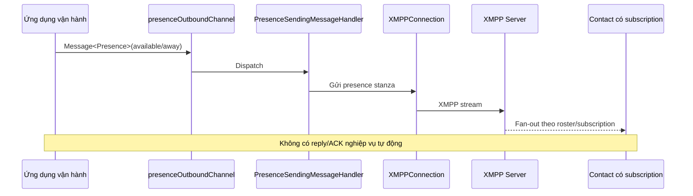

# XMPP presence outbound adapter

## 1. Bối cảnh: công bố trạng thái của ứng dụng lên XMPP

Trong module **SPRING_INTEGRATION_ADAPTERS**, ứng dụng học cách kết nối những hệ thống bên ngoài bằng inbound/outbound adapter, gateway, poller và `MessageChannel`; đồng thời quan tâm tới hợp đồng message, lỗi và vòng đời kết nối. Ở chương **Adapter XMPP**, một nhu cầu khác với gửi tin nhắn chat là **công bố trạng thái hiện diện (presence) của chính tài khoản bot** tới các liên hệ XMPP được phép theo dõi.

Giả sử dịch vụ `ops-bot@example.org` xử lý các sự kiện từ file, SFTP, HTTP, JMS, AMQP, Kafka và database. Trong giờ làm việc, bot công bố trạng thái `available`; khi đang bảo trì, nó chuyển sang `away` hoặc `dnd`; khi rút khỏi hệ thống, nó có thể công bố `unavailable`.

```text
Sự kiện lifecycle / trạng thái vận hành
          |
          v
Presence publisher (Spring bean)
          |
          v
presenceOutboundChannel
          |
          v
PresenceSendingMessageHandler
          |
          v
XMPPConnection (Smack, TLS/SASL)
          |
          v
XMPP server
          |
          +--> Các liên hệ có quyền xem presence của ops-bot
```

Mục tiêu bài học:

- Phân biệt **XMPP presence outbound adapter** với message outbound/inbound và presence inbound.
- Tạo payload `org.jivesoftware.smack.packet.Presence` đúng hợp đồng của adapter.
- Hiểu `Presence.Type`, `Presence.Mode`, `status` và `priority`.
- Cấu hình `XmppConnectionFactoryBean`, `PresenceSendingMessageHandler` và channel bằng Spring Boot Java.
- Dùng XML namespace `presence-outbound-channel-adapter` và phân biệt `DirectChannel` với `PollableChannel`.
- Giải thích broadcast presence, roster/subscription, multiple resources và tác động của login/reconnect.
- Thiết kế error handling, retry, bảo mật, quan sát và trạng thái ứng dụng không bị sai khi mất kết nối.

## 2. Presence khác message chat như thế nào?

XMPP là **Extensible Messaging and Presence Protocol**, sử dụng các XML stanza. XMPP có ba nhóm stanza cơ bản:

| Stanza | Vai trò | Ví dụ |
| --- | --- | --- |
| `<message>` | Truyền nội dung chat/thông báo | Tin nhắn chứa `<body>Import completed</body>` |
| `<presence>` | Công bố trạng thái hiện diện hoặc trao đổi yêu cầu subscription | Online, away, unavailable |
| `<iq>` | Truy vấn/trả lời ở tầng giao thức | Roster, khám phá khả năng |

Presence outbound gửi **`<presence>`**, không tạo chat message. Ví dụ cập nhật trạng thái bot:

```xml
<presence>
    <show>away</show>
    <status>Đang bảo trì kết nối dữ liệu</status>
    <priority>0</priority>
</presence>
```

Khi ngừng hiện diện:

```xml
<presence type="unavailable">
    <status>Ứng dụng tạm ngừng</status>
</presence>
```

Đây là các stanza **minh họa**. Server có thể thêm, thay đổi hoặc bỏ các thuộc tính theo chính sách; `from` thực tế gắn với phiên XMPP đã xác thực. Không cần tự đưa `from` vào một stanza broadcast bình thường để “đổi danh tính”.

### So sánh bốn endpoint XMPP

| Endpoint | Hướng truyền | Payload điển hình | Mục đích |
| --- | --- | --- | --- |
| **Presence outbound** | Spring Integration → XMPP | Smack `Presence` | Công bố trạng thái tài khoản đang đăng nhập |
| Presence inbound | XMPP → Spring Integration | Smack `Presence` | Nhận trạng thái của các liên hệ trong roster |
| Message outbound | Spring Integration → XMPP | `String` hoặc Smack `Message` | Gửi nội dung chat |
| Message inbound | XMPP → Spring Integration | Chat body hoặc Smack `Message` | Nhận nội dung chat |

**Không gửi `String` làm payload của presence outbound** chỉ vì message outbound chấp nhận text. Hợp đồng của `PresenceSendingMessageHandler` là `Presence`; nếu nhận sự kiện nghiệp vụ dạng `String`/DTO, phải chuyển nó sang `Presence` trước khi gọi handler.

## 3. Presence.Type và Presence.Mode

Trong Smack, `org.jivesoftware.smack.packet.Presence` chứa hai khía cạnh khác nhau:

1. **`Presence.Type`**: loại presence stanza theo giao thức.
2. **`Presence.Mode`**: trạng thái chi tiết khi tài khoản/resource vẫn `available`.

### 3.1. Presence.Type

| Giá trị | Ý nghĩa | Có dùng để đổi trạng thái bot? |
| --- | --- | --- |
| `available` | Resource đang công bố hiện diện | Có |
| `unavailable` | Resource rút trạng thái hiện diện | Có |
| `subscribe` | Yêu cầu được theo dõi presence người khác | Không phải chế độ online |
| `subscribed` | Chấp nhận yêu cầu subscription | Không phải chế độ online |
| `unsubscribe` | Hủy yêu cầu theo dõi | Cần xử lý theo quy tắc roster |
| `unsubscribed` | Thu hồi quyền theo dõi | Cần xử lý theo quy tắc roster |
| `error` | Presence stanza chứa lỗi giao thức | Không dùng như trạng thái bình thường |

Ví dụ chuyển bot sang **offline** bằng `Type.unavailable`. Không thay bằng `Mode.away`: away vẫn thể hiện một resource đang hiện diện.

### 3.2. Presence.Mode

| Giá trị | Cách hiểu phổ biến | Loại presence thường đi kèm |
| --- | --- | --- |
| `available` | Online bình thường | `Type.available` |
| `chat` | Sẵn sàng trò chuyện | `Type.available` |
| `away` | Tạm vắng | `Type.available` |
| `xa` | Vắng lâu (extended away) | `Type.available` |
| `dnd` | Không muốn bị làm phiền | `Type.available` |

`Mode.dnd` **không đồng nghĩa** server ngừng định tuyến message cho bot, trừ khi ứng dụng hoặc hệ thống khác có quy tắc riêng. Nó là tín hiệu hiện diện, không phải firewall hoặc cơ chế tắt consumer.

### 3.3. Status và priority

- `status`: chuỗi mô tả tự do, chẳng hạn “Đang xử lý sự cố”. Người xem có thể không hiển thị nó và ứng dụng nhận không được tin nội dung này như lệnh.
- `priority`: giá trị tương đối của **resource XMPP** có liên quan đến cách server định tuyến các stanza không gắn resource cụ thể. Nó **không phải priority của JMS/Kafka**, cũng không quyết định mức nghiêm trọng của cảnh báo.
- `from` và `to`: thuộc tính JID trong stanza; presence broadcast thông thường không cần chỉ định một JID đích, còn **directed presence** có thể sử dụng `to` theo hợp đồng giao thức.

## 4. Cơ chế outbound adapter

Spring Integration cung cấp `org.springframework.integration.xmpp.outbound.PresenceSendingMessageHandler`. Handler nhận một Spring `Message<?>`, lấy **payload `Presence`** và yêu cầu `XMPPConnection` gửi nó.



Các thành phần:

| Thành phần | Trách nhiệm | Giới hạn |
| --- | --- | --- |
| `XmppConnectionFactoryBean` | Khởi tạo và quản lý kết nối Smack | Không thay thế bảo mật và quản lý secret |
| `PresenceSendingMessageHandler` | Gửi payload `Presence` qua kết nối | Không cung cấp reply message |
| `DirectChannel` | Kích hoạt handler khi có message | Không phải hàng đợi bền vững |
| `QueueChannel` + poller | Lấy message chờ theo chu kỳ | Không tự gửi lại presence theo nhịp nếu queue không có message |
| XMPP server | Định tuyến presence tới liên hệ phù hợp | Không bảo đảm mọi người đã nhìn thấy trạng thái |

**XMPP presence outbound là một outbound channel adapter một chiều.** Nếu cần biết một hệ thống khác đã xử lý yêu cầu, phải thiết kế **message inbound, event ID/correlation và quy trình xác nhận riêng**, không suy ra từ việc gửi presence.

## 5. Roster và subscription quyết định ai nhìn thấy trạng thái

Presence broadcast thông thường không phải một message gửi đến mọi JID mà ứng dụng biết. XMPP server gửi bản cập nhật tới những liên hệ có **quyền subscribe presence của tài khoản bot** theo quy tắc roster và quyền riêng tư.

Ví dụ:

```text
ops-bot@example.org
  |
  +-- operator@example.org  (đã subscribe presence của bot)
  |
  +-- auditor@example.org   (chưa được cấp quyền subscribe)
```

Khi bot chuyển sang away, operator có thể thấy cập nhật; auditor không mặc nhiên nhận được chỉ vì biết JID của bot.

### Phân biệt hai chiều subscription

“Operator có quyền xem bot” và “bot có quyền xem operator” là **hai hướng riêng**. XMPP roster có thể lưu subscription với trạng thái `to`, `from`, `both` hoặc `none`. Nếu cần hiển thị trạng thái của operator, ứng dụng phải có quyền theo dõi operator và sử dụng **presence inbound adapter**; chỉ có outbound presence không đủ.

### SubscriptionMode của connection factory

`XmppConnectionFactoryBean.setSubscriptionMode(...)` cấu hình cách Smack phản ứng với yêu cầu subscription **đến tài khoản đang đăng nhập**.

| Mode | Ý nghĩa | Rủi ro/chú ý |
| --- | --- | --- |
| `Roster.SubscriptionMode.accept_all` | Tự chấp nhận yêu cầu subscribe theo cơ chế Smack | Có thể tiết lộ presence cho người không mong muốn |
| `reject_all` | Từ chối tự động các yêu cầu mới | Nên dùng nếu roster đã được cấp quyền và không muốn tự mở rộng |
| `manual` | Để ứng dụng thực hiện quy trình chấp thuận | Cần một workflow quản trị subscription |

Tài liệu API Spring Integration 6.5 mô tả mặc định của connection factory là `accept_all`. **Đừng để chính sách quyền phụ thuộc vào một giá trị mặc định**: trong môi trường có dữ liệu nội bộ, đặt chế độ tường minh và thống nhất với chính sách server.

Nếu chỉ cần phát presence và không cần tính năng roster, một số cấu hình có thể tắt subscription handling bằng `setSubscriptionMode(null)`. Tuy nhiên, điều này có thể ảnh hưởng đến việc tải roster và không tự bảo đảm những người khác vẫn nhận được presence như dự kiến. Chỉ áp dụng sau khi kiểm chứng cấu hình máy chủ và yêu cầu nghiệp vụ.

## 6. Cấu hình dự án Spring Boot

Ví dụ dùng **Java 17+** và phiên bản Spring Integration 6.x phù hợp với Spring Boot. Maven dependencies:

```xml
<dependencies>
    <dependency>
        <groupId>org.springframework.boot</groupId>
        <artifactId>spring-boot-starter-integration</artifactId>
    </dependency>
    <dependency>
        <groupId>org.springframework.integration</groupId>
        <artifactId>spring-integration-xmpp</artifactId>
    </dependency>
</dependencies>
```

`spring-integration-xmpp` tích hợp thư viện **Smack**. Nếu không dùng BOM của Spring Boot, cần chọn rõ dependency version tương thích. Đoạn Java dưới đây dùng API builder Smack hiện đại, tránh constructor `new Presence(Type)` và các setter `Presence.setStatus(...)` đã bị deprecated ở một số phiên bản.

Chuẩn bị server XMPP test như Openfire/ejabberd và ít nhất hai tài khoản:

- Bot công bố presence: `ops-bot@example.org`.
- Client quan sát: `operator@example.org`, có quyền xem presence của bot.

`application.yml`:

```yaml
app:
  xmpp:
    host: ${XMPP_HOST:xmpp.internal.example.org}
    port: ${XMPP_PORT:5222}
    domain: ${XMPP_DOMAIN:example.org}
    user: ${XMPP_USER:ops-bot}
    password: ${XMPP_PASSWORD}
```

`host` là hostname TCP của máy chủ; `domain` là miền dịch vụ XMPP của JID, không nhất thiết giống host. Giá trị `example.org` ở đây chỉ để minh họa; cần thay bằng domain và server của môi trường test.

Không commit password vào source. Dùng secret manager hoặc environment variable, bật TLS có xác minh chứng chỉ/hostname và SASL phù hợp; kiểm soát cổng truy cập và quyền của tài khoản.

## 7. Ví dụ Java hoàn chỉnh: công bố trạng thái away

Lớp cấu hình dưới đây tạo `XMPPConnection`, `DirectChannel` và `PresenceSendingMessageHandler`. Một `ApplicationRunner` gửi trạng thái `available + away` khi ứng dụng được khởi động, chỉ khi connection đã xác thực.

```java
import org.jivesoftware.smack.XMPPConnection;
import org.jivesoftware.smack.packet.Presence;
import org.jivesoftware.smack.roster.Roster;

import org.springframework.beans.factory.annotation.Qualifier;
import org.springframework.beans.factory.annotation.Value;
import org.springframework.boot.ApplicationRunner;
import org.springframework.context.annotation.Bean;
import org.springframework.context.annotation.Configuration;
import org.springframework.integration.annotation.ServiceActivator;
import org.springframework.integration.channel.DirectChannel;
import org.springframework.integration.config.EnableIntegration;
import org.springframework.integration.xmpp.config.XmppConnectionFactoryBean;
import org.springframework.integration.xmpp.outbound.PresenceSendingMessageHandler;
import org.springframework.messaging.MessageChannel;
import org.springframework.messaging.support.MessageBuilder;

@Configuration
@EnableIntegration
public class XmppPresenceOutboundConfig {

    @Bean(name = "xmppConnection")
    public XmppConnectionFactoryBean xmppConnection(
            @Value("${app.xmpp.host}") String host,
            @Value("${app.xmpp.domain}") String domain,
            @Value("${app.xmpp.port:5222}") int port,
            @Value("${app.xmpp.user}") String user,
            @Value("${app.xmpp.password}") String password) {

        XmppConnectionFactoryBean factory =
                new XmppConnectionFactoryBean();
        factory.setHost(host);
        factory.setServiceName(domain);
        factory.setPort(port);
        factory.setUser(user);
        factory.setPassword(password);
        factory.setResource("presence-publisher");

        // Khong tu chap nhan nhung yeu cau subscription moi.
        factory.setSubscriptionMode(Roster.SubscriptionMode.reject_all);
        return factory;
    }

    @Bean
    public MessageChannel presenceOutboundChannel() {
        return new DirectChannel();
    }

    @Bean
    @ServiceActivator(inputChannel = "presenceOutboundChannel")
    public PresenceSendingMessageHandler presenceOutboundAdapter(
            XMPPConnection xmppConnection) {

        return new PresenceSendingMessageHandler(xmppConnection);
    }

    @Bean
    public ApplicationRunner publishInitialBusinessStatus(
            XMPPConnection xmppConnection,
            @Qualifier("presenceOutboundChannel") MessageChannel channel) {

        return args -> {
            if (!xmppConnection.isAuthenticated()) {
                throw new IllegalStateException(
                        "XMPP connection is not authenticated"
                );
            }

            Presence away = xmppConnection.getStanzaFactory()
                    .buildPresenceStanza()
                    .ofType(Presence.Type.available)
                    .setMode(Presence.Mode.away)
                    .setStatus("Dang bao tri mot so luong tich hop")
                    .setPriority(0)
                    .build();

            boolean accepted = channel.send(
                    MessageBuilder.withPayload(away).build()
            );
            if (!accepted) {
                throw new IllegalStateException(
                        "Presence outbound channel rejected the message"
                );
            }
        };
    }
}
```

Đặt class trong phạm vi component scan của `@SpringBootApplication` hoặc import vào Spring context. Ví dụ **chưa được thực thi trong bài học**; phải có server XMPP thật, account hợp lệ và quan hệ subscription phù hợp để kiểm chứng end-to-end.

### Đọc luồng gửi

1. `XmppConnectionFactoryBean` tạo một kết nối Smack đã cấu hình host/domain/port/user/password và resource của bot.
2. `PresenceSendingMessageHandler` được đăng ký làm consumer của `presenceOutboundChannel` thông qua `@ServiceActivator`.
3. `ApplicationRunner` kiểm tra `XMPPConnection.isAuthenticated()` rồi dùng **`getStanzaFactory().buildPresenceStanza()`** để tạo payload `Presence`.
4. `MessageBuilder.withPayload(away)` tạo Spring `Message<Presence>`. Không cần header `XmppHeaders.TO` khi công bố presence broadcast thông thường.
5. `channel.send(...)` chuyển message tới handler, handler gửi presence qua connection.
6. Server phân phối thay đổi trạng thái theo roster/subscription và chính sách của nó.

Nếu triển khai kết nối bằng TLS/SASL nâng cao, sử dụng `XmppConnectionFactoryBean.setConnectionConfiguration(XMPPTCPConnectionConfiguration)` với cấu hình Smack thích hợp. Không thay thế cấu hình bảo mật bằng việc tắt certificate verification.

### ApplicationRunner chỉ là nguồn sự kiện thử nghiệm

Trong production, nguồn phát presence thường là:

- Sự kiện chuyển chế độ bảo trì hoặc ngừng nhận tác vụ.
- Health/lifecycle event **đã được xác thực bằng trạng thái nghiệp vụ**, không phải chỉ kiểm tra một cờ.
- Scheduler có điều kiện để cập nhật mode mới, không phát lặp vô hạn cùng một giá trị.
- Điều khiển vận hành có phân quyền để công bố available/away/dnd.

Nếu application runner chạy trước khi kết nối xác thực xong, ví dụ cố ý báo lỗi thay vì giả định gửi thành công. Hệ thống thực có thể chờ health/connection event, lưu **trạng thái presence mong muốn**, rồi phát lại khi kết nối được khôi phục.

## 8. Tạo các trạng thái available, dnd và unavailable

Sau khi có `XMPPConnection`, có thể xây dựng nhiều giá trị `Presence` bằng builder:

```java
Presence available = xmppConnection.getStanzaFactory()
        .buildPresenceStanza()
        .ofType(Presence.Type.available)
        .setMode(Presence.Mode.chat)
        .setStatus("San sang nhan yeu cau")
        .build();

Presence doNotDisturb = xmppConnection.getStanzaFactory()
        .buildPresenceStanza()
        .ofType(Presence.Type.available)
        .setMode(Presence.Mode.dnd)
        .setStatus("Dang xu ly su co")
        .build();

Presence unavailable = xmppConnection.getStanzaFactory()
        .buildPresenceStanza()
        .ofType(Presence.Type.unavailable)
        .setStatus("Tam dung dich vu")
        .build();
```

Đây là các **đoạn tạo payload**, có thể được gửi qua cùng `presenceOutboundChannel`. Không dùng `setMode(Presence.Mode.dnd)` để thay thế `Type.unavailable`; chúng có ý nghĩa giao thức khác nhau.

### Lưu ý về priority

`setPriority(...)` là mức ưu tiên của một **resource XMPP** trong quyết định định tuyến theo server và quy tắc XMPP. Nó không phải cách điều chỉnh độ ưu tiên của event bên trong JMS/AMQP/Kafka. Nếu ứng dụng có nhiều resource cùng JID, việc gửi presence từ một resource không đồng nghĩa mọi resource đã chuyển sang cùng trạng thái.

### Không gửi “offline” trước khi chắc chắn có kết nối

Một handler không thể phát stanza `unavailable` ra mạng khi TCP connection đã mất. Khi shutdown thông thường, Smack/server có thể phát unavailable trong quá trình đóng phiên, nhưng **không bảo đảm** một thao tác shutdown hook luôn chạy nếu process bị kill, host mất điện hoặc mạng đã đứt. Bên xem cần hiểu trạng thái cuối cùng có thể bị trễ hoặc stale.

## 9. XML namespace: cách cấu hình outbound presence

Spring Integration cũng hỗ trợ phần tử `<int-xmpp:presence-outbound-channel-adapter>`:

```xml
<beans xmlns="http://www.springframework.org/schema/beans"
       xmlns:xsi="http://www.w3.org/2001/XMLSchema-instance"
       xmlns:int="http://www.springframework.org/schema/integration"
       xmlns:int-xmpp="http://www.springframework.org/schema/integration/xmpp"
       xsi:schemaLocation="
           http://www.springframework.org/schema/beans
           https://www.springframework.org/schema/beans/spring-beans.xsd
           http://www.springframework.org/schema/integration
           https://www.springframework.org/schema/integration/spring-integration.xsd
           http://www.springframework.org/schema/integration/xmpp
           https://www.springframework.org/schema/integration/xmpp/spring-integration-xmpp.xsd">

    <int:channel id="presenceOutboundChannel"/>

    <int-xmpp:xmpp-connection
        id="xmppConnection"
        host="${app.xmpp.host}"
        port="${app.xmpp.port}"
        user="${app.xmpp.user}"
        password="${app.xmpp.password}"
        resource="presence-publisher"
        subscription-mode="reject_all"/>

    <int-xmpp:presence-outbound-channel-adapter
        id="presencePublisher"
        channel="presenceOutboundChannel"
        xmpp-connection="xmppConnection"/>
</beans>
```

Đây là **phương án thay thế** Java configuration; không bật đồng thời hai endpoint gửi cùng một presence nếu không chủ định. Trong ví dụ XML, ứng dụng vẫn phải có producer đặt **`Message<Presence>`** vào `presenceOutboundChannel`. Các placeholder được resolve theo Spring Environment của ứng dụng.

### Khi sử dụng PollableChannel

Nếu nhận message từ `QueueChannel`, outbound endpoint phải có **poller để lấy message chờ**. Ví dụ XML minh họa cách khai báo riêng:

```xml
<int:channel id="presenceQueue">
    <int:queue capacity="100"/>
</int:channel>

<int-xmpp:presence-outbound-channel-adapter
    id="pollingPresencePublisher"
    channel="presenceQueue"
    xmpp-connection="xmppConnection">
    <int:poller fixed-rate="1000" max-messages-per-poll="1"/>
</int-xmpp:presence-outbound-channel-adapter>
```

Đây là **cấu hình thay thế** cho adapter dùng DirectChannel phía trên, không phải cấu hình thứ hai cần triển khai đồng thời. Poller lấy **tối đa một message đã có trong queue mỗi lượt**; nó **không tự tạo ra bản cập nhật presence mới mỗi giây**. Nếu muốn heartbeat hoặc refresh trạng thái, phải có producer đưa sự kiện vào channel theo chính sách.

Khi gửi qua queue chỉ nằm trong RAM, dữ liệu chờ có thể mất khi JVM dừng; với yêu cầu bền vững hoặc cần retry, chọn message store/broker tương ứng.

## 10. Presence khi đăng nhập và khi reconnect

Đây là điểm dễ làm ứng dụng công bố **hai trạng thái liên tiếp**:

1. Smack có tùy chọn `ConnectionConfiguration.Builder.setSendPresence(boolean)`. Mặc định, client có thể gửi một `available` presence ban đầu sau khi login.
2. Ví dụ ở mục 7 tiếp tục gửi `available + away` khi `ApplicationRunner` chạy.
3. Liên hệ có quyền subscribe có thể nhìn thấy hai cập nhật gần nhau: ban đầu online bình thường, rồi away.

Điều này không nhất thiết sai, nhưng nếu UI/logic phụ thuộc vào thứ tự, cần quyết định ai chịu trách nhiệm phát **initial presence**. Trong cấu hình Smack nâng cao, `setSendPresence(false)` có thể được sử dụng để kiểm soát việc phát presence ban đầu, với điều kiện ứng dụng **chắc chắn tự công bố trạng thái sau khi đăng nhập**.

### Reconnect làm trạng thái bị lệch

Giả sử bot đã phát `dnd`, rồi mạng bị ngắt:

```text
10:00  login, presence available
10:05  ứng dụng công bố dnd
10:06  mất kết nối XMPP
10:10  kết nối lại, Smack tự gửi initial available
10:11  ứng dụng chưa gửi lại dnd
```

Nếu chỉ dựa vào “message dnd đã được gửi lúc 10:05”, các liên hệ có thể thấy bot ở mode available sau reconnect, trong khi nghiệp vụ vẫn đang xử lý sự cố.

Giải pháp:

- Lưu **desired presence state** trong ứng dụng, ví dụ `type=available, mode=dnd, status="Đang xử lý sự cố"`.
- Khi kết nối được xác thực lại, phát lại desired state theo **epoch/session hiện tại**.
- Giảm các lần gửi trùng liên tiếp, nhưng chấp nhận rằng việc phát lại sau reconnect có thể là cần thiết.
- Quan sát trạng thái connection và xác minh bằng một client subscriber ở môi trường test.
- Tránh tuyên bố đã cập nhật trạng thái chỉ vì ghi thành công một biến local khi XMPP connection vẫn mất.

Đây là chính sách **reconciliation** của ứng dụng, không phải một khả năng tự bảo đảm của `PresenceSendingMessageHandler`. Không nhầm reconnect với replay hay transaction của database.

## 11. Một JID có nhiều resource

XMPP cho phép cùng tài khoản đăng nhập từ nhiều client, ví dụ:

```text
ops-bot@example.org/primary
ops-bot@example.org/backup
```

Mỗi resource có thể công bố presence khác nhau. Bot `/primary` phát `unavailable` không đồng nghĩa `/backup` cũng offline. Ở phía nhận, một ứng dụng dùng **presence inbound adapter** phải hiểu full JID và bare JID:

| Phạm vi | Ví dụ | Ý nghĩa |
| --- | --- | --- |
| Bare JID | `ops-bot@example.org` | Tài khoản |
| Full JID | `ops-bot@example.org/primary` | Một resource/client cụ thể |
| Trạng thái tổng hợp | Tính từ các resource | Chính sách của ứng dụng, không phải field `Presence` duy nhất |

Nếu chạy nhiều pod với cùng tài khoản, server có thể cấp các resource khác nhau hoặc phân phối stanza theo chính sách riêng. Cần xác định **một nguồn điều khiển presence** hoặc điều phối ownership, tránh hai instance liên tục phát trạng thái mâu thuẫn.

Vì presence là thông tin **ngắn hạn**, không dùng nó để xác nhận một transaction nghiệp vụ đã commit. Một resource available có thể đang bận, và một resource away vẫn có thể nhận chat.

## 12. Directed presence và nguy cơ lạm dụng

Presence broadcast thông thường **không cần `to`**. Smack cũng cho phép tạo stanza presence **có địa chỉ nhận cụ thể**, thường gọi là **directed presence**.

Ví dụ khái niệm:

```java
// JID phải được parse bằng API JID của Smack và được cho phép.
// Presence directed = xmppConnection.getStanzaFactory()
//         .buildPresenceStanza()
//         .ofType(Presence.Type.available)
//         .to(authorizedJid)
//         .build();
```

Đoạn trên chỉ minh họa định hướng, **không có biến `authorizedJid` hoàn chỉnh trong bài**. Không sử dụng directed presence để bỏ qua quyền subscription/đồng ý theo dõi. Khi cần gửi cho một JID cụ thể, phải kiểm tra chính sách server, quyền của bên nhận và dữ liệu đầu vào.

Nếu chỉ muốn gửi một thông báo tới người trực ca, **dùng XMPP message outbound adapter** với recipient JID phù hợp; không dùng presence như kênh nhắn tin thay thế.

## 13. Lỗi gửi, retry và đảm bảo giao hàng

`PresenceSendingMessageHandler` nhận payload `Presence` và cố gửi qua XMPP connection. Lỗi có thể xuất hiện tại nhiều tầng:

| Tình huống | Điều có thể xảy ra | Hướng xử lý |
| --- | --- | --- |
| Chưa authenticated | Handler không thể gửi stanza hợp lệ | Đợi kết nối đăng nhập hoặc báo lỗi rõ ràng |
| Đứt TCP trong lúc gửi | Trạng thái server không chắc chắn | Reconcile desired state sau reconnect |
| XMPP server từ chối/giới hạn | Presence không được phân phối như mong đợi | Theo dõi lỗi, hạn chế tần suất cập nhật |
| Subscriber chưa được cấp quyền | Không nhận được broadcast presence | Kiểm tra roster và subscription |
| App gửi quá nhiều cập nhật | Client/roster bị nhiễu, tăng tải | Debounce/coalesce thay đổi trạng thái |
| Cùng tài khoản có nhiều resource | Người xem thấy trạng thái từ resource khác nhau | Quy định ownership và semantics tổng hợp |
| App crash không phát unavailable | Liên hệ có thể thấy trạng thái cũ tạm thời | Server timeout/roster state và health check |
| Queue nội bộ đầy | Producer bị từ chối hoặc block | Bounded queue, cảnh báo và chính sách backpressure |

### “send() trả true” có nghĩa gì?

Với `DirectChannel`, `channel.send(message)` cho biết việc gửi vào channel được chấp nhận theo semantics của Spring Messaging. Handler có thể ném exception nếu connection gặp lỗi. Nhưng **không thể kết luận** mọi liên hệ đã cập nhật UI hoặc đã đọc chuỗi status.

Presence không được thiết kế như một **message queue có ACK từng bản cập nhật**. Thay vì cố phát lại tất cả những trạng thái cũ, một ứng dụng giám sát thường muốn công bố **trạng thái mới nhất còn đúng** khi kết nối trở lại.

### Retry nào phù hợp?

- Với lỗi tạm thời khi connection đang down, giữ **desired state** và chờ reconnect rồi phát lại.
- Không retry vô hạn các trạng thái đã lỗi thời như `away` khi ứng dụng đã chuyển sang `available`.
- Khi cần audit/điều tra, lưu event chuyển trạng thái ở một kho nghiệp vụ riêng; không giả định XMPP presence là event log có replay.
- Không dùng reply channel của outbound adapter như xác nhận người nhận đã thay đổi trạng thái.

## 14. Vòng đời shutdown và ngừng phát trạng thái

Một dịch vụ có thể muốn phát `unavailable` khi đóng kết nối theo kế hoạch:

```text
RUNNING -> DRAINING -> UNAVAILABLE -> DISCONNECT
             |
             +--> Dừng nhận công việc mới
             +--> Hoàn tất hoặc bàn giao công việc đang chạy
```

Nguyên tắc:

1. Trước hết cập nhật trạng thái nghiệp vụ thành **draining** để hệ thống không tiếp nhận tác vụ mới.
2. Nếu connection vẫn authenticated và có thời gian, công bố `away/dnd` hoặc `unavailable` theo chính sách.
3. Đợi một khoảng có giới hạn cho các hoạt động cần hoàn tất, rồi đóng connection.
4. Nếu process bị kill -9 hoặc mất điện, **không thể bảo đảm** một shutdown hook sẽ chạy. Server có thể cập nhật unavailable sau khi phát hiện kết nối mất.
5. Không coi việc phát `unavailable` là đã hủy mọi công việc trong queue, database hoặc broker.

Trong nhiều trường hợp, **Smack có thể gửi unavailable khi disconnect bình thường**. Việc tự gửi thêm unavailable phải được kiểm chứng để tránh phát hai cập nhật không cần thiết và để phân biệt trạng thái bảo trì với việc ngừng phiên XMPP thực sự.

## 15. Bảo mật và quyền riêng tư

Một cập nhật presence có thể tiết lộ thời điểm bot hoạt động, giai đoạn bảo trì hoặc mô tả sự cố. Dù không chứa nội dung chat, presence vẫn có thể là dữ liệu vận hành nhạy cảm.

Các kiểm soát tối thiểu:

- **TLS/SASL:** xác minh chứng chỉ và hostname, dùng cơ chế xác thực được server hỗ trợ.
- **Secrets:** password của bot qua secret manager; không commit hoặc in ra log.
- **Subscription:** chỉ cho phép liên hệ đã được phê duyệt xem presence, không dùng `accept_all` khi chính sách không cho phép.
- **Status text:** không gửi token, đường dẫn nội bộ, IP, mã khách hàng hoặc lỗi đầy đủ lên roster nếu không được phép.
- **Rate limit:** giới hạn cập nhật do người dùng/HTTP request có thể kích hoạt, tránh spam.
- **Authorization:** chỉ controller/role được phép mới có thể chuyển bot sang maintenance hoặc available.
- **Audit:** lưu người thay đổi desired state và lý do trong hệ thống nội bộ khi cần.
- **Data minimization:** không giữ lịch sử presence của người dùng lâu hơn yêu cầu.

TLS client-to-server **không tự cung cấp mã hóa đầu-cuối** cho mọi subscriber. Nếu trạng thái chứa thông tin nhạy cảm, cần phân loại và giảm nội dung công bố thay vì dựa hoàn toàn vào TLS.

## 16. Thực hành với hai tài khoản test

Chuẩn bị máy chủ XMPP test với `ops-bot@example.org` và `operator@example.org`, trong đó operator đã **subscribe presence của bot**.

### Các bước thực hiện

1. **Kết nối:** cấu hình `XMPP_HOST`, `XMPP_DOMAIN`, `XMPP_USER`, `XMPP_PASSWORD`, xác minh bot đăng nhập.
2. **Initial presence:** chạy ví dụ Java, quan sát operator có thấy `available` rồi `away` không.
3. **Đổi mode:** tạo payload `Presence.Mode.chat` rồi `Presence.Mode.dnd`, gửi lần lượt qua channel.
4. **Đổi status:** đặt chuỗi mô tả, kiểm tra client operator có hiển thị không.
5. **Unavailable:** tạo `Type.unavailable` và gửi khi bot còn authenticated; quan sát trạng thái của resource.
6. **Subscription:** dùng một liên hệ chưa subscribe và so sánh khả năng nhận broadcast.
7. **Nhiều resource:** đăng nhập cùng tài khoản qua resource khác, quan sát sự khác nhau giữa trạng thái từng resource và trạng thái tài khoản.
8. **Reconnect:** đưa bot vào `dnd`, ngắt mạng trong môi trường test rồi nối lại; kiểm tra việc phát lại desired state.
9. **Lỗi handler:** gửi thử `Message<String>` thay vì `Message<Presence>`; ghi nhận vì sao sai hợp đồng.
10. **QueueChannel:** chuyển sang XML poller ở mục 9; kiểm tra poller chỉ lấy những message đã có trong queue.

### Log và trạng thái kỳ vọng

```text
ops-bot@example.org/presence-publisher
  presence.type = available
  presence.mode = away
  status        = Dang bao tri mot so luong tich hop
```

Đây là **mẫu kết quả kỳ vọng**, không phải log từ lần chạy đã được thực hiện. Việc operator nhìn thấy status phụ thuộc quyền subscription, client, XMPP server và kết nối thực tế.

## 17. Troubleshooting

| Triệu chứng | Nguyên nhân có thể | Hướng xử lý |
| --- | --- | --- |
| Lỗi kiểu payload | Gửi `String`/DTO cho presence handler | Tạo Smack `Presence` bằng builder |
| Không thể gửi | XMPP connection chưa authenticated, TLS/SASL lỗi | Kiểm tra host, domain, account, certificate |
| Bot online nhưng không đúng mode | Smack gửi initial available hoặc reconnect reset state | Quản lý desired state và phát lại khi authenticated |
| Operator không thấy trạng thái | Không có subscription hoặc client không hỗ trợ hiển thị | Kiểm tra roster, quyền và stanza thực |
| Chỉ một resource biến mất | `unavailable` được gửi từ một client/resource | Đừng coi tất cả resource của bare JID là offline |
| Một trạng thái bị gửi nhiều lần | Nhiều publisher, scheduler hoặc retry | Chỉ định ownership, debounce |
| Status text không hiển thị | Client bỏ qua hoặc rút gọn text | Không dựa vào UI status làm ACK |
| Poller không phát gì | PollableChannel chưa có message | Tạo producer; poller không tự sinh presence |
| App crash mà người xem vẫn thấy online | Server/client chưa phát hiện session mất | Chờ timeout/reconciliation; không giả định shutdown hook |
| Subscription tự tăng ngoài ý muốn | Connection factory mặc định `accept_all` | Đặt chế độ tường minh và kiểm tra roster |
| Presence cập nhật làm chậm ứng dụng | Quá nhiều gửi đồng bộ trên DirectChannel | Rate limit, bounded queue và metric |

## 18. Bài tập tự luyện và câu hỏi

### Bài tập

1. Tạo ba `Presence` tương ứng `available/chat`, `available/dnd` và `unavailable`. Nêu khác biệt giữa Type và Mode.
2. Thay ApplicationRunner bằng một service công bố presence khi trạng thái bảo trì thay đổi. Không gửi lại khi giá trị không đổi.
3. Thiết kế bảng `desired_presence` gồm `accountJid`, `resource`, `type`, `mode`, `status`, `version` và `updatedAt`.
4. Xử lý reconnect: khi connection authenticated lại, đọc desired state mới nhất và gửi lại một lần.
5. So sánh outbound adapter với inbound presence và message outbound để chọn đúng endpoint cho yêu cầu “gửi thông báo lỗi”.
6. Dùng XML `QueueChannel` + poller, tạo 3 presence event rồi đo thời gian chúng được gửi; giải thích vì sao queue không tự tạo heartbeat.
7. Tạo liên hệ chưa subscribe bot, kiểm tra giới hạn quyền xem presence.
8. Thử chạy hai resource cùng tài khoản, phát away trên một resource và available trên resource còn lại, đề xuất chính sách tính trạng thái tài khoản.
9. Giả lập lỗi mạng khi gửi; thiết kế để không phát lại một trạng thái cũ đã bị thay thế.
10. Kiểm tra status text chứa thông tin nhạy cảm, định nghĩa danh sách nội dung cấm công bố và quyền được đổi trạng thái.

### Câu hỏi tự kiểm tra

**Q1. Payload mà XMPP presence outbound handler mong đợi là gì?**  
Là `org.jivesoftware.smack.packet.Presence`, không phải body `String` của chat.

**Q2. Lớp Java của outbound presence là gì?**  
`PresenceSendingMessageHandler`.

**Q3. `Presence.Type.unavailable` và `Presence.Mode.away` có giống nhau không?**  
Không. Unavailable rút trạng thái hiện diện của resource; away là mode của resource vẫn available.

**Q4. Vì sao một liên hệ biết JID của bot nhưng không thấy presence?**  
Vì chưa chắc liên hệ đó đã được cấp quyền subscription để theo dõi presence của bot.

**Q5. Đặt `subscription-mode=accept_all` có phù hợp mọi hệ thống không?**  
Không. Nó có thể tự mở quyền theo dõi; cần chính sách roster và quyền riêng tư rõ ràng.

**Q6. Đặt `@Poller` có bắt buộc cho DirectChannel outbound không?**  
Không. Poller chỉ cần nếu handler lấy message từ một `PollableChannel` tương ứng.

**Q7. Tại sao mode bị thay đổi sau reconnect dù ứng dụng chưa phát event mới?**  
Smack có thể gửi initial available khi đăng nhập lại; ứng dụng nên phát lại desired state nếu cần.

**Q8. Khi `channel.send(...)` trả `true` có chắc mọi subscriber đã nhìn thấy trạng thái không?**  
Không. Đây không phải ACK người nhận hoặc chứng nhận UI đã cập nhật.

**Q9. Có thể dùng presence để bảo đảm database đã commit không?**  
Không. Presence là tín hiệu hiện diện, không phải giao dịch nghiệp vụ.

## 19. Ghi nhớ

**XMPP presence outbound adapter** sử dụng `PresenceSendingMessageHandler` để lấy **Smack `Presence`** từ Spring `Message` và công bố lên `XMPPConnection` do `XmppConnectionFactoryBean` quản lý. `Presence.Type` xác định available/unavailable hoặc stanza liên quan subscription, còn `Presence.Mode` bổ sung away/dnd/chat khi resource vẫn hiện diện. Có thể cấu hình qua Java hoặc XML, và thêm poller **chỉ khi nguồn message của outbound endpoint là PollableChannel**.

Khả năng nhìn thấy cập nhật phụ thuộc vào **roster và subscription**; một JID có thể có nhiều resource. Độ tin cậy của trạng thái cần thêm **desired state**, chính sách sau reconnect, hạn chế gửi trùng, bảo mật TLS/SASL và kiểm soát status text. Gửi presence không phải gửi chat, không đồng nghĩa đã ACK nghiệp vụ và không bảo đảm các hệ thống file, SFTP, HTTP, JMS, AMQP, Kafka hay database đã hoàn thành công việc.

### Tài liệu tham khảo

- [Spring Integration Reference — XMPP Presence](https://docs.spring.io/spring-integration/reference/xmpp.html)
- [Spring Integration API 6.5 — PresenceSendingMessageHandler](https://docs.spring.io/spring-integration/docs/6.5.0/api/org/springframework/integration/xmpp/outbound/PresenceSendingMessageHandler.html)
- [Spring Integration API 6.5 — XmppConnectionFactoryBean](https://docs.spring.io/spring-integration/docs/6.5.0/api/org/springframework/integration/xmpp/config/XmppConnectionFactoryBean.html)
- [Smack Javadoc — Presence](https://download.igniterealtime.org/smack/docs/latest/javadoc/org/jivesoftware/smack/packet/Presence.html)
- [Smack Javadoc — PresenceBuilder](https://download.igniterealtime.org/smack/docs/latest/javadoc/org/jivesoftware/smack/packet/PresenceBuilder.html)
- [Smack Javadoc — ConnectionConfiguration.Builder](https://download.igniterealtime.org/smack/docs/latest/javadoc/org/jivesoftware/smack/ConnectionConfiguration.Builder.html)
- [XMPP RFC 6121 — Messaging and Presence](https://xmpp.org/rfcs/rfc6121.html)
