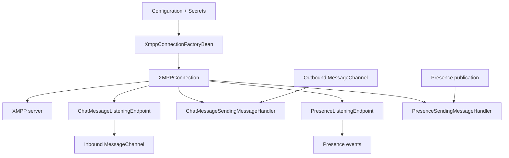
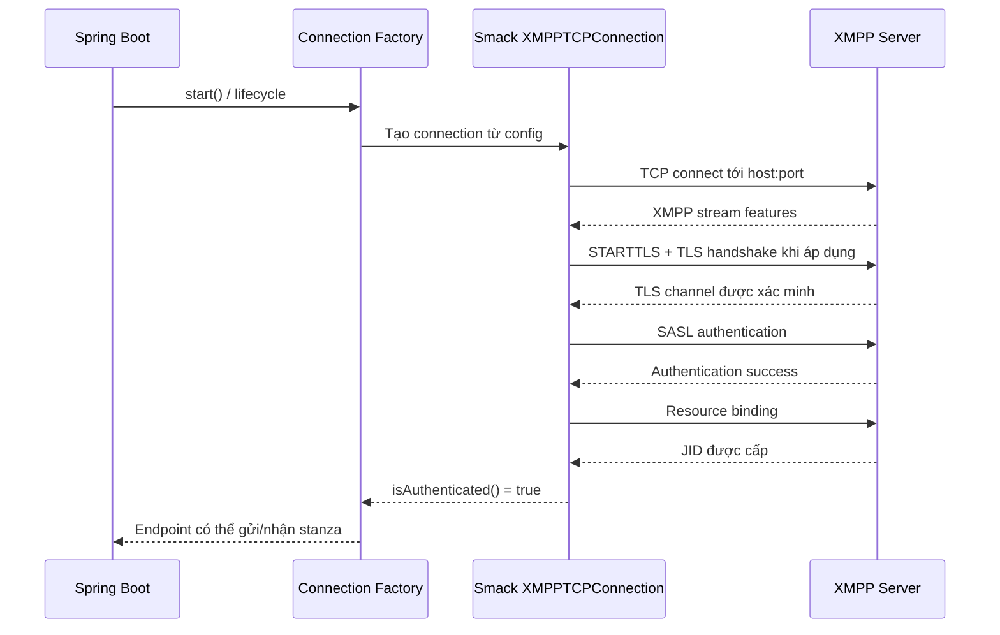
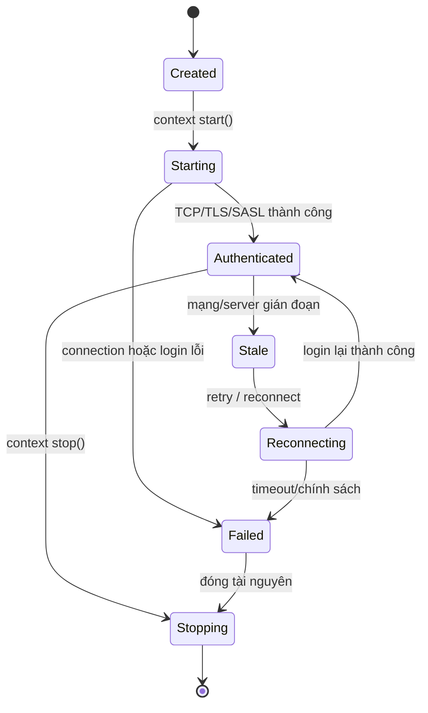

# Connection factory và authentication

## 1. Vì sao mọi XMPP adapter đều cần kết nối được xác thực?

Trong module **SPRING_INTEGRATION_ADAPTERS**, Spring Integration được dùng để nối các hệ thống bên ngoài bằng inbound/outbound adapter, gateway, poller và `MessageChannel`. Bên cạnh hợp đồng message, hệ thống phải quản lý **kết nối, xác thực, lỗi và vòng đời** của từng giao thức. Với chương **Adapter XMPP**, các luồng nhận/gửi message hoặc presence đều cần một **XMPPConnection** hợp lệ trước khi giao tiếp.

Ví dụ một ứng dụng vận hành sử dụng tài khoản `integration-bot@example.org`:

```text
                Spring Boot application
                       |
              XmppConnectionFactoryBean
                       |
                XMPPConnection (Smack)
                       |
                  TCP / STARTTLS
                       |
                 XMPP Server
                       |
                  SASL + bind JID
                       |
        +--------------+--------------+
        |              |              |
   Message inbound  Message outbound  Presence adapter
        |              |              |
  MessageChannel   MessageChannel  MessageChannel
```

Thay vì mỗi adapter tự kết nối/đăng nhập độc lập, chúng có thể **dùng chung một kết nối đã quản lý**. `XmppConnectionFactoryBean` là cơ chế thuận tiện của Spring Integration để cung cấp một `XMPPConnection` cho những endpoint ấy.

Sau bài học, bạn có thể:

- Phân biệt địa chỉ máy chủ TCP (`host`), miền dịch vụ XMPP (`serviceName/XMPP domain`), user, password và resource.
- Cấu hình `XmppConnectionFactoryBean` theo Java và XML, hiểu `FactoryBean<XMPPConnection>` và `SmartLifecycle`.
- Dùng `XMPPTCPConnectionConfiguration` của Smack cho TLS, timeout và cấu hình nâng cao.
- Giải thích thứ tự **TCP connect → TLS → SASL login → resource binding → authenticated**.
- Kiểm soát subscription mode và roster khi dùng message/presence adapter.
- Quản lý secrets, certificate validation, reconnect, readiness, startup/shutdown và giám sát.
- Phân biệt **kết nối hoạt động** với **message đã được xử lý/ACK nghiệp vụ**, kể cả sau reconnect.

## 2. Thành phần và ranh giới trách nhiệm

| Thành phần | Trách nhiệm | Không tự bảo đảm |
| --- | --- | --- |
| `XmppConnectionFactoryBean` | Tạo, cấu hình và quản lý lifecycle của kết nối Smack | Tự tạo quyền cho người dùng khác hoặc bảo đảm giao message |
| `XMPPConnection` | Kết nối, đăng nhập, gửi/nhận stanza | Database/broker đã commit |
| `XMPPTCPConnectionConfiguration` | Cấu hình XMPP domain, host, port, credential, TLS... | Chính sách xác thực/ủy quyền của ứng dụng |
| `ChatMessageListeningEndpoint` | Nhận XMPP message qua listener | Không có request–reply hay replay mặc định |
| `ChatMessageSendingMessageHandler` | Gửi XMPP message | Người nhận đã đọc |
| `PresenceListeningEndpoint` | Nhận presence qua roster listener | Snapshot hiện diện luôn chính xác |
| `PresenceSendingMessageHandler` | Phát hiện diện của tài khoản | Mọi liên hệ đều được phép nhìn thấy |
| `MessageChannel` | Đưa Spring message giữa các endpoint | Kết nối XMPP được xác thực |

Phần **connection factory** thuộc tầng kết nối/giao thức; các adapter mới là những endpoint chuyển đổi giữa XMPP stanza và Spring Integration message.



Đây là **một kết nối cho một danh tính/phiên XMPP** trong ví dụ. Nếu cần nhiều tài khoản độc lập, cấu hình các connection factory và tên bean riêng cho từng tài khoản; không mặc định chúng chia sẻ quyền hoặc roster.

## 3. Phân biệt host, domain, user và JID

Sai lầm rất thường gặp là nghĩ `host`, `domain`, `user` và JID là một giá trị.

Ví dụ cấu hình:

```text
XMPP service domain : example.org
TCP host            : xmpp.internal.example.org
Client port         : 5222
Username (authn)    : integration-bot
Password            : <lay tu secret manager>
Resource            : spring-integration
Full JID sau login  : integration-bot@example.org/spring-integration
```

| Giá trị | Diễn giải | Ghi chú |
| --- | --- | --- |
| `host` | Máy chủ XMPP mà TCP socket kết nối tới | Có thể là tên máy trong nội bộ hoặc được tìm qua DNS |
| `port` | Cổng client-to-server | Thường là `5222`; phải khớp hạ tầng thật |
| `serviceName` / XMPP domain | Miền dịch vụ logic dùng trong xác thực máy chủ và định danh XMPP | Thường là domain của JID nhưng không nhất thiết bằng `host` |
| `user` | Credential identifier gửi qua SASL | Có thể là localpart, nhưng identity sau auth không phải lúc nào giống hệt username |
| `password` | Bí mật phục vụ SASL, nếu dùng phương án password | Không in log và không lưu trong source |
| `resource` | Tên resource yêu cầu khi bind JID | Giúp phân biệt các client/phiên cùng tài khoản |
| **Bare JID** | `integration-bot@example.org` | Danh tính tài khoản |
| **Full JID** | `integration-bot@example.org/spring-integration` | Danh tính phiên/resource cụ thể |

Ở XMPP, **service domain** là yếu tố quan trọng đối với xác thực tên máy chủ trong TLS. Đừng “sửa lỗi certificate” bằng cách đổi service domain sang một hostname bất kỳ cho qua bước connect; cần kiểm chứng certificate, tên dịch vụ và cấu hình DNS/SRV thực tế.

### Tại sao resource không phải tên instance duy nhất tuyệt đối?

Resource `spring-integration` có thể được **server chấp thuận, sửa hoặc cấp lại** theo chính sách bind. Nếu nhiều pod login cùng tài khoản, server có thể tạo các full JID khác nhau hoặc xử lý xung đột resource theo cấu hình. Vì vậy:

- Không coi resource được yêu cầu là bằng chứng resource thực tế sau login.
- Quan sát JID trả về từ `XMPPConnection.getUser()` sau khi authenticated.
- Không dùng full JID như khóa nghiệp vụ duy nhất nếu các lần restart tạo resource mới.
- Với inbound nhận chat, kiểm thử cách server phân phối stanza giữa nhiều resource.

## 4. Quá trình kết nối và authentication

Một luồng kết nối TCP/XMPP chuẩn thường trải qua các giai đoạn:



**TLS** và **SASL** là hai lớp riêng:

1. **TCP connect** chứng minh client có thể mở socket tới host:port, nhưng **chưa được xác thực**.
2. **TLS/STARTTLS** bảo vệ kênh truyền và cho phép xác minh server, khi được hỗ trợ/cấu hình.
3. **SASL** xác thực credential hoặc một cơ chế xác thực đã đàm phán, ví dụ password-based hay certificate-based phù hợp hạ tầng.
4. **Resource binding** tạo phiên JID; có thể kiểm tra `getUser()` để biết JID được cấp thực sự.

Các bước có thể thay đổi chi tiết theo phiên bản XMPP, phương thức TLS và cơ chế SASL. Cổng 5222 thường dùng STARTTLS cho client-to-server; **không đánh đồng cổng TCP mở với phiên XMPP đã login**.

### Ba trạng thái không được nhầm

| Trạng thái | API thường dùng | Có thể gửi/nhận stanza nghiệp vụ? |
| --- | --- | --- |
| Bean đã được tạo | Spring context có `XMPPConnection` | Chưa chắc |
| TCP đã kết nối | `connection.isConnected()` | Chưa chắc, có thể chưa login |
| Đã xác thực | `connection.isAuthenticated()` | Có thể thực hiện các thao tác được server cấp quyền |

Ngay cả khi `isAuthenticated()==true`, chưa thể suy ra **người nhận online, subscription đã cấp, server đã phân phối stanza hoặc consumer đã ghi DB**.

## 5. Dependency và cấu hình môi trường

Ví dụ dùng Java 17+, Spring Boot và Spring Integration XMPP 6.x có BOM quản lý phiên bản tương thích.

```xml
<dependencies>
    <dependency>
        <groupId>org.springframework.boot</groupId>
        <artifactId>spring-boot-starter-integration</artifactId>
    </dependency>
    <dependency>
        <groupId>org.springframework.integration</groupId>
        <artifactId>spring-integration-xmpp</artifactId>
    </dependency>
</dependencies>
```

Nếu không dùng BOM, phải xác nhận phiên bản Spring Integration/Smack tương thích. Không sao chép ví dụ Smack 3.x (`ConnectionConfiguration` kiểu cũ hoặc các constructor cũ) vào mã hiện đại mà chưa đối chiếu API.

Ví dụ `application.yml`:

```yaml
app:
  xmpp:
    host: ${XMPP_HOST:xmpp.internal.example.org}
    port: ${XMPP_PORT:5222}
    domain: ${XMPP_DOMAIN:example.org}
    user: ${XMPP_USER:integration-bot}
    password: ${XMPP_PASSWORD}
    resource: ${XMPP_RESOURCE:spring-integration}
```

Các địa chỉ chỉ là ví dụ. Cần có một XMPP server thật và tài khoản được cấp quyền. Với production:

- Dùng **secret manager/environment variable** cho mật khẩu; không commit file chứa credential thật.
- Cấu hình CA/truststore và xác minh chứng chỉ/hostname đúng XMPP service domain.
- Giới hạn kết nối mạng, dùng security group/firewall phù hợp.
- Quản lý credential rotation, thu hồi tài khoản và quyền subscription.
- Tránh bật debug log ở mức có thể ghi toàn bộ stanza hoặc thông tin xác thực nhạy cảm.

## 6. Ví dụ Java: một XmppConnectionFactoryBean được chia sẻ

Ví dụ Spring Boot dưới đây cấu hình **một connection factory** với các property thường dùng và một **ApplicationRunner kiểm tra** trạng thái. Đây là bài về kết nối, nên không cần tạo message inbound/outbound giả để buộc luồng hoạt động.

```java
import org.jivesoftware.smack.XMPPConnection;
import org.jivesoftware.smack.roster.Roster;

import org.springframework.beans.factory.annotation.Value;
import org.springframework.boot.ApplicationRunner;
import org.springframework.context.annotation.Bean;
import org.springframework.context.annotation.Configuration;
import org.springframework.integration.config.EnableIntegration;
import org.springframework.integration.xmpp.config.XmppConnectionFactoryBean;

@Configuration
@EnableIntegration
public class XmppConnectionConfig {

    @Bean(name = "xmppConnection")
    public XmppConnectionFactoryBean xmppConnection(
            @Value("${app.xmpp.host}") String host,
            @Value("${app.xmpp.domain}") String domain,
            @Value("${app.xmpp.port:5222}") int port,
            @Value("${app.xmpp.user}") String user,
            @Value("${app.xmpp.password}") String password,
            @Value("${app.xmpp.resource:spring-integration}") String resource) {

        XmppConnectionFactoryBean factory = new XmppConnectionFactoryBean();
        factory.setHost(host);
        factory.setPort(port);
        factory.setServiceName(domain);
        factory.setUser(user);
        factory.setPassword(password);
        factory.setResource(resource);

        // Khong tu chap nhan subscriber moi ngoai chinh sach.
        factory.setSubscriptionMode(Roster.SubscriptionMode.reject_all);
        return factory;
    }

    @Bean
    public ApplicationRunner inspectXmppConnection(
            XMPPConnection xmppConnection) {

        return args -> {
            if (!xmppConnection.isConnected()
                    || !xmppConnection.isAuthenticated()) {
                throw new IllegalStateException(
                        "XMPP connection is not authenticated"
                );
            }

            // Log ket qua co chon loc; KHONG log password/token.
            System.out.printf(
                    "XMPP ready: jid=%s%n",
                    xmppConnection.getUser()
            );
        };
    }
}
```

Đặt lớp `XmppConnectionConfig` trong component scan của `@SpringBootApplication` hoặc import vào Spring context. Khi Spring context quản lý connection factory, `ApplicationRunner` chạy sau bước khởi tạo và lifecycle thông thường; nếu kết nối chưa sẵn sàng thì ví dụ **thất bại có chủ đích** thay vì thông báo sai rằng dịch vụ đã ready.

### Tại sao bean trả về FactoryBean nhưng tham số nhận XMPPConnection?

`XmppConnectionFactoryBean` kế thừa `AbstractFactoryBean<XMPPConnection>` và triển khai `SmartLifecycle`. Khi khai báo:

```java
@Bean(name = "xmppConnection")
public XmppConnectionFactoryBean xmppConnection() {
    return new XmppConnectionFactoryBean();
}
```

thì tên bean `xmppConnection` thường được Spring giải quyết tới **đối tượng `XMPPConnection` mà factory tạo ra**, không phải chính factory. Spring có quy ước truy cập đối tượng factory thông qua tiền tố `&` (ví dụ `&xmppConnection`) khi thực sự cần thao tác với factory.

Đoạn trên **chỉ minh họa semantics của FactoryBean**, không phải cấu hình kết nối độc lập có thể chạy (chưa đặt user/domain/password).

### Dùng chung một connection cho nhiều adapter

Đơn vị tái sử dụng phù hợp là một kết nối do factory quản lý:

```java
@Bean
public ChatMessageListeningEndpoint inboundChat(XMPPConnection connection) {
    return new ChatMessageListeningEndpoint(connection);
}

@Bean
public ChatMessageSendingMessageHandler outboundChat(
        XMPPConnection connection) {
    return new ChatMessageSendingMessageHandler(connection);
}
```

Đây là **các đoạn minh họa constructor và việc chia sẻ connection**; một endpoint thực còn phải được nối với `MessageChannel` và cấu hình lifecycle/consumer. Không tạo ra một connection riêng mỗi khi có message, vì việc TCP/TLS/SASL login liên tục sẽ tốn tài nguyên và có thể làm thay đổi resource/roster state.

## 7. Cấu hình nâng cao bằng XMPPTCPConnectionConfiguration

Các setter thuận tiện của `XmppConnectionFactoryBean` đủ cho cấu hình cơ bản. Khi cần kiểm soát **TLS policy, connect timeout, host verification, proxy hoặc tùy chọn Smack**, hãy tạo một `XMPPTCPConnectionConfiguration` trước và truyền qua `setConnectionConfiguration(...)`.

Ví dụ Spring bean **thay thế** cấu hình factory ở mục 6, không nên cùng khai báo hai bean có cùng tên:

```java
import org.jivesoftware.smack.ConnectionConfiguration;
import org.jivesoftware.smack.roster.Roster;
import org.jivesoftware.smack.tcp.XMPPTCPConnectionConfiguration;

import org.springframework.beans.factory.annotation.Value;
import org.springframework.context.annotation.Bean;
import org.springframework.context.annotation.Configuration;
import org.springframework.integration.xmpp.config.XmppConnectionFactoryBean;

@Configuration
public class SecureXmppConnectionConfig {

    @Bean(name = "xmppConnection")
    public XmppConnectionFactoryBean xmppConnection(
            @Value("${app.xmpp.host}") String host,
            @Value("${app.xmpp.domain}") String domain,
            @Value("${app.xmpp.port:5222}") int port,
            @Value("${app.xmpp.user}") String user,
            @Value("${app.xmpp.password}") String password) {

        XMPPTCPConnectionConfiguration config =
                XMPPTCPConnectionConfiguration.builder()
                    .setXmppDomain(domain)
                    .setHost(host)
                    .setPort(port)
                    .setUsernameAndPassword(user, password)
                    .setResource("spring-integration")
                    .setSecurityMode(
                        ConnectionConfiguration.SecurityMode.required
                    )
                    .setConnectTimeout(10000)
                    .build();

        XmppConnectionFactoryBean factory = new XmppConnectionFactoryBean();
        factory.setConnectionConfiguration(config);
        factory.setSubscriptionMode(Roster.SubscriptionMode.reject_all);
        return factory;
    }
}
```

`SecurityMode.required` yêu cầu TLS, nhưng **TLS chỉ an toàn khi chứng chỉ và hostname được xác minh đúng** theo thiết lập Smack/JVM/server. Không sử dụng `SecurityMode.disabled` hoặc một `TrustManager` luôn chấp nhận mọi chứng chỉ trong production. Với CA nội bộ, cấu hình truststore phù hợp thay vì bỏ qua kiểm tra.

### Điểm cần kiểm tra khi dùng builder

| API Smack | Mục đích |
| --- | --- |
| `setXmppDomain(domain)` | Miền dịch vụ XMPP; không phải TCP host |
| `setHost(host)` | TCP endpoint cần kết nối |
| `setPort(port)` | Cổng client-to-server |
| `setUsernameAndPassword(user, password)` | Credential SASL cơ bản |
| `setResource(resource)` | Resource yêu cầu sau login |
| `setSecurityMode(required)` | Yêu cầu TLS |
| `setConnectTimeout(10000)` | Giới hạn thời gian thiết lập TCP, đơn vị milliseconds |
| `setHostnameVerifier(...)` | Tùy chỉnh xác minh hostname khi có yêu cầu đặc biệt |

Không kết hợp bừa bãi setter chi tiết trên factory với một `XMPPTCPConnectionConfiguration` riêng rồi đoán cấu hình nào thắng. **Chọn một cách cấu hình làm nguồn sự thật** và kiểm tra kết nối thực tế.

Nếu hạ tầng dùng SASL EXTERNAL, chứng chỉ client hoặc cơ chế xác thực không dựa vào password, cấu hình tương ứng trong Smack (SSL context/key manager, cơ chế SASL và quyền server) thay vì cố đặt một password giả. Đoạn mã password-based trên không đại diện cho mọi hình thức SASL.

## 8. Cấu hình XML namespace

Spring Integration có phần tử `<int-xmpp:xmpp-connection>` giúp khai báo nhanh:

```xml
<beans xmlns="http://www.springframework.org/schema/beans"
       xmlns:xsi="http://www.w3.org/2001/XMLSchema-instance"
       xmlns:int="http://www.springframework.org/schema/integration"
       xmlns:int-xmpp="http://www.springframework.org/schema/integration/xmpp"
       xsi:schemaLocation="
           http://www.springframework.org/schema/beans
           https://www.springframework.org/schema/beans/spring-beans.xsd
           http://www.springframework.org/schema/integration
           https://www.springframework.org/schema/integration/spring-integration.xsd
           http://www.springframework.org/schema/integration/xmpp
           https://www.springframework.org/schema/integration/xmpp/spring-integration-xmpp.xsd">

    <int:channel id="xmppOutbound"/>

    <int-xmpp:xmpp-connection
        id="xmppConnection"
        host="${app.xmpp.host}"
        port="${app.xmpp.port}"
        user="${app.xmpp.user}"
        password="${app.xmpp.password}"
        resource="spring-integration"
        subscription-mode="reject_all"/>

    <int-xmpp:outbound-channel-adapter
        id="xmppOutboundAdapter"
        channel="xmppOutbound"
        xmpp-connection="xmppConnection"/>
</beans>
```

Đây là một **ví dụ cấu hình connection và endpoint outbound**, chưa có producer tạo message chat hoặc người nhận; không tự chạy end-to-end. Nó minh họa cách **nhiều adapter có thể tham chiếu cùng id `xmppConnection`**. Không đặt password thật trực tiếp vào XML.

Với XML namespace, nếu bỏ `id` và chỉ dùng một connection, tên mặc định thường là `xmppConnection`. Nếu cùng context có nhiều tài khoản, luôn khai báo tên riêng, inject đúng connection vào từng endpoint và tránh nhầm tenant.

### Khi nào nên dùng Java thay XML?

XML ngắn gọn cho host/user/password/resource và chính sách subscription. Khi cần chi tiết như `XMPPTCPConnectionConfiguration`, CA tùy chỉnh, SASL mechanism, proxy hoặc timeout, **Java config thường rõ ràng và dễ kiểm tra phiên bản hơn**. Không sao chép cấu hình Spring Integration/S smack rất cũ từ tài liệu lịch sử mà không đối chiếu API thực của thư viện.

## 9. Authentication: kiểm tra lỗi theo từng tầng

Một log “connection refused” và một log “not authorized” có ý nghĩa rất khác nhau.

| Giai đoạn | Lỗi thường gặp | Kiểm tra |
| --- | --- | --- |
| DNS | Không tìm được `host` | DNS/SRV, máy chủ nội bộ, container network |
| TCP connect | `Connection refused` / timeout | Port, firewall, server listener, network policy |
| XMPP stream | Service/domain sai | XMPP service domain, virtual host, protocol |
| STARTTLS/TLS | Certificate path hoặc hostname mismatch | CA/truststore, server certificate, SNI/service name |
| SASL login | Invalid credentials/mechanism | User/password, account status, SASL policy |
| Resource binding | Resource conflict hoặc bind error | Resource, giới hạn session, chính sách server |
| Sau auth | Không nhận chat/presence | Recipient JID, roster/subscription, filter, endpoint lifecycle |

### SASL không phải là authorization

Đăng nhập thành công cho biết server đã xác thực **danh tính client**. Nó không tự cấp quyền:

- Đọc presence của mọi tài khoản khác.
- Gửi stanza cho một miền bị chặn bởi chính sách server.
- Tham gia mọi phòng MUC.
- Thực hiện lệnh nghiệp vụ trên database.

Authorization phải được thực thi ở **server XMPP** và **consumer ứng dụng**. Nếu chat body chứa lệnh `DELETE_ORDER`, cần kiểm tra sender có được phép thực hiện lệnh đó không; không tin một body chỉ vì kết nối của bot đã authenticated.

### Kiểm tra danh tính sau đăng nhập

Sau `connection.isAuthenticated()`, có thể đọc:

```java
if (connection.isAuthenticated()) {
    System.out.println("Bound JID: " + connection.getUser());
}
```

Đoạn này chỉ nên ghi log thông tin cần thiết trong môi trường test. Ở production, full JID/resource có thể tiết lộ topology của ứng dụng; tránh log mọi stanza hoặc credential.

## 10. Subscription mode và roster: cấu hình liên quan đến bảo mật

`XmppConnectionFactoryBean.setSubscriptionMode(...)` điều khiển cách Smack xử lý **yêu cầu subscription** từ các tài khoản khác:

| Giá trị | Ý nghĩa | Khi nào cân nhắc |
| --- | --- | --- |
| `Roster.SubscriptionMode.accept_all` | Tự chấp nhận subscription request theo cách Smack hỗ trợ | Chỉ khi được tổ chức cho phép |
| `reject_all` | Từ chối yêu cầu subscription mới | Khi roster được cấp quyền trước |
| `manual` | Để ứng dụng xử lý phê duyệt | Có workflow cho phép/từ chối |
| `null` trong setter | Vô hiệu subscription listener/roster load theo cấu hình tích hợp | Dùng khi giao thức/ứng dụng không cần roster, đã kiểm chứng |

Trong API Spring Integration 6.5, mặc định của connection factory là **`accept_all`**. Đây là một **lựa chọn chính sách có tác động tới quyền riêng tư**, không nên giữ mặc định vô thức. Trong ví dụ Java, `reject_all` được đặt tường minh, nghĩa là bot không tự mở quyền cho người xin subscribe mới.

Quan trọng: subscription có **hướng**. Việc bot chấp nhận cho operator xem presence của bot **không tự** cho bot quyền xem presence của operator. Khi xây presence inbound, phải kiểm tra roster và subscription thực tế từ server.

Không dùng `setSubscriptionMode(null)` chỉ vì gặp lỗi roster mà chưa hiểu hệ quả: tài liệu mô tả việc vô hiệu subscription processing cũng làm thay đổi hành vi tải roster tại login, từ đó ảnh hưởng tới presence inbound.

## 11. SmartLifecycle: khởi động, dừng và thứ tự endpoint

`XmppConnectionFactoryBean` triển khai `SmartLifecycle`, cung cấp các phương thức như `start()`, `stop()`, `isRunning()`, `setAutoStartup(...)` và `setPhase(...)`. Spring quản lý lifecycle này trong ApplicationContext.



Sơ đồ là **mô hình vận hành** để tư duy; các tên trạng thái như `Starting`, `Stale` là của bài học, không phải enum công khai của factory.

### Thứ tự khởi động

Một connection factory có thể tự bắt đầu khi context chạy. Các endpoint nhận/gửi XMPP phải dùng kết nối này; cần quan sát **authenticated state**, không chỉ bean tồn tại.

Nếu ứng dụng phải cho phép HTTP “readiness” chỉ khi bot login thành công:

1. Theo dõi `isConnected()` **và** `isAuthenticated()`.
2. Khi connection stale, thay đổi readiness/health signal.
3. Đừng đánh dấu pod ready nếu inbound listener chưa đăng ký hoặc tài khoản chưa được phép truy cập nguồn đích cần thiết.
4. Khi shutdown, ngừng tiếp nhận công việc mới, xử lý hoặc lưu sự kiện đang chờ rồi đóng kết nối.

`setPhase(...)` cho phép điều phối thứ tự start/stop giữa các bean `SmartLifecycle`. Tránh dựa vào một con số phase cố định không được kiểm chứng; đọc cách các endpoint liên quan quản lý lifecycle trong đúng phiên bản Spring Integration sử dụng.

### Không tạo connection thủ công cho mỗi message

Sai lầm thường gặp:

```text
Mỗi request HTTP
    -> new XMPPTCPConnection
    -> connect + TLS + login
    -> gửi 1 stanza
    -> disconnect
```

Cách này gây overhead, tăng nguy cơ throttle, làm thay đổi resource/roster và khiến xử lý lỗi/retry khó hơn. Connection factory có lifecycle và các adapter dùng chung kết nối thường phù hợp hơn với dịch vụ tích hợp dài hạn.

## 12. Reconnect không đồng nghĩa đã giao hết message

Tài liệu Spring Integration mô tả khả năng **thử kết nối lại và tự login** khi kết nối stale, miễn kết nối trước đó đã ở trạng thái authenticated. Đây là tính năng hỗ trợ **phục hồi kết nối**, không phải cam kết về mọi stanza.

Ví dụ timeline:

```text
09:00  authenticated -> nhận/gửi message bình thường
09:05  mất mạng
09:06  hệ thống muốn gửi ALERT-42, nhưng connection đang down
09:10  reconnect và login lại
09:11  adapter sẵn sàng, ALERT-42 có được gửi không?
```

Không thể kết luận `ALERT-42` đã được gửi chỉ từ `isAuthenticated()==true` lúc 09:10. Nếu event chưa được lưu ở một nguồn bền vững, nó có thể đã mất trước reconnect.

### Cần phân biệt

| Khả năng | Ý nghĩa | Cần thêm gì? |
| --- | --- | --- |
| Reconnect | Phục hồi TCP/XMPP session | Chính sách timeout/backoff/health |
| SASL relogin | Xác thực lại tài khoản | Credential hiện hành, TLS đúng |
| Offline message | Server có thể lưu message khi người nhận offline | Chính sách server và hợp đồng phù hợp |
| Stream Management (XEP-0198) | Có thể hỗ trợ resume/ack ở cấp stream | Client + server cùng hỗ trợ/cấu hình |
| Delivery receipt (XEP-0184) | Một loại biên nhận XMPP tùy chọn | Client/recipient hỗ trợ; không bằng DB commit |
| ACK nghiệp vụ | Đích xác nhận đã xử lý event | Event ID, correlation, trạng thái bền vững |

Nếu cảnh báo/đơn hàng không được phép mất, dùng **durable outbox/JMS/AMQP/Kafka** trước bước gửi XMPP, retry hữu hạn, và idempotency theo event ID ở phía nhận. Không chỉ lưu trạng thái kết nối mà quên trạng thái nghiệp vụ.

### Presence sau reconnect

Smack có tùy chọn `setSendPresence(true)` để tự phát initial presence khi login. Nếu ứng dụng trước đó đặt `dnd` nhưng reconnect phát lại `available`, trạng thái hiển thị có thể sai cho tới khi bot phát lại **desired presence state**. Đây là một bài toán reconciliation độc lập với việc gửi chat.

## 13. Credential rotation và nhiều instance

### Đổi mật khẩu/tài khoản

`XmppConnectionFactoryBean` có `setPassword(...)` để cấu hình credential khi tạo kết nối. Điều đó không chứng minh rằng **đổi environment variable lúc JVM đang chạy sẽ tự cập nhật một connection đã đăng nhập**.

Kế hoạch rotation cần:

1. Cấp credential mới trên server.
2. Phân phối bí mật qua secret manager đúng phiên bản.
3. Thực hiện reconnect/redeploy có kiểm soát với thông tin mới.
4. Theo dõi `authenticated` và lỗi SASL; xác nhận bot đã hoạt động.
5. Thu hồi credential cũ, có rollback plan nếu môi trường yêu cầu.

Không ghi password vào log, issue tracker, tài liệu nội bộ thiếu bảo vệ hoặc message headers chuyển ra XMPP.

### Nhiều pod cùng tài khoản

```text
Pod A ---- XMPP connection /resource-a ---+
                                          +---- XMPP server
Pod B ---- XMPP connection /resource-b ---+
```

Hai pod dùng cùng account nhưng là **hai session** khác nhau. Máy chủ có thể phân phối message theo resource/priority và chính sách server. Không mặc định rằng cả A và B đều nhận một bản tin như consumer group của Kafka hoặc một pod tự được bầu làm leader.

Nếu inbound bắt buộc xử lý một message đúng một lần:

- Thiết kế một ingress owner rõ ràng hoặc phân vùng theo account/resource.
- Chuyển stanza vào broker bền vững, có event ID/correlation, cùng idempotent consumer.
- Không giải quyết bằng cách chỉ tạo thêm pod và hy vọng server tự load balance.
- Kiểm tra quota số session của một tài khoản và cách server xử lý resource trùng.

## 14. TLS, SASL, certificate và giới hạn bảo mật

### TLS

Smack có `ConnectionConfiguration.SecurityMode.required` để yêu cầu TLS. Khi cấu hình CA nội bộ, cần truststore hoặc `SSLContext` đúng với hạ tầng và **không dùng TrustManager bỏ qua kiểm tra**. Nếu certificate sai tên hoặc hết hạn, cần sửa certificate/domain chứ không nên chuyển `SecurityMode.disabled`.

TLS bảo vệ **đường truyền client–server**, không mặc định cung cấp mã hóa đầu-cuối giữa mọi user XMPP. Server có thể lưu, xử lý hoặc định tuyến stanza theo chính sách.

### SASL

SASL đàm phán cơ chế xác thực theo khả năng server/client. Một số môi trường dùng username/password, môi trường khác dùng SASL EXTERNAL hoặc certificate client. Không phải mọi cơ chế đều được phép bởi server hoặc thư viện đang dùng.

Không nên:

- Hard-code credential vào source.
- Bật cơ chế xác thực yếu chỉ để demo chạy qua.
- Tắt xác minh TLS khi SASL báo lỗi (hai lỗi có nguyên nhân khác nhau).
- Cho phép bot có quyền cao tham gia mọi roster/room theo mặc định.

### Authorization và subscription

Một kết nối authenticated không thay thế quyền của sender/recipient trong ứng dụng. Với inbound chat, cần kiểm tra JID của người gửi và schema nội dung trước khi thực hiện nghiệp vụ. Với presence, cần subscription phù hợp; kết nối hợp lệ không tự cấp quyền thấy trạng thái tất cả liên hệ.

## 15. Quan sát trạng thái và xử lý sự cố

Nên đo:

- Số lần `connect`, `login`, `reconnect` và thời gian mỗi lần.
- `isConnected`, `isAuthenticated`, JID được bind (có giới hạn log).
- Lỗi DNS/TCP, TLS/certificate, SASL và resource binding.
- Thời gian stale session và số message bị từ chối/đang chờ.
- Số lượng inbound/outbound stanza theo loại, số lỗi handler, backlog trong broker.
- Tỷ lệ retry và duplicate theo event ID; độ trễ từ event gốc tới bước xử lý nghiệp vụ.

| Triệu chứng | Nguyên nhân khả dĩ | Kiểm tra và khắc phục |
| --- | --- | --- |
| Bean có nhưng `isAuthenticated()==false` | Chưa login hoặc login lỗi | Lifecycle, host/domain, SASL, log |
| TCP timeout | DNS, firewall, port, server down | Test mạng đúng môi trường, không kết luận do password |
| TLS handshake lỗi | CA/hostname/service domain/certificate | Truststore, server cert, TLS policy |
| SASL “not authorized” | Sai credential, cơ chế bị cấm, tài khoản khóa | Account, server policy, mechanism |
| Connected nhưng không nhận chat | Sai JID/resource, listener chưa chạy | Inbound adapter, channel, filter, routing |
| Presence không đến | Subscription chưa được phép, roster chưa tải | Roster/permission, subscription mode |
| Reconnect liên tục | Credential cũ, network chập chờn, throttling | Retry/backoff, rotation, health metric |
| Sau restart nhận message trùng | Sender/server phát lại, không dedup | Event ID và unique constraint |
| Nhiều pod xử lý một message | Nhiều resource đăng nhập, server routing | Ownership/queue/idempotency |
| Bot được subscribe ngoài ý muốn | Mặc định `accept_all` | `reject_all`/`manual` và kiểm toán roster |
| Ứng dụng ready nhưng không gửi được | Readiness chỉ kiểm tra TCP/bean | Thêm kiểm tra authenticated và endpoint |

### Quy trình chẩn đoán ngắn

1. Xác minh server đang chạy, DNS/host và port từ đúng nơi deploy.
2. Kiểm tra **domain XMPP**, không chỉ hostname kết nối.
3. Kiểm tra TLS certificate/CA/hostname trước khi kiểm tra SASL.
4. Xác minh credential, tài khoản có bị khóa và cơ chế SASL được phép.
5. Sau login, kiểm tra `connection.getUser()` là JID mong muốn.
6. Kiểm tra endpoint XMPP đang hoạt động và được nối đúng `MessageChannel`.
7. Thử trao đổi một stanza với tài khoản test, đối chiếu server log nếu có quyền.
8. Với reconnect/restart, so khớp event ID và trạng thái gửi/nhận thay vì chỉ nhìn connection health.

## 16. Thực hành với hai tài khoản XMPP test

Chuẩn bị server XMPP (ví dụ Openfire hoặc ejabberd) và:

- Bot: `integration-bot@example.org`.
- Người thử nghiệm: `operator@example.org`.

Thực hiện:

1. **Kết nối cơ bản:** cấu hình property, khởi động ứng dụng và kiểm tra `isConnected`, `isAuthenticated`, JID được cấp.
2. **Sai host:** sửa hostname trong môi trường test rồi ghi nhận lỗi DNS/TCP, phân biệt với lỗi SASL.
3. **Sai password:** giữ host/domain đúng nhưng thay credential test; quan sát giai đoạn thất bại.
4. **Domain khác host:** sử dụng host nội bộ và service domain của tài khoản, lý giải vì sao chúng không nhất thiết giống nhau.
5. **Resource:** thay tên resource và so sánh full JID được server cấp sau login.
6. **Bật TLS bắt buộc:** dùng cấu hình builder `SecurityMode.required`; kiểm tra hành vi với chứng chỉ được tin cậy.
7. **Đổi subscription mode:** thay `reject_all` bằng `manual` trong test, mô tả trách nhiệm phê duyệt subscription.
8. **Dùng chung connection:** cấu hình một inbound chat và một outbound chat cùng inject `XMPPConnection`; gửi/nhận với tài khoản operator.
9. **Ngắt mạng:** trong môi trường test, tạm ngắt connection, xem `isAuthenticated`/health và reconnect. Xác định các event không có bảo đảm replay.
10. **Hai pod:** đăng nhập hai client cùng user với resource khác nhau, quan sát cách server phân phối chat và presence.
11. **Thay credential:** mô phỏng rotation bằng secret test, redeploy có kiểm soát và xác minh login với thông tin mới.
12. **Readiness:** xây dựng một điều kiện health chỉ trả `UP` khi connection authenticated và adapter cần thiết đang ready.

Đây là các bước **thực hành đề xuất**; không có test thực sự hoặc kết quả chạy server được thực hiện trong quá trình viết bài.

## 17. Tự kiểm tra kiến thức

**Q1. `XmppConnectionFactoryBean` tạo ra đối tượng gì?**  
Một `XMPPConnection` do Smack triển khai, được Spring quản lý qua `FactoryBean` và `SmartLifecycle`.

**Q2. `host` và `serviceName` có phải một không?**  
Không. `host` là TCP endpoint; `serviceName` là XMPP service domain. Chúng có thể khác nhau.

**Q3. `isConnected()` và `isAuthenticated()` khác nhau thế nào?**  
Connected chỉ nói socket/stream đã kết nối; authenticated nói client đã đăng nhập thành công.

**Q4. Có nên dùng `SecurityMode.disabled` nếu TLS gặp lỗi certificate?**  
Không. Cần sửa truststore, CA, certificate hoặc service domain.

**Q5. `resource` có phải khóa nghiệp vụ ổn định qua mọi restart?**  
Không. Resource được server cấp/điều phối theo phiên và có thể thay đổi.

**Q6. `subscription-mode=accept_all` có ý nghĩa gì?**  
Smack tự chấp nhận các yêu cầu subscription mới theo chính sách tương ứng; có nguy cơ mở rộng người được xem presence.

**Q7. Connection tự reconnect có bảo đảm mọi chat bị lỡ sẽ replay không?**  
Không. Cần xem tính năng server, lưu trữ offline/stream management và hợp đồng nghiệp vụ.

**Q8. Có nên tạo connection mới cho mỗi message outbound?**  
Không phù hợp cho phần lớn dịch vụ chạy liên tục; dùng connection factory quản lý vòng đời hiệu quả hơn.

**Q9. Một bot authenticated có tự được phép xem presence của mọi người không?**  
Không. Cần roster/subscription và authorization phù hợp.

**Q10. Làm gì khi credential cần đổi trong lúc ứng dụng đang chạy?**  
Quản lý rotation/reconnect hoặc redeploy có kiểm soát, không giả định environment variable mới tự thay credential trong connection.

## 18. Ghi nhớ

**Connection factory và authentication** là nền tảng của mọi XMPP adapter trong Spring Integration. `XmppConnectionFactoryBean` tạo và quản lý `XMPPConnection` để các endpoint chat/presence dùng chung. Cần phân biệt **TCP host, XMPP service domain, user/password, resource và JID**, cùng thứ tự **TLS rồi SASL login** trong phiên kết nối thích hợp.

Hãy cấu hình TLS an toàn, kiểm soát subscription, bảo vệ secrets và kiểm tra `isAuthenticated()` thay vì chỉ thấy bean hoặc TCP connected. **Reconnect phục hồi kết nối, không phải ACK/replay nghiệp vụ.** Nếu hệ thống yêu cầu độ tin cậy cao khi nối file/SFTP/HTTP/JMS/AMQP/Kafka/database vào XMPP, cần cơ chế lưu sự kiện, retry/idempotency và kiểm chứng trạng thái end-to-end ngoài chính connection factory.

### Tài liệu tham khảo

- [Spring Integration Reference — XMPP Support](https://docs.spring.io/spring-integration/reference/xmpp.html)
- [Spring Integration 6.5 API — XmppConnectionFactoryBean](https://docs.spring.io/spring-integration/docs/6.5.0/api/org/springframework/integration/xmpp/config/XmppConnectionFactoryBean.html)
- [Smack API — XMPPTCPConnectionConfiguration](https://download.igniterealtime.org/smack/docs/latest/javadoc/org/jivesoftware/smack/tcp/XMPPTCPConnectionConfiguration.html)
- [Smack API — ConnectionConfiguration.Builder](https://download.igniterealtime.org/smack/docs/latest/javadoc/org/jivesoftware/smack/ConnectionConfiguration.Builder.html)
- [Smack API — XMPPConnection](https://download.igniterealtime.org/smack/docs/latest/javadoc/org/jivesoftware/smack/XMPPConnection.html)
- [XMPP Standards Foundation — RFC 6120 (Core)](https://xmpp.org/rfcs/rfc6120.html)
- [XMPP Standards Foundation — RFC 6121 (IM & Presence)](https://xmpp.org/rfcs/rfc6121.html)
