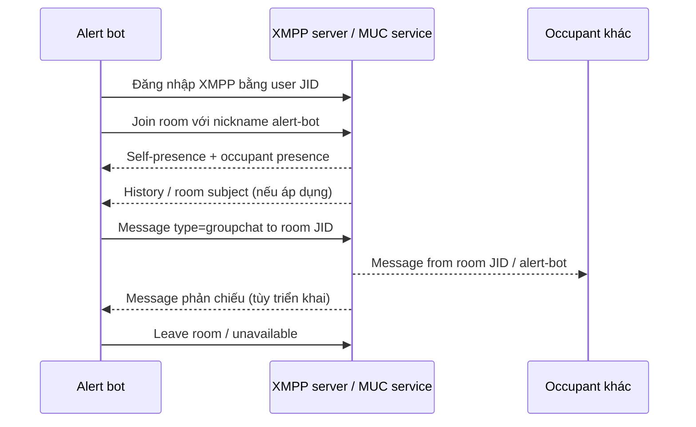
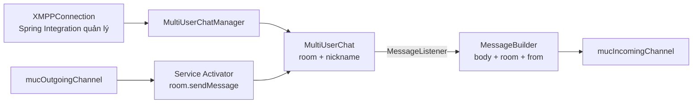
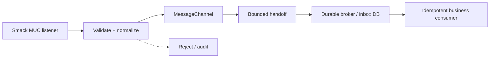

# Chat room và conversation address

## 1. Bài toán: gửi cảnh báo vào một phòng chat thay vì một tài khoản

Trong module **SPRING_INTEGRATION_ADAPTERS**, Spring Integration kết nối các hệ thống ngoài bằng inbound/outbound adapter, gateway, poller và `MessageChannel`. Chương **Adapter XMPP** đã giới thiệu những endpoint trao đổi chat và presence; bài này đi sâu vào **địa chỉ hội thoại** và **phòng chat nhiều người (Multi-User Chat – MUC)**.

Giả sử một dịch vụ nhập đơn hàng muốn gửi cảnh báo vào phòng trực ca. Nếu gửi một tin nhắn riêng cho từng nhân viên, ứng dụng phải quản lý danh sách người nhận và xử lý nhiều lượt gửi. XMPP MUC cho phép bot tham gia **một room** và gửi tin nhắn tới room; dịch vụ MUC của server sẽ phân phối tới các occupant có quyền.

```text
           File / SFTP / HTTP / JMS / AMQP / Kafka / DB
                              |
                              v
                      Business event
                              |
                              v
                       MessageChannel
                              |
                              v
                    MUC sender (Smack)
                              |
                              v
               alerts@conference.example.org
                              |
                +-------------+-------------+
                |             |             |
             oncall-1      oncall-2       alert-bot
```

Điểm quan trọng là **JID của room**, **JID của occupant** và **JID của tài khoản đăng nhập** không thay thế cho nhau. Xây dựng sai địa chỉ hội thoại có thể khiến tin nhắn gửi riêng thay vì phát cho cả phòng, hoặc dùng nickname làm danh tính bảo mật.

Sau bài học, bạn có thể:

- Phân biệt **bare/full JID của người dùng**, **room JID** và **occupant JID**.
- Hiểu XEP-0045: join/leave room, tin nhắn `groupchat`, vai trò, quyền và lịch sử hội thoại.
- Dùng `MultiUserChatManager` và `MultiUserChat` của Smack với `XMPPConnection` do Spring Integration quản lý.
- Chuyển sự kiện `MultiUserChat.addMessageListener` vào `MessageChannel`, và gửi nội dung ra room từ một channel khác.
- Giải thích vì sao **`ChatMessageListeningEndpoint` không tự làm đầy đủ vòng đời MUC**.
- Thiết kế địa chỉ được phép, chuẩn hóa nickname, chống lặp, nối lại room sau reconnect và xử lý lỗi.
- Phân biệt `thread`, stanza ID, occupant nickname, room ID và correlation ID nghiệp vụ.

## 2. Conversation address trong XMPP

XMPP sử dụng **Jabber ID (JID)** làm địa chỉ. JID có một miền (`domainpart`), có thể có phần tên (`localpart`) và resource (`resourcepart`). Dạng biểu diễn thông dụng:

```text
localpart@domainpart/resourcepart
```

Trong hội thoại 1–1 và MUC, cùng cú pháp nhưng **ý nghĩa** các thành phần khác nhau.

| Loại địa chỉ | Ví dụ | Đại diện cho |
| --- | --- | --- |
| **Bare user JID** | `operator@example.org` | Tài khoản XMPP của người dùng |
| **Full user JID** | `operator@example.org/laptop` | Một phiên/resource của tài khoản |
| **Room JID** | `alerts@conference.example.org` | Phòng chat trên dịch vụ MUC |
| **Occupant JID** | `alerts@conference.example.org/oncall-1` | Nickname của một người đang ở room |
| **MUC service domain** | `conference.example.org` | Dịch vụ lưu trữ các room |

**Room JID** có dạng `room@service`. **Occupant JID** có dạng `room@service/nick`. Nickname sau dấu `/` là tên hiển thị trong room; nó không nhất thiết tiết lộ bare user JID thật.

### Tại sao không thể lấy mọi dấu `@` rồi coi là user?

`operator@example.org` là tài khoản thuộc miền XMPP thông thường; `alerts@conference.example.org` có thể là **thực thể phòng** thuộc dịch vụ MUC. Server cần hỗ trợ XEP-0045 tại `conference.example.org`. Nếu chỉ thay từ `example.org` thành một subdomain tùy ý, bạn **chưa tạo được MUC service**; hãy dùng service domain mà server đã cấu hình hoặc khám phá qua Smack service discovery.

### Địa chỉ nào được dùng trong từng hành động?

| Hành động | Địa chỉ điển hình |
| --- | --- |
| Nhắn trực tiếp cho operator | `operator@example.org` hoặc full user JID theo nhu cầu |
| Gửi một tin tới **cả room** | `alerts@conference.example.org` |
| Join room với nickname `alert-bot` | Directed presence tới `alerts@conference.example.org/alert-bot` theo XEP-0045 |
| Nhắn riêng cho một occupant | `alerts@conference.example.org/oncall-1` với message loại `chat` |
| Nhận message do occupant phát trong room | `from=alerts@conference.example.org/oncall-1`, loại `groupchat` |

Một tin nhắn riêng cho occupant trong MUC **không giống** message gửi cả phòng. Quyền private message có thể bị room hạn chế.

## 3. XEP-0045 và vòng đời MUC

**XEP-0045 (Multi-User Chat)** định nghĩa room, occupant, join/leave, invitation, moderator, membership và các quyền khác. Bên gửi phải tham gia room (hoặc có quyền ngoại lệ do server cấu hình) trước khi phát thông điệp nhóm.



### Các khái niệm chính

- **Room:** không gian hội thoại chung, nhận tin nhắn `groupchat` gửi tới room JID.
- **Occupant:** người đang tham gia room dưới một nickname. Nickname có thể thay đổi.
- **Role:** quyền tạm thời trong phiên room, như `moderator`, `participant`, `visitor`.
- **Affiliation:** quan hệ lâu dài với room, như `owner`, `admin`, `member` hoặc `outcast`.
- **History:** các message trước đó mà MUC service có thể cung cấp khi join.
- **Subject:** chủ đề room, có thể có quyền chỉnh sửa riêng.

| Tình huống | Hệ quả thường gặp |
| --- | --- |
| Room chỉ dành cho member | Tài khoản chưa thuộc member list có thể không join được |
| Room cần password | Join không cung cấp password có thể bị từ chối |
| Nickname đã có người dùng | Có thể nhận lỗi conflict, hoặc server yêu cầu nickname khác |
| Room moderated, bot là visitor | Có thể join nhưng không được quyền phát groupchat |
| Bot bị kick/ban | Quyền truy cập room thay đổi; cần ghi nhận và không retry vô hạn |
| Room không tồn tại | Join có thể thất bại; một số server có thể tạo room theo chính sách |

**Không dùng `createOrJoin(...)` một cách vô thức trong production:** có thể tạo ra phòng mới và cần cấu hình để mở khóa phòng. Với bot gửi cảnh báo, phương án đơn giản hơn là **room được quản trị viên tạo/cấp quyền trước**, bot chỉ gọi `join(...)`.

## 4. Khác biệt giữa stanza chat trực tiếp và groupchat

Tin nhắn 1–1:

```xml
<message
    from="integration-bot@example.org/si"
    to="operator@example.org"
    type="chat">
    <body>Import failed</body>
</message>
```

Tin nhắn gửi cả room:

```xml
<message
    from="integration-bot@example.org/si"
    to="alerts@conference.example.org"
    type="groupchat">
    <body>Import failed: batch-42</body>
</message>
```

Dịch vụ MUC có thể phản chiếu tới occupants với `from` mang **occupant JID**:

```xml
<message
    from="alerts@conference.example.org/alert-bot"
    to="operator@example.org/laptop"
    type="groupchat">
    <body>Import failed: batch-42</body>
</message>
```

Hai điểm cần lưu ý:

1. **`to` của tin gửi room là bare room JID** (`alerts@conference.example.org`), còn `from` của message được room phản chiếu có thể là occupant JID (`.../alert-bot`).
2. **Nickname không phải danh tính xác thực**. Ở phòng semi-anonymous, ứng dụng nhận có thể không thấy user JID thật. Không cho phép một message trở thành lệnh quản trị chỉ dựa vào nickname trông giống tài khoản được tin cậy.

Nếu ứng dụng cần command có quyền cao, nên dùng API nghiệp vụ xác thực hoặc một cơ chế authorization riêng; MUC có thể phục vụ cảnh báo và tương tác, nhưng không nên coi nickname trong stanza là credential.

## 5. Spring Integration adapter và phần việc thuộc Smack MUC

Spring Integration có `ChatMessageListeningEndpoint` và `ChatMessageSendingMessageHandler` cho trao đổi **XMPP message**; có các presence adapter cho trạng thái hiện diện. Nhưng để tham gia room theo XEP-0045, bạn cần **quản lý session MUC** bằng Smack.

| Nhu cầu | API phù hợp | Chú ý |
| --- | --- | --- |
| Duy trì XMPP account và kết nối | `XmppConnectionFactoryBean` | Cần TLS/SASL/authenticated |
| Nhận chat message thông thường | `ChatMessageListeningEndpoint` | Listener cho XMPP message, không tự join room |
| Gửi chat 1–1 | `ChatMessageSendingMessageHandler` | Gửi tới recipient JID theo header |
| Join/leave room | `MultiUserChat` | Hợp đồng room/nickname/password riêng |
| Nhận groupchat trong room | `MultiUserChat.addMessageListener` | Chỉ nhận groupchat khi đã tham gia theo cơ chế MUC |
| Gửi message tới room | `MultiUserChat.sendMessage(...)` | Room phải joined và account có voice phù hợp |
| Phát message đã nhận vào Spring flow | `MessageChannel` + `MessageBuilder` | Cần gắn room, from, stanza ID rõ ràng |

**Không mặc định** rằng chỉ gửi `Message<String>` với `XmppHeaders.TO="alerts@conference.example.org"` qua chat outbound handler là đủ cho hội thoại nhóm. Dù server có thể định tuyến một stanza đến room trong một số trường hợp, ứng dụng còn cần **join/permission, lịch sử, reconnect, membership và quản lý listener**. Mẫu đáng tin cậy hơn là quản lý `MultiUserChat` tường minh, rồi nối các event với Spring `MessageChannel`.



## 6. Chuẩn bị dependency và môi trường test

Ví dụ dùng Java 17+, Spring Boot, Spring Integration XMPP và Smack MUC.

```xml
<dependencies>
    <dependency>
        <groupId>org.springframework.boot</groupId>
        <artifactId>spring-boot-starter-integration</artifactId>
    </dependency>
    <dependency>
        <groupId>org.springframework.integration</groupId>
        <artifactId>spring-integration-xmpp</artifactId>
    </dependency>
</dependencies>
```

`MultiUserChatManager` nằm trong API Smack extension (module `smack-extensions`). Nếu dependency tree của dự án **chưa** có module này, bổ sung đúng phiên bản Smack được bộ dependency management đang dùng quản lý:

```xml
<!-- Chỉ cần thêm khi smack-extensions chưa nằm trong dependency graph. -->
<dependency>
    <groupId>org.igniterealtime.smack</groupId>
    <artifactId>smack-extensions</artifactId>
</dependency>
```

Không ép bừa các phiên bản Smack khác nhau vì có thể gây lỗi `NoSuchMethodError`, `ClassNotFoundException` hoặc hành vi không tương thích. Đoạn code sau dùng API Smack 4.4.x tương ứng với Javadoc được tham chiếu; cần đối chiếu khi dự án chuyển sang phiên bản khác.

Máy chủ XMPP test (Openfire, ejabberd hoặc tương đương) cần:

- Tài khoản bot: `integration-bot@example.org`.
- Tài khoản operator: `operator@example.org`.
- Dịch vụ MUC: `conference.example.org`.
- Room đã tạo: `alerts@conference.example.org`.
- Bot có quyền join và gửi message trong room; không cần quyền owner/admin nếu chỉ gửi cảnh báo.

Ví dụ `application.yml`:

```yaml
app:
  xmpp:
    host: ${XMPP_HOST:xmpp.internal.example.org}
    port: ${XMPP_PORT:5222}
    domain: ${XMPP_DOMAIN:example.org}
    user: ${XMPP_USER:integration-bot}
    password: ${XMPP_PASSWORD}
    resource: ${XMPP_RESOURCE:si-bot}
    room: ${XMPP_ROOM:alerts@conference.example.org}
    nickname: ${XMPP_NICKNAME:alert-bot}
```

`domain` là XMPP service domain của tài khoản bot, `host` là máy chủ TCP; `room` thuộc **MUC service domain**. Ba giá trị này có thể khác nhau. Tất cả host/JID ở đây chỉ mang tính minh họa, không phải dịch vụ công cộng sẵn có.

Mật khẩu phải lấy từ environment/secret manager; cấu hình TLS với xác minh CA/hostname và SASL theo chính sách server. Không đưa credentials vào mã nguồn hoặc nhật ký.

## 7. Ví dụ Spring Boot: join room, nhận và phát groupchat

Ví dụ bên dưới cho thấy cách ghép **Smack MUC** với **Spring Integration channels**. Room phải có sẵn. `ApplicationRunner` đăng ký listener, join room rồi gửi một message demo. Phần nhận đưa body, room, occupant và stanza ID vào Spring message; phần gửi nhận `String` từ `mucOutgoingChannel`.

```java
import org.jivesoftware.smack.MessageListener;
import org.jivesoftware.smack.SmackException;
import org.jivesoftware.smack.XMPPConnection;
import org.jivesoftware.smack.roster.Roster;
import org.jivesoftware.smackx.muc.MultiUserChat;
import org.jivesoftware.smackx.muc.MultiUserChatManager;
import org.jxmpp.jid.EntityBareJid;
import org.jxmpp.jid.impl.JidCreate;
import org.jxmpp.jid.parts.Resourcepart;

import org.springframework.beans.factory.annotation.Qualifier;
import org.springframework.beans.factory.annotation.Value;
import org.springframework.boot.ApplicationRunner;
import org.springframework.context.annotation.Bean;
import org.springframework.context.annotation.Configuration;
import org.springframework.integration.annotation.ServiceActivator;
import org.springframework.integration.channel.DirectChannel;
import org.springframework.integration.config.EnableIntegration;
import org.springframework.integration.xmpp.config.XmppConnectionFactoryBean;
import org.springframework.messaging.Message;
import org.springframework.messaging.MessageChannel;
import org.springframework.messaging.MessageHandler;
import org.springframework.messaging.MessagingException;
import org.springframework.messaging.support.MessageBuilder;

@Configuration
@EnableIntegration
public class XmppMucFlowConfig {

    @Bean(name = "xmppConnection")
    public XmppConnectionFactoryBean xmppConnection(
            @Value("${app.xmpp.host}") String host,
            @Value("${app.xmpp.domain}") String domain,
            @Value("${app.xmpp.port:5222}") int port,
            @Value("${app.xmpp.user}") String user,
            @Value("${app.xmpp.password}") String password,
            @Value("${app.xmpp.resource}") String resource) {

        XmppConnectionFactoryBean factory =
                new XmppConnectionFactoryBean();
        factory.setHost(host);
        factory.setServiceName(domain);
        factory.setPort(port);
        factory.setUser(user);
        factory.setPassword(password);
        factory.setResource(resource);
        factory.setSubscriptionMode(Roster.SubscriptionMode.reject_all);
        return factory;
    }

    @Bean
    public MessageChannel mucIncomingChannel() {
        return new DirectChannel();
    }

    @Bean
    public MessageChannel mucOutgoingChannel() {
        return new DirectChannel();
    }

    @Bean
    public MultiUserChat alertRoom(
            XMPPConnection connection,
            @Value("${app.xmpp.room}") String configuredRoom)
            throws Exception {

        EntityBareJid roomJid =
                JidCreate.entityBareFrom(configuredRoom);
        MultiUserChatManager manager =
                MultiUserChatManager.getInstanceFor(connection);

        // Smack mac dinh khong tu join lai sau reconnect.
        manager.setAutoJoinOnReconnect(true);
        return manager.getMultiUserChat(roomJid);
    }

    @Bean
    public ApplicationRunner joinRoom(
            XMPPConnection connection,
            MultiUserChat room,
            @Qualifier("mucIncomingChannel") MessageChannel inbound,
            @Qualifier("mucOutgoingChannel") MessageChannel outbound,
            @Value("${app.xmpp.nickname}") String nickname) {

        return args -> {
            if (!connection.isAuthenticated()) {
                throw new IllegalStateException(
                        "XMPP connection not authenticated"
                );
            }

            MessageListener listener = stanza -> {
                String body = stanza.getBody();
                if (body == null || body.isBlank()) {
                    return;
                }

                String from = stanza.getFrom() == null
                        ? ""
                        : stanza.getFrom().toString();

                Message<String> springMessage = MessageBuilder
                        .withPayload(body)
                        .setHeader("mucRoom", room.getRoom().toString())
                        .setHeader("mucFrom", from)
                        .setHeader("mucStanzaId", stanza.getStanzaId())
                        .build();

                inbound.send(springMessage);
            };

            room.addMessageListener(listener);
            try {
                // Chi join room da duoc tao truoc.
                room.join(Resourcepart.from(nickname));
            }
            catch (Exception ex) {
                room.removeMessageListener(listener);
                throw ex;
            }

            outbound.send(MessageBuilder
                    .withPayload("ALERT: bot da tham gia room")
                    .build());
        };
    }

    @Bean
    @ServiceActivator(inputChannel = "mucOutgoingChannel")
    public MessageHandler publishToRoom(MultiUserChat room) {
        return message -> {
            if (!(message.getPayload() instanceof String body)
                    || body.isBlank()) {
                throw new IllegalArgumentException(
                        "MUC outbound requires nonempty String"
                );
            }
            if (!room.isJoined()) {
                throw new MessagingException(
                        message, "Bot is not in the room"
                );
            }

            try {
                room.sendMessage(body);
            }
            catch (SmackException.NotConnectedException ex) {
                throw new MessagingException(
                        message, "MUC send failed", ex
                );
            }
            catch (InterruptedException ex) {
                Thread.currentThread().interrupt();
                throw new MessagingException(
                        message, "MUC send interrupted", ex
                );
            }
        };
    }

    @ServiceActivator(inputChannel = "mucIncomingChannel")
    public void onRoomMessage(Message<String> message) {
        System.out.printf(
                "MUC room=%s from=%s body=%s%n",
                message.getHeaders().get("mucRoom"),
                message.getHeaders().get("mucFrom"),
                message.getPayload()
        );
        // Production: normalize, authorize, validate, deduplicate.
    }
}
```

### Các điều kiện của ví dụ

- Kết nối phải `authenticated` trước khi join.
- Dịch vụ `conference.example.org` phải thực sự hỗ trợ XEP-0045 và room `alerts` phải tồn tại/cho phép bot tham gia.
- Nickname `alert-bot` được parse thành `Resourcepart`; nếu nickname không hợp lệ hoặc đã có occupant khác chiếm, join có thể thất bại.
- `MessageListener` nhận message qua Smack; channel và consumer được Spring Integration quản lý.
- `room.sendMessage(body)` là API MUC gửi tới room; nó **không đồng nghĩa** tin đã được toàn bộ occupant đọc.
- `setAutoJoinOnReconnect(true)` hỗ trợ thử join lại nhưng không bảo đảm join luôn thành công; cần theo dõi callback/error và quyền room.

Ví dụ dùng `ApplicationRunner` để bài học ngắn gọn. Trong production, hãy chuyển join, listener registration và leave vào một bean quản lý `SmartLifecycle` hoặc lifecycle tương đương. Khi dừng, **gỡ listener bằng `removeMessageListener(listener)` và gọi `room.leave()` nếu còn joined**. Không dựa vào runner để tự dọn dẹp.

### Vì sao nhận message bằng Smack thay vì chỉ cấu hình chat inbound adapter?

`ChatMessageListeningEndpoint` được Spring Integration cung cấp cho message nhận từ tài khoản XMPP. Nó không tự thực hiện toàn bộ thao tác **tham gia room, quản lý nickname, cấu hình room, tự join lại hay membership**. Trong ví dụ, `MultiUserChat.addMessageListener` giúp chỉ nhận groupchat của chính room đã join và chuyển nội dung vào `mucIncomingChannel` qua `MessageBuilder`.

Không nên đăng ký cả **MUC listener** và một **stanza listener tổng quát** rồi vô tình xử lý cùng một groupchat hai lần. Nếu cần cả direct chat và groupchat, tách route/endpoint, kiểm tra `Message.Type`, recipient và room JID trước khi deduplicate.

## 8. Thông tin cần giữ trong Spring Message

Khi chuyển từ Smack sang Spring Integration, cần định nghĩa rõ **hợp đồng message**. Ví dụ chỉ lấy body và ba header do ứng dụng định nghĩa:

```text
payload = "ALERT: batch-42 failed"
headers:
  mucRoom       = "alerts@conference.example.org"
  mucFrom       = "alerts@conference.example.org/alert-bot"
  mucStanzaId   = "stanza-1234"
  id            = <Spring Message ID>
  timestamp     = <Spring Message timestamp>
```

`mucRoom`, `mucFrom` và `mucStanzaId` là **tên header tự đặt trong ví dụ**, không phải hằng số có sẵn của `XmppHeaders`. Trong các flow tích hợp khác, nên dùng một DTO có kiểu dữ liệu rõ ràng, ví dụ `RoomEvent(roomJid, occupantJid, body, stanzaId, receivedAt)`.

| Thuộc tính | Có thể tin để làm gì? | Không nên suy ra |
| --- | --- | --- |
| Room JID | Phân loại hội thoại đã join | Người gửi có quyền tác động database |
| Occupant JID | Hiển thị nickname trong room | Tài khoản thật/identity đã xác thực ở ứng dụng |
| Stanza ID | Đối chiếu kỹ thuật một stanza khi phù hợp | ID nghiệp vụ duy nhất toàn hệ thống |
| Spring Message ID | Theo dõi message trong một flow | XMPP stanza ID hoặc idempotency key ổn định |
| Application event ID | Chống xử lý lặp theo hợp đồng | Tự động có nếu body chỉ là text |

Nếu body chứa JSON, hãy parse schema và lấy một `eventId` bền vững, thay vì dùng nickname hoặc Spring Message ID làm unique key.

### Không nhầm thread ID với room address

`XmppHeaders.THREAD` của XMPP message có thể liên hệ các message cùng hội thoại theo quy tắc giao thức. Nhưng:

- Một **room JID** xác định không gian hội thoại, không phải thread của một message.
- Một **occupant JID** xác định một nickname đang tham gia, không phải mã người dùng đáng tin cậy.
- Một **thread ID** không chứng minh message đã xử lý thành công.
- Một **event ID nghiệp vụ** cần do hợp đồng ứng dụng cung cấp, bảo vệ khỏi trùng lặp qua retry/reconnect.

## 9. Gửi private message cho một occupant

XEP-0045 hỗ trợ **private message** tới một occupant JID như `alerts@conference.example.org/oncall-1` với `type="chat"`, thay vì `groupchat` gửi đến bare room JID.

```xml
<message
    from="integration-bot@example.org/si-bot"
    to="alerts@conference.example.org/oncall-1"
    type="chat">
    <body>Vui lòng kiểm tra batch-42</body>
</message>
```

Smack có `MultiUserChat.createPrivateChat(...)` để gửi private message trong bối cảnh MUC. Quyền gửi có thể bị hạn chế qua cấu hình room (ví dụ cấm private message cho visitor). Không dùng occupant JID làm thay thế chắc chắn cho bare JID thật của một nhân viên.

### Khi nào chọn loại hội thoại nào?

| Nhu cầu | Cách gửi |
| --- | --- |
| Thông báo chung cho trực ca | `MultiUserChat.sendMessage(...)` tới room |
| Thông báo riêng một tài khoản | Chat message outbound tới bare/full user JID |
| Nhắn riêng người đang ở room | Private chat tới occupant JID nếu room cho phép |
| Thay đổi trạng thái online/away của bot | Presence outbound adapter |
| Xác thực lệnh thay đổi dữ liệu | API nghiệp vụ với authorization riêng |

Không gửi dữ liệu nhạy cảm vào room chỉ vì “chỉ có người quen ở trong đó”: danh sách occupant, quyền room, lịch sử được lưu và khả năng truy cập có thể thay đổi.

## 10. Room configuration: quyền, bảo mật và danh tính

Một room MUC có thể:

- **Public** hoặc **hidden** (có/không xuất hiện trong discovery).
- **Persistent** hoặc **temporary** (còn hay bị xóa khi trống).
- **Members-only** hoặc **open**.
- **Password-protected** hoặc không yêu cầu mật khẩu.
- **Moderated** hoặc không; visitor có thể không có quyền phát biểu.
- **Non-anonymous** hoặc **semi-anonymous**, ảnh hưởng tới việc occupant JID có lộ user JID thật hay không.

Đừng nhầm **role** với **affiliation**:

| Loại | Ví dụ | Vòng đời |
| --- | --- | --- |
| Role | `moderator`, `participant`, `visitor` | Trong phiên tham gia room |
| Affiliation | `owner`, `admin`, `member`, `outcast` | Liên hệ/quyền dài hạn với room |

Bot chỉ gửi cảnh báo thường **không cần owner/admin**. Hãy cấp tối thiểu quyền join, đọc và phát message phù hợp. Không tự cho bot khả năng ban/kick hoặc cấu hình room nếu nghiệp vụ không yêu cầu.

### Bảo vệ địa chỉ hội thoại

Room JID là đầu vào cần kiểm soát. Nếu một HTTP request cho phép user nhập tùy ý `roomJid`, bot có thể bị lạm dụng để gửi tin tới room ngoài tổ chức.

Quy tắc:

1. Ánh xạ **mã phòng nghiệp vụ** như `OPS_ALERTS` sang room JID trong whitelist.
2. Dùng API JID của Smack để parse `EntityBareJid`; không ghép chuỗi tùy tiện hoặc thay thế kiểm tra quyền bằng regex.
3. Đảm bảo MUC service domain nằm trong danh sách được phép.
4. Giới hạn body length/rate; không đưa token, PII hay thông tin bí mật vào room.
5. Không tự join một room tùy ý bằng tài khoản có quyền cao.

Ví dụ whitelist:

```java
Map<String, String> rooms = Map.of(
        "OPS_ALERTS", "alerts@conference.example.org",
        "SUPPORT", "helpdesk@conference.example.org"
);

String configuredRoom = rooms.get("OPS_ALERTS");
if (configuredRoom == null) {
    throw new IllegalArgumentException("Unknown room key");
}
EntityBareJid allowedRoom = JidCreate.entityBareFrom(configuredRoom);
```

Đoạn này là một **mảnh logic ứng dụng**, với `Map`, `EntityBareJid` và `JidCreate` đã được import trong ví dụ trước. Nó không tự kiểm tra membership/authorization trên server; việc join vẫn có thể bị từ chối.

## 11. Reconnect, auto-rejoin và lịch sử

Một XMPP connection được khôi phục **không tự đồng nghĩa bot đã quay lại room**. Smack `MultiUserChatManager` có `setAutoJoinOnReconnect(true)`, nhưng theo tài liệu Smack, **mặc định tính năng này tắt**. Cần kiểm tra server, quyền room, callback báo lỗi rejoin và trạng thái thực tế của `room.isJoined()`.

```text
10:00  Bot authenticated, joined room, nhận groupchat
10:05  Mất mạng: kết nối XMPP down
10:06  Operator gửi một message trong room
10:10  XMPP reconnect/login
10:11  Bot thử rejoin room
10:12  Có thể nhận history, nhưng không chắc đã có mọi message
```

### Các giới hạn phải hiểu

- **Auto-rejoin không phải replay.** Các message phát trong lúc bot offline có thể mất, được đưa vào history hoặc được phục hồi theo tính năng riêng của server.
- **History không phải event log bền vững có offset.** Server có thể chỉ trả một số message gần nhất, theo cấu hình room và tham số join.
- **History và live messages có thể gây lặp** khi nối lại; phải nhận diện những event đã xử lý theo ID ứng dụng.
- **Nickname có thể bị chiếm** trong lúc mất kết nối; join thất bại vì `conflict`.
- **Room có thể bị đổi quyền/kick/ban**, hoặc room temporary đã bị xóa.

Smack cho phép cấu hình `MucEnterConfiguration` để điều khiển nickname, password và lượng history được yêu cầu khi join. Với dữ liệu quan trọng, nên có một nguồn có thể replay độc lập, ví dụ database/outbox, JMS/AMQP/Kafka; không phụ thuộc duy nhất vào MUC history.

## 12. Trật tự và message lặp

MUC là kênh hội thoại thời gian thực. Trong một session, room có thể phản chiếu message từ chính bot, các client khác hoặc các message history. Khi có nhiều instance hoặc reconnect, ứng dụng dễ xử lý trùng sự kiện.

| Nguồn lặp | Ví dụ | Phòng tránh |
| --- | --- | --- |
| Bot thấy message do chính mình gửi | Tin broadcast được server phản chiếu về room | Nếu chỉ cần tin từ người khác, nhận diện self-occupant có kiểm tra |
| Rejoin nhận một phần history | Các message trước đó xuất hiện lần nữa | Dedupe bằng event ID/stable ID khi có |
| Hai pod cùng tham gia room | Cả hai nhận cùng một broadcast | Một ingress owner hoặc consumer idempotent |
| Người dùng gửi lại lệnh | Cùng hành động được chat nhiều lần | Application idempotency key, xác nhận |
| Retry sau timeout gửi | Không biết server đã nhận hay chưa | Outbox bền vững, key cố định khi gửi lại |

Nếu bot phục vụ **lệnh nhập liệu qua chat**, cách an toàn là:

```text
Groupchat -> validate sender/quyền -> parse eventId
          -> unique constraint / idempotent consumer
          -> cập nhật DB -> gửi kết quả có correlation ID
```

Không tuyên bố “exactly-once” chỉ vì `room.sendMessage` không ném exception; callback nhận và trạng thái database không cùng một transaction.

### Vấn đề ordering

Ngay cả khi MUC gửi event theo thứ tự trong một kết nối, xử lý downstream bất đồng bộ bằng `ExecutorChannel` hoặc nhiều consumer có thể đổi thứ tự. Nếu thứ tự các trạng thái trong một `batchId` quan trọng, phải serialize theo key hoặc dùng broker với partition/ordering và chiến lược commit phù hợp.

## 13. Vòng đời, cleanup và backpressure

Trong ví dụ `ApplicationRunner` join room một lần. Với ứng dụng chạy dài hạn, cần thêm một quản lý lifecycle:

1. Khởi tạo XMPP connection, kiểm tra `isAuthenticated()`.
2. Tạo `MultiUserChat` cho room đã được cấp quyền.
3. Đăng ký `MessageListener` rồi join.
4. Cập nhật health/readiness chỉ khi bot thực sự joined và có quyền cần thiết.
5. Khi reconnect, kiểm tra auto-rejoin và xử lý callback thất bại.
6. Khi shutdown, ngừng nhận công việc mới, gỡ listener, gọi `leave()` và đóng tài nguyên theo thứ tự.

### Tại sao không xử lý DB nặng ngay trong listener?

`MultiUserChat.addMessageListener` nhận callback do Smack kích hoạt. Nếu listener chạy query DB dài, gọi HTTP đồng bộ hoặc parse dữ liệu quá lớn, luồng xử lý stanza và độ trễ hội thoại có thể bị ảnh hưởng.

Một thiết kế production thường:



Nếu dùng `QueueChannel` trong RAM, nó **không tự bền vững qua restart**; phải quy định giới hạn sức chứa và backpressure. Nếu queue đầy, không thể giả định XMPP server sẽ phát lại mọi stanza. Với dữ liệu trọng yếu, cần hợp đồng sender/recipient hoặc hệ thống lưu bền hỗ trợ recovery.

### Một điểm về quyền sở hữu

Khi nhiều pod cùng tham gia room dưới nhiều resource, mỗi pod có thể thấy một bản sao groupchat. MUC **không phải consumer group Kafka**. Muốn chỉ một pod xử lý nghiệp vụ, cần cơ chế leader/ownership hoặc gửi event vào một broker chung và dùng idempotent consumer.

## 14. Error handling và troubleshooting

| Triệu chứng | Nguyên nhân có thể | Kiểm tra/hướng xử lý |
| --- | --- | --- |
| `room.join(...)` lỗi `not-authorized` | Room yêu cầu password | Dùng cơ chế join có password đã cấp quyền |
| Join lỗi `forbidden` | Tài khoản bị ban hoặc thiếu quyền | Kiểm tra role/affiliation và server policy |
| Join lỗi `registration-required` | Room members-only, bot chưa là member | Nhờ room admin cấp membership |
| Join lỗi `conflict` | Nickname đã có occupant dùng | Chọn nickname được phép và kiểm tra ownership |
| Không nhận groupchat | Chưa join, sai room JID, listener chưa đăng ký | Kiểm tra `room.isJoined()`, service domain, channel |
| Chỉ gửi được private chat, không gửi cả room | Nhầm occupant JID và bare room JID/`Message.Type` | Gửi `groupchat` tới room JID |
| Bot thấy tin do mình gửi | MUC phản chiếu broadcast | Dùng event ID và xử lý self-echo |
| Reconnect thành công nhưng không có message | Chưa rejoin/auto-join thất bại | Kiểm tra MUC manager và callback |
| Nhận tin cũ lặp sau reconnect | Room history hoặc gửi lại | Dedup, xác định live/history |
| Tin không chứa JID thật của sender | Room semi-anonymous | Không dùng nickname làm authentication |
| Bot bị hạn chế gửi | Role visitor trong moderated room | Kiểm tra voice/role, không tự nâng quyền |
| Hai instance xử lý cùng event | Cả hai đều là occupant room | Ownership, idempotency, broker |
| Consumer quá chậm | Dùng DirectChannel/DB nặng trong callback | Handoff có giới hạn, metric, retry |
| Tin nhắn rất lớn hoặc chứa lệnh nguy hiểm | Input không tin cậy | Size/schema/authorization validation |

### Chẩn đoán theo thứ tự

1. Kiểm tra `XMPPConnection.isAuthenticated()` và JID thực tế sau login.
2. Kiểm tra dịch vụ MUC đúng domain bằng service discovery hoặc cấu hình server.
3. Kiểm tra room JID là **bare JID của room**, không phải occupant JID.
4. Kiểm tra membership/password/role/voice và nickname có xung đột không.
5. Xác nhận `room.isJoined()` trước khi gửi.
6. Kiểm tra listener đã đăng ký và channel có consumer.
7. Kiểm tra `groupchat` type, `from`/`to` và body theo quyền đọc log.
8. Khi có reconnect, kiểm tra auto-rejoin và đừng suy ra history là replay đầy đủ.

## 15. Bài tập thực hành

1. **Địa chỉ đúng:** phân loại `operator@example.org`, `operator@example.org/laptop`, `alerts@conference.example.org` và `alerts@conference.example.org/alert-bot`.
2. **Room service:** dùng Smack MUC service discovery để tìm domain phù hợp; không giả định luôn là `conference.` + account domain.
3. **Join room:** tạo bot trong room đã được cấu hình, gọi `join(Resourcepart.from(...))` và kiểm tra `isJoined()`.
4. **Gửi groupchat:** gửi message từ `mucOutgoingChannel`, xác nhận các occupant có quyền nhìn thấy.
5. **Nhận groupchat:** gửi từ client khác, quan sát `mucRoom`, `mucFrom` và payload ở Spring service activator.
6. **Phân biệt private/groupchat:** gửi private message tới occupant JID rồi so với tin broadcast tới room JID.
7. **Nickname conflict:** cho hai client thử cùng nickname trong room test; ghi nhận lỗi/cách server xử lý.
8. **Moderated room:** thử bot ở role visitor và participant; xem quyền gửi khác nhau thế nào.
9. **History:** rời room rồi join lại; ghi nhận những tin lịch sử có xuất hiện và có thể lặp không.
10. **Reconnect:** ngắt mạng trong test, cho auto-rejoin, quan sát trạng thái joined và callback lỗi.
11. **Hai pod:** đăng nhập hai resource vào cùng room; xem mỗi pod nhận một broadcast và đề xuất chiến lược tránh import DB trùng.
12. **Security:** gửi body JSON có `eventId`, giới hạn sender được phép và kiểm tra idempotency khi hai bản giống nhau tới cùng channel.

### Câu hỏi tự kiểm tra

**Q1. Room JID và occupant JID khác nhau thế nào?**  
Room JID có dạng `room@service`; occupant JID thêm `/nickname` và đại diện người đang ở room.

**Q2. Tin nhắn gửi tới mọi occupant có `type` và `to` nào?**  
`type="groupchat"`, gửi tới **bare room JID**.

**Q3. Muốn nhận room message, chỉ cần đặt `XmppHeaders.TO` trên chat outbound adapter không?**  
Không. Cần cấu hình MUC session: join/permission/listener, và xử lý lifecycle/reconnect.

**Q4. Có thể xác thực một người chỉ từ `room@service/nick` không?**  
Không. Nickname là địa chỉ occupant, có thể đổi hoặc không công khai real JID.

**Q5. `MultiUserChatManager.setAutoJoinOnReconnect(true)` có bảo đảm replay hết các message không?**  
Không. Nó hỗ trợ thử join lại; history/replay phụ thuộc server, room và các XEP khác.

**Q6. Role và affiliation khác nhau ở đâu?**  
Role áp dụng cho phiên tham gia room; affiliation là quyền hoặc quan hệ dài hạn với room.

**Q7. Vì sao bot nhận lại chính message vừa gửi?**  
MUC có thể phản chiếu broadcast cho các occupant, gồm cả bot; cần xử lý self-echo/dedup.

**Q8. Một room có thể thay thế broker có ACK, offset và consumer group không?**  
Không. MUC chủ yếu phục vụ hội thoại; ứng dụng cần broker/trạng thái riêng nếu yêu cầu lưu bền và xử lý đúng một lần.

## 16. Ghi nhớ

Trong XMPP, **conversation address** xác định đúng chủ thể đang trao đổi: **user bare/full JID**, **bare room JID** hay **occupant JID**. Theo **XEP-0045**, message gửi cả phòng có `type="groupchat"` và `to=room@service`; private message tới một occupant dùng địa chỉ `room@service/nick` và kiểu chat phù hợp. Nickname không phải credential, cũng không nhất thiết cho biết user JID thật.

Spring Integration quản lý `XMPPConnection` và các `MessageChannel`, còn **Smack `MultiUserChatManager`/`MultiUserChat`** cung cấp các thao tác MUC như join, gửi/nhận message, leave và rejoin. Để vận hành đáng tin cậy phải quản lý quyền room, lifecycle, kết nối, history, xử lý trùng, giới hạn tải và authorization. **Room chat không mặc định là một hàng đợi bền vững với ACK hoặc replay đầy đủ**, nên các luồng nhập dữ liệu hoặc điều khiển hệ thống cần một hợp đồng nghiệp vụ và cơ chế idempotency riêng.

### Tài liệu tham khảo

- [Spring Integration Reference — XMPP Support](https://docs.spring.io/spring-integration/reference/xmpp.html)
- [Spring Integration API — ChatMessageListeningEndpoint](https://docs.spring.io/spring-integration/docs/6.5.0/api/org/springframework/integration/xmpp/inbound/ChatMessageListeningEndpoint.html)
- [Smack API — MultiUserChatManager](https://download.igniterealtime.org/smack/docs/latest/javadoc/org/jivesoftware/smackx/muc/MultiUserChatManager.html)
- [Smack API — MultiUserChat](https://download.igniterealtime.org/smack/docs/latest/javadoc/org/jivesoftware/smackx/muc/MultiUserChat.html)
- [Smack API — MessageListener](https://download.igniterealtime.org/smack/docs/latest/javadoc/org/jivesoftware/smack/MessageListener.html)
- [XEP-0045 — Multi-User Chat](https://xmpp.org/extensions/xep-0045.html)
- [RFC 6120 — Extensible Messaging and Presence Protocol: Core](https://xmpp.org/rfcs/rfc6120.html)
