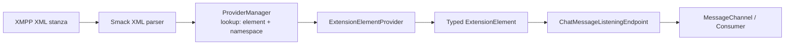
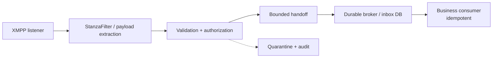

# Message payload và extension

## 1. Bối cảnh: một tin nhắn XMPP không chỉ có body

Module **SPRING_INTEGRATION_ADAPTERS** hướng dẫn kết nối hệ thống ngoài qua inbound/outbound adapter, gateway, poller và `MessageChannel`, đồng thời thực hành hợp đồng message, xử lý lỗi và vòng đời kết nối. Trong chương **Adapter XMPP**, dữ liệu thường đến dưới dạng chat stanza; tuy nhiên, một stanza có thể chứa **body**, **header giao thức** và **các phần mở rộng XML** (stanza extensions).

Xét dịch vụ nhập dữ liệu từ file, SFTP hoặc HTTP. Khi một batch thất bại, nó gửi cảnh báo:

```text
File/SFTP/HTTP/JMS/AMQP/Kafka/Database
               |
               v
       ImportFailedEvent
               |
               v
      Transformer / Enricher
               |
        +------+------+
        |             |
  Plain body text   XML extension
        |             |
        +------+------+
               v
       XMPP outbound adapter
               |
               v
            Server
               |
               v
        XMPP inbound adapter
               |
               v
       Business consumer
```

Tin nhắn đơn giản có thể truyền text “Batch 42 failed”, nhưng hệ thống máy–máy còn cần `eventId`, `batchId`, `severity` và `schemaVersion`. Có hai thiết kế phổ biến: **đặt dữ liệu trong body** (ví dụ JSON dưới dạng String) hoặc **đính kèm XMPP extension có namespace riêng**.

Sau bài này, bạn có thể:

- Phân biệt **Spring `Message<?>`**, **Smack `org.jivesoftware.smack.packet.Message`** và **XMPP XML stanza**.
- Chọn payload dạng `String`, Smack `Message` hoặc `ExtensionElement` cho XMPP outbound.
- Dùng `XmppHeaders.TO`, `FROM`, `THREAD`, `SUBJECT` và `TYPE` đúng hợp đồng.
- Dùng `ChatMessageListeningEndpoint.setPayloadExpression(...)` để trích body hoặc extension ở inbound.
- Tạo extension bằng `StandardExtensionElement` và truy xuất đúng **element name + namespace**.
- Hiểu `ExtensionElementProvider`, `ProviderManager` và khi nào cần custom provider.
- Thiết kế kiểm tra schema, authorization, idempotency, retry, giới hạn kích thước và quan sát.

## 2. Ba lớp “message” khác nhau

Một từ “message” có thể mang ba ý nghĩa:

| Tầng | Kiểu/định dạng | Vai trò |
| --- | --- | --- |
| **Ứng dụng Java** | `ImportFailedEvent`, JSON/DTO | Dữ liệu và ID nghiệp vụ |
| **Spring Integration** | `org.springframework.messaging.Message<T>` | `payload` và `headers` để chuyển giữa các endpoint |
| **XMPP/Smack** | `org.jivesoftware.smack.packet.Message` | Một stanza giao thức có `to`, `from`, `type`, `id`, `body`, `subject`, `thread`, `extensions` |

Ví dụ một Spring message:

```java
org.springframework.messaging.Message<String> event =
        org.springframework.messaging.support.MessageBuilder
                .withPayload("Batch 42 failed")
                .setHeader(
                        org.springframework.integration.xmpp.XmppHeaders.TO,
                        "operator@example.org"
                )
                .build();
```

Sau khi qua outbound adapter, dữ liệu được chuyển thành **Smack message** rồi gửi dưới dạng XMPP XML. Hai loại `Message` có tên trùng nhau nhưng **không phải cùng một lớp**. Trong Java code, nên import một trong hai và dùng fully-qualified name cho loại còn lại nếu cần.

### Ví dụ stanza có body

```xml
<message
    from="integration-bot@example.org/si"
    to="operator@example.org"
    type="chat"
    id="stanza-101">
    <body>Batch 42 failed</body>
</message>
```

`body` là nội dung chat. Các thuộc tính ngoài body như `to`/`from`/`type` thuộc stanza, không tự trở thành trường JSON trong body. Trong Spring Integration, **`DefaultXmppHeaderMapper`** hỗ trợ ánh xạ những thuộc tính XMPP chuẩn sang các header có tên tương ứng.

### Ví dụ stanza có extension

```xml
<message
    from="integration-bot@example.org/si"
    to="operator@example.org"
    type="chat"
    id="stanza-102">
    <event xmlns="urn:example:integration:alert:1" id="evt-42">
        <batchId>batch-42</batchId>
        <severity>WARN</severity>
    </event>
</message>
```

`event` là **extension XML** trong namespace `urn:example:integration:alert:1`. Namespace dùng để phân biệt extension tự thiết kế với extension chuẩn hoặc của tổ chức khác. Hai phần tử cùng tên `event` nhưng khác namespace **không phải cùng định dạng**.

Một stanza có thể có **body và nhiều extension cùng lúc**. Ví dụ chỉ có extension ở trên vẫn hợp lệ theo hợp đồng riêng của hai ứng dụng, nhưng một client chat thông thường có thể không hiển thị nội dung nếu stanza không có body. Đây là lý do lựa chọn payload phải dựa vào hệ thống nhận.

## 3. XMPP extension là gì?

XMPP mở rộng một stanza bằng những **XML child elements** mang namespace riêng. Smack biểu diễn chúng bằng `org.jivesoftware.smack.packet.ExtensionElement`.

Ví dụ:

```xml
<message to="operator@example.org" type="chat">
    <body>Cảnh báo nhập dữ liệu</body>
    <event xmlns="urn:example:integration:alert:1" id="evt-42">
        <batchId>batch-42</batchId>
        <severity>WARN</severity>
    </event>
</message>
```

Một số XEP có extension đã chuẩn hóa, chẳng hạn HTML trong chat hoặc delivery receipts. **Không phải extension tự thiết kế nào cũng là XEP chính thức.** Nếu tự đặt namespace `urn:example:integration:alert:1`, hai bên phải thống nhất cách tạo, parse, phiên bản schema và cách xử lý khi trường bị thiếu.

### Những quyết định về hợp đồng

| Câu hỏi | Lựa chọn thiết kế |
| --- | --- |
| Tin chỉ dành cho con người? | Body text rõ ràng thường đơn giản hơn |
| Tin dành cho máy cần schema? | JSON trong body hoặc XML extension |
| Có client XMPP không hiểu extension? | Giữ body làm bản tóm tắt dễ đọc nếu phù hợp |
| Có nhiều phần dữ liệu độc lập? | Dùng extension với namespace/element rõ ràng |
| Cần hỗ trợ nhiều phiên bản? | Đưa version vào namespace hoặc payload và có schema migration |
| Cần chống trùng? | Gắn event ID nghiệp vụ ổn định, không chỉ stanza ID |
| Cần ACK/transaction? | Xây dựng flow xác nhận riêng; extension không tạo ACK tự động |

**XMPP extension không tự tạo transaction, độ bền hoặc bảo đảm giao hàng**. Nó chỉ bổ sung cấu trúc dữ liệu vào một stanza.

## 4. Outbound: ba nhóm payload thường gặp

`ChatMessageSendingMessageHandler` trong Spring Integration gửi dữ liệu ra XMPP thông qua `XMPPConnection`. Theo tài liệu Spring Integration, những kiểu payload hỗ trợ gồm:

| Payload Spring | Cách diễn giải | Lưu ý |
| --- | --- | --- |
| `String` | Nội dung chat thông thường, dùng làm body | Cần `XmppHeaders.TO` xác định JID đích |
| Smack `Message` | Stanza đã được ứng dụng chuẩn bị | Kiểm soát `to`, type, body, extension và header mapper |
| Smack `ExtensionElement` / `XmlElement` phù hợp | Dữ liệu cấu trúc được gắn vào stanza như extension thay vì body | Cần phần tử/namespace đúng; client nhận phải hiểu extension |

Nếu cấu hình `setExtensionProvider(...)`, handler còn có thể lấy payload `String` chứa JSON/XML theo XEP và dùng provider để xây dựng extension. Đó là **chế độ cấu hình riêng**, không có nghĩa handler tự xem mọi JSON string là XML extension.

### 4.1. Gửi body text

```java
import org.springframework.integration.xmpp.XmppHeaders;
import org.springframework.messaging.Message;
import org.springframework.messaging.support.MessageBuilder;

Message<String> outbound = MessageBuilder
        .withPayload("ALERT: batch-42 failed")
        .setHeader(XmppHeaders.TO, "operator@example.org")
        .setHeader(XmppHeaders.THREAD, "batch-42")
        .build();
```

Đoạn này tạo **Spring message**, chưa gửi đi. Nó phải được đưa vào channel có `ChatMessageSendingMessageHandler` làm consumer.

`XmppHeaders.THREAD` là metadata hội thoại, **không phải delivery receipt hay idempotency key**. Nếu muốn correlation nghiệp vụ, thêm `eventId` vào body/extension và lưu trong kho trạng thái.

### 4.2. Gửi Smack Message đã tạo

Khi cần kiểm soát nhiều trường stanza đồng thời, ứng dụng có thể tự xây Smack `Message` rồi gửi làm payload:

```java
// Minh họa Smack API dạng builder, cần connection thật.
org.jivesoftware.smack.packet.Message stanza =
        xmppConnection.getStanzaFactory()
                .buildMessageStanza()
                .to("operator@example.org")
                .ofType(
                    org.jivesoftware.smack.packet.Message.Type.chat
                )
                .setBody("ALERT: batch-42 failed")
                .build();

org.springframework.messaging.Message<
        org.jivesoftware.smack.packet.Message> springMessage =
        org.springframework.messaging.support.MessageBuilder
                .withPayload(stanza)
                .build();
```

Đây là đoạn code **minh họa cách tạo payload**, chưa định nghĩa `xmppConnection` hay outbound channel. Các method builder là API Smack và cần đối chiếu đúng phiên bản thư viện. Không trộn `Message.Builder`/constructor cũ của Smack với API hiện tại nếu chưa kiểm chứng.

Khi payload là Smack message, hãy thống nhất **nguồn sự thật** cho `to`/`type`: không đặt một JID trong stanza rồi đặt JID trái ngược trong Spring header và mong framework giải quyết mâu thuẫn theo ý định nghiệp vụ.

### 4.3. Gửi ExtensionElement

Smack cung cấp `StandardExtensionElement` dùng cho những phần tử XML đơn giản. Ví dụ:

```java
import org.jivesoftware.smack.packet.StandardExtensionElement;
import org.springframework.integration.xmpp.XmppHeaders;
import org.springframework.messaging.Message;
import org.springframework.messaging.support.MessageBuilder;

String namespace = "urn:example:integration:alert:1";

StandardExtensionElement event = StandardExtensionElement
        .builder("event", namespace)
        .addAttribute("id", "evt-42")
        .addElement("batchId", "batch-42")
        .addElement("severity", "WARN")
        .build();

Message<StandardExtensionElement> extensionMessage =
        MessageBuilder.withPayload(event)
                .setHeader(XmppHeaders.TO, "operator@example.org")
                .build();
```

`StandardExtensionElement` là một `ExtensionElement` hợp lệ, và outbound handler hỗ trợ gửi extension payload theo cơ chế `Stanza.addExtension(...)` thay cho `setBody(...)`. Hãy lưu ý người nhận vẫn cần biết **namespace, tên element, kiểu trường và ý nghĩa nghiệp vụ**.

Không dùng nối chuỗi XML tùy ý từ input người dùng. Builder của Smack giúp tạo phần tử theo đúng API, nhưng **không tự xác thực** event ID, schema hay quyền của sender.

## 5. Inbound: payload-expression lấy gì từ stanza?

`ChatMessageListeningEndpoint` đăng ký một `StanzaListener` trên `XMPPConnection`. Khi stanza được nhận, endpoint có thể dùng `setPayloadExpression(...)` để đánh giá một biểu thức SpEL với **Smack `Message` làm đối tượng gốc**.

| Expression | Kết quả dự kiến | Điều cần kiểm tra |
| --- | --- | --- |
| `body` | Body `String` | Có thể null với stanza chỉ có extension |
| `#root` | Nguyên đối tượng Smack `Message` | Consumer phải xử lý kiểu Smack |
| `getExtension('urn:example:integration:alert:1')` | Extension đầu tiên khớp namespace | Có thể null; nên kiểm tra cả element name |
| `getExtensionElement('event','urn:example:integration:alert:1')` | Extension có đúng element/namespace | Phụ thuộc API Smack đã chọn |
| `#extension` | Một extension duy nhất trong evaluation context | **Chỉ được cung cấp khi có đúng một extension** |

Tài liệu Spring Integration có ví dụ `getExtension('google:mobile:data').json` hoặc `#extension.json` cho một XEP cụ thể. **Đừng sao chép `.json` cho extension tự thiết kế**: `StandardExtensionElement` không có thuộc tính `json`. Với nó, cần dùng `getAttributeValue(...)`, `getFirstElement(...)` hoặc một provider tùy chỉnh.

### 5.1. Chỉ lấy body text

```java
endpoint.setPayloadExpression(
        new org.springframework.expression.spel.standard
                .SpelExpressionParser()
                .parseExpression("body")
);
```

Cấu hình kiểu này phù hợp khi `StanzaFilter` đã loại message không có body. Nếu một message chỉ có extension thì biểu thức `body` trả null; đừng kỳ vọng framework tự tạo một String rỗng.

### 5.2. Giữ nguyên Smack Message để tự xử lý body và extension

```java
endpoint.setPayloadExpression(
        new org.springframework.expression.spel.standard
                .SpelExpressionParser()
                .parseExpression("#root")
);
```

Consumer sau đó nhận `org.springframework.messaging.Message<org.jivesoftware.smack.packet.Message>`; nó có thể kiểm tra body, stanza ID, element name và namespace mà không phải chọn một payload duy nhất từ trước.

### 5.3. Chỉ trích một extension cụ thể

```xml
<int-xmpp:inbound-channel-adapter
    id="eventExtensionInbound"
    channel="extensionChannel"
    xmpp-connection="xmppConnection"
    payload-expression="getExtensionElement('event', 'urn:example:integration:alert:1')"/>
```

Đây là **cấu hình minh họa**: nếu stanza không có extension tương ứng thì expression có thể trả null. Cần một `StanzaFilter` phù hợp hoặc một endpoint nhận nguyên message rồi quyết định cách xử lý, thay vì mặc định mọi stanza đều có extension.

**Lưu ý:** Nếu chỉ có một extension, `#extension` có thể tiện lợi. Khi stanza có **hai hoặc nhiều extension**, biến đó không được cung cấp theo cơ chế được Reference mô tả. Nên chọn theo QName (element name + namespace) khi hợp đồng có thể mở rộng.

## 6. StanzaFilter: loại input không đúng hợp đồng từ sớm

`StanzaFilter` chạy trong đường nhận của Smack trước khi Spring Integration dựng payload. Ví dụ chỉ muốn xử lý message loại `chat`/`normal` có body **hoặc** extension sự kiện:

```java
import org.jivesoftware.smack.packet.Message;
import org.jivesoftware.smack.packet.Stanza;
import org.jivesoftware.smack.filter.StanzaFilter;

StanzaFilter filter = (Stanza stanza) -> {
    if (!(stanza instanceof Message message)) {
        return false;
    }

    boolean supportedType =
            message.getType() == Message.Type.chat
            || message.getType() == Message.Type.normal;

    boolean hasBody = message.getBody() != null
            && !message.getBody().isBlank();

    boolean hasEvent = message.getExtensionElement(
            "event", "urn:example:integration:alert:1"
    ) != null;

    return supportedType && (hasBody || hasEvent);
};

endpoint.setStanzaFilter(filter);
```

Ở đây, `endpoint` là `ChatMessageListeningEndpoint` đã được tạo. Filter giúp không đưa stanza `presence`/`iq` hoặc message chat rỗng vào flow nghiệp vụ.

Tuy nhiên, **filter không phải authorization**. Khi message đi qua, consumer vẫn cần kiểm tra sender JID được phép, schema, kích thước, event ID và quyền thực hiện hành động. Không tin một stanza chỉ vì nó có namespace mà ứng dụng nhận diện.

## 7. Ví dụ Spring Boot: nhận cả body và extension

Đoạn cấu hình hoàn chỉnh dưới đây minh họa:

1. `XmppConnectionFactoryBean` quản lý kết nối tới server XMPP test.
2. Một inbound adapter giữ nguyên **Smack message** để consumer đọc body và extension.
3. Một outbound handler chấp nhận **String** hoặc **StandardExtensionElement**.
4. `ApplicationRunner` đưa hai message mẫu vào outbound channel. Để quan sát inbound, một client/tài khoản XMPP khác phải gửi đến account của bot; không mặc định bot tự nhận bản sao của message đã gửi.

### 7.1. Dependencies và application.yml

```xml
<dependencies>
    <dependency>
        <groupId>org.springframework.boot</groupId>
        <artifactId>spring-boot-starter-integration</artifactId>
    </dependency>
    <dependency>
        <groupId>org.springframework.integration</groupId>
        <artifactId>spring-integration-xmpp</artifactId>
    </dependency>
</dependencies>
```

Ví dụ dùng Java 17+, Spring Boot với Spring Integration 6.x và Smack tương thích. Nếu dự án không dùng dependency management của Spring Boot, cần chỉ định phiên bản tương thích và kiểm tra các API Smack. Không lấy mã Smack 3.x hoặc một phiên bản beta bất kỳ để áp dụng trực tiếp.

```yaml
app:
  xmpp:
    host: ${XMPP_HOST:xmpp.internal.example.org}
    port: ${XMPP_PORT:5222}
    domain: ${XMPP_DOMAIN:example.org}
    user: ${XMPP_USER:integration-bot}
    password: ${XMPP_PASSWORD}
    recipient: ${XMPP_RECIPIENT:operator@example.org}
```

Giá trị host/domain/JID chỉ dùng cho minh họa. Cần XMPP server thật (chẳng hạn Openfire/ejabberd), tài khoản `integration-bot` và `operator` được cấp quyền. Không đưa password thực vào repository; dùng environment hoặc secret manager và bật TLS có xác minh chứng chỉ.

### 7.2. Java configuration

```java
import org.jivesoftware.smack.XMPPConnection;
import org.jivesoftware.smack.packet.ExtensionElement;
import org.jivesoftware.smack.packet.StandardExtensionElement;
import org.jivesoftware.smack.roster.Roster;

import org.springframework.beans.factory.annotation.Qualifier;
import org.springframework.beans.factory.annotation.Value;
import org.springframework.boot.ApplicationRunner;
import org.springframework.context.annotation.Bean;
import org.springframework.context.annotation.Configuration;
import org.springframework.expression.spel.standard.SpelExpressionParser;
import org.springframework.integration.annotation.ServiceActivator;
import org.springframework.integration.channel.DirectChannel;
import org.springframework.integration.config.EnableIntegration;
import org.springframework.integration.xmpp.XmppHeaders;
import org.springframework.integration.xmpp.config.XmppConnectionFactoryBean;
import org.springframework.integration.xmpp.inbound.ChatMessageListeningEndpoint;
import org.springframework.integration.xmpp.outbound.ChatMessageSendingMessageHandler;
import org.springframework.messaging.MessageChannel;
import org.springframework.messaging.support.MessageBuilder;

@Configuration
@EnableIntegration
public class XmppPayloadExtensionFlow {

    private static final String NS = "urn:example:integration:alert:1";

    @Bean(name = "xmppConnection")
    public XmppConnectionFactoryBean xmppConnection(
            @Value("${app.xmpp.host}") String host,
            @Value("${app.xmpp.domain}") String domain,
            @Value("${app.xmpp.port:5222}") int port,
            @Value("${app.xmpp.user}") String user,
            @Value("${app.xmpp.password}") String password) {

        XmppConnectionFactoryBean factory = new XmppConnectionFactoryBean();
        factory.setHost(host);
        factory.setServiceName(domain);
        factory.setPort(port);
        factory.setUser(user);
        factory.setPassword(password);
        factory.setResource("payload-extension-demo");
        factory.setSubscriptionMode(Roster.SubscriptionMode.reject_all);
        return factory;
    }

    @Bean
    public MessageChannel xmppInboundChannel() {
        return new DirectChannel();
    }

    @Bean
    public MessageChannel xmppOutboundChannel() {
        return new DirectChannel();
    }

    @Bean
    public ChatMessageListeningEndpoint inboundMessages(
            XMPPConnection connection,
            @Qualifier("xmppInboundChannel") MessageChannel channel) {

        ChatMessageListeningEndpoint endpoint =
                new ChatMessageListeningEndpoint(connection);
        endpoint.setOutputChannel(channel);
        endpoint.setStanzaFilter(stanza ->
                stanza instanceof org.jivesoftware.smack.packet.Message m
                && (m.getType()
                        == org.jivesoftware.smack.packet.Message.Type.chat
                    || m.getType()
                        == org.jivesoftware.smack.packet.Message.Type.normal)
                && ((m.getBody() != null && !m.getBody().isBlank())
                    || m.getExtensionElement("event", NS) != null));

        // Payload cua Spring Message se la Smack Message.
        endpoint.setPayloadExpression(
                new SpelExpressionParser().parseExpression("#root")
        );
        return endpoint;
    }

    @Bean
    @ServiceActivator(inputChannel = "xmppOutboundChannel")
    public ChatMessageSendingMessageHandler outboundMessages(
            XMPPConnection connection) {
        return new ChatMessageSendingMessageHandler(connection);
    }

    @ServiceActivator(inputChannel = "xmppInboundChannel")
    public void onIncoming(
            org.springframework.messaging.Message<
                    org.jivesoftware.smack.packet.Message> incoming) {

        org.jivesoftware.smack.packet.Message stanza =
                incoming.getPayload();

        String sender = stanza.getFrom() == null
                ? ""
                : stanza.getFrom().toString();
        String body = stanza.getBody();

        ExtensionElement extension =
                stanza.getExtensionElement("event", NS);
        if (extension instanceof StandardExtensionElement event) {
            String eventId = event.getAttributeValue("id");
            StandardExtensionElement severity =
                    event.getFirstElement("severity");
            String level = severity == null
                    ? null : severity.getText();

            System.out.printf(
                "EXT from=%s eventId=%s level=%s%n",
                sender, eventId, level
            );
            // Production: authorize sender, validate schema,
            // luu event ID va xu ly idempotent.
        }
        else if (body != null && !body.isBlank()) {
            System.out.printf("TEXT from=%s body=%s%n", sender, body);
        }
    }

    @Bean
    public ApplicationRunner sendExamples(
            XMPPConnection connection,
            @Qualifier("xmppOutboundChannel") MessageChannel channel,
            @Value("${app.xmpp.recipient}") String recipient) {

        return args -> {
            if (!connection.isAuthenticated()) {
                throw new IllegalStateException(
                        "XMPP connection is not authenticated"
                );
            }

            channel.send(MessageBuilder
                    .withPayload("ALERT: batch-42 failed")
                    .setHeader(XmppHeaders.TO, recipient)
                    .build());

            StandardExtensionElement event = StandardExtensionElement
                    .builder("event", NS)
                    .addAttribute("id", "evt-42")
                    .addElement("batchId", "batch-42")
                    .addElement("severity", "WARN")
                    .build();

            channel.send(MessageBuilder
                    .withPayload(event)
                    .setHeader(XmppHeaders.TO, recipient)
                    .build());
        };
    }
}
```

Đặt class trong vùng component scan của `@SpringBootApplication` hoặc import vào Spring context. Code minh họa cơ chế **send/receive qua endpoint**, không bao gồm việc kiểm thử trên XMPP server thật; cần cấu hình kết nối/TLS, tài khoản và quyền thích hợp.

### 7.3. Vì sao giữ nguyên Smack message ở inbound?

Consumer có thể kiểm tra:

- `getBody()` để nhận text.
- `getExtensionElement("event", NS)` để nhận extension có đúng tên/namespace.
- `getFrom()` để biết JID gửi (vẫn phải authorize).
- `getStanzaId()` để đối chiếu kỹ thuật khi cần.
- `getType()` và `getThread()` để hiểu ngữ cảnh hội thoại.

Nếu chỉ dùng `payload-expression="body"`, một stanza **chỉ có extension** không có body có thể bị mất thông tin cần thiết hoặc gây lỗi null. Trái lại, nếu chỉ trích extension, tin nhắn chat văn bản bình thường sẽ không có payload tương ứng.

### 7.4. Một số giới hạn của ví dụ

- `ApplicationRunner` gửi hai stanza độc lập. **Không** có bảo đảm chúng đến nơi theo một giao dịch chung.
- Một client GUI thông thường có thể hiển thị message có body nhưng không hiển thị stanza chỉ có extension.
- `StandardExtensionElement` phù hợp cho cấu trúc đơn giản, không thay thế parser/schema chuyên dụng trong hệ thống phức tạp.
- Consumer mới chỉ log và chưa có giới hạn payload, whitelist sender, lưu DB hay retry; phải bổ sung các kiểm soát này trước production.
- `@ServiceActivator` cùng `DirectChannel` có thể chạy xử lý trên đường callback Smack; với thao tác nặng, nên tách handoff sang queue/broker có giới hạn.

## 8. Header mapping và đường đi metadata

`DefaultXmppHeaderMapper` là mapper tiêu chuẩn của Spring Integration cho thuộc tính message XMPP.

| Hằng số | Header Spring | Ý nghĩa |
| --- | --- | --- |
| `XmppHeaders.TO` | `xmpp_to` | JID người nhận |
| `XmppHeaders.FROM` | `xmpp_from` | JID người gửi |
| `XmppHeaders.TYPE` | `xmpp_type` | Chat/normal/groupchat/... |
| `XmppHeaders.SUBJECT` | `xmpp_subject` | Tiêu đề, nếu có |
| `XmppHeaders.THREAD` | `xmpp_thread` | Thread của hội thoại |
| `XmppHeaders.CHAT` | `xmpp_chat` | Ngữ cảnh chat khi endpoint cung cấp |

**Không nhầm `XmppHeaders.TO` với hằng số `XmppHeaders.CHAT_TO` trong những ví dụ lịch sử.** Theo API Spring Integration 6.x, `XmppHeaders.TO` là hằng số hiện có. Cũng không dùng `XmppHeaders.CHAT` để thay địa chỉ nhận.

### Header tùy chỉnh có tự đi qua XMPP không?

Thông thường **không**. Những header như `tenantId`, `importId`, `traceId` không tự trở thành thuộc tính XML XMPP chỉ vì được đặt trên Spring `Message`. `DefaultXmppHeaderMapper` có thể được cấu hình `requestHeaderNames`/`replyHeaderNames`, nhưng không nên map wildcard toàn bộ header mà chưa đánh giá dữ liệu nhạy cảm.

Nếu một event ID phải đến hệ thống nhận, hãy truyền nó trong **body hoặc extension đã thỏa thuận**. Không gửi token/credential, đường dẫn nội bộ hoặc dữ liệu riêng tư qua những header được đưa ra mạng một cách vô tình.

### Spring Message ID, stanza ID và event ID

| ID | Ai tạo/ở tầng nào? | Có phù hợp chống xử lý trùng? |
| --- | --- | --- |
| `MessageHeaders.ID` | Spring Messaging | Không ổn định xuyên tái tạo message/retry |
| XMPP `stanzaId` | Smack/client/server theo giao thức | Cần hiểu phạm vi/độ tin cậy trước khi sử dụng |
| `XmppHeaders.THREAD` | Metadata hội thoại | Không phải định danh sự kiện |
| `eventId` của ứng dụng | Hợp đồng nghiệp vụ | Phù hợp khi được tạo ổn định và được validate |

Khi retry một bản tin có cùng nghiệp vụ, **giữ nguyên event ID** để bên nhận có thể dedup, thay vì tạo một event ID mới mỗi lượt thử.

## 9. ProviderManager và custom ExtensionElementProvider

`StandardExtensionElement` có thể biểu diễn nhiều XML extension đơn giản, nhưng với một XEP hoặc schema riêng phức tạp, bên nhận thường cần một **lớp extension có kiểu dữ liệu rõ** và một **provider** để parse XML.

Kiến trúc:



Các thành phần:

- `ExtensionElement`: đối tượng đại diện một XML child element của stanza.
- `ExtensionElementProvider<E>`: lớp parser từ XML của element thành đối tượng `E`.
- `ProviderManager`: registry tìm provider theo **element name** và **namespace**.
- `StandardExtensionElement`: dạng tổng quát hỗ trợ phần tử/attribute/child đơn giản, hữu ích khi không cần typed provider.

Ví dụ đăng ký provider đã được triển khai:

```java
import org.jivesoftware.smack.provider.ProviderManager;

// EventExtensionProvider la class do ung dung tu xay dung.
// Phai cai dat parse XML cho QName ("event", NS).
ProviderManager.addExtensionProvider(
        "event",
        "urn:example:integration:alert:1",
        new EventExtensionProvider()
);
```

Đây là **mảnh tích hợp minh họa**, không phải class Java độc lập có thể compile khi `EventExtensionProvider` chưa được định nghĩa. Một provider thật phải triển khai parser theo API `XmlPullParser` của đúng phiên bản Smack, kiểm tra schema/giới hạn kích thước và tạo typed `ExtensionElement`.

Smack còn hỗ trợ đăng ký provider qua **provider configuration file**; không bắt buộc hard-code mọi provider nếu thư viện XEP đã có cơ chế tự đăng ký. Khi đăng ký trùng QName, phải xem chính sách ghi đè của registry và tránh thay provider của một XEP khác vô ý.

### 9.1. Khi nào dùng setExtensionProvider ở outbound?

`ChatMessageSendingMessageHandler.setExtensionProvider(...)` cho phép cấp một provider để **xây dựng extension từ payload String** (chẳng hạn một JSON/XML string theo XEP) trước khi gửi.

```java
ChatMessageSendingMessageHandler handler =
        new ChatMessageSendingMessageHandler(connection);

// Chỉ khi đã có provider phù hợp với định dạng payload.
handler.setExtensionProvider(customEventExtensionProvider);
```

Biến `connection` và `customEventExtensionProvider` ở đoạn trên là những object giả định đã được cấu hình; đây **không phải toàn bộ bean runnable**. Không đặt `setExtensionProvider` rồi tiếp tục gửi mọi String như một body chat thông thường: khi bật provider, cách handler dựng nội dung outgoing sẽ đổi theo cấu hình đó.

Nếu ứng dụng đã tạo sẵn `ExtensionElement` bằng builder hoặc typed extension riêng, **không nhất thiết phải có extension provider phía gửi**. Bên nhận vẫn cần hiểu cách parse extension tương ứng với schema.

### 9.2. Chọn namespace và phiên bản schema

Ví dụ:

```xml
<event xmlns="urn:example:integration:alert:1" id="evt-42">
    <batchId>batch-42</batchId>
    <severity>WARN</severity>
</event>
```

Một bản thay đổi không tương thích có thể dùng `urn:example:integration:alert:2`. Đừng giữ namespace cũ mà thay hoàn toàn ý nghĩa trường, khiến consumer cũ parse sai. Nếu chỉ thêm trường tùy chọn, công bố quy tắc forward/backward compatibility: consumer cũ có thể bỏ qua trường lạ, consumer mới cần kiểm tra trường bắt buộc.

| Điều kiện | Hành động gợi ý |
| --- | --- |
| Thiếu `eventId` | Reject/quarantine, không đoán ID |
| `severity` ngoài tập giá trị cho phép | Reject hoặc dùng fallback có audit theo hợp đồng |
| Namespace chưa hỗ trợ | Reject hoặc chuyển tới dead-letter theo chính sách |
| Có nhiều extension khác nhau | Chọn theo QName; không dựa vào `#extension` |
| Extension đã từng xử lý | Dedup theo event ID |
| Stanza có body nhưng extension không hợp lệ | Không mặc định tin body để vượt qua schema validation |

## 10. Chọn body JSON hay XML extension?

Hai lựa chọn đều có thể hợp lệ; vấn đề là **hợp đồng tương thích**.

| Tiêu chí | JSON trong body | XML extension |
| --- | --- | --- |
| Client chat thông thường | Có thể hiển thị chuỗi JSON | Có thể không hiển thị khi không có body |
| Lập trình consumer | Parse JSON theo schema | Parse XML/provider/XEP theo namespace |
| Tách nội dung cho người và metadata cho máy | Cần quy ước thêm | Body và extension có thể cùng tồn tại |
| Phiên bản | Trường `schemaVersion` trong JSON | Namespace/version của extension |
| Hệ sinh thái XMPP | Không tự là một XEP | Tích hợp tốt hơn với những XEP đã định nghĩa |
| Kiểm tra input | JSON parser, schema, size | XML parser/provider, namespace, size |
| Hỗ trợ client cũ | JSON có thể bị hiển thị thô | Extension lạ có thể bị bỏ qua |

Không nghĩ rằng dùng extension sẽ tự động bảo mật hơn JSON: cả hai đều chứa **input không tin cậy**, được truyền trên kết nối, có thể bị server/client lưu và phải chịu chính sách TLS/riêng tư tương ứng.

Nếu chỉ cần giao tiếp máy–máy giữa hai dịch vụ có kiểm soát, JSON body có thể đơn giản. Nếu cần tương tác với chuẩn XMPP hoặc vừa hiển thị text vừa mang dữ liệu cấu trúc, extension có thể phù hợp hơn.

## 11. Bảo mật: đừng biến extension thành kênh thực thi lệnh

Một bên gửi có thể cố ý gửi:

- XML extension chứa chuỗi quá dài, nhiều cấp lồng nhau hoặc số lượng child lớn.
- Namespace giống hợp đồng nhưng payload có giá trị không hợp lệ.
- Event ID đã dùng trước để kích hoạt thao tác trùng.
- Body/extension có đường dẫn file, URL callback hoặc câu lệnh mà consumer thực hiện không kiểm soát.
- Trường `from` giả mạo theo ngữ cảnh giao thức hoặc nickname của MUC trùng với người tin cậy.

### Những kiểm soát tối thiểu

1. **TLS/SASL** với xác minh CA/hostname. TLS client-to-server không đồng nghĩa end-to-end encryption.
2. **Authorization theo sender JID** và loại hành động. Đừng chỉ nhìn namespace để quyết định có quyền.
3. **Giới hạn kích thước stanza/body/extension** và số lượng event mỗi đơn vị thời gian, trước thao tác parse nặng.
4. **XML parser an toàn**: không tự bật external entities/DTD hoặc entity expansion trong custom provider; dùng các API/parser mặc định an toàn và giới hạn nesting.
5. **Schema validation**: kiểu trường, độ dài, enum, event ID, timestamp, version và các trường bắt buộc.
6. **Không thực thi input**: không chạy shell, SQL, XPath, SpEL hoặc truy cập filesystem từ giá trị extension chưa kiểm tra.
7. **Dedupe và idempotency** theo ID nghiệp vụ bền vững; có audit.
8. **Log chọn lọc**, không log toàn bộ stanza khi có token, dữ liệu cá nhân hoặc thông tin vận hành nhạy cảm.

**`payload-expression` phải là biểu thức do ứng dụng cấu hình và kiểm soát**, không nhận một biểu thức SpEL tùy ý từ sender hoặc HTTP request rồi đánh giá nó. SpEL có thể truy cập method/property; đây là bề mặt tấn công nếu cho input không đáng tin trở thành biểu thức thực thi.

## 12. Lỗi, retry, kết nối và tính nhất quán

Một XMPP inbound adapter nhận message theo listener sự kiện; outbound adapter gửi qua connection. **Không có giao dịch chung** giữa XMPP, database, JMS, AMQP hoặc Kafka chỉ vì dữ liệu có extension.

| Giai đoạn | Lỗi có thể gặp | Thiết kế phục hồi |
| --- | --- | --- |
| Kết nối | TCP/TLS/SASL lỗi, session stale | Health/reconnect/backoff |
| Nhận stanza | Mất mạng, listener chưa chạy | Offline policy, stream management, nguồn replay riêng |
| Trích payload | `body`/extension không có | Filter, chọn đúng QName, reject rõ ràng |
| Parse extension | Provider thiếu hoặc schema sai | Parse an toàn, quarantine |
| Validate sender | JID không thuộc danh sách cho phép | Từ chối trước nghiệp vụ |
| Ghi database | Timeout/commit thất bại | Durable inbox, retry và idempotent transaction |
| Gửi outbound | Mất kết nối sau khi send bắt đầu | Giữ event ID, không biết chắc server đã nhận |
| ACK bên nhận | Không có reply nghiệp vụ | Correlation/event ID và trạng thái chờ |

### Reconnect không tự là replay

Smack/Spring Integration có cơ chế khôi phục kết nối, nhưng **không thể kết luận mọi stanza bị bỏ lỡ đều được phát lại**. Các khả năng như offline message, XMPP Stream Management (XEP-0198) hoặc delivery receipts (XEP-0184) phụ thuộc client/server, cấu hình và chỉ bảo đảm trong phạm vi giao thức tương ứng.

Với event quan trọng, nên đưa dữ liệu vào **durable outbox** trước khi gửi, và ở phía nhận có **durable inbox** hoặc consumer idempotent. Nếu cần xử lý đúng một lần về nghiệp vụ, dùng unique constraint/transaction tại kho đích; không suy ra exactly-once từ `MessageHeaders.ID`, stanza ID hay việc gọi send không ném exception.

### Consumer chậm và backpressure

`DirectChannel` thường chuyển lời gọi trực tiếp đến consumer. Với XMPP inbound, xử lý DB/HTTP nặng trong callback Smack có thể làm tăng độ trễ nhận stanza. Một kiến trúc:



`QueueChannel` hoặc `ExecutorChannel` giúp tách thread nhưng **không tự bền vững**. Phải kiểm soát sức chứa, quy tắc khi đầy, shutdown, lỗi và nguồn replay; nếu chuyển vào JMS/AMQP/Kafka, thiết kế ACK/offset/transaction theo đúng broker đó.

## 13. Kịch bản kiểm thử end-to-end

Chuẩn bị hai tài khoản **trên môi trường test**:

- Bot nhận: `integration-bot@example.org`, chạy Java config ở mục 7.
- Client gửi: `operator@example.org`, có khả năng gửi message text hoặc extension.

Các bước:

1. **Text bình thường:** gửi body “ALERT: batch-42 failed” từ operator đến bot; xác nhận consumer chạy nhánh `TEXT`.
2. **Extension-only:** gửi `<event xmlns="urn:example:integration:alert:1">...` không có body; xác nhận consumer chạy nhánh `EXT` và lấy `id`/`severity`.
3. **Cả body và extension:** gửi stanza có cả hai; xác định ưu tiên xử lý theo hợp đồng (ví dụ extension là nguồn dữ liệu chính).
4. **Không có extension:** gửi body chat khác; kiểm tra không bị `NullPointerException`.
5. **Sai namespace:** đổi sang `urn:example:integration:alert:2`; kiểm tra filter/consumer xử lý theo hợp đồng chưa hỗ trợ.
6. **Hai extension:** đính kèm thêm extension khác; so sánh cách lấy bằng QName với `#extension`.
7. **Thiếu event ID:** gửi `event` không có `id`; thiết kế schema validation và đường từ chối.
8. **Sender không được phép:** gửi từ tài khoản chưa được authorize; event không được gây tác động database.
9. **Trùng event ID:** gửi `evt-42` hai lần; dùng unique constraint để đảm bảo nghiệp vụ chỉ áp dụng một lần.
10. **Ngắt mạng:** ngắt rồi reconnect trên môi trường test; đếm số stanza nhận được, tránh mặc định replay.
11. **Provider tùy chỉnh:** tạo typed `EventExtension` và parser riêng; đăng ký `ProviderManager` theo element/namespace.
12. **Message lớn:** gửi một payload vượt giới hạn ứng dụng; xác nhận hệ thống từ chối có kiểm soát và không làm nghẽn callback.

Ví dụ log dự kiến (không phải log đã chạy):

```text
TEXT from=operator@example.org/laptop body=ALERT: batch-42 failed
EXT  from=operator@example.org/laptop eventId=evt-42 level=WARN
```

Giá trị JID/resource thực phụ thuộc server và phiên đăng nhập. Không dùng dữ liệu thật trong phép thử lỗi, spam hoặc payload quá lớn.

## 14. Troubleshooting

| Triệu chứng | Nguyên nhân có thể | Kiểm tra/cách sửa |
| --- | --- | --- |
| Body text hoạt động nhưng extension-only lỗi | `payload-expression="body"` trả null | Giữ `#root` hoặc trích extension có kiểm tra |
| SpEL `#extension` không tồn tại | Stanza có 0 hoặc nhiều hơn 1 extension | Chọn extension theo QName |
| Không parse được extension tùy chỉnh | Thiếu provider hoặc sai element/namespace | `ProviderManager` và schema của extension |
| `getExtensionElement` trả null | Sai namespace/element hoặc sender không gửi | Kiểm tra stanza thực, tên và namespace |
| Gửi XML extension nhưng client không hiển thị | Không có body hoặc client không hiểu XEP | Giữ body tóm tắt khi phù hợp |
| Gửi String nhưng phía nhận chỉ thấy extension | Handler đã cấu hình `extensionProvider` | Kiểm tra mode outbound đang sử dụng |
| Thiếu `XmppHeaders.TO` | Recipient chưa được enrich | Header mapper và JID |
| Code dùng `XmppHeaders.CHAT_TO` không compile | Hằng số cũ trong tài liệu lịch sử | Dùng `XmppHeaders.TO` trên API 6.x |
| Nhận event trùng | Sender retry, server/client redelivery | Event ID và idempotency |
| Callback Smack bị chậm | Parse nặng hoặc ghi DB trực tiếp | Handoff có giới hạn |
| Parse XML tiêu tốn CPU/RAM | XML không đáng tin hoặc quá sâu | Limits và parser an toàn |
| Không nhận message sau reconnect | Connection/listener chưa sẵn sàng hoặc server không replay | Health, lifecycle và nguồn bền vững |

## 15. Bài tập tự luyện

1. Tạo `Message<String>` với `XmppHeaders.TO`, giải thích vì sao đây chưa phải Smack stanza.
2. Tạo `StandardExtensionElement` gồm `id`, `batchId`, `severity` và namespace riêng.
3. Gửi hai message trong mục 7 đến một tài khoản test; mô tả những gì client chat thông thường có thể hiển thị.
4. Thay inbound `payload-expression="body"` bằng `#root`; so sánh khả năng đọc extension-only.
5. Viết `StanzaFilter` chỉ nhận loại chat/normal và extension có QName chính xác.
6. Tạo một stanza có **hai extension**, chứng minh vì sao `#extension` không còn là lựa chọn an toàn.
7. Thiết kế JSON body thay cho extension XML; so sánh schema versioning, tương thích client và validation.
8. Xây typed `EventExtension` cùng `ExtensionElementProvider` cho một namespace riêng, đăng ký vào `ProviderManager` trước khi bắt đầu nhận.
9. Gắn `eventId` bền vững; thử gửi lại sau timeout và chỉ commit business event một lần.
10. Thêm validation sender JID, size limit, schema enum, audit và quarantine khi extension không hợp lệ.
11. Đề xuất phương án tiếp tục xử lý khi server XMPP mất mạng vài phút, và phân biệt reconnect với replay.
12. Chuyển downstream nặng sang broker có độ bền và xác định điều kiện xác nhận nghiệp vụ.

### Câu hỏi tự kiểm tra

**Q1. Spring `Message<?>` và Smack `Message` có giống nhau không?**  
Không. Spring message dùng payload/headers trong flow; Smack message là stanza XMPP có to/from/body/extension.

**Q2. Outbound adapter chấp nhận những kiểu payload phổ biến nào?**  
`String`, Smack `Message`, và extension element phù hợp; hoặc String được provider chuyển thành extension khi cấu hình tương ứng.

**Q3. `payload-expression` của XMPP inbound đánh giá trên đối tượng nào?**  
Smack `org.jivesoftware.smack.packet.Message` làm root object.

**Q4. Khi nào dùng `#extension`?**  
Khi message có đúng một extension theo điều kiện mà Spring Integration cung cấp biến đó.

**Q5. Namespace có tác dụng gì?**  
Phân biệt phần mở rộng cùng tên, nhận diện hợp đồng/XEP và hỗ trợ quản lý phiên bản.

**Q6. `ExtensionElementProvider` khác `ProviderManager` ra sao?**  
Provider parse XML thành extension object; manager đăng ký/tìm provider theo QName.

**Q7. Spring header `tenantId` có tự gửi thành field XML không?**  
Không. Cần mapping/hợp đồng rõ ràng; dữ liệu nghiệp vụ có thể nằm trong body hoặc extension.

**Q8. Tại sao không dùng stanza ID làm bảo đảm exactly-once?**  
Vì stanza ID không xác nhận downstream đã commit; cần event ID, trạng thái và idempotency riêng.

## 16. Ghi nhớ

**Message payload và extension** là chìa khóa để thiết kế hợp đồng XMPP rõ ràng. Spring Integration vận chuyển `Message<?>` với payload/headers; Smack vận chuyển `<message>` stanza với body, thuộc tính giao thức và những XML extension. `ChatMessageSendingMessageHandler` hỗ trợ body `String`, Smack message hoặc extension payload; `ChatMessageListeningEndpoint` có `StanzaFilter` và `payload-expression` để chọn stanza và trích dữ liệu.

Khi thiết kế một XEP/custom extension, phải phân biệt **element name + namespace**, cấu hình parser/provider khi cần, validate sender và schema, giới hạn input, giữ event ID ổn định, xử lý retry/idempotency và quản lý lifecycle kết nối. **Extension không tự là cơ chế ACK, transaction hay replay**; với file/SFTP/HTTP/JMS/AMQP/Kafka/database, mỗi ranh giới vẫn cần hợp đồng lỗi và độ tin cậy riêng.

### Tài liệu tham khảo

- [Spring Integration Reference — XMPP Support](https://docs.spring.io/spring-integration/reference/xmpp.html)
- [Spring Integration API 6.5 — ChatMessageListeningEndpoint](https://docs.spring.io/spring-integration/docs/6.5.0/api/org/springframework/integration/xmpp/inbound/ChatMessageListeningEndpoint.html)
- [Spring Integration API 6.5 — ChatMessageSendingMessageHandler](https://www.springframework.org/spring-integration/docs/6.5.0/api/org/springframework/integration/xmpp/outbound/ChatMessageSendingMessageHandler.html)
- [Spring Integration API 6.5 — XmppHeaders](https://docs.spring.io/spring-integration/docs/6.5.0/api/org/springframework/integration/xmpp/XmppHeaders.html)
- [Smack 4.4.7 API — StandardExtensionElement](https://download.igniterealtime.org/smack/docs/4.4.7/javadoc/org/jivesoftware/smack/packet/StandardExtensionElement.html)
- [Smack 4.4.7 API — ExtensionElementProvider](https://download.igniterealtime.org/smack/docs/4.4.7/javadoc/org/jivesoftware/smack/provider/ExtensionElementProvider.html)
- [Smack API — ProviderManager](https://download.igniterealtime.org/smack/docs/latest/javadoc/org/jivesoftware/smack/provider/ProviderManager.html)
- [Smack Provider Architecture](https://download.igniterealtime.org/smack/dailybuilds/documentation/providers.html)
- [XMPP RFC 6120 — Core](https://xmpp.org/rfcs/rfc6120.html)
