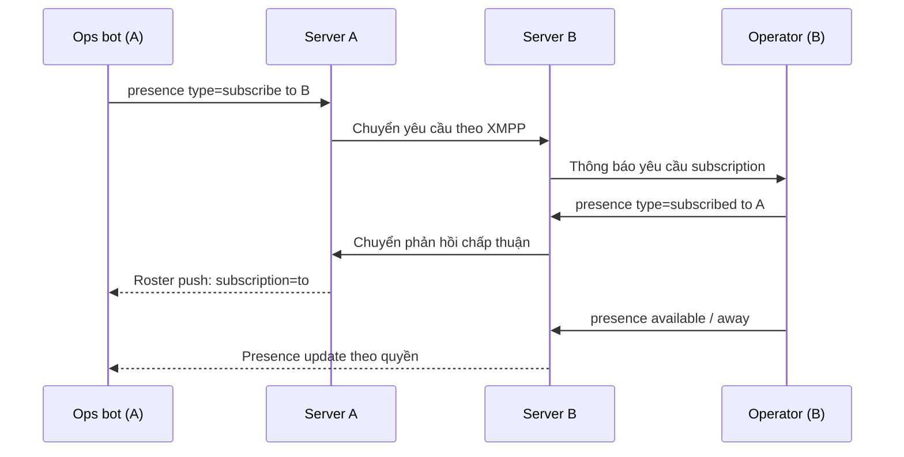
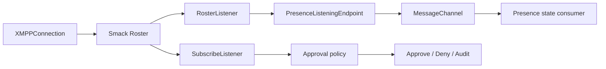

# Presence subscription và trạng thái

## 1. Bối cảnh: “online” không có nghĩa là “được phép theo dõi”

Module **SPRING_INTEGRATION_ADAPTERS** hướng dẫn kết nối các hệ thống ngoài vào Spring Integration bằng inbound/outbound adapter, gateway, poller và `MessageChannel`. Các luồng file, SFTP, HTTP, JMS, AMQP, Kafka, database và XMPP đều cần hợp đồng message, xử lý lỗi và quản lý vòng đời kết nối rõ ràng. Trong chương **Adapter XMPP**, bài này tập trung vào **quyền theo dõi presence (subscription)** và **trạng thái hiện diện (presence state)**.

Giả sử `ops-bot@example.org` theo dõi ca trực của `operator@example.org`. Bot đã đăng nhập XMPP thành công nhưng không thấy operator online. Điều đó **không chứng minh operator offline**: tài khoản bot có thể chưa được operator chấp thuận cho xem presence; roster có thể chưa tải; mạng có thể đang gián đoạn; hoặc operator vẫn online ở một resource mà bot chưa nhận được cập nhật.

```text
                  operator@example.org
                  /laptop        /phone
                      \            /
                       XMPP server
                            |
              Subscription có được cấp?
                            |
                  +---------+---------+
                  |                   |
                 CÓ                CHƯA CÓ
                  |                   |
             Presence updates     Không thể suy ra
                  |               operator offline
                  v
      ops-bot@example.org
                  |
         PresenceListeningEndpoint
                  |
         presenceEventsChannel
                  |
          Consumer / state store
```

### Mục tiêu học tập

Sau bài học, bạn có thể:

- Phân biệt **roster entry**, **subscription permission** và **presence event**.
- Giải thích chính xác các trạng thái subscription `none`, `to`, `from`, `both`, cùng trạng thái **pending**.
- Hiểu các stanza `subscribe`, `subscribed`, `unsubscribe` và `unsubscribed`; phân biệt với `available`/`unavailable`.
- Cấu hình `XmppConnectionFactoryBean.setSubscriptionMode(...)` và quản lý roster bằng Smack.
- Dùng `RosterEntry.canSeeHisPresence()`, `canSeeMyPresence()`, `isSubscriptionPending()` để kiểm tra quyền.
- Sử dụng `PresenceListeningEndpoint` nhận `Message<Presence>` vào `MessageChannel`.
- Thiết kế lưu trạng thái **theo full JID/resource**, tổng hợp theo bare JID và đối chiếu lại sau reconnect.
- Xử lý quyền riêng tư, cấp/revoke subscription, lỗi kết nối, retry, trạng thái UNKNOWN và các bài thử thực tế.

## 2. Ba khái niệm phải tách biệt

| Khái niệm | Ý nghĩa | Câu hỏi mà nó trả lời |
| --- | --- | --- |
| **Roster** | Danh sách liên hệ và metadata thuộc tài khoản XMPP; có thể có nickname, groups, subscription type | Bot đang quản lý liên hệ nào? |
| **Subscription** | Quyền một chiều hoặc hai chiều được xem cập nhật presence | Bot có được phép xem operator không? |
| **Presence** | Cập nhật trạng thái từ một resource XMPP, thường qua stanza `<presence>` | Resource nào đang available/away/unavailable? |

Ba tầng liên quan nhưng không đồng nhất:

1. Một JID **có trong roster** chưa chắc bot có quyền xem presence của JID đó.
2. Một quyền **subscription đã được cấp** không chứng minh contact đang online.
3. Một event `unavailable` từ một resource không chứng minh mọi resource của tài khoản đã offline.
4. Một connection đang `authenticated` không chứng minh roster đã tải hoặc event subscription được xử lý xong.

### User JID và resource

```text
operator@example.org                bare JID: tài khoản
operator@example.org/laptop         full JID: một resource
operator@example.org/phone          full JID: resource khác
```

Subscription được quản lý chủ yếu ở cấp **bare JID/tài khoản**. Presence được công bố từ các **resource**. Nếu laptop logout nhưng phone còn online, logic account-level không nên lập tức báo cả tài khoản offline.

## 3. Subscription là quan hệ có hướng

Theo RFC 6121, bốn trạng thái chính dưới đây được giải thích **từ góc nhìn của tài khoản đang đọc roster** — trong bài là `ops-bot@example.org`:

| Roster `subscription` | Bot xem presence của operator? | Operator xem presence của bot? |
| --- | --- | --- |
| `none` | Chưa có quyền | Chưa có quyền |
| `to` | **Có** | Không |
| `from` | Không | **Có** |
| `both` | **Có** | **Có** |

Đây là mấu chốt dễ đọc ngược:

- **`to`**: bot có subscription **đến presence của người kia**.
- **`from`**: bot cho phép subscription **từ người kia đến presence của bot**.
- **`both`**: cả hai chiều.
- **`none`**: chưa có chiều nào.

### Ví dụ quan hệ bất đối xứng

```text
operator chấp thuận bot xem presence
  => roster của bot:       subscription=to
  => roster của operator:  subscription=from

operator cũng muốn xem presence của bot và được chấp thuận
  => roster của bot:       subscription=both
  => roster của operator:  subscription=both
```

**Không mặc định hai chiều được chấp thuận đồng thời.** Trong môi trường doanh nghiệp, một bot chỉ cần theo dõi trạng thái người trực ca có thể chỉ cần trạng thái `to`; không nhất thiết phải tự cho mọi liên hệ xem lịch sử trực tuyến của bot.

### Pending subscription

`none` chưa đủ để biết bot đã gửi yêu cầu hay chưa. RFC 6121 có các trạng thái phụ **Pending Out** (đã gửi yêu cầu, chờ bên kia chấp thuận) và **Pending In** (bên kia gửi yêu cầu, bot chưa quyết định).

| Tình huống | Điều kiện khái niệm | Cách hiểu |
| --- | --- | --- |
| `none`, không pending | Không bên nào được xem; không còn yêu cầu đang chờ | Chưa cấp quyền |
| `none + pending out` | Bot vừa xin theo dõi operator | **Chưa được phép xem** |
| `none + pending in` | Operator xin theo dõi bot | Bot phải áp dụng chính sách phê duyệt |
| `to + pending in` | Bot đã được xem operator; operator đang xin xem bot | Chưa tự là `both` |
| `from + pending out` | Operator được xem bot; bot đang xin xem operator | Chưa tự là `both` |

Smack có `RosterEntry.isSubscriptionPending()` để kiểm tra **yêu cầu gửi đi đang chờ**. Không dùng nó để kết luận đầy đủ mọi Pending In; yêu cầu đến cần được xử lý qua chính sách `SubscriptionMode`/`SubscribeListener` hoặc API liên quan.

## 4. Bốn stanza quản lý subscription

Đừng nhầm các stanza **quản lý quyền** với các stanza **công bố trạng thái**.

| `Presence.Type` | Bên gửi muốn gì? | Kết quả kỳ vọng |
| --- | --- | --- |
| `subscribe` | Xin quyền xem presence của contact | Contact/server xét yêu cầu |
| `subscribed` | Đồng ý cấp quyền xem presence cho người đã xin | Subscription thay đổi sau xử lý server |
| `unsubscribe` | Hủy quyền mà chính mình đang dùng để xem contact | Không tiếp tục nhận presence của contact |
| `unsubscribed` | Thu hồi/từ chối quyền mà người khác có đối với presence của mình | Contact không còn quyền theo dõi |

### 4.1. Bot xin theo dõi operator

```xml
<presence
    from="ops-bot@example.org"
    to="operator@example.org"
    type="subscribe"/>
```

Operator chấp thuận:

```xml
<presence
    from="operator@example.org"
    to="ops-bot@example.org"
    type="subscribed"/>
```

Sau khi server xử lý và đẩy roster update, quan hệ thường là **`to` từ góc nhìn bot**, **`from` từ góc nhìn operator**. Nếu operator từ chối, bot không có quyền xem và không được suy rằng operator offline.



Sơ đồ là luồng khái niệm. Cách server route/đẩy roster và thứ tự event chi tiết phải theo RFC và hệ thống được triển khai. **Gửi `subscribe` thành công không đồng nghĩa contact đã đồng ý**.

### 4.2. Bot không muốn theo dõi operator nữa

Bot có thể gửi `unsubscribe` để hủy chiều “bot xem operator”:

```xml
<presence to="operator@example.org" type="unsubscribe"/>
```

Nếu operator muốn thu hồi quyền “bot xem operator”, operator có thể gửi `unsubscribed` tới bot:

```xml
<presence to="ops-bot@example.org" type="unsubscribed"/>
```

**Thu hồi subscription khác với xóa một entry khỏi roster.** Việc xóa entry có thể tác động thêm đến quan hệ và danh bạ theo API/server; không xem xóa roster là thao tác nghiệp vụ vô hại. Khi một quyền bị thu hồi, ứng dụng phải ngừng trình bày dữ liệu hiện diện cũ như dữ liệu hiện hành.

## 5. Available, unavailable, show/mode và status text

Các stanza ở mục 4 quản lý **quyền theo dõi**. Sau khi được quyền, bot có thể nhận các stanza trạng thái thông thường:

```xml
<presence from="operator@example.org/laptop"
          to="ops-bot@example.org/spring-integration">
    <show>away</show>
    <status>Đang trong cuộc họp</status>
    <priority>5</priority>
</presence>
```

```xml
<presence from="operator@example.org/laptop"
          to="ops-bot@example.org/spring-integration"
          type="unavailable"/>
```

Smack biểu diễn bằng `org.jivesoftware.smack.packet.Presence`:

| Thuộc tính / API | Ví dụ | Cần hiểu |
| --- | --- | --- |
| `getType()` | `Presence.Type.available` | Resource công bố đang hiện diện |
| `getType()` | `Presence.Type.unavailable` | Resource ngừng hiện diện |
| `getMode()` | `Presence.Mode.away` | Resource vẫn có thể available, nhưng tạm vắng |
| `getMode()` | `Presence.Mode.dnd` | Không muốn bị làm phiền; **không tự là offline** |
| `getStatus()` | `"Đang họp"` | Chuỗi tùy ý, có thể null và không được tin làm lệnh |
| `getPriority()` | `5` | Độ ưu tiên của resource theo XMPP routing, không phải nghiệp vụ |
| `getFrom()` | `operator@example.org/laptop` | Full JID có resource, cần chuẩn hóa |

**`available` và `away` không phải hai giá trị cạnh tranh của cùng một enum.** Cái đầu là `Presence.Type`; cái sau là `Presence.Mode`. Nếu bot nhận `type=available`, `mode=dnd`, không được tự đánh dấu operator offline.

## 6. Spring Integration và Smack xử lý hai mảng khác nhau

Spring Integration cung cấp **presence inbound/outbound channel adapter**; Smack quản lý kết nối, roster và subscription.

| Nhu cầu | API chính | Ghi chú |
| --- | --- | --- |
| Đăng nhập và quản lý kết nối | `XmppConnectionFactoryBean`, `XMPPConnection` | TLS/SASL, JID, reconnect |
| Chọn chính sách subscription mới đến | `setSubscriptionMode(...)` | Tác động quyền riêng tư |
| Đọc roster và quyền | `Roster.getInstanceFor(connection)`, `RosterEntry` | Cần roster đã tải |
| Gửi yêu cầu xem contact | `Roster.sendSubscriptionRequest(BareJid)` | Chỉ xin quyền, chưa được duyệt |
| Xử lý subscribe mới đến | `Roster.addSubscribeListener(...)` | Dùng với chính sách manual |
| Nhận cập nhật trạng thái | `PresenceListeningEndpoint` | `RosterListener` → `Message<Presence>` |
| Công bố trạng thái của bot | `PresenceSendingMessageHandler` | Payload `Presence` |
| Tiêu thụ event trong flow | `MessageChannel`, `@ServiceActivator` | Không tự duy trì state bền vững |

`PresenceListeningEndpoint` dùng roster listener để nhận **presence changes**, không được xem là một endpoint tự phát mọi yêu cầu `subscribe` và tự thực hiện approval. Khi cần duyệt yêu cầu, xử lý bằng **Smack SubscribeListener** hoặc quy trình quản trị cụ thể.

**Không cần poller cho XMPP presence inbound**: adapter event-driven. Trong trường hợp downstream tiêu thụ từ `QueueChannel`, poller thuộc **consumer phía sau**, không dùng để “poll” trạng thái server XMPP.

## 7. SubscriptionMode: mặc định và lựa chọn an toàn

`XmppConnectionFactoryBean.setSubscriptionMode(...)` nhận `Roster.SubscriptionMode`:

| Mode | Smack làm gì khi có yêu cầu subscribe mới? | Khi nào phù hợp? |
| --- | --- | --- |
| `accept_all` | Tự động chấp thuận | Chỉ khi chính sách đã cho phép mọi contact yêu cầu |
| `reject_all` | Tự động từ chối | Bot có roster cấp quyền trước, không mở thêm quyền |
| `manual` | Giao quyết định cho listener/ứng dụng | Cần whitelist hoặc quy trình phê duyệt |

**Có hai giá trị mặc định dễ nhầm**:

- Trong API **Spring Integration `XmppConnectionFactoryBean` 6.5**, giá trị mặc định của **factory** được mô tả là **`accept_all`**.
- Trong API **Smack `Roster` 4.4**, giá trị mặc định của **Smack Roster** độc lập được mô tả là **`reject_all`**.

Không dựa vào suy luận “Smack default là reject, nên bean Spring chắc cũng reject”. Luôn đặt chính sách tường minh khi thao tác với tài khoản dịch vụ.

### Vì sao không chọn accept_all cho bot sản xuất?

Nếu một tài khoản không được kiểm soát xin subscribe, bot có thể **tự cấp quyền cho tài khoản đó theo dõi trạng thái presence của bot**. Điều này có thể tiết lộ thời điểm trực tuyến, hoạt động bảo trì hoặc cấu trúc ca trực. Trong XMPP, authorization ở roster và chính sách server vẫn phải được tôn trọng.

### Vì sao reject_all không đồng nghĩa bot không được xem ai?

`reject_all` quyết định cách xử lý **yêu cầu mới xin xem presence của bot**. Nó **không tự hủy** những quyền bot đã được operator chấp thuận cho xem operator. Hai chiều subscription độc lập.

### Chế độ manual cần listener thực sự

Khi `manual`, ứng dụng phải có listener xử lý subscribe request. Nếu không có listener phù hợp, yêu cầu có thể bị để chờ mà không có phản hồi. `Roster.addSubscribeListener(...)` cũng đặt mode thủ công theo API Smack; phải quản lý vòng đời listener và không cho phép hai chính sách xung đột.

## 8. Ví dụ Spring Boot: đọc quyền subscription và nhận presence

Ví dụ sử dụng Java 17+, Spring Boot và phiên bản Spring Integration XMPP tương thích. Cần XMPP server test, hai tài khoản có quyền thích hợp; bài **không thực thi server thật**.

### 8.1. Maven dependencies

```xml
<dependencies>
    <dependency>
        <groupId>org.springframework.boot</groupId>
        <artifactId>spring-boot-starter-integration</artifactId>
    </dependency>
    <dependency>
        <groupId>org.springframework.integration</groupId>
        <artifactId>spring-integration-xmpp</artifactId>
    </dependency>
</dependencies>
```

Nếu không dùng BOM Spring Boot, phải khai báo các phiên bản Spring Integration/Smack tương thích và đối chiếu API. Không trộn API Smack 3.x với phiên bản 4.4.x hoặc các phiên bản mới hơn mà chưa kiểm tra.

### 8.2. application.yml

```yaml
app:
  xmpp:
    host: ${XMPP_HOST:xmpp.internal.example.org}
    port: ${XMPP_PORT:5222}
    domain: ${XMPP_DOMAIN:example.org}
    user: ${XMPP_USER:ops-bot}
    password: ${XMPP_PASSWORD}
    contact: ${XMPP_CONTACT:operator@example.org}
```

`host` là hostname kết nối TCP; `domain` là **miền dịch vụ XMPP** của tài khoản; `contact` là JID mục tiêu cần kiểm tra. Những giá trị `example.org` chỉ là minh họa. Giữ password trong secret manager/environment, dùng TLS với xác minh chứng chỉ/hostname, không commit secrets vào Git.

### 8.3. Java configuration hoàn chỉnh

Ví dụ một connection factory, một presence inbound endpoint và consumer. Khi ứng dụng khởi động, `ApplicationRunner` kiểm tra quyền subscription **nhưng không tự yêu cầu hoặc cấp quyền**.

```java
import org.jivesoftware.smack.XMPPConnection;
import org.jivesoftware.smack.packet.Presence;
import org.jivesoftware.smack.roster.Roster;
import org.jivesoftware.smack.roster.RosterEntry;
import org.jxmpp.jid.EntityBareJid;
import org.jxmpp.jid.impl.JidCreate;

import org.springframework.beans.factory.annotation.Qualifier;
import org.springframework.beans.factory.annotation.Value;
import org.springframework.boot.ApplicationRunner;
import org.springframework.context.annotation.Bean;
import org.springframework.context.annotation.Configuration;
import org.springframework.integration.annotation.ServiceActivator;
import org.springframework.integration.channel.DirectChannel;
import org.springframework.integration.config.EnableIntegration;
import org.springframework.integration.xmpp.config.XmppConnectionFactoryBean;
import org.springframework.integration.xmpp.inbound.PresenceListeningEndpoint;
import org.springframework.messaging.Message;
import org.springframework.messaging.MessageChannel;

@Configuration
@EnableIntegration
public class XmppPresenceSubscriptionConfig {

    @Bean(name = "xmppConnection")
    public XmppConnectionFactoryBean xmppConnection(
            @Value("${app.xmpp.host}") String host,
            @Value("${app.xmpp.domain}") String domain,
            @Value("${app.xmpp.port:5222}") int port,
            @Value("${app.xmpp.user}") String user,
            @Value("${app.xmpp.password}") String password) {

        XmppConnectionFactoryBean factory =
                new XmppConnectionFactoryBean();
        factory.setHost(host);
        factory.setServiceName(domain);
        factory.setPort(port);
        factory.setUser(user);
        factory.setPassword(password);
        factory.setResource("subscription-monitor");

        // Khong tu mo quyen theo doi presence cho moi requester.
        factory.setSubscriptionMode(Roster.SubscriptionMode.reject_all);
        return factory;
    }

    @Bean
    public MessageChannel presenceEventsChannel() {
        return new DirectChannel();
    }

    @Bean
    public PresenceListeningEndpoint presenceInboundAdapter(
            XMPPConnection connection,
            @Qualifier("presenceEventsChannel") MessageChannel channel) {

        PresenceListeningEndpoint endpoint =
                new PresenceListeningEndpoint(connection);
        endpoint.setOutputChannel(channel);
        endpoint.setAutoStartup(true);
        return endpoint;
    }

    @ServiceActivator(inputChannel = "presenceEventsChannel")
    public void onPresence(Message<Presence> springMessage) {
        Presence presence = springMessage.getPayload();
        String from = presence.getFrom() == null
                ? "(unknown)"
                : presence.getFrom().toString();

        System.out.printf(
                "PRESENCE from=%s type=%s mode=%s status=%s%n",
                from,
                presence.getType(),
                presence.getMode(),
                presence.getStatus()
        );

        // Production: normalize full JID, check contact permission,
        // update resource state and observedAt idempotently.
    }

    @Bean
    public ApplicationRunner inspectContactSubscription(
            XMPPConnection connection,
            @Value("${app.xmpp.contact}") String configuredContact) {

        return args -> {
            if (!connection.isAuthenticated()) {
                throw new IllegalStateException(
                        "XMPP connection is not authenticated"
                );
            }

            EntityBareJid contact =
                    JidCreate.entityBareFrom(configuredContact);
            Roster roster = Roster.getInstanceFor(connection);

            // Chi chay khi authenticated, de lay thong tin hien tai.
            roster.reloadAndWait();
            RosterEntry entry = roster.getEntry(contact);
            if (entry == null) {
                System.out.println("Contact is not in the roster");
                return;
            }

            System.out.printf(
                    "ROSTER contact=%s type=%s canSeeContact=%s "
                    + "contactCanSeeMe=%s pendingOut=%s%n",
                    entry.getJid(),
                    entry.getType(),
                    entry.canSeeHisPresence(),
                    entry.canSeeMyPresence(),
                    entry.isSubscriptionPending()
            );

            // Khong goi sendSubscriptionRequest() tu dong.
            // Approval la mot quy trinh rieng co quyen ro rang.
        };
    }
}
```

Lớp cần nằm trong component scan của `@SpringBootApplication` hoặc được import vào Spring context. Ví dụ dùng `DirectChannel` để dễ quan sát; nếu consumer ghi database chậm, cần tách callback khỏi xử lý nặng.

### 8.4. Giải thích mã

| Dòng/API | Mục đích |
| --- | --- |
| `setSubscriptionMode(reject_all)` | Không tự cấp thêm quyền cho contact mới muốn xem bot |
| `PresenceListeningEndpoint(connection)` | Đăng ký listener trên roster của connection |
| `Message<Presence>` | Payload là Smack `Presence`, **không** phải body String |
| `Roster.getInstanceFor(connection)` | Lấy roster thuộc đúng tài khoản/connection |
| `roster.reloadAndWait()` | Tải/đối chiếu roster từ server trước khi kiểm tra |
| `entry.getType()` | Đọc trạng thái `none`/`to`/`from`/`both` |
| `entry.canSeeHisPresence()` | Bot có quyền xem contact hay không |
| `entry.canSeeMyPresence()` | Contact có quyền xem bot hay không |
| `entry.isSubscriptionPending()` | Một yêu cầu outgoing subscription còn chờ hay không |

**`roster.reloadAndWait()` không phải thao tác nên gọi trong mọi event callback.** Đây là bước kiểm tra/snapshot trong ví dụ. Với production, cần timeout, health, chính sách reload/reconnect và không chạy thao tác mạng đồng bộ nặng trong `RosterListener`.

**Lưu ý về event-driven:** ví dụ có thể in roster hợp lệ nhưng không nhận presence vì contact chưa công bố sự kiện mới hoặc server chưa chuyển cập nhật. Đừng nhầm “không có event ngay lập tức” với “không có subscription”.

## 9. Gửi yêu cầu subscription có chủ đích

Nếu `ops-bot` cần theo dõi `operator` nhưng chưa có quyền, một quy trình được phân quyền có thể gửi yêu cầu qua Smack:

```java
import org.jivesoftware.smack.roster.Roster;
import org.jxmpp.jid.EntityBareJid;
import org.jxmpp.jid.impl.JidCreate;

// connection da authenticated va request da duoc cho phep.
Roster roster = Roster.getInstanceFor(connection);
EntityBareJid contact =
        JidCreate.entityBareFrom("operator@example.org");

roster.sendSubscriptionRequest(contact);
```

Đây là **mảnh code mô tả**, không phải method độc lập: biến `connection` phải là kết nối do factory quản lý; khi triển khai phải xử lý `NotConnectedException`/`NotLoggedInException`/`InterruptedException` phù hợp. **Không chạy đoạn này tự động ở mỗi lần startup** để tránh spam yêu cầu và không vô ý vượt chính sách duyệt.

Một lựa chọn khác khi muốn đồng thời tạo entry và xin theo dõi:

```java
roster.createItemAndRequestSubscription(
        contact,
        "Operator ca truc",
        new String[] {"Operations"}
);
```

`createItemAndRequestSubscription(...)` chỉ **tạo roster item và gửi yêu cầu**, không tự biến quyền thành `to`. Server và operator phải xử lý yêu cầu. Nếu chỉ cần tạo entry mà chưa gửi request, Smack còn có `createItem(...)`.

### Quy trình vận hành đề xuất

1. Operator/administrator cấp quyền cho bot được theo dõi một danh sách JID cố định.
2. Bot hoặc công cụ quản trị gửi `subscribe` theo yêu cầu có phê duyệt.
3. Contact quyết định chấp thuận/từ chối theo chính sách.
4. Server cập nhật roster subscription.
5. Ứng dụng đọc lại `canSeeHisPresence()`; chỉ khi đã có quyền mới xem presence như dữ liệu được phép.
6. Khi người dùng thu hồi quyền, ẩn/xóa dữ liệu trạng thái không còn được phép hiển thị, theo chính sách retention.

**Subscription không phải một cách bypass quyền riêng tư.** Không tạo tài khoản hoặc thay đổi danh sách liên hệ để âm thầm theo dõi người dùng ngoài thỏa thuận.

## 10. Duyệt yêu cầu subscription đến bằng SubscribeListener

Khi có use case cho phép một tập người dùng được xem presence của bot, cần chính sách rõ ràng. `Roster.SubscriptionMode.manual` kết hợp `SubscribeListener` cho phép ứng dụng quyết định dựa trên JID đã phê duyệt.

```java
import java.util.Set;

import org.jivesoftware.smack.XMPPConnection;
import org.jivesoftware.smack.roster.Roster;
import org.jivesoftware.smack.roster.SubscribeListener;

Roster roster = Roster.getInstanceFor(connection);
Set<String> allowed = Set.of(
        "operator@example.org",
        "supervisor@example.org"
);

SubscribeListener listener = (from, request) -> {
    String bareJid = from.asBareJid().toString();
    if (allowed.contains(bareJid)) {
        return SubscribeListener.SubscribeAnswer.Approve;
    }
    return SubscribeListener.SubscribeAnswer.Deny;
};

roster.addSubscribeListener(listener); // Smack chuyen sang manual mode

// Khi lifecycle dung: roster.removeSubscribeListener(listener).
```

Đây là một **đoạn cấu hình listener minh họa**, không phải bean chạy độc lập: `connection` phải có sẵn, listener nên được đăng ký **trước khi có subscription request cần xử lý**, và cần được gỡ khi dừng. Không thực thi gọi mạng hoặc truy vấn chậm trong callback. Whitelist trong thực tế phải lấy từ một nguồn quản trị có kiểm soát, chuẩn hóa JID bằng thư viện phù hợp, và có audit.

Các giá trị `SubscribeAnswer`:

| Giá trị | Ý nghĩa |
| --- | --- |
| `Approve` | Chấp thuận request từ contact |
| `Deny` | Từ chối request |
| `ApproveAndAlsoRequestIfRequired` | Chấp thuận và, nếu cần, **xin chiều ngược lại** |
| `null` | Listener không đưa ra quyết định; Smack có thể hỏi listener tiếp theo |

**Không dùng `ApproveAndAlsoRequestIfRequired` mặc định** nếu chỉ muốn contact xem bot, vì nó có thể khởi tạo yêu cầu để bot theo dõi contact, mở thêm một quan hệ quyền theo dõi không cần thiết.

### Không nhầm manual approval với PresenceListeningEndpoint

`PresenceListeningEndpoint` làm việc với **cập nhật hiện diện của roster**. `SubscribeListener` làm việc với **yêu cầu quyền subscription đến**. Nếu muốn theo dõi cả hai loại sự kiện trong ứng dụng, cần hai đường xử lý rõ ràng, thay vì trộn yêu cầu cấp quyền vào consumer presence với payload đã được giả định là update trạng thái.

## 11. Cấu hình XML namespace

Với dự án dùng XML, Spring Integration hỗ trợ `<int-xmpp:xmpp-connection>` và `<int-xmpp:presence-inbound-channel-adapter>`:

```xml
<beans xmlns="http://www.springframework.org/schema/beans"
       xmlns:xsi="http://www.w3.org/2001/XMLSchema-instance"
       xmlns:int="http://www.springframework.org/schema/integration"
       xmlns:int-xmpp="http://www.springframework.org/schema/integration/xmpp"
       xsi:schemaLocation="
           http://www.springframework.org/schema/beans
           https://www.springframework.org/schema/beans/spring-beans.xsd
           http://www.springframework.org/schema/integration
           https://www.springframework.org/schema/integration/spring-integration.xsd
           http://www.springframework.org/schema/integration/xmpp
           https://www.springframework.org/schema/integration/xmpp/spring-integration-xmpp.xsd">

    <int:channel id="presenceEvents"/>

    <int-xmpp:xmpp-connection
        id="xmppConnection"
        host="${app.xmpp.host}"
        port="${app.xmpp.port}"
        user="${app.xmpp.user}"
        password="${app.xmpp.password}"
        resource="subscription-monitor"
        subscription-mode="reject_all"/>

    <int-xmpp:presence-inbound-channel-adapter
        id="presenceInboundAdapter"
        channel="presenceEvents"
        xmpp-connection="xmppConnection"
        auto-startup="true"/>
</beans>
```

Đây là **phương án thay thế Java configuration**, không khai báo cả hai trong cùng context nếu chỉ cần một endpoint. XML chưa tạo một `service-activator`; cần downstream consumer cho `presenceEvents`. Các placeholder `${...}` do Spring environment giải quyết.

`subscription-mode` thuộc cấu hình **connection/roster policy**, không phải một filter nghiệp vụ được `PresenceListeningEndpoint` thực thi. Nó không cho bot quyền xem JID bất kỳ; quyền thực tế vẫn do subscription state trên server xác định.

Nếu cần `manual`, triển khai listener/approval riêng bằng Smack. Đừng đặt `manual` mà không có người xử lý request, để hệ thống im lặng giữ pending vô thời hạn.

## 12. Lưu trạng thái hiện diện khi một tài khoản có nhiều resource

Mô hình dữ liệu chỉ có một boolean `isOnline` theo bare JID thường dẫn đến kết luận sai:

```text
10:00  operator@example.org/laptop  available
10:01  operator@example.org/phone   available
10:05  operator@example.org/laptop  unavailable
10:06  operator@example.org        ??? 
```

Nếu bot được phép xem presence, tài khoản vẫn có thể **online qua phone**. Không thể coi event `unavailable` của laptop là toàn bộ tài khoản offline.

### Hai cấp trạng thái

| Cấp độ | Khóa gợi ý | Nội dung |
| --- | --- | --- |
| Resource | `accountBareJid + resource/fullJid` | `type`, `mode`, `status`, `observedAt` |
| Account | `accountBareJid` | Trạng thái tổng hợp từ các resource được biết và còn hợp lệ |

Chính sách tổng hợp tham khảo:

1. Nếu chưa có quyền subscription, trạng thái account là **`NOT_AUTHORIZED`**, không phải OFFLINE.
2. Nếu mất kết nối hoặc dữ liệu quá cũ, trạng thái account là **`UNKNOWN`**.
3. Nếu có ít nhất một resource `available` còn hợp lệ, trạng thái account có thể là **`AVAILABLE`**; mode có thể được chọn theo chính sách.
4. Nếu tất cả resource đã biết đều `unavailable`, snapshot đáng tin cậy và kết nối ổn định, account có thể là **`UNAVAILABLE`**.
5. Khi roster subscription thay đổi từ `to/both` sang `none/from`, đánh dấu state `NOT_AUTHORIZED` và ngừng công bố dữ liệu cũ.

Các giá trị `NOT_AUTHORIZED` và `UNKNOWN` là **trạng thái do ứng dụng thiết kế**, không phải `Presence.Type` trong Smack.

### Đừng dùng mode như quyền

`Presence.Mode.away` và `Presence.Mode.dnd` chỉ thể hiện tình trạng resource. Chúng không phải bằng chứng người dùng đang ở văn phòng, không cho phép ứng dụng bỏ qua bước authorization và cũng không tự là lệnh từ chối cảnh báo. Nếu cần điều phối ca trực, phải có quy tắc nghiệp vụ và nguồn lịch trực riêng.

## 13. Reconnect: bản ghi presence có thể cũ hơn thực tế

Một kịch bản thường gặp:

```text
09:00 bot login, được quyền xem operator, nhận available
09:05 bot mất mạng
09:06 operator logout, server gửi unavailable nhưng bot bỏ lỡ
09:10 bot reconnect và login thành công
09:11 cache bot vẫn hiển thị available từ 09:00
```

Việc **reconnect thành công không bảo đảm replay mọi cập nhật presence** xảy ra khi bot offline. Cũng không nên mặc định inbound adapter tự phát một snapshot đầy đủ khi start.

### Chiến lược đối chiếu (reconciliation)

1. Khi connection bị mất hoặc `isAuthenticated()==false`, đánh dấu trạng thái hiện diện trong cache là **UNKNOWN/stale**, không tiếp tục khẳng định online.
2. Sau reconnect, kiểm tra roster đã tải và quyền subscription bằng `RosterEntry`.
3. Sử dụng API roster của Smack như `reloadAndWait()` (với timeout/giới hạn) và `getAvailablePresences(BareJid)` để dựng snapshot **khi đã được phép**.
4. Đồng bộ snapshot với các event listener, tránh ghi đè event mới bằng snapshot cũ; dùng `connectionEpoch`/`observedAt` hoặc thứ tự được điều phối.
5. Theo dõi TTL và thời điểm cập nhật cuối; nếu dữ liệu quá cũ thì chuyển UNKNOWN.
6. Nếu quyền bị revoke, dừng hiển thị/đẩy tiếp presence, và áp dụng chính sách lưu trữ dữ liệu.

**Không diễn giải `Roster.getPresence(...)` trả `unavailable` là một bằng chứng tuyệt đối contact offline**. Smack còn có thể trả trạng thái không available khi không có thông tin hoặc chưa được subscription; cần xét quyền và độ mới của dữ liệu.

### Phân biệt hai tình huống

| Tình huống | Cách đánh dấu |
| --- | --- |
| Subscription chưa được cấp | `NOT_AUTHORIZED` |
| Subscription đã cấp nhưng connection đang mất | `UNKNOWN` |
| Subscription đã cấp, snapshot tin cậy cho thấy không còn resource | `UNAVAILABLE` (theo chính sách) |
| Một resource có `type=available` | `AVAILABLE` ở resource đó |
| Một resource có `type=available, mode=dnd` | Online nhưng đang DND, không phải offline |

## 14. RosterListener, SubscribeListener và race condition

`RosterListener` dùng để nhận thay đổi roster và presence. `SubscribeListener` được gọi khi có request `subscribe` ở chế độ manual. Cả hai đều nằm trong thế giới Smack, nhưng có phạm vi khác nhau.



**Bảo vệ điểm khởi tạo:** nếu bạn chỉ cài listener sau khi roster đã phát nhiều event, ứng dụng có thể bỏ lỡ một số thay đổi giữa bước đọc snapshot và bước đăng ký listener.

Smack có API `Roster.getEntriesAndAddListener(...)` để nhận entries hiện có và cài listener trong một thao tác được điều phối, sao cho listener chỉ nhận sự kiện sau khi callback entries đã hoàn tất. Với yêu cầu đồng bộ trạng thái cao, cần nghiên cứu phương án này và kết hợp chiến lược kết nối lại, không chỉ dùng một lần `getEntries()` rồi mới `addRosterListener()`.

Nếu dùng `PresenceListeningEndpoint` của Spring Integration, framework quản lý việc đăng ký `RosterListener` theo lifecycle endpoint. Không đăng ký thêm một listener tự viết rồi vô tình xử lý cùng event hai lần mà không có cơ chế dedup.

### Không làm việc nặng trong callback

Một `SubscribeListener` kiểm tra whitelist trong bộ nhớ là nhanh. Một listener gọi dịch vụ ngoài nhiều giây để duyệt request có thể làm chậm đường xử lý stanza. Nếu cần phê duyệt bởi người quản trị, thiết kế một **request workflow** bền vững và chỉ gửi quyết định sau khi được phê duyệt; đừng âm thầm chấp thuận tất cả vì không muốn chờ.

## 15. Quyền riêng tư và bảo mật

Presence phản ánh thời điểm một tài khoản xuất hiện, vắng mặt, thời gian truy cập hoặc nội dung status text. Đây có thể là dữ liệu hành vi nhạy cảm trong nội bộ tổ chức.

Các nguyên tắc cần áp dụng:

- **Explicit permission:** chỉ theo dõi liên hệ có subscription đúng chính sách; không coi việc biết JID là đủ quyền.
- **Không auto-accept ngoài chủ đích:** đặt `reject_all` hoặc `manual` nếu không có yêu cầu cấp quyền tự động.
- **TLS/SASL:** xác thực server certificate/hostname, giữ password trong secret manager và dùng quyền tài khoản tối thiểu.
- **Authorization nội bộ:** không cho mọi consumer biết trạng thái của mọi contact; kiểm soát API và dashboard.
- **Data minimization:** chỉ lưu thông tin cần thiết, giới hạn retention, không lưu status text dài hoặc chứa dữ liệu riêng tư nếu không cần.
- **Revocation:** khi quyền bị thu hồi, xóa hoặc ẩn cache hiện hành và ngừng phát event tới downstream trái phép.
- **Audit:** ghi ai xin quyền, ai chấp thuận, trạng thái subscription thay đổi khi nào.
- **Rate limit:** không phát `subscribe` lặp liên tục theo mỗi lần startup hoặc cho phép input HTTP tự tạo quan hệ subscription.
- **Input validation:** status text và JID là dữ liệu có thể không tin cậy; escape khi hiển thị, không đưa thẳng vào shell/SQL.

Một `RosterEntry` có thể chứa nickname do ứng dụng quản lý; nickname **không phải danh tính được xác thực** hoặc quyền cấp phép. Kiểm tra JID qua API của Smack và danh sách cho phép.

## 16. So sánh với các adapter khác trong module

| Endpoint | Dữ liệu chính | Cơ chế nhận | Quyền/độ tin cậy cần kiểm soát |
| --- | --- | --- | --- |
| **XMPP presence inbound** | `Presence` từ roster | Event listener | Subscription, resource, trạng thái stale |
| XMPP presence outbound | `Presence` của bot | Gửi stanza | Ai được xem theo roster |
| XMPP message inbound | Body/stanza chat | Stanza listener | JID sender, schema, reconnect |
| XMPP message outbound | Text/stanza/extension | Gửi stanza | Recipient JID, delivery/ACK |
| File inbound | `File` | Poll filesystem | File readiness, accept-once |
| SFTP inbound | Remote/local file | Poll/đồng bộ | Remote permission, incomplete files |
| JMS/AMQP inbound | Broker message | Listener | ACK, retry, transaction |
| Kafka inbound | Records | Consumer poll | Offset/partition/commit |
| HTTP inbound gateway | Request | Request–reply | Authentication, authorization, timeout |

Không áp dụng cơ chế **ACK/redelivery** của JMS/AMQP/Kafka cho presence. Presence là trạng thái ngắn hạn; bot cần reconciliation, không cố replay tất cả thay đổi `away`/`dnd` cũ như một event log giao dịch.

## 17. Thực hành trên hai tài khoản test

Chuẩn bị server XMPP test (Openfire/ejabberd hoặc tương đương), hai tài khoản `ops-bot@example.org` và `operator@example.org`. Không sử dụng tài khoản thật của nhân viên trong những phép thử xin/thu hồi subscription.

### Kịch bản A — chưa có quyền

1. Đảm bảo bot và operator **chưa subscribe presence của nhau**.
2. Khởi động ứng dụng với `reject_all`, kiểm tra `entry.getType()` nếu roster có entry.
3. Operator online nhưng bot không nhận presence.
4. Giải thích vì sao UI phải hiện `NOT_AUTHORIZED`/`UNKNOWN`, **không** kết luận OFFLINE.

### Kịch bản B — xin và cấp một chiều

1. Với một thao tác quản trị có quyền, bot gửi `sendSubscriptionRequest(operatorBareJid)`.
2. Trước khi operator quyết định, quan sát trạng thái **pending outgoing**.
3. Operator phê duyệt qua XMPP client/server.
4. Roster của bot chuyển thành `to`, nếu không có chiều subscription ngược.
5. Operator phát `available` và `away`; bot quan sát `Presence.Type`/`Mode` qua inbound adapter.

### Kịch bản C — từ một chiều sang hai chiều

1. Operator xin xem presence của bot.
2. Bot chỉ chấp thuận theo whitelist/chính sách manual.
3. Kiểm tra trạng thái `both` từ góc nhìn bot.
4. Hủy một chiều và xác minh trạng thái còn lại phù hợp (không tự reset hết hai chiều).

### Kịch bản D — nhiều resource và reconnect

1. Operator đăng nhập từ `/laptop` và `/phone`.
2. Logout `/laptop`, xác minh logic account vẫn online nếu `/phone` available.
3. Ngắt mạng của bot trong môi trường test.
4. Operator thay đổi trạng thái khi bot offline.
5. Bot reconnect, đánh dấu state UNKNOWN và reload/reconcile roster/presence.
6. Xác minh không lấy event cũ ghi đè snapshot mới.

### Kịch bản E — từ chối và thu hồi quyền

1. Một tài khoản chưa được cấp quyền xin subscribe bot.
2. `reject_all` hoặc manual whitelist từ chối.
3. Kiểm tra không có dữ liệu presence bị tiết lộ ngoài dự kiến.
4. Operator thu hồi quyền bot xem trạng thái; ứng dụng ngừng hiện dữ liệu cũ.

### Log kỳ vọng (để quan sát, không phải output đã chạy)

```text
ROSTER contact=operator@example.org type=none canSeeContact=false
ROSTER contact=operator@example.org type=to canSeeContact=true
PRESENCE from=operator@example.org/laptop type=available mode=away
PRESENCE from=operator@example.org/phone type=available mode=chat
PRESENCE from=operator@example.org/laptop type=unavailable
```

Giá trị thật phụ thuộc server, tài khoản, quyền, thời điểm listener được đăng ký và phiên XMPP. Đừng mặc định mọi test luôn nhận đúng số event hoặc đúng thứ tự.

## 18. Troubleshooting

| Hiện tượng | Nguyên nhân thường gặp | Cách xử lý |
| --- | --- | --- |
| Bot authenticated nhưng không thấy presence | Chưa có subscription `to`/`both` | Kiểm tra `canSeeHisPresence()` và quyền server |
| Roster có contact nhưng `none` | Đã tạo entry nhưng chưa cấp quyền | Gửi yêu cầu và chờ chấp thuận có chủ đích |
| Bot vẫn thấy operator dù đặt `reject_all` | `reject_all` chỉ từ chối **request mới đến** | Phân biệt hai chiều subscription |
| Một request xin quyền không được phản hồi | `manual` nhưng chưa đăng ký listener | Cấu hình `SubscribeListener`/approval workflow |
| Không thấy trạng thái pending in | Chỉ dùng `isSubscriptionPending()` | Kiểm tra đường incoming request/SubscribeListener |
| Account báo offline sau logout laptop | Còn resource phone available | Lưu trạng thái theo full JID |
| UI online mãi sau mất mạng | Cache event cũ chưa bị vô hiệu | UNKNOWN, TTL, reconciliation |
| `getPresence()` trả unavailable dù người đó online | Thiếu quyền/roster chưa tải hoặc thực sự offline | Kiểm tra subscription và độ tin cậy |
| Bot nhận nhiều event lặp | Reconnect, nhiều listener/pod, server update | Dedup/idempotent state transitions |
| Không thấy cập nhật sau reconnect | Listener hoặc roster chưa sẵn sàng | Health, lifecycle và reload có kiểm soát |
| Có tài khoản lạ biết bot online | `accept_all` hoặc roster cấp quyền quá rộng | Kiểm tra policy và revoke quyền |
| Lỗi xác thực XMPP | Host/domain, TLS/SASL, credential | Chẩn đoán kết nối trước khi sửa subscription |
| Consumer làm nghẽn listener | Ghi DB/HTTP đồng bộ quá lâu | Handoff có giới hạn, broker nếu cần |

## 19. Bài tập tự luyện

1. **Đọc state table:** giải thích `none`, `to`, `from`, `both` từ góc nhìn của một bot.
2. **Hai chiều:** nếu bot được xem operator nhưng operator chưa được xem bot, roster của bot là gì?
3. **Pending:** mô tả tại sao gửi `subscribe` chưa làm `canSeeHisPresence()` lập tức thành `true`.
4. **Roster API:** dùng `RosterEntry.canSeeHisPresence()`/`canSeeMyPresence()` phân biệt quyền ở hai chiều.
5. **SubscriptionMode:** so sánh `accept_all`, `reject_all`, `manual` và giải thích điểm khác giữa default của Spring factory và Smack Roster.
6. **SubscribeListener:** viết whitelist cho hai bare JID, không tự gửi yêu cầu theo chiều ngược.
7. **Từ chối:** một contact không được phép xin subscribe; ghi nhận audit và trả `Deny`.
8. **Revoke:** operator thu hồi quyền, thiết kế cách ứng dụng ẩn cache đã lưu.
9. **Presence state:** nhận `available/away` và `available/dnd`, không gộp chúng thành offline.
10. **Hai thiết bị:** nhận unavailable từ laptop nhưng phone còn available; tính account state đúng.
11. **Reconnect:** triển khai state `UNKNOWN` và đối chiếu snapshot sau khi connection được xác thực lại.
12. **Backpressure:** giải thích vì sao không nên gọi HTTP/DB chậm trong listener và cách chuyển sang durable queue.
13. **Khả năng riêng tư:** thiết kế giới hạn thời gian lưu status text và quyền xem dashboard.
14. **Kiểm thử server:** phân biệt lỗi subscription với lỗi TCP/TLS/SASL bằng log và API trạng thái.

### Câu hỏi tự kiểm tra

**Q1. Một roster entry có `subscription=to` nghĩa là gì?**  
Từ góc nhìn tài khoản đang đọc roster, tài khoản đó được xem presence của contact; contact chưa chắc được xem chiều ngược.

**Q2. Nếu bot muốn xem contact, bot gửi stanza nào?**  
`<presence type="subscribe">`; phải chờ contact/server chấp thuận.

**Q3. `subscribed` có đồng nghĩa contact đang online?**  
Không. Nó là chấp thuận **quyền theo dõi**, không phải availability.

**Q4. `unavailable` có đồng nghĩa subscription bị hủy?**  
Không. Nó nói một resource không còn hiện diện. Thu hồi quyền dùng các stanza/phương thức subscription riêng.

**Q5. `RosterEntry.canSeeMyPresence()` cho biết điều gì?**  
Contact có quyền xem presence của tài khoản đang đọc roster hay không.

**Q6. `reject_all` có xóa toàn bộ subscription đang tồn tại không?**  
Không. Nó định nghĩa cách từ chối yêu cầu subscribe mới đến theo chính sách.

**Q7. Tại sao không coi `Roster.getPresence() == unavailable` là bằng chứng offline tuyệt đối?**  
Vì dữ liệu có thể unavailable khi chưa có subscription, chưa có thông tin hoặc kết nối/roster chưa đáng tin cậy.

**Q8. Presence inbound có cần poller không?**  
Không. `PresenceListeningEndpoint` nhận sự kiện từ `RosterListener` theo callback.

**Q9. Tại sao cần `UNKNOWN` sau reconnect?**  
Vì các thay đổi trong lúc mất mạng có thể bị bỏ lỡ; trạng thái cache cũ không còn đáng tin.

**Q10. Presence subscription có thay thế được authorization của database không?**  
Không. Quyền xem online/away khác hoàn toàn quyền thực hiện thao tác nghiệp vụ.

## 20. Ghi nhớ

**Presence subscription và trạng thái** là hai lớp độc lập: subscription xác định **ai được phép xem ai**, còn presence mô tả trạng thái **của một resource** tại một thời điểm. Từ góc nhìn bot, `to` là **bot xem contact**, `from` là **contact xem bot**; `both` là hai chiều. Các stanza `subscribe`/`subscribed`/`unsubscribe`/`unsubscribed` thay đổi quyền, còn `available`/`unavailable` và mode `away/dnd` mô tả hiện diện.

Spring Integration sử dụng `XmppConnectionFactoryBean` và `PresenceListeningEndpoint` để kết nối roster events với `MessageChannel`. Smack `Roster` và `SubscribeListener` quản lý quyền. Hãy chọn chính sách subscription tường minh, kiểm tra roster thực, xử lý nhiều resource và trạng thái stale, cùng TLS/SASL, authorization, audit và retention. **Reconnect không tự là replay; thiếu event không chứng minh offline; việc cấp quyền xem presence không cấp quyền thao tác database/JMS/AMQP/Kafka hay các hệ thống khác.**

### Tài liệu tham khảo

- [Spring Integration Reference — XMPP Presence Support](https://docs.spring.io/spring-integration/reference/xmpp.html)
- [Spring Integration API 6.5 — XmppConnectionFactoryBean](https://docs.spring.io/spring-integration/docs/6.5.0/api/org/springframework/integration/xmpp/config/XmppConnectionFactoryBean.html)
- [Spring Integration API 6.5 — PresenceListeningEndpoint](https://docs.spring.io/spring-integration/docs/6.5.0/api/org/springframework/integration/xmpp/inbound/PresenceListeningEndpoint.html)
- [Smack 4.4.7 — Roster](https://download.igniterealtime.org/smack/docs/4.4.7/javadoc/org/jivesoftware/smack/roster/Roster.html)
- [Smack 4.4.7 — RosterEntry](https://download.igniterealtime.org/smack/docs/4.4.7/javadoc/org/jivesoftware/smack/roster/RosterEntry.html)
- [Smack 4.4.7 — SubscribeListener](https://download.igniterealtime.org/smack/docs/4.4.7/javadoc/org/jivesoftware/smack/roster/SubscribeListener.html)
- [Smack 4.4.7 — SubscribeAnswer](https://download.igniterealtime.org/smack/docs/4.4.7/javadoc/org/jivesoftware/smack/roster/SubscribeListener.SubscribeAnswer.html)
- [XMPP RFC 6121 — Instant Messaging and Presence, Appendix A Subscription States](https://datatracker.ietf.org/doc/html/rfc6121)
