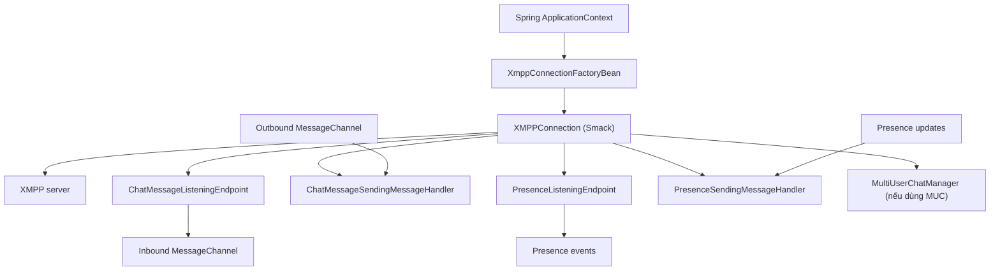
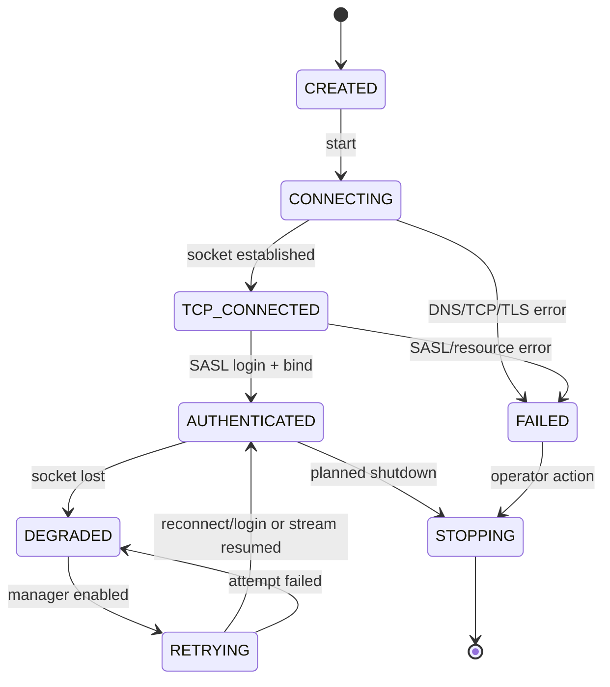
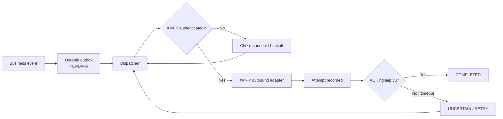

# Reconnect khi XMPP connection mất

## 1. Bối cảnh: kết nối lại được nhưng dữ liệu có còn đúng?

Trong module **SPRING_INTEGRATION_ADAPTERS**, chúng ta kết nối các hệ thống bên ngoài với Spring Integration bằng **inbound/outbound adapter, gateway, poller và `MessageChannel`**. Ngoài việc nhận/gửi message từ file, SFTP, HTTP, JMS, AMQP, Kafka hoặc database, một ứng dụng tích hợp cần xử lý **lỗi và vòng đời kết nối**. Với chương **Adapter XMPP**, mất kết nối TCP không chỉ làm ngừng gửi/nhận tin nhắn mà còn ảnh hưởng tới phiên đăng nhập, roster, presence, room chat và trạng thái nghiệp vụ.

Ví dụ ứng dụng `ops-bot@example.org` kết nối tới XMPP server để:

- Nhận lệnh/chat của nhân viên trực ca.
- Gửi cảnh báo nhập liệu sang `operator@example.org`.
- Theo dõi presence của những liên hệ đã cho phép subscribe.
- Tham gia phòng `alerts@conference.example.org` để nhận/gửi groupchat.

Khi mạng mất 30 giây, một **reconnect thành công** chưa trả lời được các câu hỏi: “tin đã gửi lúc mất mạng có đến server chưa?”, “cảnh báo cần retry không?”, “bot còn ở trong room không?”, “presence cache còn đúng không?”.

```text
           Spring Integration / Smack
                      |
                   XMPP TCP
                      |
         +------------+------------+
         |                         |
      Connected                Network failure
         |                         |
      Authenticated               Retry
         |                         |
      Normal flow              Reconnect TCP
                                   |
                              SASL login lại
                              hoặc SM resume
                                   |
                   +---------------+---------------+
                   |               |               |
             Listener/roster   MUC join state   Pending messages
             phải kiểm tra     phải kiểm tra    phải đối chiếu
```

Sau bài học, bạn có thể:

1. Phân biệt **TCP connected, XMPP authenticated, stream resumed, consumer ready**.
2. Giải thích khả năng reconnect của `XmppConnectionFactoryBean` và `ReconnectionManager` của Smack.
3. Cấu hình chính sách reconnect/backoff và quan sát kết nối bằng `ConnectionListener`.
4. Xây dựng health/readiness không báo `UP` khi XMPP vẫn chưa đăng nhập.
5. Phân tích **XEP-0198 Stream Management**, offline message, delivery receipt và ACK nghiệp vụ.
6. Khôi phục đúng luồng **chat inbound, outbound, presence và MUC** sau gián đoạn.
7. Thiết kế **durable outbox/inbox, retry, idempotency, reconciliation** khi không rõ stanza có được giao hay không.
8. Kiểm thử sự cố thực tế và giám sát mà không rò rỉ thông tin đăng nhập.

## 2. Nhận diện đúng loại mất kết nối

Không phải mọi lỗi “XMPP không hoạt động” đều là lỗi mạng tạm thời.

| Loại lỗi | Ví dụ | Có thể tự hồi phục bằng reconnect? |
| --- | --- | --- |
| TCP chập chờn | Wi-Fi mất, NAT timeout, server restart | Thường có, nếu mạng/server trở lại |
| DNS hoặc routing | Host không phân giải, sai cấu hình mạng | Có thể, khi hạ tầng được sửa |
| TLS handshake | Certificate hết hạn, CA không được tin cậy, hostname mismatch | **Không** nên retry vô hạn mà không sửa cấu hình |
| SASL authentication | Sai password, tài khoản bị khóa, cơ chế SASL bị cấm | Cần sửa credential/chính sách |
| Resource/session conflict | Hai client muốn dùng resource trùng, server policy | Cần xem quy tắc session của server |
| Client chủ động `disconnect()` | Shutdown có chủ đích | Không nên tự kết nối lại vô hạn |
| Server từ chối stanza | Không có quyền MUC, recipient/JID sai | Reconnect TCP không giải quyết quyền |
| Downstream lỗi | Database hoặc broker lỗi nhưng XMPP vẫn authenticated | Phục hồi **downstream**, không “reset kết nối XMPP” |

### Ba trạng thái nền tảng

| Trạng thái | Kiểm tra | Ý nghĩa |
| --- | --- | --- |
| **Bean tồn tại** | Spring có bean `XMPPConnection` | Chưa biết có kết nối hay chưa |
| **Connected** | `connection.isConnected()` | TCP/XMPP stream có thể đã mở, **chưa chắc đã SASL login** |
| **Authenticated** | `connection.isAuthenticated()` | Tài khoản đã đăng nhập thành công vào server |

Với một bot xử lý nghiệp vụ, **readiness** còn cần biết inbound listener đang chạy, outbound path chấp nhận gửi, hoặc MUC room đã join — tùy nhiệm vụ. Chỉ kiểm tra `isConnected()` là thiếu.

## 3. Connection factory của Spring Integration quản lý những gì?

`org.springframework.integration.xmpp.config.XmppConnectionFactoryBean` cấu hình `XMPPTCPConnection` của Smack, triển khai `FactoryBean<XMPPConnection>` và `SmartLifecycle`. Các XMPP adapter của **cùng tài khoản** có thể dùng chung connection do factory cung cấp.



Theo Spring Integration Reference, khi một XMPP connection **stale**, kết nối được thử khôi phục kèm **automatic login** nếu trước đó đã từng **authenticated**. Framework cũng đăng ký `ConnectionListener` để log sự kiện kết nối ở mức `DEBUG`. Do đó:

- Reconnect được quản lý ở tầng **kết nối**; không cần tự tạo `XMPPConnection` cho từng tin nhắn.
- Trường hợp **chưa từng login thành công** ở lần đầu có thể khác với gián đoạn sau khi đã authenticated. Đừng dựa vào cơ chế “reconnect sau session hợp lệ” để sửa password sai lúc startup.
- `start()`/`stop()` của Spring và ý định **disconnect** của ứng dụng khác với lỗi mạng bất ngờ.
- Việc reconnect không tự làm một `MessageChannel` thành hàng đợi bền vững hay xác nhận consumer đã xử lý.

### Vì sao dùng chung connection?

Mỗi lần mở connection riêng phải thực hiện DNS, TCP, TLS/STARTTLS, SASL và resource binding, làm tăng độ trễ và nguy cơ quota/session conflict. Một connection dùng chung đơn giản hơn về lifecycle, nhưng mọi endpoint phụ thuộc vào nó **cùng bị ảnh hưởng** khi connection mất.

Nếu cần nhiều tài khoản độc lập hoặc yêu cầu failover đặc biệt, cấu hình nhiều factory **với tên bean và quyền riêng**, không mặc định hai connection chia sẻ roster, session hay thứ tự message.

## 4. Smack ReconnectionManager: cơ chế và giới hạn

Thư viện Smack cung cấp `org.jivesoftware.smack.ReconnectionManager`. Manager quan sát việc kết nối rơi **bất ngờ** và thử kết nối lại; với một session đủ điều kiện, có thể đăng nhập lại theo cơ chế của connection.

```java
import org.jivesoftware.smack.AbstractXMPPConnection;
import org.jivesoftware.smack.ReconnectionManager;
import org.jivesoftware.smack.XMPPConnection;

void enableReconnect(XMPPConnection connection) {
    if (!(connection instanceof AbstractXMPPConnection tcpConnection)) {
        throw new IllegalArgumentException(
                "Expected Smack AbstractXMPPConnection");
    }

    ReconnectionManager manager =
            ReconnectionManager.getInstanceFor(tcpConnection);
    manager.setReconnectionPolicy(
            ReconnectionManager.ReconnectionPolicy.RANDOM_INCREASING_DELAY
    );
    manager.enableAutomaticReconnection();
}
```

Đây là **method cấu hình minh họa**, không phải file Java hoàn chỉnh. `XmppConnectionFactoryBean` đã có cơ chế reconnect riêng theo cấu hình của phiên bản Spring Integration. Trước khi tùy biến thêm, hãy kiểm tra `manager.isAutomaticReconnectEnabled()`; **không bật nhiều vòng retry độc lập** cho cùng một connection.

### Các chính sách reconnect

| Chính sách Smack | Ý nghĩa | Lưu ý vận hành |
| --- | --- | --- |
| `RANDOM_INCREASING_DELAY` | Thời gian chờ tăng theo giai đoạn và có tính ngẫu nhiên theo triển khai | Giảm retry dồn dập, thích hợp nhiều client |
| `FIXED_DELAY` | Cố định khoảng nghỉ giữa các lần thử | Dễ dự đoán nhưng có nguy cơ đồng loạt retry khi nhiều pod |

Javadoc Smack mô tả kiểu increasing delay với các khoảng thử theo giai đoạn, ví dụ thử dày lúc đầu rồi thưa dần khi outage kéo dài. **Chi tiết thời gian cụ thể phụ thuộc phiên bản**, không nên hard-code giả định vào SLO mà không đo trên runtime thật.

`ReconnectionManager.setFixedDelay(seconds)` đổi chính sách sang fixed delay. Khi đặt thời gian nghỉ quá ngắn, nhiều instance có thể cùng retry liên tục lúc server vừa khởi động, gây **thundering herd**. Hãy chọn backoff, quota và cảnh báo thích hợp.

### Mặc định của Smack không luôn là mặc định của Spring

Javadoc Smack có `ReconnectionManager.getEnabledPerDefault()` và `setEnabledPerDefault(...)`; mặc định của một kết nối Smack thuần có thể **tắt auto reconnect**. Spring Integration có thể cấu hình reconnect khi tạo connection qua factory. Vì vậy **phải kiểm tra trên connection thực**, không suy luận “Smack mặc định tắt nên Spring cũng tắt” hoặc ngược lại.

### Khi nào tự động reconnect không nên chạy?

- Ứng dụng đang shutdown có chủ đích.
- Credential đã bị thu hồi hoặc chính sách TLS cần thay đổi.
- Account bị khóa do đăng nhập sai nhiều lần.
- Server chủ động từ chối phiên vì lý do chính sách.

Các trường hợp này cần **vận hành sửa nguyên nhân**, thay vì vòng retry vô hạn che giấu sự cố. Tắt reconnect trên shutdown có kiểm soát nếu ứng dụng tự quản lý manager; đừng tự gọi `connect()` từ nhiều thread cạnh tranh với manager/framework.

## 5. ConnectionListener: quan sát thứ tự sự kiện đúng cách

`org.jivesoftware.smack.ConnectionListener` có các callback:

| Callback | Ý nghĩa | Hành động hợp lý |
| --- | --- | --- |
| `connecting(connection)` | Bắt đầu kết nối TCP/XMPP | Chuyển health sang CONNECTING |
| `connected(connection)` | Kết nối tới endpoint thành công | **Chưa** coi là authenticated |
| `authenticated(connection, resumed)` | Login thành công hoặc stream được khôi phục | Đánh dấu connection ready, kích hoạt đối chiếu trạng thái |
| `connectionClosed()` | Đóng connection bình thường | Đánh dấu unavailable; không tự gọi reconnect tùy tiện |
| `connectionClosedOnError(ex)` | Connection mất do lỗi | Đánh dấu DEGRADED; ghi lỗi có kiểm soát |

Giá trị `resumed` của `authenticated(connection, resumed)` báo phiên stream trước **đã được resume hay không**, chứ không phải “mọi message đã giao đến database”.

Smack tách callback **reconnection countdown/failure** vào `ReconnectionListener` qua `ReconnectionManager.addReconnectionListener(...)`:

- `reconnectingIn(seconds)`: còn bao nhiêu giây trước lần thử tiếp theo.
- `reconnectionFailed(exception)`: một lần thử không thành công.

Hai callback này **không tự biến error thành một Spring Integration message**. Nếu muốn bắn event giám sát vào `MessageChannel`, phải viết bridge rõ ràng và tránh tự tạo vòng lặp error/reconnect.

**Không làm I/O nặng trong callback**. Đối chiếu roster, join room hoặc ghi DB lớn nên được chuyển sang tác vụ điều phối có giới hạn, với key/epoch để tránh chạy nhiều lần cùng lúc.

## 6. Cấu hình Spring Boot: connection và observer

Ví dụ sau chạy với **Java 17+**, Spring Boot được cấu hình tương thích Spring Integration XMPP 6.x và Smack 4.4.x. Nó cho thấy một connection factory và một **observer có vòng đời rõ ràng**. Observer theo dõi trạng thái bằng `AtomicBoolean`/`AtomicLong`, đăng ký listener khi Spring tạo bean và gỡ listener khi bean bị hủy.

### 6.1. Maven dependencies

```xml
<dependencies>
    <dependency>
        <groupId>org.springframework.boot</groupId>
        <artifactId>spring-boot-starter-integration</artifactId>
    </dependency>
    <dependency>
        <groupId>org.springframework.integration</groupId>
        <artifactId>spring-integration-xmpp</artifactId>
    </dependency>
</dependencies>
```

Với project không có BOM, chọn rõ phiên bản Spring Integration/Smack tương thích; tránh ép riêng một version Smack quá cũ hoặc quá mới. Không sử dụng code Smack 3.x với Smack 4.4.x mà chưa kiểm chứng API.

`application.yml`:

```yaml
app:
  xmpp:
    host: ${XMPP_HOST:xmpp.internal.example.org}
    port: ${XMPP_PORT:5222}
    domain: ${XMPP_DOMAIN:example.org}
    user: ${XMPP_USER:ops-bot}
    password: ${XMPP_PASSWORD}
    resource: ${XMPP_RESOURCE:si-reconnect}
```

`host` là **máy chủ TCP**; `domain` là **XMPP service domain**, không nhất thiết trùng hostname máy chủ. JID sau login có thể là `ops-bot@example.org/si-reconnect`, tùy resource server cấp. Đây chỉ là ví dụ: cần XMPP server test và account thật. Secret phải nằm trong environment hoặc secret manager, **không commit password**.

### 6.2. Java configuration

```java
import java.util.concurrent.atomic.AtomicBoolean;
import java.util.concurrent.atomic.AtomicLong;

import org.jivesoftware.smack.AbstractXMPPConnection;
import org.jivesoftware.smack.ConnectionListener;
import org.jivesoftware.smack.ReconnectionManager;
import org.jivesoftware.smack.XMPPConnection;
import org.jivesoftware.smack.roster.Roster;

import org.springframework.beans.factory.DisposableBean;
import org.springframework.beans.factory.InitializingBean;
import org.springframework.beans.factory.annotation.Value;
import org.springframework.boot.ApplicationRunner;
import org.springframework.context.annotation.Bean;
import org.springframework.context.annotation.Configuration;
import org.springframework.integration.config.EnableIntegration;
import org.springframework.integration.xmpp.config.XmppConnectionFactoryBean;

@Configuration
@EnableIntegration
public class XmppReconnectConfig {

    @Bean(name = "xmppConnection")
    public XmppConnectionFactoryBean xmppConnection(
            @Value("${app.xmpp.host}") String host,
            @Value("${app.xmpp.domain}") String domain,
            @Value("${app.xmpp.port:5222}") int port,
            @Value("${app.xmpp.user}") String user,
            @Value("${app.xmpp.password}") String password,
            @Value("${app.xmpp.resource:si-reconnect}") String resource) {

        XmppConnectionFactoryBean factory =
                new XmppConnectionFactoryBean();
        factory.setHost(host);
        factory.setServiceName(domain);
        factory.setPort(port);
        factory.setUser(user);
        factory.setPassword(password);
        factory.setResource(resource);

        // Khong tu chap nhan subscribe request cua moi JID.
        factory.setSubscriptionMode(Roster.SubscriptionMode.reject_all);
        return factory;
    }

    @Bean
    public XmppConnectionHealth xmppConnectionHealth(
            XMPPConnection connection) {
        return new XmppConnectionHealth(connection);
    }

    @Bean
    public ApplicationRunner configureReconnect(
            XMPPConnection connection,
            XmppConnectionHealth health) {

        return args -> {
            if (!(connection instanceof AbstractXMPPConnection tcp)) {
                throw new IllegalStateException(
                        "Unsupported XMPP connection type");
            }

            ReconnectionManager manager =
                    ReconnectionManager.getInstanceFor(tcp);

            manager.setReconnectionPolicy(
                ReconnectionManager.ReconnectionPolicy.RANDOM_INCREASING_DELAY
            );
            manager.enableAutomaticReconnection();

            System.out.printf(
                "XMPP authenticated=%s reconnectEnabled=%s%n",
                health.isReady(),
                manager.isAutomaticReconnectEnabled()
            );
        };
    }

    public static final class XmppConnectionHealth
            implements InitializingBean, DisposableBean {

        private final XMPPConnection connection;
        private final AtomicBoolean ready = new AtomicBoolean(false);
        private final AtomicLong authenticationEpoch = new AtomicLong(0);

        private final ConnectionListener listener =
                new ConnectionListener() {

            @Override
            public void connecting(XMPPConnection c) {
                ready.set(false);
            }

            @Override
            public void connected(XMPPConnection c) {
                // TCP connected != SASL authenticated.
                ready.set(false);
            }

            @Override
            public void authenticated(
                    XMPPConnection c, boolean resumed) {
                ready.set(true);
                long epoch = authenticationEpoch.incrementAndGet();
                System.out.printf(
                    "XMPP authenticated epoch=%d resumed=%s%n",
                    epoch, resumed
                );
                // Chi phat tin hieu, khong goi DB/HTTP trong callback.
            }

            @Override
            public void connectionClosed() {
                ready.set(false);
            }

            @Override
            public void connectionClosedOnError(Exception ex) {
                ready.set(false);
                System.err.println(
                    "XMPP disconnected: " + ex.getClass().getSimpleName());
            }
        };

        public XmppConnectionHealth(XMPPConnection connection) {
            this.connection = connection;
        }

        @Override
        public void afterPropertiesSet() {
            connection.addConnectionListener(listener);
            // Bao ve truong hop login xong truoc khi listener dang ky.
            ready.set(connection.isAuthenticated());
        }

        public boolean isReady() {
            return ready.get()
                    && connection.isConnected()
                    && connection.isAuthenticated();
        }

        public long authenticationEpoch() {
            return authenticationEpoch.get();
        }

        @Override
        public void destroy() {
            connection.removeConnectionListener(listener);
            ready.set(false);
        }
    }
}
```

Đặt class trong vùng component scan của `@SpringBootApplication` hoặc import vào context. Code không kết nối được nếu chưa có XMPP server, tài khoản, DNS và TLS/SASL đúng; bài này **không thực thi test với server thật**.

### Phân tích ví dụ

| Phần | Vai trò |
| --- | --- |
| `XmppConnectionFactoryBean` | Tạo `XMPPConnection` dùng chung, có lifecycle của Spring |
| `ConnectionListener` | Ghi nhận connected, authenticated, closed/error |
| `AtomicBoolean ready` | Cache nhanh cho health/readiness |
| `authenticationEpoch` | Đếm số lần observer nhận sự kiện `authenticated` |
| `afterPropertiesSet()` | Gắn listener và đọc snapshot auth ban đầu |
| `destroy()` | Gỡ listener, tránh giữ callback sau khi bean đã dừng |
| `ReconnectionManager.getInstanceFor(...)` | Tùy chỉnh chính sách reconnect cho connection thực |
| `isAutomaticReconnectEnabled()` | Kiểm tra thay vì đoán mặc định |

**Giới hạn của ví dụ:** `authenticationEpoch` là bộ đếm **trong RAM**, không phải session ID do server cấp và không ổn định qua restart. Nếu callback authenticated xảy ra trước lúc observer đăng ký, initial snapshot có thể đánh dấu ready nhưng chưa tăng epoch. Để điều phối các tác vụ phải chạy một lần cho mỗi phiên, cần một state machine và cơ chế bắt đầu reconciliation có kiểm soát, không chỉ dựa vào bộ đếm này.

Việc bật reconnect trong `ApplicationRunner` là lựa chọn minh họa. Khi dùng phiên bản factory đã kích hoạt reconnect, lời gọi enable mang tính idempotent; tránh một scheduler thứ hai cùng gọi `connect()`. Khi phải áp dụng chính sách trước startup, cấu hình trước vòng đời connection hoặc qua cơ chế được phiên bản runtime hỗ trợ, rồi kiểm chứng qua integration test.

## 7. Vẽ đúng state machine sau gián đoạn



Đây là **mô hình trạng thái vận hành đề xuất**, không phải enum chính thức của `XMPPConnection`. Một ứng dụng cần phân biệt:

- **CONNECTING:** đang mở TCP, chưa nên nhận công việc cần gửi XMPP.
- **AUTHENTICATED:** kết nối đã đăng nhập; các endpoint phụ thuộc có thể thử hoạt động.
- **DEGRADED:** mất kết nối hoặc phát hiện phiên stale; giữ lại công việc chưa xác nhận.
- **RETRYING:** manager đang thử khôi phục; không có nghĩa đăng nhập đã thành công.
- **READY FOR BUSINESS:** trạng thái do ứng dụng tính thêm sau khi kiểm tra listener/room/subscription/buffer và downstream.

### Sự cố xảy ra giữa hai thao tác

```text
10:00  connected + authenticated
10:02  outbound send(ALERT-42) bắt đầu
10:02  TCP mất khi chưa nhận kết quả rõ ràng
10:03  app có thể không biết server đã nhận ALERT-42 chưa
10:05  connection lại authenticated
10:06  câu hỏi: có retry ALERT-42 không?
```

Nếu retry, có thể tạo **hai** message; nếu bỏ qua, có thể **mất** message. Cần một hợp đồng giao hàng và `eventId`, không thể giải quyết chỉ bằng kiểm tra `isAuthenticated()`.

## 8. XEP-0198: Stream Management và stream resumption

XMPP **Stream Management (XEP-0198)** hỗ trợ hai khả năng ở tầng stream:

1. **Stanza acknowledgement:** một phía xác nhận đã **handled** một số stanza nhận được theo sequence number.
2. **Stream resumption:** sau lỗi mạng phù hợp và trong cửa sổ cho phép, client/server có thể khôi phục stream cũ với state trước đó và phối hợp retransmit các stanza cần thiết.

Đây là khả năng **tùy chọn và có điều kiện**, không phải mặc định cho mọi XMPP server/client.

| Câu hỏi | API Smack liên quan | Ý nghĩa |
| --- | --- | --- |
| Server có hỗ trợ SM? | `XMPPTCPConnection.isSmAvailable()` | Khả năng được quảng cáo |
| SM đang được thương lượng? | `isSmEnabled()` | Phiên hiện tại có dùng SM |
| Có thể resume? | `isSmResumptionPossible()` | Theo cửa sổ/điều kiện resume |
| Lần reconnect có resume stream? | `streamWasResumed()` | Xác định đã resume thành công |
| Muốn bật SM khi server hỗ trợ? | `setUseStreamManagement(true)` | Chỉ áp dụng cho kết nối tương thích |
| Muốn bật stream resume? | `setUseStreamManagementResumption(true)` | Cần server và cấu hình hỗ trợ |

Ví dụ quan sát sau khi authenticated:

```java
import org.jivesoftware.smack.XMPPConnection;
import org.jivesoftware.smack.tcp.XMPPTCPConnection;

void inspectStreamManagement(XMPPConnection connection) {
    if (connection instanceof XMPPTCPConnection tcp) {
        System.out.printf(
            "SM supported=%s enabled=%s resumed=%s%n",
            tcp.isSmAvailable(),
            tcp.isSmEnabled(),
            tcp.streamWasResumed()
        );
    }
}
```

Đây là snippet quan sát, không phải cấu hình bắt buộc. Các lựa chọn `setUseStreamManagement(...)` nên được đặt **đúng thời điểm vòng đời connection** theo Smack; nếu phải bật từ đầu, cấu hình/khởi tạo connection tương ứng **trước khi login** thay vì đổi ngẫu nhiên giữa phiên.

### SM ACK không phải ACK nghiệp vụ

XEP-0198 xác nhận rằng **đầu nhận của stream nhận trách nhiệm xử lý/định tuyến stanza** trong phạm vi giao thức. Nó **không** chứng minh:

- Thiết bị của người nhận đã hiển thị tin.
- Con người đã đọc hoặc hiểu tin.
- Consumer của ứng dụng đã hoàn thành giao dịch database.
- Một message đã được ghi vào Kafka/JMS/AMQP một cách nguyên tử với XMPP.

XEP-0184 **Message Delivery Receipts** cung cấp receipt ở cấp client khi được hỗ trợ, nhưng cũng **không phải xác nhận đã đọc/đã thực hiện nghiệp vụ**. Với công việc quan trọng, cần **application ACK** riêng, chứa event ID/correlation, được lưu ở phía nhận.

### Resume thất bại thì sao?

Nếu stream không được resume (hết thời gian, server không hỗ trợ, session mất), Smack có thể thiết lập phiên mới và các tính năng như roster/presence/MUC cần đối chiếu lại. **Không tuyên bố đã replay mọi stanza** chỉ vì `reconnect` báo thành công.

## 9. Khôi phục luồng inbound chat

`ChatMessageListeningEndpoint` nhận stanza qua listener trên `XMPPConnection` rồi đẩy vào `MessageChannel`. Khi kết nối rơi:

- Listener có thể không nhận sự kiện trong khoảng mất mạng.
- Khi Smack nối lại, cần kiểm chứng listener vẫn đăng ký và adapter đang chạy.
- Server có thể giữ **offline message** hoặc hỗ trợ SM, nhưng điều đó phụ thuộc cấu hình và không bảo đảm replay đầy đủ.
- Hai instance dùng một tài khoản nhưng khác resource có thể được server phân phối stanza khác nhau.

```text
XMPP network -> ChatMessageListeningEndpoint -> inboundChannel
                                              |
                                  validate + authorize sender
                                              |
                                      durable inbox / broker
                                              |
                                     idempotent consumer
```

### Không sửa bằng poller

XMPP inbound là **event-driven**, không cần `@Poller` để hỏi server có chat mới không. `QueueChannel` ở downstream có thể dùng poller đọc buffer nội bộ, nhưng poller đó **không tìm lại các stanza đã mất ngoài network**.

### Cách xác minh sau reconnect

1. Kiểm tra `connection.isAuthenticated()`.
2. Kiểm tra `ChatMessageListeningEndpoint` còn running và đúng output channel.
3. Gửi một message thử từ tài khoản test có quyền, xác nhận consumer nhận đúng JID, body và headers.
4. Kiểm tra số lượng event ID đã xử lý với nguồn gửi, nếu có cơ chế đối chiếu.
5. Dọn dữ liệu duplicate bằng idempotent business consumer, **không** chỉ theo Spring `MessageHeaders.ID` vốn được tạo mới.

**Một endpoint đang running không đồng nghĩa đã nhận lại toàn bộ tin trong khoảng offline**. Đây là hai điều kiện kiểm tra riêng.

## 10. Khôi phục outbound: durable outbox và retry có kiểm soát

Outbound adapter như `ChatMessageSendingMessageHandler` có thể báo lỗi khi connection đã mất. Nếu nghiệp vụ phát ra cảnh báo đúng lúc rớt mạng, việc gọi lại sau reconnect phải có cơ chế chống lặp.

### Thiết kế outbox



Đây là kiến trúc **đề xuất**, không phải một transaction duy nhất. Ví dụ trạng thái:

| Trạng thái | Ý nghĩa |
| --- | --- |
| `PENDING` | Sự kiện đã lưu bền, chưa thử gửi |
| `SENDING` | Dispatcher đang sở hữu lượt gửi và lease/timeout |
| `SENT_TO_CLIENT` | Lời gọi handler không báo lỗi, chưa biết bên nhận đã commit |
| `UNCERTAIN` | Kết quả gửi không rõ do timeout/mất mạng |
| `COMPLETED` | Đã đạt điều kiện ACK theo hợp đồng ứng dụng |
| `FAILED` | Dừng retry theo chính sách; cần can thiệp |

Nếu chỉ yêu cầu **best-effort notification**, có thể coi gửi xong ở tầng client là hoàn tất, nhưng phải **công bố rõ** mức bảo đảm. Nếu gửi đơn hàng/điều khiển hệ thống, cần ACK nghiệp vụ và nguồn event bền vững.

### Nguyên tắc retry

1. Gắn `eventId`/`deliveryId` ổn định; giữ nguyên qua mọi lần thử.
2. Không đổi `eventId` sau mỗi lần reconnect.
3. Dùng unique constraint hoặc idempotent handler ở consumer.
4. Thêm backoff, số lần thử tối đa, giới hạn tốc độ và dead-letter/manual review.
5. Tách lỗi **permanent** (sai JID, thiếu quyền) khỏi lỗi **transient** (mất mạng).
6. Khi ACK bị mất, cho phép retry cùng event ID mà không gây tác động nghiệp vụ lần hai.

**Không retry một stanza vô hạn ngay trong callback Smack.** Đây có thể là thread nhận sự kiện; làm vậy sẽ gây nghẽn và khuếch đại outage.

## 11. Presence sau reconnect: phải làm mới trạng thái

`PresenceListeningEndpoint` nhận trạng thái từ `RosterListener`. Vì presence là dữ liệu **thay đổi theo thời gian**, một cache còn giữ `available` từ trước khi rớt mạng có thể đã sai.

### Tình huống

```text
09:00 operator/laptop available -> bot lưu online
09:05 bot mất mạng
09:06 operator/laptop unavailable -> bot bỏ lỡ
09:10 bot nối lại -> cache vẫn online nếu không đối chiếu
```

Giải pháp:

- Khi connection mất, đánh dấu presence cache `UNKNOWN`/**stale**, không khẳng định online.
- Sau authenticated, kiểm tra roster/subscription và làm mới snapshot qua Smack `Roster` khi được phép.
- Theo dõi trạng thái **theo full JID/resource**, rồi tổng hợp theo bare JID. `operator@example.org/laptop` offline không chứng minh `operator@example.org/phone` cũng offline.
- Lưu `observedAt`, `connectionEpoch` hoặc version để tránh một snapshot cũ ghi đè event mới.
- Tôn trọng quyền `subscription=to/both` từ góc nhìn tài khoản bot; không có quyền không được hiểu là contact offline.

### Đối chiếu roster

```java
import org.jivesoftware.smack.XMPPConnection;
import org.jivesoftware.smack.roster.Roster;
import org.jxmpp.jid.EntityBareJid;
import org.jxmpp.jid.impl.JidCreate;

void refreshContact(XMPPConnection connection) throws Exception {
    if (!connection.isAuthenticated()) {
        return;
    }

    Roster roster = Roster.getInstanceFor(connection);
    roster.reloadAndWait();
    EntityBareJid contact =
            JidCreate.entityBareFrom("operator@example.org");

    var entry = roster.getEntry(contact);
    if (entry == null || !entry.canSeeHisPresence()) {
        System.out.println("NOT_AUTHORIZED");
        return;
    }

    System.out.printf(
        "Known presences for %s: %d%n",
        contact, roster.getAvailablePresences(contact).size()
    );
}
```

Đây là **ví dụ thao tác read/reconcile**, không được chạy lặp trong callback `RosterListener`. `reloadAndWait()` có thể thực hiện request network; nên đặt timeout, chạy qua worker có giới hạn và xử lý race giữa snapshot với event mới. Danh sách rỗng không đủ chứng minh một người đã chủ động offline nếu quyền hoặc trạng thái kết nối chưa đáng tin cậy.

### Presence outbound và initial presence

Smack có thể tự gửi `available` khi đăng nhập. Nếu trước outage bot đã phát `dnd` nhưng sau reconnect lại phát initial `available`, các contact có thể thấy trạng thái sai. Nên lưu một **desired presence state** trong ứng dụng rồi công bố lại sau khi authenticated, tránh phát lại chuỗi trạng thái cũ.

**Presence không phải lịch sử giao dịch**; khi khôi phục, ưu tiên trạng thái **mới nhất đúng** chứ không cố gửi toàn bộ `away → dnd → available` từ lúc mất mạng.

## 12. MUC: reconnect connection không tự rejoin room

Một bot `alerts@conference.example.org/alert-bot` đang ở room MUC có thể mất phiên khi mạng rớt. `XMPPConnection.isAuthenticated()==true` sau reconnect **không đồng nghĩa** `MultiUserChat.isJoined()==true`.

Smack `MultiUserChatManager` có hỗ trợ auto-rejoin, **mặc định không bật**:

```java
import org.jivesoftware.smack.XMPPConnection;
import org.jivesoftware.smackx.muc.MultiUserChatManager;

void configureRoomRejoin(XMPPConnection connection) {
    MultiUserChatManager manager =
            MultiUserChatManager.getInstanceFor(connection);
    manager.setAutoJoinOnReconnect(true);
    // Nên cấu hình callback thông báo thất bại rejoin.
}
```

Cần kiểm tra riêng:

- Bot còn là member/participant được phép join hay không.
- Nickname có xung đột `conflict` hoặc room cần password không.
- Room có bị đóng/xóa/kick/ban trong lúc offline không.
- `room.isJoined()` sau reconnect có thực sự `true` không.
- Listener MUC có còn được đăng ký một lần hay bị nhân đôi qua nhiều lần join.
- Có nhận tin history khi rejoin không; history có thể thiếu hoặc trùng.

`setAutoJoinFailedCallback(...)` hỗ trợ báo lỗi rejoin. Javadoc Smack lưu ý một lỗi khi rejoin một room có thể khiến các room còn lại **không được tiếp tục thử** theo cơ chế auto-join đó. Do đó nếu bot tham gia nhiều room, cần chiến lược đối chiếu từng room và cảnh báo lỗi, không chỉ bật auto-join rồi bỏ mặc.

**MUC history không tương đương Kafka log với offset/consumer group.** Với lệnh có tác động tới database, phải có event ID và nguồn xử lý idempotent riêng.

## 13. TLS, SASL, password rotation và lỗi không thể tự sửa

Reconnect có thể thử lại TCP, nhưng không thể tự chữa một certificate hết hạn hoặc mật khẩu đã bị thu hồi.

### TLS/STARTTLS

- Đặt `ConnectionConfiguration.SecurityMode.required` khi chính sách yêu cầu TLS.
- Dùng CA/truststore đúng và kiểm tra **certificate/hostname** của XMPP service domain.
- Không dùng `TrustManager` chấp nhận mọi chứng chỉ hoặc `SecurityMode.disabled` trong production chỉ để reconnect thành công.
- Khi certificate server được thay, cần kế hoạch cập nhật truststore nếu CA thay đổi.

### SASL

- Sai user/password hoặc cơ chế SASL không được server cho phép là lỗi **cấu hình/quyền**, không nên bị che bởi retry dày.
- Nếu credential được rotation qua secret manager, một `XMPPConnection` đã tạo **không tự cập nhật mật khẩu** chỉ vì environment variable thay đổi.
- Cần reconnect/redeploy có kiểm soát cùng credential mới, xác nhận login và thu hồi credential cũ theo quy trình.

### Resource

`resource` trong `ops-bot@example.org/si-reconnect` là resource XMPP; khi login lại, resource thực có thể được server cấp khác. Nếu nhiều instance cùng tài khoản, đừng coi resource cố định là khóa bền vững để phân phối message hoặc idempotency.

## 14. Nhiều instance: ngăn thundering herd và xử lý trùng

```text
Pod A -> connection /resource-a ----+
                                     +--> XMPP server
Pod B -> connection /resource-b ----+
Pod C -> connection /resource-c ----+

Server restart -> A, B, C cùng thử reconnect
```

Các vấn đề:

- Nhiều pod cùng retry tức thời gây tải đột biến, làm server phục hồi chậm.
- Server có thể phân phối chat theo resource/priority hoặc policy, **không tự là consumer group**.
- Khi bot join cùng MUC từ nhiều resource, nhiều pod có thể nhận **cùng một broadcast**.
- Mỗi pod có presence cache riêng, có thể lệch nhau sau reconnect.
- Nếu mỗi pod tự replay outbox, cùng `eventId` có thể gửi nhiều lần.

Biện pháp:

1. Chọn backoff có jitter hoặc chính sách increasing delay, giới hạn retry/quota.
2. Phân định owner của ingress, hoặc đưa event vào broker dùng chung.
3. Dùng lease/lock bền vững cho dispatcher outbox nếu có nhiều worker.
4. Idempotency tại database/consumer đích, không dựa vào số connection.
5. Theo dõi tài khoản/resource thực tế sau login, tránh giả định mọi pod có chung trạng thái.
6. Không tự tạo `ReconnectionManager` và một scheduler `connect()` độc lập chạy cạnh tranh.

## 15. Health, readiness, metrics và cảnh báo

Khi XMPP là một phần quan trọng của hệ thống, health nên phản ánh **khả năng thực hiện nghiệp vụ**, không chỉ TCP.

| Tín hiệu | Ví dụ | Ý nghĩa |
| --- | --- | --- |
| `xmpp_connected` | Boolean | Socket/stream đang connected |
| `xmpp_authenticated` | Boolean | Phiên được xác thực |
| `xmpp_reconnect_attempt_total` | Counter | Số lần thử reconnect |
| `xmpp_auth_failure_total` | Counter | Lỗi xác thực |
| `xmpp_disconnected_seconds` | Duration | Thời gian mất kết nối |
| `xmpp_stream_resumed_total` | Counter | Số lần resume thành công nếu dùng XEP-0198 |
| `xmpp_muc_joined` | Boolean per room | Bot đã join room yêu cầu hay chưa |
| `xmpp_outbox_pending` | Gauge | Số event chưa hoàn tất |
| `xmpp_inbound_lag` | Duration (nếu đo được) | Độ trễ event nhận đến business processing |

Đây là **tên metric đề xuất**, không phải metric mặc định của Spring Integration hoặc Smack.

### Readiness policy tham khảo

```text
ready =
    connection.isConnected()
    && connection.isAuthenticated()
    && requiredInboundListenerIsRunning
    && requiredRoomJoined
    && downstreamCapacityAvailable
```

Các điều kiện thêm tùy dịch vụ. Nếu ứng dụng chỉ gửi chat và không cần MUC, đừng bắt health phụ thuộc vào room không sử dụng. Nếu outage XMPP không làm toàn bộ HTTP API mất khả năng phục vụ, có thể đánh dấu **XMPP subsystem DEGRADED** thay vì làm cả pod unready và gây vòng restart liên tục.

### Log cần có

Nên ghi `instanceId`, connection state, error category, reconnect attempt, authentication epoch và latency; có thể thêm correlation/event ID trong outbox. **Không log password, SASL token, payload chứa bí mật hay toàn bộ stanza** chỉ để debug outage. Dùng mức `DEBUG` có thời hạn và quyền truy cập phù hợp.

## 16. Kiểm thử trên môi trường test

Chuẩn bị server XMPP test (Openfire/ejabberd hoặc tương đương) với:

- Bot: `ops-bot@example.org`.
- Contact: `operator@example.org`.
- Room (nếu có MUC): `alerts@conference.example.org`.

### Ma trận kiểm thử

| Kịch bản | Thao tác | Điều cần quan sát |
| --- | --- | --- |
| Mất mạng tạm | Ngắt mạng client rồi nối lại | `connectionClosedOnError`, retry, authenticated |
| Shutdown bình thường | Dừng Spring context | Không cố reconnect vô hạn |
| Sai credential ngay từ startup | Dùng password test sai | Thất bại phân loại SASL, không báo ready |
| Server restart | Restart server test | Backoff, thời gian phục hồi và JID sau login |
| TLS certificate sai | Dùng certificate test không được tin | Handshake thất bại rõ ràng, không hạ security |
| Outbound không rõ kết quả | Ngắt mạng giữa lúc gửi `eventId` | Trạng thái UNCERTAIN, retry idempotent |
| Offline message | Gửi chat khi bot offline | Có/không replay theo cấu hình server |
| Presence cache stale | Contact logout khi bot offline | UNKNOWN rồi reconcile, không giữ online mãi |
| MUC auto-rejoin | Bot mất kết nối khi đang ở room | `isJoined()` và callback lỗi |
| Nhiều pod | 2–3 JVM cùng tài khoản | Tránh retry dồn dập và xử lý duplicate |
| XEP-0198 | Server có/không bật SM | `isSmAvailable`/`isSmEnabled`/`streamWasResumed` |
| Downstream chậm | Ghi DB chậm sau inbound | Callback không bị nghẽn, queue có giới hạn |

### Kịch bản 1: mất mạng sau khi đã login

1. Khởi động ứng dụng và xác minh `isConnected()` cùng `isAuthenticated()`.
2. Từ một máy test, gửi chat đến bot; ghi nhận một message được xử lý.
3. Ngắt mạng giữa bot và server (trên **hạ tầng test**).
4. Ghi thời điểm listener phát `connectionClosedOnError` và thời gian thử reconnect.
5. Cho mạng hoạt động lại; xác minh `authenticated(connection, resumed)` được gọi hoặc snapshot auth đã phục hồi.
6. Gửi một message mới và xác nhận inbound còn hoạt động.
7. Đối chiếu các message được gửi trong lúc offline — **không suy ra** chúng được replay nếu thiếu bằng chứng.

### Kịch bản 2: outbound “unknown outcome”

1. Tạo một bản ghi outbox có `eventId="evt-42"`.
2. Dispatcher gửi chat chứa `evt-42` và cố tình ngắt mạng vào thời điểm nhạy cảm.
3. Ghi trạng thái UNCERTAIN khi không biết server đã nhận hay chưa.
4. Khi reconnect, retry **cùng eventId**.
5. Ở phía nhận, dùng unique constraint để bảo đảm tác động nghiệp vụ chỉ một lần.

### Kịch bản 3: presence và MUC

1. Cho bot subscribe hợp lệ presence của operator và join room test.
2. Mất mạng bot; cho operator chuyển từ available sang unavailable.
3. Đánh dấu presence cache là UNKNOWN và room state là NOT_JOINED/UNKNOWN.
4. Reconnect; reload roster khi được phép, đối chiếu resource state.
5. Kiểm tra room đã auto-rejoin hay chưa; xử lý lỗi join có quyền rõ ràng.
6. Xem có history/duplicate và xác định cơ chế bỏ qua sự kiện đã xử lý.

**Không thử ngắt mạng hoặc sai certificate trên tài khoản/cluster production.** Không dùng message chứa PII, mật khẩu hoặc lệnh thật trong các phép thử gây lỗi.

## 17. Troubleshooting thường gặp

| Triệu chứng | Nguyên nhân có thể | Kiểm tra / hướng xử lý |
| --- | --- | --- |
| Bean tồn tại nhưng không gửi được | Connection chưa authenticated | Kiểm tra cả `isConnected` và `isAuthenticated` |
| Không reconnect sau khi startup fail | Chưa từng login thành công, sai SASL/TLS | Sửa cấu hình và thiết kế retry startup có giới hạn |
| Reconnect chạy quá dày | Fixed delay ngắn, nhiều pod cùng thử | Jitter/backoff, quota, metric |
| Nối lại TCP nhưng chưa authenticated | TLS/SASL/resource binding đang lỗi | Phân loại giai đoạn lỗi |
| Client reconnect nhưng room trống | MUC chưa join lại | `setAutoJoinOnReconnect`, `room.isJoined()`, callback |
| Presence vẫn online sau outage | Cache không bị invalidated | UNKNOWN, TTL, roster reconciliation |
| Inbound không nhận tin mới sau reconnect | Listener/endpoint không chạy hoặc sai resource | Endpoint lifecycle, thử gửi message test |
| Gửi outbound trùng sau timeout | Retry với trạng thái không rõ | Event ID, durable outbox, dedup bên nhận |
| Thiếu message gửi lúc offline | Server không lưu hoặc không replay | Offline/SM policy, nguồn event bền vững |
| `streamWasResumed()` false | SM không bật, không hỗ trợ, hoặc quá hạn | `isSmAvailable`, `isSmEnabled`, resumption window |
| XEP-0184 receipt không đến | Client không hỗ trợ/không phản hồi | Không coi receipt là bảo đảm nghiệp vụ |
| TLS handshake lỗi liên tục | Certificate/hostname/truststore sai | Sửa CA và tên máy, không tắt verification |
| SASL not authorized | Password cũ, account khóa | Credential rotation, quyền và server log |
| Sau login có resource khác | Server cấp/bind resource mới | `connection.getUser()`, server policy |
| Hai pod cùng xử lý groupchat | MUC broadcast cho nhiều occupant | Ownership, broker, idempotent consumer |
| Shutdown rồi tự connect lại | Có retry loop ngoài framework | Chỉ giữ một manager, stop đúng lifecycle |

### Câu hỏi chẩn đoán theo thứ tự

1. Đây là lỗi TCP/TLS/SASL hay downstream?
2. Connection đã từng **authenticated** thành công trước outage chưa?
3. Auto reconnection trên connection **thực** có đang bật không?
4. Có ai khác chủ động gọi `disconnect()` hoặc `connect()` song song không?
5. Sau reconnect, `getUser()`/resource có thay đổi không?
6. XEP-0198 có negotiated/resumed không, và có dấu vết stanza pending?
7. Inbound listener, roster subscription và MUC room đã sẵn sàng lại chưa?
8. Outbox/inbox có eventId để reconcile dữ liệu bị mất hoặc trùng không?

## 18. Bài tập thực hành

1. **Phân biệt trạng thái:** giải thích ba kết quả bean tồn tại, `connected=true`, `authenticated=true`.
2. **Connection observer:** chạy ví dụ Spring Boot, ghi log callback khi mạng mất rồi khôi phục.
3. **Policy:** so sánh `RANDOM_INCREASING_DELAY` và `FIXED_DELAY` khi chạy ba instance.
4. **Startup failure:** đăng nhập bằng password test sai, giải thích vì sao không coi đây là outage mạng ngắn.
5. **Health endpoint:** thiết kế điều kiện readiness cho dịch vụ chỉ gửi chat và một dịch vụ cần join MUC.
6. **XEP-0198:** kiểm tra `isSmAvailable`, `isSmEnabled` và `streamWasResumed`; giải thích ACK stream không phải DB commit.
7. **Đo độ trễ:** ghi thời điểm `connectionClosedOnError`, số lần retry và thời điểm authenticated trở lại.
8. **Offline message:** gửi ba message trong thời gian bot down; quan sát server có replay không, không suy luận từ spec chung.
9. **Durable outbox:** thiết kế bảng eventId, status, lease, attemptCount và nextRetryAt.
10. **Idempotent consumer:** nhận hai lần cùng `eventId` nhưng chỉ áp dụng cập nhật database một lần.
11. **Presence stale:** cho operator logout khi bot offline; viết thuật toán UNKNOWN/reconciliation theo full JID.
12. **MUC:** thử auto-rejoin và trường hợp nickname conflict/members-only làm join thất bại.
13. **Credential rotation:** mô tả cách cập nhật secret và redeploy/reconnect có kiểm soát.
14. **Backpressure:** chuyển downstream từ DirectChannel sang durable broker; xác định phản ứng khi buffer đầy.
15. **Multi-instance:** phát một groupchat khi hai pod cùng joined, đo số message consumer nhận và thiết kế dedup.
16. **Shutdown:** phân biệt một disconnect có chủ đích với `connectionClosedOnError`; bảo đảm không có vòng retry ngoài ý muốn.

### Tự kiểm tra

**Q1. Spring Integration tự reconnect trong điều kiện nào được Reference nêu?**  
Khi connection trở nên stale và trước đó đã từng login/authenticated thành công; không dùng điều này để bỏ qua lỗi credential đầu tiên.

**Q2. `isConnected()` có chứng minh đã login không?**  
Không. Phải kiểm tra `isAuthenticated()`.

**Q3. Callback nào quan trọng để biết login hoặc resume đã thành công?**  
`ConnectionListener.authenticated(connection, resumed)`; giá trị `resumed` chỉ về stream, không phải nghiệp vụ.

**Q4. Smack ReconnectionManager có bao nhiêu chính sách chính trong Javadoc?**  
`RANDOM_INCREASING_DELAY` và `FIXED_DELAY`.

**Q5. Vì sao không nên vừa bật manager vừa chạy một scheduler `connect()` riêng?**  
Hai vòng retry độc lập có thể cạnh tranh, gây lỗi lifecycle và khuếch đại tải.

**Q6. XEP-0198 ACK có chứng minh người dùng đã đọc tin hoặc DB đã commit không?**  
Không. Nó xác nhận việc xử lý stanza trong phạm vi stream, không phải ACK nghiệp vụ.

**Q7. Reconnect XMPP có tự bảo đảm inbound replay?**  
Không. Còn phụ thuộc server, offline policy, XEP/stream state và nguồn lưu bền.

**Q8. Đăng nhập lại có chắc bot đã join MUC room không?**  
Không. Cần kiểm tra `room.isJoined()` và xử lý auto-rejoin/permission.

**Q9. Tại sao cần đánh dấu presence cache UNKNOWN sau outage?**  
Vì những thay đổi presence trong lúc mất mạng có thể bị bỏ lỡ.

**Q10. Nếu gửi cảnh báo bị timeout rồi reconnect, giải pháp an toàn cho business event là gì?**  
Giữ event ID ổn định, durable outbox, retry có backoff và dedup/idempotency bên nhận.

## 19. Ghi nhớ

**Reconnect khi XMPP connection mất** là bài toán gồm **kết nối, xác thực, khôi phục phiên và phục hồi trạng thái nghiệp vụ**, không chỉ gọi lại `connect()`. `XmppConnectionFactoryBean` quản lý kết nối Spring Integration, còn Smack `ReconnectionManager` và `ConnectionListener` cung cấp các cơ chế retry và quan sát. Hãy phân biệt `connected` với `authenticated`, và xác minh listener, roster, subscription, room MUC sau khi đăng nhập lại.

XEP-0198 có thể hỗ trợ acknowledgement/resumption ở **tầng stream**, nhưng không tự thành ACK người nhận hoặc database commit. **Reconnect không đồng nghĩa replay; retry có thể gây lặp; sự kiện presence có thể stale; MUC có thể chưa joined.** Với các hệ thống file/SFTP/HTTP/JMS/AMQP/Kafka/database và XMPP, cần durable outbox/inbox, event ID, idempotency, backoff, health, TLS/SASL an toàn và kiểm thử sự cố thực tế.

### Tài liệu tham khảo

- [Spring Integration Reference — XMPP Support](https://docs.spring.io/spring-integration/reference/xmpp.html)
- [Spring Integration API 6.5 — XmppConnectionFactoryBean](https://docs.spring.io/spring-integration/docs/6.5.0/api/org/springframework/integration/xmpp/config/XmppConnectionFactoryBean.html)
- [Smack API — ReconnectionManager](https://download.igniterealtime.org/smack/docs/4.4.7/javadoc/org/jivesoftware/smack/ReconnectionManager.html)
- [Smack API — ConnectionListener](https://download.igniterealtime.org/smack/docs/4.4.7/javadoc/org/jivesoftware/smack/ConnectionListener.html)
- [Smack API — XMPPTCPConnection](https://download.igniterealtime.org/smack/docs/4.4.7/javadoc/org/jivesoftware/smack/tcp/XMPPTCPConnection.html)
- [Smack API — MultiUserChatManager](https://download.igniterealtime.org/smack/docs/4.4.7/javadoc/org/jivesoftware/smackx/muc/MultiUserChatManager.html)
- [XEP-0198 — Stream Management](https://xmpp.org/extensions/xep-0198.html)
- [XEP-0184 — Message Delivery Receipts](https://xmpp.org/extensions/xep-0184.html)
- [XMPP RFC 6120 — Core](https://xmpp.org/rfcs/rfc6120.html)
