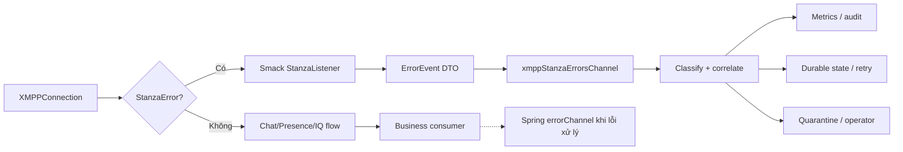
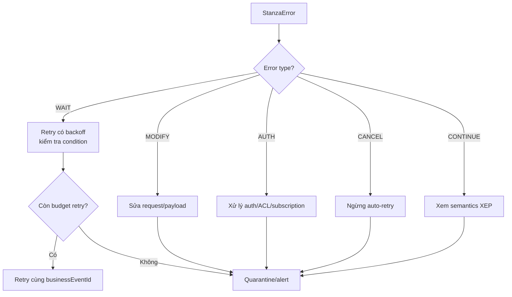

# Xử lý stanza lỗi

## 1. Bối cảnh và mục tiêu

Module **SPRING_INTEGRATION_ADAPTERS** hướng dẫn kết nối hệ thống ngoài vào Spring Integration bằng inbound/outbound adapter, gateway, poller và `MessageChannel`, thực hành luồng dữ liệu qua file, SFTP, HTTP, JMS, AMQP, Kafka, database cùng cách quản lý hợp đồng message, lỗi và vòng đời kết nối.

Trong chương **Adapter XMPP**, một luồng gửi tin thành công ở phía Java không có nghĩa server XMPP đã định tuyến thông điệp đến đích. Server hoặc một thực thể XMPP khác có thể trả về **stanza lỗi**; ngoài ra còn có lỗi ở TCP, TLS, SASL, Smack, Spring Integration hoặc consumer nghiệp vụ. Bài học này tập trung vào cách **nhận diện, phân loại và xử lý stanza lỗi**, đồng thời chỉ ra ranh giới với những loại lỗi còn lại.

Giả sử dịch vụ `ops-bot@example.org` nhận sự kiện nhập dữ liệu từ HTTP/JMS rồi gửi thông báo đến `operator@example.org`. Một ngày, tài khoản người nhận không tồn tại hoặc server đích tạm thời quá tải:

```text
HTTP / JMS / Database event
           |
           v
   Spring MessageChannel
           |
           v
   XMPP outbound adapter
           |
           v
      XMPP Server
           |
      +----+----------------------+
      |                           |
   Normal route               Error stanza
      |                           |
   Recipient              Smack stanza listener
                                  |
                                  v
                         Error events channel
                                  |
                         Classify + correlate
                                  |
                    +-------------+-------------+
                    |             |             |
                  Retry       Fix/auth       Quarantine
```

Sau bài học, bạn có thể:

1. Phân biệt **stanza error**, **stream error**, **connection/authentication error** và **Spring Messaging exception**.
2. Đọc `Stanza.getError()`, `StanzaError.getType()`, `getCondition()` và `getDescriptiveText()` bằng Smack.
3. Hiểu `Message.Type.error`, `Presence.Type.error` và `IQ.Type.error` theo XMPP.
4. Sử dụng `XMPPConnection.addAsyncStanzaListener(...)` để quan sát stanza lỗi rồi chuyển thành Spring `Message`.
5. Xử lý `XMPPException.XMPPErrorException` khi thao tác IQ request–response qua `StanzaCollector`.
6. Phân biệt **XMPP error stanza** với `errorChannel` của Spring Integration và ứng dụng.
7. Phân loại lỗi tạm thời/vĩnh viễn, thiết kế **retry có backoff**, correlation, outbox/inbox và idempotency.
8. Kiểm thử lỗi thực tế và vận hành mà không vô tình làm lộ dữ liệu hoặc tạo vòng lặp phản hồi lỗi.

## 2. XMPP có nhiều tầng lỗi

XMPP là giao thức XML trên stream, thường chạy qua TCP với STARTTLS và SASL. Một exception không mặc định tương ứng với một stanza `<error>`.

| Tầng | Biểu hiện | Cơ chế phát hiện | Nên xử lý ở đâu? |
| --- | --- | --- | --- |
| **Stanza** | `<message type="error">`, `<presence type="error">`, `<iq type="error">` | `Stanza.getError()`, IQ collector/`XMPPErrorException` | Error router, request correlation |
| **XML stream** | `<stream:error>`, stream bị chấm dứt | `StreamError`/`StreamErrorException`, connection listener | Connection lifecycle, reconnect có kiểm soát |
| **Network** | TCP timeout, socket bị đóng, DNS fail | `SmackException`, I/O exception, connection state | Infrastructure health/backoff |
| **TLS/SASL** | Chứng chỉ sai, login bị từ chối | TLS/SASL exception/log | Sửa certificate, credential hoặc policy |
| **Smack request timeout** | Không có IQ response trước deadline | `SmackException.NoResponseException` | Uncertain outcome, timeout/retry policy |
| **Spring Integration** | Transform/payload lỗi, không gửi được tới channel | `MessagingException`, `ErrorMessage` tùy đường thực thi | `errorChannel`, logging/recovery flow |
| **Business consumer** | Database lỗi, schema sai, sender thiếu quyền | Validator và service exception | Durable inbox, DLQ/quarantine, audit |

**Quan trọng:** Một TCP disconnection không tự là stanza error. Ngược lại, một `IQ.Type.error` có thể đến khi kết nối vẫn hoàn toàn **authenticated**. Không reset kết nối mỗi khi nhận `forbidden` hoặc `item-not-found`.

### Hai câu hỏi phải trả lời riêng

- **Thông điệp XMPP nào bị từ chối?** Dựa trên stanza type, stanza ID, JID đối tác và request gốc nếu có.
- **Ứng dụng đã hoàn thành nghiệp vụ nào?** Dựa trên event ID/correlation và trạng thái database/outbox, không chỉ dựa vào việc Smack gửi stanza.

## 3. Cấu trúc một stanza lỗi

Theo XMPP Core (RFC 6120), một stanza phản hồi lỗi có type `error` và một phần tử con `<error>` chứa **error type**, **condition**, tùy chọn **text** hoặc phần mở rộng chuyên biệt.

### 3.1. Message error

Ví dụ một server trả lỗi cho chat gửi đến JID không thể định tuyến:

```xml
<message
    from="example.org"
    to="ops-bot@example.org/spring-integration"
    type="error"
    id="alert-42">
    <error type="cancel">
        <service-unavailable
            xmlns="urn:ietf:params:xml:ns:xmpp-stanzas"/>
        <text xmlns="urn:ietf:params:xml:ns:xmpp-stanzas">
            Destination is unavailable
        </text>
    </error>
</message>
```

Đây là **XML minh họa**, không phải một phản hồi mà mọi server đều phát đúng như vậy. Một server có thể trả `recipient-unavailable`, `item-not-found` hoặc điều kiện khác tùy tình huống. Thông điệp cũng có thể mang lại một số nội dung gốc; **không nên log toàn bộ stanza** vì có thể chứa thông tin nhạy cảm.

### 3.2. Presence error

Ví dụ một request presence bị từ chối:

```xml
<presence
    from="operator@example.org"
    to="ops-bot@example.org/spring-integration"
    type="error"
    id="presence-42">
    <error type="auth">
        <forbidden
            xmlns="urn:ietf:params:xml:ns:xmpp-stanzas"/>
    </error>
</presence>
```

Sự kiện này không đồng nghĩa operator đang offline. Nó là **lỗi về thao tác hoặc quyền ở tầng presence**, cần kiểm tra roster/subscription và chính sách server.

### 3.3. IQ error

IQ có mô hình request–response; lỗi thường trả về `IQ.Type.error` với cùng stanza ID của request:

```xml
<iq
    from="example.org"
    to="ops-bot@example.org/spring-integration"
    type="error"
    id="iq-request-42">
    <query xmlns="urn:example:integration:query:1"/>
    <error type="cancel">
        <feature-not-implemented
            xmlns="urn:ietf:params:xml:ns:xmpp-stanzas"/>
    </error>
</iq>
```

Khi dùng Smack `StanzaCollector.nextResultOrThrow()`, một response IQ lỗi có thể chuyển thành **`XMPPException.XMPPErrorException`** cho caller. Đây là đường xử lý *request–response* khác với listener nhận lỗi bất đồng bộ từ các message chat.

### 3.4. Stream error khác stanza error

Ví dụ hình thức stream-level:

```xml
<stream:error>
    <conflict xmlns="urn:ietf:params:xml:ns:xmpp-streams"/>
</stream:error>
```

**`<stream:error>` không phải một `<iq type="error">`**. Lỗi stream có thể làm chấm dứt phiên; cần theo dõi connection listener, phân tích nguyên nhân trước khi reconnect. Không kỳ vọng `Stanza.getError()` sẽ bắt mọi lỗi stream.

## 4. Hai thuộc tính quan trọng: error type và condition

Smack `org.jivesoftware.smack.packet.StanzaError` biểu diễn phần tử con `<error>`. Nó có:

- `getType()`: nhóm cách ứng xử được khuyến nghị.
- `getCondition()`: điều kiện lỗi cụ thể trong RFC.
- `getDescriptiveText()`: lời giải thích tùy chọn, có thể null.
- `getErrorGenerator()` và `getConditionText()`: metadata tùy trường hợp.

### 4.1. StanzaError.Type

| `StanzaError.Type` | Ý nghĩa trong giao thức | Gợi ý xử lý ứng dụng |
| --- | --- | --- |
| `WAIT` | Lỗi được xem là tạm thời, có thể retry sau khi chờ | Retry hữu hạn, backoff và giới hạn tải |
| `CANCEL` | Yêu cầu không thể hoàn thành theo cách hiện tại | Ngừng retry tự động, điều tra/chỉnh cấu hình |
| `MODIFY` | Dữ liệu request cần thay đổi | Validate và sửa input, không gửi lại y nguyên |
| `AUTH` | Cần cấp quyền hoặc credential phù hợp | Sửa authorization/subscription, không retry mù |
| `CONTINUE` | Gợi ý có thể tiếp tục theo semantics đặc thù | Kiểm tra XEP/hợp đồng, không coi là success tự động |

Đây là **gợi ý tầng giao thức**, không phải một hàm `retry=true/false` tuyệt đối. Một condition như `resource-constraint` thường phù hợp với backoff; còn `forbidden` phản ánh quyền và không thể khắc phục chỉ bằng cách đợi.

### 4.2. Một số condition tiêu biểu

| Condition XML | Type thường gặp | Diễn giải | Hành động đề xuất |
| --- | --- | --- | --- |
| `bad-request` | `MODIFY` | Request không hợp lệ | Sửa schema/định dạng |
| `jid-malformed` | `MODIFY` | JID sai cú pháp | Validate JID bằng Smack |
| `not-acceptable` | `MODIFY` | Request không được chấp nhận ở dạng hiện tại | Sửa payload hoặc policy |
| `forbidden` | `AUTH` | Thiếu quyền thực hiện | Kiểm tra authorization |
| `not-authorized` | `AUTH` | Chưa được cho phép | Sửa auth, ACL hoặc subscription |
| `registration-required` | `AUTH` | Cần đăng ký hoặc membership | Hoàn tất quy trình cấp quyền |
| `conflict` | `CANCEL` | Tài nguyên/nickname trùng | Chọn resource/nickname hợp lệ |
| `item-not-found` | `CANCEL` | Mục tiêu không tồn tại hoặc không tìm thấy | Kiểm tra địa chỉ và cấu hình |
| `feature-not-implemented` | `CANCEL` | Server không hỗ trợ tính năng | Đổi khả năng/XEP hoặc hạ tầng |
| `service-unavailable` | `CANCEL` | Dịch vụ không đáp ứng trong ngữ cảnh đó | Kiểm tra khả năng/đích, không retry vô hạn |
| `recipient-unavailable` | `WAIT` | Recipient chưa thể nhận | Backoff, kênh thay thế nếu cần |
| `remote-server-timeout` | `WAIT` | Server ở miền xa phản hồi quá hạn | Retry giới hạn và đối chiếu |
| `resource-constraint` | `WAIT` | Server thiếu tài nguyên | Rate limit/backoff |
| `internal-server-error` | `WAIT` | Lỗi phía server | Retry có giới hạn, cảnh báo |
| `policy-violation` | `MODIFY` | Vi phạm chính sách | Điều chỉnh request/behavior |

Giá trị type là những gán thường gặp trong bảng lỗi RFC; **server có thể đưa thêm extension**, và một ứng dụng vẫn phải dựa vào hợp đồng thực tế của server. Không chuyển một lỗi `CANCEL` thành `WAIT` chỉ vì muốn retry cho nhanh.

## 5. Phân biệt phản hồi IQ với lỗi message bất đồng bộ

### Với IQ

XMPP IQ có `get`, `set`, `result` và `error`. Khi một client gửi request IQ, caller có thể **đợi response** theo stanza ID cùng đối tác:

```text
IQ get/set id=iq-42 ----> Server
                                |
                     +----------+----------+
                     |                     |
               IQ result              IQ error
                     |                     |
               nextResult()       XMPPErrorException
```

Smack `StanzaCollector` thích hợp khi cần đợi response cụ thể; nên dùng collector được liên kết với chính request, **không tạo filter chỉ theo stanza ID trên mọi nguồn**.

### Với chat message

`ChatMessageSendingMessageHandler` là **outbound channel adapter một chiều**. Gửi một `Message<String>` vào `MessageChannel` không biến thao tác chat thành một lời gọi IQ đồng bộ trả `result`/`error`. Một error stanza liên quan có thể đến **sau khi handler đã hoàn tất**:

```text
send(message) returns
       |
       | ... later ...
       v
server emits <message type="error">
       |
       v
global error listener -> correlation/outbox
```

Do đó, nên có **đường quan sát lỗi độc lập** nếu nghiệp vụ cần phân loại message error. Không mặc định rằng Spring `errorChannel` sẽ nhận mọi `<message type="error">` như một Java exception.

## 6. Kiến trúc xử lý stanza lỗi trong Spring Integration

Spring Integration quản lý các flow message; Smack nhận/sắp xếp stanza XMPP. Một mô hình dễ kiểm soát:



Trong mô hình này, có **hai kênh lỗi riêng về mặt ngữ nghĩa**:

1. **`xmppStanzaErrorsChannel` (tự định nghĩa):** chứa sự kiện lỗi XMPP được tạo từ `Stanza.getError()`.
2. **`errorChannel` của Spring Integration:** xử lý `ErrorMessage` được framework phát trong các trường hợp Java message processing failure phù hợp.

Không dùng một kênh duy nhất rồi giả định mọi lỗi có cùng payload. **StanzaError** là dữ liệu giao thức; **Throwable/MessagingException** là lỗi thực thi.

## 7. Chuẩn bị dependencies và môi trường

Ví dụ áp dụng cho Java 17+, Spring Boot với phiên bản Spring Integration XMPP 6.x và Smack tương thích. Maven:

```xml
<dependencies>
    <dependency>
        <groupId>org.springframework.boot</groupId>
        <artifactId>spring-boot-starter-integration</artifactId>
    </dependency>
    <dependency>
        <groupId>org.springframework.integration</groupId>
        <artifactId>spring-integration-xmpp</artifactId>
    </dependency>
</dependencies>
```

Với dự án không dùng BOM của Spring Boot, phải quản lý chính xác version Spring Integration/Smack. Không sao chép API `XMPPError`/`PacketListener` từ ví dụ Smack 3.x hoặc 4.0 cũ mà chưa đối chiếu với phiên bản đang chạy; trong Smack 4.4.x, lỗi stanza được biểu diễn bằng `StanzaError`.

Chuẩn bị XMPP server test (Openfire hoặc ejabberd) với:

- Account bot: `ops-bot@example.org`.
- Account gửi thử: `operator@example.org`.
- Một JID test hoặc room test có thể tạo lỗi quyền/địa chỉ theo chính sách server.

`application.yml`:

```yaml
app:
  xmpp:
    host: ${XMPP_HOST:xmpp.internal.example.org}
    port: ${XMPP_PORT:5222}
    domain: ${XMPP_DOMAIN:example.org}
    user: ${XMPP_USER:ops-bot}
    password: ${XMPP_PASSWORD}
```

`host` là hostname TCP thực; `domain` là miền dịch vụ XMPP của tài khoản, không nhất thiết bằng host. Các địa chỉ `example.org` chỉ là ví dụ và cần thay bằng môi trường thử nghiệm thực tế. Không commit password; dùng secret manager hoặc environment variable, cấu hình TLS với xác minh certificate và hostname đúng chuẩn.

## 8. Ví dụ Java: lắng nghe mọi error stanza và chuyển vào channel

Ví dụ dưới đây tạo `XmppConnectionFactoryBean`, một channel cho sự kiện lỗi, và một bridge đăng ký **Smack asynchronous stanza listener**. Bridge **không tự sửa hoặc gửi lại** request; nó chỉ phân loại và phát thông tin tối thiểu cho consumer.

### 8.1. Cấu hình Spring Boot hoàn chỉnh

```java
import org.jivesoftware.smack.StanzaListener;
import org.jivesoftware.smack.XMPPConnection;
import org.jivesoftware.smack.packet.Stanza;
import org.jivesoftware.smack.packet.StanzaError;
import org.jivesoftware.smack.roster.Roster;

import org.springframework.beans.factory.DisposableBean;
import org.springframework.beans.factory.InitializingBean;
import org.springframework.beans.factory.annotation.Qualifier;
import org.springframework.beans.factory.annotation.Value;
import org.springframework.context.annotation.Bean;
import org.springframework.context.annotation.Configuration;
import org.springframework.integration.annotation.ServiceActivator;
import org.springframework.integration.channel.DirectChannel;
import org.springframework.integration.config.EnableIntegration;
import org.springframework.integration.xmpp.config.XmppConnectionFactoryBean;
import org.springframework.messaging.Message;
import org.springframework.messaging.MessageChannel;
import org.springframework.messaging.support.MessageBuilder;

@Configuration
@EnableIntegration
public class XmppStanzaErrorConfig {

    @Bean(name = "xmppConnection")
    public XmppConnectionFactoryBean xmppConnection(
            @Value("${app.xmpp.host}") String host,
            @Value("${app.xmpp.domain}") String domain,
            @Value("${app.xmpp.port:5222}") int port,
            @Value("${app.xmpp.user}") String user,
            @Value("${app.xmpp.password}") String password) {

        XmppConnectionFactoryBean factory =
                new XmppConnectionFactoryBean();
        factory.setHost(host);
        factory.setServiceName(domain);
        factory.setPort(port);
        factory.setUser(user);
        factory.setPassword(password);
        factory.setResource("stanza-error-monitor");
        factory.setSubscriptionMode(Roster.SubscriptionMode.reject_all);
        return factory;
    }

    @Bean
    public MessageChannel xmppStanzaErrorsChannel() {
        return new DirectChannel();
    }

    @Bean
    public StanzaErrorBridge stanzaErrorBridge(
            XMPPConnection connection,
            @Qualifier("xmppStanzaErrorsChannel") MessageChannel channel) {
        return new StanzaErrorBridge(connection, channel);
    }

    @ServiceActivator(inputChannel = "xmppStanzaErrorsChannel")
    public void onStanzaError(Message<XmppStanzaFailure> incoming) {
        XmppStanzaFailure error = incoming.getPayload();

        // Chỉ in metadata đã chọn, không dump body/extension.
        System.err.printf(
                "XMPP_ERROR kind=%s stanzaId=%s peer=%s "
                + "type=%s condition=%s%n",
                error.stanzaKind(),
                error.stanzaId(),
                error.peerJid(),
                error.errorType(),
                error.condition()
        );

        // Production: mapping sang outbox/event ID,
        // metrics, retry decision, quarantine hoặc audit.
    }

    public record XmppStanzaFailure(
            String stanzaKind,
            String stanzaId,
            String peerJid,
            String errorType,
            String condition,
            String generator) {
    }

    public static final class StanzaErrorBridge
            implements InitializingBean, DisposableBean {

        private final XMPPConnection connection;
        private final MessageChannel channel;

        private final StanzaListener listener = stanza -> {
            StanzaError error = stanza.getError();
            if (error == null) {
                return;
            }

            String kind;
            if (stanza instanceof org.jivesoftware.smack.packet.IQ) {
                kind = "iq";
            }
            else if (stanza instanceof org.jivesoftware.smack.packet.Presence) {
                kind = "presence";
            }
            else if (stanza instanceof org.jivesoftware.smack.packet.Message) {
                kind = "message";
            }
            else {
                kind = "other";
            }

            String from = stanza.getFrom() == null
                    ? "(missing)"
                    : stanza.getFrom().toString();

            XmppStanzaFailure event = new XmppStanzaFailure(
                    kind,
                    stanza.getStanzaId(),
                    from,
                    String.valueOf(error.getType()),
                    String.valueOf(error.getCondition()),
                    error.getErrorGenerator()
            );

            // Demo: consumer chi log metadata. Production:
            // dung handoff co gioi han hoac kho ben vung.
            channel.send(MessageBuilder.withPayload(event).build());
        };

        public StanzaErrorBridge(
                XMPPConnection connection,
                MessageChannel channel) {
            this.connection = connection;
            this.channel = channel;
        }

        @Override
        public void afterPropertiesSet() {
            connection.addAsyncStanzaListener(
                    listener,
                    stanza -> stanza.getError() != null
            );
        }

        @Override
        public void destroy() {
            connection.removeAsyncStanzaListener(listener);
        }
    }
}
```

Đặt class trong phạm vi component scan của `@SpringBootApplication` hoặc import vào Spring context. Để có dữ liệu, cần server và account test thực, cùng một kịch bản sinh error stanza. Ví dụ **chưa được chạy trên server trong quá trình viết bài**.

### 8.2. Đọc luồng từng bước

1. `XmppConnectionFactoryBean` tạo connection cho tài khoản bot. Nó có nhiệm vụ đăng nhập/quản lý lifecycle, không tự biến stanza error thành `ErrorMessage` của Spring.
2. `StanzaErrorBridge.afterPropertiesSet()` đăng ký `StanzaListener` **một lần** trên connection.
3. Filter `stanza.getError() != null` nhận các stanza lỗi có phần tử `<error>`, bất kể `message`, `presence` hay `iq`.
4. Listener đọc metadata tối thiểu qua `getStanzaId()`, `getFrom()`, `getType()`, `getCondition()` và `getErrorGenerator()`.
5. `MessageBuilder` đóng gói `XmppStanzaFailure` thành Spring `Message` và gửi tới `xmppStanzaErrorsChannel`.
6. `@ServiceActivator` nhận DTO và in metadata. Trong production cần lưu/tương quan với outbox, quyết định retry/alert.
7. `destroy()` gỡ listener khi bean dừng để không giữ callback đã hết vòng đời.

**Không sử dụng `stanza.getError()` thay thế kiểm tra `connection.isAuthenticated()`**. Listener này xử lý error stanza ở một phiên nhận dữ liệu; TLS/SASL/network/stream error phải được quan sát bằng cơ chế khác.

### 8.3. Tại sao dùng addAsyncStanzaListener?

Smack có nhiều loại listener:

| API | Đặc điểm | Rủi ro |
| --- | --- | --- |
| `addSyncStanzaListener(...)` | Chạy trên đường xử lý stanza đồng bộ của Smack | Chặn vòng xử lý nhận nếu handler chậm |
| `addAsyncStanzaListener(...)` | Callback thực thi bất đồng bộ | Sự kiện có thể đến consumer **không đúng thứ tự nhận ban đầu** |
| `addStanzaListener(...)` (Smack 4.4+) | Cơ chế listener có đảm bảo riêng về thứ tự và không gọi đồng thời cùng listener | Cần đối chiếu semantics phiên bản |

Ví dụ dùng **async** để tránh làm nặng thread nhận stanza khi log event. Nhưng async **không tự là queue bền vững**, và không bảo đảm ordering cho logic retry. Nếu lỗi phải được xử lý theo thứ tự trong một hội thoại/transaction, dùng broker hoặc state machine theo key; không chỉ dựa vào thứ tự callback.

### 8.4. Một số giới hạn quan trọng của ví dụ

- `DirectChannel` gọi consumer đồng bộ với lời gọi gửi từ bridge; một handler chậm vẫn có thể chiếm worker Smack. Ví dụ chỉ log metadata nhanh. Production nên dùng **bounded handoff** và lưu bền khi cần.
- Listener toàn cục có thể **cùng nhìn thấy** error stanza mà `StanzaCollector`/API Smack khác đang xử lý. Nó không tự “nuốt” response IQ, nhưng có thể tạo **hai bản ghi lỗi** nếu cả caller và bridge cùng audit.
- `stanzaId` chỉ là ID kỹ thuật. Không suy ra luôn liên hệ được với một event nghiệp vụ; correlation cần ánh xạ đã lưu trước.
- `peerJid` trong DTO là giá trị `from` của **error stanza**, có thể là **server hoặc service**, không nhất thiết là người nhận ban đầu.
- `XmppStanzaFailure` không chứa body, token hay XML gốc theo chủ đích để tránh làm rò rỉ dữ liệu; nếu cần forensic, dùng storage chuyên dụng có kiểm soát retention và quyền truy cập.

## 9. IQ request: bắt XMPPErrorException ở caller

Trong giao tiếp request–response với IQ, Smack có thể ném `XMPPException.XMPPErrorException` trực tiếp khi `StanzaCollector` chờ và nhận error response.

Ví dụ một phương thức giả định đã có **`IQ request` hợp lệ**:

```java
import org.jivesoftware.smack.SmackException;
import org.jivesoftware.smack.StanzaCollector;
import org.jivesoftware.smack.XMPPConnection;
import org.jivesoftware.smack.XMPPException;
import org.jivesoftware.smack.packet.IQ;
import org.jivesoftware.smack.packet.StanzaError;

public IQ requestIq(XMPPConnection connection, IQ request)
        throws Exception {

    try (StanzaCollector collector =
            connection.createStanzaCollectorAndSend(request)) {

        return collector.nextResultOrThrow();
    }
    catch (XMPPException.XMPPErrorException ex) {
        StanzaError error = ex.getStanzaError();
        System.err.printf(
                "IQ rejected: requestId=%s type=%s condition=%s%n",
                request.getStanzaId(),
                error.getType(),
                error.getCondition()
        );

        // Tầng nghiệp vụ quyết định sửa request,
        // yêu cầu cấp quyền hoặc ngừng/retry.
        throw ex;
    }
    catch (SmackException.NoResponseException ex) {
        // Timeout: chưa rõ server đã xử lý request hay chưa.
        throw ex;
    }
    catch (SmackException.NotConnectedException ex) {
        // Connection đã mất; phục hồi connection riêng.
        throw ex;
    }
    catch (InterruptedException ex) {
        Thread.currentThread().interrupt();
        throw ex;
    }
}
```

Đây là **method minh họa**, đặt trong service có `XMPPConnection` do Spring quản lý và `request` đã được khởi tạo. Không dùng một IQ request tùy tiện tự tạo mà chưa biết provider/namespace/XEP được server hỗ trợ.

### Vì sao StanzaCollector phù hợp?

`StanzaCollector` chờ **kết quả của request cụ thể** theo cơ chế Smack. `nextResultOrThrow()` trả response khi thành công, ném `XMPPErrorException` khi thấy stanza error hoặc `NoResponseException` khi quá hạn. Dùng try-with-resources để giải phóng collector, tránh tích tụ listener/collector.

`NoResponseException` **khác** `XMPPErrorException`:

- `XMPPErrorException`: có phản hồi lỗi XMPP trong phạm vi thao tác.
- `NoResponseException`: hết thời gian chờ, không biết chắc server đã thực hiện hay chưa.

Đây là lý do phải gắn **correlation ID/event ID** và idempotency nếu request có tác dụng phụ.

## 10. Spring errorChannel không phải “mọi lỗi XMPP”

`ChatMessageListeningEndpoint` kế thừa `MessageProducerSupport`, có khả năng cấu hình `setErrorChannel(...)`. Cơ chế này dành cho **lỗi khi framework xử lý hoặc gửi Spring Message**, tùy đường thực thi và nơi exception được bắt.

Ví dụ:

```java
import org.springframework.integration.channel.DirectChannel;
import org.springframework.messaging.MessageChannel;
import org.springframework.messaging.support.ErrorMessage;
import org.springframework.integration.annotation.ServiceActivator;

@Bean
public MessageChannel xmppFrameworkErrors() {
    return new DirectChannel();
}

@ServiceActivator(inputChannel = "xmppFrameworkErrors")
public void frameworkFailure(ErrorMessage errorMessage) {
    Throwable cause = errorMessage.getPayload();
    System.err.println(
            "Spring XMPP flow failed: "
            + cause.getClass().getSimpleName()
    );
    // Audit/metric/recovery duoc thiet ke rieng.
}
```

Khi tạo inbound endpoint tương ứng, có thể cấu hình:

```java
ChatMessageListeningEndpoint endpoint =
        new ChatMessageListeningEndpoint(connection);
endpoint.setOutputChannel(inboundChannel);
endpoint.setErrorChannel(xmppFrameworkErrors);
endpoint.setStanzaFilter(stanza ->
        stanza instanceof org.jivesoftware.smack.packet.Message m
        && m.getType()
                != org.jivesoftware.smack.packet.Message.Type.error
        && m.getError() == null
        && m.getBody() != null);
endpoint.setPayloadExpression(
        new SpelExpressionParser().parseExpression("body")
);
```

Các biến `connection` và `inboundChannel` là các bean đã có từ cấu hình ứng dụng; hai đoạn trên **chỉ minh họa cách nối error channel**, không phải một lớp Java độc lập đã có đủ import/bean cho mọi biến. Nếu dùng XML, cấu hình `error-channel` của endpoint theo namespace và phiên bản Spring Integration tương ứng.

### Ba đường lỗi độc lập

| Tình huống | Đường xử lý |
| --- | --- |
| Server trả `<message type="error">` | Smack stanza listener / error event router |
| Inbound transformer hoặc consumer ném `MessagingException` | Spring Integration `errorChannel` nếu được framework chuyển đến; hoặc exception quay về caller |
| Mất TCP hoặc TLS handshake thất bại | `ConnectionListener`/Smack exception + connection health |

**Không bảo đảm** mọi exception từ một callback Smack được tự động đưa vào `errorChannel`: điều đó phụ thuộc vào endpoint và cách framework bắt exception. Cần integration test đúng cấu hình để chứng minh đường lỗi thực tế.

### Tránh trộn payload

Spring `ErrorMessage` có payload là `Throwable`. Spring `Message<XmppStanzaFailure>` của ví dụ có payload là **record lỗi giao thức**. Nếu đưa cả hai vào một channel và dùng `Message<String>` để nhận, consumer sẽ gặp lỗi kiểu dữ liệu. Hãy dùng router/channels rõ ràng hoặc chuyển về một schema lỗi đã chuẩn hóa.

## 11. Correlation: lỗi này ứng với request/event nào?

Một lỗi stanza có thể chứa `id` bằng ID của request gốc. Nhưng chỉ nhìn ID **không luôn đủ**:

- ID có thể không được set, bị thay đổi hoặc được tái sử dụng theo client/server.
- `from` của lỗi có thể là **server** thay vì JID recipient.
- Nhiều instance gửi message qua nhiều resource hoặc cùng một dịch vụ.
- Lỗi có thể đến sau khi caller đã hết timeout.
- Một số IQ API đã báo lỗi cho caller, còn global listener cũng quan sát bản đó.

### Mô hình correlation đề xuất

```text
businessEventId = evt-20261123-42
attemptId       = attempt-003
stanzaId        = xmp-00901
connectionEpoch = 17
senderBareJid   = ops-bot@example.org
recipientJid    = operator@example.org
status          = SENT_UNCONFIRMED
```

Đây là **các field do ứng dụng tự định nghĩa**, không phải toàn bộ header tự có của Spring Integration/XMPP.

| Khóa | Dùng để | Không đảm bảo |
| --- | --- | --- |
| `businessEventId` | Nhận diện nghiệp vụ xuyên retry | Tự có trong stanza khi chưa được gửi theo hợp đồng |
| `attemptId` | Phân biệt các lần thử gửi | Mỗi attempt là một business event mới |
| `stanzaId` | Đối chiếu phản hồi XMPP cụ thể | Event nghiệp vụ duy nhất trên toàn hệ thống |
| `connectionEpoch` | Tránh trộn phản hồi từ các phiên khác nhau | Server cấp/đảm bảo ID theo enum nào đó |
| `recipientJid` | Xác minh đối tượng mà mình dự định gửi | Chắc chắn bằng `from` của error stanza |
| `serverErrorCondition` | Phân loại lỗi ở tầng giao thức | Trạng thái database bên nhận |

Khi nhận lỗi, lookup theo **stanza ID + tài khoản/phiên/đích** trong store có TTL và kiểm tra quyền trước khi cập nhật trạng thái. Nếu không tìm được correlation, đưa vào metric/audit “orphan error”, không tự suy đoán rồi sửa trạng thái của một đơn hàng ngẫu nhiên.

### IQ có thể bị ghi nhận lỗi hai lần

Ví dụ một `IQ.Type.error` đến:

1. `StanzaCollector.nextResultOrThrow()` ném `XMPPErrorException` cho caller.
2. Một global `StanzaListener` cũng phát `XmppStanzaFailure`.

Nếu cả hai ghi bản ghi lỗi độc lập, metric có thể đếm gấp đôi. Nên có một **correlation key và quy tắc dedup**, hoặc quy định IQ request error thuộc ownership của caller còn listener chỉ quan sát để audit.

## 12. Retry: quyết định theo condition, hợp đồng và trạng thái hiện tại

Không retry mọi lỗi; nhiều lỗi chỉ được sửa bằng **thay payload, quyền hoặc cấu hình**.



### Hàm phân loại đơn giản

```java
import org.jivesoftware.smack.packet.StanzaError;

public final class XmppErrorPolicy {

    private XmppErrorPolicy() {
    }

    public enum ErrorAction {
        RETRY_AFTER_BACKOFF,
        FIX_REQUEST,
        FIX_AUTHORIZATION,
        STOP_AND_REVIEW,
        INSPECT_PROTOCOL
    }

    public static ErrorAction decideAction(StanzaError error) {
        if (error == null || error.getType() == null) {
            return ErrorAction.INSPECT_PROTOCOL;
        }
        return switch (error.getType()) {
            case WAIT -> ErrorAction.RETRY_AFTER_BACKOFF;
            case MODIFY -> ErrorAction.FIX_REQUEST;
            case AUTH -> ErrorAction.FIX_AUTHORIZATION;
            case CANCEL -> ErrorAction.STOP_AND_REVIEW;
            case CONTINUE -> ErrorAction.INSPECT_PROTOCOL;
        };
    }
}
```

Đây là **lớp phân loại minh họa**; có thể đặt trong `XmppErrorPolicy.java` cùng tên public class. Không tự động dùng nó để gửi lại stanza: phải bổ sung **condition-specific rules**, tính thời hạn sự kiện, quyền, retry budget và trạng thái business.

Ví dụ `WAIT + resource-constraint` có thể retry sau backoff; `AUTH + forbidden` cần sửa quyền; `MODIFY + jid-malformed` cần sửa địa chỉ, không chờ. `CANCEL + service-unavailable` phải xem lại khả năng của đích, không mặc định gửi lại vô hạn.

### Lỗi gửi không rõ kết quả

Một **timeout** sau khi gọi Smack là trạng thái khác với việc nhận `StanzaError`. Có thể stanza đã tới server trước khi caller hết hạn. Nếu retry, có thể tạo bản tin trùng; nếu bỏ, có thể mất. Cần dùng **business event ID ổn định** để bên nhận xử lý idempotent.

## 13. Durable outbox/inbox và xử lý end-to-end

Với tin cảnh báo đơn thuần, ứng dụng có thể chấp nhận mức **best effort**, ghi nhận số lỗi và thông báo cho vận hành. Nhưng với các lệnh thay đổi dữ liệu, giao dịch đơn hàng hoặc nhiệm vụ cần xác nhận, nên có kho trạng thái riêng:

```text
Business transaction
       |
       v
Durable outbox PENDING (eventId ổn định)
       |
       v
Dispatcher / rate limit
       |
       v
XMPP message outbound
       |
       +--> Stanza error --> classify/correlate
       |
       +--> Send returned / timeout
                    |
                    v
             Await ACK nghiệp vụ
                    |
        +-----------+------------+
        |                        |
      ACK received            Expired/unknown
        |                        |
   COMPLETED               Retry có giới hạn
```

| Trạng thái outbox | Ý nghĩa | Chuyển tiếp |
| --- | --- | --- |
| `PENDING` | Đã ghi bền event trước khi gửi | `SENDING` |
| `SENDING` | Worker đang sở hữu lượt gửi | `SENT_UNCONFIRMED` hoặc `UNCERTAIN` |
| `SENT_UNCONFIRMED` | API gửi không lỗi, chưa nhận ACK business | `COMPLETED`/`UNCERTAIN` |
| `REJECTED` | Đã nhận stanza error tương quan được | Phân loại rồi fix/retry/quarantine |
| `UNCERTAIN` | Không rõ server/recipient đã nhận chưa | Retry cùng eventId và dedup |
| `COMPLETED` | Đạt điều kiện ACK nghiệp vụ | Kết thúc |
| `FAILED` | Hết retry budget hoặc lỗi vĩnh viễn | Operator review |

**Không có giao dịch nguyên tử chung** giữa XMPP và database/JMS/AMQP/Kafka chỉ vì sử dụng Spring Integration. Độ tin cậy phải thiết kế ở từng ranh giới.

### Idempotent consumer

Phía nhận nên:

1. Validate sender JID và quyền thực hiện hành động.
2. Parse schema có `eventId` bắt buộc.
3. Chèn `eventId` vào bảng/durable inbox với **unique constraint** trong transaction nghiệp vụ.
4. Nếu event đã tồn tại, trả ACK cho cùng event (nếu hợp đồng yêu cầu) mà không thực thi lại tác động.
5. Nếu dữ liệu không hợp lệ, lưu reject reason và phản hồi nghiệp vụ phù hợp, **không tùy tiện tạo XMPP error stanza** nếu request là chat một chiều.

XMPP `stanzaId`, Spring `MessageHeaders.ID` và `businessEventId` là ba loại ID khác nhau. Đừng dùng một ID do Spring tạo mới mỗi lần nhận làm idempotency key xuyên retry.

## 14. Lỗi stanza và vòng đời kết nối

Một số lỗi hoạt động ở tầng **stream** thay vì stanza. Khi có `XMPPException.StreamErrorException` hoặc connection đóng với lỗi, cần quan sát thông qua `ConnectionListener` và health/reconnect:

```java
import org.jivesoftware.smack.ConnectionListener;
import org.jivesoftware.smack.XMPPConnection;

ConnectionListener observer = new ConnectionListener() {
    @Override
    public void authenticated(
            XMPPConnection connection, boolean resumed) {
        System.out.println("XMPP authenticated, resumed=" + resumed);
    }

    @Override
    public void connectionClosedOnError(Exception exception) {
        System.err.println(
                "Connection failed: "
                + exception.getClass().getSimpleName()
        );
    }
};

connection.addConnectionListener(observer);
// Khi stop: connection.removeConnectionListener(observer);
```

Đây là **snippet dùng connection có sẵn**, không phải bean hoàn chỉnh. Gỡ listener theo lifecycle để tránh callback lặp.

### Không reset connection vì một stanza error

| Tình huống | Hành động thường phù hợp |
| --- | --- |
| `<iq type="error">` với `forbidden` | Kiểm tra permission/XEP/ACL |
| `<message type="error">` với `jid-malformed` | Sửa recipient JID trước lần gửi mới |
| `<presence type="error">` với `subscription-required` | Quy trình cấp subscription/room permission |
| `<stream:error>` rồi connection đóng | Kiểm tra stream/session và reconnect policy |
| `NotConnectedException` | Đợi kết nối khôi phục, bảo toàn pending event |
| `SASL authentication failure` | Sửa credential và chính sách login, không retry dày |

Smack có `ReconnectionManager` và Spring Integration có hỗ trợ phục hồi connection, nhưng **reconnect không tự phát lại mọi stanza** và không tự khôi phục business state. Tương tự, XEP-0198 Stream Management có thể hỗ trợ ACK/resumption ở tầng stream khi client/server cấu hình phù hợp, **không đồng nghĩa database bên nhận đã commit**.

## 15. Không tạo vòng lặp error cho error stanza

Một quy tắc thiết kế quan trọng là **không gửi một stanza lỗi mới để phản hồi một stanza đã là lỗi**. Điều này tránh hai phía liên tục trả lỗi cho nhau.

Ví dụ sai về tư duy:

```text
Server A --> message type=error --> Bot
Bot      --> message type=error --> Server A
Server A --> message type=error --> Bot
...
```

Thay vào đó, khi nhận error stanza:

1. Ghi nhận metadata cần thiết và correlation.
2. Phân loại retry/fix/quarantine.
3. Nếu cần thông báo con người, sử dụng **kênh quản trị riêng** hoặc dashboard, không gửi nguyên error stanza quay về.
4. Nếu là nghiệp vụ chat có reply, chỉ phát **một phản hồi theo hợp đồng nghiệp vụ** cho request hợp lệ, tránh phản hồi chính thông điệp type error.
5. Đặt rate limit/circuit breaker để không biến outage thành bão message.

Không gửi các XML `<iq type="error">` tự xây tới bất kỳ JID nào từ input không tin cậy. Với IQ request handler, nếu cần trả error response, sử dụng helper `IQ.createErrorResponse(...)` có cùng request ID và tuân thủ spec, nhưng phải kiểm tra quyền và chỉ làm vậy cho request `IQ.Type.get/set` hợp lệ.

## 16. Bảo mật, privacy và input không đáng tin

Error stanza có thể chứa `<text>` hoặc extension do server/peer tạo, và đôi khi có phần thông điệp gốc. **Đây vẫn là dữ liệu đầu vào không đáng tin cậy**.

Các kiểm soát cần thiết:

- **TLS/SASL:** dùng certificate/hostname validation, quản lý secrets; không hạ bảo mật vì thấy lỗi `not-authorized`.
- **Authorization:** chỉ tin sender/peer theo hợp đồng; một stanza lỗi báo `forbidden` không cấp quyền cho ai.
- **Sanitized logs:** log condition/type/stanza ID/correlation tối thiểu, không dump XML chứa body, token hoặc PII.
- **Kích thước/trường text:** giới hạn lưu trữ/hiển thị `getDescriptiveText()`, escape nội dung khi trình bày ở HTML.
- **Không thực thi input:** không dùng `conditionText`/description làm đường dẫn filesystem, shell command, SQL, URL callback hoặc SpEL do bên ngoài điều khiển.
- **Dedup và rate limit:** tránh attacker hoặc hệ thống lỗi đẩy hàng nghìn error stanza gây bão metric/cảnh báo.
- **Namespace/provider:** nếu error có extension tùy chỉnh, parse bằng provider hợp lệ, không bật XML external entities/DTD tùy tiện.
- **Audit/retention:** phân quyền truy cập lỗi kỹ thuật; giữ dữ liệu trong thời hạn cần thiết.

**JID trong error stanza** cần được đối chiếu với request gốc và phiên connection. Không lấy riêng `getFrom()` làm bằng chứng xác thực business event, nhất là khi có dịch vụ trung gian, federation hoặc MUC.

## 17. Quan sát và cảnh báo

Một hệ thống vận hành không chỉ in stack trace; cần theo dõi lỗi theo loại và tác động:

| Metric đề xuất | Chiều phân nhóm | Ý nghĩa |
| --- | --- | --- |
| `xmpp_stanza_error_total` | stanzaKind, type, condition | Tần suất lỗi giao thức |
| `xmpp_iq_timeout_total` | IQ operation, peer domain | Request hết thời gian chờ |
| `xmpp_connection_error_total` | stage, category | TCP/TLS/SASL/stream |
| `xmpp_outbox_rejected_total` | error type, destination class | Event outbound bị từ chối |
| `xmpp_outbox_pending` | tenant/system | Backlog chưa hoàn tất |
| `xmpp_error_correlation_miss_total` | stanzaKind | Lỗi không tìm được request gốc |
| `xmpp_retry_total` | cause, attempt bucket | Retry và nguy cơ gây bão |
| `xmpp_quarantine_total` | reason | Event cần xử lý thủ công |

Đây là **tên metric gợi ý**, không phải metric mặc định của Spring Integration hoặc Smack.

### Chú ý cardinality

Không đưa **full JID, stanza ID, event ID hoặc body** làm label của mọi time-series metric: cardinality có thể bùng nổ và rò rỉ dữ liệu. Những giá trị này phù hợp hơn cho log/audit được giới hạn quyền và retention. Đối với metric, dùng `condition` và nhóm destination đã chuẩn hóa.

### Cảnh báo nào hữu ích?

- Tỷ lệ `WAIT`/`resource-constraint` tăng cao: server quá tải.
- `AUTH`/`forbidden` tăng sau thay đổi quyền: kiểm tra ACL/roster.
- `MODIFY`/`jid-malformed` tăng sau release: lỗi validation.
- `CANCEL`/`feature-not-implemented` lặp lại: gọi XEP mà server không hỗ trợ.
- `NoResponseException` tăng nhưng không có stanza error: kiểm tra mạng, timeout, server/federation và correlation.
- Outbox `UNCERTAIN` tồn quá lâu: cần đối chiếu ACK nghiệp vụ.

## 18. Thực hành kiểm thử stanza lỗi

Chuẩn bị XMPP server test và hai tài khoản riêng, có quyền theo chính sách. Không tạo lỗi hàng loạt lên server production.

### Ma trận bài thử

| Kịch bản | Cách tạo trong môi trường test | Kỳ vọng |
| --- | --- | --- |
| JID sai cú pháp | Gửi request chứa JID không hợp lệ qua API test | Bị từ chối ở validation hoặc nhận error thích hợp |
| JID đích không tồn tại | Gửi message tới tài khoản test chưa tạo | Có thể có message error, tùy server |
| IQ không hỗ trợ | Gửi IQ với XEP/namespace test chưa hỗ trợ | `feature-not-implemented`/`service-unavailable` nếu server trả |
| Thao tác thiếu quyền | Thử join MUC members-only bằng bot chưa là member | `forbidden`/`registration-required` tùy server |
| Server quá tải mô phỏng | Giới hạn tải ở môi trường test | `resource-constraint` hoặc timeout |
| IQ timeout | Chặn response trong môi trường test | `NoResponseException`, **không tự là StanzaError** |
| Mất TCP | Ngắt mạng giữa bot và server | Connection exception, **không tự là error stanza** |
| Spring handler lỗi | Ném exception có chủ đích trong consumer test | Kiểm chứng `errorChannel` thực tế |
| IQ error và listener toàn cục | Tạo một response IQ lỗi | Caller và bridge cùng quan sát; tránh double-count |
| MUC thiếu quyền | Join hoặc phát message khi role không cho phép | Đối chiếu loại lỗi/role |
| Retry sau timeout | Ngắt mạng sát thời điểm gửi event | Cùng eventId, consumer idempotent |

### Thực hành A — phân biệt lỗi giao thức và lỗi Java

1. Khởi động connection factory và bridge ở mục 8.
2. Xác nhận `connection.isAuthenticated()` trước khi gửi dữ liệu test.
3. Gửi một message tới JID không hợp lệ **theo chính sách test**; nhận diện lỗi xuất hiện ở validation, Smack exception hay stanza error.
4. Nếu server trả error stanza, quan sát `stanzaKind`, `condition`, `errorType` và `stanzaId` được log.
5. Ngắt mạng rồi đối chiếu: lúc này không nên mặc định thấy `StanzaError`, mà cần quan sát connection listener.

### Thực hành B — lỗi IQ

1. Chuẩn bị một IQ request test hợp lệ về mặt XML với namespace không được server hỗ trợ.
2. Gửi qua `StanzaCollector`, dùng `nextResultOrThrow()`.
3. Khi nhận `XMPPErrorException`, đọc `getStanzaError().getCondition()`.
4. Với cùng request, xem global listener có ghi một bản audit hay không.
5. Thiết kế dedup để metric không đếm IQ error hai lần.

### Thực hành C — retry/idempotency

1. Ghi outbox `businessEventId="evt-42"`, attempt `a1` và stanza ID tương ứng.
2. Gây timeout kết nối ở một thời điểm có thể chưa rõ server đã nhận dữ liệu.
3. Đánh dấu `UNCERTAIN`, không tự đặt `COMPLETED`.
4. Retry bằng **cùng businessEventId**, attempt mới và backoff.
5. Consumer dùng unique constraint để từ chối hiệu ứng lặp.
6. Nhận một stanza error tương quan được, cập nhật reason và đánh giá có còn retry hay không.

### Log mong đợi (minh họa)

```text
XMPP_ERROR kind=message stanzaId=alert-42 peer=example.org
           type=cancel condition=service-unavailable
XMPP_ERROR kind=iq stanzaId=iq-request-42 peer=example.org
           type=cancel condition=feature-not-implemented
```

Đây là **log ví dụ**, không phải kết quả từ việc chạy trên server. Smack/Server có thể dùng các condition, ID và JID khác nhau; có server không trả message error cho một số kịch bản.

## 19. Troubleshooting

| Triệu chứng | Nguyên nhân có thể | Cách kiểm tra |
| --- | --- | --- |
| Không có event ở `xmppStanzaErrorsChannel` | Không có error stanza, listener chưa đăng ký hoặc filter sai | Kiểm tra raw stanza test và listener lifecycle |
| Chỉ có `NotConnectedException` | TCP connection down | Connection health/reconnect, không tìm `<error>` |
| `NoResponseException` nhưng không có error stanza | IQ reply timeout | Timeout, server log, correlation/unknown outcome |
| `getError()` trả null | Stanza thành công hoặc không phải stanza error | Kiểm tra `type`, XML và lỗi ở tầng khác |
| `getDescriptiveText()` null | Server không gửi phần tử `<text>` | Phân loại bằng type + condition |
| Error IQ xuất hiện hai lần trong audit | Caller và global listener cùng ghi | Dedup theo request/attempt |
| Message lỗi nhưng Spring `errorChannel` trống | XMPP error là dữ liệu giao thức | Dùng stanza error bridge riêng |
| Spring `errorChannel` có lỗi nhưng không có stanza error | Transform/handler Java ném exception | Kiểm tra flow message nội bộ |
| `forbidden` lặp lại dù đã retry | Quyền chưa được sửa | Sửa ACL, membership, subscription |
| `jid-malformed` tăng sau deploy | Build recipient JID sai | Parse/validate JID trước gửi |
| `resource-constraint` tăng | Server throttling/quota | Backoff/rate limit/monitor |
| Mất dữ liệu sau reconnect | Không lưu pending event | Durable outbox/inbox và replay hợp đồng |
| Listener xử lý chậm | DirectChannel consumer làm I/O nặng | Bounded handoff/broker |
| Error stanza chứa dữ liệu nhạy cảm trong log | Dump toàn bộ raw XML | Mask/sanitize, giảm log retention |
| Dùng `Message.Type.error` nhưng không bắt presence/IQ error | Filter chỉ nhận message | Lọc `Stanza.getError()!=null` ở global listener |

## 20. Bài tập tự luyện

1. Phân biệt ba ví dụ XML `message`, `presence` và `iq` có `type="error"`.
2. Giải thích vì sao `<stream:error>` không nằm trong `Stanza.getError()`.
3. Viết code lấy `StanzaError.getType()`, `getCondition()`, `getDescriptiveText()` và xử lý null.
4. Lập bảng retry cho `WAIT`, `CANCEL`, `MODIFY`, `AUTH` và `CONTINUE`.
5. Dùng `addAsyncStanzaListener` để phát lỗi vào Spring `MessageChannel`.
6. Thay consumer log bằng một `ErrorEvent` có `eventId` sau khi correlation với outbox.
7. Thử một request IQ trả lỗi và xác định dữ liệu trong `XMPPErrorException`.
8. Tạo một `NoResponseException` trong test và giải thích vì sao không được coi là `forbidden`.
9. Cấu hình một `ChatMessageListeningEndpoint` chỉ xử lý chat hợp lệ, không xử lý error stanza như body thường.
10. Tạo một `errorChannel` riêng cho lỗi Spring Messaging và so sánh payload với `XmppStanzaFailure`.
11. Thiết kế cách chống double-count khi IQ caller và global listener cùng thấy error.
12. Thiết kế retry budget, backoff và dead-letter cho `resource-constraint`.
13. Thử tình huống gửi lại một sự kiện sau timeout với cùng `businessEventId`.
14. Liệt kê các trường không nên ghi vào log/metric và đề xuất retention.
15. Đề xuất health/readiness cho dịch vụ vừa dùng XMPP vừa ghi database/Kafka.

### Câu hỏi tự kiểm tra

**Q1. Stanza error có phải TCP exception không?**  
Không. Nó là phản hồi giao thức dưới dạng stanza có phần tử `<error>`.

**Q2. Smack class nào chứa type và condition của stanza lỗi?**  
`org.jivesoftware.smack.packet.StanzaError`.

**Q3. `WAIT` có bảo đảm retry sẽ thành công không?**  
Không. Nó gợi ý lỗi tạm thời; vẫn cần xem condition, deadline và retry budget.

**Q4. `forbidden` nên xử lý thế nào?**  
Kiểm tra/khắc phục authorization hoặc membership, không retry nguyên request vô hạn.

**Q5. Vì sao một `NoResponseException` không giống `XMPPErrorException`?**  
Timeout không có response rõ ràng; `XMPPErrorException` biểu thị đã nhận error response ở tầng XMPP.

**Q6. `ChatMessageSendingMessageHandler` có tự chờ message error bất đồng bộ không?**  
Không. Outbound channel adapter một chiều không tự là IQ request–reply gateway.

**Q7. Spring `errorChannel` có tự nhận mọi `<message type="error">` không?**  
Không. Cần thiết kế listener/route stanza lỗi riêng khi muốn nhận diện lỗi giao thức.

**Q8. Tại sao phải giữ business event ID riêng với stanza ID?**  
Stanza ID dùng cho giao thức/attempt; event ID bền vững giúp correlation và idempotency qua retry.

**Q9. Có nên gửi lỗi trả lại một stanza vốn đã là lỗi không?**  
Không. Tránh vòng lặp error; xử lý nội bộ, audit hoặc kênh quản trị thích hợp.

**Q10. Nhận được `IQ.Type.error` có nghĩa connection phải reconnect không?**  
Không nhất thiết. Có thể là lỗi quyền hoặc request, trong khi connection vẫn authenticated.

## 21. Ghi nhớ

**Xử lý stanza lỗi** trong Spring Integration XMPP bắt đầu từ việc phân biệt **lỗi giao thức XMPP** với **lỗi kết nối** và **lỗi xử lý Spring**. Một stanza lỗi có `type="error"` và `<error>`; Smack biểu diễn nội dung bằng `StanzaError` với `Type`, `Condition` và text tùy chọn. IQ request có thể trả lỗi qua `XMPPErrorException`, còn chat error bất đồng bộ cần đường lắng nghe và correlation riêng.

Đừng coi mọi lỗi là lý do reconnect hoặc retry. Hãy phân loại condition, bảo vệ quyền, giữ `businessEventId` xuyên retry, lưu outbox/inbox khi cần độ bền, tránh phản hồi một error stanza bằng error stanza khác, kiểm soát logging và kiểm chứng ACK nghiệp vụ độc lập. Đặc biệt, **không có `StanzaError` không đồng nghĩa đã giao thành công; `MessageChannel.send()` thành công không chứng minh recipient đã xử lý**.

### Tài liệu tham khảo

- [Spring Integration Reference — XMPP Support](https://docs.spring.io/spring-integration/reference/xmpp.html)
- [Spring Integration API 6.5 — ChatMessageListeningEndpoint](https://docs.spring.io/spring-integration/docs/6.5.0/api/org/springframework/integration/xmpp/inbound/ChatMessageListeningEndpoint.html)
- [Smack 4.4.7 API — StanzaError](https://download.igniterealtime.org/smack/docs/4.4.7/javadoc/org/jivesoftware/smack/packet/StanzaError.html)
- [Smack 4.4.7 API — StanzaError.Type](https://download.igniterealtime.org/smack/docs/4.4.7/javadoc/org/jivesoftware/smack/packet/StanzaError.Type.html)
- [Smack 4.4.7 API — XMPPErrorException](https://download.igniterealtime.org/smack/docs/4.4.7/javadoc/org/jivesoftware/smack/XMPPException.XMPPErrorException.html)
- [Smack 4.4.7 API — XMPPConnection](https://download.igniterealtime.org/smack/docs/4.4.7/javadoc/org/jivesoftware/smack/XMPPConnection.html)
- [Smack 4.4.7 API — StanzaCollector](https://download.igniterealtime.org/smack/docs/4.4.7/javadoc/org/jivesoftware/smack/StanzaCollector.html)
- [XMPP RFC 6120 — Stanza Errors, mục 8.3](https://datatracker.ietf.org/doc/html/rfc6120#section-8.3)
- [XMPP XEP-0198 — Stream Management](https://xmpp.org/extensions/xep-0198.html)
