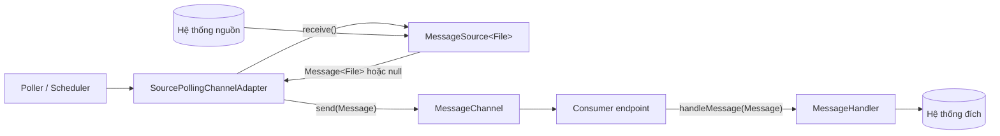

# MessageSource và MessageHandler trong adapter

Trong Spring Integration, adapter nối một hệ thống bên ngoài với luồng xử lý nội bộ thông qua `MessageChannel`. Hai hợp đồng cần hiểu rõ nhất khi xây dựng adapter là `MessageSource` (lấy dữ liệu để tạo message) và `MessageHandler` (nhận message để xử lý hoặc gửi dữ liệu ra ngoài). Đây là nền tảng để kết nối file, SFTP, HTTP, JMS, AMQP, Kafka và cơ sở dữ liệu, đồng thời kiểm soát poller, kiểu payload, lỗi và vòng đời kết nối.

Bài học thuộc chương **Kiểu endpoint**. Trọng tâm là phân biệt trách nhiệm của hai hợp đồng, cách chúng tham gia vào inbound/outbound adapter và cách thiết kế một luồng có thể kiểm chứng.

## 1. Kết quả cần đạt

Sau bài này, bạn có thể:

- Mô tả chính xác chiều dữ liệu của `MessageSource` và `MessageHandler`, từ góc nhìn ứng dụng Spring Integration.
- Giải thích vì sao `MessageSource` thường đi cùng `SourcePollingChannelAdapter` và `Poller`, trong khi `MessageHandler` được gắn vào consumer endpoint.
- Cấu hình một luồng file inbound → channel → file outbound bằng Java DSL.
- Phân biệt adapter dạng polling, adapter dạng message-driven và gateway dạng request–reply.
- Nhận diện vấn đề về lọc bản ghi trùng, dữ liệu chưa hoàn chỉnh, retry, lỗi, tính đồng bộ và khởi động lại.

## 2. Đặt đúng vị trí trong kiến trúc

Một luồng polling inbound và outbound có thể hình dung như sau:



**Phân định trách nhiệm:**

1. `MessageSource` truy xuất hệ thống nguồn và trả về một `Message<T>` hoặc `null` khi chưa có dữ liệu.
2. `SourcePollingChannelAdapter` là **endpoint** được lên lịch. Nó gọi `receive()`, sau đó gửi message hợp lệ vào `MessageChannel`.
3. `MessageChannel` tách phía tạo message khỏi phía tiêu thụ; loại channel quyết định cách giao nhận và mức độ đồng bộ.
4. Consumer endpoint chuyển message từ channel tới một `MessageHandler`; handler xử lý nội dung hoặc ghi ra hệ thống đích.

Điểm dễ nhầm: một `MessageSource` đơn lẻ **không tự chạy theo chu kỳ**. Phải có polling endpoint và lịch poll phù hợp. Tương tự, một `MessageHandler` đơn lẻ **không tự lấy message từ hệ thống ngoài**; nó được consumer endpoint gọi khi có message đến.

### So sánh nhanh

| Khía cạnh | `MessageSource<T>` | `MessageHandler` |
|---|---|---|
| Vai trò | Tạo message từ dữ liệu nguồn | Tiêu thụ message đầu vào |
| Phương thức chính | `Message<T> receive()` | `void handleMessage(Message<?> message)` |
| Giá trị trả về | Message hoặc `null` | Không trả về giá trị từ hợp đồng này |
| Chiều điển hình | Inbound polling | Outbound adapter hoặc bước xử lý |
| Ai kích hoạt? | Poller thông qua `SourcePollingChannelAdapter` | Consumer endpoint khi nhận message từ channel |
| Ví dụ | `FileReadingMessageSource`, nguồn JDBC polling | `FileWritingMessageHandler`, handler gửi SFTP hoặc HTTP |
| Khi không có dữ liệu | Trả về `null`; không đồng nghĩa lỗi | Chỉ được gọi khi có message |
| Khi thao tác thất bại | Có thể phát sinh exception trong lúc poll | Có thể ném `MessagingException`/exception để flow xử lý |

> **Quy tắc nhớ:** Source trả lời “message mới lấy từ đâu?”, Handler trả lời “message nhận được phải làm gì?”. Adapter/endpoint là phần nối hợp đồng đó với channel và vòng đời Spring Integration.

## 3. Hợp đồng `MessageSource`

Giao diện cốt lõi nằm trong `org.springframework.integration.core.MessageSource`. Ở mức sử dụng, có thể hiểu nó như sau:

```java
// Minh họa hợp đồng (rút gọn, không phải mã nguồn đầy đủ của thư viện).
public interface MessageSource<T> {
    Message<T> receive();
}
```

Mỗi lần được gọi, `receive()` thực hiện một lần lấy dữ liệu theo cơ chế của source. Ví dụ, source đọc thư mục có thể chọn một file; source JDBC có thể lấy một bản ghi; source tùy biến có thể đọc từ hàng đợi trong bộ nhớ.

`receive()` cần phân biệt ba tình huống:

- **Có dữ liệu:** trả về `Message<T>` với payload và headers phù hợp.
- **Chưa có dữ liệu:** trả về `null`; poller kết thúc lượt nhận và thử lại khi đến lịch.
- **Không thể truy cập hoặc xử lý nguồn:** phát sinh exception để cơ chế xử lý lỗi của endpoint quyết định bước tiếp theo; không nên biến mọi lỗi kết nối thành `null` vì sẽ che mất sự cố.

Ví dụ ngắn về một source tùy biến:

```java
Queue<String> pending = new ConcurrentLinkedQueue<>();

MessageSource<String> source = () -> {
    String value = pending.poll();
    return value == null
            ? null
            : MessageBuilder.withPayload(value)
                    .setHeader("sourceSystem", "demo-queue")
                    .build();
};
```

Đoạn này cần các kiểu `Queue`, `ConcurrentLinkedQueue`, `MessageSource`, `MessageBuilder` được import tương ứng. Nó minh họa hợp đồng `receive()`, chưa tự tạo endpoint hay lịch poll. Trong ứng dụng thực tế, cũng cần xét khả năng lấy ra khỏi queue rồi xử lý lỗi: dữ liệu có thể mất nếu nguồn không có cơ chế xác nhận hoặc hoàn tác.

### Poller điều khiển nhịp nhận

Với inbound polling, `SourcePollingChannelAdapter` sử dụng cấu hình poller:

- `fixedDelay`: chờ một khoảng từ lúc lượt thực thi trước hoàn thành.
- `fixedRate`: lên lịch dựa trên thời điểm bắt đầu lượt thực thi; cần xem xét tình trạng chồng lấn tải.
- `maxMessagesPerPoll`: giới hạn số lần thử nhận trong một lượt poll; lượt có thể kết thúc sớm khi source trả về `null`.
- `taskExecutor` và chính sách transaction/retry (khi được cấu hình): ảnh hưởng thread, độ đồng thời và phạm vi xử lý lỗi.

Giả sử poller chạy 3 giây một lần và có `maxMessagesPerPoll(5)`: mỗi lượt có thể gọi `receive()` tối đa năm lần, hoặc dừng sớm nếu source không còn message. **Số message trong một lượt poll không đồng nghĩa số file sẽ được xử lý thành công**; các bước sau có thể lỗi hoặc bị chặn.

## 4. Hợp đồng `MessageHandler`

`MessageHandler` thuộc `org.springframework.messaging`, nhận trọn message gồm payload và headers:

```java
// Minh họa hợp đồng (rút gọn).
public interface MessageHandler {
    void handleMessage(Message<?> message) throws MessagingException;
}
```

Handler có thể ghi file, gửi HTTP request, publish Kafka record, gửi JMS/AMQP message hoặc thực hiện một bước xử lý nội bộ. Hai điểm quan trọng:

1. Handler nhận **`Message<?>`**, không chỉ payload. Header có thể mang tên file, correlation ID, thông tin định tuyến, `replyChannel`, `errorChannel` hay metadata đặc thù của giao thức.
2. Phương thức giao diện trả về `void`. Điều đó phù hợp với **outbound channel adapter một chiều**. Nếu cần gửi request rồi nhận response, hãy chọn gateway hoặc một endpoint có ngữ nghĩa trả lời thích hợp, thay vì kỳ vọng `handleMessage()` tự trả kết quả.

Không phải mọi `MessageHandler` đều là outbound adapter: service activator, transformer hay những consumer endpoint khác cũng có thể dùng handler để xử lý message trong ứng dụng. Ngược lại, không phải mọi inbound adapter đều dùng `MessageSource`.

## 5. Ví dụ hoàn chỉnh: đọc file rồi ghi sang thư mục khác

Yêu cầu: cứ 3 giây quét thư mục `data/inbox`, lấy tối đa 5 file trong một lượt và ghi bản sao sang `data/archive`. Ví dụ dùng **Spring Integration Java DSL** với dependency `spring-integration-file` (để Spring Boot quản lý phiên bản dependency nếu dự án dùng Spring Boot).

```xml
<!-- Trích trong dependencies của pom.xml -->
<dependency>
    <groupId>org.springframework.boot</groupId>
    <artifactId>spring-boot-starter-integration</artifactId>
</dependency>
<dependency>
    <groupId>org.springframework.integration</groupId>
    <artifactId>spring-integration-file</artifactId>
</dependency>
```

```java
import java.io.File;
import java.time.Duration;

import org.springframework.context.annotation.Bean;
import org.springframework.context.annotation.Configuration;
import org.springframework.integration.config.EnableIntegration;
import org.springframework.integration.dsl.IntegrationFlow;
import org.springframework.integration.dsl.Pollers;
import org.springframework.integration.file.FileReadingMessageSource;
import org.springframework.integration.file.FileWritingMessageHandler;
import org.springframework.integration.file.support.FileExistsMode;

@Configuration
@EnableIntegration
public class FileAdapterConfig {

    @Bean
    public FileReadingMessageSource inputFileSource() {
        FileReadingMessageSource source = new FileReadingMessageSource();
        source.setDirectory(new File("data/inbox"));
        source.setAutoCreateDirectory(true);
        return source;
    }

    @Bean
    public FileWritingMessageHandler outputFileHandler() {
        FileWritingMessageHandler handler =
                new FileWritingMessageHandler(new File("data/archive"));
        handler.setAutoCreateDirectory(true);
        handler.setFileExistsMode(FileExistsMode.FAIL);
        handler.setExpectReply(false);
        return handler;
    }

    @Bean
    public IntegrationFlow copyFilesFlow(
            FileReadingMessageSource inputFileSource,
            FileWritingMessageHandler outputFileHandler) {

        return IntegrationFlow.from(
                    inputFileSource,
                    endpoint -> endpoint.poller(
                            Pollers.fixedDelay(Duration.ofSeconds(3))
                                   .maxMessagesPerPoll(5)))
                .handle(outputFileHandler)
                .get();
    }
}
```

**Diễn biến khi chạy:**

1. Khi context khởi động, Spring Integration khởi tạo flow và polling endpoint, tạo thư mục nếu chưa có.
2. Mỗi lượt poll, `SourcePollingChannelAdapter` gọi `inputFileSource.receive()`.
3. Khi có file, source trả về message có **payload kiểu `File`** (tham chiếu đến file trên đĩa, không tự đọc toàn bộ nội dung thành `String`).
4. Flow chuyển message đến `outputFileHandler`; handler đọc payload và ghi file vào `data/archive`.
5. `FileExistsMode.FAIL` khiến việc ghi thất bại nếu file đích cùng tên đã tồn tại. Đây là lựa chọn minh bạch để phát hiện trùng khi học; sản phẩm thực tế cần chính sách riêng.

**Tự thử:** tạo `data/inbox/hello.txt` chứa `Xin chào Spring Integration`, chạy ứng dụng có cấu hình trên, rồi kiểm tra `data/archive/hello.txt`. Bạn sẽ thấy bản sao ở thư mục đích; ví dụ **không xóa hoặc di chuyển** file nguồn. Đặt thêm file khác và kiểm tra hệ thống nhận vào những lượt poll sau. Khi không có file mới, source trả về `null`; đó là hoạt động bình thường.

Java DSL che bớt các lớp endpoint nội bộ để dễ đọc. Cách viết `.handle(outputFileHandler)` đưa một đối tượng `MessageHandler` vào flow; framework kết nối nó với kênh và consumer endpoint tương ứng. Trong phiên bản Java DSL hiện đại, không bắt buộc phải khai báo một `MessageChannel` riêng cho mỗi bước khi không cần đặt tên hoặc thay đổi kiểu channel.

### Vì sao ví dụ này dùng `MessageSource` và `MessageHandler` riêng?

Có thể cấu hình ngắn hơn bằng các factory DSL như `Files.inboundAdapter(...)` và `Files.outboundAdapter(...)`. Tuy nhiên, tạo rõ `FileReadingMessageSource` và `FileWritingMessageHandler` giúp quan sát ranh giới:

- Source quản lý việc **phát hiện và chọn file nguồn**.
- Poller quản lý **khi nào và mỗi lượt lấy bao nhiêu message**.
- Handler quản lý **ghi file ra đích** và chính sách file đã tồn tại.
- Channel/consumer endpoint quản lý **cách đưa message** tới handler.

Đổi đích từ file sang SFTP hoặc một dịch vụ HTTP thường tác động chủ yếu đến handler và cấu hình kết nối; đổi nguồn từ file sang JDBC polling chủ yếu tác động đến source và message contract. Payload/header giữa hai phía vẫn phải tương thích.

## 6. Polling, message-driven và gateway: không đồng nhất mọi adapter

| Kiểu kết nối | Thành phần điển hình | Cách dữ liệu kích hoạt flow | Điều cần lưu ý |
|---|---|---|---|
| File inbound | `FileReadingMessageSource` | Poller gọi `receive()` | Có thể thấy file chưa ghi xong, cần filter |
| JDBC inbound | Message source/adapter truy vấn cơ sở dữ liệu | Poll theo lịch | Phải giải quyết đánh dấu bản ghi đã lấy và transaction |
| SFTP inbound polling | SFTP inbound source/synchronizer | Poller lấy file từ server | Xét file chưa hoàn tất, metadata store và lỗi mạng |
| HTTP inbound | HTTP inbound gateway/adapter | HTTP request tới ứng dụng | Request kích hoạt trực tiếp; không cần `MessageSource.receive()` để thăm dò |
| JMS/AMQP/Kafka inbound dạng listener | Message-driven adapter | Broker/client thông báo message | Dựa trên listener, ack/offset và chính sách retry |
| Outbound file/SFTP/HTTP/JMS/AMQP/Kafka | Handler hoặc outbound gateway tương ứng | Message đi tới consumer endpoint | Phải xác định gửi một chiều hay request–reply |

**Inbound** nghĩa là đi **vào ứng dụng Spring Integration**, không phải nhất thiết đi vào Internet hay server. **Outbound** nghĩa là đi **ra khỏi ứng dụng Spring Integration**. Một inbound gateway có thể nhận request và gửi response, còn outbound gateway có thể gọi hệ thống ngoài rồi đưa reply trở lại flow. Gateway khác outbound adapter một chiều ở **hợp đồng trao đổi**, không chỉ ở tên class.

Đặc biệt, poller không chỉ dành cho nguồn bên ngoài: nếu consumer đọc từ `QueueChannel` (một `PollableChannel`), endpoint có thể là `PollingConsumer`. Đó là việc **poll channel nội bộ** để giao message cho handler, khác với `SourcePollingChannelAdapter` **poll MessageSource bên ngoài**.

## 7. Thiết kế message contract giữa nguồn và đích

Một adapter ổn định cần hợp đồng rõ ràng về payload và headers. Trước khi nối hai đầu, hãy quyết định:

| Thành phần hợp đồng | Câu hỏi thiết kế | Ví dụ file |
|---|---|---|
| Payload | Kiểu Java gì, có mang dữ liệu thật hay chỉ tham chiếu? | `File`, `byte[]`, `String` |
| Định danh | Message có thể được nhận lại không, nhận biết trùng bằng gì? | Đường dẫn + thời gian sửa, checksum hoặc business ID |
| Metadata định tuyến | Handler tìm nơi gửi và tên đích thế nào? | `FileHeaders.FILENAME`, tên thư mục, routing key |
| Correlation | Gắn kết request/reply hoặc nhiều bước xử lý ra sao? | `correlationId`, mã giao dịch |
| Lỗi và trả lời | Ai chịu trách nhiệm retry và báo kết quả? | `errorChannel`, gateway reply, log/metric |
| Ràng buộc hệ thống | Kích thước, encoding, timeouts, concurrency? | File lớn nên stream/copy phù hợp |

Ví dụ, `FileReadingMessageSource` phát ra payload `File`. Nếu handler kế tiếp chỉ chấp nhận `String` JSON, cần có bước đọc/transform và kiểm tra encoding; không nên dựa vào việc ép kiểu ngầm. Với HTTP, status code và response body chỉ đi tiếp theo hợp đồng của outbound gateway hoặc cấu hình xử lý reply; không xuất hiện tự động chỉ vì handler gửi request.

Một quy tắc hữu ích: **giữ payload là dữ liệu nghiệp vụ, headers là metadata vận chuyển/định tuyến**, đồng thời xác định rõ header nào bắt buộc và header nào có thể thiếu. Với giao thức nhạy cảm, không đưa mật khẩu, token hoặc thông tin bí mật vào message headers/log.

## 8. Lỗi, duplicate và vòng đời

### 8.1. Khi source hoặc handler ném lỗi

- Trong luồng đồng bộ qua `DirectChannel`, exception từ handler có thể lan ngược trên cùng thread tới bên gửi, bao gồm lượt poll hiện tại.
- Với tác vụ poller được scheduler chạy, Spring Integration có cơ chế xuất lỗi dưới dạng `ErrorMessage` tới `errorChannel` khi dùng cấu hình xử lý lỗi phù hợp.
- Với channel bất đồng bộ hoặc listener adapter, cách ghi nhận exception, retry, ack hoặc gửi error message tùy endpoint, loại channel và cấu hình. Không nên mặc định rằng mọi lỗi đều được retry tự động.

Theo dõi tối thiểu: số message nhận thành công, số xử lý thất bại, độ trễ, số lần retry, error queue và trạng thái kết nối. Phân loại lỗi tạm thời (timeout, mất mạng) với lỗi cố định (payload sai schema, không có quyền ghi, file trùng). Giới hạn retry và có nơi lưu các message cần xử lý thủ công khi nguồn/đích hỗ trợ.

### 8.2. Không nhầm “đọc một lần” với “xử lý đúng một lần”

Trong ví dụ file, `FileReadingMessageSource` dùng cơ chế lọc file đã nhận (mặc định có `AcceptOnceFileListFilter` trong cấu hình thông thường), nhưng trạng thái lọc trong bộ nhớ **không tồn tại qua lần restart**. Một file nguồn chưa được xóa có thể lại được nhận sau khi chạy lại ứng dụng. Nếu file đích tồn tại và dùng `FAIL`, handler sẽ báo lỗi; đó là lý do cần chiến lược idempotency/deduplication có lưu bền khi triển khai thực tế.

Ở môi trường nhiều instance, cần cân nhắc metadata store chia sẻ, khóa hoặc cơ chế claim dữ liệu ở hệ thống nguồn. Với JDBC, đọc rồi cập nhật trạng thái trong transaction có thể giảm đua tranh; với Kafka/JMS/AMQP, cơ chế ack/offset và thời điểm commit quyết định khả năng nhận lại. Không thể suy ra bảo đảm exactly-once xuyên nhiều hệ thống chỉ từ việc dùng adapter.

### 8.3. Không lấy file đang được ghi dở

Một poller có thể phát hiện file khi tiến trình khác vẫn đang ghi. `AcceptOnceFileListFilter` không tự bảo đảm file đã hoàn chỉnh. Cách thường dùng là cho bên ghi tạo file tạm rồi **rename** khi hoàn tất; source chỉ nhận tên hoàn chỉnh. Nếu không kiểm soát được bên ghi, có thể dùng bộ lọc theo tuổi file/last-modified phù hợp, kết hợp filter đúng thứ tự.

### 8.4. Lifecycle và lưu lượng

Các endpoint Spring Integration có vòng đời như start/stop và có thể cấu hình tự khởi động. Dừng polling endpoint nghĩa là ngừng gọi source theo lịch; không có nghĩa mọi tác vụ hoặc kết nối đang thực thi tự động rollback. Khi vận hành cần kiểm tra điều kiện dừng an toàn, timeout và việc giải phóng tài nguyên.

Đặt `maxMessagesPerPoll`, nhịp poll và concurrency theo tốc độ nguồn và sức chịu tải của đích. Một `DirectChannel` thường gọi handler đồng bộ trên thread gửi; chuyển sang `ExecutorChannel` hoặc `QueueChannel` làm thay đổi thời điểm xử lý, quản trị backpressure và cách nhận lỗi. Tránh đổi kiểu channel mà không kiểm tra lại bảo đảm thứ tự và retry.

## 9. Những lỗi hiểu sai thường gặp

| Nhận định sai | Cách hiểu đúng |
|---|---|
| “Đã có `MessageSource` thì nó tự poll.” | Source chỉ cung cấp `receive()`; polling endpoint và poller mới lên lịch gọi nó. |
| “Mỗi inbound adapter đều là `MessageSource`.” | Inbound polling thường dùng `MessageSource`; inbound message-driven nhận sự kiện từ listener; gateway nhận request rồi trả reply. |
| “`MessageHandler` luôn trả kết quả cho nơi gọi.” | Hợp đồng `handleMessage()` là `void`; request–reply phải được biểu diễn bằng endpoint/gateway phù hợp. |
| “`null` từ source có nghĩa hệ thống lỗi.” | `null` biểu thị chưa có message trong lần gọi đó; lỗi thật cần được báo bằng exception/cơ chế giám sát. |
| “Một file chỉ được nhận đúng một lần mãi mãi.” | Filter mặc định không đủ cho restart hoặc nhiều instance; cần idempotency bền vững. |
| “Đổi sang channel bất đồng bộ không ảnh hưởng xử lý lỗi.” | Nó thay đổi thread và cách exception đi qua luồng; phải cấu hình retry và error handling tương ứng. |

## 10. Bài tập thực hành

**Bài 1 — Quan sát nhịp poll.** Chạy ví dụ trên, để thư mục `data/inbox` rỗng rồi lần lượt thêm ba file. Ghi lại thời điểm file xuất hiện ở `data/archive`. Thay `maxMessagesPerPoll(5)` bằng `maxMessagesPerPoll(1)` và so sánh số file có thể được nhận trong một lượt poll.

**Bài 2 — Xử lý duplicate.** Thêm file `hello.txt`, xác nhận bản sao được tạo, rồi chạy lại ứng dụng trong khi giữ nguyên file nguồn và file đích. Quan sát lỗi khi `FileExistsMode.FAIL` gặp tên file đã tồn tại. Đề xuất chính sách phù hợp nếu yêu cầu nghiệp vụ là bỏ qua, thay thế hay lưu phiên bản mới.

**Bài 3 — Thiết kế adapter khác.** Giả sử chuyển sang “đọc hóa đơn từ JDBC mỗi 10 giây và đẩy sang Kafka”. Hãy xác định (a) phần nào thay cho `MessageSource`, (b) phần nào đóng vai `MessageHandler`, (c) kiểu payload và business ID, (d) cơ chế claim bản ghi, retry và tránh publish trùng. Chỉ ra thành phần nào cần poller và thành phần nào được broker đẩy sự kiện.

### Tự kiểm tra

1. `SourcePollingChannelAdapter` làm việc gì mà `MessageSource` không tự làm?
2. Vì sao `MessageHandler` nhận `Message<?>` thay vì chỉ nhận payload?
3. Khi nào nên chọn inbound gateway hoặc message-driven adapter thay vì polling inbound adapter?
4. Nếu handler lỗi sau khi source đã chọn file, cần có những cơ chế nào để tránh mất dữ liệu hoặc xử lý trùng?

Nếu trả lời được bốn câu trên và tự chạy được ví dụ file, bạn đã nắm ranh giới cốt lõi của hai hợp đồng endpoint để tiếp tục thực hành kết nối SFTP, HTTP, JMS, AMQP, Kafka và cơ sở dữ liệu.

## Tài liệu tham khảo

- [Spring Integration Reference — Channel Adapter](https://docs.spring.io/spring-integration/reference/channel-adapter.html)
- [Spring Integration Reference — Reading Files](https://docs.spring.io/spring-integration/reference/file/reading.html)
- [Spring Integration Reference — Writing Files](https://docs.spring.io/spring-integration/reference/file/writing.html)
- [Spring Integration Reference — Error Handling](https://docs.spring.io/spring-integration/reference/7.0/error-handling.html)
