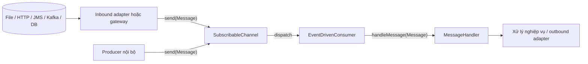
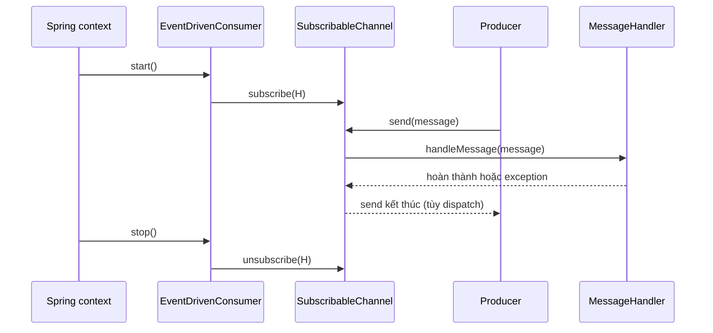
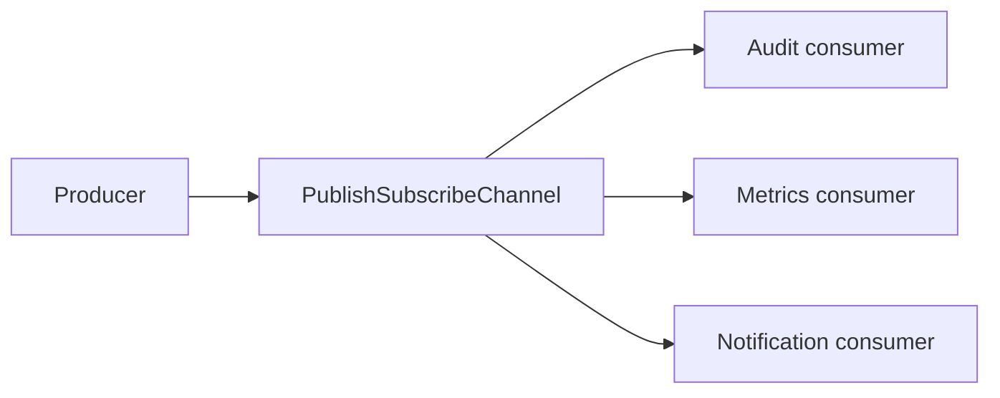
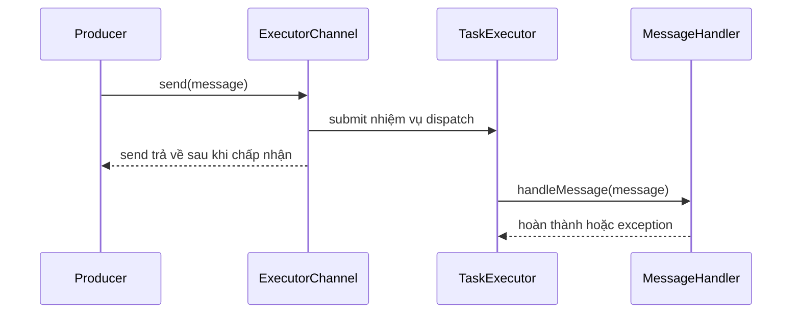
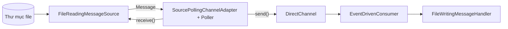

# Event-driven consumer trên SubscribableChannel

Trong Spring Integration, **event-driven consumer** là endpoint nhận message ngay khi message được gửi vào một `SubscribableChannel`. Endpoint này đăng ký một `MessageHandler` làm subscriber; khi channel phân phối message, handler được gọi theo cơ chế dispatch của channel. Cơ chế này là một mắt xích quan trọng khi kết nối hệ thống ngoài thông qua inbound/outbound adapter, gateway và `MessageChannel`.

Bài thuộc chương **Kiểu endpoint** của module **SPRING_INTEGRATION_ADAPTERS**. Phạm vi module bao gồm file, SFTP, HTTP, JMS, AMQP, Kafka và cơ sở dữ liệu; tại đây ta tập trung vào **cách tiêu thụ message sau khi message đã đi vào luồng Spring Integration**. Hiểu đúng subscriber, dispatch, threading, lỗi và vòng đời endpoint giúp thiết kế các luồng kết nối ít bất ngờ khi vận hành.

## 1. Mục tiêu học tập

Sau bài học, bạn có thể:

1. Giải thích hợp đồng của `SubscribableChannel` và vai trò của `EventDrivenConsumer`.
2. Phân biệt mô hình tiêu thụ sự kiện trên `DirectChannel`, `ExecutorChannel` và `PublishSubscribeChannel`.
3. Tạo consumer chạy thực tế bằng cấu hình Java và `MessageHandler`.
4. Phân biệt event-driven consumer với polling consumer và với inbound adapter sử dụng poller.
5. Giải thích tác động của channel tới thứ tự xử lý, lỗi, transaction, idempotency và vòng đời.

## 2. Các thành phần tham gia

Một message trong Spring Integration có **payload** và **headers**. Producer gửi message vào `MessageChannel`; channel chọn cách giao message cho consumer endpoint. Với `SubscribableChannel`, consumer đăng ký nhận các thông báo khi có message mới, không cần tự gọi `receive()` định kỳ.



Trong sơ đồ, hai loại producer đều gửi tới cùng một channel. Việc **nhận sự kiện từ channel** khác với việc **lấy dữ liệu từ hệ thống ngoài**. Chẳng hạn, một file inbound adapter vẫn có thể dùng poller để phát hiện file, rồi gửi `Message<File>` đến `DirectChannel`; consumer đăng ký trên channel ấy vẫn là event-driven consumer.

### 2.1. `MessageChannel` và `SubscribableChannel`

Các hợp đồng cốt lõi thuộc Spring Messaging:

```java
// Minh họa các phương thức chính; không phải toàn bộ mã nguồn thư viện.
public interface MessageChannel {
    boolean send(Message<?> message);
    boolean send(Message<?> message, long timeout);
}

public interface SubscribableChannel extends MessageChannel {
    boolean subscribe(MessageHandler handler);
    boolean unsubscribe(MessageHandler handler);
}
```

- `send(...)` là thao tác của **producer**.
- `subscribe(handler)` đăng ký một consumer để channel có thể đẩy message tới nó.
- `unsubscribe(handler)` gỡ đăng ký đó.
- `MessageHandler.handleMessage(Message<?> message)` thực thi logic xử lý khi message được dispatch.

`subscribe(...)` không phải thao tác gửi message. Một subscriber cũng không đồng nghĩa có một thread riêng: channel quyết định handler chạy đồng bộ hay bất đồng bộ.

### 2.2. `EventDrivenConsumer` là endpoint quản lý subscription

`org.springframework.integration.endpoint.EventDrivenConsumer` là một endpoint của Spring Integration liên kết `SubscribableChannel` với `MessageHandler`. Khi được khởi động, endpoint đăng ký handler với channel; khi dừng, endpoint hủy đăng ký. Framework cũng hỗ trợ tự tạo loại endpoint này khi bạn dùng cấu hình Java DSL hoặc annotation phù hợp.



**Lưu ý:** Sơ đồ thể hiện thứ tự lời gọi ở mức khái niệm. Khi channel dùng executor, handler có thể chạy sau khi lời gọi `send()` đã trả về. Các ngoại lệ, timeout và kết quả xử lý cũng khác so với channel đồng bộ.

## 3. So sánh những channel liên quan

| Channel | Hợp đồng | Số handler nhận một message | Thread xử lý điển hình | Trường hợp dùng |
|---|---|---|---|---|
| `DirectChannel` | `SubscribableChannel` | **Một** subscriber được chọn trong số những subscriber đang có | Cùng thread gọi `send()` | Xử lý point-to-point, cần phản hồi lỗi ngay |
| `ExecutorChannel` | `SubscribableChannel` | **Một** subscriber được chọn | Thread do `TaskExecutor` cung cấp | Tách luồng gửi khỏi xử lý, điều tiết tải |
| `PublishSubscribeChannel` | `SubscribableChannel` | **Nhiều** subscriber theo cơ chế broadcast | Đồng bộ mặc định; có thể cấp executor để chạy bất đồng bộ | Audit, metrics, thông báo nhiều nhánh |
| `QueueChannel` | `PollableChannel` | Consumer **poll** lấy message từ queue | Thread do polling endpoint điều khiển | Đệm message và xử lý theo nhịp poll |

Ba nhận xét thường bị bỏ sót:

- Gắn **hai handler** vào một `DirectChannel` không tạo fan-out: channel sẽ dispatch mỗi message tới một handler được chọn. Nếu cần cả hai xử lý cùng sự kiện, dùng `PublishSubscribeChannel` hoặc fan-out được cấu hình rõ.
- `PublishSubscribeChannel` mặc định vẫn có thể chạy **đồng bộ** ngay trên thread producer. Chữ *event-driven* chỉ nói cách kích hoạt, không đảm bảo chạy bất đồng bộ.
- `QueueChannel` là ví dụ `PollableChannel`: consumer endpoint thường là `PollingConsumer`, vốn chủ động nhận message từ channel theo lịch. Không nên gọi đó là `EventDrivenConsumer` chỉ vì dữ liệu có nguồn gốc từ một sự kiện.

`DirectChannel` và `ExecutorChannel` phục vụ kiểu phân phối point-to-point; thứ tự chọn subscriber và hành vi failover cần được kiểm tra theo cấu hình dispatcher/phiên bản framework, không nên coi đó là quy tắc nghiệp vụ.

## 4. Ví dụ chạy được: consumer trên `DirectChannel`

Giả sử hệ thống bán hàng phát ra sự kiện `OrderPlaced`. Mỗi sự kiện được đưa vào một channel; một consumer đọc payload, in mã đơn hàng và tổng tiền. Ví dụ chủ động tạo `EventDrivenConsumer` để nhìn rõ kết nối giữa channel và handler, thay vì để Java DSL tự tạo endpoint.

Dự án dùng **Java 17+**, Spring Boot và Spring Integration. Trong Maven, thêm starter nếu dự án chưa có:

```xml
<dependency>
    <groupId>org.springframework.boot</groupId>
    <artifactId>spring-boot-starter-integration</artifactId>
</dependency>
```

Tạo cấu hình sau trong ứng dụng Spring Boot:

```java
import org.springframework.beans.factory.annotation.Qualifier;
import org.springframework.boot.ApplicationRunner;
import org.springframework.context.annotation.Bean;
import org.springframework.context.annotation.Configuration;
import org.springframework.integration.channel.DirectChannel;
import org.springframework.integration.config.EnableIntegration;
import org.springframework.integration.endpoint.EventDrivenConsumer;
import org.springframework.messaging.MessageHandler;
import org.springframework.messaging.SubscribableChannel;
import org.springframework.messaging.support.MessageBuilder;

@Configuration
@EnableIntegration
public class OrderConsumerConfig {

    public record OrderPlaced(String orderId, long totalVnd) {}

    @Bean("ordersChannel")
    public SubscribableChannel ordersChannel() {
        return new DirectChannel();
    }

    @Bean("orderHandler")
    public MessageHandler orderHandler() {
        return message -> {
            OrderPlaced order = (OrderPlaced) message.getPayload();
            System.out.printf(
                    "Đã nhận đơn %s, tổng tiền %d VND%n",
                    order.orderId(),
                    order.totalVnd());
        };
    }

    @Bean
    public EventDrivenConsumer orderConsumer(
            @Qualifier("ordersChannel") SubscribableChannel channel,
            @Qualifier("orderHandler") MessageHandler handler) {
        return new EventDrivenConsumer(channel, handler);
    }

    @Bean
    public ApplicationRunner publishDemoOrder(
            @Qualifier("ordersChannel") SubscribableChannel channel) {
        return args -> {
            boolean sent = channel.send(
                    MessageBuilder
                            .withPayload(new OrderPlaced("ORD-101", 150_000L))
                            .setHeader("eventType", "OrderPlaced")
                            .build());

            if (!sent) {
                throw new IllegalStateException("Không gửi được sự kiện");
            }
        };
    }
}
```

Đặt lớp cấu hình trong package được Spring Boot scan, rồi chạy ứng dụng có `@SpringBootApplication`. `ApplicationRunner` được gọi sau khi context đã khởi tạo; với cấu hình mặc định, consumer endpoint đã tự khởi động và đăng ký handler. Kết quả mong đợi trên console:

```text
Đã nhận đơn ORD-101, tổng tiền 150000 VND
```

**Đọc từng bước theo lời gọi thật:**

1. Spring tạo bean `ordersChannel` (một `DirectChannel`) và bean `orderHandler`.
2. Spring tạo bean `orderConsumer`, rồi lifecycle của endpoint đăng ký `orderHandler` bằng `subscribe(...)`.
3. `ApplicationRunner` gửi `Message<OrderPlaced>` vào channel.
4. `DirectChannel` chọn subscriber và gọi `handleMessage(...)` ngay trên thread gửi.
5. Handler trích payload và xử lý. Nếu handler ném exception, lời gọi `send(...)` có thể nhận exception ấy ngay vì đường xử lý là đồng bộ.

Header `eventType` là ví dụ metadata tự định nghĩa. Không có cơ chế nào bắt buộc header này phải tồn tại; producer và consumer cần thống nhất **message contract** nếu nghiệp vụ sử dụng nó.

### 4.1. Cách cấu hình ngắn hơn với annotation

Khi không cần tạo `EventDrivenConsumer` bằng tay, có thể dùng annotation `@ServiceActivator`:

```java
// Ví dụ độc lập, thay cho bean orderHandler + orderConsumer ở trên.
@ServiceActivator(inputChannel = "ordersChannel")
public void onOrderPlaced(OrderPlaced order) {
    System.out.println("Đã xử lý " + order.orderId());
}
```

Khi bật Spring Integration và đăng ký method này trong một bean được Spring quản lý, framework tạo endpoint thích hợp, lấy message từ `ordersChannel` và chuyển payload vào phương thức. **Chọn một trong hai cách** cho cùng logic trong ví dụ, tránh vô tình đăng ký hai consumer và dẫn tới việc message được phân phối khác kỳ vọng.

Trong Java DSL, cùng ý tưởng thường được biểu diễn bằng `IntegrationFlow.from("ordersChannel").handle(...)`: DSL giúp framework tạo endpoint, còn bản chất subscriber/channel vẫn như trên.

### 4.2. Đăng ký handler trực tiếp khi nào?

```java
MessageHandler handler = message -> System.out.println(message.getPayload());
channel.subscribe(handler);
// ... producer gửi các message ...
channel.unsubscribe(handler);
```

Đoạn này minh họa đúng API `SubscribableChannel` nhưng **không phải lựa chọn mặc định trong ứng dụng Spring Integration**. Với endpoint do framework quản lý, Spring thực hiện subscribe/unsubscribe theo lifecycle. Đăng ký tay đòi hỏi bạn tự quản lý thời điểm đăng ký, gỡ đăng ký và nguy cơ tồn tại subscription ngoài mong muốn.

## 5. Khi muốn nhiều consumer nhận cùng sự kiện

Một đơn hàng được tạo có thể cần cập nhật metrics **và** ghi audit. Đăng ký hai consumer lên `DirectChannel` sẽ không đảm bảo cả hai được gọi. Dùng `PublishSubscribeChannel`:

```java
import org.springframework.context.annotation.Bean;
import org.springframework.context.annotation.Configuration;
import org.springframework.integration.annotation.ServiceActivator;
import org.springframework.integration.channel.PublishSubscribeChannel;
import org.springframework.messaging.Message;

@Configuration
public class AuditConsumerConfig {

    @Bean("orderEvents")
    public PublishSubscribeChannel orderEvents() {
        return new PublishSubscribeChannel();
    }

    @ServiceActivator(inputChannel = "orderEvents")
    public void writeAudit(Message<?> message) {
        System.out.println("AUDIT " + message.getPayload());
    }

    @ServiceActivator(inputChannel = "orderEvents")
    public void updateMetrics(Message<?> message) {
        System.out.println("METRIC " + message.getPayload());
    }
}
```

Giả sử một producer gửi message vào `orderEvents`, mỗi handler được đăng ký sẽ là một nhánh nhận event. Với cấu hình trên, dispatch mặc định đồng bộ nên lỗi ở một nhánh có thể ảnh hưởng đến việc hoàn thành hoặc giao message cho các nhánh khác. Nếu nghiệp vụ yêu cầu độc lập lỗi và khả năng xử lý lại của từng nhánh, cần thiết kế thêm error handling, queue/broker hoặc cơ chế tách nhánh phù hợp.



**Phân biệt broadcast và competing consumers:**

- `PublishSubscribeChannel`: phù hợp **fan-out**; các subscriber nhận cùng một event theo cơ chế broadcast.
- `DirectChannel`: phù hợp **competing consumers** trong cùng ứng dụng; mỗi message được giao cho một handler được chọn, không broadcast.
- Broker như Kafka/JMS/AMQP: có semantics riêng về partition, topic, queue, subscription và consumer group. Việc đăng ký subscriber lên một channel **trong bộ nhớ** không tự mang lại cơ chế lưu bền của broker.

## 6. Event-driven không đồng nghĩa bất đồng bộ

Xét lời gọi `channel.send(message)` trong ba trường hợp:

**`DirectChannel`:** producer gọi handler trên cùng thread. Nếu handler mất 500 ms, bên gọi thường phải chờ xử lý hoàn thành. Điều này giúp giữ ngữ cảnh đồng bộ như transaction hiện tại, nhưng handler chậm có thể giữ thread của HTTP request hoặc adapter nguồn quá lâu.

**`ExecutorChannel`:** channel giao việc xử lý qua `TaskExecutor`. Producer có thể hoàn tất việc gửi trước khi handler chạy xong. Tuy nhiên, hàng đợi executor có thể đầy, task bị từ chối, xử lý không giữ thứ tự khi có nhiều thread, và exception không truyền nguyên vẹn về producer theo cùng stack call.

**`PublishSubscribeChannel` với executor:** các subscriber có thể được dispatch bất đồng bộ. Mỗi nhánh phải được thiết kế về lỗi, capacity, thời điểm hoàn thành và cách ghi nhận delivery.



Lưu ý với executor: đây là luồng minh họa trường hợp executor nhận task thành công. Chính sách executor có thể từ chối task hoặc thậm chí chạy trên thread bên gọi, tùy cấu hình. Vì vậy, không thể suy ra `send() == true` nghĩa là công việc ở hệ thống đích đã hoàn thành.

### 6.1. Bảng chọn channel theo mục tiêu

| Mục tiêu | Gợi ý ban đầu | Cần kiểm tra thêm |
|---|---|---|
| Xử lý tuần tự, muốn biết lỗi ngay | `DirectChannel` | Thời gian handler, timeout ở upstream |
| Tách thread producer khỏi handler | `ExecutorChannel` với executor giới hạn | Queue capacity, rejection, ordering, error handling |
| Mỗi sự kiện được nhiều nhánh xử lý | `PublishSubscribeChannel` | Một nhánh lỗi có ảnh hưởng nhánh khác không? |
| Cần đệm message giữa producer và consumer | `QueueChannel` + `PollingConsumer` | Queue capacity, poller, độ bền khi restart |
| Cần lưu bền, replay, ack/offset giữa các dịch vụ | JMS/AMQP/Kafka tùy nghiệp vụ | Consumer group, retry, idempotency, transaction |

`QueueChannel` mặc định là thành phần trong bộ nhớ; không nên xem nó là một broker lưu bền qua restart. Các phương án lưu trữ bền vững cần cấu hình chuyên biệt.

## 7. Phân biệt ba khái niệm thường bị lẫn

### 7.1. Event-driven consumer trên channel

`EventDrivenConsumer` chờ channel dispatch message tới handler sau khi đã subscribe. **Không có poller của consumer** trong mô hình này.

### 7.2. Polling consumer trên channel

`PollingConsumer` lấy message từ `PollableChannel` theo lịch poll rồi gọi `MessageHandler`. Với `QueueChannel`, consumer cần poller; message có thể nằm trong queue chờ một lượt nhận.

### 7.3. Polling inbound adapter lấy dữ liệu từ bên ngoài

`SourcePollingChannelAdapter` gọi `MessageSource.receive()` theo lịch, sau đó **gửi message** đến một channel. Nếu channel đó là `DirectChannel`, phần handler phía sau vẫn có thể là `EventDrivenConsumer`.



Ví dụ này kết hợp cả **polling ở đầu vào hệ thống ngoài** và **event-driven consumption trên channel nội bộ**. Nên đặt câu hỏi “ai đang được poll?” trước khi kết luận cả flow là polling hay event-driven.

## 8. Hợp đồng message và hành vi lỗi

### 8.1. Kiểm tra payload và headers

Handler nhận `Message<?>`, nên cần xác định rõ:

| Thuộc tính | Quyết định cần ghi trong hợp đồng | Ví dụ |
|---|---|---|
| Payload | Kiểu Java, schema, encoding, phiên bản | `OrderPlaced(orderId, totalVnd)` |
| Định danh nghiệp vụ | Khóa để phát hiện xử lý trùng | `orderId` hoặc `eventId` |
| Correlation | Liên hệ message với request hoặc workflow | `correlationId` |
| Trace | Theo dõi sự kiện giữa adapter và handler | `traceId` không chứa bí mật |
| Reply | Có phản hồi không, gửi theo hợp đồng nào? | `replyChannel` trong flow request–reply |
| Error | Ai xử lý exception và báo trạng thái? | exception đồng bộ, `ErrorMessage`, error flow |

Một handler nhận `Message<OrderPlaced>` không tự khiến producer ở HTTP/Kafka/JMS chuyển đổi JSON thành record đúng schema. Cần đặt bước converter/transformer và xác thực dữ liệu ở vị trí thích hợp.

### 8.2. Đồng bộ: exception có thể quay lại người gửi

Khi xử lý qua `DirectChannel`, handler chạy trong thread gọi `send()`. Ví dụ handler không ghi được DB và ném exception: producer có thể nhận exception ngay từ lời gọi gửi. Nếu upstream là HTTP inbound gateway, điều đó có thể làm request lỗi theo error flow cấu hình. Nếu upstream là poller, exception được xử lý theo chính sách lỗi của polling task.

Không nên cho rằng việc đặt header `errorChannel` sẽ tự động “nuốt” mọi exception đồng bộ. Cần xem endpoint nào tạo `ErrorMessage` và nó có cơ chế xuất lỗi sang channel đó hay không.

### 8.3. Bất đồng bộ: lỗi cần đường xử lý riêng

Với executor hoặc adapter message-driven bất đồng bộ, thread producer thường không thể bắt trực tiếp exception xảy ra muộn trong handler. Cần thiết kế chính sách ghi nhận và xử lý lỗi tương ứng, ví dụ error handler/error channel của endpoint, retry có giới hạn, cảnh báo vận hành và nơi giữ message thất bại.

Không suy ra mọi message thất bại đều tự động được retry hoặc dead-letter. Khả năng này phụ thuộc adapter, retry advice, broker và cấu hình xác nhận tiêu thụ.

### 8.4. Không có subscriber thì sao?

Khi `DirectChannel` không có handler được subscribe, lời gọi gửi có thể thất bại bằng `MessageDeliveryException` hoặc cơ chế báo lỗi dispatch tương ứng. Trong lúc startup/shutdown, đây là tình huống cần tính đến nếu có producer hoạt động trước khi consumer start hoặc sau khi consumer stop. Với `PublishSubscribeChannel`, hành vi khi không có subscriber phụ thuộc thiết lập như `minSubscribers` và cách dispatch; không nên áp một quy tắc cho mọi channel.

## 9. Transaction, thứ tự và độ tin cậy

### 9.1. Transaction

`DirectChannel` giữ xử lý trên cùng thread, nhờ đó các bước đồng bộ có thể cùng tham gia transaction đang hoạt động nếu tài nguyên và transaction manager phù hợp. Chuyển sang `ExecutorChannel` tạo ranh giới thread: transaction context dạng `ThreadLocal` **không tự đi theo** task, nên cần thiết kế transaction ở phía consumer hoặc cơ chế phối hợp khác.

### 9.2. Thứ tự message

Một `DirectChannel` với một producer gửi tuần tự và handler đồng bộ thường giữ thứ tự lời gọi của producer đó. Nhưng nhiều producer, nhiều subscriber cạnh tranh hoặc nhiều thread executor có thể làm thay đổi thứ tự xử lý. Nếu nghiệp vụ yêu cầu theo `orderId` hoặc theo khóa giao dịch, cần định nghĩa rõ phạm vi bảo đảm thứ tự.

### 9.3. Duplicate và idempotency

Subscriber trên channel **không đồng nghĩa exactly-once**. Sự kiện từ Kafka/JMS/AMQP có thể được nhận lại do retry hoặc thời điểm commit ack/offset. Adapter từ file/SFTP/JDBC có thể lấy lại dữ liệu sau restart hoặc lỗi giữa hai bước. Consumer nên có kiểm tra idempotency nếu xử lý lại sẽ gây tác dụng phụ:

```text
eventId = "evt-2026-001"
Nếu eventId đã ghi nhận thành công → bỏ qua tác dụng phụ.
Nếu chưa xử lý → thực hiện nghiệp vụ và lưu trạng thái xử lý
                trong ranh giới transaction thích hợp.
```

Việc ghi nhận `eventId` và cập nhật nghiệp vụ cần được thiết kế chống race condition, chẳng hạn bằng unique constraint trong DB và transaction phù hợp. Nếu gọi hệ thống ngoài, có thể cần idempotency key hoặc outbox/inbox pattern tùy tính chất giao dịch.

### 9.4. Giới hạn tải và backpressure

- Với `DirectChannel`, handler chậm làm chậm producer đồng bộ; cần timeout hợp lý và tránh giữ thread của web server quá lâu.
- Với `ExecutorChannel`, nên cấu hình executor có số thread và hàng đợi **có giới hạn**, định nghĩa hành vi khi quá tải.
- Với `PublishSubscribeChannel`, số subscriber và thời gian xử lý mỗi nhánh ảnh hưởng tài nguyên, latency và lượng message đang chờ.
- Nếu yêu cầu xử lý hàng loạt, có thể dùng poller, queue, splitter/aggregator hoặc broker, nhưng phải xét message ordering và độ bền dữ liệu.

## 10. Vòng đời subscription và vận hành

`EventDrivenConsumer` có lifecycle do Spring Integration quản lý. Những điểm cần kiểm tra khi đưa vào hệ thống thực:

1. **Khởi động:** endpoint có được `autoStartup` không? Nếu được, handler được subscribe khi endpoint start. Producer cần gửi sau khi subscription sẵn sàng.
2. **Tạm dừng:** khi endpoint stop, subscription được gỡ khỏi channel. Hệ quả khi producer vẫn gửi phụ thuộc loại channel, subscriber còn lại và nguồn dữ liệu.
3. **Khởi động lại:** endpoint subscribe lại; thiết kế không được giả định trạng thái in-memory hay event đã qua được giữ lại.
4. **Quan sát:** theo dõi số message đến, số xử lý thành công/thất bại, latency, backlog của executor hoặc broker, số lần retry và event bị bỏ qua do trùng.

Trong các luồng adapter thực tế, lifecycle còn bao gồm kết nối SFTP, HTTP client, JMS connection/listener, Kafka consumer, database pool và scheduler. Việc dừng consumer trên **channel nội bộ** không tự đảm bảo adapter nguồn ngoài cũng đã ngừng nhận dữ liệu. Cần quản trị riêng các endpoint đầu nguồn và phối hợp thứ tự stop/start khi vận hành.

## 11. Những hiểu lầm cần tránh

| Hiểu lầm | Điều đúng |
|---|---|
| “Event-driven luôn chạy trên thread riêng.” | `DirectChannel` và `PublishSubscribeChannel` mặc định có thể dispatch đồng bộ. |
| “Hai handler trên `DirectChannel` đều nhận mỗi message.” | `DirectChannel` dispatch theo mô hình point-to-point, thường một handler cho mỗi message. |
| “Chỉ có listener từ Kafka/JMS mới được gọi là event-driven.” | Một `EventDrivenConsumer` bất kỳ có thể nhận message do producer nội bộ hoặc poller adapter gửi vào `SubscribableChannel`. |
| “Có `SubscribableChannel` thì không bao giờ cần poller.” | Poller vẫn có thể dùng ở **nguồn bên ngoài** trước khi message được đẩy vào channel. |
| “`send()` trả `true` tức là downstream đã commit.” | Với dispatch bất đồng bộ, `send()` có thể hoàn thành trước khi handler xử lý xong. |
| “Thêm `errorChannel` là tự động retry mọi lỗi.” | Cần biết thành phần nào publish error message và chính sách retry được cấu hình ở đâu. |
| “Subscribe một lần thì tự có durability.” | Subscription của channel trong ứng dụng không tự mang lại lưu bền, replay hay ack của broker. |

## 12. Bài tập thực hành

### Bài 1 — Quan sát thread và thời gian trả về

Từ ví dụ `OrderConsumerConfig`, in thêm `Thread.currentThread().getName()` ở `ApplicationRunner` và `orderHandler`. Cho handler ngủ 500 ms để quan sát độ trễ gọi `send()`. Sau đó thay channel bằng `ExecutorChannel` với một `TaskExecutor` phù hợp và so sánh. Khi chạy bất đồng bộ, thêm cơ chế đợi/kết thúc có chủ đích để ứng dụng demo không dừng trước khi handler hoàn tất.

**Câu hỏi:** exception ở handler có còn được catch trực tiếp trong `ApplicationRunner` không? Vì sao?

### Bài 2 — Một hoặc nhiều subscriber

Tạo hai handler `audit` và `notify`. Thử cho cả hai subscribe vào `DirectChannel`, gửi 10 message và đếm số lần mỗi handler chạy; sau đó thay bằng `PublishSubscribeChannel`. Quan sát sự khác nhau giữa **mỗi message đến một handler** và **mỗi message đến tất cả handler**.

**Câu hỏi:** nếu `audit` thất bại với channel đồng bộ, nhánh `notify` có luôn thành công không? Cấu hình nào giúp hai nhánh độc lập hơn?

### Bài 3 — Kết hợp inbound adapter và event-driven consumer

Thiết kế luồng `SFTP inbound polling → DirectChannel → EventDrivenConsumer → JDBC outbound` để lưu metadata file. Hãy chỉ ra:

- Thành phần nào poll SFTP và thành phần nào subscribe trên channel.
- Kiểu payload và headers cần có để xác định file, tenant và correlation ID.
- Cách chống ghi trùng khi ứng dụng restart hoặc file được phát hiện lại.
- Cách xử lý khi database ngừng hoạt động, bao gồm retry và giám sát lỗi.

### Câu hỏi tự kiểm tra

1. `EventDrivenConsumer` tự xử lý `receive()` theo chu kỳ hay đăng ký `MessageHandler` qua `subscribe()`?
2. Sự khác biệt về số subscriber nhận message giữa `DirectChannel` và `PublishSubscribeChannel` là gì?
3. Vì sao chuyển `DirectChannel` sang `ExecutorChannel` có thể thay đổi transaction và error handling?
4. Tại sao một flow dùng file inbound poller vẫn có thể chứa event-driven consumer?
5. Khi dừng consumer nhưng producer tiếp tục gửi, điều gì cần kiểm tra trước tiên?

Nếu trả lời được các câu này, bạn đã nắm được hợp đồng và ranh giới trách nhiệm của event-driven consumer, đủ cơ sở để nối các adapter/gateway vào channel phù hợp và thiết kế lỗi, vòng đời, độ tin cậy ở các bài tiếp theo.

## Tài liệu tham khảo

- [Spring Framework: `SubscribableChannel` API](https://docs.spring.io/spring-framework/docs/current/javadoc-api/org/springframework/messaging/SubscribableChannel.html)
- [Spring Integration: `EventDrivenConsumer` API](https://docs.spring.io/spring-integration/api/org/springframework/integration/endpoint/EventDrivenConsumer.html)
- [Spring Integration Reference: Channel Implementations](https://docs.spring.io/spring-integration/reference/channel/implementations.html)
- [Spring Integration Reference: Messaging Endpoints](https://docs.spring.io/spring-integration/reference/endpoint.html)
- [Spring Integration Reference: Error Handling](https://docs.spring.io/spring-integration/reference/error-handling.html)
