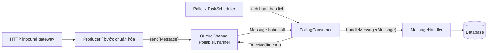
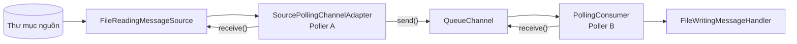
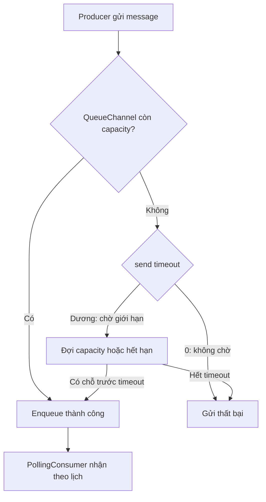

# Polling consumer trên PollableChannel

Trong Spring Integration, **polling consumer** là một endpoint chủ động lấy message từ `PollableChannel` theo lịch do **poller** điều khiển. Sau mỗi lần lấy được message, endpoint chuyển message cho `MessageHandler` thực hiện nghiệp vụ. Kiểu consumer này phù hợp khi cần đặt một vùng đệm giữa bên tạo và bên xử lý message, giới hạn nhịp tiêu thụ hoặc chủ động kiểm soát lượng công việc trong mỗi lượt poll.

Bài nằm trong chương **Kiểu endpoint** của module **SPRING_INTEGRATION_ADAPTERS**. Module kết nối hệ thống ngoài qua inbound/outbound adapter, gateway, poller và `MessageChannel`, thực hành với file, SFTP, HTTP, JMS, AMQP, Kafka và cơ sở dữ liệu. Ở đây, trọng tâm là **poll một channel bên trong ứng dụng**, hiểu khác biệt với poll hệ thống bên ngoài, rồi thiết kế cấu hình, lỗi, transaction và vòng đời cho luồng có thể vận hành.

## 1. Mục tiêu học tập

Sau bài học, bạn có thể:

1. Giải thích các hợp đồng `PollableChannel`, `PollingConsumer` và `MessageHandler`.
2. Phân biệt polling consumer với event-driven consumer và `SourcePollingChannelAdapter`.
3. Thiết lập `QueueChannel`, `@ServiceActivator` và `@Poller` để xử lý message theo nhịp có kiểm soát.
4. Giải thích `fixedDelay`, `maxMessagesPerPoll`, `receiveTimeout`, capacity và thread thực thi.
5. Nhận diện rủi ro mất message, xử lý trùng, nghẽn queue và giao dịch không trọn vẹn khi áp dụng vào file, SFTP, HTTP, JMS, AMQP, Kafka hoặc database.

## 2. Bức tranh tổng thể

Một ví dụ phổ biến: HTTP inbound gateway tiếp nhận yêu cầu, một bước xử lý đưa công việc vào `QueueChannel`, sau đó polling consumer lấy tối đa hai message trong mỗi lần poll để ghi vào cơ sở dữ liệu.



Có ba ranh giới trách nhiệm:

- **Producer** đưa message vào channel và chịu trách nhiệm xác định thời điểm gửi; nó không gọi trực tiếp `receive()` của consumer.
- **PollableChannel** giữ hoặc cung cấp message để consumer chủ động lấy ra. Với `QueueChannel`, channel lưu các message trong queue theo capacity được cấu hình.
- **PollingConsumer** là endpoint được Spring quản lý; đến mỗi lượt poll, nó gọi `receive()` của channel rồi chuyển message cho `MessageHandler`.

Polling consumer nhận message từ **channel nội bộ**. Nó không nhất thiết kết nối trực tiếp tới HTTP, FTP, SFTP, JMS hoặc database. Các kết nối ngoài thuộc trách nhiệm của adapter, gateway hoặc các thành phần tích hợp tương ứng.

## 3. Hợp đồng cốt lõi

### 3.1. `PollableChannel`: có thao tác nhận chủ động

`PollableChannel` thuộc Spring Messaging và mở rộng `MessageChannel`. Có thể hình dung các phương thức quan trọng như sau:

```java
// Minh họa phần giao diện cần dùng, không phải toàn bộ mã nguồn thư viện.
public interface MessageChannel {
    boolean send(Message<?> message);
    boolean send(Message<?> message, long timeout);
}

public interface PollableChannel extends MessageChannel {
    Message<?> receive();
    Message<?> receive(long timeout);
}
```

Khác với `SubscribableChannel.subscribe(MessageHandler)`, consumer của `PollableChannel` **phải gọi `receive()`** để lấy message. Tùy implementation và timeout, lời gọi có thể:

- Trả về `Message<?>` khi đã lấy được một message.
- Trả về `null` khi không có message trong khoảng thời gian được cho phép.
- Phát sinh exception khi có vấn đề ở tầng channel hoặc implementation.

`receive(timeout)` dùng thời gian chờ tính bằng **mili giây**. Với `QueueChannel`, giá trị `0` dùng để kiểm tra ngay, không chờ; timeout dương cho phép chờ một khoảng giới hạn; timeout âm thường biểu thị chờ không giới hạn theo hợp đồng của các implementation tương ứng. Không nên chọn chờ vô hạn mà chưa xem xét thread và shutdown.

### 3.2. `PollingConsumer`: poll channel rồi gọi handler

`org.springframework.integration.endpoint.PollingConsumer` là endpoint nhận một `PollableChannel` và một `MessageHandler`. Polling endpoint chịu trách nhiệm lập lịch và gọi handler khi nhận được message. Về mặt khái niệm:

```java
// Pseudocode để giải thích luồng, không phải implementation thật.
void doOneScheduledPoll() {
    for (int n = 0; n < maxMessagesPerPoll; n++) {
        Message<?> message = inputChannel.receive(receiveTimeout);
        if (message == null) {
            return; // Lượt này chưa có gì để xử lý.
        }
        handler.handleMessage(message);
    }
}
```

Pseudocode cố ý giản lược handling exception, transaction, advice chain, trigger và trường hợp `maxMessagesPerPoll` có ý nghĩa đặc biệt. Mỗi lượt poll thực tế do lifecycle của Spring Integration cùng scheduler điều phối, và một số chính sách có thể thay đổi số lần thực thi.

### 3.3. `MessageHandler`: thực thi công việc

Handler nhận toàn bộ `Message<?>` nên có thể dùng payload và headers: ID sự kiện, `correlationId`, tên file hoặc thông tin route. `MessageHandler` không tự lấy message từ channel, và `handleMessage()` trả `void`. Nếu cần trả response theo mô hình request–reply, cần dùng hợp đồng endpoint/gateway thích hợp.

## 4. Phân biệt ba kiểu endpoint

| Kiểu endpoint | Đối tượng được lấy/nhận | Thành phần kích hoạt | Channel đầu vào | Tình huống tiêu biểu |
|---|---|---|---|---|
| `PollingConsumer` | Message **đã ở channel** | Poller | `PollableChannel`, ví dụ `QueueChannel` | Lấy message theo batch nhỏ từ queue nội bộ |
| `EventDrivenConsumer` | Message được channel **đẩy tới subscriber** | Lời gọi `send()`/dispatch | `SubscribableChannel`, ví dụ `DirectChannel` | Xử lý ngay khi producer gửi |
| `SourcePollingChannelAdapter` | Dữ liệu từ **MessageSource** | Poller | Không nhận message từ một input channel; gửi đến output channel | Quét thư mục hoặc JDBC theo lịch |

Cùng một flow có thể có cả hai loại polling:



Ở đây, **Poller A** quyết định thời điểm tìm file mới trong hệ thống ngoài. **Poller B** quyết định thời điểm lấy những message đã nằm trong `QueueChannel` để ghi file đích. Hai poller có mục đích và giới hạn tải khác nhau. Nếu thay `QueueChannel` bằng `DirectChannel` mà vẫn dùng `PollingConsumer`, hợp đồng không phù hợp: `DirectChannel` là `SubscribableChannel`, cần event-driven consumer.

## 5. Những thông số quan trọng của poller

| Thông số | Ý nghĩa | Tác động vận hành |
|---|---|---|
| `fixedDelay` | Khoảng trễ từ khi lần chạy trước hoàn tất đến khi lên lịch lần tiếp theo | Tránh lặp sát nhau khi handler chậm |
| `fixedRate` | Nhịp lên lịch theo thời điểm bắt đầu, tùy trigger/scheduler | Cần quan sát hiệu ứng khi một lượt chạy lâu |
| `cron` | Lập lịch theo biểu thức thời gian | Phù hợp tác vụ theo mốc giờ |
| `maxMessagesPerPoll` | Số message tối đa được xử lý trong một lần kích hoạt | Giới hạn kích thước một lượt, ảnh hưởng throughput |
| `receiveTimeout` | Thời gian chờ cho **mỗi lần receive** trên channel | Có thể làm một lượt poll giữ thread lâu khi queue rỗng |
| `taskExecutor` | Executor cho công việc polling khi được cấu hình | Có thể thay đổi concurrency, thứ tự và error handling |
| `errorChannel`/error handler | Đích hoặc chính sách xử lý lỗi của poll task nếu được hỗ trợ/cấu hình | Cần biết lỗi được ghi nhận, retry hay bỏ qua thế nào |

Với `maxMessagesPerPoll=2`, một lần được scheduler kích hoạt sẽ thử lấy tối đa hai message và giao xử lý. Nếu message đầu tiên là `null`, lượt poll có thể kết thúc ngay. `receiveTimeout=0` giúp lần thử nhận ở queue rỗng trả về ngay; đặt thời gian chờ lớn có thể khiến thread của scheduler bị giữ lại. `fixedDelay` không phải là độ trễ áp dụng giữa **từng** message trong cùng lượt poll.

### Ví dụ về nhịp nhận

Giả sử queue có sẵn 5 message trước lượt poll đầu tiên, handler xử lý rất nhanh, `fixedDelay=2s`, `maxMessagesPerPoll=2`, `receiveTimeout=0`:

| Lượt poll | Message có thể lấy | Message còn trong queue sau lượt |
|---|---|---|
| Lượt 1 | M1, M2 | M3, M4, M5 |
| Lượt 2 | M3, M4 | M5 |
| Lượt 3 | M5; lần nhận tiếp theo không có dữ liệu | Trống |

Bảng minh họa điều kiện lý tưởng: một consumer, không có message mới chen vào, không lỗi và chưa có ai nhận message khác. Lịch thực tế còn phụ thuộc thời gian xử lý của handler và scheduler.

**Ước lượng tải:** Nếu mỗi lượt xử lý tối đa 2 message và thời gian thực thi không đáng kể so với `fixedDelay=2s`, năng lực nhận xấp xỉ 1 message/giây. Nếu mỗi message mất 1 giây, một lượt tối đa hai message có thể mất gần 2 giây cộng 2 giây delay, nên throughput thực tế giảm. Đây chỉ là ước lượng để chọn giá trị ban đầu, không phải cam kết tốc độ.

## 6. Ví dụ thực hành Spring Boot: `QueueChannel` + `@ServiceActivator`

Tình huống: một ứng dụng nhận sự kiện thanh toán, đưa vào queue nội bộ và xử lý lần lượt theo nhịp poll. Để dễ quan sát, ví dụ chỉ in kết quả; chưa kết nối thật với database hay broker.

### 6.1. Phụ thuộc

Dùng Spring Boot 3.x/4.x tương thích với Java đang sử dụng và để dependency management của Boot quản lý phiên bản Spring Integration.

```xml
<!-- pom.xml: đặt trong mục dependencies -->
<dependency>
    <groupId>org.springframework.boot</groupId>
    <artifactId>spring-boot-starter-integration</artifactId>
</dependency>
```

### 6.2. Tạo queue và gửi dữ liệu mẫu

```java
package com.example.integration;

import org.springframework.beans.factory.annotation.Qualifier;
import org.springframework.boot.ApplicationRunner;
import org.springframework.context.annotation.Bean;
import org.springframework.context.annotation.Configuration;
import org.springframework.integration.channel.QueueChannel;
import org.springframework.integration.config.EnableIntegration;
import org.springframework.messaging.MessageChannel;
import org.springframework.messaging.support.MessageBuilder;

@Configuration
@EnableIntegration
public class PaymentQueueConfig {

    public record PaymentEvent(String paymentId, long amountVnd) {}

    @Bean("paymentQueue")
    public QueueChannel paymentQueue() {
        return new QueueChannel(10); // Capacity tối đa 10 message trong bộ nhớ.
    }

    @Bean
    public ApplicationRunner seedPayments(
            @Qualifier("paymentQueue") MessageChannel channel) {
        return args -> {
            for (int i = 1; i <= 5; i++) {
                PaymentEvent event = new PaymentEvent(
                        "PAY-" + i, i * 100_000L);

                boolean accepted = channel.send(
                        MessageBuilder.withPayload(event)
                                .setHeader("eventType", "PaymentReceived")
                                .build(),
                        0); // Không chờ nếu queue đầy.

                if (!accepted) {
                    throw new IllegalStateException(
                            "Payment queue đã đầy: " + event.paymentId());
                }
            }
        };
    }
}
```

`QueueChannel(10)` chứa tối đa 10 message đang chờ; capacity là **số lượng message**, không phải số byte. Trong ví dụ, năm message được gửi trước khi xử lý hết; `send(..., 0)` giúp producer báo lỗi ngay nếu queue hết chỗ tại thời điểm gửi.

### 6.3. Tạo polling consumer bằng annotation

Tạo class dưới cùng package để Spring Boot component scan thấy được:

```java
package com.example.integration;

import org.springframework.integration.annotation.Poller;
import org.springframework.integration.annotation.ServiceActivator;
import org.springframework.messaging.Message;
import org.springframework.stereotype.Component;

@Component
public class PaymentQueueConsumer {

    @ServiceActivator(
            inputChannel = "paymentQueue",
            poller = @Poller(
                    fixedDelay = "2000",
                    maxMessagesPerPoll = "2",
                    receiveTimeout = "0"))
    public void handle(
            Message<PaymentQueueConfig.PaymentEvent> message) {
        var event = message.getPayload();
        System.out.printf(
                "[%s] Đã xử lý %s: %d VND%n",
                Thread.currentThread().getName(),
                event.paymentId(),
                event.amountVnd());
    }
}
```

Cấu hình này yêu cầu framework tạo **polling consumer endpoint** gắn với `paymentQueue` và thực hiện:

1. Đến lịch, poller yêu cầu channel cung cấp message.
2. Nếu có message, endpoint gọi phương thức `handle(...)` tương ứng với `MessageHandler` được framework tạo từ method.
3. Lặp lại tối đa hai message cho một lượt poll.
4. Khi queue trống, lần receive không chờ và lượt poll kết thúc.
5. Lượt poll tiếp theo đến sau thời gian trễ đã cấu hình và thời gian xử lý của lượt trước.

Dùng `@ServiceActivator` là cách ngắn gọn để Spring Integration tự tạo endpoint. Về khái niệm, class `PollingConsumer` thực hiện phần nhận theo lịch, còn `MessageHandler` thực hiện logic nghiệp vụ.

Để chạy, ứng dụng cần class `@SpringBootApplication` nằm tại `com.example.integration` hoặc package cha. Khi ứng dụng khởi động, `ApplicationRunner` gửi năm sự kiện. Poller sẽ lấy và in lần lượt các message qua nhiều lượt. Thời điểm dòng log đầu tiên phụ thuộc lịch khởi tạo; không nên kỳ vọng đúng chính xác một mốc thời gian tuyệt đối.

### 6.4. Cách cấu hình tương đương bằng Java DSL

Khi dùng Java DSL, ta có thể dùng flow nhận từ `paymentQueue` và cấu hình poller ở consumer endpoint:

```java
import java.time.Duration;

import org.springframework.context.annotation.Bean;
import org.springframework.context.annotation.Configuration;
import org.springframework.integration.dsl.IntegrationFlow;
import org.springframework.integration.dsl.Pollers;
import org.springframework.messaging.MessageHandler;

@Configuration
public class PaymentQueueDsl {

    @Bean
    public IntegrationFlow consumePayments() {
        return IntegrationFlow.from("paymentQueue")
                .handle((MessageHandler) message -> {
                    var event = (PaymentQueueConfig.PaymentEvent)
                            message.getPayload();
                    System.out.println("DSL xử lý " + event.paymentId());
                }, endpoint -> endpoint.poller(
                        Pollers.fixedDelay(Duration.ofSeconds(2))
                                .maxMessagesPerPoll(2)
                                .receiveTimeout(0)))
                .get();
    }
}
```

**Chọn một trong hai cách triển khai** (annotation ở mục 6.3 hoặc flow DSL ở mục 6.4). Nếu bật cả hai với cùng `paymentQueue`, hai consumer sẽ cạnh tranh nhận message từ queue; mỗi message có thể tới một trong hai consumer, trái với kỳ vọng của demo ban đầu.

## 7. Queue capacity, blocking và backpressure

Vùng đệm giúp producer có thể tạm thời gửi nhanh hơn tốc độ consumer, nhưng bộ đệm hữu hạn có thể đầy.



Điểm cần tính trước khi đưa vào production:

- **Queue quá nhỏ:** có thể khiến producer bị từ chối sớm khi consumer chậm.
- **Queue quá lớn:** tiêu tốn bộ nhớ, che dấu việc downstream đang nghẽn và kéo dài độ trễ chờ.
- **`send()` với timeout:** có thể chặn thread gọi nếu queue đầy. Tránh dùng thời gian chờ dài trên luồng HTTP request nếu SLA thấp.
- **Tăng `maxMessagesPerPoll`:** có thể tăng throughput nhưng khiến một poll task chiếm thread lâu hơn và làm downstream chịu burst lớn hơn.
- **Tăng số poller/executor thread:** cần kiểm chứng thread safety, thứ tự xử lý, transaction và trạng thái chia sẻ của handler.

Không nên coi `QueueChannel` mặc định là broker có persistence. Nó thường dùng queue trong bộ nhớ; khi tiến trình dừng, các message chưa xử lý có thể mất. Nếu yêu cầu lưu bền, cần lựa chọn message store bền vững được cấu hình phù hợp hoặc broker chuyên dụng (JMS/AMQP/Kafka) cùng cơ chế xác nhận/khôi phục tương ứng.

## 8. Lỗi khi handler thất bại

Ví dụ handler ghi database ném exception sau khi polling consumer đã nhận message:

```mermaid
sequenceDiagram
    participant P as Poller
    participant Q as QueueChannel
    participant H as MessageHandler
    participant D as Database

    P->>Q: receive(timeout)
    Q-->>P: message
    P->>H: handleMessage(message)
    H->>D: ghi giao dịch
    D-->>H: exception
    H-->>P: exception
    Note over P,Q: Message đã được lấy khỏi queue;<br/>không được mặc định là sẽ tự quay lại.
```

Với `QueueChannel` trong bộ nhớ, thao tác `receive()` đã lấy message khỏi queue. **Đừng mặc định exception từ handler sẽ tự đưa message trở về queue**. Việc rollback/requeue còn tùy cơ chế transaction, message store, retry advice, interceptor và endpoint được cấu hình.

### 8.1. Các hướng xử lý lỗi

| Tình huống | Hướng xử lý |
|---|---|
| Database tạm mất kết nối | Retry có giới hạn, exponential backoff, quan sát thời gian lỗi |
| Dữ liệu sai schema | Kiểm tra trước khi ghi; chuyển sang nhánh xử lý lỗi nghiệp vụ |
| Message bị xử lý lại | Dùng business key hoặc event ID để đảm bảo idempotency |
| Lỗi sau khi ghi DB nhưng trước bước tiếp theo | Cân nhắc transaction và outbox/inbox để khớp trạng thái |
| Handler chạy lâu hoặc treo | Timeout, giám sát thời lượng poll, hủy tác vụ có kiểm soát |
| Queue đầy | Thiết lập chính sách backpressure và phản hồi producer |

Một số polling endpoint cho phép cấu hình error channel/error handler để phát `ErrorMessage` và giám sát lỗi bất đồng bộ. Dù vậy, **bắt lỗi và log** không đồng nghĩa **đã xử lý lại thành công**. Cần một chính sách retry và nơi giữ message thất bại tương thích với yêu cầu mất dữ liệu/khôi phục.

### 8.2. Không giả định `send() == true` tức là đã xử lý xong

`send()` thành công vào `QueueChannel` thường chỉ cho biết message đã được channel chấp nhận tại thời điểm đó; handler có thể chưa chạy. Vì vậy, nếu một HTTP inbound gateway trả ngay `202 Accepted` sau khi enqueue, đó là lời hứa về **chấp nhận yêu cầu**, không phải bảo đảm đã ghi DB. Cần thiết kế API báo trạng thái và cơ chế bền vững riêng nếu nghiệp vụ cần chắc chắn về kết quả.

### 8.3. Idempotency với hệ thống ngoài

Khi consumer đẩy dữ liệu tới JMS, AMQP, Kafka, SFTP hoặc database, lỗi mạng có thể xảy ra **sau khi hệ thống đích đã nhận dữ liệu** nhưng trước khi ứng dụng ghi nhận thành công. Retry không kiểm soát có thể gây gửi trùng. Hãy định nghĩa khóa nghiệp vụ như `paymentId`, `documentId` hoặc `eventId`; tại phía nhận, dùng unique constraint, idempotency key hoặc deduplication bền vững khi cần.

## 9. Transaction và ranh giới xử lý

Có thể đặt transaction quanh công việc của polling endpoint khi cấu hình transaction advice và transaction manager phù hợp. Tuy nhiên, các điểm sau không tự động đúng trong mọi cấu hình:

1. Transaction ghi DB sẽ tự khôi phục message đã lấy khỏi `QueueChannel` trong bộ nhớ.
2. Transaction của database sẽ đồng thời commit với HTTP, SFTP hoặc Kafka.
3. Poller chạy nhiều thread vẫn giữ đúng thứ tự theo khóa nghiệp vụ.
4. Có retry là có exactly-once xuyên tất cả hệ thống.

Transaction thường bảo vệ các tài nguyên tham gia vào transaction manager tương ứng. Nếu yêu cầu commit nguồn và đích phải nhất quán, cần xem xét message store transactional, outbox/inbox hoặc thiết kế xác nhận ở adapter/broker. Khi thay QueueChannel bằng broker, cách ack/commit offset và thời điểm handler hoàn tất trở thành một phần hợp đồng xử lý.

**Ví dụ yêu cầu có độ tin cậy cao:** Một message thanh toán chỉ được xác nhận hoàn tất sau khi record ghi thành công vào DB. Trong thiết kế dùng queue nội bộ, nên cân nhắc durable store hoặc nguồn có khả năng redelivery và ghi dấu `paymentId` đã hoàn thành. Chỉ dùng queue trong bộ nhớ rồi in log là phù hợp cho demo hoặc những tác vụ chấp nhận mất dữ liệu khi restart.

## 10. Vòng đời và vận hành

Polling consumer là endpoint được Spring Integration quản lý thông qua lifecycle:

- **Khởi động:** Khi endpoint auto-start, poller bắt đầu được lên lịch nhận từ channel.
- **Dừng:** Khi endpoint stop, các lượt poll mới không tiếp tục được lên lịch theo endpoint; cần xem xét tác vụ đang chạy, timeout và thời điểm giải phóng tài nguyên.
- **Khởi động lại:** Endpoint bắt đầu poll trở lại. Với queue trong bộ nhớ, state chỉ còn nếu process/context và queue vẫn tồn tại; restart process không mang lại persistence.
- **Mở rộng:** Nhiều instance cùng nhận một nguồn cần cơ chế phối hợp/claim message. Các `QueueChannel` trong bộ nhớ của từng instance không tạo thành queue phân tán.

Các tín hiệu cần theo dõi gồm **queue depth, remaining capacity, số message nhận/giây, thời gian handler xử lý, số lỗi, độ trễ từ enqueue đến xử lý, số retry và message bị bỏ qua do trùng**. Queue depth tăng liên tục nghĩa là throughput tiêu thụ thấp hơn tốc độ sản sinh; tăng capacity chỉ trì hoãn lúc nghẽn nếu không giải quyết chênh lệch tốc độ.

### Gợi ý điều chỉnh cấu hình

Bắt đầu với `maxMessagesPerPoll` nhỏ và `receiveTimeout` ngắn. Đo thời gian xử lý một message và tốc độ producer. Sau đó điều chỉnh lịch poll, số lượng message mỗi lượt và capacity dựa trên độ trễ mục tiêu. Với nguồn đích có rate limit (HTTP API, SFTP server, database), nên thêm giới hạn concurrency và retry/backoff phù hợp thay vì chỉ tăng số thread.

## 11. Những hiểu lầm thường gặp

| Hiểu lầm | Cách hiểu đúng |
|---|---|
| “PollingConsumer poll trực tiếp SFTP/DB.” | Nó poll một `PollableChannel`; adapter nguồn có thể có poller riêng. |
| “QueueChannel tự kích hoạt handler khi gửi.” | Producer enqueue; polling consumer chủ động `receive()` theo lịch. |
| “`fixedDelay=2000` là mỗi message cách nhau đúng 2 giây.” | Delay tính giữa các lượt poll, không giữa từng message trong một lượt. |
| “`maxMessagesPerPoll=2` nghĩa là tối đa 2 message mỗi giây.” | Đây là giới hạn **mỗi lượt**, còn throughput phụ thuộc lịch và thời gian handler. |
| “QueueChannel mặc định giữ dữ liệu qua restart.” | Queue mặc định trong bộ nhớ và không cung cấp durability qua process restart. |
| “Message đã enqueue thì downstream chắc chắn xử lý thành công.” | Enqueue chỉ là một bước; handler có thể lỗi hoặc chưa được thực thi. |
| “Transaction DB rollback thì message tự trở về queue.” | Cần kiểm tra transaction-aware store/adapter; không giả định requeue. |
| “Đổi QueueChannel thành DirectChannel vẫn giữ polling consumer.” | Hai channel thuộc hai hợp đồng khác nhau; DirectChannel dùng consumer theo subscription. |

## 12. Bài tập thực hành

### Bài 1 — Quan sát số lượt poll

Chạy ví dụ thanh toán với 5 message, `fixedDelay=2000`, `maxMessagesPerPoll=2`, `receiveTimeout=0`. In thêm `System.currentTimeMillis()` trong handler. Ghi lại nhóm message được xử lý ở từng lượt. Đổi thành `maxMessagesPerPoll=1` rồi thử lại, nêu nguyên nhân tổng thời gian có thể tăng.

### Bài 2 — Thử queue đầy

Đổi `new QueueChannel(10)` thành `new QueueChannel(2)` nhưng giữ producer gửi năm message liên tục với `send(message, 0)`. Dự đoán lúc nào gửi có thể thất bại và quan sát giá trị trả về. Giải thích vì sao lịch chạy thực tế có thể làm số lần send thành công khác với dự đoán nếu consumer đồng thời dequeue.

### Bài 3 — Xử lý lỗi có chủ đích

Trong handler, ném exception khi `paymentId.equals("PAY-3")`. Quan sát log và những message còn chờ, sau đó đề xuất chiến lược xử lý lỗi để không mất PAY-3: durable inbox, retry advice, lỗi nghiệp vụ tách riêng và kiểm tra idempotency. Nêu điều gì phải được cấu hình, không giả định framework tự thực hiện.

### Bài 4 — Thiết kế luồng adapter có giới hạn tải

Thiết kế `SFTP inbound polling → QueueChannel → PollingConsumer → JDBC outbound` cho file hóa đơn. Xác định hai poller, kiểu payload/header, capacity, nhịp xử lý DB, cách nhận biết file đã hoàn tất, tránh gửi trùng sau restart và phương án khôi phục nếu DB ngừng hoạt động.

### Câu hỏi tự kiểm tra

1. Khi `PollableChannel.receive(0)` trả `null`, điều đó có đồng nghĩa lỗi không?
2. Vì sao `maxMessagesPerPoll` và `fixedDelay` cần được cân chỉnh cùng nhau?
3. `PollingConsumer` khác `SourcePollingChannelAdapter` ở đối tượng mà nó poll như thế nào?
4. Tại sao nên cẩn thận với queue trong bộ nhớ nếu một message liên quan đến chuyển tiền hoặc tạo hóa đơn?
5. `send(message, 0)` thất bại khi queue đầy nên được producer xử lý ra sao?

Hãy trả lời các câu hỏi bằng chính dòng message đi qua producer → queue → polling endpoint → handler. Khi phân biệt được thời điểm **enqueue**, **dequeue** và **hoàn tất side effect**, bạn đã nắm cốt lõi của polling consumer để tiếp tục kết nối adapter, gateway và các hệ thống ngoài một cách có kiểm soát.

## Tài liệu tham khảo

- [Spring Framework API — `PollableChannel`](https://docs.spring.io/spring-framework/docs/current/javadoc-api/org/springframework/messaging/PollableChannel.html)
- [Spring Integration API — `PollingConsumer`](https://docs.spring.io/spring-integration/api/org/springframework/integration/endpoint/PollingConsumer.html)
- [Spring Integration Reference — Message Channel Implementations](https://docs.spring.io/spring-integration/reference/channel/implementations.html)
- [Spring Integration Reference — Message Endpoints](https://docs.spring.io/spring-integration/reference/endpoint.html)
- [Spring Integration Reference — Error Handling](https://docs.spring.io/spring-integration/reference/error-handling.html)
