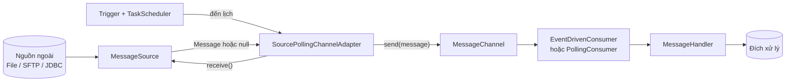
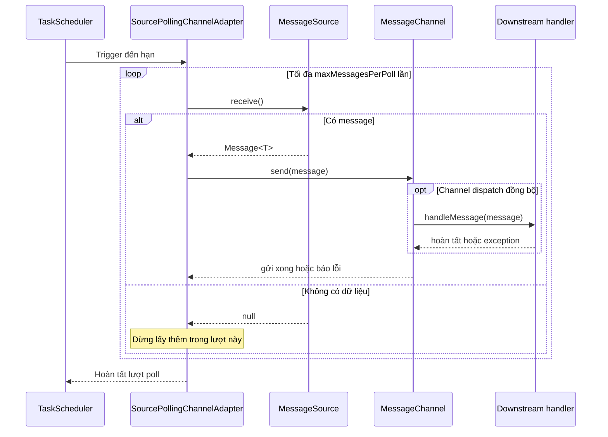
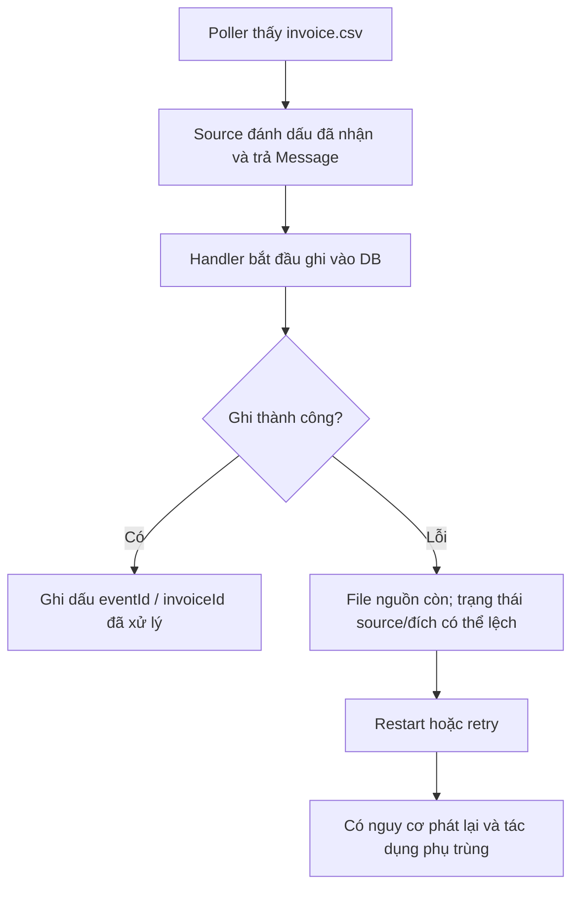

# SourcePollingChannelAdapter cho nguồn dữ liệu

Trong Spring Integration, **`SourcePollingChannelAdapter`** là endpoint có nhiệm vụ **gọi một `MessageSource` theo lịch** rồi **đưa message nhận được vào `MessageChannel`**. Nó là mắt xích đưa dữ liệu từ một nguồn *cần chủ động truy vấn* (chẳng hạn thư mục file hoặc bảng cơ sở dữ liệu) vào luồng tích hợp.

Bài thuộc chương **Kiểu endpoint** của module **SPRING_INTEGRATION_ADAPTERS**. Phạm vi module là kết nối hệ thống ngoài bằng inbound/outbound adapter, gateway, poller và MessageChannel; thực hành với file, SFTP, HTTP, JMS, AMQP, Kafka và cơ sở dữ liệu, kèm xử lý hợp đồng message, lỗi và vòng đời. Nội dung dưới đây tập trung vào **đầu vào dạng polling** để phân biệt chính xác source, polling endpoint, channel và consumer.

## 1. Mục tiêu học tập

Sau bài này, bạn có thể:

1. Giải thích vì sao `MessageSource.receive()` cần một endpoint lập lịch.
2. Mô tả vòng xử lý của `SourcePollingChannelAdapter` từ lúc poller kích hoạt đến khi message tới channel.
3. Cấu hình một inbound adapter đọc file bằng Java DSL, đặt nhịp poll và giới hạn số message mỗi lượt.
4. Phân biệt **poll nguồn ngoài** với **poll channel nội bộ**.
5. Thiết kế message contract, filter chống trùng, error handling, transaction, backpressure và vòng đời cho hệ thống có dữ liệu đến theo đợt.

## 2. Vị trí của SourcePollingChannelAdapter trong một flow



Có ba vai trò cần tách rõ:

- **`MessageSource<T>`** biết cách lấy dữ liệu và dựng `Message<T>`. Nó không tự đặt lịch và không quyết định message đi tới channel nào.
- **`SourcePollingChannelAdapter`** kết hợp source với lịch poll; nó gọi `receive()` và chuyển message sang **output channel**.
- **`MessageChannel`** chịu trách nhiệm phân phối message cho các endpoint tiếp theo. Consumer xử lý message có thể đồng bộ hoặc bất đồng bộ, tùy loại channel.

Ví dụ: thư mục `data/inbox` có file `invoice-101.csv`. Source chọn file và phát `Message<File>`; polling adapter đưa message vào channel; handler cuối cùng đọc hoặc sao chép file. Nếu chưa có file mới, source có thể trả về `null` và lượt poll kết thúc bình thường.

> **Cốt lõi:** `SourcePollingChannelAdapter` **lấy dữ liệu từ `MessageSource` để *gửi* vào channel**. `PollingConsumer` **lấy message từ `PollableChannel` để *giao* cho handler**. Cả hai có thể dùng poller nhưng đối tượng được poll khác nhau.

## 3. Hợp đồng `MessageSource` và nguyên lý poll

`MessageSource<T>` nằm trong `org.springframework.integration.core`. Hợp đồng cốt lõi, trình bày rút gọn:

```java
// Minh họa giao diện; không phải toàn bộ mã nguồn thư viện.
public interface MessageSource<T> {
    Message<T> receive();
}
```

Một lần gọi `receive()` có ba kết quả đáng quan tâm:

| Kết quả | Ý nghĩa | Hành vi mong đợi của polling endpoint |
|---|---|---|
| `Message<T>` | Tìm được một đơn vị dữ liệu | Chuyển message tới output channel |
| `null` | Hiện không có message khả dụng | Kết thúc việc nhận cho lượt hiện tại; chờ lịch tiếp theo |
| Exception | Không lấy/biến đổi được dữ liệu | Áp dụng chính sách xử lý lỗi của polling task, ghi log/metric và retry nếu có cấu hình |

Không nên dùng `null` để che mọi lỗi I/O hoặc lỗi kết nối, vì vận hành sẽ không phân biệt được **hết dữ liệu** với **nguồn dữ liệu đang hỏng**.

### 3.1. Vòng xử lý khái niệm

```java
// Pseudocode mô tả luồng xử lý, không phải code nội bộ của Spring Integration.
void scheduledPoll() {
    for (int count = 0; count < maxMessagesPerPoll; count++) {
        Message<?> message = source.receive();
        if (message == null) {
            break;
        }
        outputChannel.send(message);
    }
}
```

Trong framework thật, điều kiện dừng, transaction, `maxMessagesPerPoll` đặc biệt, timeout gửi, error handler, advice và scheduler được quản lý bằng các lớp endpoint. Pseudocode chỉ nhằm nhấn mạnh thứ tự **`receive → send`**.

Với một source đọc file, payload có thể là `File`. Với source JDBC, payload có thể là một hàng, một danh sách hàng hoặc kiểu đã ánh xạ, tùy adapter và cấu hình. `SourcePollingChannelAdapter` không tự chuyển mọi payload thành JSON.

### 3.2. `SourcePollingChannelAdapter` không phải `MessageHandler`

Khác với outbound adapter, nhiệm vụ chính của inbound source polling endpoint là **tạo và gửi message**. Nó không phải handler được consumer endpoint gọi trên một input channel. Nếu muốn xử lý sau khi source phát message, nối output channel tới một `MessageHandler`, service activator, transformer, router hoặc gateway phù hợp.

## 4. Trình tự của một lượt poll



Nếu output là `DirectChannel`, phần xử lý downstream thường thực hiện trên thread của poll task; handler chậm làm lượt poll dài hơn. Nếu output là `QueueChannel`, gọi `send()` có thể chỉ enqueue; sau đó một **`PollingConsumer` khác** phải lấy message khỏi queue. Nếu output là `ExecutorChannel`, handler có thể chạy ở thread khác và lỗi có thể xuất hiện sau khi lượt gửi đã kết thúc.

## 5. Cấu hình poller đúng yêu cầu tải

Một polling endpoint cần lịch. Các cách thường gặp là:

- **`fixedDelay`**: lên lịch lượt tiếp theo sau khoảng trễ tính từ lúc lượt trước hoàn thành; dễ kiểm soát tải khi handler mất thời gian.
- **`fixedRate`**: lên lịch theo nhịp thời gian từ lúc bắt đầu; phải cân nhắc scheduler, tác vụ chạy lâu và concurrency.
- **`cron`**: phù hợp xử lý theo khung giờ hoặc lịch nghiệp vụ.
- **`maxMessagesPerPoll`**: số message tối đa lấy/gửi trong một lượt; nếu source trả về `null`, lượt có thể dừng sớm.
- **`taskExecutor`**: khi cấu hình, có thể thay đổi thread/concurrency và ranh giới xử lý lỗi; cần biết source và handler có thread-safe không.
- **Transaction/advice**: chính sách bao quanh polling task hoặc từng lượt nhận tùy cấu hình cụ thể.

Giả sử `fixedDelay=3 giây`, `maxMessagesPerPoll=2` và source có sẵn 5 message, không có gửi mới hay lỗi:

| Lượt poll | Có thể lấy từ source | Còn lại trước lượt tiếp |
|---|---|---|
| 1 | M1, M2 | M3, M4, M5 |
| 2 | M3, M4 | M5 |
| 3 | M5, sau đó `null` | Hết dữ liệu |

`maxMessagesPerPoll=2` giới hạn **mỗi lượt**, không có nghĩa đúng 2 message mỗi 3 giây trong mọi tình huống: thời gian nhận, send và xử lý đồng bộ đều ảnh hưởng tới nhịp thực tế.

**Phân biệt `receiveTimeout`:** `PollableChannel.receive(timeout)` có tham số chờ, được dùng trong polling consumer khi poll một channel. `MessageSource.receive()` không có tham số timeout theo hợp đồng cốt lõi. Với `SourcePollingChannelAdapter`, timeout truy cập hệ thống ngoài (kết nối SFTP, câu truy vấn DB, API client tùy source) phải thiết lập ở thành phần tương ứng. Không nên nhầm timeout nhận từ channel với timeout truy vấn nguồn ngoài.

## 6. Ví dụ thực hành: file inbound → polling adapter → file outbound

Yêu cầu: cứ 3 giây quét thư mục `data/inbox`, lấy tối đa hai file mới mỗi lượt và sao chép sang `data/outbox`. Ví dụ dùng Spring Boot với Spring Integration Java DSL, giúp nhìn rõ `MessageSource`, poller, output channel và `MessageHandler`.

### 6.1. Dependency

Dùng Java 17+ và một phiên bản Spring Boot tương thích. Khi có Spring Boot parent/BOM, để Boot quản lý version của các module:

```xml
<!-- Phần dependencies trong pom.xml -->
<dependency>
    <groupId>org.springframework.boot</groupId>
    <artifactId>spring-boot-starter-integration</artifactId>
</dependency>
<dependency>
    <groupId>org.springframework.integration</groupId>
    <artifactId>spring-integration-file</artifactId>
</dependency>
```

### 6.2. Cấu hình source, handler và flow

```java
package com.example.integration;

import java.io.File;
import java.time.Duration;

import org.springframework.context.annotation.Bean;
import org.springframework.context.annotation.Configuration;
import org.springframework.integration.config.EnableIntegration;
import org.springframework.integration.dsl.IntegrationFlow;
import org.springframework.integration.dsl.Pollers;
import org.springframework.integration.file.FileReadingMessageSource;
import org.springframework.integration.file.FileWritingMessageHandler;
import org.springframework.integration.file.support.FileExistsMode;

@Configuration
@EnableIntegration
public class FilePollingFlowConfig {

    // MessageSource: tìm file và phát Message<File>.
    @Bean
    public FileReadingMessageSource inboundFiles() {
        FileReadingMessageSource source = new FileReadingMessageSource();
        source.setDirectory(new File("data/inbox"));
        source.setAutoCreateDirectory(true);
        return source;
    }

    // MessageHandler: tiêu thụ message và ghi file tới đích.
    @Bean
    public FileWritingMessageHandler outboundFiles() {
        FileWritingMessageHandler handler =
                new FileWritingMessageHandler(new File("data/outbox"));
        handler.setAutoCreateDirectory(true);
        handler.setFileExistsMode(FileExistsMode.FAIL);
        handler.setExpectReply(false);
        return handler;
    }

    @Bean
    public IntegrationFlow fileCopyFlow(
            FileReadingMessageSource inboundFiles,
            FileWritingMessageHandler outboundFiles) {

        return IntegrationFlow
                .from(inboundFiles, endpoint -> endpoint.poller(
                        Pollers.fixedDelay(Duration.ofSeconds(3))
                               .maxMessagesPerPoll(2)))
                .handle(outboundFiles)
                .get();
    }
}
```

Class cần nằm trong package mà `@SpringBootApplication` quét được. Mặc dù Java DSL không khai báo `new SourcePollingChannelAdapter(...)` bằng tay, framework vẫn tạo **source polling endpoint** cho `IntegrationFlow.from(inboundFiles, endpoint -> endpoint.poller(...))`.

`FileReadingMessageSource` phát **payload kiểu `File`**, tức tham chiếu tới file trên đĩa. Nó không mặc định đọc hết nội dung thành `String`/JSON. `FileWritingMessageHandler` nhận message và ghi file sang thư mục đích. Đường xử lý trong ví dụ đồng bộ theo flow DSL; nếu thay đổi kiểu channel, phải xem lại hành vi xử lý lỗi và thời điểm send hoàn thành.

### 6.3. Cách thử và kết quả kỳ vọng

1. Chạy ứng dụng có cấu hình trên.
2. Tạo `data/inbox/alpha.txt`, `data/inbox/beta.txt`, `data/inbox/gamma.txt`.
3. Quan sát `data/outbox`: ba file được sao chép khi các lượt poll nhận được file tương ứng. Với tối đa 2 file/lượt, nếu cả ba đã có sẵn trước lượt poll, flow cần ít nhất hai lượt để nhận đủ trong điều kiện một source, không lỗi.
4. Không thấy file mới sau đó là bình thường: `receive()` có thể trả về `null`.
5. File nguồn **không tự bị xóa**; đây là ví dụ *copy*, không phải thao tác move.

`FileExistsMode.FAIL` chủ động báo lỗi khi file đích cùng tên đã tồn tại. Điều này giúp quan sát hậu quả khi một file nguồn được nhận lại sau restart. Với hệ thống thực, lựa chọn bỏ qua, ghi đè, đổi tên, versioning hoặc đưa vào luồng xử lý trùng phải theo yêu cầu nghiệp vụ.

### 6.4. Vì sao không tự khai báo bean `SourcePollingChannelAdapter`?

Java DSL cung cấp cách tạo source polling endpoint gắn với source, channel và poller đúng lifecycle Spring Integration. Viết endpoint bằng API thấp hơn có ích khi cần tích hợp đặc thù, nhưng không cần để học hợp đồng chính. Điều quan trọng là biết thành phần nào được gọi trong mỗi lượt poll và ai sở hữu output channel, chứ không phải buộc mọi flow phải tự khởi tạo class endpoint.

## 7. Message contract giữa source và channel

Sau khi source tạo message, downstream nhận đầy đủ `payload` và `headers`. Adapter chỉ có thể hoạt động đúng nếu hai bên thống nhất hợp đồng.

| Thành phần | Câu hỏi cần trả lời | Ví dụ với file |
|---|---|---|
| Payload | Kiểu dữ liệu là gì? | `File`, `byte[]`, `String` hoặc DTO |
| Định danh | Nhận biết bản ghi/file trùng bằng gì? | Path + metadata hoặc business ID |
| Headers | Downstream cần metadata nào? | Tên file, correlation ID, nguồn, tenant |
| Thời điểm hoàn tất | Khi nào dữ liệu thực sự sẵn sàng? | File được rename từ tên tạm sau khi ghi xong |
| Retry | Có thể nhận lại message sau lỗi không? | Có thể, tùy filter và nguồn dữ liệu |
| Schema | Dữ liệu đầu vào có cần validate/transform? | CSV delimiter, encoding, schema version |

Nếu downstream mong JSON `String` nhưng source phát `File`, hãy thêm bước đọc file, parser và validator trước handler. Đừng coi `MessageChannel` là nơi tự chuyển đổi payload theo mọi kiểu mong muốn.

Dùng headers để chuyển metadata phục vụ route/correlation, nhưng không ghi mật khẩu, token hoặc khóa kết nối vào message/log.

## 8. Chọn MessageSource cho các hệ thống ngoài

`SourcePollingChannelAdapter` chỉ phù hợp khi có một `MessageSource` cho phép **chủ động lấy** dữ liệu. Không nên quy tất cả inbound adapter vào cùng mô hình:

| Hệ thống | Cách lấy điển hình | Điều cần kiểm soát |
|---|---|---|
| **File** | `FileReadingMessageSource` theo lịch | File đang ghi dở, lọc trùng, restart |
| **SFTP/FTP** | Remote polling source/đồng bộ file theo lịch | Timeout, phân biệt file hoàn tất, metadata store |
| **Database (JDBC)** | Inbound polling adapter/source chạy query | Đánh dấu bản ghi đã claim, transaction, chống xử lý lại |
| **JMS/AMQP** | Có thể có polling adapter trong một số tích hợp; thường dùng listener/message-driven | Ack, redelivery, transaction, retry theo broker |
| **Kafka** | Consumer/listener container theo cơ chế client Kafka | Partition, consumer group, offset commit |
| **HTTP inbound** | Request kích hoạt inbound adapter/gateway | Request–reply, timeout, HTTP status, không cần poll một `MessageSource` |
| **HTTP outbound** | Handler/gateway gọi endpoint ngoài theo message | Timeout, idempotency, status response |

Ví dụ, JDBC polling query `SELECT ... WHERE status = 'NEW'` không tự an toàn nếu hai instance cùng chạy. Cần dùng cơ chế **claim/cập nhật trạng thái có tính nguyên tử**, transaction hoặc khóa thích hợp. Với SFTP, cần xác định lúc file hoàn chỉnh và có bộ lọc/metadata store phù hợp. Với Kafka, nhận message từ broker thường được quản lý bởi container listener/consumer của adapter, không phải một `SourcePollingChannelAdapter` tùy tiện.

## 9. Duplicate, file đang ghi dở và idempotency

### 9.1. Lọc `AcceptOnce` không đồng nghĩa exactly-once

Một file source có thể dùng filter kiểu `AcceptOnceFileListFilter` để tránh phát lại cùng file trong một tiến trình. Tuy vậy, bộ nhớ của filter **không bền vững khi restart**, và filter không thể bảo đảm rằng handler đã hoàn tất tác vụ sau khi file được phát thành message.

Một chuỗi lỗi thường gặp:



Trong production, cân nhắc metadata store bền vững và chia sẻ giữa các instance, kết hợp idempotent receiver hoặc unique constraint theo định danh nghiệp vụ. Đối với hóa đơn, `invoiceId` ổn định thường hữu ích hơn chỉ dùng tên file.

### 9.2. Không đọc dữ liệu chưa hoàn tất

Một tiến trình khác có thể còn đang ghi `invoice.csv` khi poller phát hiện file. Filter accept-once chỉ giải quyết một phần phát hiện trùng, **không bảo đảm file đã được ghi xong**.

Giải pháp phù hợp thường là bên ghi tạo `invoice.csv.tmp` rồi đổi tên atomically sang `invoice.csv` khi hoàn tất (trong điều kiện hệ thống file hỗ trợ), còn source chỉ nhận tên hoàn chỉnh. Nếu không kiểm soát được bên ghi, dùng bộ lọc tuổi file/last modified và quy tắc ổn định kích thước phù hợp.

### 9.3. Lỗi xảy ra ở hai đầu của `send()`

- Source có thể đã **claim** một bản ghi/file rồi không gửi được vào channel.
- Output channel có thể đã chấp nhận message, nhưng downstream **chưa hoàn thành** xử lý.
- Downstream có thể ghi thành công rồi process chết trước khi nguồn đánh dấu hoàn tất.

Do vậy, đừng gắn ý nghĩa “thành công từ đầu đến cuối” vào một lần `receive()` hoặc `send()`. Thiết kế trạng thái xử lý cần phản ánh nơi đã commit và phương án khôi phục từ điểm đó.

## 10. Error handling và transaction

### 10.1. Khi `MessageSource.receive()` ném lỗi

Mất kết nối SFTP/JDBC, lỗi phân quyền hoặc đọc file có thể làm lượt poll ném exception. Endpoint chạy dưới scheduler; chính sách error handler/error channel của polling task cần được cấu hình và giám sát. Không nên giả định lỗi này tự động retry vô hạn hoặc tự đưa message vào dead-letter queue.

### 10.2. Khi output channel không nhận được message

Với `DirectChannel`, handler phía sau có thể ném exception ngay trên thread poll. Với `QueueChannel` có capacity, thao tác gửi có thể bị chặn hoặc thất bại nếu queue đầy. Với `ExecutorChannel`, downstream có thể lỗi sau khi lời gọi gửi đã hoàn tất.

Nếu dùng output channel có buffer, cần xem xét **send timeout**, saturation policy, khả năng backpressure và thời điểm ghi nhận hoàn thành ở phía nguồn. Mục tiêu là không tạo nhiều dữ liệu nhanh hơn khả năng downstream tiếp nhận mà không có chiến lược.

### 10.3. Transaction không tự trải qua mọi hệ thống

Một polling endpoint có thể được bao quanh bởi transaction advice nếu source/nguồn dữ liệu hỗ trợ. Ví dụ, JDBC source claim bản ghi và ghi trạng thái trong DB có thể tham gia một transaction của database. Tuy nhiên:

- Transaction database không tự bao trùm file system, SFTP, HTTP hay Kafka.
- Đổi từ `DirectChannel` sang channel bất đồng bộ có thể tạo ranh giới thread, khiến context transaction không tự lan sang handler.
- Một source đánh dấu dữ liệu đã lấy trước khi downstream commit vẫn có rủi ro mất hoặc xử lý trùng.
- Retry cần có idempotency; không thể suy ra exactly-once xuyên hai hệ thống độc lập chỉ vì có Spring Integration.

Nếu nghiệp vụ yêu cầu độ tin cậy cao, cân nhắc outbox/inbox, transactional message store, nguồn có redelivery hoặc một cơ chế confirm/ack phù hợp với từng giao thức.

## 11. Vòng đời endpoint và vận hành

`SourcePollingChannelAdapter` là endpoint do Spring Integration quản lý. Các khía cạnh quan trọng:

1. **Startup:** Endpoint có thể tự khởi động theo `autoStartup`. Chỉ khi đã start, poller mới bắt đầu kích hoạt việc nhận.
2. **Stop:** Dừng endpoint để ngừng lập lịch poll mới. Cần kiểm tra các tác vụ đang chạy, timeout kết nối và việc giải phóng tài nguyên.
3. **Restart:** Polling chạy lại; state ở source và filter có thể không tồn tại nếu chỉ lưu trong memory.
4. **Throttling:** Điều chỉnh `fixedDelay`, `maxMessagesPerPoll`, giới hạn thread và downstream capacity theo tải thực.
5. **Giám sát:** Theo dõi lượng message nhận được, số lần `receive() == null`, exception nguồn, lỗi send, thời gian xử lý mỗi lượt, backlog và độ trễ từ khi dữ liệu xuất hiện đến khi downstream hoàn thành.

Không thể chỉ tăng `maxMessagesPerPoll` để xử lý mọi backlog: nếu handler đồng bộ chậm hoặc hệ thống đích bị giới hạn tốc độ, một lượt poll sẽ chiếm scheduler thread lâu. Nếu source hỗ trợ song song, phải đánh giá thread safety, trùng dữ liệu và khả năng điều phối khi chạy nhiều instance.

### Checklist trước khi đưa vào production

| Câu hỏi | Quyết định nên có |
|---|---|
| Dữ liệu đã hoàn chỉnh chưa? | Filter file tạm, marker sẵn sàng hoặc trạng thái DB |
| Có thể nhận cùng dữ liệu hai lần không? | Business key/idempotency, persistent metadata |
| Nguồn downtime thì sao? | Timeout, backoff, monitoring và cảnh báo |
| Downstream chậm thì sao? | Bounded queue, send timeout, rate limit |
| Lỗi giữa nhận và xử lý thì sao? | Transaction, retry/redelivery, dead-letter hoặc khôi phục thủ công |
| Restart có làm phát lại không? | Test restart, kiểm tra durable state |
| Thông tin nhạy cảm ở đâu? | Secret trong configuration/secret store, tránh để trong headers/log |

## 12. Sai lầm thường gặp

| Nhận định sai | Hiểu đúng |
|---|---|
| “`MessageSource` sẽ tự quét nguồn định kỳ.” | Cần `SourcePollingChannelAdapter` và poller/trigger để gọi `receive()`. |
| “`SourcePollingChannelAdapter` lấy message từ `QueueChannel`.” | Nó lấy từ `MessageSource` và **gửi** ra channel; `PollingConsumer` mới poll `PollableChannel`. |
| “`null` từ source luôn là lỗi.” | `null` thường nghĩa là chưa có dữ liệu trong lượt nhận đó. |
| “Tất cả inbound adapter đều cần poller.” | HTTP inbound và nhiều broker listener là message-driven/request-driven. |
| “`maxMessagesPerPoll=5` là xử lý 5 message/giây.” | Giới hạn theo lượt poll; tốc độ còn do lịch, source và handler. |
| “Gửi vào queue thành công là dữ liệu đích đã commit.” | Enqueue và hoàn tất side effect là hai thời điểm khác nhau. |
| “AcceptOnce filter đảm bảo exactly-once.” | Filter không tự bao quát restart, nhiều instance và lỗi downstream. |
| “Gắn transaction lên poller sẽ rollback mọi thao tác ngoài DB.” | Transaction chỉ bao gồm các tài nguyên tham gia cơ chế transaction phù hợp. |

## 13. Bài tập thực hành

### Bài 1 — Quan sát `maxMessagesPerPoll`

Chạy ví dụ ở mục 6 với năm file. Đặt `maxMessagesPerPoll(1)`, rồi đổi thành `maxMessagesPerPoll(3)`. Ghi nhận số lượt poll tối thiểu để sao chép đủ năm file, và lý giải khác biệt khi file được đưa vào thư mục ở những thời điểm khác nhau.

### Bài 2 — `null` khác exception

Viết một `MessageSource<String>` đơn giản lấy dữ liệu từ `ConcurrentLinkedQueue<String>`; trả `null` nếu rỗng. Trong một tình huống thử nghiệm khác, chủ động ném exception để kiểm tra error handler. Quan sát hai tình huống có giống nhau trong log và metric hay không.

```java
// Minh họa source tùy biến; cần các import tương ứng.
Queue<String> pending = new ConcurrentLinkedQueue<>();

MessageSource<String> source = () -> {
    String value = pending.poll();
    return value == null
            ? null
            : MessageBuilder.withPayload(value).build();
};
```

Lưu ý: lấy dữ liệu ra khỏi queue rồi handler lỗi có thể làm mất message nếu không có cơ chế khôi phục. Mục tiêu của bài tập là phân biệt API, chưa phải triển khai queue bền vững.

### Bài 3 — Kết nối JDBC outbound

Thiết kế luồng `SFTP inbound polling → DirectChannel → transformer → JDBC outbound` để ghi metadata hóa đơn. Xác định: phần nào là source, phần nào là polling endpoint, kiểu payload sau transformer, business key để chống ghi trùng, lúc nào xác nhận file đã xử lý và cách khôi phục khi database tạm dừng.

### Bài 4 — Hai poller trên cùng một flow

Thay flow thành `FileReadingMessageSource → SourcePollingChannelAdapter → QueueChannel → PollingConsumer → FileWritingMessageHandler`. Thiết lập Poller A đọc tối đa 10 file mỗi 2 giây; Poller B ghi tối đa 2 file mỗi 2 giây. Dự đoán backlog khi có 100 file đến một lúc, rồi thảo luận capacity, dữ liệu mất khi restart và cách giới hạn tốc độ đầu nguồn.

### Tự kiểm tra

1. `SourcePollingChannelAdapter` khác `PollingConsumer` ở đầu vào là gì?
2. Khi `MessageSource.receive()` trả `null`, flow nên diễn giải ra sao?
3. Vì sao `DirectChannel` có thể khiến thời gian handler ảnh hưởng trực tiếp tới nhịp poll?
4. Accept-once filter có những giới hạn gì khi ứng dụng restart?
5. Làm sao tránh lấy file SFTP/FTP vẫn đang được ghi?
6. Để bảo đảm không ghi trùng hóa đơn sau retry, cần thêm điều kiện nào ở tầng nghiệp vụ?
7. Nếu output channel bị đầy, cần xem xét các loại timeout và cơ chế backpressure nào?

Khi mô tả được đường đi **nguồn ngoài → `MessageSource.receive()` → `SourcePollingChannelAdapter` → `MessageChannel.send()` → downstream**, bạn đã nắm đúng trách nhiệm của endpoint này và có nền tảng chọn adapter/gateway phù hợp cho từng hệ thống.

## Tài liệu tham khảo

- [Spring Integration API — SourcePollingChannelAdapter](https://docs.spring.io/spring-integration/api/org/springframework/integration/endpoint/SourcePollingChannelAdapter.html)
- [Spring Integration Reference — Polling Consumer và Inbound Channel Adapter](https://docs.spring.io/spring-integration/reference/endpoint.html)
- [Spring Integration Reference — Poller Configuration](https://docs.spring.io/spring-integration/reference/endpoint/polling-consumer.html)
- [Spring Integration Reference — File Reading](https://docs.spring.io/spring-integration/reference/file/reading.html)
- [Spring Integration Reference — Message Channels](https://docs.spring.io/spring-integration/reference/channel/implementations.html)
- [Spring Integration Reference — Error Handling](https://docs.spring.io/spring-integration/reference/error-handling.html)
