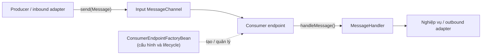
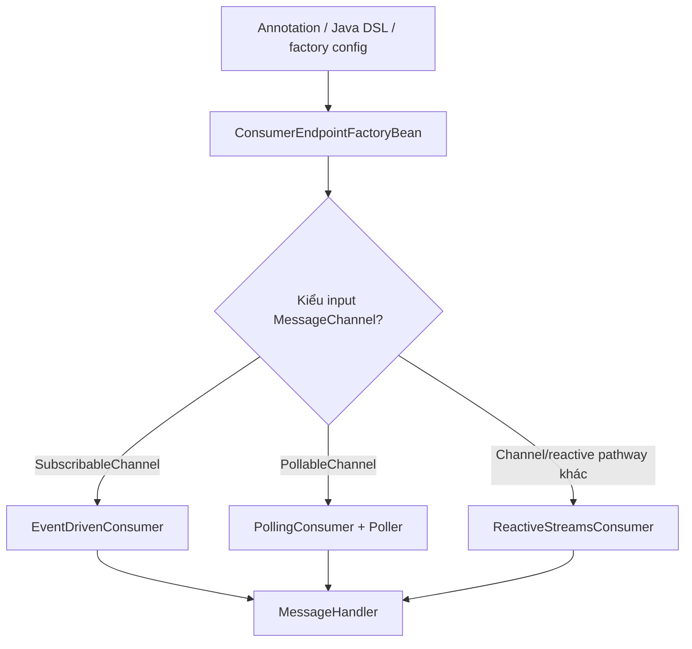
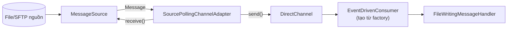
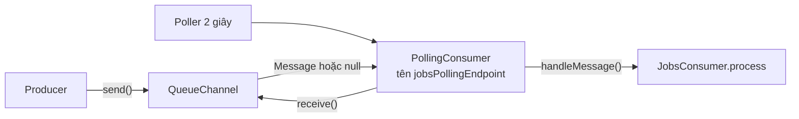

# ConsumerEndpointFactoryBean và endpoint ẩn

Trong Spring Integration, một phương thức được đánh dấu `@ServiceActivator` hoặc một bước `.handle(...)` trong Java DSL nhìn qua chỉ là **logic xử lý message**. Tuy nhiên, để phương thức ấy thực sự nhận được message, framework còn phải tạo **consumer endpoint** nối `MessageChannel` với `MessageHandler`, đăng ký nó vào Spring context và quản lý vòng đời. `ConsumerEndpointFactoryBean` là một thành phần cấu hình giúp thực hiện công việc này.

Bài thuộc chương **Kiểu endpoint** của module **SPRING_INTEGRATION_ADAPTERS**. Module hướng đến kết nối hệ thống ngoài bằng inbound/outbound adapter, gateway, poller và MessageChannel; thực hành với file, SFTP, HTTP, JMS, AMQP, Kafka, cơ sở dữ liệu, đồng thời xử lý hợp đồng message, lỗi và vòng đời kết nối. Trong bài này, “**endpoint ẩn**” chỉ endpoint **được framework tự tạo từ annotation, Java DSL hoặc cấu hình cấp cao**, nên không xuất hiện như một lệnh `new EventDrivenConsumer(...)`/`new PollingConsumer(...)` trong code nghiệp vụ. Đây không phải một loại endpoint bí mật hay một API có tên `HiddenEndpoint`.

## 1. Mục tiêu học tập

Sau khi học, bạn có thể:

1. Giải thích nhiệm vụ của `ConsumerEndpointFactoryBean` và sự khác nhau giữa **factory**, **endpoint**, **handler**, **channel**.
2. Dự đoán loại consumer endpoint dựa trên `SubscribableChannel` hoặc `PollableChannel`.
3. Chỉ ra endpoint do framework sinh khi dùng `@ServiceActivator`, `@Transformer` hoặc Java DSL.
4. Truy xuất endpoint và factory bằng Spring context, hiểu tiền tố `&` của `FactoryBean`.
5. Đặt tên endpoint, cấu hình `autoStartup`, `phase`, poller và quan sát lifecycle.
6. Chẩn đoán tình huống producer đã gửi message nhưng handler không được gọi, xử lý trùng hoặc lỗi khó truy vết.

## 2. Vì sao cần một consumer endpoint?

Giả sử ứng dụng có handler:

```java
MessageHandler handler = message ->
        System.out.println("Đã nhận: " + message.getPayload());
```

Handler chỉ biết xử lý một `Message<?>`. Nó **chưa biết nhận message từ channel nào**, thời điểm nào được gọi và khi nào phải dừng. Ta cần một endpoint đứng giữa channel và handler:



**Phân vai:**

| Thành phần | Trách nhiệm | Có tự xử lý nghiệp vụ không? |
|---|---|---|
| `MessageChannel` | Nhận và phân phối message | Không, channel chỉ quản lý cách giao message |
| `MessageHandler` | Xử lý payload/headers, gọi dịch vụ đích | Có, hoặc ủy quyền cho service |
| `EventDrivenConsumer` | Subscribe handler lên `SubscribableChannel` | Không trực tiếp định nghĩa nghiệp vụ |
| `PollingConsumer` | Theo lịch lấy message từ `PollableChannel` rồi gọi handler | Không trực tiếp định nghĩa nghiệp vụ |
| `ConsumerEndpointFactoryBean` | Từ input channel, handler và tùy chọn cấu hình, tạo endpoint thích hợp | Không |
| Spring container | Khởi tạo bean, tiêm phụ thuộc, quản lý start/stop | Không |

Một handler có thể được gọi thông qua các loại endpoint khác nhau, nhưng **loại channel quyết định cách message được nhận**. Chính vì vậy, cách cấu hình ngắn trong Spring Integration che được phần nối dây mà vẫn cần bảo đảm đủ các thành phần khi chạy.

## 3. `ConsumerEndpointFactoryBean` là gì?

Class `org.springframework.integration.config.ConsumerEndpointFactoryBean` triển khai `FactoryBean<AbstractEndpoint>` và `SmartLifecycle`. Nó nhận **handler** cùng **input channel** và các tùy chọn; sau khi Spring hoàn tất khởi tạo bean, nó cung cấp một đối tượng `AbstractEndpoint` phù hợp.

Theo API Spring Integration hiện đại, chiến lược tạo endpoint phụ thuộc kiểu channel:

| Input channel | Kiểu endpoint | Cách nhận message |
|---|---|---|
| `SubscribableChannel` như `DirectChannel` | `EventDrivenConsumer` | Đăng ký handler qua `subscribe(...)` |
| `PollableChannel` như `QueueChannel` | `PollingConsumer` | Poller gọi `receive(timeout)` |
| Kiểu channel khác trong các đường dẫn hỗ trợ reactive | `ReactiveStreamsConsumer` | Tiêu thụ theo mô hình reactive thích hợp |

Nhánh reactive là trường hợp nâng cao và phụ thuộc loại channel/hợp đồng reactive trong phiên bản Spring Integration đang dùng. Hai lựa chọn chính khi học adapter là `SubscribableChannel` và `PollableChannel`.



### 3.1. Một số thuộc tính đáng biết

Các phương thức có ích khi đọc code cấu hình thấp tầng:

```java
// API minh họa; đây là danh sách phương thức, không phải code biên dịch độc lập.
factory.setInputChannel(channel);      // Hoặc setInputChannelName(...)
factory.setHandler(handler);            // Object, thường là MessageHandler
factory.setPollerMetadata(poller);      // Khi input là PollableChannel
factory.setAutoStartup(true);
factory.setPhase(0);
factory.setAdviceChain(adviceChain);
factory.setTaskScheduler(scheduler);    // Khi cần cấu hình scheduler
```

Không phải phương thức nào cũng phải gọi. Khi dùng annotation hoặc Java DSL, bạn thường cấu hình các thuộc tính tương đương ở cấp endpoint, rồi để Spring Integration tạo factory/endpoint.

**Nhận diện sai lầm:** `ConsumerEndpointFactoryBean` **không phải là chính handler** và cũng **không phải một kênh message**. Nó không thay thế `FileReadingMessageSource` hay một inbound Kafka listener. Đây là hạ tầng tạo **consumer endpoint kết nối input channel với handler**.

### 3.2. Khác gì với `SourcePollingChannelAdapter`?

`SourcePollingChannelAdapter` là **inbound producer endpoint**: nó gọi `MessageSource.receive()` rồi gửi message sang **output channel**.

`ConsumerEndpointFactoryBean` tạo **consumer endpoint** có **input channel** và `MessageHandler`. Nếu input là `QueueChannel`, product là `PollingConsumer`; nếu input là `DirectChannel`, product là `EventDrivenConsumer`.

Một flow file có thể chứa cả hai:



Inbound polling endpoint đọc hệ thống ngoài; consumer endpoint phía sau nhận message từ channel nội bộ. Điều này giúp các adapter/gateway kết nối được mà không gắn logic I/O nguồn trực tiếp vào handler đích.

## 4. “Endpoint ẩn” thực chất là những bean nào?

Xét cấu hình:

```java
@Component
public class OrderAuditService {

    @ServiceActivator(inputChannel = "orderEvents")
    public void record(String orderId) {
        System.out.println("Audit đơn hàng " + orderId);
    }
}
```

Bạn không thấy `new EventDrivenConsumer(...)`, cũng không đăng ký handler bằng `channel.subscribe(...)`. Dù vậy, Spring Integration xử lý annotation để tạo các bean tương ứng:

1. Một **`MessageHandler`** có khả năng gọi `record(String)` và ánh xạ payload message.
2. Một **`AbstractEndpoint`** để kết nối handler với `orderEvents`.
3. Cấu hình lifecycle và polling nếu input channel yêu cầu.

Với tên component mặc định `orderAuditService`, method `record`, annotation `ServiceActivator`, quy tắc đặt tên phổ biến cho annotation là:

| Bean | Ví dụ tên |
|---|---|
| Consumer endpoint | `orderAuditService.record.serviceActivator` |
| Handler của endpoint | `orderAuditService.record.serviceActivator.handler` |

Tên chính xác phụ thuộc kiểu khai báo (`@Component`, `@Bean`, Java DSL, XML), tên component, các `@EndpointId` và phiên bản. Khi điều tra production, hãy **quan sát bean thực tế** thay vì phỏng đoán tên từ log.

Một điểm quan trọng: **“ẩn” trong mã cấu hình không có nghĩa là vô hình với Spring context**. Endpoint vẫn có bean identity, lifecycle, khả năng quan sát và thường có thể truy xuất qua `ApplicationContext`.

### 4.1. Cấu hình cao cấp nào có thể tạo endpoint?

| Cách khai báo | Điều lập trình viên viết | Điều framework chuẩn bị |
|---|---|---|
| `@ServiceActivator` | Method xử lý message, `inputChannel` | Handler + consumer endpoint |
| `@Transformer` | Method biến đổi message/payload | Transformer handler + endpoint |
| `@Filter`, `@Router` | Quy tắc lọc/định tuyến | Handler tương ứng + endpoint |
| Java DSL `.handle(...)` | Một bước consumer trong flow | Handler và endpoint, có thể có channel trung gian |
| XML `<int:service-activator .../>` | Khai báo handler/channel | Bean handler + endpoint theo namespace |
| `@InboundChannelAdapter` | Method/source và poller | **Source polling endpoint**, trường hợp khác consumer factory |

Gateway và adapter message-driven có mô hình endpoint riêng theo giao thức; không nên suy rằng **mọi** adapter trên JMS/Kafka/HTTP đều được tạo bằng `ConsumerEndpointFactoryBean`.

## 5. Ví dụ thực hành A: annotation tự tạo event-driven endpoint

Ví dụ này nhận một ID đơn hàng và ghi audit ra console. Sử dụng Java 17+, Spring Boot tương thích và Spring Integration. Trong `pom.xml` có dependency:

```xml
<dependency>
    <groupId>org.springframework.boot</groupId>
    <artifactId>spring-boot-starter-integration</artifactId>
</dependency>
```

### 5.1. Khai báo channel và producer mẫu

```java
package com.example.integration;

import org.springframework.beans.factory.annotation.Qualifier;
import org.springframework.boot.ApplicationRunner;
import org.springframework.context.annotation.Bean;
import org.springframework.context.annotation.Configuration;
import org.springframework.integration.channel.DirectChannel;
import org.springframework.integration.config.EnableIntegration;
import org.springframework.messaging.MessageChannel;
import org.springframework.messaging.support.MessageBuilder;

@Configuration
@EnableIntegration
public class OrderEventsConfig {

    @Bean("orderEvents")
    public MessageChannel orderEvents() {
        return new DirectChannel();
    }

    @Bean
    public ApplicationRunner sendSampleOrder(
            @Qualifier("orderEvents") MessageChannel channel) {
        return args -> channel.send(
                MessageBuilder.withPayload("ORD-2026-101").build());
    }
}
```

### 5.2. Viết handler dưới dạng method

```java
package com.example.integration;

import org.springframework.integration.annotation.EndpointId;
import org.springframework.integration.annotation.ServiceActivator;
import org.springframework.stereotype.Component;

@Component
public class OrderAuditService {

    @EndpointId("orderAuditEndpoint")
    @ServiceActivator(inputChannel = "orderEvents")
    public void record(String orderId) {
        System.out.println("AUDIT " + orderId);
    }
}
```

Ứng dụng có `@SpringBootApplication` nằm tại package `com.example.integration` hoặc package cha. Khi context khởi động:

1. Spring tạo `orderEvents`, thực thể `DirectChannel`.
2. Spring Integration xử lý `@ServiceActivator`, tạo message handler cho `record(...)` và một consumer endpoint.
3. Do input là `DirectChannel` (`SubscribableChannel`), endpoint thực tế thuộc loại **`EventDrivenConsumer`**.
4. Lifecycle khởi động endpoint, handler được subscribe vào channel.
5. `ApplicationRunner` gửi payload `ORD-2026-101`; console in `AUDIT ORD-2026-101`.

`@EndpointId("orderAuditEndpoint")` cho bean endpoint một tên dễ tìm. Đối với method được đánh dấu annotation EIP mà không đồng thời khai báo `@Bean`, bean handler thường mang tên `orderAuditEndpoint.handler`. Đây là lý do nên đặt endpoint ID có chủ đích cho flow quan trọng.

**Thử nghiệm:** bỏ `@EndpointId`, khởi động lại ứng dụng và kiểm tra tên endpoint được Spring tự tạo. Kết quả sẽ cho thấy endpoint chưa bao giờ thực sự “biến mất”; chỉ có phần khai báo endpoint được framework tự động sinh.

## 6. Ví dụ thực hành B: tạo `ConsumerEndpointFactoryBean` tường minh

Để hiểu hạ tầng bên dưới, có thể tự tạo factory bean. Đây là **ví dụ độc lập thay cho mục 5**, không đặt cả hai cùng subscribe một channel khi đang muốn quan sát một handler duy nhất.

```java
package com.example.integration;

import org.springframework.beans.factory.annotation.Qualifier;
import org.springframework.boot.ApplicationRunner;
import org.springframework.context.ApplicationContext;
import org.springframework.context.annotation.Bean;
import org.springframework.context.annotation.Configuration;
import org.springframework.integration.channel.DirectChannel;
import org.springframework.integration.config.ConsumerEndpointFactoryBean;
import org.springframework.integration.config.EnableIntegration;
import org.springframework.messaging.MessageChannel;
import org.springframework.messaging.MessageHandler;
import org.springframework.messaging.support.MessageBuilder;

@Configuration
@EnableIntegration
public class ExplicitFactoryConfig {

    @Bean("auditInput")
    public MessageChannel auditInput() {
        return new DirectChannel();
    }

    @Bean("auditHandler")
    public MessageHandler auditHandler() {
        return message -> System.out.println(
                "Factory handler: " + message.getPayload());
    }

    @Bean("auditEndpoint")
    public ConsumerEndpointFactoryBean auditEndpoint(
            @Qualifier("auditInput") MessageChannel channel,
            @Qualifier("auditHandler") MessageHandler handler) {

        ConsumerEndpointFactoryBean factory =
                new ConsumerEndpointFactoryBean();
        factory.setInputChannel(channel);
        factory.setHandler(handler);
        factory.setAutoStartup(true);
        return factory;
    }

    @Bean
    public ApplicationRunner inspectAndPublish(
            ApplicationContext context,
            @Qualifier("auditInput") MessageChannel channel) {
        return args -> {
            Object endpoint = context.getBean("auditEndpoint");
            Object factory = context.getBean("&auditEndpoint");

            System.out.println("Endpoint class: "
                    + endpoint.getClass().getSimpleName());
            System.out.println("Factory class: "
                    + factory.getClass().getSimpleName());

            channel.send(
                    MessageBuilder.withPayload("invoice-0042").build());
        };
    }
}
```

**Kết quả kỳ vọng:**

```text
Endpoint class: EventDrivenConsumer
Factory class: ConsumerEndpointFactoryBean
Factory handler: invoice-0042
```

Mục đích ví dụ là làm rõ hai lớp đối tượng. `auditEndpoint` là **bean name**; khi gọi `context.getBean("auditEndpoint")`, Spring `FactoryBean` trả về **product** là `AbstractEndpoint` (ở đây là `EventDrivenConsumer`). Khi dùng `context.getBean("&auditEndpoint")`, tiền tố `&` yêu cầu Spring trả về **chính factory object**.

Không gọi `factory.getObject()` thủ công trong `@Bean` rồi tự đăng ký product, vì việc này bỏ qua hoặc làm rối một phần vòng đời do container quản lý. Hãy để Spring xử lý `FactoryBean`.

### 6.1. Vì sao không luôn tạo factory bằng tay?

Cấu hình annotation/DSL ngắn và khó mắc lỗi wiring hơn. Tạo factory tường minh hữu ích để học cơ chế hoặc trong các tình huống cần thao tác cấu hình thấp tầng, nhưng với flow thực tế thường dùng **Java DSL**, **annotation** hoặc namespace để thiết lập bean đúng cách.

## 7. Khi input là `PollableChannel`, endpoint thay đổi thế nào?

Giữ cùng ý tưởng handler nhưng thay channel bằng `QueueChannel`. Khi đó không có subscription kiểu event-driven; một **`PollingConsumer`** cần lịch poll để lấy message từ queue.

Cấu hình mức cao dễ đọc nhất:

```java
package com.example.integration;

import org.springframework.context.annotation.Bean;
import org.springframework.context.annotation.Configuration;
import org.springframework.integration.channel.QueueChannel;
import org.springframework.integration.config.EnableIntegration;
import org.springframework.messaging.PollableChannel;

@Configuration
@EnableIntegration
public class JobsQueueConfig {

    @Bean("jobsQueue")
    public PollableChannel jobsQueue() {
        return new QueueChannel(20);
    }
}
```

```java
package com.example.integration;

import org.springframework.integration.annotation.EndpointId;
import org.springframework.integration.annotation.Poller;
import org.springframework.integration.annotation.ServiceActivator;
import org.springframework.stereotype.Component;

@Component
public class JobsConsumer {

    @EndpointId("jobsPollingEndpoint")
    @ServiceActivator(
            inputChannel = "jobsQueue",
            poller = @Poller(
                    fixedDelay = "2000",
                    maxMessagesPerPoll = "3",
                    receiveTimeout = "0"))
    public void process(String jobId) {
        System.out.println("Xử lý job " + jobId);
    }
}
```

Một producer khác có thể gửi message `String` vào `jobsQueue` qua `MessageChannel.send(...)`. Mỗi lượt poll lấy tối đa ba message; nếu queue rỗng và `receiveTimeout=0`, lần nhận trả về ngay. Đây là một **`PollingConsumer`** dù code nghiệp vụ vẫn chỉ có method `process(String)`.



Nếu muốn dùng `ConsumerEndpointFactoryBean` tường minh cho `QueueChannel`, factory còn cần nhận cấu hình `PollerMetadata` phù hợp, có `Trigger` và các giới hạn poll. Khi dùng annotation, `@Poller` diễn đạt các thông tin đó và framework xử lý phần nối dây.

### 7.1. Trường hợp hay gây lỗi: đổi channel mà quên poller

Nếu thay `DirectChannel` thành `QueueChannel` nhưng không cung cấp poller, consumer không có nhịp lấy message thích hợp hoặc có thể dùng poller mặc định tùy cơ chế cấu hình/phiên bản. Với yêu cầu vận hành xác định, hãy **cấu hình poller tường minh**, không dựa vào mặc định. Với channel đồng bộ `DirectChannel`, một poller trên consumer không có ý nghĩa vì endpoint nhận message bằng subscription.

## 8. Java DSL cũng tạo endpoint phía sau một dòng cấu hình

Ví dụ:

```java
import org.springframework.context.annotation.Bean;
import org.springframework.context.annotation.Configuration;
import org.springframework.integration.dsl.IntegrationFlow;
import org.springframework.messaging.MessageHandler;

@Configuration
public class AuditFlowConfig {

    @Bean
    public IntegrationFlow auditFlow() {
        return IntegrationFlow.from("orderEvents")
                .handle(
                        (MessageHandler) message ->
                                System.out.println(
                                        "DSL " + message.getPayload()),
                        endpoint -> endpoint
                                .id("auditDslEndpoint")
                                .autoStartup(true))
                .get();
    }
}
```

Đây là **một cách thay thế khác** cho cách annotation/tường minh bên trên. Nếu cùng khai báo cả ba trên `DirectChannel`, bạn đang tạo **nhiều consumer cạnh tranh**; một message không mặc định đi tới tất cả handler.

Trong Java DSL, `IntegrationFlow` trước hết mô tả cấu hình, còn runtime do channel, handler và endpoint thực thi. DSL tạo/cấu hình các bean thích hợp; những bước như `.handle(...)`, `.transform(...)` hoặc `.filter(...)` có endpoint tương ứng dù code không khởi tạo trực tiếp `EventDrivenConsumer`.

Việc dùng `.id("auditDslEndpoint")` giúp đặt tên bean endpoint để đo metric, điều khiển lifecycle hoặc tìm trong Spring context. Đối với endpoint cần quản trị, nên đặt ID rõ nghĩa thay vì phụ thuộc toàn bộ vào tên sinh tự động.

## 9. Tra cứu endpoint và quản lý lifecycle

### 9.1. Phân biệt bean endpoint và factory khi quan sát

Với cấu hình factory tường minh ở mục 6:

```java
AbstractEndpoint endpoint =
        context.getBean("auditEndpoint", AbstractEndpoint.class);

ConsumerEndpointFactoryBean factory =
        context.getBean("&auditEndpoint",
                ConsumerEndpointFactoryBean.class);

System.out.println(endpoint.isRunning());
System.out.println(factory.isRunning());
```

Đoạn này cần import `org.springframework.integration.endpoint.AbstractEndpoint` và sử dụng `context` là Spring `ApplicationContext`. Với endpoint do annotation hoặc DSL tạo ra, có thể truy xuất product bằng bean ID của endpoint; **không mặc định** rằng mọi cấu hình đều có một factory bean có thể lấy qua cùng một tên và `&`. Hãy kiểm tra bean definition thực tế.

### 9.2. Tắt/bật một endpoint có tên

Ví dụ dùng annotation:

```java
@EndpointId("ordersAudit")
@ServiceActivator(
        inputChannel = "orderEvents",
        autoStartup = "false")
public void record(String orderId) {
    System.out.println("Audit " + orderId);
}
```

Khi endpoint không tự khởi động, có thể kiểm soát bằng bean `Lifecycle` tương ứng:

```java
Lifecycle endpoint =
        context.getBean("ordersAudit", Lifecycle.class);

endpoint.start();  // Subscribe hoặc bắt đầu polling.
endpoint.stop();   // Unsubscribe hoặc ngừng lập lịch poll.
```

Cần import `org.springframework.context.Lifecycle`. Mục đích của `autoStartup=false` là tạm hoãn khởi chạy endpoint cho đến khi điều kiện phụ thuộc đã sẵn sàng, chẳng hạn database, SFTP hoặc downstream có thể tiếp nhận dữ liệu.

**Dừng consumer không đồng nghĩa tắt toàn bộ luồng**: producer và inbound adapter phía trước có thể vẫn hoạt động. Với `DirectChannel`, một producer gửi khi không có subscriber có thể gặp lỗi dispatch. Với `QueueChannel`, message có thể tiếp tục được enqueue cho đến khi hết capacity. Với JMS/Kafka, việc dừng consumer trên channel nội bộ cũng không thay thế việc quản lý listener/container đầu nguồn.

### 9.3. `phase` để phối hợp start/stop

Endpoint thường tham gia `SmartLifecycle`, có các thuộc tính `autoStartup`, `phase` và `isRunning`. Theo cơ chế lifecycle của Spring, bean có phase thấp thường start trước bean có phase cao; khi stop, thứ tự đảo ngược. Nếu flow phụ thuộc thứ tự startup giữa inbound adapter, consumer và downstream, cần kiểm tra **phase thực tế của các endpoint** và các dependency.

`ConsumerEndpointFactoryBean` cung cấp cấu hình `setPhase(...)`, còn annotation/DSL có các tùy chọn tương đương. Không nên áp cùng một số phase tùy ý cho mọi endpoint, đặc biệt khi luồng có poller, broker listener và channel bất đồng bộ.

## 10. Những lỗi hay gặp khi endpoint được tạo tự động

| Triệu chứng | Nguyên nhân có thể | Hướng kiểm tra |
|---|---|---|
| Producer đã gửi nhưng handler không chạy | Endpoint chưa được tạo hoặc chưa start | Component scan, `@EnableIntegration`, bean ID, `isRunning()` |
| `DirectChannel` báo không có subscriber | Endpoint chưa subscribe, bị stop, cấu hình channel sai | Kiểm tra input channel và lifecycle |
| `QueueChannel` có backlog liên tục | Poller quá chậm, handler lỗi hoặc endpoint chưa start | `maxMessagesPerPoll`, scheduler, queue depth, error logs |
| Hai handler tưởng đều nhận nhưng thực tế một | Nhiều consumer cạnh tranh trên `DirectChannel` | Dùng `PublishSubscribeChannel` nếu cần fan-out |
| Handler bị gọi từ hai đường và sinh duplicate | Annotation và DSL cùng đăng ký endpoint cho cùng nghiệp vụ | Kiểm tra bean/flow định nghĩa trùng |
| Không tìm thấy bean tên dự đoán | Tên auto-generated khác, dùng `@EndpointId` hoặc DSL ID | Liệt kê bean của `AbstractEndpoint`, xem tên thực |
| Đổi channel rồi lỗi cấu hình poller | Loại channel không phù hợp consumer hoặc thiếu poller | Phân loại `SubscribableChannel`/`PollableChannel` |
| Lỗi downstream không về producer | Channel/adapter xử lý bất đồng bộ | Thread boundary, error handler, error channel, retry advice |

### 10.1. Liệt kê các endpoint trong Spring context

Bạn có thể thêm đoạn kiểm tra trong một `ApplicationRunner` của ứng dụng demo:

```java
import java.util.Arrays;
import org.springframework.boot.ApplicationRunner;
import org.springframework.context.ApplicationContext;
import org.springframework.context.annotation.Bean;
import org.springframework.integration.endpoint.AbstractEndpoint;

@Bean
ApplicationRunner showEndpoints(ApplicationContext context) {
    return args -> Arrays.stream(
            context.getBeanNamesForType(AbstractEndpoint.class))
            .sorted()
            .forEach(name -> {
                AbstractEndpoint endpoint =
                        context.getBean(name, AbstractEndpoint.class);
                System.out.printf("%s -> %s, running=%s%n",
                        name,
                        endpoint.getClass().getSimpleName(),
                        endpoint.isRunning());
            });
}
```

Đây là đoạn **minh họa chèn trong một class `@Configuration`**, không phải file Java độc lập. Nó có thể giúp xác minh framework đã tạo endpoint nào và trạng thái chạy của chúng. Tên bean được in ra là dữ liệu đáng tin cậy hơn việc đoán từ tên method.

Trong hệ thống nhiều module, cần tránh log quá nhiều thông tin nhạy cảm từ payload/headers khi debug. Việc in **tên endpoint, class và trạng thái** thường đã đủ để tìm lỗi wiring ban đầu.

## 11. Lỗi, transaction và message contract vẫn thuộc flow

Factory bean giúp tạo đúng consumer endpoint, nhưng **không tự giải quyết mọi bài toán vận hành**.

**Hợp đồng message:** Handler cần biết kiểu payload, headers định tuyến, `correlationId`, schema/version, ràng buộc null và lỗi chuyển đổi. Một method nhận `String` không tự chuyển mọi JSON từ HTTP/JMS/Kafka thành string nghiệp vụ đúng format.

**Xử lý lỗi:** Với `DirectChannel`, handler thường chạy trên thread gửi; exception có thể quay về producer. Với `ExecutorChannel` hoặc `QueueChannel`, xử lý có thể chậm hoặc chạy thread khác, nên cần error channel/error handler, monitoring và retry thích hợp.

**Transaction:** Dùng `DirectChannel` đồng bộ có thể giữ cùng thread và transaction context khi tài nguyên tham gia phù hợp. Băng qua ranh giới thread hoặc lưu message vào queue khiến transaction không tự lan rộng. Factory không biến thao tác DB + SFTP/HTTP/Kafka thành một distributed transaction.

**Idempotency:** Gửi thành công vào channel chưa chắc downstream đã commit. Khi file/SFTP/JDBC được poll lại hoặc JMS/Kafka redelivery, handler có thể nhận trùng message. Cần xác định business ID, cách ghi nhận xử lý bền vững và chính sách retry. `ConsumerEndpointFactoryBean` **không bảo đảm exactly-once**.

**Vòng đời kết nối:** Dừng một endpoint consumer trên channel không đồng nghĩa dừng kết nối SFTP, listener JMS, Kafka consumer container hay HTTP inbound gateway. Mỗi adapter/gateway có tài nguyên và lifecycle riêng cần được phối hợp.

## 12. Bản đồ lựa chọn và cách tư duy khi triển khai

| Bài toán | Thành phần nhìn thấy trong code | Endpoint bên dưới nên kiểm tra |
|---|---|---|
| Lưu đơn hàng vào DB sau khi nhận `DirectChannel` | `@ServiceActivator(inputChannel = "orders")` | `EventDrivenConsumer` và handler |
| Xử lý việc từ `QueueChannel` mỗi 2 giây | `@ServiceActivator` + `@Poller` | `PollingConsumer` và poller |
| Đọc file mới từ thư mục mỗi 5 giây | `FileReadingMessageSource` + `IntegrationFlow.from(source, ...)` | `SourcePollingChannelAdapter` ở đầu vào |
| Gửi message ra SFTP hoặc HTTP | `.handle(outboundHandler)` | Consumer endpoint của channel + outbound handler |
| Nhận HTTP request rồi trả HTTP response | HTTP inbound gateway | Gateway/request–reply endpoint, không suy luận từ factory consumer |
| Nhận sự kiện từ Kafka/JMS listener | Adapter message-driven | Listener/container cùng lifecycle/ack của giao thức |

Suy luận theo **đầu vào thực tế**: một thành phần lấy từ source ngoài, nhận từ channel nội bộ, hay nhận callback của broker/HTTP? Sau đó xác định channel type, handler, lifecycle và chính sách lỗi. Tên class của factory chỉ là một phần trong bức tranh.

## 13. Bài tập thực hành

### Bài 1 — Phát hiện endpoint “ẩn”

Chạy ví dụ annotation ở mục 5. Dùng `showEndpoints(...)` ở mục 10 để in danh sách endpoint. Xác nhận class runtime và tên do `@EndpointId` đặt. Bỏ `@EndpointId` rồi chạy lại để quan sát tên được sinh tự động. Giải thích vì sao một method có `@ServiceActivator` nhận được message dù không tự gọi `subscribe()`.

### Bài 2 — So sánh factory và product

Chạy ví dụ mục 6. Ghi lại kết quả của `getBean("auditEndpoint")` và `getBean("&auditEndpoint")`. Thay `DirectChannel` bằng `QueueChannel` (ở một cấu hình thử khác) và bổ sung `PollerMetadata`. Dự đoán product là loại endpoint nào. Giải thích vì sao thiếu lịch poll là một vấn đề khi message chỉ nằm trong queue.

### Bài 3 — Khởi động có điều kiện

Cho endpoint annotation `autoStartup = "false"`. Chạy producer trước khi start endpoint, quan sát kết quả gửi trên `DirectChannel`; sau đó gọi `start()` cho endpoint và gửi message mới. Giải thích cách thứ tự start/stop có thể ảnh hưởng adapter SFTP inbound và handler JDBC outbound.

### Bài 4 — Điều tra duplicate handler

Tạo hai cách khai báo cùng một business handler trên một `DirectChannel`: một bằng `@ServiceActivator`, một bằng Java DSL. Gửi một message và kiểm tra handler thực sự nào xử lý. Đổi channel thành `PublishSubscribeChannel`, rồi quan sát sự khác biệt. Nêu rủi ro nếu cả hai thực thi thao tác ghi DB và cách loại bỏ wiring trùng.

### Bài 5 — Thiết kế một flow thực tế

Thiết kế luồng **SFTP inbound polling → DirectChannel → service activator kiểm tra hóa đơn → JDBC outbound**. Hãy xác định:

1. Endpoint nào poll nguồn SFTP và endpoint nào được tạo dưới hình thức consumer.
2. Tên bean/id nên đặt để theo dõi và tạm dừng từng công đoạn.
3. Payload và headers cần có để xác định tenant, tên file, `invoiceId` và correlation.
4. Cơ chế phát hiện file đã hoàn tất, tránh duplicate sau restart và retry khi DB lỗi.
5. Loại channel sẽ thay đổi thế nào nếu muốn tách nhịp nhận file khỏi nhịp ghi database.

### Câu hỏi tự kiểm tra

1. `ConsumerEndpointFactoryBean` tạo loại endpoint nào khi input là `DirectChannel`? Khi input là `QueueChannel`?
2. Vì sao một `@ServiceActivator` vẫn cần endpoint dù code chỉ khai báo method xử lý?
3. `context.getBean("id")` và `context.getBean("&id")` khác nhau thế nào với bean kiểu `FactoryBean`?
4. Khi nào cần `@Poller`, và poller có thay thế `MessageHandler` không?
5. Vì sao cần `@EndpointId` hoặc `.id(...)` nếu muốn thao tác lifecycle và tra cứu log?
6. Nếu một handler nhận message qua `ExecutorChannel`, tại sao lỗi của nó có thể không quay lại thread producer?
7. Khi producer gửi message thành công, bước nào mới xác nhận tác dụng phụ ở DB/SFTP/Kafka đã hoàn tất?

Khả năng **tìm được endpoint thật phía sau annotation/DSL** giúp bạn đọc cấu hình Spring Integration chính xác hơn, điều khiển được điểm tiêu thụ message và phân biệt lỗi wiring với lỗi dữ liệu hoặc kết nối hệ thống ngoài.

## Tài liệu tham khảo

- [Spring Integration API — ConsumerEndpointFactoryBean](https://docs.spring.io/spring-integration/api/org/springframework/integration/config/ConsumerEndpointFactoryBean.html)
- [Spring Integration Reference — Message Endpoints](https://docs.spring.io/spring-integration/reference/endpoint.html)
- [Spring Integration Reference — Annotation Support](https://docs.spring.io/spring-integration/reference/configuration/annotations.html)
- [Spring Integration API — EndpointId](https://docs.spring.io/spring-integration/api/org/springframework/integration/annotation/EndpointId.html)
- [Spring Integration Reference — Java DSL Basics](https://docs.spring.io/spring-integration/reference/dsl/java-basics.html)
- [Spring Integration Reference — DSL and Endpoint Configuration](https://docs.spring.io/spring-integration/reference/dsl/java-endpoints.html)
