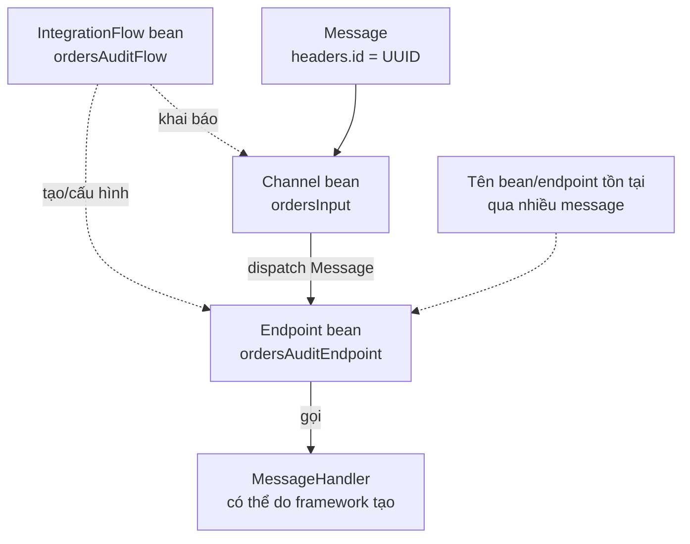
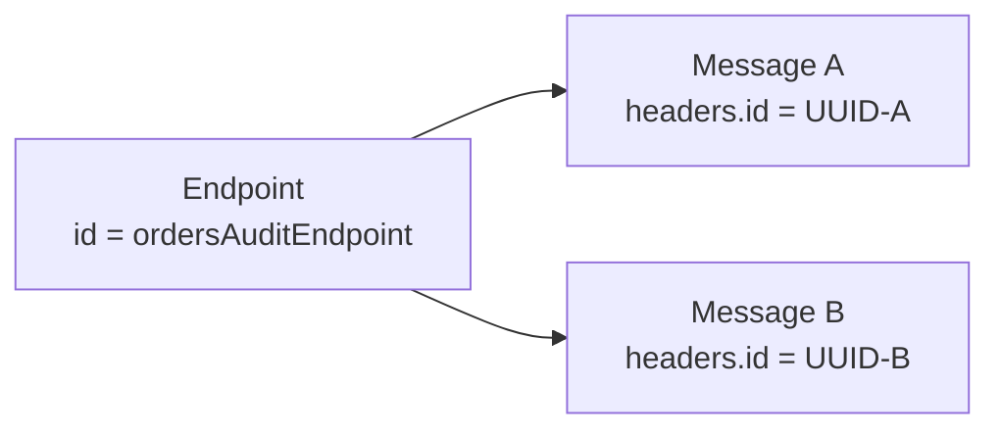
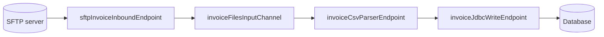

# Endpoint ID và tên bean nội bộ

Trong Spring Integration, một flow có thể được khai báo chỉ bằng vài dòng Java DSL hoặc annotation, nhưng khi khởi động, framework vẫn tạo nhiều thành phần: `MessageChannel`, `MessageHandler`, consumer endpoint, inbound adapter, gateway và các bean phục vụ cấu hình. **Endpoint ID** giúp xác định một điểm thực thi cụ thể; **Spring bean name** giúp tìm đối tượng đó trong `ApplicationContext`. Phân biệt các tên này là điều kiện quan trọng để theo dõi, kiểm soát vòng đời và chẩn đoán lỗi trong luồng tích hợp.

Bài thuộc chương **Kiểu endpoint** của module **SPRING_INTEGRATION_ADAPTERS**. Module tập trung kết nối hệ thống ngoài thông qua inbound/outbound adapter, gateway, poller và `MessageChannel`; thực hành với file, SFTP, HTTP, JMS, AMQP, Kafka và cơ sở dữ liệu, cùng các yêu cầu về hợp đồng message, lỗi và vòng đời kết nối. Trong bài này, ta tìm hiểu **cách đặt tên và định vị các thành phần runtime** để có thể quản trị chính xác các adapter/endpoint khi ứng dụng vận hành.

## 1. Mục tiêu học tập

Sau khi hoàn thành, bạn có thể:

1. Phân biệt endpoint ID, bean name, channel name, handler bean, `IntegrationFlow` bean name và `MessageHeaders.ID`.
2. Đặt tên endpoint rõ nghĩa bằng `@EndpointId` hoặc `.id(...)` trong Java DSL.
3. Giải thích vì sao một khai báo `@ServiceActivator` hoặc `.handle(...)` có thể tạo endpoint và handler nội bộ.
4. Truy xuất các endpoint thực tế qua `ApplicationContext` và xác định loại endpoint đang chạy.
5. Phân biệt bean do `FactoryBean` tạo với chính factory qua tiền tố `&`.
6. Sử dụng tên ổn định để kiểm tra start/stop, lỗi wiring, đăng ký nhầm consumer và các vấn đề observability.
7. Áp dụng quy ước đặt tên cho flow kết nối file/SFTP/HTTP/JMS/AMQP/Kafka/JDBC.

## 2. Bốn tầng cần phân biệt

Ví dụ, một flow được khai báo như sau:

```text
[HTTP inbound gateway] -> [ordersInput channel] -> [ordersAudit endpoint]
                                                 -> [audit MessageHandler]
```

Spring quản lý nhiều đối tượng riêng:

| Khái niệm | Ví dụ minh họa | Ý nghĩa |
|---|---|---|
| **Tên bean của channel** | `ordersInput` | Tìm `MessageChannel` trong Spring context; producer/consumer dùng tên này để nối dây |
| **Endpoint ID / tên bean endpoint** | `ordersAuditEndpoint` | Định danh điểm tiêu thụ message; dùng tra cứu và điều khiển lifecycle |
| **Tên bean của handler** | `ordersAuditEndpoint.handler` nếu framework tạo theo quy ước tương ứng | Định danh đối tượng thực hiện xử lý; tên sinh tự động có thể thay đổi theo cấu hình/phiên bản |
| **Tên bean của flow** | `ordersAuditFlow` | Định danh khai báo `IntegrationFlow`; không nhất thiết là endpoint hay channel |
| **Tên bean của adapter nguồn** | `sftpInvoiceInbound` | Tìm bean/endpoint nhận dữ liệu từ hệ thống ngoài, nếu đã đặt tên phù hợp |
| **ID của từng message** | `MessageHeaders.ID`, thường là UUID | Định danh một message cụ thể, khác hoàn toàn ID của endpoint |

Một hệ thống thực tế còn có tên bean của `TaskScheduler`, `PollerMetadata`, `ConnectionFactory`, `DataSource`, converter và error channel. Chúng giúp kết nối hoặc chạy endpoint, nhưng không phải ID của consumer endpoint.



**Quan trọng:** Hình minh họa không hứa rằng mọi component đều có bean name cùng quy tắc. Tên thực tế phụ thuộc cách khai báo, metadata và phiên bản Spring Integration; vì vậy phải tra cứu context thay vì tự suy luận chuỗi tên.

## 3. Endpoint ID dùng để làm gì?

Một endpoint là điểm thực thi kết nối giữa message channel và handler, hoặc giữa nguồn bên ngoài và channel. Các loại endpoint phổ biến:

- `EventDrivenConsumer`: đăng ký handler trên `SubscribableChannel` như `DirectChannel`.
- `PollingConsumer`: poll `PollableChannel` như `QueueChannel` theo lịch.
- `SourcePollingChannelAdapter`: poll `MessageSource.receive()` rồi đưa message vào output channel.
- Gateway và adapter theo giao thức (HTTP, JMS, Kafka, SFTP...) có loại endpoint và lifecycle riêng.

**Endpoint ID ổn định** giúp thực hiện ba nhóm công việc: định vị bean để kiểm tra hoặc điều khiển vòng đời, liên hệ log/metric với thành phần cụ thể, và tránh phụ thuộc vào tên sinh tự động khi cấu hình phát triển.

Ví dụ, khi `ordersAuditEndpoint` không chạy, bạn có thể tìm bean theo đúng tên để kiểm tra `isRunning()`. Khi `sftpInvoiceInbound` cần tạm dừng, bạn cần điều khiển **endpoint nguồn SFTP**, thay vì vô tình dừng một handler JDBC đích khác.

### Endpoint ID khác message ID và correlation ID



- **Endpoint ID** định danh một thành phần runtime thuộc ứng dụng.
- **`MessageHeaders.ID`** định danh một message. Khi tạo message mới trong các bước transform, ID message có thể thay đổi.
- **Correlation ID** liên hệ nhiều message thuộc một request, một lô hoặc một quy trình nghiệp vụ; không nên tự lấy endpoint ID để thay thế correlation ID.
- **Business ID** như `invoiceId`, `orderId`, `eventId` mới là ứng viên cho idempotency nghiệp vụ.

Không nên đưa `MessageHeaders.ID` vào cấu hình endpoint hoặc cho rằng một endpoint chỉ xử lý một message cố định.

## 4. Vì sao xuất hiện tên bean nội bộ?

Khi dùng annotation hoặc Java DSL, phần lớn code ứng dụng chỉ khai báo **cần xử lý message gì**. Spring Integration tự bổ sung thành phần điều phối:

```java
@ServiceActivator(inputChannel = "ordersInput")
public void record(String orderId) {
    System.out.println("AUDIT " + orderId);
}
```

Ở thời điểm cấu hình, Spring Integration có thể tạo:

1. Một `MessageHandler` gọi method `record(String)` và chuyển đổi payload cần thiết.
2. Một consumer endpoint nối handler đó với `ordersInput`.
3. Các bean hoặc definition hỗ trợ endpoint, tùy kiểu khai báo.
4. Lifecycle để endpoint subscribe hoặc bắt đầu poll khi context khởi động.

Đối với consumer endpoint được tạo qua cấu hình framework, `ConsumerEndpointFactoryBean` là một lớp hạ tầng có thể tham gia tạo `EventDrivenConsumer` hoặc `PollingConsumer` dựa trên loại input channel. Vì thế, trong context có thể đồng thời thấy tên **endpoint product** và tên **handler** dù code nghiệp vụ không tự khởi tạo chúng.

Nếu không chỉ định ID, Spring Integration thường phải sinh tên phù hợp để các bean không trùng nhau. Tên tự sinh có thể chứa tên bean, method, kiểu endpoint, chỉ số hoặc ký hiệu của framework. **Không hard-code tên tự sinh** vào logic cần ổn định qua refactor/nâng cấp.

### 4.1. Một số tên không có cùng vai trò

Giả sử thấy các tên sau trong log hoặc khi liệt kê bean:

```text
ordersInput
ordersAuditEndpoint
ordersAuditEndpoint.handler
ordersAuditFlow
```

Có thể diễn giải:

- `ordersInput` là channel do developer đặt tên.
- `ordersAuditEndpoint` là ID endpoint đã khai báo rõ.
- `ordersAuditEndpoint.handler` có thể là bean handler nội bộ theo quy ước khi framework sinh handler; **phải xác nhận qua context**, không giả định mọi endpoint đều có hậu tố này.
- `ordersAuditFlow` là bean đại diện cho flow DSL.

Cần xem **type của bean**, không chỉ nhìn chuỗi tên. Một tên có chữ `handler` có thể là handler; một bean theo tên endpoint có thể được tạo qua `FactoryBean`.

## 5. Ví dụ hoàn chỉnh A: Java DSL đặt ID ổn định

Ví dụ này dùng Spring Boot và Spring Integration để gửi một sự kiện đơn hàng vào `DirectChannel`, xử lý bằng handler, sau đó kiểm tra tên runtime và trạng thái endpoint.

Dùng Java 17+ và một bản Spring Boot phù hợp. Dependency Maven:

```xml
<!-- dependencies trong pom.xml -->
<dependency>
    <groupId>org.springframework.boot</groupId>
    <artifactId>spring-boot-starter-integration</artifactId>
</dependency>
```

### 5.1. Khai báo channel, flow và probe

```java
package com.example.integration;

import java.util.Arrays;

import org.springframework.beans.factory.annotation.Qualifier;
import org.springframework.boot.ApplicationRunner;
import org.springframework.context.ApplicationContext;
import org.springframework.context.annotation.Bean;
import org.springframework.context.annotation.Configuration;
import org.springframework.integration.channel.DirectChannel;
import org.springframework.integration.config.EnableIntegration;
import org.springframework.integration.dsl.IntegrationFlow;
import org.springframework.integration.endpoint.AbstractEndpoint;
import org.springframework.messaging.MessageChannel;
import org.springframework.messaging.MessageHandler;
import org.springframework.messaging.support.MessageBuilder;

@Configuration
@EnableIntegration
public class OrderAuditConfig {

    // Bean name của CHANNEL.
    @Bean("ordersInput")
    public MessageChannel ordersInput() {
        return new DirectChannel();
    }

    // Bean name của FLOW; khác ID endpoint bên dưới.
    @Bean("ordersAuditFlow")
    public IntegrationFlow ordersAuditFlow() {
        return IntegrationFlow.from("ordersInput")
                .handle(
                        (MessageHandler) message -> {
                            String orderId = (String) message.getPayload();
                            System.out.println("AUDIT " + orderId);
                        },
                        endpoint -> endpoint
                                .id("ordersAuditEndpoint")
                                .autoStartup(true))
                .get();
    }

    @Bean
    public ApplicationRunner inspectThenSend(
            ApplicationContext context,
            @Qualifier("ordersInput") MessageChannel input) {

        return args -> {
            AbstractEndpoint endpoint = context.getBean(
                    "ordersAuditEndpoint", AbstractEndpoint.class);

            System.out.println("Endpoint class = "
                    + endpoint.getClass().getSimpleName());
            System.out.println("Endpoint running = "
                    + endpoint.isRunning());

            System.out.println("Các endpoint:");
            Arrays.stream(context.getBeanNamesForType(
                    AbstractEndpoint.class))
                    .sorted()
                    .forEach(System.out::println);

            input.send(MessageBuilder
                    .withPayload("ORD-1001")
                    .setHeader("traceId", "demo-001")
                    .build());
        };
    }
}
```

Đặt class này trong package được `@SpringBootApplication` quét. Một ứng dụng Spring Boot tối giản:

```java
package com.example.integration;

import org.springframework.boot.SpringApplication;
import org.springframework.boot.autoconfigure.SpringBootApplication;

@SpringBootApplication
public class EndpointNamesApplication {
    public static void main(String[] args) {
        SpringApplication.run(EndpointNamesApplication.class, args);
    }
}
```

Khi chạy với cấu hình mặc định, bạn sẽ thấy endpoint thuộc loại `EventDrivenConsumer`, trạng thái `running=true` và dòng `AUDIT ORD-1001`. Danh sách bean endpoint có thể chứa thêm endpoint do auto-configuration hoặc các flow khác tạo ra.

**Điểm cần quan sát:**

- `@Bean("ordersInput")` đặt **tên channel**, để `IntegrationFlow.from("ordersInput")` tra đúng nơi nhận message.
- `@Bean("ordersAuditFlow")` đặt **tên flow bean**, không đặt tên consumer endpoint.
- `.id("ordersAuditEndpoint")` đặt **ID endpoint consumer**, thuận tiện cho tra cứu `AbstractEndpoint`.
- Lambda `MessageHandler` thực hiện nghiệp vụ. Handler có thể do DSL đăng ký dưới bean name khác theo cơ chế quản lý nội bộ.
- `ApplicationRunner` chạy sau khi context đã khởi tạo; endpoint auto-start ở cấu hình này để nhận sự kiện.

### 5.2. Điều gì xảy ra nếu đổi tên?

Thử đổi `ordersAuditFlow` thành `auditOrdersFlow` nhưng giữ `.id("ordersAuditEndpoint")` và `ordersInput`: tên bean flow thay đổi, còn endpoint vẫn có ID đã đặt.

Thử đổi `.id("ordersAuditEndpoint")` thành `.id("ordersAuditV2")`: code `getBean("ordersAuditEndpoint", ...)` phải cập nhật theo; nếu không có bean cũ, Spring sẽ báo lỗi tra cứu bean.

Thử đổi `ordersInput` thành `ordersInputV2`: cần cập nhật cả `@Bean`, `@Qualifier` và `IntegrationFlow.from("...")` tương ứng, vì tên channel là một phần của **wiring contract**.

Thử bỏ `.id(...)` rồi liệt kê tên endpoint từ context. Framework vẫn tạo endpoint, nhưng tên được sinh tự động có thể không đủ ổn định để dùng làm khóa cấu hình vận hành.

## 6. Ví dụ B: dùng `@EndpointId` với annotation

Đối với annotated endpoint, `@EndpointId` là cách đặt tên rõ nghĩa cho endpoint mà không cần viết `ConsumerEndpointFactoryBean` hoặc Java DSL.

**Ví dụ độc lập thay thế mục 5:** dùng lại channel `ordersInput` nhưng không bật đồng thời flow DSL `ordersAuditFlow` từ mục trước nếu chỉ muốn một consumer xử lý.

```java
package com.example.integration;

import org.springframework.integration.annotation.EndpointId;
import org.springframework.integration.annotation.ServiceActivator;
import org.springframework.stereotype.Component;

@Component
public class OrdersAuditService {

    @EndpointId("ordersAuditEndpoint")
    @ServiceActivator(inputChannel = "ordersInput")
    public void record(String orderId) {
        System.out.println("ANNOTATION AUDIT " + orderId);
    }
}
```

Trong cấu hình này:

- `ordersAuditService` (theo quy tắc tên bean Spring thông dụng) là **service bean** chứa method.
- `ordersAuditEndpoint` là **ID consumer endpoint**, dùng để tra cứu lifecycle của điểm nhận message.
- Handler nội bộ để gọi `record(String)` được framework chuẩn bị; tên bean chính xác nên xem từ context.
- Nếu input là `DirectChannel`, consumer hoạt động theo **event-driven**. Nếu dùng `QueueChannel`, cần poller và endpoint tương ứng là **polling consumer**.

`@EndpointId` được sử dụng cùng các EIP annotation trên method khi Spring Integration xử lý endpoint. Nó không phải annotation định danh message, không thay thế `@Qualifier`, cũng không làm thay đổi bean name của channel.

### 6.1. Tại sao không đặt `@Bean("ordersAuditEndpoint")` lên service?

Tên bean của **service object** và tên endpoint có thể được quản lý độc lập. Nếu bạn đặt tên cho service bằng `@Component("ordersAuditService")`, điều đó chỉ định bean chứa logic; Spring Integration vẫn phải tạo một endpoint để gọi method khi message đến. Muốn điều khiển cụ thể điểm tiêu thụ, hãy đặt **endpoint ID**.

Một service có thể chứa nhiều method `@ServiceActivator`, `@Transformer` hoặc `@Router` với các input channel khác nhau. Mỗi method có thể tạo **một endpoint riêng**. Đặt một tên duy nhất cho class service không định danh đủ các điểm thực thi đó.

## 7. Bean name, `FactoryBean` và tiền tố `&`

Spring `FactoryBean<T>` là cơ chế mà một bean factory tạo ra **product**. Trong các cấu hình consumer cấp thấp, `ConsumerEndpointFactoryBean` có thể tạo ra một `AbstractEndpoint`.

Giả sử một bean định nghĩa dưới tên `ordersAuditEndpoint` thực sự là một `ConsumerEndpointFactoryBean`:

```java
// Trích đoạn minh họa trong nơi có biến context.
Object product = context.getBean("ordersAuditEndpoint");
// Product: endpoint được tạo, ví dụ EventDrivenConsumer.

Object factory = context.getBean("&ordersAuditEndpoint");
// Factory object: ConsumerEndpointFactoryBean.
```

Ký tự `&` là cú pháp dereference của Spring IoC để lấy chính `FactoryBean`, không phải một phần thông thường của endpoint ID.

**Không suy luận rằng mọi endpoint trong ứng dụng đều có factory bean cùng tên.** Cấu hình annotation, DSL, namespace và từng phiên bản có thể đăng ký bean theo cách khác nhau. Có thể kiểm tra sự tồn tại trước khi gọi:

```java
if (context.containsBean("&ordersAuditEndpoint")) {
    Object factory = context.getBean("&ordersAuditEndpoint");
    System.out.println(factory.getClass().getName());
}
```

Nếu chỉ cần start/stop hoặc xem class endpoint, thường hãy thao tác trực tiếp với **product** `AbstractEndpoint` theo tên endpoint; không cần dựa vào API nội bộ của factory.

## 8. Cách tìm endpoint, channel và handler thật trong context

Một trình kiểm tra ngắn giúp xác định **bean name lẫn type** thay vì phỏng đoán. Đặt method sau trong một class `@Configuration` của ứng dụng demo:

```java
import java.util.Arrays;
import org.springframework.boot.ApplicationRunner;
import org.springframework.context.ApplicationContext;
import org.springframework.context.annotation.Bean;
import org.springframework.integration.endpoint.AbstractEndpoint;
import org.springframework.messaging.MessageChannel;
import org.springframework.messaging.MessageHandler;

@Bean
ApplicationRunner inspectIntegrationBeans(ApplicationContext context) {
    return args -> {
        System.out.println("== ENDPOINTS ==");
        Arrays.stream(context.getBeanNamesForType(AbstractEndpoint.class))
                .sorted()
                .forEach(name -> {
                    AbstractEndpoint endpoint =
                            context.getBean(name, AbstractEndpoint.class);
                    System.out.printf("%s : %s, running=%s%n",
                            name,
                            endpoint.getClass().getSimpleName(),
                            endpoint.isRunning());
                });

        System.out.println("== CHANNELS ==");
        Arrays.stream(context.getBeanNamesForType(MessageChannel.class))
                .sorted()
                .forEach(System.out::println);

        System.out.println("== HANDLERS ==");
        Arrays.stream(context.getBeanNamesForType(MessageHandler.class))
                .sorted()
                .forEach(System.out::println);
    };
}
```

Đoạn code này dành cho **quan sát trong môi trường học tập hoặc chẩn đoán có kiểm soát**. Nó không giả định trước hậu tố tên bean nội bộ và không log payload, token hoặc password. Khi áp dụng vào ứng dụng lớn, giới hạn phạm vi log để tránh lộ thông tin cấu hình không cần thiết.

### 8.1. Vì sao `getBeanNamesForType(AbstractEndpoint.class)` hữu ích?

Nó lọc bean theo **kiểu thực tế**. Dù tên endpoint được developer đặt hay tự sinh, danh sách vẫn cho biết những endpoint thuộc kiểu `AbstractEndpoint` mà context có thể cung cấp. Sau đó mới xem runtime class (`EventDrivenConsumer`, `PollingConsumer`, `SourcePollingChannelAdapter` hoặc subclass) và trạng thái `isRunning()`.

Cần chú ý **ApplicationContext chỉ cho biết những bean trong context đang truy vấn**. Ứng dụng có nhiều context cha/con hoặc nhiều tiến trình cần tra đúng context. Một tên endpoint duy nhất trong một instance không bảo đảm nó là duy nhất toàn hệ thống phân tán.

### 8.2. Đặt tên và tra cứu không tự xác nhận nghiệp vụ đã chạy

Nếu `endpoint.isRunning() == true`, điều đó cho biết endpoint đã start theo lifecycle, **không chứng minh mọi message đã xử lý thành công**. Muốn chẩn đoán delivery, cần thêm metric, error handler, log có correlation ID và thông tin từ nguồn/đích.

## 9. Naming convention cho dự án tích hợp

Tên nên rõ **vai trò**, **đối tượng** và **chiều dữ liệu**. Có thể sử dụng một quy ước nhất quán như sau (đây là gợi ý cho dự án, không phải quy tắc bắt buộc của Spring Integration):

| Loại | Ví dụ | Ý nghĩa |
|---|---|---|
| Inbound adapter endpoint | `sftpInvoiceInboundEndpoint` | Poll/nhận hóa đơn từ SFTP |
| Output channel sau inbound | `invoiceFilesInputChannel` | Mang message file vào luồng |
| Transformer endpoint | `invoiceCsvParserEndpoint` | Parse CSV thành DTO |
| Outbound adapter endpoint | `invoiceJdbcWriteEndpoint` | Ghi DTO vào JDBC |
| Error channel | `invoiceIntegrationErrors` | Nhận error message theo cấu hình |
| IntegrationFlow bean | `invoiceImportFlow` | Đại diện khai báo cả flow |

Ví dụ luồng:



Ở production, nên thống nhất quy tắc cho bean names trong một context, không gắn host name hoặc thời điểm chạy vào **endpoint ID** nếu mục tiêu là truy xuất ổn định qua deploy. Những thuộc tính biến đổi như file ID, transaction ID, partition, offset và trace ID hãy đặt trong message headers, metric labels hợp lý hoặc logs, không nối vào bean name động.

### 9.1. ID của endpoint không thay địa chỉ hệ thống ngoài

Ví dụ `sftpInvoiceInboundEndpoint` chỉ là định danh của endpoint trong ứng dụng. Nó **không** phải host SFTP, thư mục nguồn hay username. Tương tự, `invoiceJdbcWriteEndpoint` không phải JDBC URL và `ordersKafkaConsumerEndpoint` không tự định nghĩa Kafka topic/consumer group. Cấu hình giao thức vẫn nằm ở adapter, client, factory và properties tương ứng.

## 10. Lifecycle: dùng ID để kiểm soát đúng điểm thực thi

Khi có bean endpoint ID rõ ràng, ta có thể truy xuất lifecycle:

```java
import org.springframework.context.ApplicationContext;
import org.springframework.integration.endpoint.AbstractEndpoint;

// Đoạn minh họa: context là ApplicationContext đã khởi tạo.
AbstractEndpoint endpoint =
        context.getBean("ordersAuditEndpoint", AbstractEndpoint.class);

System.out.println(endpoint.isRunning());

// Chỉ thực hiện ở vị trí vận hành có chủ đích:
endpoint.stop();
endpoint.start();
```

Đây là thao tác **trên endpoint bean**, khác với gọi `handler.handleMessage(...)` thủ công. Tác dụng cụ thể của `stop()` tùy loại endpoint:

| Loại endpoint | Khi start | Khi stop |
|---|---|---|
| `EventDrivenConsumer` | Subscribe handler lên `SubscribableChannel` | Unsubscribe handler |
| `PollingConsumer` | Bắt đầu lịch nhận message từ `PollableChannel` | Ngừng các lần poll mới theo lifecycle |
| `SourcePollingChannelAdapter` | Bắt đầu poll `MessageSource` theo lịch | Ngừng poll nguồn theo lifecycle |

Việc dừng endpoint không tự hủy các thao tác đã commit ở hệ thống đích, không tự khôi phục message đã lấy khỏi queue và không bảo đảm các task đang chạy lập tức dừng. Khi phối hợp nhiều endpoint, cần xét `autoStartup`, `phase`, task đang chạy, timeout và chính sách bảo toàn message.

### 10.1. Quan hệ với `autoStartup` và `phase`

Java DSL có thể cấu hình:

```java
// Trích một đoạn trong định nghĩa IntegrationFlow.
.handle((MessageHandler) message -> process(message),
        endpoint -> endpoint
                .id("invoiceJdbcWriteEndpoint")
                .autoStartup(false)
                .phase(100))
```

`autoStartup(false)` yêu cầu endpoint không tự khởi động trong quá trình refresh context; hệ thống có thể chủ động start sau khi kiểm tra downstream sẵn sàng. `phase` hỗ trợ điều phối thứ tự start/stop giữa các `SmartLifecycle` bean: theo quy tắc Spring, phase thấp start trước và stop sau phase cao.

Đặt `phase` có chủ đích khi endpoint nguồn cần chờ subscriber/đích sẵn sàng. Tuy nhiên, lifecycle ordering không thay thế logic khôi phục khi producer gửi message vào channel mà chưa có consumer nhận.

## 11. Lỗi đặt tên và cách điều tra

| Triệu chứng | Giả thuyết cần kiểm tra | Cách xác minh |
|---|---|---|
| `NoSuchBeanDefinitionException` khi lấy `ordersAuditEndpoint` | Sai ID, endpoint không được tạo, context khác | Liệt kê `AbstractEndpoint` và kiểm tra cấu hình đăng ký |
| `DirectChannel` báo không có subscriber | Endpoint chưa start hoặc nối sai channel | Kiểm tra bean channel và `endpoint.isRunning()` |
| `QueueChannel` cứ tăng backlog | `PollingConsumer` chưa start, poller chậm hoặc handler lỗi | Kiểm tra endpoint tương ứng, poller, queue depth |
| Handler chạy hai lần ngoài ý muốn | Có hai endpoint với hai đường nhận hoặc nguồn redelivery | Liệt kê endpoint, flow, nguồn dữ liệu và business key |
| Đặt tên trùng, ứng dụng không khởi tạo đúng | Hai bean/endpoint cùng tên hoặc xung đột cách đăng ký | Rà soát ID khai báo, thông tin lỗi Spring bean registration |
| Log chỉ có tên generated khó nhận diện | Không đặt ID ổn định cho endpoint quan trọng | Thêm `@EndpointId` hoặc `.id(...)`, sau đó kiểm chứng bean |
| Đã dừng handler nhưng nguồn vẫn nhận file | Dừng consumer thay vì inbound polling endpoint | Tìm ID adapter nguồn và lifecycle của nó |
| Tên hiện trong graph nhưng message mất | Lifecycle đang chạy không đồng nghĩa delivery được đảm bảo | Kiểm tra error channel, ack, retry, transaction, idempotency |

### 11.1. Xung đột ID

Bean name thường phải duy nhất trong cùng một `ApplicationContext`. Nếu khai báo hai endpoint cùng ID, tùy cấu hình container/framework ứng dụng có thể báo lỗi đăng ký bean, ghi đè bean hoặc tạo ra hành vi wiring không mong đợi. Nên coi **ID trùng là lỗi thiết kế** và kiểm tra khi khởi tạo, đặc biệt khi gom nhiều integration flow vào một module.

Một ví dụ dễ mắc:

```java
// Flow 1:
.handle(handlerA, e -> e.id("paymentProcessEndpoint"))

// Flow 2:
.handle(handlerB, e -> e.id("paymentProcessEndpoint"))
```

Hai flow riêng không được dùng chung ID endpoint như trên. Hãy đặt `paymentValidateEndpoint` và `paymentPersistEndpoint` theo trách nhiệm thực tế.

### 11.2. Nhiều handler trên một channel không phải đặt tên trùng

Một `DirectChannel` với hai consumer endpoint khác ID vẫn là **point-to-point**: mỗi message thường được dispatch tới một subscriber được chọn, không broadcast. Nếu muốn cả hai handler nhận cùng một message, phải cấu hình `PublishSubscribeChannel` hoặc fan-out khác. Đặt hai ID khác nhau chỉ tránh xung đột bean; không thay đổi semantics channel.

### 11.3. Lỗi không tìm thấy factory khi dùng tiền tố `&`

`&endpointId` chỉ có nghĩa khi bean theo tên đó là `FactoryBean`. Nếu Spring không tạo endpoint thông qua factory bean cùng tên, `context.getBean("&endpointId")` sẽ không trả về đối tượng bạn mong đợi. Chẩn đoán chính nên dựa trên **type và tên product** từ context.

## 12. Observability: ID có ích nhưng chưa đủ

Khi tích hợp nhiều adapter, tên endpoint nhất quán giúp đọc log và xem trạng thái từng bước. Ví dụ một message đi qua:

```text
sftpInvoiceInboundEndpoint
    -> invoiceFilesInputChannel
    -> invoiceCsvParserEndpoint
    -> invoiceJdbcWriteEndpoint
```

Nếu báo lỗi ở parser, ta cần biết **tên endpoint**; nếu báo một hóa đơn cụ thể lỗi, ta cần thêm **invoiceId**, **correlationId**, thời gian và nguyên nhân. Hai loại định danh bổ sung cho nhau.

Các hệ thống có thể dùng Spring Integration management/metrics, Micrometer hoặc actuator integration graph tùy phiên bản và cấu hình. Không được giả định mọi metric, graph hoặc điểm quan sát đều xuất hiện mặc định; khi cần, hãy bật tính năng tương ứng và xác nhận tên/nhãn runtime. Tên endpoint do developer đặt vẫn hữu ích ngay cả khi chỉ debug bằng `ApplicationContext`.

**Không dùng endpoint ID làm dữ liệu bí mật** hoặc ghép token vào tên bean. Metric labels và log có thể lan truyền qua nhiều hệ thống; tên bean nên ổn định, dễ đọc và không chứa thông tin cá nhân nhạy cảm.

## 13. Quan hệ với từng loại adapter/gateway

| Luồng tích hợp | Thành phần cần đặt tên | Điểm cần tránh nhầm |
|---|---|---|
| **File/SFTP inbound polling** | Source polling endpoint, output channel, downstream consumer | Source ID khác channel ID; lỗi file/source khác lỗi handler |
| **HTTP inbound gateway** | Gateway endpoint, request/reply channels | ID gateway không phải HTTP path hay message request ID |
| **HTTP outbound** | Consumer endpoint/gateway và client config | Endpoint ID không quyết định HTTP status hay timeout |
| **JMS/AMQP inbound listener** | Listener adapter/container, channels và error handler | Listener lifecycle/ack do giao thức quản lý; không suy rằng mọi listener là `PollingConsumer` |
| **Kafka inbound** | Kafka adapter/consumer container, input channel, downstream endpoint | Consumer group, topic, partition và offset khác endpoint ID |
| **JDBC inbound polling** | Source polling endpoint, channel, transaction/handler | Query claim bản ghi không được thay bằng tên endpoint |
| **JDBC outbound** | Outbound consumer endpoint và `DataSource` | Tên endpoint không thay transaction/idempotency nghiệp vụ |

Ở các giao thức hỗ trợ redelivery (JMS/AMQP/Kafka) hoặc với file/SFTP/JDBC có thể nhận lại dữ liệu sau restart, **idempotency** dựa vào business key/durable state. Việc đặt endpoint ID đúng không bảo đảm exactly-once; nó giúp tìm **đúng thành phần** khi điều tra nguyên nhân xử lý trùng.

## 14. Thực hành theo tình huống

### Bài 1 — Đối chiếu bốn loại tên

Chạy ví dụ Java DSL ở mục 5. Ghi lại:

- Bean name của channel.
- Bean name của `IntegrationFlow`.
- ID endpoint và runtime class.
- Bean name của `MessageHandler` nếu Spring context đăng ký handler ở dạng bean độc lập.

Đổi tên bean flow và quan sát endpoint ID có đổi hay không. Sau đó đổi `.id(...)` rồi kiểm tra lần nữa.

### Bài 2 — Tự động sinh endpoint từ annotation

Thử ví dụ `@EndpointId` ở mục 6 trong một cấu hình riêng, chỉ dùng một consumer. Gỡ `@EndpointId`, dùng `inspectIntegrationBeans` để tìm endpoint được tạo. Viết ngắn một đoạn giải thích tại sao tên tự sinh khó dùng làm khóa điều khiển lâu dài.

### Bài 3 — Dừng và chạy lại endpoint

Lấy `AbstractEndpoint` theo ID ổn định, gọi `stop()` rồi thử gửi một message vào `DirectChannel`. Quan sát lỗi hoặc kết quả gửi khi không có subscriber. Gọi `start()` rồi gửi lại một message mới. Giải thích khác biệt giữa **message đã gửi thất bại** và **message được lưu chờ**.

### Bài 4 — Tìm cấu hình trùng consumer

Tạo hai consumer endpoint cùng subscribe vào một `DirectChannel`, mỗi endpoint có ID khác nhau. Gửi một loạt message rồi ghi nhận handler nào chạy. Đổi channel thành `PublishSubscribeChannel` để so sánh. Vì sao việc cả hai endpoint có ID riêng vẫn không khiến `DirectChannel` phát một message cho cả hai?

### Bài 5 — Đặt tên cho luồng nhập hóa đơn

Thiết kế luồng:

```text
SFTP inbound polling
    -> File MessageChannel
    -> CSV transformer
    -> JDBC outbound
    -> error handling
```

Đặt tên cho từng **endpoint**, từng **channel** chính và bean `IntegrationFlow`. Tiếp theo, mô tả cách truy xuất đúng endpoint để tạm dừng lấy file khi DB quá tải. Chọn `invoiceId` làm business key, một correlation ID cho luồng xử lý và nêu tại sao không dùng tên endpoint làm khóa chống trùng.

### Bài 6 — Đọc sự cố production

Giả sử log ghi:

```text
No subscribers for channel 'invoiceFilesInputChannel'
```

Trong context thấy endpoint `invoiceCsvParserEndpoint` có `running=false`, còn `sftpInvoiceInboundEndpoint` có `running=true`. Hãy chỉ ra thành phần nào vẫn đang tạo message, thành phần nào không nhận, điều gì có thể xảy ra khi channel là `DirectChannel` và thứ tự xử lý an toàn để giảm phát sinh lỗi mới.

## 15. Câu hỏi tự kiểm tra

1. Endpoint ID khác gì với tên bean channel và `MessageHeaders.ID`?
2. `@Bean("ordersAuditFlow")` có tự đặt ID `ordersAuditEndpoint` không?
3. Sự khác nhau giữa `@EndpointId("...")` và `.id("...")` là gì về **cách khai báo**?
4. Vì sao `@ServiceActivator` có thể tạo nhiều bean runtime hơn số method bạn viết?
5. Cách tìm endpoint có tên tự sinh mà không cần đoán hậu tố tên là gì?
6. `getBean("endpoint")` và `getBean("&endpoint")` khác nhau trong trường hợp một `FactoryBean` là bean được đăng ký?
7. Đặt ID rõ nghĩa có tự xử lý backpressure, retry, transaction và duplicate không?
8. Trong flow có SFTP source poller và JDBC outbound consumer, nên dừng endpoint nào khi muốn ngừng lấy file mới? Tại sao?
9. Vì sao hai consumer có ID khác nhau trên cùng `DirectChannel` vẫn không tạo broadcast?
10. Nếu endpoint `running=true` nhưng DB chưa có bản ghi, bạn cần thu thập thêm thông tin nào?

Khi bạn tìm được **đúng bean endpoint, đúng channel, đúng handler và đúng ID của message nghiệp vụ**, việc debug một luồng adapter trở nên rõ ràng hơn: biết component nào đang chạy, message đi qua đâu và lỗi xuất hiện ở bước nào, thay vì dựa vào chuỗi tên do framework sinh ngẫu nhiên.

## Tài liệu tham khảo

- [Spring Integration Reference — Message Endpoints](https://docs.spring.io/spring-integration/reference/endpoint.html)
- [Spring Integration Reference — Annotation Support](https://docs.spring.io/spring-integration/reference/configuration/annotations.html)
- [Spring Integration Reference — Java DSL](https://docs.spring.io/spring-integration/reference/dsl/java-basics.html)
- [Spring Integration API — EndpointId](https://docs.spring.io/spring-integration/api/org/springframework/integration/annotation/EndpointId.html)
- [Spring Integration API — ConsumerEndpointFactoryBean](https://docs.spring.io/spring-integration/api/org/springframework/integration/config/ConsumerEndpointFactoryBean.html)
- [Spring Framework Reference — Bean Naming](https://docs.spring.io/spring-framework/reference/core/beans/definition.html#beans-beanname)
- [Spring Framework Reference — FactoryBean](https://docs.spring.io/spring-framework/reference/core/beans/factory-extension.html#beans-factory-extension-factorybean)
