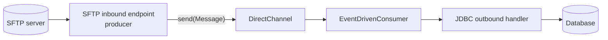
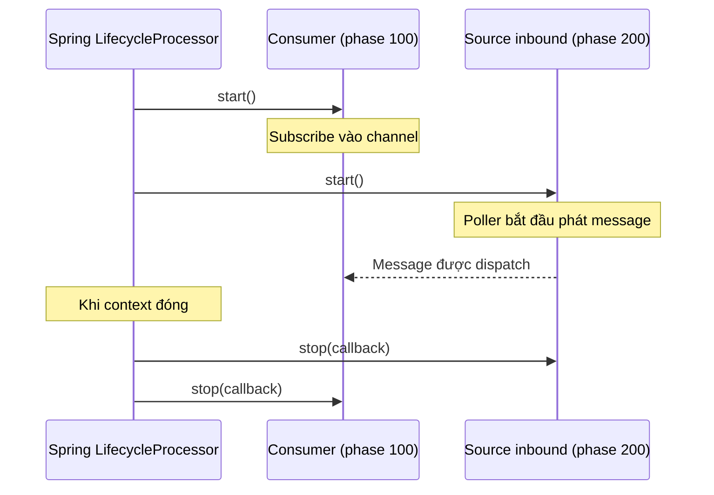
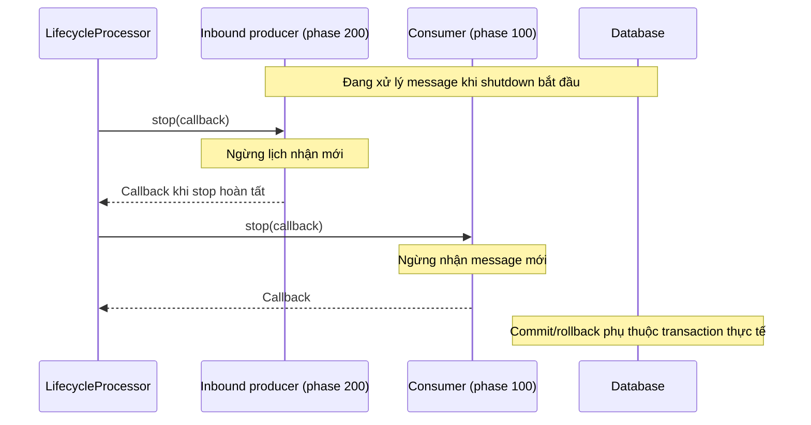
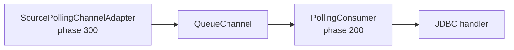

# SmartLifecycle và thứ tự khởi động

Trong Spring Integration, tạo đúng `MessageSource`, `MessageChannel` và `MessageHandler` vẫn chưa đủ để một luồng chạy ổn định. Ứng dụng còn phải quyết định **endpoint nào bắt đầu nhận dữ liệu trước, endpoint nào bắt đầu phát dữ liệu sau, và khi dừng thì ngắt ở đâu trước**. Spring dùng hợp đồng `SmartLifecycle` và thuộc tính `phase` để điều phối các thành phần được quản lý trong `ApplicationContext`.

Bài thuộc chương **Kiểu endpoint** của module **SPRING_INTEGRATION_ADAPTERS**. Module xây dựng các luồng kết nối file, SFTP, HTTP, JMS, AMQP, Kafka và cơ sở dữ liệu bằng inbound/outbound adapter, gateway, poller và `MessageChannel`; đồng thời quan tâm đến hợp đồng message, xử lý lỗi và vòng đời kết nối. Chủ đề ở đây là **vòng đời của endpoint và thứ tự start/stop**, bao gồm cả những giới hạn của cơ chế này khi hệ thống ngoài chậm, lỗi hoặc khởi động độc lập.

## 1. Mục tiêu học tập

Sau bài học, bạn có thể:

1. Giải thích `Lifecycle`, `Phased`, `SmartLifecycle` và cách Spring quản lý chúng.
2. Phân biệt `autoStartup`, `phase`, `isRunning()`, `start()`, `stop()` và `stop(Runnable)`.
3. Dùng nguyên tắc **consumer sẵn sàng trước producer** để đặt phase trong một luồng adapter có channel nội bộ.
4. Viết Java DSL với endpoint ID và phase tường minh, sau đó tra cứu lifecycle qua `ApplicationContext`.
5. Phân tích tác động khi dừng poller, dừng consumer, backlog trong `QueueChannel` và task đang thực thi.
6. Không nhầm “endpoint đang chạy” với “kết nối đã sẵn sàng”, “đã xử lý hết dữ liệu” hay “đã commit thành công”.
7. Đề xuất kế hoạch khởi động và tắt an toàn cho các adapter file/SFTP/HTTP/JMS/AMQP/Kafka/JDBC.

## 2. Vì sao thứ tự khởi động quan trọng?

Xét một flow:



Giả sử inbound adapter bắt đầu quét SFTP và phát message **trước khi consumer đã subscribe** vào `DirectChannel`. Khi producer gửi, channel có thể báo không có subscriber; nguồn có thể đã đánh dấu file là đã nhận hoặc gặp lỗi gửi. Ngược lại, nếu consumer được start trước, channel đã có handler khi producer bắt đầu đưa dữ liệu vào.

Khi shutdown, mong muốn thường ngược lại: **ngừng lấy dữ liệu mới trước**, rồi cho các bước đang xử lý kết thúc hoặc rút hết backlog theo chính sách nghiệp vụ, sau đó mới dừng consumer.

Một cách diễn đạt:

```text
START (phase tăng dần):
Consumer / downstream   -->   Producer / inbound

STOP (phase giảm dần):
Producer / inbound      -->   Consumer / downstream
```

Đây là quy tắc tổ chức *các endpoint có phụ thuộc thực sự*. Không phải mọi thành phần luôn cần sắp xếp bằng một dãy phase; các channel, adapter và dịch vụ độc lập có thể chạy ở phase khác nhau. Thứ tự phù hợp phải được chọn theo luồng dữ liệu và yêu cầu của hệ thống đích.

## 3. Bộ ba giao diện vòng đời của Spring

### 3.1. `Lifecycle`

`org.springframework.context.Lifecycle` cung cấp các thao tác cơ bản:

```java
// Hợp đồng rút gọn để giải thích.
public interface Lifecycle {
    void start();
    void stop();
    boolean isRunning();
}
```

- `start()`: yêu cầu thành phần bắt đầu hoạt động.
- `stop()`: yêu cầu thành phần dừng theo cách mà implementation hỗ trợ.
- `isRunning()`: phản ánh trạng thái lifecycle do thành phần báo cáo.

`isRunning() == true` **không phải bảo đảm** TCP socket đang kết nối, database đang phản hồi, broker đã phân công partition hay mọi message đã xử lý thành công.

### 3.2. `Phased`

`org.springframework.context.Phased` cung cấp `getPhase()`. Spring dùng giá trị phase để sắp xếp thứ tự giữa các bean lifecycle do container điều phối. Nguyên tắc chung:

- **Start:** phase số nhỏ hơn bắt đầu trước phase số lớn hơn.
- **Stop:** phase số lớn hơn dừng trước phase số nhỏ hơn.
- **Cùng phase:** không nên dựa vào một thứ tự ngầm ổn định giữa các bean độc lập; nếu có phụ thuộc thực sự, thể hiện nó tường minh.

Phase có thể âm, bằng 0 hoặc dương. Nó là giá trị thứ tự, **không phải số giây chờ**, không phải mức độ ưu tiên của thread và không phải thứ tự xử lý message.

### 3.3. `SmartLifecycle`

`org.springframework.context.SmartLifecycle` mở rộng `Lifecycle` và `Phased`, bổ sung khả năng tự start và dừng có callback:

```java
// Minh họa các thành phần quan trọng của giao diện.
public interface SmartLifecycle extends Lifecycle, Phased {
    boolean isAutoStartup();
    void stop(Runnable callback);
}
```

Cấu trúc rút gọn trên bỏ qua các phương thức/default implementation khác của phiên bản Spring Framework thực tế. Khi context được refresh, `LifecycleProcessor` quản lý việc tự khởi động những bean `SmartLifecycle` phù hợp. Khi đóng context, bộ xử lý vòng đời gọi cơ chế dừng theo phase và đợi callback trong giới hạn timeout của từng phase.

| Thành phần | Thuộc tính/phương thức | Câu hỏi vận hành |
|---|---|---|
| Auto start | `isAutoStartup()` | Endpoint có tự bắt đầu khi context khởi tạo không? |
| Phase | `getPhase()` | Nó bắt đầu trước/sau endpoint nào? |
| Trạng thái | `isRunning()` | Endpoint đã được start theo lifecycle chưa? |
| Khởi động | `start()` | Bắt đầu đăng ký nhận hoặc lập lịch poll |
| Dừng trực tiếp | `stop()` | Yêu cầu ngừng hoạt động |
| Dừng có callback | `stop(Runnable)` | Báo cho container khi bước dừng đã hoàn tất |

**Không dùng `phase` để “chờ 5 giây cho database khởi động”**. Phase quyết định thứ tự gọi start/stop trong một Spring context. Nó không xác nhận tài nguyên ở ngoài tiến trình đã sẵn sàng.

## 4. Endpoint Spring Integration áp dụng vòng đời thế nào?

Phần lớn các endpoint Spring Integration có vòng đời do Spring quản lý. Tùy loại endpoint, hành vi start/stop khác nhau:

| Endpoint | Khi start | Khi stop | Vấn đề cần lưu ý |
|---|---|---|---|
| `EventDrivenConsumer` | Subscribe `MessageHandler` vào `SubscribableChannel` | Unsubscribe handler | `DirectChannel` có thể không còn subscriber |
| `PollingConsumer` | Bắt đầu lịch poll một `PollableChannel` | Ngừng lịch poll mới | Queue có thể còn message chưa lấy |
| `SourcePollingChannelAdapter` | Bắt đầu poll `MessageSource`, gửi tới output channel | Ngừng poll nguồn | Tác vụ nhận/gửi đang chạy cần xét riêng |
| HTTP inbound gateway/adapter | Tiếp nhận và xử lý request theo cấu hình | Ngừng hoạt động endpoint tương ứng | HTTP server và kết nối đang mở có vòng đời riêng |
| JMS/AMQP listener inbound | Kích hoạt container/listener liên quan | Ngừng listener theo khả năng của adapter/container | Ack, redelivery và giao dịch theo broker |
| Kafka message-driven inbound | Kích hoạt consumer container | Ngừng consumer/container theo cấu hình | Commit offset, rebalance, in-flight records |
| Outbound handler được gắn vào channel | Consumer endpoint gọi handler khi có message | Dừng consumer endpoint | Đối tượng client/cổng kết nối có thể có vòng đời riêng |

Tên `SmartLifecycle` nói về việc quản lý **thành phần đang chạy**. Nó **không có nghĩa** mọi `MessageHandler` đều là một `SmartLifecycle` riêng. Thường chính consumer endpoint mới chịu trách nhiệm đăng ký hoặc poll channel để gọi handler.

Với một `DirectChannel`, khả năng nhận message của consumer gắn với việc subscribe. Với `QueueChannel`, message có thể tiếp tục nằm đợi khi `PollingConsumer` dừng, nhưng queue có thể đầy hoặc dữ liệu có thể mất nếu nó chỉ tồn tại trong bộ nhớ và process kết thúc.

## 5. `autoStartup`: khởi động tự động hay có điều kiện?

Một endpoint có `autoStartup=true` thường được Spring lifecycle processor start khi context khởi tạo. Với `autoStartup=false`, endpoint không tự bắt đầu trong vòng khởi tạo lifecycle đó; ứng dụng có thể chủ động gọi `start()` khi điều kiện phụ thuộc sẵn sàng.

Ví dụ trong Java DSL:

```java
// Trích bên trong IntegrationFlow; endpoint đã có input channel phù hợp.
.handle(handler, endpoint -> endpoint
        .id("invoiceWriterEndpoint")
        .autoStartup(false)
        .phase(100))
```

Cấu hình này hữu ích khi cần đợi hệ thống đích hoàn tất kiểm tra kết nối hoặc chờ điều kiện nghiệp vụ. Tuy nhiên, **`autoStartup=false` không tự kích hoạt lại endpoint khi database khỏe**. Cần có một phần điều phối phù hợp gọi `start()` sau khi đã kiểm tra điều kiện sẵn sàng.

Không nên nhầm `autoStartup` với:

- `@Lazy`: trì hoãn khởi tạo bean, là một khái niệm khác việc start endpoint.
- `@DependsOn`: biểu diễn phụ thuộc khởi tạo bean, không thay thế việc kiểm tra endpoint hoặc hệ thống ngoài đã sẵn sàng.
- Readiness/liveness probe của ứng dụng: phản ánh điều kiện phục vụ traffic, không tự quyết định mọi endpoint có bắt đầu poll hay không.

## 6. `phase`: sắp xếp downstream trước upstream

Giả sử một producer theo lịch gửi message vào `DirectChannel`, còn consumer nhận message đồng bộ từ channel. Quy tắc đặt phase có thể là:

| Thành phần | ID | Phase minh họa | Ý định |
|---|---|---:|---|
| Consumer ghi dữ liệu | `recordsConsumerEndpoint` | **100** | Start trước để subscribe |
| Inbound polling source | `recordsInboundEndpoint` | **200** | Start sau để gửi khi downstream đã nhận |
| Context shutdown | — | Theo thứ tự giảm dần | Stop producer phase 200 trước, consumer phase 100 sau |



Các con số **100** và **200 chỉ là ví dụ**, không phải giá trị mặc định của Spring Integration. Nếu ứng dụng đã có các phase khác, chọn giá trị nhất quán với toàn bộ luồng. Những bean được quản lý trong các context hoặc tiến trình **khác nhau** không được sắp thứ tự bởi phase của một context.

### 6.1. Vì sao consumer trước producer?

Với `DirectChannel`, producer gửi message khi chưa có subscriber có thể gặp `MessageDeliveryException`. Nếu inbound poller đã lấy file hoặc DB record trước khi downstream subscribe, khôi phục trạng thái nguồn trở nên khó hơn.

Khi consumer start trước, việc subscribe đã sẵn sàng *ở mức channel nội bộ*. Nhưng điều đó vẫn **không xác nhận** database đích, HTTP API, SFTP server hoặc broker ở xa đã sẵn sàng. Hệ thống cần retry/backoff và cơ chế xác nhận phù hợp.

### 6.2. Khi nào phải điều chỉnh nguyên tắc?

Nếu consumer phụ thuộc một client connection riêng cũng implement `SmartLifecycle`, có thể cần client khởi động trước consumer, hoặc chờ health/readiness của hệ thống đích. Khi một luồng chứa nhiều nhánh, lựa chọn phase theo **đồ thị phụ thuộc**; không đặt tùy tiện một phase “đẹp” cho tất cả endpoint.

Trong hệ thống có message-driven inbound adapter, listener container cũng là phần của luồng producer. Thứ tự lý tưởng thường là downstream sẵn sàng rồi mới nhận từ broker, nhưng còn phụ thuộc cách adapter khởi động và cơ chế redelivery của broker.

## 7. Ví dụ hoàn chỉnh: Java DSL điều khiển phase

Ví dụ sử dụng một `MessageSource<String>` đọc ba bản ghi từ queue mẫu và gửi vào `DirectChannel`. Consumer ghi log. Hai flow được khai báo riêng để đặt ID và phase cho đúng hai endpoint.

**Dependency Maven** (dự án dùng Spring Boot và phiên bản Java tương thích, ví dụ Java 17+):

```xml
<dependency>
    <groupId>org.springframework.boot</groupId>
    <artifactId>spring-boot-starter-integration</artifactId>
</dependency>
```

Đặt lớp sau trong package được Spring Boot component-scan:

```java
package com.example.integration;

import java.time.Duration;
import java.util.List;
import java.util.Queue;
import java.util.concurrent.ConcurrentLinkedQueue;

import org.springframework.context.annotation.Bean;
import org.springframework.context.annotation.Configuration;
import org.springframework.integration.channel.DirectChannel;
import org.springframework.integration.config.EnableIntegration;
import org.springframework.integration.core.MessageSource;
import org.springframework.integration.dsl.IntegrationFlow;
import org.springframework.integration.dsl.Pollers;
import org.springframework.messaging.MessageChannel;
import org.springframework.messaging.MessageHandler;
import org.springframework.messaging.support.MessageBuilder;

@Configuration
@EnableIntegration
public class LifecycleFlowConfig {

    @Bean("recordsChannel")
    public MessageChannel recordsChannel() {
        return new DirectChannel();
    }

    // Demo MessageSource: trong sản phẩm thật có thể là file/SFTP/JDBC.
    @Bean("recordsSource")
    public MessageSource<String> recordsSource() {
        Queue<String> pending = new ConcurrentLinkedQueue<>(
                List.of("REC-101", "REC-102", "REC-103"));

        return () -> {
            String record = pending.poll();
            return record == null
                    ? null
                    : MessageBuilder.withPayload(record).build();
        };
    }

    // Producer: SourcePollingChannelAdapter do Java DSL tạo.
    @Bean
    public IntegrationFlow recordsInboundFlow(
            MessageSource<String> recordsSource) {
        return IntegrationFlow.from(
                    recordsSource,
                    endpoint -> endpoint
                            .id("recordsInboundEndpoint")
                            .phase(200)
                            .autoStartup(true)
                            .poller(Pollers
                                    .fixedDelay(Duration.ofSeconds(2))
                                    .maxMessagesPerPoll(1)))
                .channel("recordsChannel")
                .get();
    }

    // Consumer: EventDrivenConsumer do Java DSL tạo.
    @Bean
    public IntegrationFlow recordsConsumerFlow() {
        return IntegrationFlow.from("recordsChannel")
                .handle(
                        (MessageHandler) message -> {
                            System.out.println("Xử lý "
                                    + message.getPayload());
                        },
                        endpoint -> endpoint
                                .id("recordsConsumerEndpoint")
                                .phase(100)
                                .autoStartup(true))
                .get();
    }
}
```

Lớp `@SpringBootApplication` đặt tại `com.example.integration` hoặc package cha có thể chạy hai flow này. Sau khi Spring context được refresh, kết quả dự kiến có các dòng:

```text
Xử lý REC-101
Xử lý REC-102
Xử lý REC-103
```

**Giải thích thứ tự:**

1. Spring đăng ký các bean cấu hình, channel, source và flow.
2. Khi lifecycle processor auto-start các endpoint, `recordsConsumerEndpoint` (phase 100) được start trước: handler subscribe `recordsChannel`.
3. `recordsInboundEndpoint` (phase 200) được start sau: poller gọi `recordsSource.receive()` và gửi message vào channel.
4. Khi source hết dữ liệu, `receive()` trả `null`; điều này là trạng thái bình thường, endpoint vẫn có thể `running=true`.
5. Khi context đóng, endpoint producer phase 200 được stop trước consumer phase 100, giúp ngăn phát thêm message trước khi gỡ subscriber.

**Giới hạn demo:** `ConcurrentLinkedQueue` chỉ nằm trong bộ nhớ. Việc `poll()` lấy một phần tử khỏi queue không có xác nhận hay rollback nếu downstream gặp lỗi. Để chạy thật với file, SFTP, Kafka hay JDBC, cần cơ chế retry/redelivery và idempotency tương ứng.

### 7.1. Quan sát phase và trạng thái từ `ApplicationContext`

Bạn có thể thêm cấu hình kiểm tra trong một lớp `@Configuration`:

```java
import org.springframework.boot.ApplicationRunner;
import org.springframework.context.ApplicationContext;
import org.springframework.context.SmartLifecycle;
import org.springframework.context.annotation.Bean;

@Bean
ApplicationRunner inspectLifecycles(ApplicationContext context) {
    return args -> {
        SmartLifecycle consumer = context.getBean(
                "recordsConsumerEndpoint", SmartLifecycle.class);
        SmartLifecycle producer = context.getBean(
                "recordsInboundEndpoint", SmartLifecycle.class);

        System.out.printf("Consumer: phase=%d, running=%s%n",
                consumer.getPhase(), consumer.isRunning());
        System.out.printf("Producer: phase=%d, running=%s%n",
                producer.getPhase(), producer.isRunning());
    };
}
```

Trong ví dụ, output cần phản ánh phase 100 và 200. Khi `ApplicationRunner` thực thi, các endpoint auto-start thường đã được lifecycle processor khởi động. Trạng thái `running=true` chỉ xác nhận endpoint ở trạng thái chạy theo hợp đồng, không bảo đảm source hiện có dữ liệu.

Đừng dùng `ApplicationRunner` này để tự ý `stop()` các endpoint trong ứng dụng thật: các thao tác trên là quyết định vận hành và có thể làm ngắt luồng xử lý.

## 8. Điều khiển start/stop thủ công

Khi cần khởi động một luồng sau khi kiểm tra điều kiện, cấu hình `autoStartup(false)` cho producer và consumer phù hợp. Sau đó, có thể gọi theo thứ tự:

```java
// Trích minh họa: context là ApplicationContext hợp lệ.
SmartLifecycle consumer = context.getBean(
        "recordsConsumerEndpoint", SmartLifecycle.class);
SmartLifecycle producer = context.getBean(
        "recordsInboundEndpoint", SmartLifecycle.class);

// Sau khi xác nhận hệ thống đích đã sẵn sàng:
consumer.start();
producer.start();

// Khi muốn ngừng nhận thêm dữ liệu:
producer.stop();
// Sau khi xử lý xong công việc đang chạy theo cơ chế riêng:
consumer.stop();
```

**Lưu ý:** `phase` điều khiển thứ tự khi Spring lifecycle processor điều phối các bean. Nếu code tự gọi `start()` hoặc `stop()` **từng bean**, chính code phải chọn đúng thứ tự; `phase` không tự sắp xếp lại các lời gọi thủ công.

Một phương án khác là dùng các API điều khiển `IntegrationFlow`/endpoint có quản lý lifecycle phù hợp với phiên bản đang dùng; dù chọn API nào, cần biết endpoint nào thực sự bị start/stop và có gửi message trong khoảng chuyển trạng thái hay không.

### 8.1. `stop(Runnable)` có nghĩa gì?

Ở shutdown do container điều phối, `SmartLifecycle.stop(Runnable callback)` cho thành phần khả năng **dừng bất đồng bộ**. Thành phần cần gọi callback khi phần việc dừng đã hoàn tất. Spring đợi các callback trong giới hạn timeout của giai đoạn shutdown.

```java
// Pseudocode của một SmartLifecycle tùy biến:
@Override
public void stop(Runnable callback) {
    requestStopAcceptingWork();

    // Nếu có cleanup bất đồng bộ, gọi callback SAU khi cleanup hoàn tất:
    completeShutdownAsync(() -> {
        running = false;
        callback.run();
    });
}
```

Đoạn code chỉ minh họa *ngữ nghĩa*; các hàm `requestStopAcceptingWork` và `completeShutdownAsync` do ứng dụng tự định nghĩa, không phải API có sẵn. Trong code thật, phải bảo đảm callback được gọi **một lần kể cả khi cleanup thất bại**, tránh khiến Spring phải chờ đến timeout. Nếu không có công việc bất đồng bộ, có thể dừng đồng bộ rồi gọi callback.

Không nên hiểu callback là “mọi message đã commit”: chỉ có nghĩa thành phần báo **bước stop đã hoàn tất theo contract của nó**. Với listener hoặc thread pool, cần kiểm tra cụ thể implementation có chờ tác vụ đang chạy, hoàn tất ack hay chỉ ngừng nhận mới.

## 9. Shutdown có thứ tự và xử lý message đang bay

Với luồng `SFTP inbound → DirectChannel → JDBC handler`, việc dừng inbound trước consumer giúp không bắt đầu thêm lượt poll mới. Tuy nhiên, một lượt poll đã bắt đầu có thể vẫn đang đọc file, gửi message hoặc ghi DB.



**Những điều không nên tự giả định:**

- Stop endpoint không tự rollback một file đã được đọc hoặc một API đã được gọi.
- Stop polling endpoint không nhất thiết hủy ngay mọi task đang chạy; tùy scheduler, timeout và khả năng interrupt.
- Stop consumer không chứng minh buffer hoặc broker đã hết message.
- `QueueChannel` mặc định không mang tính lưu bền qua process restart.
- HTTP response, JMS/AMQP ack, Kafka offset commit và DB commit có thời điểm hoàn thành riêng.

Khi cần đảm bảo dữ liệu, hãy xác định **thời điểm nguồn xác nhận đã nhận** và **thời điểm hệ thống đích commit**. Đối với broker, dùng ack/offset và redelivery phù hợp; đối với file/SFTP, dùng metadata store hoặc chiến lược đánh dấu file; đối với JDBC, dùng transaction hoặc claim bản ghi nguyên tử. Kết hợp idempotency để xử lý an toàn khi dữ liệu được nhận lại.

### 9.1. Nếu dùng `QueueChannel` ở giữa



Ở giai đoạn start, consumer phase 200 khởi động trước source phase 300. Khi stop, source dừng trước rồi mới đến consumer. **Nhưng** chỉ hai phase này **không đảm bảo queue được drain hoàn toàn** trước khi consumer bị dừng.

Nếu yêu cầu rút hết backlog, ứng dụng cần một bước điều phối bổ sung: ngừng producer, chờ queue và các task đang chạy đạt điều kiện mong muốn trong thời hạn cho phép, rồi dừng consumer. Việc đo queue depth chỉ là một tín hiệu; queue rỗng nhưng handler có thể vẫn đang xử lý message đã dequeue. Cần theo dõi **in-flight work** và xác nhận commit nếu muốn kết luận hoàn tất.

## 10. Khi nào phase không đủ?

### 10.1. Một database hoặc server SFTP chưa sẵn sàng

Spring có thể start được handler/endpoint nhưng lần truy cập DB hoặc SFTP vẫn timeout. Phase chỉ sắp thứ tự lời gọi lifecycle **trong cùng Spring context**, không đợi server ngoài khỏe. Cần connection timeout, retry với giới hạn/backoff, circuit breaker hoặc readiness gate thích hợp.

### 10.2. Nhiều instance triển khai cùng lúc

Instance A và instance B có các `SmartLifecycle` riêng. `phase=100` trong instance A không đảm bảo listener của instance B đã start. Khi các instance cùng poll SFTP/JDBC hoặc consume Kafka, dùng cơ chế claim, consumer group, partition, lock hoặc metadata store tương ứng để tránh tranh chấp và trùng lặp.

### 10.3. Channel bất đồng bộ

Với `ExecutorChannel`, việc `send()` hoàn thành không đồng nghĩa handler hoàn thành. Một producer endpoint có thể báo đã stop trong khi executor vẫn còn công việc. Cần xét chính sách executor shutdown, backlog, queue capacity và transaction ở thread xử lý.

### 10.4. Nhiều `ApplicationContext`

Một ứng dụng có context cha/con hoặc nhiều context độc lập không tự có một thứ tự lifecycle toàn cục chỉ vì cùng dùng phase. Khi cần ràng buộc giữa các context hoặc dịch vụ, phải có orchestration hoặc kiểm tra readiness riêng.

### 10.5. `autoStartup=false` và start thủ công

Nếu một bean không auto-start, phase của nó **không ép Spring tự gọi start**. Một endpoint chỉ được start thủ công có thể bỏ qua thứ tự mong muốn nếu ứng dụng gọi trước endpoint phụ thuộc.

## 11. Cấu hình với annotation và các loại adapter

Java DSL cho phép cấu hình endpoint bằng `.id(...)`, `.autoStartup(...)`, `.phase(...)`. Đối với endpoint được tạo từ annotation, hãy dùng những thuộc tính lifecycle được annotation hỗ trợ trong phiên bản Spring Integration của dự án và xác minh **ID endpoint thực tế** (ví dụ với `@EndpointId`), sau đó kiểm tra `SmartLifecycle` bằng Spring context.

Khi cấu hình từ Java DSL hoặc XML, nên gắn phase **vào đúng endpoint cần điều khiển**:

| Luồng | Producer ở đâu? | Consumer ở đâu? | Gợi ý start/stop |
|---|---|---|---|
| File inbound polling → file outbound | `SourcePollingChannelAdapter` đọc file | Consumer gọi `FileWritingMessageHandler` | Consumer trước, source poller sau |
| SFTP inbound → JDBC outbound | SFTP inbound endpoint | Consumer/handler JDBC | Đảm bảo handler sẵn sàng trước khi poll SFTP |
| HTTP inbound gateway → service | Gateway nhận request | Consumer nhận channel nội bộ | Kiểm tra request có thể đến trước subscriber không |
| JMS/AMQP inbound listener → DB | Listener/container inbound | Handler ghi DB | Cần xem ack, redelivery và transaction |
| Kafka inbound → HTTP outbound | Kafka consumer adapter/container | Handler hoặc outbound gateway gọi HTTP | Cần xem partition assignment, offset commit, timeout |
| JDBC polling → Kafka outbound | JDBC source poller | Consumer gửi Kafka | Gắn readiness và cơ chế claim/idempotency |

Các listener container, kết nối HTTP, session SFTP, Kafka consumer, JMS/AMQP connection và database pool đều có cấu hình/tài nguyên riêng. Đặt phase cho **consumer endpoint nội bộ** không tự bảo đảm toàn bộ adapter ngoài đã dừng hoặc kết nối đã giải phóng.

## 12. Quy trình vận hành an toàn cho một flow

Khi một luồng tích hợp cần khởi động hoặc dừng có chủ đích, hãy mô tả được trình tự và điều kiện hoàn thành:

1. **Nhận diện endpoint:** Liệt kê ID và runtime class; phân biệt nguồn ngoài, channel, consumer và handler.
2. **Xác định phụ thuộc:** Consumer nào phải subscribe hoặc sẵn sàng trước khi producer gửi? Hệ thống đích đã có connection và schema phù hợp chưa?
3. **Chọn phase:** Gán số thấp cho thành phần cần start sớm; số cao cho thành phần cần dừng sớm.
4. **Bật/tắt autoStartup:** Những endpoint cần kiểm tra readiness trước khi nhận traffic có thể được quản trị bằng start thủ công.
5. **Kiểm tra startup:** Theo dõi `isRunning()`, thử gửi một message an toàn và xác minh downstream hoàn tất.
6. **Khi shutdown:** Ngừng tiếp nhận dữ liệu mới, quan sát in-flight/backlog, để consumer hoàn tất theo deadline rồi đóng tài nguyên.
7. **Sau restart:** Kiểm tra state nguồn, redelivery, idempotency và dữ liệu được ghi trùng hoặc mất.

Với Spring Boot, cấu hình `spring.lifecycle.timeout-per-shutdown-phase` có thể giới hạn thời gian mà lifecycle processor đợi bean ở từng phase trong lúc shutdown. Ví dụ:

```properties
spring.lifecycle.timeout-per-shutdown-phase=30s
```

Đây là **giới hạn chờ shutdown**, không phải bảo đảm rằng dữ liệu đã flush/commit hết trong 30 giây. Giá trị nên được cân nhắc theo thời gian xử lý lớn nhất, các tác vụ đang chạy và yêu cầu dừng của môi trường triển khai.

## 13. Các lỗi thường gặp

| Nhận định sai | Cách hiểu đúng |
|---|---|
| “Phase càng lớn thì start càng sớm.” | Phase thấp thường start trước; khi stop, thứ tự đảo ngược. |
| “Phase 200 nghĩa là chờ 200 ms.” | Phase chỉ là giá trị sắp thứ tự lifecycle. |
| “`autoStartup=false` nghĩa bean không được khởi tạo.” | Bean vẫn có thể được tạo; chỉ endpoint không tự start trong chu kỳ auto-start. |
| “Consumer chạy rồi thì DB chắc chắn khỏe.” | `isRunning()` không phải kiểm tra kết nối/commit của DB. |
| “Stop inbound là mọi message đang xử lý đã kết thúc.” | Có thể còn task đang chạy hoặc message đã enqueue. |
| “Dừng `QueueChannel` consumer sẽ xóa backlog.” | Queue có thể vẫn còn message; mất qua restart phụ thuộc storage. |
| “Đặt phase đảm bảo exactly-once.” | Cần thêm ack, transaction, redelivery, metadata/idempotency theo giao thức. |
| “Mọi thứ có phase sẽ tự start.” | Phải xét `isAutoStartup()` và cách bean được quản lý. |
| “Gọi `start()` thủ công sẽ tự sắp thứ tự các bean khác.” | Lời gọi thủ công cần đảm bảo các dependency đã sẵn sàng. |
| “Hai service khác nhau có phase giống nhau thì start đồng bộ.” | Phase không điều phối giữa các tiến trình độc lập. |

## 14. Bài tập thực hành

### Bài 1 — Xác minh thứ tự start và stop

Dùng ví dụ ở mục 7. Thêm log lifecycle phù hợp hoặc breakpoint để quan sát `recordsConsumerEndpoint` (phase 100) và `recordsInboundEndpoint` (phase 200). Ghi lại thứ tự khi context khởi động và khi shutdown. Đổi hai giá trị phase cho nhau và mô tả rủi ro khi producer có dữ liệu ngay từ lượt poll đầu tiên.

### Bài 2 — `autoStartup=false`

Cấu hình hai endpoint không auto-start. Trong một `ApplicationRunner`, kiểm tra `isRunning()`, rồi lần lượt gọi `consumer.start()`, `producer.start()`. So sánh với việc start producer trước. Giải thích vì sao `phase` không tự đổi thứ tự các lời gọi do code tự thực hiện.

### Bài 3 — Queue còn backlog

Thiết kế `SourcePollingChannelAdapter → QueueChannel → PollingConsumer → JDBC handler`. Tạo 20 message; producer poll nhanh, consumer xử lý chậm. Khi producer dừng, theo dõi queue depth và số handler đang thực thi. Đề xuất điều kiện rõ ràng để dừng consumer an toàn, và nêu vì sao queue depth bằng 0 vẫn chưa chắc DB đã commit hết.

### Bài 4 — SFTP và database khởi động chậm

Một dịch vụ bắt đầu poll SFTP ngay khi JVM chạy, còn database cần thêm thời gian migrate schema. Thiết kế startup theo phase và readiness gate: khi nào bắt đầu poll file? Khi DB tạm mất kết nối sau khi hệ thống đã chạy, cần retry, idempotency và trạng thái lỗi nào?

### Bài 5 — Message-driven và shutdown

Một Kafka inbound adapter đang nhận bản ghi rồi gửi sang HTTP outbound gateway. Tại lúc shutdown, có record đã được nhận nhưng HTTP chưa trả lời. Phân tích các thời điểm: nhận record, gọi HTTP, HTTP thành công, commit offset, callback stop. Nêu những trường hợp có thể retry hoặc tạo tác dụng phụ trùng; phase giúp gì và giới hạn ở đâu?

### Bài 6 — Thiết kế thứ tự cho ba endpoint

Cho các endpoint: `fileInbound`, `validateInvoice`, `persistInvoice`, với các channel đồng bộ và một `QueueChannel` trước bước ghi DB. Đề xuất phase tương ứng để start downstream trước upstream. Sau đó thiết kế stop có điều kiện rút hết queue; giải thích tại sao chỉ gán phase không đủ.

## 15. Câu hỏi tự kiểm tra

1. `SmartLifecycle` bổ sung điều gì so với `Lifecycle`?
2. Với phase 100 và 200, endpoint nào start trước? Endpoint nào stop trước?
3. `autoStartup=false` có làm bean hoàn toàn biến mất khỏi `ApplicationContext` không?
4. `EventDrivenConsumer` và `SourcePollingChannelAdapter` thực hiện điều gì khi start và stop?
5. Vì sao `DirectChannel` có thể báo lỗi khi producer chạy trước consumer?
6. Vì sao queue rỗng không chứng minh mọi handler đã hoàn tất?
7. `stop(Runnable)` cần gọi callback khi nào?
8. Phase có quản lý thứ tự khởi động giữa hai Kubernetes pod không?
9. Khi `isRunning()==true`, còn cần kiểm tra gì trước khi tuyên bố dịch vụ đã sẵn sàng?
10. Với JMS/AMQP/Kafka, tại sao thứ tự lifecycle không thay thế cấu hình ack, offset và idempotency?

Cần nhớ đường đi của một message và điểm bắt đầu hoạt động của mỗi thành phần: **hệ thống nguồn → inbound adapter → channel → consumer endpoint → handler → hệ thống đích**. Đặt phase theo thứ tự phụ thuộc, xác nhận readiness và có chiến lược xử lý message đang bay là những bước cụ thể giúp flow tránh mất dữ liệu trong quá trình startup/shutdown.

## Tài liệu tham khảo

- [Spring Framework API — SmartLifecycle](https://docs.spring.io/spring-framework/docs/current/javadoc-api/org/springframework/context/SmartLifecycle.html)
- [Spring Framework API — Lifecycle](https://docs.spring.io/spring-framework/docs/current/javadoc-api/org/springframework/context/Lifecycle.html)
- [Spring Framework Reference — Startup and Shutdown Callbacks](https://docs.spring.io/spring-framework/reference/core/beans/factory-nature.html#beans-factory-lifecycle-processor)
- [Spring Integration Reference — Message Endpoints](https://docs.spring.io/spring-integration/reference/endpoint.html)
- [Spring Integration Reference — Polling Consumer](https://docs.spring.io/spring-integration/reference/endpoint/polling-consumer.html)
- [Spring Integration Reference — Java DSL](https://docs.spring.io/spring-integration/reference/dsl/java-basics.html)
- [Spring Boot Reference — Graceful Shutdown](https://docs.spring.io/spring-boot/reference/web/graceful-shutdown.html)
