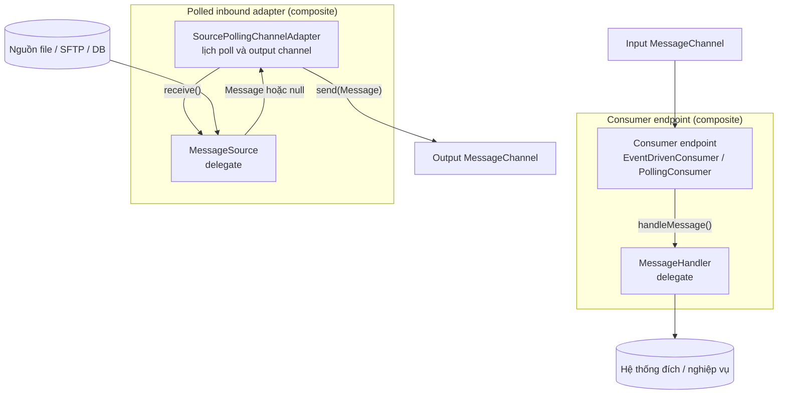
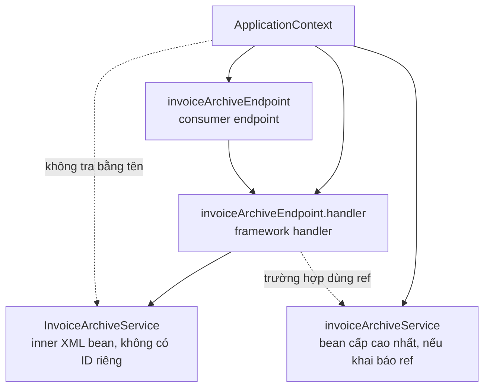
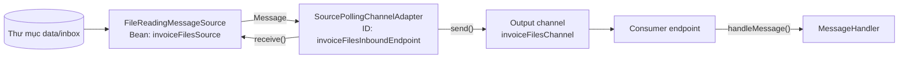
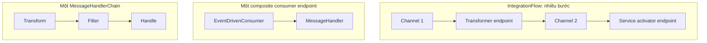

# Endpoint composite và inner bean

Một endpoint Spring Integration thường là **một thành phần logic nhưng được triển khai bằng nhiều đối tượng phối hợp**. Chẳng hạn, consumer endpoint nhận message từ `MessageChannel`, sau đó ủy quyền phần xử lý cho một `MessageHandler`. Tương tự, inbound polling endpoint gọi một `MessageSource` để lấy dữ liệu và đưa message vào channel. Vì vậy, khi tìm một endpoint trong Spring `ApplicationContext`, bạn có thể gặp **bean endpoint** cùng **bean handler/source liên quan**, dù trong XML hoặc Java DSL chỉ có một khai báo ngắn.

Bài thuộc chương **Kiểu endpoint** của module **SPRING_INTEGRATION_ADAPTERS**. Mục tiêu của module là kết nối các hệ thống ngoài bằng inbound/outbound adapter, gateway, poller và `MessageChannel`; thực hành với file, SFTP, HTTP, JMS, AMQP, Kafka và cơ sở dữ liệu, đồng thời kiểm soát message contract, lỗi và vòng đời. Ở đây, ta làm rõ cấu trúc **composite endpoint**, quy tắc **inner bean**, cách truy xuất các thành phần và hệ quả đối với cấu hình, kiểm thử và vận hành.

## 1. Kết quả cần đạt

Sau bài này, bạn có thể:

1. Giải thích vì sao một endpoint consumer cần cả đối tượng điều phối và `MessageHandler`, còn polled inbound adapter cần `MessageSource`.
2. Phân biệt **endpoint composite** với **cả một `IntegrationFlow`** và với **`MessageHandlerChain`**.
3. Nhận diện tên bean `someConsumer.handler` và `somePolledAdapter.source` trong các cấu hình được Spring Integration đăng ký theo quy ước.
4. Phân biệt **handler/source do framework đăng ký thành bean truy xuất được** với **inner bean do ứng dụng khai báo lồng trong XML**, vốn không có tên bean cấp cao nhất để tra cứu trực tiếp.
5. Dùng `ApplicationContext` kiểm tra endpoint, handler, source và trạng thái lifecycle.
6. Lựa chọn lúc nào khai báo một service thành bean `@Bean`/`<beans:bean id="..."/>` riêng và lúc nào dùng đối tượng inline.
7. Phân tích ảnh hưởng tới lỗi, transaction, retry, idempotency và lifecycle của adapter file/SFTP/HTTP/JMS/AMQP/Kafka/JDBC.

## 2. Thế nào là composite endpoint?

Tài liệu Spring Integration mô tả nhiều endpoint là **composite beans**, bao gồm các consumer và polled inbound channel adapter. Một endpoint logic kết hợp phần **điều phối message** với phần **nhận hoặc xử lý dữ liệu**:



### 2.1. Consumer gồm endpoint và handler

`EventDrivenConsumer` đăng ký một handler trên `SubscribableChannel`. Khi channel dispatch, handler được gọi. `PollingConsumer` lấy message từ `PollableChannel` theo poller rồi gọi handler. Cả hai đều **ủy quyền nghiệp vụ cho `MessageHandler`**.

| Đối tượng | Chịu trách nhiệm | Ví dụ |
|---|---|---|
| Consumer endpoint | Chọn cơ chế nhận message, subscribe/poll, lifecycle | `EventDrivenConsumer`, `PollingConsumer` |
| `MessageHandler` | Thực hiện nghiệp vụ theo payload/headers | `FileWritingMessageHandler`, service activator, outbound adapter handler |
| Input `MessageChannel` | Đưa message đến consumer | `DirectChannel`, `QueueChannel`, `ExecutorChannel` |

Endpoint có thể hoạt động và báo `isRunning() == true` mà chưa có message nào được xử lý; handler cũng có thể tồn tại dưới dạng bean nhưng chưa có endpoint đang chạy để gọi nó.

### 2.2. Inbound polling gồm endpoint và source

`SourcePollingChannelAdapter` sử dụng `MessageSource.receive()` để lấy message theo lịch, rồi gửi ra **output channel**.

| Đối tượng | Chịu trách nhiệm | Ví dụ |
|---|---|---|
| `SourcePollingChannelAdapter` | Lập lịch và điều phối `receive() → send()` | Adapter đọc file theo chu kỳ |
| `MessageSource<T>` | Truy cập nguồn, tạo `Message<T>` hoặc trả `null` | `FileReadingMessageSource`, source JDBC polling |
| Output `MessageChannel` | Chuyển message cho luồng tiếp theo | `DirectChannel`, `QueueChannel` |

`MessageSource` đơn độc không tự poll. Ngược lại, inbound adapter chỉ có `SourcePollingChannelAdapter` mà không có source phù hợp sẽ không biết lấy dữ liệu gì.

### 2.3. Composite không đồng nghĩa mọi bean là inner bean

Một endpoint **được ghép từ nhiều đối tượng** không nhất thiết đồng nghĩa tất cả các đối tượng ấy là *Spring inner bean*. Framework có thể đăng ký handler/source dưới một tên bean truy xuất được; ứng dụng cũng có thể tự định nghĩa một service dùng chung thành bean độc lập. **Cấu trúc runtime** và **cách đăng ký bean trong Spring container** là hai khía cạnh liên quan nhưng khác nhau.

## 3. Hai loại bean dễ bị gọi nhầm là “inner”

Đây là điểm trọng tâm của bài.

### 3.1. Delegate do Spring Integration đăng ký

Đối với cấu hình được framework hỗ trợ, endpoint có tên `someConsumer` có thể đi kèm bean `someConsumer.handler`. Tương tự, inbound polling adapter có tên `somePolledAdapter` có thể đi kèm `somePolledAdapter.source`. Tên này được Spring Integration dùng để người vận hành hoặc bài kiểm thử **truy cập delegate** khi cần.

```text
someConsumer                 -> consumer endpoint
someConsumer.handler         -> MessageHandler được framework đăng ký

somePolledAdapter            -> inbound polling endpoint
somePolledAdapter.source     -> MessageSource được framework đăng ký
```

Ví dụ này trình bày **quy ước tên phổ biến trong cấu hình được Spring Integration quản lý**. Không được suy ra mọi phiên bản, mọi Java DSL inline lambda, mọi custom adapter hoặc mọi `@Bean` đều tạo đúng các tên trên. Hãy kiểm tra bean thật trong `ApplicationContext` và giữ tên tường minh cho component cần truy cập ổn định.

### 3.2. Inner bean theo đúng nghĩa Spring XML

Đây là ví dụ một service object được định nghĩa *bên trong* khai báo service activator:

```xml
<!-- Trích đoạn XML: khai báo các namespace beans/int ở file cấu hình bao ngoài -->
<int:service-activator id="invoiceArchiveEndpoint"
                       input-channel="invoiceInput"
                       method="archive">
    <beans:bean class="com.example.integration.InvoiceArchiveService"/>
</int:service-activator>
```

Đối tượng `InvoiceArchiveService` là **Spring inner bean** do bạn khai báo. Nó được tạo để làm delegate cho cấu hình bên ngoài và **không được đăng ký thành một bean cấp cao nhất có tên riêng** để có thể tra cứu trực tiếp bằng:

```java
context.getBean("invoiceArchiveService"); // Không có tên này do XML ở trên tạo.
```

Mặc dù vậy, **thành phần `MessageHandler` của framework** tương ứng với endpoint vẫn có thể được đăng ký theo convention như `invoiceArchiveEndpoint.handler`. Hai đối tượng có vai trò khác nhau: handler là tầng nhận message, còn inner bean là đối tượng nghiệp vụ do handler gọi.

### 3.3. Đưa service thành bean cấp cao nhất khi cần dùng lại

```xml
<beans:bean id="invoiceArchiveService"
            class="com.example.integration.InvoiceArchiveService"/>

<int:service-activator id="invoiceArchiveEndpoint"
                       input-channel="invoiceInput"
                       ref="invoiceArchiveService"
                       method="archive"/>
```

Khi này `invoiceArchiveService` là bean có tên riêng. Có thể inject nó vào bean khác hoặc lấy bằng `context.getBean("invoiceArchiveService")`. Hai ví dụ XML mang cùng ý định xử lý message nhưng **khác về khả năng tra cứu và chia sẻ đối tượng nghiệp vụ**.

| Cách khai báo | Service có bean ID cấp cao nhất? | Có thể inject/reuse bằng ID? | Khi phù hợp |
|---|---|---|---|
| `<beans:bean .../>` lồng trong service activator | Không | Không trực tiếp theo ID riêng | Delegate chỉ phục vụ một cấu hình |
| `<beans:bean id="invoiceArchiveService" .../>` + `ref` | Có | Có | Dùng chung, test, quản lý cấu hình riêng |
| `@Bean("invoiceArchiveService")` trong Java config | Có | Có | Khai báo service rõ danh tính bằng Java |
| Inline lambda của Java DSL | Tùy cách DSL đăng ký thành phần | Không dựa vào một tên tự đoán | Logic ngắn, không cần reuse |
| Component scan với `@Component` | Thông thường có tên bean do Spring cấp | Có, khi được scan và không xung đột tên | Service nghiệp vụ độc lập |

**Quy tắc thực tế:** Nếu một delegate cần được tái sử dụng, cấu hình riêng, mock trực tiếp hoặc truy xuất bằng tên trong nhiều nơi, hãy khai báo **bean cấp cao nhất có ID tường minh**.

## 4. Ví dụ minh họa bằng sơ đồ bean



Sơ đồ gộp **hai phương án cấu hình thay thế nhau**: bên trái là XML inner bean, bên phải là XML dùng `ref`. Trong một cấu hình cụ thể, bạn chọn một phương án cho cùng service activator.

Nhìn vào container, hãy phân biệt:

- **Endpoint bean** quản lý khi nào và từ đâu nhận message.
- **Framework handler bean** thực thi hợp đồng `MessageHandler`, có thể gọi delegate.
- **Service delegate** chứa nghiệp vụ; có thể là inner bean hoặc top-level bean tùy cách đăng ký.
- **Channel bean** là nơi producer gửi message và consumer nhận message.
- **`IntegrationFlow` bean** (nếu dùng Java DSL) là khai báo tổng hợp các thành phần, không thay thế từng bean endpoint.

## 5. Ví dụ thực hành: Java DSL tạo composite consumer

Ví dụ sau tự tạo một `DirectChannel`, một `IntegrationFlow` và một `MessageHandler` **cấp cao nhất** để dễ thấy các ranh giới. Nó dùng Spring Boot, Spring Integration Java DSL và Java 17+.

### 5.1. Phụ thuộc Maven

```xml
<dependency>
    <groupId>org.springframework.boot</groupId>
    <artifactId>spring-boot-starter-integration</artifactId>
</dependency>
```

Dùng Spring Boot BOM hoặc parent để quản lý phiên bản phù hợp, tránh gán thủ công các phiên bản Spring Integration không tương thích.

### 5.2. Cấu hình và quan sát bean thực tế

```java
package com.example.integration;

import java.util.Arrays;

import org.springframework.beans.factory.annotation.Qualifier;
import org.springframework.boot.ApplicationRunner;
import org.springframework.context.ApplicationContext;
import org.springframework.context.annotation.Bean;
import org.springframework.context.annotation.Configuration;
import org.springframework.integration.channel.DirectChannel;
import org.springframework.integration.config.EnableIntegration;
import org.springframework.integration.dsl.IntegrationFlow;
import org.springframework.integration.endpoint.AbstractEndpoint;
import org.springframework.messaging.MessageChannel;
import org.springframework.messaging.MessageHandler;
import org.springframework.messaging.support.MessageBuilder;

@Configuration
@EnableIntegration
public class InvoiceConsumerConfig {

    // Channel bean: nguồn gửi message vào đây.
    @Bean("invoiceInput")
    public MessageChannel invoiceInput() {
        return new DirectChannel();
    }

    // Handler bean có ID rõ ràng, có thể inject / test độc lập.
    @Bean("invoiceArchiveHandler")
    public MessageHandler invoiceArchiveHandler() {
        return message -> {
            String invoiceId = (String) message.getPayload();
            System.out.println("Lưu metadata hóa đơn: " + invoiceId);
        };
    }

    // DSL tạo/cấu hình consumer endpoint nối channel với handler.
    @Bean("invoiceArchiveFlow")
    public IntegrationFlow invoiceArchiveFlow(
            @Qualifier("invoiceArchiveHandler") MessageHandler handler) {
        return IntegrationFlow.from("invoiceInput")
                .handle(handler, endpoint -> endpoint
                        .id("invoiceArchiveEndpoint")
                        .autoStartup(true))
                .get();
    }

    @Bean
    public ApplicationRunner inspectAndSend(
            ApplicationContext context,
            @Qualifier("invoiceInput") MessageChannel input) {
        return args -> {
            AbstractEndpoint endpoint = context.getBean(
                    "invoiceArchiveEndpoint", AbstractEndpoint.class);
            MessageHandler handler = context.getBean(
                    "invoiceArchiveHandler", MessageHandler.class);

            System.out.println("Endpoint = "
                    + endpoint.getClass().getSimpleName());
            System.out.println("Running = " + endpoint.isRunning());
            System.out.println("Handler = " + handler.getClass().getName());

            System.out.println("Các endpoint trong context:");
            Arrays.stream(context.getBeanNamesForType(
                    AbstractEndpoint.class))
                    .sorted()
                    .forEach(System.out::println);

            input.send(MessageBuilder
                    .withPayload("INV-2026-001")
                    .setHeader("sourceSystem", "demo")
                    .build());
        };
    }
}
```

Đặt lớp cấu hình trong package mà `@SpringBootApplication` quét được. Ví dụ ứng dụng:

```java
package com.example.integration;

import org.springframework.boot.SpringApplication;
import org.springframework.boot.autoconfigure.SpringBootApplication;

@SpringBootApplication
public class CompositeEndpointApplication {
    public static void main(String[] args) {
        SpringApplication.run(CompositeEndpointApplication.class, args);
    }
}
```

Với một ứng dụng demo chỉ chứa các bean này, output nghiệp vụ dự kiến là:

```text
Endpoint = EventDrivenConsumer
Running = true
Handler = ... (tên lớp lambda do JVM tạo)
Các endpoint trong context:
invoiceArchiveEndpoint
Lưu metadata hóa đơn: INV-2026-001
```

Tên chính xác của class lambda hoặc các bean bổ sung có thể khác; **không dùng tên class lambda làm contract**. `invoiceArchiveHandler` là bean cấp cao nhất do ứng dụng đặt tên; `invoiceArchiveEndpoint` là endpoint consumer do DSL tạo. Tên flow bean `invoiceArchiveFlow` không đồng nghĩa với endpoint ID.

### 5.3. Vì sao đây là composite endpoint?

Tại runtime, `EventDrivenConsumer` subscribe handler được gắn trong cấu hình. Handler là một đối tượng khác và do framework gọi khi channel dispatch message. Việc đặt handler thành bean `@Bean("invoiceArchiveHandler")` cho phép kiểm thử độc lập; việc đặt `.id("invoiceArchiveEndpoint")` cho phép tra cứu và điều khiển **điểm nhận message**.

Đổi `DirectChannel` thành `QueueChannel` sẽ làm cơ chế consumer khác đi: channel mới là `PollableChannel`, cần cấu hình poller và endpoint sẽ là `PollingConsumer`. Không nên chỉ đổi loại channel mà giữ nguyên các giả định đồng bộ.

## 6. Khi handler là đối tượng inline trong DSL

Java DSL cho phép nhúng handler ngay tại bước `.handle(...)`:

```java
@Bean
IntegrationFlow inlineInvoiceFlow() {
    return IntegrationFlow.from("invoiceInput")
            .handle((MessageHandler) message -> {
                System.out.println("INLINE " + message.getPayload());
            }, endpoint -> endpoint.id("inlineInvoiceEndpoint"))
            .get();
}
```

Đây là **ví dụ thay thế**, không bật đồng thời với flow ở mục 5 khi bạn muốn một message chỉ được xử lý bởi một consumer. Nếu cả hai subscribe vào `DirectChannel`, channel dùng cơ chế point-to-point nên mỗi message thường đến **một** subscriber được chọn, không broadcast.

Ở ví dụ inline:

- Java DSL giữ tham chiếu tới handler và tạo bean/endpoint cần thiết cho flow.
- Tên và kiểu bean handler **do cơ chế đăng ký của DSL quyết định**; không suy ra handler có tên `inlineInvoiceEndpoint.handler` chỉ từ việc bạn viết lambda.
- `inlineInvoiceEndpoint` là ID ổn định của endpoint nhờ `.id(...)`.
- Nếu cần inject handler từ nhiều flow hoặc mock/điều chỉnh độc lập, nên khai báo handler top-level bằng `@Bean`.

Một lambda inline trong Java DSL **không phải** XML inner bean, dù hai cách đều cho phép bạn viết cấu hình ngắn mà không đặt tên riêng cho đối tượng nghiệp vụ.

## 7. Tình huống inbound polling: composite endpoint với `MessageSource`

Với nguồn cần quét định kỳ, adapter có cấu trúc `SourcePollingChannelAdapter + MessageSource`. Ví dụ Java DSL:

```java
package com.example.integration;

import java.io.File;
import java.time.Duration;

import org.springframework.context.annotation.Bean;
import org.springframework.context.annotation.Configuration;
import org.springframework.integration.config.EnableIntegration;
import org.springframework.integration.dsl.IntegrationFlow;
import org.springframework.integration.dsl.Pollers;
import org.springframework.integration.file.FileReadingMessageSource;

@Configuration
@EnableIntegration
public class InvoiceFileInboundConfig {

    @Bean("invoiceFilesSource")
    public FileReadingMessageSource invoiceFilesSource() {
        FileReadingMessageSource source = new FileReadingMessageSource();
        source.setDirectory(new File("data/inbox"));
        source.setAutoCreateDirectory(true);
        return source;
    }

    @Bean
    public IntegrationFlow invoiceFilesInboundFlow(
            FileReadingMessageSource invoiceFilesSource) {
        return IntegrationFlow
                .from(invoiceFilesSource, endpoint -> endpoint
                        .id("invoiceFilesInboundEndpoint")
                        .poller(Pollers
                                .fixedDelay(Duration.ofSeconds(5))
                                .maxMessagesPerPoll(3)))
                .channel("invoiceFilesChannel")
                .get();
    }
}
```

Cần có một consumer khác nhận từ `invoiceFilesChannel` nếu muốn xử lý message; Java DSL dùng tên channel để kết nối. Source ở ví dụ này có **tên bean cấp cao nhất là `invoiceFilesSource`**, vì đã khai báo bằng `@Bean`. Do đó, khi muốn truy xuất source trong `ApplicationContext`, hãy dùng chính tên đó:

```java
FileReadingMessageSource source =
        context.getBean("invoiceFilesSource",
                FileReadingMessageSource.class);
```

Không nên tự giả định luôn có thêm bean `invoiceFilesInboundEndpoint.source`. Quy ước `somePolledAdapter.source` mô tả cách framework có thể đăng ký một delegate được tạo trong cấu hình endpoint; nếu **đã tự khai báo source là top-level bean**, tên được phép dựa vào là `invoiceFilesSource`.

### 7.1. Phân biệt `receive()` với `handleMessage()`



`MessageSource.receive()` có thể trả `null` nếu không có file mới. `MessageHandler.handleMessage(...)` nhận message đã có và thực hiện side effect. Endpoint composite chỉ **ủy quyền** cho hai loại component ở hai phía; không tự tạo ra bảo đảm chính xác một lần.

## 8. Composite endpoint khác gì với `IntegrationFlow` và `MessageHandlerChain`?

Ba khái niệm có phạm vi khác nhau:

| Khái niệm | Đơn vị logic | Thành phần bên trong | Điểm cần nhớ |
|---|---|---|---|
| **Composite endpoint** | Một endpoint (consumer hoặc polled inbound adapter) | Endpoint + handler hoặc source | Ranh giới nhận/phát message, vòng đời endpoint |
| **`IntegrationFlow`** | Khai báo cả một luồng nhiều bước | Có thể có nhiều channels, transformers, filters, endpoints | DSL tạo các bean runtime; flow là đơn vị cấu hình/điều phối |
| **`MessageHandlerChain`** | Một `MessageHandler` ủy quyền cho chuỗi handler nội bộ | Transformer, filter, handler... theo chuỗi | Một endpoint có thể gọi cả chain; thường liên quan cấu hình XML |

`MessageHandlerChain` là khái niệm riêng, thiết kế để thực thi một chuỗi handler **qua một endpoint**, tránh phải khai báo channel trung gian ở mỗi bước. Tài liệu Spring Integration lưu ý rằng cách DSL dựng `IntegrationFlow` thành chuỗi bước không đồng nhất với cơ chế nội bộ của `MessageHandlerChain`. Đừng suy rằng mọi flow nhiều bước đều trở thành một `MessageHandlerChain`.



Tại sao phân biệt này quan trọng? Khi muốn dừng **một consumer**, bạn cần ID endpoint phù hợp. Khi muốn thay đổi cấu hình của **một service**, bạn cần bean delegate. Khi cần tái cấu trúc **cả flow**, bạn quản lý định nghĩa flow và các thành phần nó đăng ký. Đây là các mức thao tác khác nhau.

## 9. Kiểm tra bean bằng `ApplicationContext`

Tên bean “có vẻ đúng” chưa đủ. Để xác nhận, hãy liệt kê **cả tên lẫn type** của các thành phần trong context:

```java
// Đặt method sau trong một class @Configuration.
@Bean
ApplicationRunner listIntegrationComponents(ApplicationContext context) {
    return args -> {
        System.out.println("=== ENDPOINTS ===");
        for (String name : context.getBeanNamesForType(
                org.springframework.integration.endpoint.AbstractEndpoint.class)) {
            Object bean = context.getBean(name);
            System.out.println(name + " -> "
                    + bean.getClass().getSimpleName());
        }

        System.out.println("=== HANDLERS ===");
        for (String name : context.getBeanNamesForType(
                org.springframework.messaging.MessageHandler.class)) {
            Object bean = context.getBean(name);
            System.out.println(name + " -> "
                    + bean.getClass().getSimpleName());
        }

        System.out.println("=== MESSAGE SOURCES ===");
        for (String name : context.getBeanNamesForType(
                org.springframework.integration.core.MessageSource.class)) {
            Object bean = context.getBean(name);
            System.out.println(name + " -> "
                    + bean.getClass().getSimpleName());
        }
    };
}
```

Method trên cần import `ApplicationRunner`, `ApplicationContext` và `@Bean`, đồng thời đặt trong class cấu hình được Spring quản lý. Cách liệt kê này giúp phân biệt bean handler/source được đăng ký với **inner bean không có tên cấp cao nhất**. Lưu ý: kết quả chỉ phản ánh các bean trong `ApplicationContext` đang truy vấn; một ứng dụng nhiều context hoặc nhiều process phải kiểm tra đúng nơi.

### 9.1. Tra cứu có điều kiện

```java
String handlerName = "invoiceArchiveEndpoint.handler";

if (context.containsBean(handlerName)) {
    Object handler = context.getBean(handlerName);
    System.out.println(handler.getClass().getName());
} else {
    System.out.println("Không có top-level bean: " + handlerName);
}
```

Sự vắng mặt của tên này **không tự chứng minh endpoint chưa hoạt động**. Có thể bạn đã cung cấp handler top-level với tên khác, hoặc DSL/annotation đăng ký thành phần theo một quy tắc khác. Hãy kiểm tra endpoint, channel, loại handler và log startup.

### 9.2. Nếu endpoint được tạo qua `FactoryBean`

Trong các cấu hình cấp thấp, `ConsumerEndpointFactoryBean` có thể tạo product là `AbstractEndpoint`. Với bean thực sự được đăng ký là `FactoryBean` dưới ID `invoiceArchiveEndpoint`:

```java
Object endpoint = context.getBean("invoiceArchiveEndpoint");
Object factory = context.getBean("&invoiceArchiveEndpoint");
```

`&` là cú pháp Spring dùng để lấy **factory**, không phải hậu tố “inner bean”. Chỉ dùng cách này khi có `FactoryBean` tương ứng; không mặc định mọi endpoint từ annotation/DSL đều có factory dưới cùng ID.

## 10. Khi nào nên khai báo delegate thành bean độc lập?

### 10.1. Nên có bean top-level khi

- Nhiều flow phải dùng chung một service để cập nhật DB, ghi SFTP, gọi HTTP hoặc publish Kafka.
- Cần inject dependency cho service, cấu hình property riêng, hoặc dùng proxy/interceptor theo chính sách rõ ràng.
- Bài kiểm thử muốn mock/spy đúng một handler hoặc source thay vì dựng toàn bộ flow.
- Cần tra cứu bean theo ID trong công cụ vận hành hoặc thay đổi cấu hình được hỗ trợ.
- Cần xác định rõ tên và lifecycle của một tài nguyên như file watcher, connection pool hoặc custom source.

Ví dụ:

```java
@Bean("orderArchiveService")
public OrderArchiveService orderArchiveService() {
    return new OrderArchiveService();
}
```

Đoạn trên là minh họa: `OrderArchiveService` là class của ứng dụng, cần được định nghĩa thực tế. Nếu service cần `DataSource`, hãy tiêm qua constructor thay vì tạo kết nối trực tiếp bên trong lambda.

### 10.2. Inline delegate phù hợp khi

- Logic ngắn, dùng riêng cho một flow.
- Không cần inject từ nhiều nơi hoặc truy xuất bằng tên ổn định.
- Việc đọc flow trở nên đơn giản hơn khi logic đặt ngay bên cạnh channel/endpoint.
- Không có tài nguyên vòng đời độc lập cần theo dõi ngoài endpoint.

Dù chọn inline, vẫn nên đặt **endpoint ID** bằng `.id(...)` hay `@EndpointId` khi cần kiểm soát start/stop hoặc đối chiếu metric. Một delegate không có ID riêng vẫn có thể là thành phần của endpoint cần quan sát.

## 11. Vòng đời, lỗi và transaction

### 11.1. Endpoint và delegate có thể có vòng đời khác nhau

`EventDrivenConsumer` thường start bằng cách subscribe handler vào `SubscribableChannel`, stop bằng unsubscribe. `PollingConsumer` start/stop lịch nhận từ `PollableChannel`. `SourcePollingChannelAdapter` start/stop lịch gọi `MessageSource`.

Nếu handler/source có tài nguyên riêng (socket, session SFTP, file watcher, client JMS/AMQP/Kafka, JDBC pool), vòng đời của chúng **không nhất thiết trùng** với vòng đời của consumer/source polling endpoint. Một bean cấp cao nhất có thể có init/destroy callback; một inner bean do container quản lý cũng có thể trải qua bước khởi tạo/hủy thích hợp nhưng không được tra cứu theo tên top-level.

**Dừng consumer không mặc định đóng mọi kết nối** mà adapter ở đầu nguồn hoặc handler đích đang sở hữu. Khi shutdown, xác định chính xác endpoint nào ngừng nhận dữ liệu, task nào còn đang chạy và tài nguyên nào phải flush/close.

### 11.2. Khi handler ném exception

Với `DirectChannel`, handler thường chạy đồng bộ trên thread gửi, nên exception có thể quay về producer. Với `QueueChannel` và `PollingConsumer`, message có thể đã được dequeue trước khi handler lỗi; retry/requeue phải được thiết kế theo transaction, message store hoặc error flow. Với `ExecutorChannel`, xử lý có thể bất đồng bộ, lỗi phát sinh sau khi `send()` trả về.

Không có thuộc tính “composite” nào tự đảm bảo retry, rollback hoặc exactly-once. Khi xử lý file, SFTP, JMS, AMQP, Kafka hay JDBC, phải định nghĩa chính sách lỗi theo nơi dữ liệu thực sự được lấy/ghi và cơ chế ack/commit tương ứng.

### 11.3. Transaction phải dựa vào tài nguyên thực

Một consumer đồng bộ có thể thực thi handler trong transaction context của caller nếu các tài nguyên tham gia phù hợp. Nhưng một flow có nhiều bean không đồng nghĩa có transaction chung xuyên HTTP, SFTP, file và database. Khi tách thread hoặc queue, transaction context không tự lan truyền.

Nếu cần tránh ghi trùng hóa đơn khi adapter poll lại file hoặc broker redeliver, hãy dùng **business ID** (ví dụ `invoiceId`), unique constraint/idempotency key và lưu trạng thái xử lý bền vững. Đừng dùng endpoint ID hay tên bean nội bộ làm khóa chống trùng nghiệp vụ.

## 12. Những lỗi cấu hình dễ mắc

| Hiện tượng | Nguyên nhân có thể | Cách kiểm tra |
|---|---|---|
| `getBean("invoiceArchiveService")` không tìm thấy | Service khai báo là XML inner bean, không có ID cấp cao nhất | Đổi sang bean top-level và `ref` nếu cần tra cứu |
| `getBean("consumer.handler")` không thấy | Handler được cấu hình bằng bean riêng hoặc cách đăng ký khác | Liệt kê bean `MessageHandler` và xem endpoint thực tế |
| Handler bean có trong context nhưng không chạy | Consumer endpoint chưa start, sai channel hoặc không có message | Kiểm tra endpoint ID, `isRunning()`, channel |
| Một message bị xử lý bởi handler không mong muốn | Nhiều consumer cạnh tranh trên `DirectChannel` | Liệt kê endpoint subscribe và kiểm tra cấu trúc channel |
| Tưởng `IntegrationFlow` là một endpoint duy nhất | Nhầm flow composite với endpoint composite | Liệt kê `AbstractEndpoint` do flow đăng ký |
| Cùng service được chạy hai lần | Có nhiều endpoint/flow, hoặc nguồn redelivery | Kiểm tra wiring, source status, business ID |
| Đổi inner bean thành `ref` rồi lỗi startup | Bean ID sai, dependency thiếu, trùng tên hoặc phạm vi bean không phù hợp | Đọc lỗi tạo bean và tra tên/type thực tế |
| Stop một handler không ngừng nhận file | Inbound polling endpoint vẫn hoạt động | Dừng đúng adapter nguồn và phối hợp downstream |
| Đoạn code dùng `&endpointId` lỗi | Không có `FactoryBean` theo tên đang truy vấn | Kiểm tra `containsBean("&...")` và bean definition |
| Đổi channel sang `QueueChannel` rồi không xử lý | Thiếu hoặc sai poller của consumer | Kiểm tra `PollingConsumer`, lịch poll và queue depth |

## 13. Bài tập thực hành

### Bài 1 — Tìm composite consumer

Chạy ví dụ Java DSL ở mục 5, in tên/type của tất cả `AbstractEndpoint` và `MessageHandler`. Xác định `invoiceArchiveEndpoint` và `invoiceArchiveHandler`. Hãy trả lời: khi gửi một message vào `invoiceInput`, đối tượng nào nhận từ channel và đối tượng nào thực thi nghiệp vụ?

### Bài 2 — Đổi từ inline sang top-level bean

Bắt đầu từ ví dụ inline ở mục 6, chuyển logic handler thành `@Bean("invoiceArchiveHandler")`, rồi inject vào flow. Dùng `ApplicationContext` kiểm tra bean đã xuất hiện theo ID. Giải thích tác dụng đối với kiểm thử và tái sử dụng.

### Bài 3 — Inner bean trong XML

Tạo cấu hình XML với một `<beans:bean/>` lồng trong `<int:service-activator/>`. Thử tra service theo tên dự đoán và nhận xét kết quả. Sau đó khai báo service ở cấp cao nhất với `id="invoiceArchiveService"`, dùng `ref` và kiểm tra lại. Phân biệt handler bean của framework với service bean do ứng dụng khai báo.

### Bài 4 — Tìm source thật của inbound adapter

Chạy ví dụ file inbound ở mục 7, kiểm tra `invoiceFilesSource` và `invoiceFilesInboundEndpoint` trong context. Thêm một consumer nhận `invoiceFilesChannel` và ghi tên file. Khi không có file mới, source sẽ trả `null`; điều đó có làm endpoint biến mất khỏi context không?

### Bài 5 — Phân tích vấn đề message bị xử lý trùng

Thiết kế luồng `SFTP inbound polling → transformer CSV → JDBC outbound`. Nêu tên endpoint và bean delegate chính. Giải thích vì sao dù composite endpoint và handler/source có tên rõ ràng, sau restart ứng dụng vẫn có thể nhận lại file. Đề xuất durable metadata store và idempotency theo `invoiceId`.

### Bài 6 — Vận hành flow nhiều bước

Một HTTP inbound gateway đẩy message vào `DirectChannel`, sau đó handler gọi Kafka producer. Producer báo thành công nhưng consumer downstream chưa commit. Hãy chỉ ra bean nào là endpoint, bean nào là handler/client, nơi nào cần quan sát lỗi và vì sao `send()` thành công không đồng nghĩa side effect đầu cuối đã hoàn tất.

## 14. Câu hỏi tự kiểm tra

1. Vì sao consumer endpoint được coi là composite?
2. `EventDrivenConsumer` và `PollingConsumer` ủy quyền phần nghiệp vụ cho interface nào?
3. `SourcePollingChannelAdapter` ủy quyền việc lấy dữ liệu cho interface nào?
4. `someConsumer.handler` và `somePolledAdapter.source` là quy ước tên dành cho trường hợp nào?
5. XML inner bean có phải bean cấp cao nhất để gọi `context.getBean("...")` theo ID tự đoán không?
6. Muốn truy xuất service được khai báo lồng bên trong XML, nên thay đổi cấu hình thế nào?
7. Một `IntegrationFlow` gồm ba endpoint có phải luôn là một `MessageHandlerChain` không?
8. Dùng inline lambda trong DSL có tương đương chính xác với khái niệm XML inner bean không?
9. Vì sao `isRunning() == true` không chứng minh toàn bộ message đã commit?
10. Nếu yêu cầu ngừng poll SFTP, bạn nên dừng bean adapter nguồn hay bean handler JDBC? Tại sao?

Khi đọc một flow, hãy xác định **component điều phối**, **delegate xử lý/lấy dữ liệu**, **cách delegate được đăng ký thành bean** và **message channel nối các bước**. Việc phân biệt bốn điều này giúp bạn kiểm tra, sửa cấu hình và điều khiển endpoint mà không dựa vào suy đoán tên bean hoặc nhầm lẫn các lớp runtime.

## Tài liệu tham khảo

- [Spring Integration Reference — Message Endpoints, mục Endpoint Inner Beans](https://docs.spring.io/spring-integration/reference/endpoint.html)
- [Spring Integration Reference — Overview, mục Endpoint Bean Names](https://docs.spring.io/spring-integration/reference/overview.html)
- [Spring Integration Reference — Java DSL](https://docs.spring.io/spring-integration/reference/dsl.html)
- [Spring Integration Reference — DSL Basics](https://docs.spring.io/spring-integration/reference/dsl/java-basics.html)
- [Spring Integration Reference — Message Handler Chain](https://docs.spring.io/spring-integration/reference/handler-chain.html)
- [Spring Framework Reference — Beans: Inner Beans](https://docs.spring.io/spring-framework/reference/core/beans/dependencies/factory-properties-detailed.html#beans-inner-beans)
- [Spring Integration API — ConsumerEndpointFactoryBean](https://docs.spring.io/spring-integration/api/org/springframework/integration/config/ConsumerEndpointFactoryBean.html)
