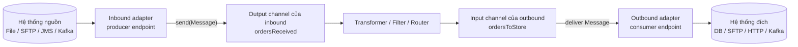
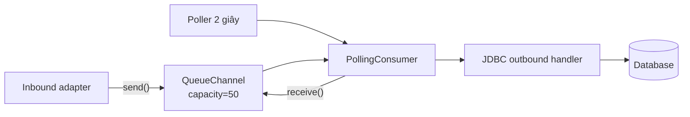
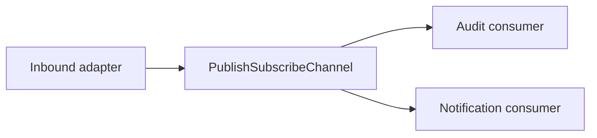
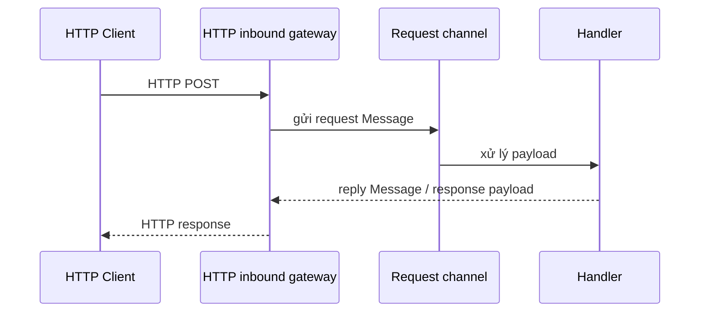
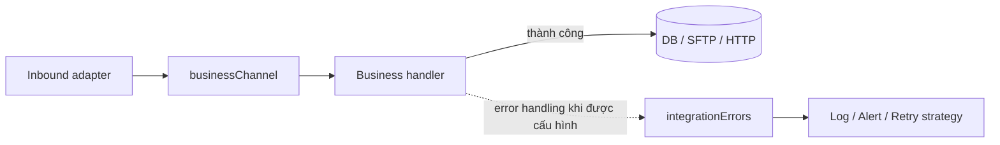
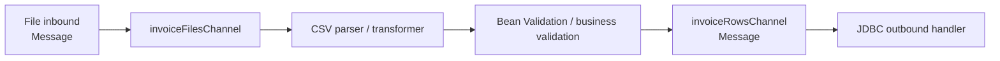

# Liên kết adapter với channel đầu vào đầu ra

Trong Spring Integration, **adapter là cầu nối giữa thế giới bên ngoài và hệ thống message nội bộ**. Một adapter nhận sự kiện từ file, SFTP, HTTP, JMS, AMQP, Kafka hoặc cơ sở dữ liệu rồi phát `Message<?>` vào một `MessageChannel`; một adapter khác nhận message từ channel để ghi file, gửi HTTP request, publish Kafka record hoặc cập nhật database. Nếu nối nhầm **input channel** với **output channel**, luồng có thể không chạy, mất phản hồi hoặc xử lý sai thứ tự.

Bài thuộc chương **Kiểu endpoint** của module **SPRING_INTEGRATION_ADAPTERS**. Module tập trung kết nối hệ thống ngoài qua inbound/outbound adapter, gateway, poller và `MessageChannel`, đồng thời quản lý message contract, lỗi và vòng đời. Trọng tâm của bài này là **hướng di chuyển message**, cách wiring đúng các endpoint và phương pháp kiểm tra một flow từ nguồn đến đích.

## 1. Mục tiêu học tập

Sau bài học, bạn có thể:

1. Giải thích `inputChannel` và `outputChannel` theo **góc nhìn của một endpoint**, không theo tên hệ thống bên ngoài.
2. Phân biệt inbound adapter, outbound adapter, inbound gateway và outbound gateway theo luồng message và phản hồi.
3. Biết khi nào một channel cần `EventDrivenConsumer` hoặc `PollingConsumer`.
4. Xây dựng luồng Java DSL hoàn chỉnh `FileReadingMessageSource → DirectChannel → FileWritingMessageHandler`.
5. Đặt tên, nối và kiểm tra các channel/endpoint, kể cả khi dùng Java DSL, annotation hoặc XML.
6. Thiết kế request–reply, error handling, retry, idempotency, transaction và backpressure ở những ranh giới đúng.
7. Phân tích các ví dụ kết nối SFTP, HTTP, JMS, AMQP, Kafka và JDBC mà không nhầm ngữ nghĩa từng giao thức.

## 2. Quy tắc quan trọng nhất: hướng nhìn từ endpoint

Một adapter được gọi là **inbound** khi nó *đưa message vào Spring Integration*; gọi là **outbound** khi nó *đưa dữ liệu từ Spring Integration ra hệ thống ngoài*. Hai nhãn này mô tả **chiều qua ranh giới tích hợp**, không nhất thiết là chiều của TCP connection hay của một cuộc gọi HTTP.



**Chốt từ vựng:**

- **Inbound adapter:** có **output channel** để phát message vào flow; thông thường không cần một *input channel* nhận message từ phía Spring Integration.
- **Outbound adapter:** có **input channel** để tiêu thụ message từ flow; thông thường không có *output channel* trả response theo hợp đồng message.
- **Gateway:** thường có thêm quan hệ **request–reply**. Cần phân biệt channel mang *request*, channel mang *reply*, `replyChannel` trong headers và channel xử lý lỗi.
- **Channel:** kết nối các endpoint. Nó không tự biết phải đọc SFTP, ghi database hay trả HTTP response.

Một adapter không chuyển dữ liệu chỉ vì có bean `MessageChannel`. Nó còn cần **endpoint được start**, wiring đúng channel, payload/headers hợp lệ và cơ chế dispatch phù hợp.

## 3. Bảng định hướng theo loại endpoint

| Thành phần | Vai trò trong flow | Channel thường được cấu hình | Có phản hồi application-level mặc định? |
|---|---|---|---|
| **Inbound channel adapter** | Producer: nguồn ngoài → message nội bộ | `outputChannel` / `channel` | Không theo kiểu request–reply |
| **Outbound channel adapter** | Consumer: message nội bộ → đích ngoài | `inputChannel` / `channel` | Không; xử lý theo kiểu one-way |
| **Inbound gateway** | Nhận request ngoài → gửi request message → phát response ra ngoài | Request channel và đường reply | Có, theo giao thức và cấu hình |
| **Outbound gateway** | Nhận request message → gọi hệ thống ngoài → phát reply message vào flow | Request input channel và reply/output channel | Có, theo hợp đồng gateway |
| **Service activator** | Nhận message và gọi logic nghiệp vụ | Input channel; output/reply khi có kết quả | Có thể one-way hoặc request–reply |
| **Source polling endpoint** | Poll `MessageSource` để đưa message vào flow | Output channel | Không trực tiếp |
| **Consumer polling endpoint** | Poll `PollableChannel`, gọi handler | Input channel | Tùy loại handler; không tự biến adapter one-way thành gateway |

Từng thành phần có API riêng. Bảng mô tả **hợp đồng logic**, không khẳng định mọi adapter đều có method Java `setInputChannel()` hoặc `setOutputChannel()` giống hệt nhau.

### 3.1. Inbound adapter được kích hoạt bằng gì?

- **Polling inbound:** `SourcePollingChannelAdapter` theo lịch gọi `MessageSource.receive()`, ví dụ file/SFTP/JDBC polling, sau đó `send()` vào output channel.
- **Message-driven inbound:** listener hoặc callback của hệ thống ngoài (thường gặp ở JMS/AMQP/Kafka) kích hoạt việc phát message vào channel. Loại này **không nhất thiết cần poller của Spring Integration**.
- **Request-driven inbound:** HTTP inbound adapter/gateway được kích hoạt bởi HTTP request đến; thread/container HTTP tham gia điều phối theo cấu hình.

Dù cách kích hoạt khác nhau, sau khi đã tạo `Message<?>`, điểm chung là **phát vào một output channel hoặc bước xử lý tiếp theo**.

### 3.2. Outbound adapter nhận từ channel nào?

Outbound handler chỉ chạy khi có consumer endpoint đưa message tới nó. Nếu input channel là:

- `DirectChannel`: consumer theo subscription thường gọi handler ngay trên thread gửi.
- `ExecutorChannel`: dispatch có thể bất đồng bộ qua executor.
- `QueueChannel`: consumer phải có poller để chủ động `receive()`.
- `PublishSubscribeChannel`: một message có thể được chuyển đến nhiều subscriber; nếu outbound adapter là một trong số đó, side effect có thể diễn ra cùng các nhánh khác.

Vì vậy, nối đúng **tên channel** chưa đủ; cần chọn đúng **ngữ nghĩa phân phối** của channel.

## 4. `MessageChannel` là hợp đồng kết nối

Hợp đồng gửi message được thể hiện qua `MessageChannel`:

```java
// Minh họa những phương thức quan trọng, không phải toàn bộ mã nguồn.
public interface MessageChannel {
    boolean send(Message<?> message);
    boolean send(Message<?> message, long timeout);
}
```

Một `Message<?>` bao gồm:

- **Payload:** dữ liệu chính, ví dụ `File`, DTO `Invoice`, `byte[]`, JSON string, Kafka record đã chuyển đổi.
- **Headers:** metadata như correlation ID, tên file, content type, tenant ID hoặc routing key (nếu các thành phần có hỗ trợ/sinh ra).
- **Đường đi:** producer gửi vào channel; channel phân phối tới consumer endpoint phù hợp.

Khi adapter inbound đưa message vào channel, message chưa nhất thiết được xử lý xong ở hệ thống đích. Ví dụ với `QueueChannel`, `send() == true` thường chỉ cho biết message **được chấp nhận vào queue**, chưa phải database đã commit.

### 4.1. Channel thường có tên bean ổn định

```java
@Bean("invoiceInputChannel")
public MessageChannel invoiceInputChannel() {
    return new DirectChannel();
}
```

Tên `invoiceInputChannel` là một **wiring contract**. Producer có thể trỏ tới channel bằng tên ấy, và consumer cũng dùng đúng tên đó làm input. Nếu đổi tên bean mà chỉ sửa một phía, flow sẽ đứt nối hoặc tự tạo một channel khác ngoài ý định (tùy cấu hình).

**Đừng nhầm các ID:**

| Định danh | Ví dụ | Tác dụng |
|---|---|---|
| Channel bean name | `invoiceInputChannel` | Xác định nơi gửi và nhận message |
| Inbound endpoint ID | `invoiceFileInbound` | Điều khiển poll nguồn / lifecycle |
| Outbound endpoint ID | `invoiceFileOutbound` | Điều khiển consumer / lifecycle |
| Flow bean name | `invoiceImportFlow` | Nhận diện khai báo cả luồng |
| Message header ID | UUID của message | Nhận diện một message cụ thể |
| Business ID | `invoiceId` | Phát hiện xử lý trùng theo nghiệp vụ |

## 5. Một flow gồm các cạnh nối, không chỉ gồm các bean

Hãy diễn đạt thiết kế dưới dạng **ai sản xuất cho channel nào** và **ai tiêu thụ từ channel nào**:

```mermaid
flowchart LR
    File[("File nguồn")]
    Source["FileReadingMessageSource"]
    Poll["SourcePollingChannelAdapter<br/>id=fileInboundEndpoint"]
    Ch["invoiceFilesChannel<br/>DirectChannel"]
    Consumer["EventDrivenConsumer<br/>id=fileOutboundEndpoint"]
    Handler["FileWritingMessageHandler"]
    Dest[("File đích")]

    File --> Source
    Poll -->|"receive()"| Source
    Source -->|"Message<File>"| Poll
    Poll -->|"send()"| Ch
    Ch -->|"dispatch"| Consumer
    Consumer -->|"handleMessage()"| Handler
    Handler --> Dest
```



Trong sơ đồ:

1. `SourcePollingChannelAdapter` là endpoint **producer**; nó có nguồn `MessageSource` và **output channel**.
2. `DirectChannel` nhận `Message<File>`; trong cùng một flow, nó là **output của inbound** và **input của outbound**.
3. `EventDrivenConsumer` subscribe vào `DirectChannel` rồi gọi `FileWritingMessageHandler`.
4. `FileWritingMessageHandler` là outbound adapter handler: side effect là ghi file đích.
5. Source poller là cơ chế phát hiện file mới. Handler ở phía `DirectChannel` được dispatch bằng sự kiện, **không cần polling consumer**.

Đây là lý do tên “input/output” **có tính tương đối**: một channel ở giữa có thể là output của endpoint phía trước và input của endpoint phía sau.

## 6. Ví dụ chạy được: kết nối hai adapter qua `DirectChannel`

Mục tiêu: cứ ba giây kiểm tra `data/inbox`, lấy tối đa hai file trong mỗi lượt, phát message vào `invoiceFilesChannel`, rồi ghi file sang `data/outbox`. Ví dụ tách **hai bean IntegrationFlow** để thấy rõ điểm nối.

### 6.1. Dependency

Dùng Java 17+ với phiên bản Spring Boot/Spring Integration tương thích. Trong `pom.xml`:

```xml
<dependencies>
    <dependency>
        <groupId>org.springframework.boot</groupId>
        <artifactId>spring-boot-starter-integration</artifactId>
    </dependency>
    <dependency>
        <groupId>org.springframework.integration</groupId>
        <artifactId>spring-integration-file</artifactId>
    </dependency>
</dependencies>
```

### 6.2. Cấu hình source, channel, handler và hai flow

```java
package com.example.integration;

import java.io.File;
import java.time.Duration;

import org.springframework.context.annotation.Bean;
import org.springframework.context.annotation.Configuration;
import org.springframework.integration.channel.DirectChannel;
import org.springframework.integration.config.EnableIntegration;
import org.springframework.integration.core.MessageSource;
import org.springframework.integration.dsl.IntegrationFlow;
import org.springframework.integration.dsl.Pollers;
import org.springframework.integration.file.FileReadingMessageSource;
import org.springframework.integration.file.FileWritingMessageHandler;
import org.springframework.integration.file.support.FileExistsMode;
import org.springframework.messaging.MessageChannel;

@Configuration
@EnableIntegration
public class InvoiceFileBridgeConfig {

    @Bean("invoiceFileSource")
    public FileReadingMessageSource invoiceFileSource() {
        FileReadingMessageSource source = new FileReadingMessageSource();
        source.setDirectory(new File("data/inbox"));
        source.setAutoCreateDirectory(true);
        return source;
    }

    @Bean("invoiceFilesChannel")
    public MessageChannel invoiceFilesChannel() {
        return new DirectChannel();
    }

    @Bean("invoiceFileWriter")
    public FileWritingMessageHandler invoiceFileWriter() {
        FileWritingMessageHandler handler =
                new FileWritingMessageHandler(new File("data/outbox"));
        handler.setAutoCreateDirectory(true);
        handler.setFileExistsMode(FileExistsMode.FAIL);
        handler.setExpectReply(false);
        return handler;
    }

    // Inbound: nguồn bên ngoài -> output channel.
    @Bean("invoiceInboundFlow")
    public IntegrationFlow invoiceInboundFlow(
            FileReadingMessageSource invoiceFileSource) {

        return IntegrationFlow.from(
                    invoiceFileSource,
                    endpoint -> endpoint
                            .id("invoiceFileInboundEndpoint")
                            .phase(200)
                            .poller(Pollers
                                    .fixedDelay(Duration.ofSeconds(3))
                                    .maxMessagesPerPoll(2)))
                .channel("invoiceFilesChannel")
                .get();
    }

    // Outbound: input channel -> MessageHandler ghi file.
    @Bean("invoiceOutboundFlow")
    public IntegrationFlow invoiceOutboundFlow(
            FileWritingMessageHandler invoiceFileWriter) {

        return IntegrationFlow.from("invoiceFilesChannel")
                .handle(invoiceFileWriter,
                        endpoint -> endpoint
                                .id("invoiceFileOutboundEndpoint")
                                .phase(100))
                .get();
    }
}
```

`@SpringBootApplication` cần nằm trong `com.example.integration` hoặc package cha để quét cấu hình. Khi chạy, hai thư mục được tạo nếu chưa có. Thả các file `invoice-A.txt`, `invoice-B.txt`, `invoice-C.txt` vào `data/inbox`; mỗi lượt poll lấy tối đa hai file sẵn sàng và ghi chúng sang `data/outbox`.

Trong code:

- `IntegrationFlow.from(invoiceFileSource, ...)` mô tả một **source-polling inbound endpoint**.
- `.channel("invoiceFilesChannel")` xác định nơi inbound phát message, tương đương vai trò **output channel**.
- `IntegrationFlow.from("invoiceFilesChannel")` xác định **input channel** cho downstream consumer.
- `.handle(invoiceFileWriter, ...)` kết nối `MessageHandler` outbound tới consumer endpoint.
- `phase(100)` cho consumer và `phase(200)` cho inbound giúp consumer subscribe trước producer khi Spring lifecycle processor khởi động theo phase tăng dần.

### 6.3. Đọc đúng kết quả của ví dụ

`FileReadingMessageSource` phát payload là `File` trỏ tới đường dẫn nguồn, không tự đọc nội dung thành `String`. `FileWritingMessageHandler` sao chép/ghi nội dung sang đích theo hợp đồng của nó; file ở thư mục nguồn **không mặc định bị xóa**.

`FileExistsMode.FAIL` làm việc ghi thất bại nếu đích đã có file cùng tên. Đây là lựa chọn để bài thực hành thể hiện lỗi; production cần chọn rõ chính sách overwrite, rename/version hoặc idempotent skip.

Khi chạy lại ứng dụng, việc nhận lại file nguồn phụ thuộc filter và metadata store. Không được suy luận rằng chỉ cần `FileReadingMessageSource` là đã có exactly-once trên restart.

### 6.4. Tại sao tách hai `IntegrationFlow`?

Có thể viết một flow liên tục với `.from(source).channel(...).handle(handler)`; tuy nhiên tách thành hai flow minh họa rõ **ranh giới output/input** và cho phép:

- Quản trị lifecycle độc lập giữa inbound và outbound consumer.
- Thay channel bằng một kiểu thích hợp mà không thay thuật toán nguồn/đích.
- Thêm transformer/filter/router giữa các endpoint.
- Theo dõi nơi message đi vào và nơi được xử lý.

Việc tách flow không tự thêm queue hoặc cơ chế lưu bền. Channel ở ví dụ vẫn là `DirectChannel`, dispatch đồng bộ.

## 7. Cấu hình bằng annotation hoặc XML: đọc “channel” theo vai trò

Spring Integration hỗ trợ nhiều kiểu khai báo. Tên thuộc tính có thể khác giữa adapter, namespace và annotation; **hãy xét vai trò**, không chỉ tên chữ.

### 7.1. Annotation trên consumer

```java
import org.springframework.integration.annotation.EndpointId;
import org.springframework.integration.annotation.ServiceActivator;
import org.springframework.stereotype.Component;

@Component
public class InvoiceAuditConsumer {

    @EndpointId("invoiceAuditEndpoint")
    @ServiceActivator(inputChannel = "invoiceAuditChannel")
    public void record(String invoiceId) {
        System.out.println("AUDIT " + invoiceId);
    }
}
```

Ở đây, `inputChannel = "invoiceAuditChannel"` nghĩa là **consumer** subscribe/poll channel được chỉ định tùy loại channel. Nó không chỉ định nơi service gửi message ra hệ thống ngoài. Nếu phương thức trả kết quả để tiếp tục flow, cần định nghĩa hợp đồng reply/output thay vì giả định kết quả sẽ tự tới một channel bất kỳ.

### 7.2. XML minh họa hai phía

Một cấu hình XML dùng Spring Integration namespace có thể thể hiện một channel ở giữa như sau:

```xml
<!-- Trích đoạn: đã khai báo namespace int và beans trong file XML bao ngoài. -->
<int:channel id="invoiceInputChannel"/>

<int:service-activator id="invoiceProcessEndpoint"
                       input-channel="invoiceInputChannel"
                       ref="invoiceService"
                       method="process"/>

<beans:bean id="invoiceService"
            class="com.example.integration.InvoiceService"/>
```

Đây là ví dụ về **consumer**; input channel là `invoiceInputChannel`, service là đối tượng nghiệp vụ. Với file/SFTP inbound channel adapter, namespace của adapter thường có thuộc tính `channel` để chỉ nơi **phát message ra**. Với outbound channel adapter, `channel` thường chỉ nơi **nhận message vào**. Cùng chữ `channel` nhưng vị trí trong luồng khác nhau.

Đừng nhầm một `<int:channel>` (định nghĩa kênh) với `<int:service-activator>` (định nghĩa endpoint consumer).

## 8. Khi channel ở giữa là `QueueChannel`

Bạn có thể muốn tách tốc độ nhận file khỏi tốc độ ghi database. Khi đó, một queue có capacity là lựa chọn thường gặp:



Ví dụ khai báo consumer bằng annotation:

```java
@Bean("ordersQueue")
public QueueChannel ordersQueue() {
    return new QueueChannel(50);
}
```

```java
@ServiceActivator(
        inputChannel = "ordersQueue",
        poller = @Poller(
                fixedDelay = "2000",
                maxMessagesPerPoll = "5",
                receiveTimeout = "0"))
public void saveOrder(OrderDto order) {
    orderService.save(order);
}
```

Hai đoạn code là **minh họa trong các class được Spring quản lý**; cần các import tương ứng và lớp `OrderDto`/`orderService` của ứng dụng. Đừng đặt chúng nguyên xi ở top-level file Java độc lập. Ý chính: inbound phát tới `ordersQueue`, còn consumer **chủ động lấy** từ queue và gọi dịch vụ ghi.

Với queue trong bộ nhớ:

- `send()` thành công không bảo đảm `saveOrder()` đã chạy.
- Nếu queue đầy, gửi có thể chặn hoặc trả về thất bại tùy timeout.
- Message có thể mất khi process restart nếu không có persistent message store.
- Polling consumer đã dequeue message và handler lỗi **không mặc định** khiến message quay về queue.
- Nếu muốn bền vững và replay, cân nhắc message store transactional hoặc broker tương ứng.

Đổi từ `DirectChannel` sang `QueueChannel` không chỉ là thay một tên bean: nó đổi cả **ranh giới thread, timing, xử lý lỗi và transaction**.

## 9. Khi cần fan-out: `PublishSubscribeChannel`

Giả sử cùng một sự kiện đơn hàng phải kích hoạt cả **audit** và **gửi thông báo**:



Dùng `PublishSubscribeChannel` khi tất cả subscriber cần được nhận sự kiện. `DirectChannel` có hai subscriber **không** tạo broadcast; nó thường giao mỗi message cho một handler được chọn trong nhóm cạnh tranh.

Fan-out không đồng nghĩa các nhánh độc lập lỗi hoặc có durability. Với publish-subscribe đồng bộ, một nhánh lỗi có thể ảnh hưởng các nhánh còn lại; cấu hình executor, error handling và nhu cầu xác nhận giao hàng cần được thiết kế riêng.

## 10. Gateway: request channel, reply channel và lỗi

Đây là vùng dễ nhầm nhất vì **gateway** có hợp đồng trả lời còn **outbound channel adapter** thường không.

### 10.1. Inbound gateway

Ví dụ một HTTP inbound gateway nhận `POST /orders`:



HTTP request đi vào gateway; gateway gửi một **request message** vào request channel. Kết quả nghiệp vụ được trả về theo reply contract (có thể thông qua `replyChannel` trong headers, reply channel cấu hình, hoặc lời gọi reply do framework quản lý), rồi gateway chuyển thành HTTP response.

Không nên suy rằng chỉ cần thêm một `outputChannel` lên inbound adapter one-way là nó thành HTTP gateway có request–reply. Hai loại endpoint có hợp đồng khác nhau.

### 10.2. Outbound gateway

Ví dụ handler nhận message từ `paymentRequests`, gọi HTTP API của đối tác, rồi phát response vào `paymentReplies`:

```text
paymentRequests (input/request channel)
    -> HTTP outbound gateway
    -> gọi hệ thống ngoài
    -> paymentReplies (reply/output channel)
```

Nếu API ngoài trả lỗi, gateway/flow xử lý theo cơ chế exception/error handling của endpoint. Một response được gửi tới reply channel **không tự động** có nghĩa các tác dụng phụ của đối tác đã commit bền vững; phải căn cứ hợp đồng API.

### 10.3. Interface gateway trong ứng dụng Java

```java
import org.springframework.integration.annotation.Gateway;
import org.springframework.integration.annotation.MessagingGateway;

@MessagingGateway(defaultRequestChannel = "ordersRequestChannel")
public interface OrdersGateway {

    @Gateway
    String submit(String orderId);
}
```

Đoạn trên là **giao diện**, không phải Java class tự thực thi. Spring Integration tạo proxy gateway; cần có một flow/handler xử lý message đến `ordersRequestChannel` và trả `String` đúng hợp đồng. Nếu downstream không trả reply, lời gọi gateway có thể chờ, timeout hoặc gặp lỗi theo cấu hình.

Với gateway cần request–reply, hãy kiểm tra **reply timeout**, message conversion, correlation headers và trường hợp người gọi ngắt kết nối. Với inbound adapter one-way, không nên gắn giả định người gửi sẽ có một response nghiệp vụ.

## 11. Error channel không thay thế input/output channel

`errorChannel` (hoặc error handler tương ứng) phục vụ **đường đi của lỗi**, khác với output channel mang dữ liệu thành công.



Bốn nguyên tắc:

1. **Không phải mọi exception đều tự biến thành `ErrorMessage`**. Lỗi đồng bộ qua `DirectChannel` có thể ném ngược về thread producer.
2. Lỗi từ poller, executor, listener broker và gateway có đường xử lý khác nhau; cần xem endpoint nào publish lỗi và header `errorChannel` nào được dùng.
3. Gửi lỗi đến một channel và log thành công **không đồng nghĩa đã retry hoặc bù trừ thành công**.
4. Với lỗi nghiệp vụ, có thể route message sang một nhánh chuyên biệt; với lỗi hạ tầng, có thể cần retry/backoff và nguồn dữ liệu có khả năng redelivery.

Hãy đặt tên rõ ràng cho **business input/output**, **reply channel** và **error channel** thay vì dùng một channel cho mọi mục đích, trừ khi đã có thiết kế/hợp đồng cụ thể.

## 12. Payload và headers: hợp đồng giữa hai adapter

Hai adapter không nhất thiết dùng cùng kiểu dữ liệu. Ví dụ một file inbound phát `Message<File>` nhưng JDBC outbound handler muốn `InvoiceRow`.



Ở đây `invoiceFilesChannel` và `invoiceRowsChannel` có **hợp đồng payload khác nhau**. Nếu nối thẳng handler nhận `InvoiceRow` vào channel chỉ có `File`, lỗi chuyển đổi hoặc `ClassCastException` có thể xảy ra.

| Thuộc tính | Việc cần quyết định giữa adapter và channel |
|---|---|
| Payload | Kiểu Java, encoding, format, schema version |
| Tên file | Metadata gốc, đường dẫn tương đối và quy ước file hoàn tất |
| Correlation ID | Dùng để liên kết message qua các bước |
| Business ID | Khóa chống duplicate khi nhận lại message |
| Content type | `text/csv`, `application/json`... nếu các bước cần |
| Reply/error metadata | Channel trả lời hoặc báo lỗi trong luồng có hợp đồng phù hợp |
| Bảo mật | Không để password/token hoặc dữ liệu nhạy cảm trong headers/log |

Đặt transformer/validator ở đúng ranh giới để downstream luôn thấy kiểu dữ liệu hợp lệ. Khi chuyển từ message file sang HTTP/Kafka/JMS, adapter có thể có converter/header mapper riêng; cần chọn và kiểm thử mapping, không xem `MessageChannel` là công cụ chuyển mọi kiểu payload tự động.

## 13. Ảnh hưởng của channel tới transaction, thứ tự và độ tin cậy

### 13.1. Channel đồng bộ và transaction

Với `DirectChannel`, dispatch thường chạy trên thread producer. Nếu handler JDBC dùng transaction đang hoạt động cùng thread và tài nguyên tham gia phù hợp, những bước đó có thể thuộc cùng transaction boundary.

**Nhưng** `DirectChannel` không tạo ra transaction tự động. File, SFTP, HTTP, Kafka và database không tự cùng commit chỉ vì có một channel đồng bộ.

### 13.2. Channel bất đồng bộ hoặc có buffer

`ExecutorChannel` hoặc `QueueChannel` tạo ranh giới xử lý khác. Lúc producer `send()` thành công, consumer có thể chưa thực thi. Ngữ cảnh transaction dạng thread-local không tự vượt qua executor thread. Thứ tự handler hoàn tất cũng có thể thay đổi nếu nhiều task song song.

### 13.3. Replay, retry và duplicate

Nếu bên nguồn có thể gửi lại file/JMS/Kafka record sau lỗi hoặc restart, downstream có thể xử lý trùng. Định nghĩa business key như `invoiceId` và dùng unique constraint/idempotency key khi cần. Tên channel, endpoint ID hay message UUID không tự bảo đảm exactly-once.

### 13.4. Backpressure

Dùng channel có buffer cần tính capacity, send timeout và tốc độ consumer. Dùng `DirectChannel` đồng bộ cần tính latency của handler và tác động lên thread producer. Nếu consumer chậm, tăng số thread có thể làm tình hình tệ hơn khi database hoặc HTTP API đích bị rate limit.

## 14. Đối chiếu nhanh theo từng công nghệ

| Công nghệ | Inbound: phát vào channel | Outbound: nhận từ channel | Điểm riêng phải thiết kế |
|---|---|---|---|
| **File** | Source poll file rồi phát `Message<File>` | Handler ghi file | Tránh file đang ghi dở, trùng tên, độ bền filter |
| **SFTP/FTP** | Poll remote file hoặc đồng bộ file rồi phát message | Handler upload file/bytes | Session, timeout, file hoàn tất, atomic rename |
| **HTTP** | Inbound adapter hoặc gateway nhận request rồi phát message | Outbound adapter/gateway gọi API | Timeout, HTTP status, response, retry/idempotency |
| **JMS** | Listener/message-driven adapter phát message | Outbound adapter gửi tới queue/topic | Ack, transaction, redelivery, selector |
| **AMQP** | Listener adapter phát message từ broker | Publish tới exchange/routing key | Ack/nack, dead-letter, publisher confirms |
| **Kafka** | Consumer container/adapter phát record message | Producer handler publish record | Offset, partition, ordering, producer ack |
| **JDBC** | Polling source truy vấn/claim bản ghi rồi phát message | JDBC handler ghi DB | Claim atomically, transaction, duplicate |

Ví dụ luồng `Kafka inbound → DirectChannel → HTTP outbound gateway` có ít nhất hai sự kiện độc lập: Kafka record đã được nhận và HTTP đối tác đã xử lý. Việc Kafka adapter gửi vào channel thành công không chứng minh HTTP giao dịch đã thành công, trừ khi hợp đồng đồng bộ và chính sách commit/ack đã được thiết kế, kiểm chứng tương ứng.

## 15. Kiểm tra wiring và vòng đời khi message không đi tiếp

### 15.1. Liệt kê endpoint và channel

Bạn có thể thêm một `ApplicationRunner` vào class `@Configuration`:

```java
import java.util.Arrays;

import org.springframework.boot.ApplicationRunner;
import org.springframework.context.ApplicationContext;
import org.springframework.context.annotation.Bean;
import org.springframework.integration.endpoint.AbstractEndpoint;
import org.springframework.messaging.MessageChannel;

@Bean
ApplicationRunner inspectWiring(ApplicationContext context) {
    return args -> {
        System.out.println("== CHANNELS ==");
        Arrays.stream(context.getBeanNamesForType(MessageChannel.class))
                .sorted()
                .forEach(System.out::println);

        System.out.println("== ENDPOINTS ==");
        Arrays.stream(context.getBeanNamesForType(AbstractEndpoint.class))
                .sorted()
                .forEach(name -> {
                    AbstractEndpoint endpoint =
                            context.getBean(name, AbstractEndpoint.class);
                    System.out.printf("%s: %s, running=%s%n",
                            name,
                            endpoint.getClass().getSimpleName(),
                            endpoint.isRunning());
                });
    };
}
```

Đoạn trên minh họa trong class cấu hình, không phải một file Java độc lập. Nó cho biết bean nào **tồn tại** và endpoint nào **đang chạy**, nhưng không tự chứng minh rằng mọi message đã xử lý xong.

### 15.2. Bảng chẩn đoán

| Triệu chứng | Nguyên nhân thường gặp | Kiểm tra |
|---|---|---|
| Inbound nhận dữ liệu nhưng không có downstream log | Output channel sai tên, consumer chưa start | Danh sách bean channel, endpoint `isRunning()`, phase |
| `DirectChannel` báo không có subscriber | Chưa có `EventDrivenConsumer` đăng ký | Input channel của handler, endpoint lifecycle |
| `QueueChannel` có backlog lớn | Thiếu poller, handler chậm/lỗi | `PollingConsumer`, maxMessagesPerPoll, queue depth |
| Adapter outbound chạy nhưng sai dữ liệu | Payload/header contract không tương thích | Converter, transformer, schema validation |
| Cần phản hồi nhưng không có reply | Dùng outbound adapter one-way thay vì gateway, hoặc thiếu reply flow | Request–reply endpoint, reply timeout, `replyChannel` |
| Message chỉ đến một trong hai handler | Dùng `DirectChannel` thay vì broadcast | Đổi sang `PublishSubscribeChannel` khi cần fan-out |
| Sau restart xử lý lại file/record | Source filter không bền vững hoặc broker redelivery | Persistent metadata, ack/offset, idempotency |
| Tắt consumer nhưng inbound vẫn phát | Dừng nhầm endpoint | Tên ID inbound và consumer, start/stop phase |
| `send() == true` nhưng DB chưa có dữ liệu | Channel bất đồng bộ hoặc handler lỗi sau enqueue | Queue depth, in-flight, error channel, transaction |

### 15.3. Startup/shutdown

Khi inbound adapter gửi vào `DirectChannel`, nên **khởi động consumer trước producer** để tránh gửi vào channel chưa có subscriber. Spring Integration endpoints thường hỗ trợ `SmartLifecycle` với `autoStartup` và `phase`. Phase thấp thường start trước và stop sau phase cao.

Khi dừng, nên ngừng nguồn mới trước rồi hoàn thành công việc đang bay theo chính sách nghiệp vụ. Với `QueueChannel`, queue rỗng không chứng minh handler đã commit vì message có thể đã được dequeue nhưng còn xử lý. Với Kafka/JMS/AMQP, cơ chế ack, offset và redelivery cần được phối hợp riêng.

## 16. Những hiểu lầm thường gặp

| Hiểu lầm | Cách hiểu đúng |
|---|---|
| “Inbound adapter có input channel vì nó nhận dữ liệu.” | Nó nhận **dữ liệu từ hệ thống ngoài**, rồi phát **message ra output channel**. |
| “Outbound adapter có output channel vì nó gửi dữ liệu đi.” | Nó nhận **message từ input channel**, rồi ghi/gửi ra hệ thống ngoài. |
| “Một channel phải được gọi là input hoặc output cố định.” | Cùng channel có thể là output của producer phía trước và input của consumer phía sau. |
| “`DirectChannel` có nhiều consumer thì broadcast.” | Mỗi message thường tới một handler được chọn; cần `PublishSubscribeChannel` khi muốn fan-out. |
| “`QueueChannel` tự đánh thức consumer.” | Consumer phải poll channel qua `PollingConsumer`. |
| “Inbound adapter và inbound gateway là như nhau.” | Gateway thêm hợp đồng request–reply; adapter có thể là one-way. |
| “`errorChannel` là output channel cho mọi kết quả.” | Nó phục vụ lỗi theo cấu hình, không thay kênh dữ liệu thành công. |
| “`send() == true` đồng nghĩa đã lưu database.” | Với queue/asynchronous dispatch, xử lý có thể chưa hoàn thành. |
| “Tên channel giống nhau là đủ.” | Cần đúng channel type, endpoint lifecycle, payload và reply/error contract. |
| “Dùng một channel sẽ tự có exactly-once.” | Cần idempotency, retry/ack/transaction phù hợp với nguồn và đích. |

## 17. Bài tập thực hành

### Bài 1 — Vẽ lại hướng channel

Cho flow:

```text
SFTP inbound -> channel A -> CSV transformer -> channel B -> JDBC outbound
```

Hãy ghi **output channel** của SFTP inbound, **input/output channel** của transformer và **input channel** của JDBC outbound. Xác định kiểu payload phù hợp tại A và B. Mô tả điều gì xảy ra nếu nối JDBC handler trực tiếp vào A khi nó chỉ chấp nhận DTO đã parse.

### Bài 2 — Chạy ví dụ file và đổi channel type

Chạy code ở mục 6 với ba file. Ghi nhận thời điểm xuất hiện file đích. Thay `DirectChannel` bằng `QueueChannel` có capacity 3 và cung cấp poller cho outbound consumer. So sánh thời điểm `send()` hoàn tất, tốc độ nhận/gửi và xử lý lỗi khi file đích đã tồn tại.

### Bài 3 — Phân biệt adapter với gateway

Thiết kế hai endpoint gọi HTTP API ngoài:

1. Một outbound adapter gửi event không cần phản hồi nghiệp vụ.
2. Một outbound gateway bắt buộc nhận response chứa mã giao dịch.

Với mỗi endpoint, xác định input channel, reply/output channel nếu có, timeout, error flow và payload response.

### Bài 4 — Fan-out đúng cách

Sau một JMS inbound adapter, yêu cầu hai nhánh **audit** và **update metrics** đều nhận cùng event. Hãy chọn channel phù hợp. Sau đó thử cấu hình hai consumer trên `DirectChannel` và giải thích vì sao chúng không bảo đảm nhận cùng event.

### Bài 5 — Giới hạn tải và khôi phục

Thiết kế `JDBC inbound polling → bounded QueueChannel → PollingConsumer → HTTP outbound`. Cần đưa ra: lịch poll, queue capacity, send timeout, giới hạn concurrent HTTP requests, retry có giới hạn, khóa idempotency và cách khôi phục khi process restart.

### Bài 6 — Điều tra sự cố

Một Kafka inbound adapter đã nhận record và log “sent to channel”, nhưng hệ thống đích HTTP chưa có yêu cầu. `QueueChannel` còn 40 message, `PollingConsumer` có `running=false`. Hãy mô tả bước kiểm tra an toàn, điểm cần start và vì sao không được tự động commit/ack record chỉ từ log “sent to channel”.

## 18. Câu hỏi tự kiểm tra

1. Input channel và output channel được gọi tên theo góc nhìn của thành phần nào?
2. Vì sao một `DirectChannel` ở giữa vừa là output của inbound adapter vừa là input của outbound adapter?
3. `SourcePollingChannelAdapter` poll `MessageSource` hay poll `MessageChannel`?
4. Vì sao outbound adapter one-way khác outbound gateway request–reply?
5. Khi cần response từ HTTP outbound, bạn phải kiểm tra hợp đồng reply nào?
6. Sau khi đổi `DirectChannel` thành `QueueChannel`, consumer endpoint cần điều gì?
7. Với nhiều subscriber cần nhận cùng message, channel nào phù hợp?
8. Vì sao tên endpoint ID không thay thế business ID hoặc correlation ID?
9. Khi producer gửi vào channel thành công, phần nào vẫn có thể thất bại?
10. Khi shutdown, vì sao nên dừng producer trước consumer, và tại sao như vậy vẫn chưa đủ để bảo đảm đã xử lý hết backlog?

Tư duy cốt lõi của bài: **mỗi adapter có một ranh giới bên ngoài và một ranh giới message bên trong**. Hãy xác định nó đang *sản xuất message*, *tiêu thụ message* hay *chờ reply*; sau đó nối channel đúng chiều, xác định hợp đồng payload/headers và thiết kế lỗi, transaction, lifecycle ở ranh giới thực sự. Khi làm được điều này, các flow file, SFTP, HTTP, JMS, AMQP, Kafka và JDBC sẽ có cấu trúc nhất quán, dễ kiểm tra và mở rộng.

## Tài liệu tham khảo

- [Spring Integration Reference — Message Endpoints](https://docs.spring.io/spring-integration/reference/endpoint.html)
- [Spring Integration Reference — Messaging Channels](https://docs.spring.io/spring-integration/reference/channel.html)
- [Spring Integration Reference — Channel Implementations](https://docs.spring.io/spring-integration/reference/channel/implementations.html)
- [Spring Integration Reference — Java DSL](https://docs.spring.io/spring-integration/reference/dsl/java-basics.html)
- [Spring Integration Reference — Gateway](https://docs.spring.io/spring-integration/reference/gateway.html)
- [Spring Integration Reference — File Support](https://docs.spring.io/spring-integration/reference/file.html)
- [Spring Integration Reference — Error Handling](https://docs.spring.io/spring-integration/reference/error-handling.html)
