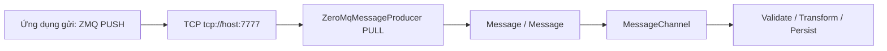
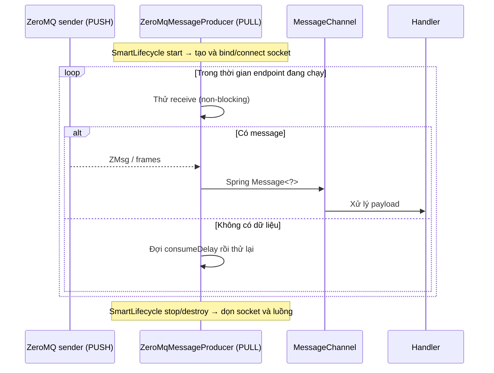

# ZeroMQ inbound channel adapter

## 1. Bài toán và mục tiêu học tập

Một hệ thống quản lý thiết bị phát sinh sự kiện rất nhanh: cảm biến gửi trạng thái nhiệt độ, bộ thu thập dữ liệu đẩy thông tin vận hành, các service khác cần nhận message để kiểm tra và lưu trữ. Không phải lúc nào nhóm phát triển cũng muốn triển khai một broker như RabbitMQ hay Kafka; một số hệ thống đã sử dụng **ZeroMQ** để trao đổi message qua TCP hoặc ngay trong một máy.

Trong ứng dụng Spring Boot, thay vì tự tạo một vòng lặp `ZMQ.Socket.recv()`, tự khởi động thread rồi chuyển dữ liệu vào service, ta dùng **ZeroMQ inbound channel adapter** của Spring Integration. Endpoint này nhận message trên socket ZeroMQ và phát các `Message<?>` vào một `MessageChannel` để các bước xử lý sau tiếp tục làm việc.

Bài nằm trong chương **Adapter ZeroMQ** của module **SPRING_INTEGRATION_ADAPTERS**. Module hướng dẫn kết nối hệ thống ngoài bằng inbound/outbound adapter, gateway, poller và `MessageChannel`; thực hành các luồng file, SFTP, HTTP, JMS, AMQP, Kafka, cơ sở dữ liệu cùng những yêu cầu về hợp đồng message, xử lý lỗi và vòng đời kết nối. Với ZeroMQ, điều cần hiểu đầu tiên là **inbound message producer**, kiểu socket được hỗ trợ, quy ước frame, topic và đặc tính giao vận **không có broker lưu trữ mặc định**.

Sau bài học, bạn có thể:

1. Giải thích nhiệm vụ của `ZeroMqMessageProducer` và phân biệt nó với `ZeroMqChannel`.
2. Chọn đúng `SocketType.PULL`, `SocketType.SUB` hoặc `SocketType.PAIR` cho inbound.
3. Cấu hình `ZContext`, `connectUrl`/`bindPort` và luồng Java DSL `ZeroMq.inboundChannelAdapter(...)`.
4. Nhận payload dạng `ZMsg` hoặc dùng message mapper để chuyển frame sang `Message<?>`.
5. Hiểu subscription, topic frame, `unwrapTopic`, cơ chế polling nội bộ `consumeDelay`.
6. Thiết kế kiểm thử, giám sát, quản lý lifecycle/socket và chống mất dữ liệu khi downstream chậm hoặc kết nối gián đoạn.

## 2. ZeroMQ là gì trong Spring Integration?

**ZeroMQ (ØMQ)** là thư viện messaging dựa trên socket với các mô hình như publish–subscribe, pipeline và pair; nó cung cấp cách trao đổi message mà **không bắt buộc có broker trung tâm**. Có thể sử dụng proxy ZeroMQ nếu kiến trúc cần định tuyến giữa nhiều phía. Java API được Spring Integration sử dụng là **JeroMQ**, một triển khai ZeroMQ trên Java.

Một vài khái niệm:

| Khái niệm | Ý nghĩa | Ví dụ |
| --- | --- | --- |
| `ZContext` | Ngữ cảnh quản lý socket và tài nguyên JeroMQ | Một bean chia sẻ trong ứng dụng |
| `ZMQ.Socket` | Socket ZeroMQ có pattern cụ thể | `PUSH`, `PULL`, `PUB`, `SUB` |
| `ZMsg` / `ZFrame` | Message ZeroMQ có thể gồm một hoặc nhiều frame nhị phân | `[topic][payload]` |
| `ZeroMqMessageProducer` | **Inbound channel adapter**: đọc socket và phát Spring message | `PULL` nhận sự kiện từ `PUSH` |
| `MessageChannel` | Chuyển Spring `Message<?>` đến transformer/filter/service activator | `zeroMqInbox` |
| `ZeroMqMessageHandler` | **Outbound channel adapter**: gửi Spring message qua ZeroMQ | `PUB` hoặc `PUSH` |
| `ZeroMqChannel` | Một loại Spring `SubscribableChannel` được triển khai trên ZeroMQ | Luồng trao đổi message qua proxy giữa các channel |
| `ZeroMqProxy` | Thành phần trung gian giúp nối các endpoint ZeroMQ | `SUB/PUB` hoặc `PULL/PUSH` proxy |

**Phân biệt tên gọi:** `ZeroMqMessageProducer` là *endpoint inbound* đưa sự kiện **từ ZeroMQ vào Spring Integration**. `ZeroMqChannel` là *một implementation của MessageChannel* dùng giao thức ZeroMQ; nó **không phải** tên khác của inbound adapter. Một ứng dụng có thể dùng inbound producer rồi đẩy vào `DirectChannel`, `FluxMessageChannel`, hoặc channel phù hợp với luồng xử lý.

### 2.1. Sơ đồ luồng nhận điển hình



ZeroMQ ở ví dụ này **không tự lưu message trong một hàng đợi bền vững**. Khi Spring Integration nhận được sự kiện, việc parse, xác thực, lưu database hoặc chuyển tiếp sang Kafka/JMS là trách nhiệm của các bước downstream. Nếu cần replay sau crash, phải thiết kế thêm tầng durable storage và xác nhận ở cấp ứng dụng.

## 3. Chọn kiểu socket inbound phù hợp

`ZeroMqMessageProducer` chỉ hỗ trợ ba kiểu socket **`PAIR`, `PULL` và `SUB`**. Các socket `PUSH`, `PUB` là chiều gửi, không phải kiểu socket nhận của inbound producer.

| Inbound socket | Socket đối ứng | Mô hình | Khi phù hợp |
| --- | --- | --- | --- |
| **`SocketType.PULL`** | `PUSH` | Pipeline; công việc được phân phối tới một trong các receiver có khả năng nhận | Thu thập sự kiện hoặc công việc từ một hay nhiều producer |
| **`SocketType.SUB`** | `PUB` | Pub/sub; nhận những thông điệp khớp subscription | Theo dõi sự kiện theo topic, số đo cảm biến, broadcast |
| **`SocketType.PAIR`** | `PAIR` | Giao tiếp một–một | Các tình huống liên lạc đơn giản, thường cùng một ứng dụng/process |

**Không nhầm với yêu cầu reply:** inbound channel adapter chỉ *nhận và phát Spring message*, không tự trả reply nghiệp vụ cho ZeroMQ sender. Nếu cần request–reply hoặc xác nhận sau commit DB, phải chọn pattern/giao thức và xây dựng cơ chế phản hồi riêng, không coi một lời gọi `send` của phía producer là ACK của consumer.

### 3.1. PUSH/PULL: pipeline, không phải broadcast

Khi nhiều `PULL` nhận công việc từ một `PUSH`, ZeroMQ phân phối công việc giữa các receiver; không mặc định **mọi receiver đều nhận mỗi message**. Ở ứng dụng xử lý nền, `PULL` thường là lựa chọn dễ hiểu để minh họa inbound. Tuy nhiên, nó không tự thực hiện ACK, retry business hoặc lưu trữ durable như một message broker.

### 3.2. PUB/SUB: mỗi subscriber chỉ nhận topic đã đăng ký

`SUB` dùng `topics(...)` để chọn các topic mong muốn, thường lọc theo **prefix byte** của phần đầu message, không phải so khớp một field JSON bất kỳ. Nếu có nhiều subscriber kết nối và đăng ký đúng topic, mỗi subscriber có thể nhận một bản sự kiện phù hợp. Tuy nhiên, thông điệp gửi **trước khi kết nối/subscribe hoàn tất có thể bị bỏ lỡ** (*slow joiner*), và queue quá tải có thể làm message bị drop.

### 3.3. PAIR không dùng thay thế cho mọi giao tiếp hai chiều

`PAIR` dành cho luồng một–một có giới hạn; không phù hợp để tự xây các trường hợp nhiều client, load balance hoặc pub/sub. Cần dùng đúng ZeroMQ socket pattern theo cách bên gửi hoạt động.

## 4. Inbound adapter hoạt động ra sao?

Spring Integration triển khai inbound dưới dạng `org.springframework.integration.zeromq.inbound.ZeroMqMessageProducer`, kế thừa `MessageProducerSupport`. Thành phần này quản lý socket và luồng nhận nội bộ theo **reactive semantics**, thử đọc dữ liệu một cách **non-blocking** rồi phát message vào flow. Khi chưa có dữ liệu, nó đợi một khoảng `consumeDelay` trước lần thử kế tiếp; **giá trị mặc định là một giây**.



**Khác FTP inbound adapter polling:** endpoint ZeroMQ này **không cần `Pollers.fixedDelay(...)` của Spring Integration**. Nó chủ động chạy vòng đọc socket trong lifecycle của chính mình. `consumeDelay` là khoảng chờ khi socket chưa có dữ liệu, không phải cron/poller trigger của `MessageSource`. Đặt `consumeDelay` quá nhỏ làm tăng số lần kiểm tra khi rảnh; đặt quá lớn có thể tăng độ trễ nhận khi traffic thấp.

Theo cơ chế nội bộ, message có thể đẩy vào `FluxMessageChannel`; nếu output channel không reactive, producer tự quản lý việc subscribe khi `start()`. Không nên gọi `recv()` trực tiếp lên **cùng socket nội bộ** từ thread của ứng dụng.

## 5. Dependency và cấu hình môi trường

### 5.1. Maven / Gradle

Với ứng dụng Spring Boot dùng BOM quản lý phiên bản Spring Integration tương thích:

```xml
<dependencies>
    <dependency>
        <groupId>org.springframework.boot</groupId>
        <artifactId>spring-boot-starter-integration</artifactId>
    </dependency>
    <dependency>
        <groupId>org.springframework.integration</groupId>
        <artifactId>spring-integration-zeromq</artifactId>
    </dependency>
</dependencies>
```

Nếu dùng Gradle với dependency management:

```groovy
implementation "org.springframework.boot:spring-boot-starter-integration"
implementation "org.springframework.integration:spring-integration-zeromq"
```

`spring-integration-zeromq` sử dụng **JeroMQ**. Không tự trộn phiên bản JeroMQ/Spring Integration khác BOM nếu chưa kiểm tra compatibility. Thành phần ZeroMQ có mặt trong Spring Integration từ phiên bản 5.4; khi dùng API DSL mới, chọn bộ dependency tương thích Spring Framework và Java runtime thực tế.

### 5.2. Application properties

```yaml
# application.yml
app:
  zeromq:
    inbound-port: ${ZEROMQ_INBOUND_PORT:7777}
    subscribe-url: ${ZEROMQ_SUBSCRIBE_URL:tcp://127.0.0.1:7788}
    topic-prefix: ${ZEROMQ_TOPIC_PREFIX:orders.}
```

`inbound-port` dành cho ví dụ `PULL` **bind** cổng TCP nhận sự kiện. `subscribe-url` và `topic-prefix` dành cho ví dụ `SUB` **connect** tới publisher. Đây là **hai luồng minh họa độc lập**: bạn có thể chạy một hoặc cả hai nếu có các peer tương ứng.

Ở Docker/Kubernetes, `127.0.0.1` là loopback **bên trong container/pod**. Để kết nối sang service ở pod hoặc máy khác, phải dùng hostname/địa chỉ có thể định tuyến và cấu hình port, firewall/NetworkPolicy tương ứng. Không hardcode địa chỉ production vào mã.

## 6. Ví dụ hoàn chỉnh 1: inbound PULL nhận một message

Mục tiêu: một client JeroMQ `PUSH` gửi một chuỗi UTF-8 đến TCP cổng 7777. Spring Integration dùng `PULL` đọc frame, phát `Message<ZMsg>` vào `zeroMqInbox` và gọi service activator để xử lý.

### 6.1. Tạo ZContext và Java DSL inbound flow

```java
import java.time.Duration;
import org.springframework.beans.factory.annotation.Value;
import org.springframework.context.annotation.Bean;
import org.springframework.context.annotation.Configuration;
import org.springframework.integration.channel.DirectChannel;
import org.springframework.integration.dsl.IntegrationFlow;
import org.springframework.integration.zeromq.dsl.ZeroMq;
import org.springframework.messaging.MessageChannel;
import org.zeromq.SocketType;
import org.zeromq.ZContext;

@Configuration
public class ZeroMqPullInboundConfiguration {

    // Container sẽ đóng context khi application shutdown.
    @Bean(destroyMethod = "close")
    public ZContext zeroMqContext() {
        return new ZContext();
    }

    @Bean("zeroMqInbox")
    public MessageChannel zeroMqInbox() {
        return new DirectChannel();
    }

    @Bean
    public IntegrationFlow zeroMqPullInboundFlow(
            ZContext zeroMqContext,
            @Value("${app.zeromq.inbound-port}") int port) {

        return IntegrationFlow.from(
                    ZeroMq.inboundChannelAdapter(
                            zeroMqContext, SocketType.PULL)
                        .bindPort(port)
                        .receiveRaw(true)
                        .consumeDelay(Duration.ofMillis(100))
                        .socketConfigurer(socket -> socket.setRcvHWM(1_000)))
                .channel("zeroMqInbox")
                .get();
    }
}
```

Ý nghĩa của các dòng chính:

| Cấu hình | Ý nghĩa |
| --- | --- |
| `new ZContext()` | Tạo context JeroMQ do Spring quản lý vòng đời |
| `SocketType.PULL` | Nhận dữ liệu từ peer `PUSH` |
| `bindPort(7777)` | Endpoint **lắng nghe** tại cổng TCP do app cung cấp |
| `receiveRaw(true)` | Payload là **`ZMsg` nguyên dạng**, chưa chuyển sang DTO/JSON |
| `consumeDelay(100ms)` | Chờ 100 ms giữa các lần kiểm tra rỗng, thay cho mặc định 1 giây |
| `socketConfigurer(...setRcvHWM)` | Ví dụ cấu hình high-water mark cho queue nhận ZeroMQ |
| `.channel("zeroMqInbox")` | Đưa Spring message vào channel nội bộ cho consumer |

`setRcvHWM(1_000)` là ví dụ về **giới hạn hàng đợi phía ZeroMQ**, không có nghĩa “giữ an toàn 1.000 message trên ổ đĩa”. HWM có hành vi khác nhau theo socket type: một số trường hợp sender chờ, một số trường hợp message bị drop. Tránh đặt không giới hạn nếu ứng dụng có rủi ro tràn bộ nhớ.

**Đừng cấu hình `connectUrl(...)` và `bindPort(...)` cùng lúc** trên một inbound adapter: hai cách chọn endpoint này loại trừ nhau. Khi bind cổng ngẫu nhiên, có thể đọc cổng thực tế qua `ZeroMqMessageProducer.getBoundPort()` sau khi endpoint đã start, nhưng trong production nên dùng cổng rõ ràng hoặc service discovery nhất quán.

### 6.2. Consumer nhận ZMsg và giải phóng frame

```java
import java.nio.charset.StandardCharsets;
import org.springframework.integration.annotation.ServiceActivator;
import org.springframework.messaging.Message;
import org.springframework.stereotype.Component;
import org.zeromq.ZFrame;
import org.zeromq.ZMsg;

@Component
public class ZeroMqIncomingEventHandler {

    @ServiceActivator(inputChannel = "zeroMqInbox")
    public void onMessage(Message<ZMsg> message) {
        ZMsg raw = message.getPayload();
        try {
            // Hợp đồng của luồng PUSH/PULL này: đúng một frame UTF-8.
            if (raw.size() != 1) {
                throw new IllegalArgumentException(
                        "Kỳ vọng một frame, nhận " + raw.size());
            }
            ZFrame frame = raw.getFirst();
            String event = new String(
                    frame.getData(), StandardCharsets.UTF_8);

            // Tại đây: validate event, parse JSON và dispatch nghiệp vụ.
            // Cần idempotency key nếu message có thể được gửi lại.
            System.out.println("ZeroMQ event received: " + event);
        } finally {
            // Với receiveRaw(true), consumer chịu trách nhiệm
            // xử lý và giải phóng các frame mà nó sở hữu.
            raw.destroy();
        }
    }
}
```

Lớp trên chỉ xử lý **một frame UTF-8** để ví dụ rõ ràng. ZeroMQ không bắt buộc message là chuỗi UTF-8; ứng dụng thật cần quy định schema, version, kích thước tối đa, charset, ranh giới multipart và validate trước khi ghi DB.

Nếu cần chuyển việc xử lý sang một thread hoặc queue khác, **sao chép dữ liệu cần thiết từ `ZMsg` sang byte[]/DTO bền vững trước khi `destroy()`**. Không chuyển tiếp đối tượng `ZMsg` đã bị giải phóng sang downstream bất đồng bộ. Cũng không để consumer giữ `ZMsg` vô thời hạn vì resource sẽ tồn đọng.

### 6.3. Gửi thử một message từ peer PUSH

Chạy ứng dụng Spring Boot đã bind cổng 7777, sau đó dùng một process JeroMQ độc lập:

```java
import org.zeromq.SocketType;
import org.zeromq.ZContext;
import org.zeromq.ZMQ;

public class ZeroMqPushDemo {
    public static void main(String[] args) {
        try (ZContext context = new ZContext()) {
            ZMQ.Socket push = context.createSocket(SocketType.PUSH);
            try {
                push.connect("tcp://127.0.0.1:7777");
                boolean acceptedBySocket = push.send(
                        "order-42,created");
                if (!acceptedBySocket) {
                    throw new IllegalStateException("ZMQ send thất bại");
                }
            } finally {
                push.close();
            }
        }
    }
}
```

Khi consumer nhận được message, đoạn demo sẽ in ra chuỗi sự kiện. `push.send(...) == true` **không phải xác nhận downstream đã lưu database thành công**, cũng không phải bằng chứng peer PULL đã tiêu thụ message; ZeroMQ có thể đã chấp nhận dữ liệu vào hàng đợi nội bộ.

Trong kiểm thử tích hợp nên có **`CountDownLatch` hoặc xác nhận ứng dụng** để chờ consumer nhận message, không phụ thuộc vào `Thread.sleep(...)` với một số mili giây cố định. Nếu process sender thoát ngay, chính sách linger/HWM và tốc độ kết nối cũng ảnh hưởng đến message còn nằm trong queue hay chưa tới receiver.

## 7. Ví dụ 2: inbound SUB nhận sự kiện theo topic

Trong hệ thống broadcast, producer sử dụng `PUB`, receiver sử dụng `SUB`. Không cần tất cả các subscriber nhận mọi topic; receiver chỉ đăng ký tiền tố quan tâm.

Giả sử publisher phát message theo **hai frame**:

```text
Frame 0: "orders.created"        (topic, UTF-8)
Frame 1: "{\"orderId\":\"42\"}"   (payload JSON UTF-8)
```

Với kiểu frame này, phải đặt `unwrapTopic(false)` vì publisher **không** chèn một frame rỗng ở giữa topic và body. Nếu peer sử dụng ba frame `[topic][empty][payload]` như mặc định của một số Spring Integration ZeroMQ outbound adapter, giữ `unwrapTopic(true)` (mặc định) cho phù hợp.

### 7.1. Java DSL SUB

```java
import java.time.Duration;
import org.springframework.beans.factory.annotation.Value;
import org.springframework.context.annotation.Bean;
import org.springframework.context.annotation.Configuration;
import org.springframework.integration.channel.DirectChannel;
import org.springframework.integration.dsl.IntegrationFlow;
import org.springframework.integration.zeromq.dsl.ZeroMq;
import org.springframework.messaging.MessageChannel;
import org.zeromq.SocketType;
import org.zeromq.ZContext;

@Configuration
public class ZeroMqSubscribeConfiguration {

    @Bean("zeroMqTopicEvents")
    public MessageChannel zeroMqTopicEvents() {
        return new DirectChannel();
    }

    @Bean
    public IntegrationFlow zeroMqTopicInboundFlow(
            ZContext zeroMqContext,
            @Value("${app.zeromq.subscribe-url}") String url,
            @Value("${app.zeromq.topic-prefix}") String topicPrefix) {

        return IntegrationFlow.from(
                    ZeroMq.inboundChannelAdapter(
                            zeroMqContext, SocketType.SUB)
                        .connectUrl(url)
                        .topics(topicPrefix)
                        .unwrapTopic(false)
                        .receiveRaw(false)
                        .consumeDelay(Duration.ofMillis(100)))
                .channel("zeroMqTopicEvents")
                .get();
    }
}
```

Đoạn này sử dụng **cùng bean `ZContext`** đã khai báo ở ví dụ PULL, không tạo context mới cho mỗi message. `topics("orders.")` là đăng ký theo prefix: `orders.created` và `orders.updated` có thể khớp, còn `billing.created` không khớp. Nếu không cấu hình topics, SUB mặc định có thể subscribe mọi topic theo hành vi của producer; với hệ thống lớn, nên lọc tường minh.

Vì `receiveRaw(false)`, inbound producer dùng message mapper/converter để tạo Spring `Message<?>` và có thể đặt topic trong header `ZeroMqHeaders.TOPIC`. Kiểu Java cụ thể của payload còn phụ thuộc mapper được cấu hình, nên ví dụ consumer bên dưới không ép sang một DTO khi chưa xác nhận hợp đồng chuyển đổi.

### 7.2. Đọc topic header thay vì tự phân tích frame

```java
import org.springframework.integration.annotation.ServiceActivator;
import org.springframework.integration.zeromq.ZeroMqHeaders;
import org.springframework.messaging.Message;
import org.springframework.stereotype.Component;

@Component
public class ZeroMqTopicEventHandler {

    @ServiceActivator(inputChannel = "zeroMqTopicEvents")
    public void onTopicMessage(Message<?> message) {
        Object topic = message.getHeaders().get(ZeroMqHeaders.TOPIC);
        Object body = message.getPayload();

        // Ví dụ logging tối thiểu; trong production cần validate schema.
        System.out.println("topic=" + topic + ", payloadType="
                + body.getClass().getSimpleName());
    }
}
```

Nếu peer không tuân thủ định dạng frame đã thống nhất, mapper có thể đọc sai body hoặc không tạo được message. Kiểm thử nên xác minh cả **topic header**, **payload type** và **payload value**. Có thể dùng `messageMapper(...)` hay `messageConverter(...)` trên DSL spec để đưa dữ liệu về một hợp đồng thống nhất như `byte[]`/JSON/DTO; hai lựa chọn này **bị bỏ qua khi `receiveRaw(true)`**.

### 7.3. Topic có thể thay đổi trong runtime

Với `SocketType.SUB`, `ZeroMqMessageProducer` cung cấp `subscribeToTopics(...)` và `unsubscribeFromTopics(...)` để điều chỉnh subscription khi đang chạy; các thao tác được công bố cho quản trị qua `@ManagedOperation`. Đây là khả năng cấu hình động của inbound producer, không nên nhầm với một `MessageFilter` chỉ lọc sau khi message đã đi vào Spring.

**Lưu ý về slow joiner:** subscription cần thời gian lan tới publisher. Nếu PUB gửi ngay trước khi SUB kết nối/đăng ký xong, những message đầu tiên có thể mất. Trong integration test, hãy có tín hiệu “receiver ready” hoặc cơ chế handshake ứng dụng; không đặt tiêu chí thành công chỉ dựa vào số lần `send(...)` trên publisher.

## 8. RAW so với mapper: chọn hợp đồng message trước

### 8.1. `receiveRaw(true)`

- Spring message có payload là **`org.zeromq.ZMsg`**.
- Toàn bộ frame/byte của message còn nguyên để bạn xử lý.
- Không tự tạo topic header từ các frame như khi dùng mapper; consumer tự đọc topic/body nếu cần.
- Phù hợp khi peer gửi multipart hoặc binary protocol tùy chỉnh.
- Người xử lý phải giải phóng `ZMsg` theo vòng đời dữ liệu; không chuyển đối tượng raw đã destroy sang thread khác.

### 8.2. `receiveRaw(false)`

- Inbound producer dùng `InboundMessageMapper<byte[]>` hoặc một `MessageConverter` được cấu hình để tạo Spring message.
- Khi message multi-frame có topic, frame đầu có thể ánh xạ thành `ZeroMqHeaders.TOPIC`; định dạng hai hay ba frame phụ thuộc `unwrapTopic`.
- Phù hợp khi cần tách transport khỏi logic nghiệp vụ: payload chuyển thành `byte[]`, `String` hoặc DTO theo converter.
- Phải thống nhất schema giữa producer/consumer; ZeroMQ **không tự định nghĩa JSON schema, content type hay transaction ID** cho ứng dụng.

| Tiêu chí | Raw `ZMsg` | Message mapper/converter |
| --- | --- | --- |
| Payload downstream | `ZMsg` | Kiểu do mapper quyết định |
| Multipart frame | Consumer tự xử lý | Mapper xử lý theo cấu hình và framing contract |
| Topic header | Tự lấy từ frame nếu muốn | Có thể dùng `ZeroMqHeaders.TOPIC` |
| Quản lý resource raw | Consumer chịu trách nhiệm | Framework/mapper xử lý chuyển đổi |
| Khi nào dùng | Protocol riêng/binary, cần kiểm soát từng frame | Luồng ứng dụng thông thường, muốn API message rõ ràng |

**Không nhầm `ZeroMqMessageProducer` với `ZeroMqChannel`:** `ZeroMqChannel` có cơ chế mapper riêng để trao đổi cả Spring message và headers giữa channel, trong khi inbound producer là điểm đi từ **ZeroMQ socket bên ngoài** vào một Spring message flow.

## 9. Bind, connect, địa chỉ và vòng đời socket

### 9.1. `bindPort(...)` và `connectUrl(...)`

| Cách cấu hình | Hành vi | Khi dùng |
| --- | --- | --- |
| `bindPort(7777)` | Adapter tạo socket nhận và **bind** đến cổng TCP cục bộ | Spring Boot đóng vai trò endpoint nhận bên server |
| `connectUrl("tcp://host:7788")` | Adapter tạo socket nhận và **connect** đến một socket/endpoint đang tồn tại | Spring Boot là subscriber/receiver của hệ thống khác |
| Không cấu hình cổng bind cụ thể | Có thể dùng cổng ngẫu nhiên theo cấu hình hỗ trợ | Test hoặc discovery có thể lấy `getBoundPort()` sau khi start |

Đừng hiểu **bind = inbound, connect = outbound**. ZeroMQ cho phép một số kiểu socket nhận tự bind hoặc tự connect tùy kiến trúc; “inbound” của Spring Integration nói về **hướng Spring message**, không phải bên nào bắt đầu TCP handshake.

### 9.2. `SmartLifecycle` và ZContext

Inbound producer quản lý socket và thread nội bộ qua Spring lifecycle. Khi context của ứng dụng khởi động, endpoint được start theo cấu hình; khi dừng, socket/thread được dọn. `ZContext` chứa tài nguyên dùng chung nên cũng cần được đóng khi ứng dụng shutdown, **sau khi endpoint đã ngừng sử dụng socket của nó**.

**Không chia sẻ trực tiếp một `ZMQ.Socket` do bạn tự tạo giữa các thread**; ZeroMQ socket thường không được thiết kế để sử dụng đồng thời tùy tiện. Spring Integration bọc socket và quản lý threading nội bộ. Dùng chung `ZContext` giữa các component theo cách Spring quản lý lifecycle là khác với việc chia sẻ socket không đồng bộ.

### 9.3. Quản lý lỗi đường truyền

Một kết nối TCP bị đứt hoặc peer restart cần được kiểm thử về reconnect/resubscribe theo pattern sử dụng. ZeroMQ có cơ chế kết nối lại ở tầng giao vận, nhưng **không cung cấp cam kết phát lại message đã mất**. App cần tự theo dõi thời điểm nhận sự kiện cuối cùng và đối soát khoảng trống sequence nếu hợp đồng yêu cầu.

Khi socket bind lên một port đã có process khác chiếm dụng, endpoint không thể lắng nghe đúng cổng. Khi `connectUrl` sai, app có thể chưa nhận message dù lifecycle đã start; đó không nhất thiết là lỗi Java DSL.

## 10. Error handling, backpressure và độ tin cậy

### 10.1. ZeroMQ không phải một broker bền vững

| Tính chất | ZeroMQ inbound adapter | Muốn bảo đảm hơn cần gì? |
| --- | --- | --- |
| PUB/SUB khi subscriber chưa sẵn sàng | Có thể mất message ban đầu | Handshake, replay hoặc event log bền vững |
| Receiver crash | Message đang nằm trong memory/socket queue có thể mất | Durable queue/DB/log và checkpoint theo event ID |
| PULL xử lý nghiệp vụ lỗi | Không tự yêu cầu PUSH gửi lại theo transaction | ACK ở cấp app, retry/outbox và idempotency |
| Downstream chậm | Queue/HWM có thể đầy; hành vi gửi tùy socket type | Đo lag, giới hạn tải và backpressure theo kiến trúc |
| Message gửi lặp | Có thể xuất hiện nếu producer tự retry | Unique event ID, idempotency tại consumer |

Spring Integration giúp nối ZeroMQ với hệ thống khác, **không bổ sung tự động** các thuộc tính “exactly-once”, ACK durable hay replay như message broker. Nếu yêu cầu lưu mọi sự kiện tài chính, hãy đưa message vào một **kho bền vững** (ví dụ transaction DB hoặc broker phù hợp) càng sớm càng tốt và xác nhận ở tầng ứng dụng.

### 10.2. High-water mark và tốc độ consumer

`socketConfigurer(...)` cho phép đặt option của `ZMQ.Socket`, ví dụ receive high-water mark `setRcvHWM(...)`. HWM giới hạn số message chưa được tiêu thụ đang xếp hàng **trong bộ nhớ** theo peer; nó không tự persist. Khi HWM đạt ngưỡng, hành vi có thể là block hoặc drop tùy loại socket.

Với `DirectChannel` ở ví dụ PULL, handler có thể xử lý ngay trong đường dispatch message. Nếu handler mất nhiều thời gian để gọi database/HTTP, tốc độ consumer chậm hơn tốc độ sender, khiến buffer phía ZeroMQ tăng. Có thể dùng một channel có executor/queue phù hợp, nhưng **queue bất đồng bộ không biến message thành durable**; cần giới hạn kích thước queue, quan sát áp lực và xử lý lỗi async.

### 10.3. Error channel và message hỏng

`ZeroMqMessageProducer` kế thừa khả năng gắn `errorChannel` của `MessageProducerSupport` qua DSL `MessageProducerSpec`. Có thể định tuyến một số lỗi phát sinh trong quá trình tạo/dispatch message tới error flow. Ví dụ cú pháp cấu hình:

```java
// Một phần cấu hình inbound adapter trong IntegrationFlow.from(...):
ZeroMq.inboundChannelAdapter(context, SocketType.PULL)
        .bindPort(7777)
        .receiveRaw(true)
        .errorChannel("zeroMqErrors");
```

Phải **tạo và đăng ký subscriber** cho channel `zeroMqErrors` tương ứng. Không mặc định mọi lỗi kết nối thấp tầng hoặc lỗi handler async đều được gửi vào error channel theo cùng cách: đường lỗi phụ thuộc endpoint, channel, scheduler/executor và phiên bản Spring Integration. Một `DirectChannel` đồng bộ có thể làm exception của handler lan lên đường dispatch; handler cần có cơ chế catch/metric/recovery hợp lý.

Nếu payload bị sai schema, hãy ghi lỗi có cấu trúc theo event ID và đưa vào quarantine có kiểm soát. Đừng vô hạn loop trên cùng một message lỗi; cũng không trả `success` cho producer khi DB chưa commit nếu hệ thống yêu cầu ACK nghiệp vụ.

## 11. Bảo mật, triển khai và giám sát

ZeroMQ hỗ trợ nhiều transport; ví dụ trong bài dùng `tcp://`. Trong production:

1. **Giới hạn mạng** bằng firewall/NetworkPolicy/security group; chỉ mở inbound port cho các peer được phép.
2. **Không coi TCP là mã hóa**. Khi cần bảo vệ tính bí mật và xác thực, sử dụng cơ chế bảo mật phù hợp của ZeroMQ (ví dụ CURVE khi được môi trường/JeroMQ hỗ trợ) hoặc một lớp mạng bảo mật đã được kiểm chứng.
3. **Định nghĩa hợp đồng frame/schema**: số frame, cách mã hóa UTF-8/binary, topic prefix, version, event ID, timestamp và kích thước tối đa.
4. **Tách thread/socket lifecycle**: các service handler không tự nhận `ZMQ.Socket` do adapter quản lý; đóng `ZContext` khi shutdown.
5. **Giới hạn memory**: HWM, kích thước frame, concurrency và queue downstream.
6. **Đo và cảnh báo**: message received/second, last received time, size, lỗi parse, số event bị loại, lag/queue depth nếu quan sát được.
7. **Lưu correlation ID**: event ID/batch ID/trace ID ở payload hoặc header theo hợp đồng; không in toàn bộ payload nhạy cảm ra log.

### 11.1. Kubernetes và TCP endpoint

Nếu adapter `bindPort(7777)` trong một pod, đường vào từ service khác cần cấu hình Service/NetworkPolicy/port mapping. Dùng `127.0.0.1` từ pod khác sẽ trỏ về **chính pod đó**, không phải pod có inbound adapter. Nếu triển khai nhiều replica của receiver cùng kiểu `PULL` sau một load balancer TCP, cần kiểm tra cách connection được phân phối, session persistence và cân bằng tải theo pattern ZeroMQ; không suy rằng Kubernetes Service bảo đảm mọi message được chuyển tới mọi pod.

Với PUB/SUB, định tuyến qua `ZeroMqProxy` có thể phù hợp khi có nhiều publisher và subscriber cần giao tiếp; nó vẫn **không biến PUB/SUB thành durable queue**. Khi phát triển, đừng nhầm định dạng `ZeroMqChannel` nối đến proxy (hai port frontend/backend) với `connectUrl` của một inbound `ZeroMqMessageProducer` kết nối **một endpoint**.

## 12. Chẩn đoán sự cố thường gặp

| Hiện tượng | Nguyên nhân đáng kiểm tra | Cách xác minh |
| --- | --- | --- |
| Không nhận được message PULL | Sender không thực sự PUSH, sai host/port, endpoint chưa start | Kiểm tra socket type, port bind, NetworkPolicy và lifecycle |
| Gửi thành công nhưng handler không chạy | Message còn queue, channel không subscriber, frame hỏng, luồng nhận lỗi | Theo dõi số nhận ở producer, channel subscription và error flow |
| SUB không nhận event nào | Chưa đăng ký topic đúng prefix, connect URL sai, publisher chưa sẵn sàng | Kiểm tra `topics(...)` và thứ tự kết nối/đăng ký |
| SUB mất những event đầu tiên | Slow joiner; PUB gửi trước khi subscription hoạt động | Dùng handshake hoặc replay, không giả định PUB sẽ giữ event cũ |
| Body đọc sai hoặc mất frame | Publisher dùng hai frame nhưng adapter để mặc định `unwrapTopic(true)`, hoặc ngược lại | Xác minh `[topic][payload]` so với `[topic][empty][payload]` |
| Handler ép kiểu payload thất bại | `receiveRaw(true)` trả `ZMsg`, còn false chạy converter | Kiểm tra cấu hình mapping và kiểu message thực tế |
| Memory tăng khi traffic cao | HWM quá lớn, handler chậm, giữ tham chiếu `ZMsg` | Đo queue, throughput và đóng resource raw |
| Port đã bị sử dụng | Hai process cùng bind một port | Kiểm tra cấu hình port và log startup |
| Bind hoạt động local, không nhận qua pod khác | Dùng loopback hoặc chưa expose TCP/NetworkPolicy | Kiểm tra Service và egress/inbound rule |
| Message bị drop ở PUB/SUB khi tải lớn | Queue high-water mark, receiver chậm hoặc mất kết nối | Đo áp lực, giảm tốc độ, dùng durable bridge nếu không được mất |
| Không có ACK sau xử lý | Inbound adapter không tự gửi response | Thiết kế message phản hồi/event acknowledgment riêng |
| App shutdown chậm | ZContext/socket còn hoạt động, thread/resource chưa đóng đúng | Kiểm tra lifecycle, linger và xử lý shutdown |

### 12.1. Phân biệt lỗi ZeroMQ và lỗi downstream

```text
Không có socket/port?    → network, bind/connect, lifecycle
Có socket nhưng không có event? → socket pattern, topic, PUB/SUB readiness
Đã nhận ZMsg nhưng lỗi parse?   → framing, mapper, schema/version
Parse xong nhưng DB lỗi?        → transaction, retry/quarantine, idempotency
DB xong nhưng producer không biết? → thiếu ACK nghiệp vụ / correlation
```

Không nên “chữa” lỗi thiếu topic bằng cách thêm poller Spring Integration, hay khắc phục mất message bằng cách tăng `consumeDelay`. Những biện pháp đó không cung cấp topic subscription hoặc cơ chế replay.

## 13. Kịch bản kiểm thử tích hợp đề xuất

Một bài thử hữu ích cần chạy **socket JeroMQ thực** và quan sát `MessageChannel` ở ứng dụng Spring Boot; unit test chỉ mock handler chưa chứng minh kết nối TCP, topic hoặc framing.

| Kịch bản | Điều cần kiểm chứng |
| --- | --- |
| PUSH một frame UTF-8 vào PULL | Handler nhận đúng một `ZMsg` và nội dung |
| Gửi nhiều sự kiện có event ID khác nhau | Không parse nhầm frame; các sự kiện được ghi theo ID |
| PULL nhận multipart ngoài hợp đồng | Consumer từ chối rõ ràng và dọn raw resource |
| SUB đăng ký `orders.` | Nhận `orders.created`/`orders.updated`, không nhận `billing.created` |
| Publisher gửi hai frame | `unwrapTopic(false)` cho kết quả topic/header và body đúng |
| Publisher gửi ba frame có empty delimiter | `unwrapTopic(true)` (mặc định) xử lý đúng |
| PUB gửi trước khi SUB kết nối | Quan sát khả năng mất message đầu; không kỳ vọng replay tự động |
| Thay `consumeDelay` | Quan sát độ trễ lúc socket rảnh và CPU, tránh suy rằng đó là cron poller |
| Giảm HWM, tạo tải nhanh | Đo buffer và hành vi block/drop theo socket type |
| Consumer cố tình xử lý chậm | Đánh giá áp lực lên sender và queue downstream |
| Peer restart | Kiểm tra reconnect và khả năng nhận message mới, không giả định tự nhận lại message cũ |
| Handler ném exception | Xác minh cấu hình error channel và cơ chế retry/quarantine |
| Application shutdown/restart | Các socket/`ZContext` được đóng; port có thể bind lại |
| Nhiều replica PULL | Kiểm tra phân phối message thực tế và idempotency cuối |

**Ví dụ assertion nghiệp vụ:** với event `order-42`, không chỉ đếm rằng “có một message được phát”, mà còn xác minh consumer parse đúng payload, event ID được ghi một lần trong database và lỗi được lưu ở quarantine nếu dữ liệu không hợp lệ.

Đây là **kế hoạch kiểm thử**, không phải khẳng định đã chạy test trong repository. Không thử tạo tải lớn hoặc điều chỉnh firewall trên hệ thống production. Khi thử PUB/SUB, dùng handshake/event sẵn sàng thay cho giả định socket `connect` đồng nghĩa subscription đã đến publisher.

## 14. Bài tập tình huống

**Đề bài:** Một nhà máy có ba bộ phát sự kiện ZeroMQ. Hai producer `PUSH` gửi tác vụ cần xử lý, một producer `PUB` phát trạng thái thiết bị theo topic `factory.machine.`. Ứng dụng Spring Boot triển khai hai replica, phải lưu sự kiện vào database và báo cáo các sự kiện sai schema. Một số sự kiện tuyệt đối không được mất.

Hãy trả lời:

1. Inbound producer nào dùng cho dữ liệu từ `PUSH`? Inbound socket có dùng `SocketType.PUSH` được không?
2. Nếu hai replica đều dùng PULL, một công việc có mặc định đến cả hai replica không?
3. Với PUB, cần inbound socket gì và cấu hình chọn topic ở đâu?
4. Publisher gửi `[topic][payload]`, cần `unwrapTopic` là `true` hay `false`?
5. Khi `receiveRaw(true)`, consumer nhận loại payload nào và phải chú ý điều gì?
6. `consumeDelay(100ms)` có tương đương `Pollers.fixedDelay(100ms)` không?
7. Vì sao `send() == true` ở ZeroMQ sender không bảo đảm event đã được commit DB?
8. Nếu PUB gửi trước khi SUB hoàn tất kết nối, chuyện gì có thể xảy ra?
9. Nếu mọi sự kiện đều phải được lưu không mất, bạn cần bổ sung thiết kế gì?
10. Khi event sai schema, nên xử lý ở lớp nào và làm sao tránh memory leak của raw `ZMsg`?

**Đáp án gợi ý:** (1) `PULL`, inbound producer không hỗ trợ `PUSH`. (2) Không; PUSH/PULL phân phối công việc cho receiver có thể nhận, không broadcast. (3) `SUB`, `topics("factory.machine.")`. (4) `false`. (5) `ZMsg`, phải đọc frame, validate và giải phóng/không dùng đối tượng đã destroy. (6) Không; `consumeDelay` là delay của vòng đọc ZeroMQ nội bộ, không phải Spring poller. (7) `send` có thể chỉ chấp nhận dữ liệu vào socket queue. (8) Các event ban đầu có thể mất do slow joiner. (9) Cần một tầng nhận/lưu durable và giao thức ACK/replay cùng idempotency theo event ID, có thể kết hợp DB/JMS/Kafka tùy nghiệp vụ. (10) Kiểm tra schema tại transformer/service activator, ghi quarantine và gọi `destroy()` cho raw message sau khi trích xuất nội dung.

## Ghi nhớ

- **`ZeroMqMessageProducer` là ZeroMQ inbound channel adapter**, đưa dữ liệu từ socket vào Spring `MessageChannel`; nó không phải `ZeroMqChannel` và không tự thực hiện request–reply.
- Inbound chỉ hỗ trợ **`PAIR`, `PULL` và `SUB`**. `PUSH/PULL` phù hợp pipeline, `PUB/SUB` phù hợp topic distribution.
- Chọn đúng `bindPort` hoặc `connectUrl`; quản lý `ZContext`, lifecycle và socket resources qua Spring.
- `receiveRaw(true)` chuyển `ZMsg` cho downstream; `receiveRaw(false)` cho mapper/converter tạo message và topic header. Với SUB, **quy ước số frame và `unwrapTopic` phải khớp publisher**.
- Endpoint tự chạy vòng nhận reactive/non-blocking; `consumeDelay` **không phải poller Spring Integration**.
- ZeroMQ không tự có durable replay, ACK DB hoặc exactly-once. Cần HWM, monitoring, idempotency, storage/ACK riêng khi thông điệp quan trọng.

## Tài liệu tham khảo

- [Spring Integration Reference — ZeroMQ Support](https://docs.spring.io/spring-integration/reference/zeromq.html)
- [Spring Integration API — ZeroMqMessageProducer](https://docs.spring.io/spring-integration/api/org/springframework/integration/zeromq/inbound/ZeroMqMessageProducer.html)
- [Spring Integration API — ZeroMqMessageProducerSpec](https://docs.spring.io/spring-integration/api/org/springframework/integration/zeromq/dsl/ZeroMqMessageProducerSpec.html)
- [Spring Integration API — ZeroMq Java DSL](https://docs.spring.io/spring-integration/api/org/springframework/integration/zeromq/dsl/ZeroMq.html)
- [JeroMQ API — ZMsg](https://javadoc.io/doc/org.zeromq/jeromq/latest/org/zeromq/ZMsg.html)
- [JeroMQ API — ZMQ.Socket](https://javadoc.io/doc/org.zeromq/jeromq/latest/org/zeromq/ZMQ.Socket.html)
- [ZeroMQ Guide](https://zguide.zeromq.org/)
