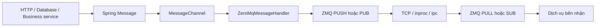
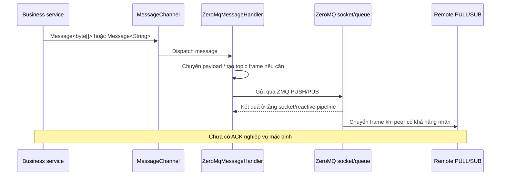
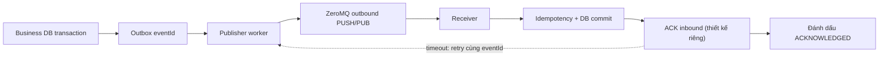

# ZeroMQ outbound channel adapter

## 1. Bài toán: gửi sự kiện từ Spring Integration sang ZeroMQ

Giả sử dịch vụ xử lý đơn hàng nhận request HTTP, kiểm tra dữ liệu và cập nhật database. Sau khi giao dịch nghiệp vụ thành công, dịch vụ cần gửi sự kiện `orders.created` cho một ứng dụng thu thập telemetry hoặc một bộ xử lý chạy bằng ngôn ngữ khác. Đối tác nhận đã triển khai **ZeroMQ**; phía Spring Boot cần giao tiếp bằng đúng socket pattern mà không tự quản lý vòng lặp socket trong mỗi service.

**ZeroMQ outbound channel adapter** thực hiện vai trò này: nhận một Spring `Message<?>` từ `MessageChannel`, chuyển nó thành dữ liệu phù hợp và **gửi ra ZeroMQ socket**. Trong Spring Integration, thành phần tương ứng là `ZeroMqMessageHandler`; Java DSL cấu hình qua `ZeroMq.outboundChannelAdapter(...)`.

Bài thuộc chương **Adapter ZeroMQ** của module **SPRING_INTEGRATION_ADAPTERS**. Module kết nối các hệ thống ngoài qua inbound/outbound adapter, gateway, poller và `MessageChannel`; thực hành với file, SFTP, HTTP, JMS, AMQP, Kafka và cơ sở dữ liệu, đồng thời xử lý hợp đồng message, lỗi và vòng đời kết nối. Với ZeroMQ outbound, điểm quan trọng là **mô hình socket, cách đóng gói frame/topic, điều kiện gửi và mức bảo đảm giao nhận**.

Sau bài học, bạn sẽ:

1. Phân biệt `ZeroMqMessageHandler`, ZeroMQ inbound adapter và `ZeroMqChannel`.
2. Chọn `SocketType.PUSH`, `SocketType.PUB` hoặc `SocketType.PAIR` cho outbound.
3. Tạo `ZContext` và cấu hình Java DSL gửi message qua `connectUrl` hoặc cổng `bind` tùy phiên bản.
4. Dùng `topicFunction`, `wrapTopic`, mapper/converter và payload `ZMsg`.
5. Hiểu vì sao việc gọi `send()` thành công **không chứng minh** phía nhận đã xử lý.
6. Kiểm soát high-water mark, reconnect, shutdown, lỗi, bảo mật và kiểm thử end-to-end.

## 2. Vị trí của outbound adapter trong kiến trúc



| Thành phần | Vai trò trong luồng | Có tự trả lời yêu cầu nghiệp vụ không? |
| --- | --- | --- |
| Business service / message producer | Tạo sự kiện cần chuyển đi | Có thể quyết định thời điểm phát sự kiện |
| `MessageChannel` | Chuyển message giữa các endpoint Spring Integration | Không tự gửi dữ liệu qua ZeroMQ |
| **`ZeroMqMessageHandler`** | Outbound adapter: serialize và gửi qua socket ZeroMQ | **Không**, chỉ là endpoint gửi một chiều |
| `ZeroMqMessageProducer` | Inbound adapter: đọc từ ZeroMQ, phát Spring message | Không tự sinh reply cho sender |
| `ZeroMqChannel` | Một implementation của Spring `SubscribableChannel` dùng ZeroMQ | Không đồng nghĩa outbound adapter |
| `ZeroMqProxy` | Thành phần tùy chọn định tuyến traffic giữa các socket | Không tự tạo durable queue |

**Inbound/outbound là hướng của Spring message**, không phải ai thực hiện TCP `bind` hay `connect`. Một outbound PUB có thể bind cổng để subscriber connect; một outbound PUSH cũng có thể connect tới PULL đã bind. Dù phía nào bind, handler vẫn là **outbound** vì dữ liệu đi từ Spring Integration ra ZeroMQ.

### 2.1. Outbound adapter không phải outbound gateway

Trong Spring Integration, gateway thường có **request–reply**: caller gửi request và chờ một reply message. `ZeroMqMessageHandler` là **one-way outbound channel adapter**; nó không tự có phương thức trả payload phản hồi từ peer ZeroMQ. Nếu nghiệp vụ phải xác nhận receiver đã ghi database, hãy thiết kế giao thức ACK ở cấp ứng dụng (ví dụ một kênh inbound khác hoặc event xác nhận có correlation ID), không suy diễn từ việc gửi message thành công.

## 3. Chọn socket pattern: PUSH, PUB hay PAIR?

Theo API Spring Integration, `ZeroMqMessageHandler` chỉ hỗ trợ **`SocketType.PAIR`, `SocketType.PUSH` và `SocketType.PUB`**. `SocketType.PULL` và `SocketType.SUB` là những kiểu socket nhận được inbound adapter hỗ trợ, không phải socket outbound tương ứng.

| Outbound socket | Peer thường dùng | Cơ chế | Tình huống |
| --- | --- | --- | --- |
| **`PUSH`** | **`PULL`** | Pipeline/phân phối công việc giữa các peer nhận | Gửi tác vụ cần một worker xử lý |
| **`PUB`** | **`SUB`** | Publish–subscribe theo prefix topic | Phát sự kiện nghiệp vụ/telemetry cho các subscriber |
| **`PAIR`** | **`PAIR`** | Trao đổi một–một, pattern đơn giản | Liên lạc hai endpoint xác định, thường ít peer |

### 3.1. PUSH/PULL không phải broadcast

Nếu một `PUSH` được kết nối với nhiều `PULL`, ZeroMQ phân phối message theo khả năng các peer, **không mặc định gửi một bản đến mọi PULL**. Điều này thích hợp cho *work pipeline*: mỗi công việc chỉ nên do một worker nhận trong điều kiện bình thường. Tuy nhiên, ZeroMQ **không tự cung cấp durable acknowledgement/requeue** như một broker chuyên dụng; nếu worker chết sau khi nhận nhưng trước khi commit, ứng dụng phải xử lý khả năng thất lạc công việc.

### 3.2. PUB/SUB không phải work queue

Với `PUB`, mỗi subscriber đã kết nối và đăng ký prefix phù hợp có thể nhận bản riêng. Nhưng publisher **không lưu lại lịch sử message** cho subscriber tới sau (*slow joiner*) và message có thể bị bỏ trong một số tình huống quá tải. Nếu một event tài chính không được phép mất, `PUB/SUB` thuần không đủ để bảo đảm lưu trữ và phát lại.

### 3.3. PAIR không thay thế RPC

`PAIR` dùng cho cặp endpoint có quan hệ một–một, không thích hợp khi nhiều client cùng kết nối hoặc cần load balance/pub-sub. Nó có thể dùng cho một vài kịch bản trao đổi hai chiều đơn giản, nhưng outbound adapter vẫn là **endpoint gửi**. Không tự coi việc chọn PAIR là đã có request–reply do Spring quản lý.

## 4. Thành phần cốt lõi và vòng đời xử lý message

`ZeroMqMessageHandler` là một `ReactiveMessageHandler`. Spring Integration bao bọc ZeroMQ socket, quản lý thread và lifecycle nội bộ để code nghiệp vụ không phải chia sẻ trực tiếp `ZMQ.Socket` giữa các thread.



Không dùng `MessageChannel.send() == true` hoặc việc handler không ném exception làm bằng chứng **receiver đã nhận và commit dữ liệu**. Với component reactive, việc publish còn có các bước bất đồng bộ; ngay cả khi socket chấp nhận frame, dữ liệu có thể đang nằm trong queue bộ nhớ và chưa tới consumer.

### 4.1. Phân biệt ba lớp hoàn tất

| Mốc | Có thể chứng minh gì? | Không chứng minh gì? |
| --- | --- | --- |
| Spring channel chấp nhận message | Message được tiếp nhận/dispatch theo loại channel | Chưa chắc đã gửi ra network |
| ZeroMQ socket xử lý lệnh gửi | Socket có thể đã xếp hàng hoặc truyền dữ liệu theo pattern | Chưa chắc peer đã xử lý; có thể bị drop hoặc mất khi crash |
| Consumer xác nhận sau khi xử lý | Consumer ghi nhận kết quả qua ACK riêng | Tùy giao thức ACK, vẫn cần idempotency và audit |

Trong kiến trúc có yêu cầu giao nhận tin cậy, hãy xác định chính xác **ACK ở mốc nào** trước khi đặt tên trạng thái là `SENT`, `DELIVERED` hay `PROCESSED`.

## 5. Chuẩn bị dependency và cấu hình

### 5.1. Maven / Gradle

Với ứng dụng Spring Boot sử dụng BOM quản lý phiên bản Spring Integration tương thích:

```xml
<dependencies>
    <dependency>
        <groupId>org.springframework.boot</groupId>
        <artifactId>spring-boot-starter-integration</artifactId>
    </dependency>
    <dependency>
        <groupId>org.springframework.integration</groupId>
        <artifactId>spring-integration-zeromq</artifactId>
    </dependency>
</dependencies>
```

Nếu dùng Gradle với dependency management thích hợp:

```groovy
implementation "org.springframework.boot:spring-boot-starter-integration"
implementation "org.springframework.integration:spring-integration-zeromq"
```

Module `spring-integration-zeromq` sử dụng **JeroMQ**, triển khai Java của ZeroMQ. Nên dùng bộ phiên bản do Spring Boot BOM hoặc Spring Integration BOM phù hợp quản lý; tránh trộn thủ công Spring Integration Core và JeroMQ không tương thích.

### 5.2. Các endpoint sử dụng trong ví dụ

```yaml
# application.yml
app:
  zeromq:
    push-target: ${ZEROMQ_PUSH_TARGET:tcp://127.0.0.1:7777}
    pub-target: ${ZEROMQ_PUB_TARGET:tcp://127.0.0.1:7788}
```

Trong phần thực hành:

- `push-target` là địa chỉ PULL peer đang **bind** và chờ PUSH kết nối.
- `pub-target` là địa chỉ SUB peer đang **bind**, để PUB phía Spring **connect** tới. ZeroMQ cho phép cách bố trí này; PUB không bắt buộc phải là bên bind.
- `127.0.0.1` chỉ thích hợp khi hai process chạy trên **cùng host/network namespace**. Trong container, loopback thường không trỏ tới container/pod khác.

Hãy đổi hostname sang DNS/service thực tế khi triển khai; chỉ mở firewall/NetworkPolicy cho peer đáng tin cậy.

## 6. Ví dụ hoàn chỉnh 1: gửi công việc bằng PUSH

Bài toán: một service gửi bản tin đơn hàng dạng UTF-8 đến worker `PULL`. Mỗi bản tin chỉ cần một frame `byte[]`; không dùng topic.

### 6.1. Khởi tạo ZContext và Java DSL

```java
import org.springframework.beans.factory.annotation.Value;
import org.springframework.context.annotation.Bean;
import org.springframework.context.annotation.Configuration;
import org.springframework.integration.channel.DirectChannel;
import org.springframework.integration.dsl.IntegrationFlow;
import org.springframework.integration.zeromq.dsl.ZeroMq;
import org.springframework.messaging.MessageChannel;
import org.zeromq.SocketType;
import org.zeromq.ZContext;

@Configuration
public class ZeroMqPushOutboundConfiguration {

    @Bean(destroyMethod = "close")
    public ZContext zeroMqContext() {
        return new ZContext();
    }

    @Bean("zeroMqTasksToSend")
    public MessageChannel zeroMqTasksToSend() {
        return new DirectChannel();
    }

    @Bean
    public IntegrationFlow zeroMqPushFlow(
            ZContext zeroMqContext,
            @Value("${app.zeromq.push-target}") String pushTarget) {

        return IntegrationFlow.from("zeroMqTasksToSend")
                .handle(ZeroMq.outboundChannelAdapter(
                                zeroMqContext, pushTarget, SocketType.PUSH)
                        .socketConfigurer(socket -> {
                            socket.setSndHWM(1_000);
                            socket.setSendTimeOut(2_000);
                        }))
                .get();
    }
}
```

Giải thích:

| Dòng cấu hình | Vai trò |
| --- | --- |
| `ZContext` | Quản lý tài nguyên socket JeroMQ theo vòng đời ứng dụng |
| `DirectChannel` | Điểm vào cho service gửi Spring message |
| `ZeroMq.outboundChannelAdapter(...)` | Tạo spec cho `ZeroMqMessageHandler` |
| `SocketType.PUSH` | Gửi qua pipeline tới `PULL` |
| `pushTarget` | TCP URL của PULL peer đã bind |
| `socket.setSndHWM(1_000)` | Đặt ngưỡng hàng đợi gửi phía socket ZeroMQ |
| `socket.setSendTimeOut(2_000)` | Ví dụ giới hạn thời gian đợi khi thao tác gửi không thể tiến triển theo socket semantics |

`setSndHWM` và `setSendTimeOut` là **tùy chọn socket**, không phải cơ chế lưu trữ message trên disk. Hành vi khi HWM đạt ngưỡng có thể khác nhau theo socket type. Hãy đo thực tế với JeroMQ, đừng giả định “đã đặt timeout 2 giây thì downstream chắc chắn phản hồi sau 2 giây”.

### 6.2. Service tạo và gửi payload

```java
import java.nio.charset.StandardCharsets;
import org.springframework.beans.factory.annotation.Qualifier;
import org.springframework.messaging.MessageChannel;
import org.springframework.messaging.support.MessageBuilder;
import org.springframework.stereotype.Service;

@Service
public class ZeroMqTaskPublisher {

    private final MessageChannel tasksToSend;

    public ZeroMqTaskPublisher(
            @Qualifier("zeroMqTasksToSend")
            MessageChannel tasksToSend) {
        this.tasksToSend = tasksToSend;
    }

    public void publishCreatedOrder(String orderId) {
        if (orderId == null || !orderId.matches("[A-Za-z0-9_-]{1,64}")) {
            throw new IllegalArgumentException("orderId không hợp lệ");
        }

        // Ví dụ đơn giản: text UTF-8, chưa phải JSON schema production.
        byte[] data = ("order-created:" + orderId)
                .getBytes(StandardCharsets.UTF_8);

        boolean acceptedByChannel = tasksToSend.send(
                MessageBuilder.withPayload(data)
                        .setHeader("eventId", "order-created-" + orderId)
                        .build());
        if (!acceptedByChannel) {
            throw new IllegalStateException(
                    "Không chuyển được message vào ZeroMQ flow");
        }
    }
}
```

Trong ví dụ, `eventId` là **header nội bộ Spring**. Với mapping mặc định chuyển payload thành byte array, **không mặc định** header này sẽ xuất hiện ở receiver JeroMQ thuần. Nếu cần receiver biết event ID để chống trùng, hãy đặt nó **trong payload schema** hoặc dùng message mapper có hợp đồng serialize headers được cả hai phía hiểu.

Việc gọi `publishCreatedOrder` trả về bình thường chỉ cho biết đường gửi Spring đã hoạt động theo hợp đồng channel/handler, **không** có ACK nghiệp vụ từ worker PULL.

### 6.3. Worker JeroMQ PULL để kiểm thử

Chạy peer sau trong **một process riêng** trước khi gọi service PUSH. Nó bind TCP port 7777, đọc một frame và in nội dung:

```java
import java.nio.charset.StandardCharsets;
import org.zeromq.SocketType;
import org.zeromq.ZContext;
import org.zeromq.ZMQ;

public class ZeroMqPullReceiverDemo {
    public static void main(String[] args) {
        try (ZContext context = new ZContext()) {
            ZMQ.Socket pull = context.createSocket(SocketType.PULL);
            try {
                pull.setReceiveTimeOut(10_000);
                pull.bind("tcp://*:7777");
                byte[] bytes = pull.recv(0);
                if (bytes == null) {
                    throw new IllegalStateException("Không nhận được message");
                }
                System.out.println(
                        new String(bytes, StandardCharsets.UTF_8));
            } finally {
                pull.close();
            }
        }
    }
}
```

Khi có một event hợp lệ, receiver thấy ví dụ `order-created:42`. Đây mới là kiểm tra **socket peer có nhận frame**; nếu receiver còn cần lưu DB thì phải bổ sung khâu xử lý và xác nhận độc lập.

## 7. Ví dụ 2: publish sự kiện theo topic bằng PUB

Với `PUB/SUB`, ứng dụng muốn phát các sự kiện `orders.created` hoặc `orders.cancelled` và subscriber lọc theo tiền tố `orders.`. Inbound peer dùng `SocketType.SUB`.

### 7.1. Chọn topic từ message header

```java
import org.springframework.beans.factory.annotation.Value;
import org.springframework.context.annotation.Bean;
import org.springframework.context.annotation.Configuration;
import org.springframework.integration.channel.DirectChannel;
import org.springframework.integration.dsl.IntegrationFlow;
import org.springframework.integration.zeromq.dsl.ZeroMq;
import org.springframework.messaging.MessageChannel;
import org.zeromq.SocketType;
import org.zeromq.ZContext;

@Configuration
public class ZeroMqPubOutboundConfiguration {

    @Bean("zeroMqEventsToPublish")
    public MessageChannel zeroMqEventsToPublish() {
        return new DirectChannel();
    }

    @Bean
    public IntegrationFlow zeroMqPubFlow(
            ZContext zeroMqContext,
            @Value("${app.zeromq.pub-target}") String pubTarget) {

        return IntegrationFlow.from("zeroMqEventsToPublish")
                .handle(ZeroMq.outboundChannelAdapter(
                                zeroMqContext, pubTarget, SocketType.PUB)
                        .topicFunction(message ->
                                (String) message.getHeaders().get("eventTopic"))
                        .wrapTopic(false))
                .get();
    }
}
```

`topicFunction(...)` đọc `eventTopic` từ Spring message. Nó chỉ có ý nghĩa với **`PUB`**; đối với `PUSH` hoặc `PAIR`, cấu hình topic không được áp dụng theo hợp đồng ZeroMQ outbound adapter.

`wrapTopic(false)` nói rằng ZeroMQ message có **hai frame** khi có topic: `[topic][payload]`. Mặc định `wrapTopic(true)` tạo **ba frame**: `[topic][empty][payload]`. Receiver phải biết framing contract; không được để hai phía tự đoán. Tài liệu Spring Integration nêu rõ khi `topicExpression` trả `null`, topic frame sẽ không được chèn vào outbound message.

### 7.2. Phát sự kiện có topic

```java
import java.nio.charset.StandardCharsets;
import org.springframework.beans.factory.annotation.Qualifier;
import org.springframework.messaging.MessageChannel;
import org.springframework.messaging.support.MessageBuilder;
import org.springframework.stereotype.Service;

@Service
public class ZeroMqOrderEventPublisher {

    private final MessageChannel events;

    public ZeroMqOrderEventPublisher(
            @Qualifier("zeroMqEventsToPublish")
            MessageChannel events) {
        this.events = events;
    }

    public void publishEvent(String topic, String json) {
        if (topic == null || !topic.matches("orders[.][a-z_-]+")) {
            throw new IllegalArgumentException("Topic không được phép");
        }
        if (json == null || json.isBlank()) {
            throw new IllegalArgumentException("Payload rỗng");
        }

        boolean accepted = events.send(
                MessageBuilder.withPayload(
                        json.getBytes(StandardCharsets.UTF_8))
                        .setHeader("eventTopic", topic)
                        .build());
        if (!accepted) {
            throw new IllegalStateException(
                    "Không gửi được event vào PUB flow");
        }
    }
}
```

Ví dụ gọi:

```java
publisher.publishEvent(
        "orders.created",
        "{\"eventId\":\"evt-42\",\"orderId\":\"42\"}");
```

Đây chỉ là demo schema. Khi triển khai production, nên serialize DTO bằng JSON serializer chuẩn, kiểm tra schema/version, giới hạn payload và bổ sung event ID ở **nội dung frame** để receiver có thể tự chống trùng.

### 7.3. SUB peer nhận hai frame

```java
import java.nio.charset.StandardCharsets;
import org.zeromq.SocketType;
import org.zeromq.ZContext;
import org.zeromq.ZMQ;

public class ZeroMqSubscriberDemo {
    public static void main(String[] args) {
        try (ZContext context = new ZContext()) {
            ZMQ.Socket sub = context.createSocket(SocketType.SUB);
            try {
                // SUB bind vì outbound PUB trong ví dụ sẽ connect.
                sub.bind("tcp://*:7788");
                sub.subscribe("orders.".getBytes(StandardCharsets.UTF_8));
                sub.setReceiveTimeOut(10_000);

                byte[] topicBytes = sub.recv(0);
                if (topicBytes == null) {
                    throw new IllegalStateException("Không có topic frame");
                }
                if (!sub.hasReceiveMore()) {
                    throw new IllegalStateException("Thiếu body frame");
                }
                byte[] bodyBytes = sub.recv(0);

                System.out.println("topic=" +
                        new String(topicBytes, StandardCharsets.UTF_8));
                System.out.println("body=" +
                        new String(bodyBytes, StandardCharsets.UTF_8));
            } finally {
                sub.close();
            }
        }
    }
}
```

Khi `PUB` vừa kết nối tới `SUB`, **subscription có thể chưa hoàn tất**. Vì vậy sự kiện gửi ngay thời điểm start có thể bị mất (*slow joiner*). Test ổn định cần cơ chế tín hiệu sẵn sàng/handshake hoặc gửi thử có kiểm soát và chỉ xác nhận sau khi receiver thực sự nhận; `Thread.sleep(100)` không bảo đảm subscription đã lan đến peer.

## 8. Topic và multipart framing phải được thỏa thuận

### 8.1. Hai cách đóng gói topic thường gặp

| Bên gửi | Cấu hình | Các frame trên wire | Bên nhận phù hợp |
| --- | --- | --- | --- |
| Spring PUB | `wrapTopic(true)` (mặc định) | `[topic][empty][payload]` | Spring SUB `unwrapTopic(true)` |
| Spring PUB | `wrapTopic(false)` | `[topic][payload]` | Spring SUB `unwrapTopic(false)` |
| Spring PUSH | Không có topic tự động | `[payload]` theo mapper mặc định | PULL đọc một frame |
| PUB gửi raw `ZMsg` | Không tự tạo topic/empty frame | Phụ thuộc chính xác các frame trong `ZMsg` | SUB phải biết framing contract raw |

Trong PUB/SUB, subscription của ZeroMQ áp dụng với **prefix byte của frame đầu tiên**. Nếu topic được đặt trong field `"topic"` của JSON body mà không có topic frame đầu, SUB đăng ký `orders.` sẽ không tự lọc JSON theo field đó.

### 8.2. `topic` cố định, `topicExpression` và `topicFunction`

`ZeroMqMessageHandlerSpec` hỗ trợ ba kiểu cấu hình:

```java
// 1. Tất cả message cùng một topic:
.topic("orders.created")

// 2. SpEL lấy header:
.topicExpression("headers['eventTopic']")

// 3. Hàm Java đọc message:
.topicFunction(message ->
        (String) message.getHeaders().get("eventTopic"))
```

Đây là **ba phương án thay thế**, không phải ba dòng để đặt nối tiếp vào cùng một handler. Với nguồn dữ liệu không đáng tin, cần kiểm tra topic trước khi truyền để tránh namespace/topic injection. Khi topic là `null`, đừng giả định receiver SUB đang chỉ subscribe `orders.` vẫn nhận dữ liệu.

### 8.3. Header ở Spring không tự trở thành ZeroMQ header

ZeroMQ frame không có cùng khái niệm `MessageHeaders` của Spring. Default mapper `ConvertingBytesMessageMapper` dùng một `ConfigurableCompositeMessageConverter` để chuyển message hoặc payload thành `byte[]`. Nó không tự tạo một giao thức liên thông mang **mọi Spring header** tới ứng dụng JeroMQ ngoài Spring.

Nếu cả hai phía đều sử dụng Spring Integration và muốn đóng gói headers, có thể lựa chọn một `OutboundMessageMapper<byte[]>` phù hợp, chẳng hạn `EmbeddedHeadersJsonMessageMapper` theo tài liệu; phía nhận phải dùng một mapper có hợp đồng tương ứng. Không trộn tùy tiện kiểu encode này với consumer mong chỉ một chuỗi JSON nghiệp vụ.

## 9. Trường hợp payload là ZMsg: đi qua như các frame thô

Nếu request message có payload là `org.zeromq.ZMsg`, `ZeroMqMessageHandler` **không thực hiện message conversion hoặc tự chèn topic**, bất kể bạn đã đặt `topicFunction` hay `wrapTopic`. Nó gửi `ZMsg` theo cấu trúc frame sẵn có và **không destroy đối tượng ZMsg** để caller có khả năng tái sử dụng.

### 9.1. Ví dụ cấu trúc raw

```java
import java.nio.charset.StandardCharsets;
import org.zeromq.ZMsg;

ZMsg raw = new ZMsg();
raw.add("orders.created".getBytes(StandardCharsets.UTF_8));
raw.add(new byte[0]); // empty frame: tương ứng wrapTopic(true)
raw.add("{\"eventId\":\"evt-42\"}".getBytes(StandardCharsets.UTF_8));

// Nếu đưa raw vào outbound adapter, ba frame này được gửi như đã định nghĩa;
// topicFunction()/wrapTopic() sẽ không tự thay đổi cấu trúc.
// Quản lý vòng đời raw theo completion boundary của ứng dụng.
```

**Lưu ý tài nguyên quan trọng:** vì handler không destroy `ZMsg`, ứng dụng có trách nhiệm bảo đảm dữ liệu raw không bị sử dụng sau khi giải phóng và không bị giữ vô hạn. Nếu luồng gửi còn xử lý bất đồng bộ, **không destroy hay thay đổi ZMsg quá sớm** khi chưa biết handler đã dùng xong. Với message thông thường, ưu tiên `byte[]` và mapper rõ ràng; raw multipart chỉ dùng khi hợp đồng wire protocol yêu cầu.

Nếu dùng raw để chèn topic bằng tay, cần thống nhất frame đầu với subscription bên nhận. Một frame rỗng thêm/bớt có thể khiến consumer đọc nhầm `payload` thành chuỗi rỗng.

## 10. Bind hay connect? Vòng đời socket trong Spring Integration

Spring Integration quản lý socket và thread nội bộ cho ZeroMQ; caller không cần tự lấy `ZMQ.Socket` rồi `send` từ nhiều thread. Một `ZContext` có thể dùng chung trong ứng dụng; để Spring đóng nó khi ứng dụng shutdown sau khi các endpoint dừng.

| Cấu hình outbound | Ý nghĩa | Ghi chú |
| --- | --- | --- |
| `outboundChannelAdapter(context, "tcp://host:7777", PUSH)` | Outbound socket **connect** tới peer | Phù hợp với PULL peer đã bind |
| `outboundChannelAdapter(context, "tcp://host:7788", PUB)` | Outbound PUB **connect** tới SUB/proxy | PUB không bắt buộc bind |
| `outboundChannelAdapter(context, 7788, PUB)` | Outbound PUB **bind** local TCP port | API bind port có từ **Spring Integration 6.4** |
| `outboundChannelAdapter(context, PUB)` | Tạo socket outbound bind một cổng ngẫu nhiên | Cũng thuộc nhóm API bind từ 6.4; cần discovery cổng |

Trong các phiên bản Spring Integration cũ, `ZeroMqMessageHandler` chủ yếu hỗ trợ **connect**; vì thế không nên sao chép API `bind` vào một dự án 5.4/6.0 mà chưa kiểm tra version. Với API hiện đại, cổng thực tế của socket bind có thể được xem qua `getBoundPort()` sau khi start.

### 10.1. Ví dụ PUB bind nếu dùng Spring Integration 6.4+

```java
@Bean
public IntegrationFlow zeroMqBoundPublisher(ZContext context) {
    return IntegrationFlow.from("zeroMqBoundEvents")
            .handle(ZeroMq.outboundChannelAdapter(
                            context, 7790, SocketType.PUB)
                    .topic("orders.")
                    .wrapTopic(false))
            .get();
}
```

Nếu chọn PUB bind tại `tcp://*:7790`, SUB receiver sẽ **connect** đến địa chỉ thật của Spring service, ví dụ `tcp://publisher-service:7790`. Trong Kubernetes, cần Service/NetworkPolicy và cấu hình routing thích hợp; `127.0.0.1` trong pod khác là loopback của pod đó.

### 10.2. Lifecycle và threading

`ZeroMqMessageHandler` là `ReactiveMessageHandler` và quản lý vòng đời thông qua Spring. ZeroMQ socket không nên được gọi tùy tiện đồng thời từ nhiều thread của code nghiệp vụ. Dùng `MessageChannel`, adapter và `ZContext` do Spring quản lý, không dùng một socket JeroMQ tự tạo rồi share qua nhiều `@Service`.

Khi ứng dụng shutdown, dữ liệu **đang nằm trong hàng đợi gửi** có thể còn chưa đến peer. ZeroMQ có `linger` để điều khiển hành vi đóng socket với message chưa gửi; giá trị và policy phù hợp phụ thuộc yêu cầu dừng dịch vụ và version JeroMQ. `socket.setLinger(0)` cho shutdown nhanh nhưng có thể làm mất message đang chờ. **Không gọi đó là graceful delivery** nếu chưa có ACK/quy trình drain thực tế.

## 11. Socket options, HWM và tốc độ downstream

`socketConfigurer(...)` được dùng để thay đổi option của `ZMQ.Socket` do handler sở hữu:

```java
.socketConfigurer(socket -> {
    socket.setSndHWM(1_000);
    socket.setSendTimeOut(2_000);
    // setLinger(...) cần chọn theo chính sách shutdown;
    // không tùy tiện ép 0 với dữ liệu phải giao nhận.
})
```

| Option/khái niệm | Ý nghĩa | Điều cần thận trọng |
| --- | --- | --- |
| `SNDHWM` | Ngưỡng queue gửi theo peer/socket | Không phải lưu trữ bền vững; có thể block/drop tùy pattern |
| Send timeout | Khoảng chờ khi một lệnh gửi bị cản bởi trạng thái socket | Không phải thời gian consumer commit DB |
| Linger | Thời gian giữ/thoát khi đóng socket còn message chưa gửi | Quá ngắn có thể mất dữ liệu; quá dài có thể kéo dài shutdown |
| Reconnect | Khả năng kết nối lại ở tầng ZeroMQ | Không cung cấp replay các event đã mất |
| Thread/channel dispatch | Cách Spring chuyển message vào handler | Không bảo đảm công việc network đã hoàn tất ngay khi caller trả về |

### 11.1. Backpressure không phải độ bền

Khi receiver PULL chậm, socket PUSH có thể bị cản bởi high-water mark và khả năng xử lý của peer. Với PUB/SUB, publisher có thể drop message khi một subscriber chậm hoặc chưa sẵn sàng. Nếu bạn đẩy liên tục từ `ExecutorChannel` hay queue Spring không giới hạn, có thể tăng memory ở cả tầng Spring lẫn ZeroMQ.

Để bảo vệ hệ thống, cần đo throughput, cấu hình queue hữu hạn, phân loại lỗi, cân nhắc bulkhead và cơ chế điều tiết producer. Nhưng nếu nghiệp vụ đòi **không mất message**, chỉ điều chỉnh HWM không đủ; phải bổ sung **durable outbox/queue và ACK/replay**.

## 12. Đảm bảo giao nhận: gửi thành công không phải đã xử lý

Một kịch bản mất message:

```text
10:00:00  DB commit một đơn hàng
10:00:01  Service đẩy event vào Spring MessageChannel
10:00:01  ZeroMQ socket chấp nhận frame vào queue trong RAM
10:00:02  Process phát bị kill trước khi frame tới receiver
10:00:03  Đơn hàng có trong DB nhưng receiver chưa từng thấy event
```

Một kịch bản khác: receiver PULL đã lấy message từ queue nhưng crash trước khi commit database. Bản tin không tự quay về sender chỉ vì receiver chết.

### 12.1. Outbox cho sự kiện quan trọng

Với sự kiện phải giao ít nhất một lần, một phương án là:

1. Trong **cùng transaction DB** với thay đổi đơn hàng, ghi một dòng `outbox(eventId, payload, status)`.
2. Một publisher worker lấy các dòng `PENDING` và chuyển sang outbound adapter.
3. Receiver nhận và lưu `eventId` vào bảng idempotency; chỉ xử lý payload mới.
4. Receiver phát **ACK nghiệp vụ** có `eventId` trên một kênh phù hợp.
5. Khi sender nhận ACK hợp lệ, đánh dấu outbox `ACKNOWLEDGED`.
6. Nếu timeout, sender có thể **gửi lại cùng `eventId`** theo backoff, còn consumer bỏ qua bản trùng.



Đây là **kiến trúc đề xuất**, không phải tính năng ZeroMQ outbound adapter tự cung cấp. Với PUB/SUB và subscriber phát sinh động, “nhận đủ ACK” có thể không xác định vì số subscriber biến đổi; nếu cần giao chắc chắn cho một worker, PUSH/PULL có protocol ACK riêng hoặc một broker bền vững có thể thích hợp hơn.

### 12.2. Không quảng cáo exactly-once khi chưa có idempotency

Mạng có thể đứt sau khi receiver đã commit nhưng trước khi sender nhận ACK. Sender retry sẽ tạo bản tin trùng. Vì vậy nên hướng tới **at-least-once qua replay + idempotent consumer**, nếu bài toán thực sự cần tính tin cậy, thay vì hứa hẹn exactly-once chỉ dựa trên ZeroMQ transport.

## 13. Error handling và quan sát

### 13.1. Lỗi có thể xuất hiện ở nhiều lớp

| Dấu hiệu | Nguyên nhân có thể | Bước xác minh |
| --- | --- | --- |
| Spring không tìm thấy channel/endpoint | Bean/config flow sai | Kiểm tra tên channel, scope scan và lifecycle |
| Bind cổng thất bại | Cổng đang bị chiếm, thiếu quyền, NetworkPolicy | Kiểm tra port và log endpoint |
| Gửi message mà PULL không nhận | Sai URL, peer chưa bind, network/routing | Kiểm tra pattern, TCP endpoint, readiness |
| PUB không có người nhận | SUB chưa connect/subscribe hoặc prefix không khớp | Kiểm tra topic frame, prefix và slow joiner |
| SUB nhận topic nhưng body rỗng | Không thống nhất `wrapTopic`/`unwrapTopic` | Kiểm tra hai hay ba frame |
| Handler ném conversion exception | Payload không chuyển được sang byte array | Kiểm tra mapper, charset, schema, giá trị null |
| Hàng đợi tăng/đứng | Receiver chậm, HWM, quá nhiều task gửi | Đo throughput, queue và cấu hình timeout |
| Event bị gửi trùng | Sender retry khi không biết peer đã nhận | Bổ sung event ID, ACK/idempotency |
| App shutdown mất event | Socket queue chưa drain, linger quá ngắn | Thực hiện outbox/ACK, đo shutdown |
| Raw multipart sai thứ tự | `ZMsg` bypass topic/converter, sender tạo sai frame | Kiểm tra framing raw và test bytes |

### 13.2. Error channel và reactive handler

Vì `ZeroMqMessageHandler` triển khai `ReactiveMessageHandler`, exception liên quan gửi có thể được báo qua đường xử lý reactive của endpoint; cách lan truyền phụ thuộc channel và cấu hình luồng. Không tự động giả định một exception ở network sẽ được ném **đồng bộ** cho caller đang gọi `MessageChannel.send()`.

Với một flow bất đồng bộ, cần có error channel/error handler được cấu hình ở **đúng nguồn phát hoặc async boundary**, một subscriber ghi lỗi và cơ chế xử lý lại dữ liệu nguồn. `DirectChannel` giúp hiểu đường dispatch đồng bộ ở mức channel, nhưng bản thân adapter còn có xử lý reactive; vì vậy vẫn cần kiểm thử nơi exception xuất hiện và khi nào upstream coi lệnh gửi đã hoàn tất.

Nếu payload không hợp lệ, filter/transform trước outbound adapter để báo lỗi có cấu trúc; không gửi JSON hỏng rồi retry vô hạn. Với dữ liệu tài chính/nhạy cảm, không log toàn bộ payload hoặc credential trong thông báo lỗi.

### 13.3. Những chỉ số nên theo dõi

- Tốc độ message gửi từ Spring và tốc độ receiver xác nhận theo event ID.
- Số event `PENDING`, `SENT`, `ACKNOWLEDGED` và `FAILED` trong outbox nếu có.
- Thời gian giữa tạo sự kiện và nhận ACK cuối.
- Số lỗi chuyển đổi payload, lỗi kết nối/bind, lỗi frame/topic.
- HWM/queue pressure và số message bị drop, nếu phiên bản/thư viện cung cấp cách đo đáng tin.
- Số lần restart, reconnect và shutdown chưa flush hết.

Không suy diễn metric “số lần gọi handler” là “số event đã được consumer lưu DB”.

## 14. Bảo mật và triển khai

1. **Giới hạn mạng:** chỉ mở port TCP outbound/inbound cần thiết, giới hạn peer bằng firewall và Kubernetes NetworkPolicy.
2. **Không coi `tcp://` tự mã hóa:** nếu dữ liệu cần bảo mật, xem xét cơ chế ZeroMQ CURVE được hỗ trợ và xác thực đúng, hoặc mạng riêng/mTLS gateway theo kiến trúc. Không tự khẳng định tất cả JeroMQ version hỗ trợ cùng option bảo mật.
3. **Kiểm tra đầu vào:** whitelist topic, giới hạn kích thước frame, schema version, charset, event ID và thời gian sống dữ liệu.
4. **Quản lý lifecycle:** một `ZContext` dùng chung hợp lý, endpoint do Spring khởi động/dừng, không chia sẻ `ZMQ.Socket` thủ công giữa nhiều thread.
5. **Kubernetes:** `127.0.0.1` trong pod không trỏ tới pod khác. Nếu outbound bind port phải expose bằng Service/NetworkPolicy phù hợp; nếu connect phải trỏ đến DNS/service của peer.
6. **Graceful shutdown:** ngừng nhận sự kiện mới, flush hoặc ghi outbox bền vững, chờ ACK có giới hạn; không dựa duy nhất vào `linger` để bảo đảm dữ liệu.

### 14.1. PUB/SUB sau TCP load balancer

Nếu có nhiều PUB hoặc SUB replica, một TCP load balancer thông thường chỉ định tuyến **kết nối TCP**, không bảo đảm broadcast mỗi event tới mọi subscriber và không tự hiểu subscription. Có thể dùng **ZeroMqProxy** phù hợp hoặc một broker/topic system khác khi số lượng peer và yêu cầu phân phối phức tạp. Trong mọi trường hợp, cần kiểm thử đúng sơ đồ kết nối thực tế thay vì chỉ kiểm tra gửi tới một endpoint local.

## 15. Kiểm thử tích hợp đề xuất

Các bài thử nên sử dụng **socket JeroMQ thật** và các endpoint Spring Integration chạy trong môi trường cô lập. Mock một `MessageHandler` không chứng minh đúng wire protocol, subscription, high-water mark hoặc shutdown.

| Kịch bản | Điều cần xác minh |
| --- | --- |
| PUSH gửi một `byte[]` đến PULL | Peer đọc đúng một frame, UTF-8 đúng |
| Hai PULL cùng nhận từ một PUSH | Có phân phối công việc, không tự broadcast |
| PUB có topic `orders.created` | SUB đăng ký `orders.` nhận được event |
| PUB có topic `billing.created` | SUB chỉ đăng ký `orders.` không nhận event |
| `wrapTopic(false)` | SUB đọc đúng `[topic][payload]` |
| `wrapTopic(true)` | SUB đọc đúng `[topic][empty][payload]` |
| Header Spring `eventId` không nằm trong body | Peer JeroMQ không tự thấy header nếu mapper không nhúng |
| Raw `ZMsg` có ba frame | Handler giữ nguyên số frame, không tự tạo thêm topic |
| PUB gửi trước khi SUB sẵn sàng | Ghi nhận khả năng mất event đầu do slow joiner |
| Receiver PULL chết sau khi lấy message | Không giả định ZeroMQ tự requeue; kiểm tra protocol ACK/replay |
| Sender bị kill khi queue còn message | Thấy giới hạn của linger và bộ nhớ |
| Peer tạm ngắt rồi kết nối lại | Nhận sự kiện mới; không mặc định nhận lại event cũ |
| Gửi với payload sai schema | Lỗi được phân loại, có logging/quarantine |
| HWM thấp + traffic cao | Quan sát block/drop tùy socket type, không gây bão bộ nhớ |
| Deploy với bind port 6.4+ | Socket bind đúng port, bên SUB connect được |
| Application shutdown | Resource được giải phóng, port có thể sử dụng lại |
| Outbox + ACK nghiệp vụ | Retry cùng event ID không làm DB ghi trùng |

Khi kiểm thử PUB/SUB, sử dụng tín hiệu **receiver ready** hoặc cơ chế xác nhận ứng dụng, không chỉ dùng `Thread.sleep(...)` để đoán subscription hoàn tất. Với test throughput, giới hạn thời gian và lưu lượng để không làm ảnh hưởng các hệ thống khác.

## 16. Bài tập tình huống

**Bối cảnh:** Một hệ thống bán hàng có hai loại thông điệp: `reserve-stock` cần được một worker xử lý, và `inventory.updated` cần nhiều dashboard đăng ký theo topic. Hệ thống deploy ba pod publisher và hai pod receiver, có thể mất kết nối trong 30 giây. Yêu cầu dữ liệu đơn hàng quan trọng không được mất, còn dashboard chấp nhận thỉnh thoảng thiếu một số sự kiện có thể đồng bộ lại bằng snapshot.

Hãy trả lời:

1. `reserve-stock` nên dùng outbound socket nào và peer nào?
2. `inventory.updated` nên dùng outbound socket nào và cách subscriber chọn topic?
3. `SocketType.SUB` có dùng trực tiếp cho outbound channel adapter không?
4. Vì sao khi `PUB` vừa start, dashboard `SUB` có thể không nhận event đầu?
5. Nếu dùng `topicFunction`, request message cần mang dữ liệu gì?
6. Với `wrapTopic(false)`, wire format là hai hay ba frame?
7. Nếu payload là `ZMsg` raw, `topicFunction` còn tự chèn topic không?
8. Gọi `MessageChannel.send() == true` có chứng minh worker đã lưu DB không?
9. Làm gì để `reserve-stock` có khả năng replay sau sender crash?
10. Vì sao ba pod publisher không nên giả định TCP load balancer là ZeroMQ pub/sub proxy?
11. Làm cách nào quan sát backlog và xử lý trùng khi sender retry?
12. Khi dùng Spring Integration 6.0, có thể sao chép overload `outboundChannelAdapter(context, 7790, PUB)` không?

**Gợi ý trả lời:** (1) `PUSH` tới `PULL`, thêm ACK/replay nếu quan trọng. (2) `PUB` tới `SUB`, đăng ký prefix topic. (3) Không, outbound chỉ hỗ trợ PAIR/PUSH/PUB. (4) Slow joiner, subscription chưa được thiết lập. (5) Header hoặc dữ liệu được function đọc để trả về topic `String`. (6) Hai frame `[topic][payload]`. (7) Không; `ZMsg` bypass conversion/topic extraction. (8) Không; message có thể chỉ được chấp nhận ở tầng Spring/socket. (9) Transactional outbox, event ID, ACK ứng dụng, idempotent consumer. (10) Load balancer chỉ định tuyến TCP connection, không cung cấp publish/subscription semantics. (11) Theo dõi outbox/ACK và dedup bằng event ID. (12) Không; API bind cổng outbound được bổ sung từ phiên bản 6.4.

## Ghi nhớ

- **`ZeroMqMessageHandler` là ZeroMQ outbound channel adapter**: chuyển Spring `Message<?>` thành frame rồi gửi ra socket, **không tự trả reply nghiệp vụ**.
- Chỉ hỗ trợ **`PUSH`, `PUB` và `PAIR`**; tương ứng thường giao tiếp với `PULL`, `SUB` và `PAIR`.
- `PUB` có `topic`, `topicExpression` hoặc `topicFunction`; phải thống nhất `wrapTopic` với framing phía SUB.
- Payload `ZMsg` được gửi **nguyên dạng**, bỏ qua conversion/topic injection và không được handler tự destroy.
- Có thể **connect** tới peer; API **bind port** cho outbound có từ Spring Integration 6.4.
- HWM, send timeout và linger quản lý socket/bộ nhớ, **không** cung cấp durable queue, ACK hay exactly-once.
- Với sự kiện quan trọng, dùng **outbox/ACK/replay và idempotency**; theo dõi đầy đủ lifecycle và lỗi thay vì coi việc gửi vào channel là xử lý xong.

## Tài liệu tham khảo

- [Spring Integration Reference — ZeroMQ Support](https://docs.spring.io/spring-integration/reference/zeromq.html)
- [Spring Integration API — ZeroMqMessageHandler](https://docs.spring.io/spring-integration/api/org/springframework/integration/zeromq/outbound/ZeroMqMessageHandler.html)
- [Spring Integration API — ZeroMqMessageHandlerSpec](https://docs.spring.io/spring-integration/api/org/springframework/integration/zeromq/dsl/ZeroMqMessageHandlerSpec.html)
- [Spring Integration API — ZeroMq Java DSL](https://docs.spring.io/spring-integration/api/org/springframework/integration/zeromq/dsl/ZeroMq.html)
- [JeroMQ API — ZMQ.Socket](https://javadoc.io/doc/org.zeromq/jeromq/latest/org/zeromq/ZMQ.Socket.html)
- [JeroMQ API — ZMsg](https://javadoc.io/doc/org.zeromq/jeromq/latest/org/zeromq/ZMsg.html)
- [ZeroMQ Guide](https://zguide.zeromq.org/)
