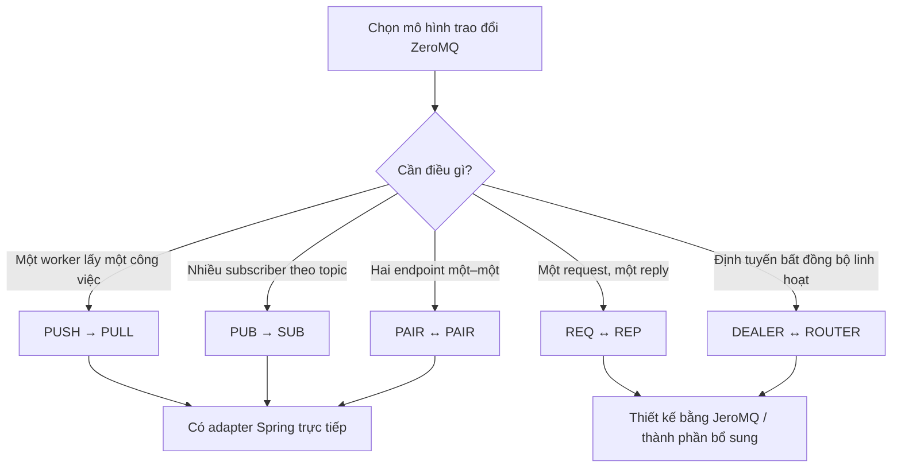
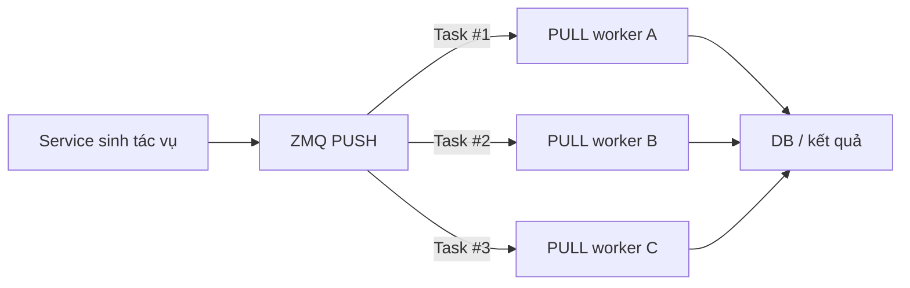
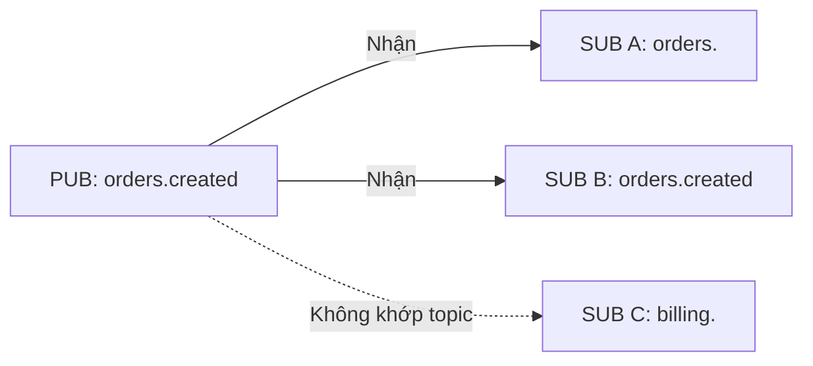
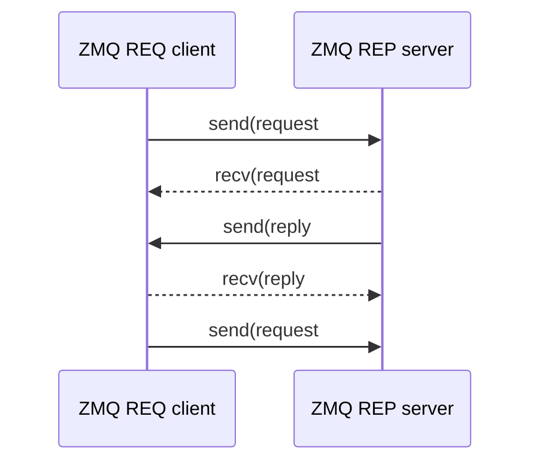
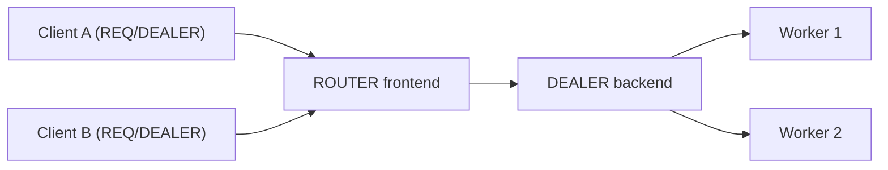
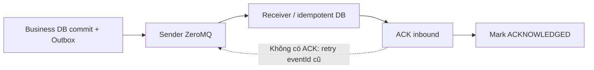

# ZeroMQ socket type và pattern trong Spring Integration

## 1. Vì sao phải chọn đúng socket type?

Một ứng dụng Spring Boot cần truyền dữ liệu tới các service bên ngoài: gửi công việc sang nhóm worker, phát thông báo cho nhiều dashboard, và đôi lúc yêu cầu một service khác trả kết quả ngay. Cả ba tình huống đều liên quan đến **message**, nhưng không thể dùng cùng một kiểu socket ZeroMQ rồi mong thư viện tự thay đổi cách phân phối.

Trong ZeroMQ (ØMQ), **socket type xác định messaging pattern**, ví dụ:

- `PUSH/PULL` phân phối công việc theo pipeline.
- `PUB/SUB` phát một sự kiện đến các subscriber có subscription phù hợp.
- `REQ/REP` tạo cuộc trao đổi yêu cầu–phản hồi theo thứ tự chặt chẽ.
- `DEALER/ROUTER` cho phép xây dựng routing và request–reply phức tạp hơn.
- `PAIR/PAIR` trao đổi với một peer duy nhất.

Trong Spring Integration, không phải socket type nào của ZeroMQ cũng tương ứng với một inbound hoặc outbound channel adapter được tích hợp sẵn. Chọn nhầm socket type có thể khiến ứng dụng không nhận dữ liệu, chỉ một worker nhận được message thay vì mọi worker, hoặc caller chờ một reply mà adapter không cung cấp.

Bài học **“ZeroMQ socket type và pattern”** thuộc chương **Adapter ZeroMQ**, module **SPRING_INTEGRATION_ADAPTERS**. Module học cách kết nối hệ thống ngoài bằng inbound/outbound adapter, gateway, poller và `MessageChannel`; thực hành với file, SFTP, HTTP, JMS, AMQP, Kafka và cơ sở dữ liệu, đồng thời kiểm soát hợp đồng message, lỗi và vòng đời kết nối. Trong bài này, trọng tâm là **ngữ nghĩa từng socket type** và cách gắn chúng vào **Spring Integration adapter, channel và proxy**.

Sau khi học, bạn sẽ có thể:

1. Phân biệt **socket type**, **messaging pattern**, **transport** và thao tác **bind/connect**.
2. Chọn đúng socket type cho yêu cầu work queue, fan-out sự kiện, request–reply hoặc giao tiếp một–một.
3. Biết tập socket type được hỗ trợ trực tiếp bởi `ZeroMqMessageProducer` và `ZeroMqMessageHandler`.
4. Tạo luồng Java DSL `PUSH/PULL` và `PUB/SUB` với `ZContext`, `MessageChannel`, framing/topic.
5. Hiểu vai trò `ZeroMqProxy` và vì sao `ZeroMqChannel` khác với một adapter thông thường.
6. Đánh giá mất message, áp lực hàng đợi, retry, ACK, idempotency và vận hành nhiều replica.

## 2. Phân biệt bốn lớp khái niệm

Một dòng code `socket.connect("tcp://host:7777")` chưa cho biết ứng dụng sẽ xử lý message theo mô hình nào. Ta phải xét bốn lớp:

| Lớp | Câu hỏi | Ví dụ |
| --- | --- | --- |
| **Socket type** | Socket này có chức năng gửi, nhận hay định tuyến thế nào? | `SocketType.PUSH`, `SocketType.SUB` |
| **Messaging pattern** | Message được phân phối, lựa chọn và phản hồi ra sao? | Pipeline, pub/sub, request–reply |
| **Transport** | Dữ liệu đi qua cơ chế truyền nào? | `tcp://`, `inproc://`, `ipc://` tùy môi trường |
| **Bind / connect** | Peer nào tạo endpoint lắng nghe, peer nào nối tới endpoint đó? | `PULL.bind("tcp://*:7777")`, `PUSH.connect(...)` |

**Inbound/outbound của Spring Integration** là chiều message **đi vào/đi ra Integration Flow**, không phải đồng nghĩa với `bind/connect` và cũng không luôn tương đương với byte flow của một giao thức request–reply.

Ví dụ một outbound `PUB` có thể **bind** trên cổng TCP để subscriber bên ngoài **connect**; đó vẫn là outbound adapter vì Spring message đi **ra ZeroMQ**. Tương tự, một inbound `SUB` có thể **connect** tới publisher đã bind, vì message đi **từ ZeroMQ vào Spring**.

### 2.1. Một sơ đồ so sánh nhanh



Sơ đồ chỉ nêu cách chọn bước đầu; mỗi pattern còn có các giới hạn cụ thể về số peer, thứ tự, phản hồi và độ bền.

## 3. Ma trận socket type và mức hỗ trợ Spring Integration

### 3.1. Tập ZeroMQ socket type phổ biến

| Socket type | Peering phổ biến | Hành vi nổi bật | Hỗ trợ trực tiếp trong adapter Spring Integration |
| --- | --- | --- | --- |
| **`PUSH`** | `PULL` | Gửi công việc, phân phối giữa các PULL peer | **Outbound** (`ZeroMqMessageHandler`) |
| **`PULL`** | `PUSH` | Nhận công việc, mỗi message được giao tới một receiver trong pipeline bình thường | **Inbound** (`ZeroMqMessageProducer`) |
| **`PUB`** | `SUB` | Publish cho nhiều subscriber, không chờ ACK | **Outbound** |
| **`SUB`** | `PUB` | Nhận thông điệp khớp các subscription theo prefix | **Inbound** |
| **`PAIR`** | `PAIR` | Giao tiếp với một peer | **Inbound và outbound** |
| **`REQ`** | `REP` hoặc pattern routing phù hợp | Gửi request, phải nhận reply trước request tiếp theo | **Không** có trong tập socket adapter trực tiếp nói trên |
| **`REP`** | `REQ` hoặc routing tương ứng | Nhận request, phải gửi reply trước request tiếp theo | **Không** |
| **`DEALER`** | `ROUTER` hoặc proxy | Asynchronous request/routing, không bị khóa bởi chu kỳ REQ/REP đơn giản | **Không** là socket trực tiếp của inbound/outbound adapter |
| **`ROUTER`** | `DEALER` hoặc proxy | Định tuyến theo peer identity/envelope | **Không** là socket trực tiếp của inbound/outbound adapter |
| **`XPUB` / `XSUB`** | Các peer pub/sub qua proxy | Quản lý/chuyển tiếp subscription, thiết kế broker/proxy tùy chỉnh | **Không** là socket type adapter tiêu chuẩn |

Đây là **ma trận các adapter ZeroMQ được Spring Integration cung cấp sẵn**, không phải khẳng định JeroMQ không hỗ trợ các socket còn lại. JeroMQ có thể làm việc với các pattern ZeroMQ bổ sung bằng API socket trực tiếp. `ZeroMqProxy` của Spring Integration cũng hỗ trợ các **proxy mode** gồm `SUB/PUB`, `PULL/PUSH` và `ROUTER/DEALER`, nhưng điều đó **không biến** `ZeroMqMessageProducer` thành một inbound `ROUTER` adapter.

### 3.2. Hai quy tắc ngắn gọn khi viết DSL

```text
ZeroMqMessageProducer (inbound): PAIR / PULL / SUB
ZeroMqMessageHandler  (outbound): PAIR / PUSH / PUB

PULL nhận từ PUSH.
SUB nhận từ PUB.
PAIR trao đổi với PAIR.
REQ/REP và DEALER/ROUTER yêu cầu thiết kế API JeroMQ phù hợp.
```

Không thử chuyển `SocketType.REP` vào `ZeroMq.inboundChannelAdapter(context, ...)` hay `SocketType.REQ` vào `ZeroMq.outboundChannelAdapter(...)` rồi giả định Spring sẽ tự làm request–reply. Hãy kiểm tra giới hạn API của đúng phiên bản module.

## 4. Pattern PUSH/PULL — pipeline và phân phối công việc

### 4.1. Cách phân phối

Trong pipeline:

- `PUSH` gửi message một chiều.
- `PULL` nhận message một chiều.
- Một `PUSH` có thể kết nối tới nhiều `PULL` worker để **phân phối** công việc, không broadcast mỗi công việc cho toàn bộ worker.
- Một `PULL` có thể nhận từ nhiều `PUSH`; queue input được điều phối theo hành vi ZeroMQ.



Sơ đồ minh họa ý tưởng phân phối, **không bảo đảm** ba message luôn chia đều mỗi worker một message. Nếu worker A kết nối trước B và C, nó có thể nhận nhiều công việc đầu tiên (*slow joiner* phía worker). Việc chọn worker còn phụ thuộc trạng thái kết nối, hàng đợi và tốc độ tiêu thụ.

### 4.2. Ưu điểm và giới hạn

**Ưu điểm:** API đơn giản, không cần topic, có thể làm fan-out công việc hoặc fan-in kết quả qua các kênh pipeline. Thích hợp với tác vụ mà tại một thời điểm **một worker** chịu trách nhiệm xử lý.

**Giới hạn:** không có ACK nghiệp vụ hay khả năng requeue bền vững mặc định. Nếu `PULL` đã nhận công việc rồi process bị kill trước khi commit DB, sender `PUSH` không tự biết để gửi lại. Trong hệ thống yêu cầu không mất tác vụ, cần giao thức ACK/replay hoặc một queue/broker bền vững.

### 4.3. Ví dụ chọn socket

| Yêu cầu | Lựa chọn |
| --- | --- |
| Đẩy 1.000 job cho 5 worker xử lý phân tải | `PUSH` → nhiều `PULL` |
| Mỗi worker phải nhận **tất cả** 1.000 sự kiện | **Không** dùng PUSH/PULL; xem `PUB/SUB` |
| Worker phải trả kết quả trước khi caller tiếp tục | Cần luồng kết quả/ACK riêng hoặc chọn request–reply thích hợp |
| Tự động retry job sau worker crash | Không có sẵn ở PUSH/PULL; cần trạng thái bền vững và replay |

## 5. Pattern PUB/SUB — broadcast và subscription theo topic

`PUB/SUB` tập trung vào **phân phối sự kiện** thay vì giao công việc cho một worker duy nhất.



### 5.1. SUB lọc theo prefix byte

Trong ZeroMQ, `SUBSCRIBE` thường là phép **so khớp tiền tố byte** của phần đầu message, không phải tìm trường `"topic"` bên trong JSON.

| Topic thực tế | SUB đăng ký `orders.` | SUB đăng ký `orders.created` |
| --- | --- | --- |
| `orders.created` | Nhận | Nhận |
| `orders.cancelled` | Nhận | Không nhận |
| `orders.created.v2` | Nhận | **Có thể nhận** vì cùng tiền tố |
| `billing.created` | Không nhận | Không nhận |

Vì so khớp **tiền tố**, các tên như `orders.created2` cũng có thể khớp prefix `orders.created`. Nếu muốn phân nhóm chính xác hơn, quy định namespace và dấu phân tách (ví dụ `orders.created.`) ngay trong hợp đồng dữ liệu. Topic nên được mã hóa theo quy tắc đã thống nhất, thường là UTF-8.

### 5.2. Slow joiner và mất message

PUB **không lưu lịch sử sự kiện** cho SUB kết nối muộn. Một subscriber mới có thể bỏ lỡ các thông điệp phát **trước khi** kết nối và subscription có hiệu lực. Ngay cả khi code đã gọi `connect()`, kết nối mạng và thông tin subscription có thể chưa được thiết lập hoàn toàn.

**Không dùng `Thread.sleep(100)` như bằng chứng subscription đã sẵn sàng.** Với bài kiểm thử chắc chắn hơn, dùng tín hiệu “ready” hoặc handshake ngoài band trước khi publisher bắt đầu gửi lô dữ liệu.

Với PUB/SUB, khi hàng đợi đạt **high-water mark**, các message có thể bị drop thay vì backpressure theo cách ứng dụng kỳ vọng. Vì vậy mô hình này thường thích hợp với dashboard, cache update, telemetry có thể snapshot lại, nhưng **không tự đáp ứng** yêu cầu mọi sự kiện tài chính phải được lưu đúng một lần.

### 5.3. ZeroMQ topic frame và Spring Integration

Khi `ZeroMqMessageHandler` outbound dùng `SocketType.PUB` và topic được cung cấp, Spring Integration có thể thêm frame topic:

```text
wrapTopic(true)  (mặc định): [topic][empty frame][payload]
wrapTopic(false):            [topic][payload]
```

Inbound `ZeroMqMessageProducer` dùng `SocketType.SUB` phải chọn `unwrapTopic` phù hợp với số frame. Khi `receiveRaw(true)`, payload là `ZMsg` gồm các frame gốc và caller tự đọc chúng. Khi dùng mapper (ví dụ `receiveRaw(false)`), topic có thể xuất hiện ở header `ZeroMqHeaders.TOPIC`.

Nếu bên phát gửi `[topic][payload]` nhưng bên nhận giả định `[topic][empty][payload]`, body có thể bị đọc nhầm. Cần kiểm thử bằng **frame thật**, không chỉ bằng giá trị JSON sau khi đã convert.

## 6. Pattern REQ/REP — request–reply tuần tự

ZeroMQ còn có socket pattern **`REQ/REP`** dành cho trao đổi dạng yêu cầu–phản hồi:



**Quy tắc quan trọng:** `REQ` thường phải **send → recv → send → recv**, còn `REP` phải **recv → send → recv → send**. Nếu code gửi hai request liên tiếp trên `REQ` mà không nhận reply của request đầu, hoặc nhận hai lần trên `REP` mà chưa gửi reply, ZeroMQ có thể báo lỗi trạng thái socket (ví dụ `EFSM`).

Vì vậy `REQ/REP` dễ hiểu với tác vụ đơn giản nhưng cần chú ý:

- **Không tự chạy nhiều request đồng thời** trên cùng REQ socket theo kiểu client HTTP thread-safe.
- Khi mất kết nối/timeout và client không nhận được reply, cần chiến lược phục hồi socket và xác minh liệu request cũ đã tác động tới server hay chưa.
- Đặt correlation ID và idempotency cho các lệnh có tác dụng phụ.
- Không dùng `REP` khi server muốn phát event bất kỳ thời điểm nào mà không nhận request trước.

### 6.1. Ví dụ JeroMQ độc lập với adapter Spring

Ví dụ hai process JeroMQ sau mô tả tính tuần tự của REQ/REP, **không** phải API của `ZeroMqMessageProducer`.

Server:

```java
import java.nio.charset.StandardCharsets;
import org.zeromq.SocketType;
import org.zeromq.ZContext;
import org.zeromq.ZMQ;

public class RepServerDemo {
    public static void main(String[] args) {
        try (ZContext context = new ZContext()) {
            ZMQ.Socket rep = context.createSocket(SocketType.REP);
            try {
                rep.bind("tcp://*:7791");
                byte[] request = rep.recv(0);
                if (request != null) {
                    String value = new String(
                            request, StandardCharsets.UTF_8);
                    rep.send("ack:" + value);
                }
            } finally {
                rep.close();
            }
        }
    }
}
```

Client:

```java
import java.nio.charset.StandardCharsets;
import org.zeromq.SocketType;
import org.zeromq.ZContext;
import org.zeromq.ZMQ;

public class ReqClientDemo {
    public static void main(String[] args) {
        try (ZContext context = new ZContext()) {
            ZMQ.Socket req = context.createSocket(SocketType.REQ);
            try {
                req.setReceiveTimeOut(5_000);
                req.connect("tcp://127.0.0.1:7791");
                req.send("job-42");        // send request
                byte[] reply = req.recv(0); // bắt buộc recv trước send tiếp
                if (reply == null) {
                    throw new IllegalStateException(
                            "Hết thời gian chờ reply");
                }
                System.out.println(
                        new String(reply, StandardCharsets.UTF_8));
            } finally {
                req.close();
            }
        }
    }
}
```

Nếu cần áp dụng request–reply trong module Spring Integration, có thể tích hợp JeroMQ REQ/REP qua service được thiết kế riêng hoặc chọn một gateway phù hợp với HTTP/JMS/AMQP/Kafka tùy hệ thống. **Không** mô tả đoạn JeroMQ trên là `ZeroMq outbound gateway` tích hợp sẵn: các outbound/inbound adapter ZeroMQ trực tiếp ở đây chỉ hỗ trợ tập socket ghi trong ma trận.

## 7. Pattern DEALER/ROUTER — routing linh hoạt hơn

`DEALER` và `ROUTER` là các socket phục vụ các thiết kế request–reply bất đồng bộ và định tuyến tới nhiều peer:

- **`DEALER`** không bị khóa chặt bởi chu kỳ send/recv như REQ.
- **`ROUTER`** nhận và gửi message có envelope/identity để chọn peer phù hợp.
- Có thể dùng chúng để xây dựng load balancer, broker/router hoặc những mô hình request có nhiều công việc đang chờ phản hồi.



Đây là **hình minh họa pattern routing**, không phải lời hứa mọi tổ hợp socket sẽ tự tương thích nếu thiếu các frame envelope bắt buộc. Khi dùng ROUTER, identity và ranh giới frame cần được bảo toàn chính xác; message bị thiếu identity hoặc delimiter có thể bị định tuyến sai hoặc bị drop.

Spring Integration hỗ trợ một `ZeroMqProxy` với chế độ **`ROUTER/DEALER`**, nhưng `ZeroMqMessageHandler` trực tiếp vẫn chỉ nhận `PAIR/PUSH/PUB` và `ZeroMqMessageProducer` trực tiếp chỉ nhận `PAIR/PULL/SUB`. Vì thế **proxy support khác adapter support**.

**Khi nào cân nhắc?** Khi yêu cầu một cụm worker có thể nhận công việc bất đồng bộ, cần load balancing có nhận dạng worker hoặc phải giữ nhiều request đồng thời. Nếu nhu cầu chỉ là chuyển message một chiều đơn giản, `PUSH/PULL` thường dễ triển khai và kiểm thử hơn.

## 8. PAIR/PAIR và transport `inproc`

`PAIR` thiết kế cho **một cặp socket** trao đổi message, thường dùng trong cùng tiến trình hoặc những luồng điều khiển đơn giản. Một `PAIR` có thể gửi và nhận, nhưng Spring Integration cung cấp nó dưới các thành phần outbound/inbound **một chiều theo flow**.

```text
Thread A / PAIR ---------------- Thread B / PAIR
     send(message)           ->     recv(message)
     recv(reply)             <-     send(reply)
```

### 8.1. Khi nào không nên dùng PAIR?

- Có nhiều client muốn cùng kết nối vào một địa chỉ.
- Cần broadcast đến nhiều subscriber.
- Cần một hàng đợi công việc với nhiều consumer.
- Cần đảm bảo request–reply có timeout, correlation và retry cho nhiều caller.

Trong các trường hợp đó, chọn pattern phù hợp thay vì biến `PAIR` thành “một socket làm tất cả”.

### 8.2. `inproc://` và một ZContext dùng chung

`inproc://` thường dùng để giao tiếp giữa các thread **trong cùng ZeroMQ context**. Hai socket thuộc các context khác nhau không thể tự kết nối với nhau chỉ vì dùng cùng chuỗi địa chỉ `inproc://...`. Thực hành an toàn là **bind trước rồi connect** khi dùng inproc; không xem nó như TCP có thể nối qua các host khác nhau.

Trong `ZeroMqChannel`, Spring Integration có khả năng dùng `PAIR` cho giao tiếp local inter-thread khi không cung cấp remote `connectUrl`. Điều này khác việc bạn tự tạo một `PAIR` socket trong mỗi service rồi share nó giữa các thread.

## 9. Bind/connect và transport không quyết định pattern

### 9.1. Bind/connect là thao tác thiết lập endpoint

Trong ZeroMQ, bên nhận **không bắt buộc bind**, bên gửi **không bắt buộc connect**.

| Kiến trúc | Bên bind | Bên connect | Hành vi |
| --- | --- | --- | --- |
| PUSH → PULL phổ biến | PULL worker | PUSH sender | Sender chủ động nối tới worker |
| PUSH → PULL đảo chiều | PUSH sender | PULL worker | Worker nối đến nguồn công việc đã bind |
| PUB → SUB phổ biến | PUB publisher | SUB subscriber | SUB kết nối và đăng ký topic |
| PUB → SUB đảo chiều | SUB subscriber | PUB publisher | Cũng có thể làm việc nếu hỗ trợ/định tuyến phù hợp |
| REQ ↔ REP đơn giản | REP server | REQ client | Dễ triển khai như RPC client/server |

**Socket type quyết định semantics**, `bind/connect` quyết định topology và endpoint nào có địa chỉ ổn định. Cả hai phải khớp với network/firewall và vòng đời ứng dụng.

### 9.2. Transport

| Transport | Ví dụ | Phạm vi sử dụng điển hình |
| --- | --- | --- |
| `tcp://` | `tcp://127.0.0.1:7777`, `tcp://worker:7777` | Giao tiếp giữa các process hoặc host có định tuyến |
| `inproc://` | `inproc://orders-control` | Giao tiếp nội bộ trong một ZContext |
| `ipc://` | `ipc:///tmp/orders.sock` | Unix-domain socket giữa các process cùng host, tùy OS/JeroMQ hỗ trợ |

Không mặc định mọi transport được hỗ trợ giống nhau trên Windows/Linux hoặc trong mọi phiên bản JeroMQ. Nếu cần IPC/Unix-domain socket, hãy kiểm thử cụ thể nền tảng; ví dụ trong bài sử dụng **TCP** để dễ kiểm tra và triển khai.

### 9.3. Container và Kubernetes

Trong container, `127.0.0.1` là loopback **của container/pod đó**. Nếu peer ở pod khác, phải dùng địa chỉ service/host phù hợp và mở cổng TCP qua `Service`/`NetworkPolicy`. Một Kubernetes Service TCP có thể cân bằng kết nối nhưng **không tự hiểu ZeroMQ topic hoặc phân phối một event tới tất cả SUB**.

Với hệ thống có nhiều publisher/subscriber, cân nhắc topology `ZeroMqProxy` hoặc broker/tầng durable khác thay vì suy rằng một TCP load balancer tương đương message broker.

## 10. Spring Integration cung cấp những thành phần nào?

Tài liệu Spring Integration mô tả ba nhóm cần phân biệt:

| Thành phần | Class/API đại diện | Vai trò |
| --- | --- | --- |
| **Inbound channel adapter** | `ZeroMqMessageProducer`, `ZeroMq.inboundChannelAdapter` | Đọc ZeroMQ và tạo `Message<?>` trong Spring |
| **Outbound channel adapter** | `ZeroMqMessageHandler`, `ZeroMq.outboundChannelAdapter` | Nhận `Message<?>` của Spring rồi gửi qua ZeroMQ |
| **ZeroMQ-based channel** | `ZeroMqChannel` | `SubscribableChannel` vận hành qua socket, có thể dùng proxy |
| **Proxy** | `ZeroMqProxy` | Kết nối các phía theo cặp `SUB/PUB`, `PULL/PUSH`, `ROUTER/DEALER` |

### 10.1. Tập socket được hỗ trợ ở adapter

```java
// Các socket type được hỗ trợ ở inbound:
ZeroMq.inboundChannelAdapter(context, SocketType.PULL);
ZeroMq.inboundChannelAdapter(context, SocketType.SUB);
ZeroMq.inboundChannelAdapter(context, SocketType.PAIR);

// Các socket type được hỗ trợ ở outbound:
ZeroMq.outboundChannelAdapter(
        context, "tcp://127.0.0.1:7777", SocketType.PUSH);
ZeroMq.outboundChannelAdapter(
        context, "tcp://127.0.0.1:7788", SocketType.PUB);
ZeroMq.outboundChannelAdapter(
        context, "tcp://127.0.0.1:7799", SocketType.PAIR);
```

Đoạn trên chỉ minh họa **factory method và socket type**, chưa tạo bean `IntegrationFlow` hoàn chỉnh. Các socket cần có peer phù hợp và cấu hình `bindPort`/`connectUrl` đúng topology thực tế.

### 10.2. ZeroMqChannel không giống một adapter

`ZeroMqChannel` là `SubscribableChannel` có cặp socket phục vụ trao đổi Spring message. Theo tài liệu, channel mặc định vận hành dạng **PUSH/PULL** và có thể chọn PUB/SUB, hoặc dùng PAIR cho local inter-thread. Với distributed mode, channel có thể kết nối tới một `ZeroMqProxy` theo cấu hình frontend/backend.

Nó có mapper mặc định để serialize message và headers theo hợp đồng của Spring Integration. Một peer JeroMQ thuần không tự hiểu những header đó nếu chưa được thiết kế dùng cùng wire format. Bởi vậy phải chọn rõ:

- **Adapter** nếu cần giao tiếp với ứng dụng ZeroMQ bên ngoài sử dụng frame protocol riêng.
- **ZeroMqChannel** khi chủ yếu cần một channel của Spring Integration vận hành qua ZeroMQ, với mapping và proxy tương ứng.

### 10.3. ZeroMqProxy làm gì?

`ZeroMqProxy` bọc khả năng proxy của JeroMQ và quản lý socket/thread theo Spring `SmartLifecycle`. Nó có hai phía frontend/backend và hỗ trợ các mode đã nêu. Ví dụ cấu hình proxy pub/sub:

```java
import org.springframework.context.annotation.Bean;
import org.springframework.context.annotation.Configuration;
import org.springframework.integration.zeromq.ZeroMqProxy;
import org.zeromq.ZContext;

@Configuration
public class ZeroMqProxyConfiguration {
    @Bean
    public ZeroMqProxy eventsProxy(ZContext context) {
        ZeroMqProxy proxy = new ZeroMqProxy(
                context, ZeroMqProxy.Type.SUB_PUB);
        proxy.setFrontendPort(6001);
        proxy.setBackendPort(6002);
        return proxy;
    }
}
```

Trong mô hình này, các client kết nối đến **đúng cổng frontend/backend** tùy vai trò của chúng. Cần kiểm tra sơ đồ port của proxy theo cấu hình và phiên bản cụ thể; không dùng cùng cổng cho cả hai phía hoặc xem proxy như nơi lưu sự kiện bền vững. Proxy giúp định tuyến/giảm độ phức tạp kết nối nhưng **không tự tạo replay, ACK hoặc transaction**.

## 11. Ví dụ Java DSL: PUSH/PULL trong một ứng dụng Spring Boot

Để minh họa **socket pattern** rõ ràng, phần này sử dụng một `PUSH` outbound và một `PULL` inbound cùng cổng TCP. Trong ứng dụng thực, hai endpoint thường nằm ở hai process; đặt cạnh nhau ở đây chỉ để quan sát luồng gửi–nhận bằng một bản demo.

### 11.1. Dependency và property

Ví dụ Maven với Spring Boot BOM quản lý phiên bản Spring Integration tương thích:

```xml
<dependencies>
    <dependency>
        <groupId>org.springframework.boot</groupId>
        <artifactId>spring-boot-starter-integration</artifactId>
    </dependency>
    <dependency>
        <groupId>org.springframework.integration</groupId>
        <artifactId>spring-integration-zeromq</artifactId>
    </dependency>
</dependencies>
```

```yaml
# application.yml
app:
  zeromq:
    worker-port: ${ZEROMQ_WORKER_PORT:7777}
    worker-url: ${ZEROMQ_WORKER_URL:tcp://127.0.0.1:7777}
    subscriber-port: ${ZEROMQ_SUB_PORT:7788}
    publisher-url: ${ZEROMQ_PUB_URL:tcp://127.0.0.1:7788}
```

Hai cặp port/URL để demo hai pattern độc lập: PUSH/PULL ở `7777` và PUB/SUB ở `7788`. Nếu deploy các thành phần ở những pod khác nhau, đặt URL theo DNS thực tế thay cho loopback.

### 11.2. ZContext, PULL inbound và PUSH outbound

```java
import java.time.Duration;
import org.springframework.beans.factory.annotation.Value;
import org.springframework.context.annotation.Bean;
import org.springframework.context.annotation.Configuration;
import org.springframework.integration.channel.DirectChannel;
import org.springframework.integration.dsl.IntegrationFlow;
import org.springframework.integration.zeromq.dsl.ZeroMq;
import org.springframework.messaging.MessageChannel;
import org.zeromq.SocketType;
import org.zeromq.ZContext;

@Configuration
public class ZeroMqPipelineFlowConfiguration {

    @Bean(destroyMethod = "close")
    public ZContext zeroMqContext() {
        return new ZContext();
    }

    @Bean("jobsToSend")
    public MessageChannel jobsToSend() {
        return new DirectChannel();
    }

    @Bean
    public IntegrationFlow pullJobsFlow(
            ZContext context,
            @Value("${app.zeromq.worker-port}") int port) {
        return IntegrationFlow.from(
                ZeroMq.inboundChannelAdapter(context, SocketType.PULL)
                        .bindPort(port)
                        .receiveRaw(true)
                        .consumeDelay(Duration.ofMillis(100))
                        .socketConfigurer(s -> s.setRcvHWM(1_000)))
                .channel("jobsReceived")
                .get();
    }

    @Bean
    public IntegrationFlow pushJobsFlow(
            ZContext context,
            @Value("${app.zeromq.worker-url}") String url) {
        return IntegrationFlow.from("jobsToSend")
                .handle(ZeroMq.outboundChannelAdapter(
                        context, url, SocketType.PUSH)
                        .socketConfigurer(s -> s.setSndHWM(1_000)))
                .get();
    }
}
```

Trong demo này:

1. Inbound `PULL` **bind** TCP cổng 7777 và tự đọc socket theo vòng nhận ZeroMQ.
2. Outbound `PUSH` **connect** đến `tcp://127.0.0.1:7777`, lấy Spring message từ channel `jobsToSend`.
3. `receiveRaw(true)` khiến Spring message nhận được có payload là `ZMsg` chứa các frame.
4. `consumeDelay` là độ trễ giữa các lần thử đọc khi socket rỗng, **không phải** `Pollers.fixedDelay` của Spring Integration.
5. `SNDHWM` và `RCVHWM` giới hạn áp lực hàng đợi, **không** tạo lưu trữ bền vững.

Một `DirectChannel` và adapter không tự tạo ACK nghiệp vụ. Nếu cần xử lý chắc chắn, downstream phải chuyển payload sang dữ liệu ổn định rồi ghi trạng thái vào DB/queue phù hợp.

### 11.3. Handler đọc frame và giải phóng ZMsg

```java
import java.nio.charset.StandardCharsets;
import org.springframework.integration.annotation.ServiceActivator;
import org.springframework.messaging.Message;
import org.springframework.stereotype.Component;
import org.zeromq.ZFrame;
import org.zeromq.ZMsg;

@Component
public class ZeroMqJobConsumer {

    @ServiceActivator(inputChannel = "jobsReceived")
    public void onJob(Message<ZMsg> message) {
        ZMsg zmsg = message.getPayload();
        try {
            if (zmsg.size() != 1) {
                throw new IllegalArgumentException(
                        "Pipeline demo yêu cầu đúng một frame");
            }
            ZFrame frame = zmsg.getFirst();
            String command = new String(
                    frame.getData(), StandardCharsets.UTF_8);
            System.out.println("Received job: " + command);
            // Nghiệp vụ thật: validate + idempotency + persist.
        } finally {
            zmsg.destroy();
        }
    }
}
```

`ZMsg` là container của các frame nhị phân; consumer raw tự chịu trách nhiệm vòng đời của dữ liệu. Nếu gửi kết quả đến thread khác, hãy **copy payload cần thiết** trước khi `destroy()`. Không lưu `ZMsg` đã destroy trong queue bất đồng bộ hoặc giữ raw frame vô hạn.

### 11.4. Service gửi message

```java
import java.nio.charset.StandardCharsets;
import org.springframework.beans.factory.annotation.Qualifier;
import org.springframework.messaging.MessageChannel;
import org.springframework.messaging.support.MessageBuilder;
import org.springframework.stereotype.Service;

@Service
public class ZeroMqJobPublisher {

    private final MessageChannel jobs;

    public ZeroMqJobPublisher(
            @Qualifier("jobsToSend") MessageChannel jobs) {
        this.jobs = jobs;
    }

    public void publish(String jobId) {
        if (jobId == null || !jobId.matches("[A-Za-z0-9_-]{1,64}")) {
            throw new IllegalArgumentException("jobId không hợp lệ");
        }
        byte[] payload = ("process:" + jobId)
                .getBytes(StandardCharsets.UTF_8);
        boolean accepted = jobs.send(
                MessageBuilder.withPayload(payload).build());
        if (!accepted) {
            throw new IllegalStateException(
                    "Spring channel không tiếp nhận job");
        }
    }
}
```

`jobs.send(...) == true` chỉ phản ánh khả năng tiếp nhận ở boundary Spring/channel; nó **không** chứng minh `ZeroMqJobConsumer` đã commit database. Nếu sender và receiver không cùng process, việc xác nhận phải được triển khai ở cấp ứng dụng.

## 12. Ví dụ Java DSL: PUB/SUB và hợp đồng topic

Đây là pattern thứ hai: một outbound `PUB` phát sự kiện, inbound `SUB` đăng ký topic. Để đơn giản, ví dụ giữ publisher và subscriber trong cùng ứng dụng nhưng một triển khai thực tế có thể tách chúng thành các service.

### 12.1. SUB inbound và PUB outbound

```java
import java.time.Duration;
import org.springframework.beans.factory.annotation.Value;
import org.springframework.context.annotation.Bean;
import org.springframework.context.annotation.Configuration;
import org.springframework.integration.channel.DirectChannel;
import org.springframework.integration.dsl.IntegrationFlow;
import org.springframework.integration.zeromq.dsl.ZeroMq;
import org.springframework.messaging.MessageChannel;
import org.zeromq.SocketType;
import org.zeromq.ZContext;

@Configuration
public class ZeroMqPubSubFlowConfiguration {

    @Bean("eventsToPublish")
    public MessageChannel eventsToPublish() {
        return new DirectChannel();
    }

    @Bean
    public IntegrationFlow subEventsFlow(
            ZContext context,
            @Value("${app.zeromq.subscriber-port}") int port) {
        return IntegrationFlow.from(
                ZeroMq.inboundChannelAdapter(context, SocketType.SUB)
                        .bindPort(port)
                        .topics("orders.")
                        .unwrapTopic(false)
                        .receiveRaw(false)
                        .consumeDelay(Duration.ofMillis(100)))
                .channel("ordersEventsReceived")
                .get();
    }

    @Bean
    public IntegrationFlow pubEventsFlow(
            ZContext context,
            @Value("${app.zeromq.publisher-url}") String url) {
        return IntegrationFlow.from("eventsToPublish")
                .handle(ZeroMq.outboundChannelAdapter(
                        context, url, SocketType.PUB)
                        .topicFunction(message ->
                                (String) message.getHeaders().get("eventTopic"))
                        .wrapTopic(false))
                .get();
    }
}
```

Trong ví dụ, `SUB` bind còn `PUB` connect để minh họa rằng **vai trò sender/receiver không bắt buộc quyết định bind/connect**. `PUB` gửi hai frame `[topic][payload]`, nên `SUB` dùng `unwrapTopic(false)`. Nếu thay thành `wrapTopic(true)` (mặc định ở outbound), phải đồng bộ `unwrapTopic(true)` ở inbound.

### 12.2. Phát sự kiện có topic

```java
import java.nio.charset.StandardCharsets;
import org.springframework.beans.factory.annotation.Qualifier;
import org.springframework.messaging.MessageChannel;
import org.springframework.messaging.support.MessageBuilder;
import org.springframework.stereotype.Service;

@Service
public class OrderEventPublisher {
    private final MessageChannel events;

    public OrderEventPublisher(
            @Qualifier("eventsToPublish") MessageChannel events) {
        this.events = events;
    }

    public void publishCreated(String eventId, String orderId) {
        if (eventId == null || orderId == null) {
            throw new IllegalArgumentException("Thiếu event ID/order ID");
        }
        String json = "{\"eventId\":\"" + eventId
                + "\",\"orderId\":\"" + orderId + "\"}";
        // Demo: production nên dùng JSON serializer và validate đầu vào.
        events.send(MessageBuilder.withPayload(
                json.getBytes(StandardCharsets.UTF_8))
                .setHeader("eventTopic", "orders.created")
                .build());
    }
}
```

Đoạn tạo chuỗi JSON chỉ để minh họa framing; **không** dùng phép nối trực tiếp đầu vào chưa kiểm tra trong production. Hãy dùng DTO + serializer chuẩn, giới hạn kích thước message và đặt event ID bền vững để consumer có thể chống trùng.

### 12.3. Consumer quan sát topic header

```java
import org.springframework.integration.annotation.ServiceActivator;
import org.springframework.integration.zeromq.ZeroMqHeaders;
import org.springframework.messaging.Message;
import org.springframework.stereotype.Component;

@Component
public class OrderEventConsumer {
    @ServiceActivator(inputChannel = "ordersEventsReceived")
    public void onEvent(Message<?> message) {
        Object topic = message.getHeaders().get(ZeroMqHeaders.TOPIC);
        Object payload = message.getPayload();
        System.out.println("topic=" + topic + ", type="
                + payload.getClass().getSimpleName());
        // Production: deserialize payload theo mapper/schema được cấu hình.
    }
}
```

Khi `receiveRaw(false)`, payload được chuyển qua mapper của Spring Integration; **kiểu Java cuối cùng phụ thuộc message mapper/converter**. Nếu cần định dạng nhị phân chuẩn giữa các công nghệ, hãy ấn định `byte[]` và schema, không tự ép một payload thành một DTO chưa xác minh converter.

### 12.4. Vì sao PUB/SUB có thể mất event đầu?

Ngay sau khi ứng dụng start, SUB có thể chưa đăng ký topic tới PUB. Gửi event quá sớm sẽ gây *slow joiner*. Nếu bài test cần chắc chắn SUB đã sẵn sàng, dùng tín hiệu handshake, latch hoặc đồng bộ ở cấp ứng dụng. Không kiểm thử bằng “gửi ngay sau start, đợi 50 ms rồi assert” và coi đó là cam kết zero-loss của ZeroMQ.

## 13. Multipart frame và raw ZMsg

ZeroMQ message có thể chứa nhiều frame. Với `ZMsg`, consumer/producer phải hiểu rõ thứ tự frame; ZeroMQ không tự suy ra schema JSON hoặc Spring headers.

### 13.1. Hai định dạng topic

```text
Định dạng A: [topic: "orders.created"] [payload: JSON bytes]
Định dạng B: [topic: "orders.created"] [empty] [payload: JSON bytes]
```

Hai định dạng này **không tương đương** với người đọc message. Inbound SUB cần `unwrapTopic(false)` cho A và `unwrapTopic(true)` cho B, nếu mapper được dùng để tách topic và body.

### 13.2. Raw bypass topic extraction/conversion

Khi outbound handler nhận payload `ZMsg`, nó gửi các frame raw **như đã có**, không tự chèn topic qua `topicFunction` và không tự destroy `ZMsg`. Với inbound `receiveRaw(true)`, `Message<?>` có payload là `ZMsg`, consumer tự phân tích các frame. Đây là cách phù hợp cho giao thức nhị phân/multipart riêng, nhưng trách nhiệm memory/resource và framing nằm nhiều hơn ở code ứng dụng.

Ví dụ tạo raw message:

```java
import java.nio.charset.StandardCharsets;
import org.zeromq.ZMsg;

ZMsg frames = new ZMsg();
frames.add("orders.created".getBytes(StandardCharsets.UTF_8));
frames.add(new byte[0]);
frames.add("{\"eventId\":\"evt-42\"}"
        .getBytes(StandardCharsets.UTF_8));

// Wire format: [topic][empty][payload].
// Khi gửi raw ZMsg, handler không tự chèn lại topic.
// Ứng dụng quản lý vòng đời frames theo completion boundary thực tế.
```

Không destroy `frames` trước khi sender/handler dùng xong trong luồng bất đồng bộ; cũng không giữ raw `ZMsg` sau khi không còn cần. Nếu nhận raw rồi chuyển sang queue khác, nên sao chép byte/frame cần thiết trước khi giải phóng tài nguyên.

## 14. Độ tin cậy, HWM và ACK không phụ thuộc riêng vào socket name

Chọn đúng socket pattern **chưa bảo đảm giao nhận bền vững**. ZeroMQ gửi/nhận qua queue và kết nối, nhưng không tự cung cấp commit log bền vững, consumer group offset hay giao dịch DB.

| Rủi ro | PUSH/PULL | PUB/SUB | REQ/REP |
| --- | --- | --- | --- |
| Sender crash khi message còn ở queue RAM | Có thể mất | Có thể mất | Có thể mất request/reply chưa hoàn tất |
| Receiver crash sau khi nhận, trước khi commit | Không tự requeue | Không tự replay | Caller có thể không biết kết quả, cần idempotency |
| Peer chưa kết nối | Có thể đợi/queue trong một số tình huống, phụ thuộc socket/HWM/linger | **PUB có thể drop message** | Có thể đợi hoặc timeout tùy socket/logic |
| Downstream chậm | HWM có thể tạo áp lực/block | HWM có thể làm drop | Request latency tăng và hạn chế chu kỳ |
| ACK nghiệp vụ tự động | Không | Không | Reply của REP có thể là ACK **nếu** app thiết kế đúng |

### 14.1. High-water mark (HWM)

`SNDHWM` và `RCVHWM` là giới hạn hàng đợi ZeroMQ theo cách thư viện quản lý; chúng **không** phải quota trên disk. Khi queue đầy, hành vi gửi có thể block hoặc drop tùy socket type. Với hệ thống quan trọng, cần kiểm thử thực tế tại mức tải cao và quan sát số message đã xử lý, không suy ra từ `send() == true`.

Ví dụ callback cấu hình socket:

```java
.socketConfigurer(socket -> {
    socket.setSndHWM(1_000);
    socket.setSendTimeOut(2_000);
    // Linger phải lựa chọn theo mục tiêu shutdown và an toàn dữ liệu.
})
```

Không áp cùng một phương án `setSndHWM` cho mọi socket rồi mặc định PUB/SUB sẽ làm backpressure giống PUSH/PULL.

### 14.2. Linger và shutdown

`linger` quyết định hành vi đóng socket khi còn dữ liệu chờ gửi. Nếu chọn `linger=0` để tắt nhanh, một phần queue chưa truyền có thể mất. Nếu giữ lâu quá, shutdown có thể chậm hoặc mắc kẹt theo cấu hình. Cần có **graceful shutdown**, giới hạn thời gian và nơi lưu bền vững nếu dữ liệu bắt buộc phải đến đích.

### 14.3. Outbox + ACK + idempotency cho dữ liệu quan trọng

Đề xuất:

1. Trong transaction nghiệp vụ, ghi bản ghi **outbox** gồm `eventId`, payload, trạng thái `PENDING`.
2. Publisher worker gửi message ZeroMQ với `eventId` trong schema.
3. Receiver ghi DB với unique key/idempotency theo `eventId`.
4. Receiver gửi **ACK ứng dụng** bằng một luồng/kênh riêng sau khi commit.
5. Sender nhận ACK rồi đánh dấu `ACKNOWLEDGED`. Nếu timeout, có thể gửi lại cùng ID theo backoff.



Ngay cả khi dùng REQ/REP, **reply có thể bị mất sau khi server commit**, nên sender retry có thể tạo request trùng. Vì thế khóa idempotency vẫn quan trọng. Đây là thiết kế reliability ở **tầng ứng dụng**, không phải tính năng mọi socket ZeroMQ tự có.

## 15. Lifecycle, concurrency và bảo mật

### 15.1. Socket và context

Trong JeroMQ, `ZContext` quản lý socket và tài nguyên liên quan. Spring Integration bọc lifecycle/thread cho `ZeroMqMessageProducer`, `ZeroMqMessageHandler` và `ZeroMqProxy`. Dùng một `ZContext` do Spring quản lý có thể phù hợp với nhiều endpoint trong cùng ứng dụng.

**Không chia sẻ trực tiếp một `ZMQ.Socket` giữa nhiều thread tùy tiện.** Thay vào đó, gửi qua `MessageChannel` và để Spring Integration xử lý threading của endpoint; nếu tự dùng REQ/REP hay ROUTER/DEALER JeroMQ, phải thiết kế ownership thread và shutdown rõ ràng.

### 15.2. Error handling theo đúng boundary

Đường lỗi có thể khác nhau:

- Inbound producer đọc socket và đưa message vào Spring flow.
- Outbound handler dùng reactive semantics; lỗi network/conversion không nhất thiết được báo đồng bộ cho caller.
- `DirectChannel` là channel đồng bộ ở mức dispatch, không tự trở thành xác nhận remote đã commit.
- `ExecutorChannel`/reactive chain có boundary bất đồng bộ; cần error channel/handler và lưu context để retry đúng chỗ.

Đừng đặt một retry advice lên mọi socket type rồi kỳ vọng thống nhất. Với `PUB/SUB`, lặp lại sự kiện mà không có event ID có thể tạo dữ liệu trùng; với `PUSH/PULL`, resend chưa biết kết quả cũng có thể tạo job trùng. Tạo policy dựa trên nghiệp vụ và khả năng idempotency.

### 15.3. Network và bảo mật

`tcp://` không tự mã hóa nội dung như HTTPS. Khi cần bảo mật:

- Giới hạn peer và port bằng firewall/NetworkPolicy/security group.
- Dùng cơ chế xác thực/mã hóa phù hợp với ZeroMQ/JeroMQ của phiên bản thực tế (ví dụ CURVE khi được hỗ trợ) hoặc một lớp bảo vệ mạng đã xác minh.
- Không log payload nhạy cảm, token, credential hoặc raw frame chứa dữ liệu cá nhân.
- Giới hạn kích thước frame, schema và namespace topic; validate dữ liệu từ peer không tin cậy.
- Kiểm tra cách triển khai proxy nếu nó mở cổng trên mọi interface, tránh phơi bày không cần thiết ra Internet.

## 16. Bảng chẩn đoán chọn sai socket pattern

| Triệu chứng | Nguyên nhân có thể | Cách kiểm tra/xử lý |
| --- | --- | --- |
| Inbound adapter từ chối `SocketType.PUSH` | PUSH không thuộc tập inbound hỗ trợ | Dùng `PULL` inbound với `PUSH` outbound |
| Outbound adapter từ chối `SocketType.SUB` | SUB không thuộc tập outbound hỗ trợ | Dùng `PUB` outbound, `SUB` inbound |
| Có ba worker nhưng chỉ một worker nhận mỗi message | PUSH/PULL đang **phân phối**, không broadcast | Nếu muốn tất cả nhận, dùng PUB/SUB |
| SUB không nhận message đầu | Slow joiner, subscription chưa lan | Thêm handshake/snapshot hoặc replay |
| SUB đăng ký `orders.created` nhưng nhận `orders.created2` | Prefix match, không phải exact match | Định nghĩa namespace và delimiter rõ |
| PUB gửi `[topic][payload]`, consumer nhận body sai | `wrapTopic`/`unwrapTopic` không khớp | Kiểm tra số frame và format |
| REQ gửi request thứ hai trước reply | Vi phạm chu kỳ send/recv | Dùng đúng state machine hoặc pattern phù hợp |
| ROUTER không định tuyến được đến worker | Thiếu peer identity/envelope | Xác minh frame identity và routing rule |
| PAIR không phục vụ nhiều client | PAIR không thiết kế multi-peer | Đổi pattern theo yêu cầu |
| Kết nối TCP được nhưng không có dữ liệu | Socket peer/type không tương thích, thiếu subscription, endpoint sai | Kiểm tra bind/connect, pattern, topic, lifecycle |
| Spring channel send thành công nhưng DB đích chưa cập nhật | Queue/socket acceptance ≠ business commit | Thêm ACK/outbox và quan sát receiver |
| Memory tăng khi tải lớn | HWM cao, downstream chậm, raw ZMsg chưa destroy | Đo queue và vòng đời frame |
| Multi-pod không nhận qua `127.0.0.1` | Loopback nằm trong mỗi pod | Dùng service DNS/port/network policy |
| Dùng `ZeroMqProxy` nhưng vẫn mất event khi restart | Proxy không phải durable broker | Bổ sung durable store/replay theo nhu cầu |

### 16.1. Checklist khi một message “biến mất”

```text
1. Socket type của hai peer có tương thích không?
2. Bên nào bind, bên nào connect, địa chỉ có route được không?
3. Có SUBSCRIBE phù hợp topic/frame đầu không?
4. Receiver có sẵn sàng trước khi publisher bắt đầu gửi không?
5. Số frame và cách wrapTopic/unwrapTopic có thống nhất không?
6. Message có bị kẹt/drop vì HWM hoặc peer disconnect không?
7. Spring message mapper có chuyển đúng payload/header không?
8. Handler downstream có lỗi, async queue đầy, thiếu subscriber không?
9. Có eventId, ACK và dữ liệu audit để xác định trạng thái cuối không?
```

## 17. Thực hành kiểm thử tích hợp

Nên thực hành với JeroMQ socket thực và Spring Integration flow chạy trong môi trường cô lập. Các phép thử chỉ mock service không chứng minh được routing, frame và subscription ở tầng ZeroMQ.

| Kịch bản | Kỳ vọng |
| --- | --- |
| `PUSH` gửi một message, một `PULL` đang nhận | Một worker nhận payload |
| `PUSH` gửi 100 message, hai `PULL` đã sẵn sàng | Message được phân phối giữa các worker, không broadcast |
| Worker thứ hai kết nối trễ | Phân phối ban đầu có thể lệch |
| `PUB` gửi `orders.created` | SUB đăng ký `orders.` nhận |
| `PUB` gửi `billing.created` | SUB chỉ đăng ký `orders.` không nhận |
| PUB gửi trước khi SUB sẵn sàng | Có thể mất event đầu |
| PUB `wrapTopic(false)`, SUB `unwrapTopic(false)` | Đọc đúng topic và body hai frame |
| PUB `wrapTopic(true)`, SUB `unwrapTopic(true)` | Đọc đúng topic và body ba frame |
| Payload `ZMsg` raw gồm ba frame | Consumer nhìn thấy đúng ba frame, quản lý resource |
| REQ gửi hai lần liên tiếp không recv | Thấy lỗi state machine của REQ/REP |
| Tạo PAIR thứ ba trong một thiết kế hai peer | Không kỳ vọng fan-out/multi-client |
| Hai pod PULL cùng socket pattern | Kiểm tra load distribution thực tế, không giả định evenly |
| HWM nhỏ và producer gửi nhanh | Quan sát block/drop theo socket pattern, đo throughput |
| Kill sender/receiver giữa truyền | Không giả định message sẽ tự replay |
| Outbox gửi cùng event ID nhiều lần | Consumer không commit trùng nhờ idempotency |
| Start/stop `ZeroMqProxy` | Socket/thread dừng đúng, cổng có thể sử dụng lại |

Các kịch bản trên là **đề xuất kiểm thử**, không phải kết quả đã chạy trong repository. Khi thiết lập test, dùng port riêng, payload giả lập và giới hạn tải. Đối với PUB/SUB, nên có tín hiệu receiver ready để tránh flaky test do slow joiner.

## 18. Bài tập tình huống

**Bối cảnh:** Một nền tảng giao nhận có ba nhóm dữ liệu:

- `stock-reserve`: yêu cầu giữ hàng cần **một worker** xử lý.
- `inventory.updated`: sự kiện cần **mọi dashboard đã đăng ký** nhận; dashboard có thể đồng bộ lại từ snapshot.
- `payment.capture`: lệnh thanh toán cần response có mã kết quả; không được tạo giao dịch trùng khi timeout.

Hệ thống dùng Spring Boot, nhiều pod Kubernetes, có thể phải tắt/mở mạng ngắn hạn. Nhóm phát triển định dùng duy nhất `SocketType.PUB` cho cả ba nhóm.

Hãy trả lời:

1. `stock-reserve` nên chọn socket type nào ở sender và worker? Vì sao?
2. Nếu có 5 worker `PULL`, một job có tự xuất hiện trên cả 5 worker không?
3. `inventory.updated` nên chọn cặp socket nào? Subscriber nên đăng ký topic thế nào?
4. Nếu dashboard kết nối muộn, PUB/SUB có gửi lại sự kiện trước đó không?
5. `payment.capture` nên dùng pattern request–reply nào nếu lập trình trực tiếp bằng JeroMQ?
6. Vì sao `REQ` không thể gửi hai request liên tiếp mà chưa nhận reply?
7. Có thể truyền `SocketType.REQ` vào `ZeroMq.outboundChannelAdapter(...)` như một gateway tích hợp sẵn không?
8. Khi nào `DEALER/ROUTER` đáng cân nhắc thay cho `REQ/REP`?
9. `ZeroMqProxy.Type.SUB_PUB` khác gì `ZeroMqMessageProducer`?
10. Nếu publisher dùng `wrapTopic(false)`, bên SUB cần xử lý topic frame ra sao?
11. Tại sao `DirectChannel.send() == true` không đủ để ghi trạng thái “thanh toán thành công”?
12. Cần những cơ chế gì để thao tác thanh toán không thực hiện trùng khi mất reply?
13. Vì sao dùng `tcp://127.0.0.1:7777` từ pod A không tự kết nối đến pod B?
14. Nếu receiver bị crash sau khi đã nhận công việc, HWM có tự đảm bảo công việc không mất không?

**Đáp án gợi ý:** (1) `PUSH/PULL` để phân phối công việc cho một worker tại một thời điểm. (2) Không, đây là pipeline/load distribution. (3) `PUB/SUB` với subscription theo tiền tố topic, ví dụ `inventory.`. (4) Không, cần snapshot/replay riêng. (5) `REQ/REP` cho trường hợp tuần tự đơn giản; nếu nhiều yêu cầu bất đồng bộ thì cân nhắc `DEALER/ROUTER` và routing envelope. (6) Vì REQ/REP có state machine send–recv nghiêm ngặt. (7) Không; adapter outbound hỗ trợ PAIR/PUSH/PUB. (8) Khi cần nhiều request đồng thời, định tuyến theo peer identity. (9) Proxy kết nối/route nhiều socket, còn inbound adapter đưa dữ liệu vào Spring flow. (10) SUB đọc định dạng `[topic][payload]`, đặt `unwrapTopic(false)` nếu dùng mapper. (11) Không có ACK nghiệp vụ. (12) Event/command ID, idempotency key DB, durable outbox, ACK sau commit và retry có kiểm soát. (13) Loopback nằm trong network namespace của pod A. (14) Không, HWM chỉ quản lý queue bộ nhớ.

## Ghi nhớ

- **Socket type quyết định cách message được phân phối**, không phải chỉ là tên một API. `PUSH/PULL` là pipeline, `PUB/SUB` là broadcast theo prefix subscription, `REQ/REP` là request–reply tuần tự, `DEALER/ROUTER` phục vụ định tuyến linh hoạt, `PAIR/PAIR` là giao tiếp một–một.
- **Spring Integration ZeroMQ adapter trực tiếp** hỗ trợ inbound **PAIR/PULL/SUB**, outbound **PAIR/PUSH/PUB**. `REQ/REP` và `DEALER/ROUTER` cần JeroMQ hoặc kiến trúc/adapter bổ sung; `ZeroMqProxy` hỗ trợ proxy mode riêng.
- `bind/connect` mô tả topology/kết nối, còn inbound/outbound mô tả hướng message trong Spring Integration. Không đánh đồng hai khái niệm.
- PUB/SUB cần thống nhất **topic prefix, số frame, `wrapTopic`/`unwrapTopic`** và cách subscription được thiết lập.
- ZeroMQ không tự cung cấp **durable replay, ACK nghiệp vụ hay exactly-once**. Với tác vụ quan trọng, bổ sung **outbox, event ID, retry, ACK và idempotency**.
- Quản lý `ZContext`, socket/thread, HWM, shutdown, bảo mật mạng và giám sát để ứng dụng hoạt động ổn định.

## Tài liệu tham khảo

- [Spring Integration Reference — ZeroMQ Support](https://docs.spring.io/spring-integration/reference/zeromq.html)
- [Spring Integration API — ZeroMqMessageProducer](https://docs.spring.io/spring-integration/api/org/springframework/integration/zeromq/inbound/ZeroMqMessageProducer.html)
- [Spring Integration API — ZeroMqMessageHandler](https://docs.spring.io/spring-integration/api/org/springframework/integration/zeromq/outbound/ZeroMqMessageHandler.html)
- [Spring Integration API — ZeroMqProxy](https://docs.spring.io/spring-integration/api/org/springframework/integration/zeromq/ZeroMqProxy.html)
- [Spring Integration API — ZeroMqChannel](https://docs.spring.io/spring-integration/api/org/springframework/integration/zeromq/channel/ZeroMqChannel.html)
- [ZeroMQ Guide — Basics](https://zguide.zeromq.org/docs/chapter1/)
- [ZeroMQ Guide — Sockets and Patterns](https://zguide.zeromq.org/docs/chapter2/)
- [ZeroMQ Guide — Advanced Request-Reply Patterns](https://zguide.zeromq.org/docs/chapter3/)
