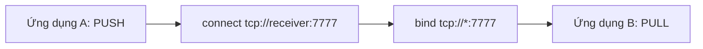
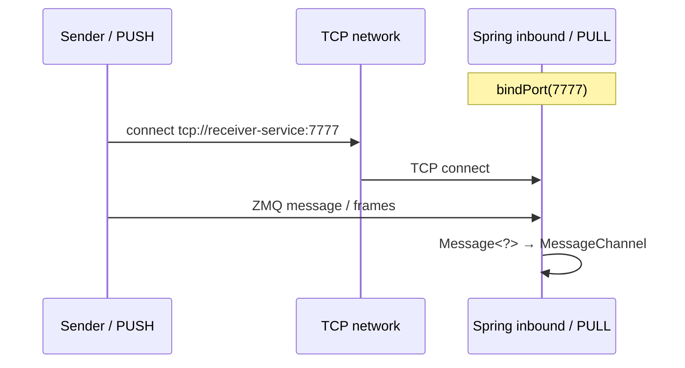
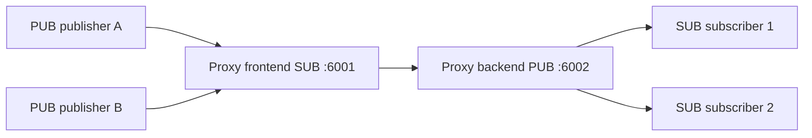
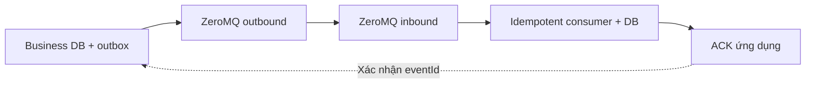

# Connect, bind và endpoint address trong ZeroMQ

## 1. Bối cảnh: socket đúng loại nhưng vẫn không nhận được dữ liệu

Một Spring Boot service cần nhận sự kiện từ hệ thống khác qua ZeroMQ. Nhóm phát triển chọn đúng cặp `PUSH/PULL`, khai báo `PULL` phía Spring Integration và `PUSH` phía producer. Chạy chung trên máy cá nhân thì hoạt động. Khi chuyển hai ứng dụng sang hai pod Kubernetes, producer vẫn gọi `send()` nhưng phía nhận không thấy sự kiện.

Lỗi có thể không nằm ở business logic hay Spring `MessageChannel`. Những câu hỏi cần kiểm tra trước là:

- Socket nào **bind** địa chỉ, socket nào **connect** tới địa chỉ đó?
- Địa chỉ `tcp://127.0.0.1:7777` đang chỉ **máy nào hoặc network namespace nào**?
- Receiver có thực sự lắng nghe trên cổng 7777 và network interface có thể truy cập từ bên ngoài không?
- ZeroMQ peer đã **kết nối và trao đổi subscription** xong chưa, hay lệnh `connect()` chỉ mới yêu cầu thiết lập kết nối?
- Nếu dùng `ZeroMqProxy`, client đang kết nối **cổng frontend hay backend**?

Bài **“Connect bind và endpoint address”** nằm trong chương **Adapter ZeroMQ**, module **SPRING_INTEGRATION_ADAPTERS**. Module hướng dẫn kết nối hệ thống ngoài bằng inbound/outbound adapter, gateway, poller và `MessageChannel`; thực hành qua file, SFTP, HTTP, JMS, AMQP, Kafka và cơ sở dữ liệu, đồng thời quan tâm hợp đồng message, lỗi và vòng đời kết nối. Trong chủ đề ZeroMQ, lựa chọn địa chỉ và hướng thiết lập socket là điều kiện nền tảng trước khi bàn đến framing, retry hay reliability.

### Mục tiêu

Sau bài học, bạn có thể:

1. Giải thích chính xác `ZMQ.Socket.bind(...)` và `ZMQ.Socket.connect(...)`; không nhầm chúng với inbound/outbound của Spring Integration.
2. Đọc và chọn ZeroMQ endpoint address cho `tcp://`, `inproc://` và `ipc://` theo môi trường.
3. Cấu hình `ZeroMqMessageProducer` bằng `bindPort` hoặc `connectUrl` và `ZeroMqMessageHandler` bằng URL connect hoặc overload bind cổng.
4. Chọn topology phù hợp cho `PUSH/PULL`, `PUB/SUB`, `PAIR`, proxy và `ZeroMqChannel`.
5. Hiểu cổng ngẫu nhiên, `getBoundPort()`, readiness và kết nối động.
6. Xử lý lỗi DNS, loopback, NAT, port conflict, firewall, container và Kubernetes.
7. Kiểm thử giao nhận thực tế, quản lý vòng đời socket và tránh nhầm `send` với xác nhận nghiệp vụ.

## 2. Bind và connect là thao tác gì?

**Bind** đăng ký một endpoint cục bộ mà các peer khác có thể dùng để liên lạc. Với TCP, socket thường mở cổng nghe trên giao diện mạng phù hợp. **Connect** gắn một socket vào endpoint đã được công bố; với TCP, nó yêu cầu thiết lập đường truyền tới địa chỉ được chỉ định.



| Thao tác | Vai trò | Ví dụ JeroMQ | Điều phải kiểm tra |
| --- | --- | --- | --- |
| `bind` | Đăng ký endpoint local; với TCP là nơi nhận kết nối từ peer | `pull.bind("tcp://*:7777")` | Cổng chưa bị chiếm; địa chỉ/interface có quyền bind; firewall cho phép |
| `connect` | Chỉ định địa chỉ endpoint mà socket muốn nối tới | `push.connect("tcp://receiver:7777")` | DNS/địa chỉ có thể định tuyến, port đúng, peer tương thích |
| `disconnect` | Gỡ một endpoint connect tùy API và nhu cầu | `socket.disconnect(url)` | Không coi là đóng toàn bộ socket |
| `unbind` | Gỡ endpoint đã bind tùy API và nhu cầu | `socket.unbind(url)` | Các peer khác có thể bị mất đường kết nối |
| `close` | Giải phóng socket theo chính sách linger | `socket.close()` | Message còn trong queue có thể chưa được giao |

**Điểm quan trọng:** Trong ZeroMQ, lệnh `connect(...)` thường trả về trước khi phiên giao vận và peer đã sẵn sàng hoàn toàn. Lời gọi `connect` không phải một health check đảm bảo `recv` ở phía đối diện đã bắt đầu nhận dữ liệu. Tương tự, một `send` không ném lỗi chỉ có thể phản ánh việc ZeroMQ chấp nhận message theo semantics của socket, **không phải ACK sau khi database đích commit**.

### 2.1. Inbound/outbound không phải bind/connect

Trong Spring Integration:

- **Inbound channel adapter** đưa dữ liệu **từ ZeroMQ vào một Spring `MessageChannel`**. Inbound producer có thể `bind` hoặc `connect`.
- **Outbound channel adapter** đưa Spring message **ra ZeroMQ**. Outbound handler cũng có thể `connect` hoặc `bind`, tùy API/phiên bản.
- Một `PULL` **có thể bind** để các `PUSH` connect; cũng có thể **connect** tới một `PUSH` đã bind.
- Một `PUB` thường bind cho `SUB` connect, nhưng trong mô hình phù hợp cũng có thể connect tới `SUB` đang bind.

```text
Luồng 1: Spring inbound PULL bind, producer PUSH connect
    PUSH (remote) ------connect------> PULL (Spring bind)

Luồng 2: Spring inbound SUB connect, producer PUB bind
    SUB (Spring connect) ------------> PUB (remote bind)

Luồng 3: Spring outbound PUB bind, subscriber SUB connect
    PUB (Spring bind) <-------------- SUB (remote connect)
```

Không chọn bind vì tên phương thức của framework có chữ “inbound”; hãy chọn dựa trên **topology, tính ổn định của địa chỉ, firewall và khả năng vận hành**.

## 3. Endpoint address: cú pháp, scheme và phạm vi

Một endpoint là địa chỉ mà ZeroMQ socket dùng để bind/connect. Với TCP, địa chỉ thường có dạng `tcp://host:port`; scheme khác có cách diễn giải riêng.

| Endpoint | Dùng trong trường hợp nào? | Điều dễ nhầm |
| --- | --- | --- |
| `tcp://127.0.0.1:7777` | Connect/bind vào loopback cùng host hoặc network namespace | **Không** truy cập pod/máy khác |
| `tcp://localhost:7777` | Môi trường local, peer cùng network namespace | `localhost` có thể phân giải IPv4/IPv6; không chắc là service khác |
| `tcp://*:7777` | **Bind** TCP trên mọi interface phù hợp | Dấu `*` không phải hostname để remote peer connect |
| `tcp://0.0.0.0:7777` | Địa chỉ wildcard IPv4 khi bind nếu transport/API hỗ trợ | Không nên quảng bá `0.0.0.0` làm đích connect từ máy khác |
| `tcp://10.20.0.15:7777` | Bind/connect qua địa chỉ IPv4 cụ thể, tùy vị trí socket | Host phải sở hữu IP đó nếu bind; remote phải route tới được nếu connect |
| `tcp://worker-service:7777` | Connect tới DNS service trong mạng nội bộ | DNS/NetworkPolicy/Service phải được thiết lập |
| `tcp://example.internal:7777` | Kết nối đến host có tên miền được phân giải | Không dùng URI HTTP như `https://...` thay cho ZeroMQ TCP |
| `inproc://orders-events` | Giao tiếp giữa các socket trong **cùng `ZContext`** | Không chạy giữa hai JVM/pod chỉ vì tên giống nhau |
| `ipc:///tmp/orders.sock` | Unix-domain socket giữa process trên host khi platform hỗ trợ | Phụ thuộc OS/JeroMQ, đường dẫn file và quyền truy cập |

### 3.1. `tcp://`: địa chỉ bind và connect không nên sao chép nguyên xi

Ví dụ:

```java
// Trên máy receiver:
pull.bind("tcp://*:7777");

// Trên máy sender khác:
push.connect("tcp://receiver.internal:7777");
```

`tcp://*:7777` nghĩa là receiver lắng nghe trên các interface theo semantics transport, **không phải** một URL mà sender ở xa có thể dùng nguyên xi. Phía connect phải biết một **địa chỉ có thể truy cập**: DNS nội bộ, IP của host, hoặc Kubernetes Service nếu phù hợp.

Không để hostname/port bị hardcode trong mã nghiệp vụ. Một địa chỉ đọc từ cấu hình nên được validate: scheme dự kiến, host không rỗng, cổng 1–65535 và thuộc vùng được phép truy cập.

### 3.2. IPv6, hostname và wildcard

ZeroMQ TCP có thể hỗ trợ IPv6 theo cấu hình socket và JeroMQ version. Khi sử dụng địa chỉ IPv6 trong endpoint, cần áp dụng cú pháp endpoint hợp lệ của phiên bản đang dùng (ví dụ dùng dấu ngoặc vuông quanh literal IPv6 nơi transport yêu cầu), đồng thời xác minh socket cho phép IPv6 và hạ tầng có route. Không mặc định `localhost` sẽ luôn phân giải về `127.0.0.1`; trên hệ thống dual-stack, nó có thể liên quan `::1`.

Trong tài liệu/ứng dụng dùng IPv4, có thể thống nhất `tcp://127.0.0.1:7777` cho bài test cùng máy để tránh nhầm tên, và `tcp://service-name:7777` cho container. Với production, xác nhận phiên bản JeroMQ thực tế và cách mạng xử lý cả IPv4/IPv6.

### 3.3. `inproc://`: cùng context, không phải “kết nối nội bộ bất kỳ”

`inproc` là transport liên thread trong **cùng ZeroMQ context**. Các socket dùng `inproc://orders-events` nhưng được tạo từ **hai `ZContext` khác nhau** không tự kết nối được với nhau. Một `ZContext` do Spring quản lý có thể được chia sẻ bởi các component ZeroMQ trong cùng ứng dụng.

```text
JVM A, ZContext X:
  socket A ---- inproc://orders-events ---- socket B

JVM B, ZContext Y:
  socket C ---- inproc://orders-events ---- socket D

Hai nhóm trên không liên lạc xuyên JVM chỉ vì trùng tên endpoint.
```

Với `inproc`, thứ tự bind/connect và quy tắc lifecycle có thể phụ thuộc ZeroMQ/JeroMQ version; khi thử nghiệm nên **bind trước, connect sau**, và kiểm chứng khi nâng cấp. Không đưa `inproc://...` vào cấu hình `connectUrl` của một service ở máy khác.

### 3.4. `ipc://`: Unix-domain socket và tính phụ thuộc nền tảng

`ipc` có thể sử dụng đường dẫn socket file trên hệ thống hỗ trợ, ví dụ `ipc:///tmp/orders.sock`. Đây là địa chỉ **local host**, không phải TCP DNS. Chú ý quyền của thư mục chứa socket, cleanup file socket cũ, mount/namespace và tương thích với JeroMQ/OS.

Không giả định ví dụ `ipc` hoạt động trên mọi máy Windows hoặc mọi phiên bản JeroMQ. Spring Integration DSL `bindPort(int)` là API **bind TCP**; không chuyển một đường dẫn `ipc://` thành số port để truyền vào `bindPort`. Với transport khác TCP, nếu cần khả năng bind địa chỉ tùy chỉnh, hãy kiểm tra API JeroMQ và giới hạn của adapter Spring Integration trước khi chọn kiến trúc.

## 4. Socket type quyết định pattern, không phải connect/bind

| Pattern | Bên gửi | Bên nhận | Topology phổ biến | Ghi chú |
| --- | --- | --- | --- | --- |
| `PUSH/PULL` | `PUSH` | `PULL` | PULL bind, PUSH connect | Pipeline, phân phối công việc |
| `PUB/SUB` | `PUB` | `SUB` | PUB bind, SUB connect | Broadcast theo subscription prefix |
| `PAIR/PAIR` | `PAIR` | `PAIR` | Một peer bind, peer kia connect | Một–một, không thay thế queue nhiều client |
| `REQ/REP` | `REQ` | `REP` | REP bind, REQ connect | Request–reply theo chu kỳ send/recv nghiêm ngặt |
| `DEALER/ROUTER` | `DEALER` | `ROUTER` | Tùy topology routing/proxy | Cần xử lý identity/envelope |

Spring Integration ZeroMQ adapter trực tiếp hỗ trợ **inbound `PAIR/PULL/SUB`** qua `ZeroMqMessageProducer` và **outbound `PAIR/PUSH/PUB`** qua `ZeroMqMessageHandler`. Các socket như `REQ/REP` hoặc `DEALER/ROUTER` cần JeroMQ trực tiếp, proxy hoặc thành phần bổ sung thích hợp; không được mặc định `ZeroMq.inboundChannelAdapter` là một gateway request–reply cho mọi loại socket.

**PUSH/PULL là phân phối**, không broadcast. **PUB/SUB là phát theo subscription**, không work queue có ACK bền vững. Dùng đúng `bind/connect` chỉ là một phần của giao thức: loại socket và định dạng frame phải tương thích.

## 5. Spring Integration API: inbound bind hoặc connect

`ZeroMqMessageProducer` là inbound channel adapter có reactive semantics. Nó nhận dữ liệu qua socket ZeroMQ và phát `Message<?>` sang Spring `MessageChannel`. Khi chưa có dữ liệu, vòng nhận dùng `consumeDelay`, mặc định khoảng một giây; đây **không phải** `Pollers.fixedDelay(...)` của Spring Integration.

### 5.1. Các phương thức DSL liên quan

```java
// Inbound PULL: bind cổng TCP cục bộ
ZeroMq.inboundChannelAdapter(context, SocketType.PULL)
        .bindPort(7777);

// Inbound SUB: connect đến remote PUB endpoint
ZeroMq.inboundChannelAdapter(context, SocketType.SUB)
        .connectUrl("tcp://publisher.internal:7788")
        .topics("orders.");
```

| API | Ý nghĩa | Cần lưu ý |
| --- | --- | --- |
| `ZeroMq.inboundChannelAdapter(context, socketType)` | Tạo inbound spec | Chỉ PAIR, PULL, SUB |
| `.bindPort(int)` | Bind socket qua TCP trên cổng cục bộ | Cổng do app sở hữu, cần expose nếu peer bên ngoài tới |
| `.connectUrl(String)` | Connect socket tới URL ZeroMQ | Chỉ định peer có thể định tuyến |
| `.topics(String...)` | Các prefix SUB đăng ký | Chỉ có nghĩa với SUB |
| `.receiveRaw(boolean)` | Có phát `ZMsg` raw hay convert qua mapper | Ảnh hưởng kiểu payload và lifecycle dữ liệu |
| `.consumeDelay(Duration)` | Khoảng chờ khi receive không có dữ liệu | Không phải delay cho TCP connect hoặc retry business |
| `.socketConfigurer(Consumer<ZMQ.Socket>)` | Thiết lập HWM, timeout, bảo mật và socket options | Cần hiểu semantics của socket option |

Không gọi `.bindPort(...)` rồi `.connectUrl(...)` trên cùng một inbound spec như cách “mở cả hai đường cho chắc”. Theo thiết kế adapter, **bind và connect là hai lựa chọn cấu hình endpoint khác nhau** cho một socket được quản lý; hãy chọn một topology rõ ràng.

### 5.2. Inbound bind cổng được chọn

Ví dụ service Spring Boot **PULL bind cổng 7777** và bên phát **PUSH connect** tới địa chỉ service.



Ví dụ Java DSL được triển khai ở mục 7.

### 5.3. Inbound connect tới publisher

Với `PUB/SUB`, một mô hình phổ biến hơn là:

```text
Spring inbound SUB:
  connectUrl("tcp://publisher-service:7788")
  topics("orders.")

Remote PUB:
  bind("tcp://*:7788")
```

Khi SUB kết nối, subscription cần thời gian được truyền đến publisher. `connect()` trả về không bảo đảm publisher đã nhận subscription. Nếu PUB gửi ngay sau khi start, vài message đầu có thể **mất** (*slow joiner*). Một test tin cậy cần tín hiệu ready/handshake hoặc nơi lưu replay, không chỉ `Thread.sleep(50)`.

## 6. Spring Integration API: outbound connect và bind

`ZeroMqMessageHandler` là outbound channel adapter dùng để gửi Spring message qua socket ZeroMQ. Theo API chính thức, nó chỉ hỗ trợ `PAIR/PUSH/PUB`. Outbound handler sử dụng reactive semantics; caller của `MessageChannel.send()` không nên xem việc trả về thành công là bằng chứng peer đã commit dữ liệu.

### 6.1. Outbound connect

```java
// PUSH connect đến PULL peer đã bind port 7777:
ZeroMq.outboundChannelAdapter(
        context, "tcp://receiver-service:7777", SocketType.PUSH);

// PUB connect đến SUB/proxy peer đã bind port 7788:
ZeroMq.outboundChannelAdapter(
        context, "tcp://subscriber-service:7788", SocketType.PUB);
```

Đây là dạng API phù hợp khi muốn điều khiển địa chỉ đích bằng property/DNS. Với `connectUrl` dưới dạng string hoặc supplier, tham chiếu nên lấy từ cấu hình môi trường để triển khai được giữa local, staging và production.

### 6.2. Outbound bind: chú ý phiên bản Spring Integration

Các overload bind TCP của `ZeroMqMessageHandler` và DSL `ZeroMq.outboundChannelAdapter(...)` được bổ sung **từ Spring Integration 6.4**:

```java
// Spring Integration 6.4+:
ZeroMq.outboundChannelAdapter(
        context, 7788, SocketType.PUB);

// Spring Integration 6.4+: không chọn port, framework bind cổng ngẫu nhiên.
ZeroMq.outboundChannelAdapter(context, SocketType.PUB);
```

Trong code Spring Integration 5.4 hoặc 6.0, không sao chép overload `(ZContext, int, SocketType)` nếu API phiên bản đó chưa có. Với thư viện cũ, thiết kế `PUB connect` đến `SUB` đã bind hoặc cập nhật phiên bản tương thích sau khi đánh giá.

### 6.3. Bảng cách chọn

| Spring endpoint | API minh họa | Phía peer |
| --- | --- | --- |
| Inbound PULL bind | `.bindPort(7777)` | Remote PUSH `connect("tcp://spring:7777")` |
| Inbound SUB connect | `.connectUrl("tcp://pub:7788")` | Remote PUB `bind("tcp://*:7788")` |
| Outbound PUSH connect | `ZeroMq.outboundChannelAdapter(ctx, url, PUSH)` | Remote PULL `bind(...)` |
| Outbound PUB bind, **6.4+** | `ZeroMq.outboundChannelAdapter(ctx, 7788, PUB)` | Remote SUB `connect("tcp://spring:7788")` |

Nếu phần mềm chạy trong một pod, “spring” ở URL phía peer phải là DNS/IP mà peer có thể reach, không phải tên bean `@Configuration` hay tên `MessageChannel`.

## 7. Ví dụ Java DSL hoàn chỉnh: Spring inbound PULL bind và outbound PUSH connect

Đây là demo nhỏ có hai adapter trong **cùng ứng dụng** để nhìn rõ kết nối. Khi deploy thật, thường có một bên Spring và một bên là peer JeroMQ ở process hoặc host khác. Demo hai đầu có thể chia sẻ một `ZContext`, nhưng hai ứng dụng khác nhau phải dùng **mỗi ứng dụng một context**, kết nối qua TCP.

### 7.1. Dependencies và cấu hình

Với Spring Boot BOM quản lý phiên bản Spring Integration tương thích:

```xml
<dependencies>
    <dependency>
        <groupId>org.springframework.boot</groupId>
        <artifactId>spring-boot-starter-integration</artifactId>
    </dependency>
    <dependency>
        <groupId>org.springframework.integration</groupId>
        <artifactId>spring-integration-zeromq</artifactId>
    </dependency>
</dependencies>
```

```yaml
# application.yml
app:
  zeromq:
    pull-bind-port: ${ZEROMQ_PULL_BIND_PORT:7777}
    push-connect-url: ${ZEROMQ_PUSH_CONNECT_URL:tcp://127.0.0.1:7777}
    sub-connect-url: ${ZEROMQ_SUB_CONNECT_URL:tcp://127.0.0.1:7788}
    pub-bind-port: ${ZEROMQ_PUB_BIND_PORT:7788}
```

Đây là cấu hình demo local. Trong Docker/Kubernetes, địa chỉ `127.0.0.1` chỉ phù hợp khi hai socket **thực sự ở cùng network namespace**; nếu là hai pod, đặt `push-connect-url` theo tên Service của pod PULL.

### 7.2. Bean ZContext và hai flow

```java
import java.time.Duration;
import org.springframework.beans.factory.annotation.Value;
import org.springframework.context.annotation.Bean;
import org.springframework.context.annotation.Configuration;
import org.springframework.integration.channel.DirectChannel;
import org.springframework.integration.dsl.IntegrationFlow;
import org.springframework.integration.zeromq.dsl.ZeroMq;
import org.springframework.messaging.MessageChannel;
import org.zeromq.SocketType;
import org.zeromq.ZContext;

@Configuration
public class ZeroMqConnectBindConfiguration {

    @Bean(destroyMethod = "close")
    public ZContext zeroMqContext() {
        return new ZContext();
    }

    @Bean("zmqJobsToSend")
    public MessageChannel zmqJobsToSend() {
        return new DirectChannel();
    }

    @Bean
    public IntegrationFlow pullInboundFlow(
            ZContext context,
            @Value("${app.zeromq.pull-bind-port}") int port) {

        return IntegrationFlow.from(
                ZeroMq.inboundChannelAdapter(context, SocketType.PULL)
                        .bindPort(port)
                        .receiveRaw(true)
                        .consumeDelay(Duration.ofMillis(100))
                        .socketConfigurer(socket -> socket.setRcvHWM(1_000)))
                .channel("zmqJobsReceived")
                .get();
    }

    @Bean
    public IntegrationFlow pushOutboundFlow(
            ZContext context,
            @Value("${app.zeromq.push-connect-url}") String url) {

        return IntegrationFlow.from("zmqJobsToSend")
                .handle(ZeroMq.outboundChannelAdapter(
                        context, url, SocketType.PUSH)
                        .socketConfigurer(socket -> socket.setSndHWM(1_000)))
                .get();
    }
}
```

**Thứ tự logic:** inbound PULL bind trên local port; outbound PUSH connect đến địa chỉ đó; khi có một message từ channel `zmqJobsToSend`, handler gửi message qua ZeroMQ. ZeroMQ xử lý kết nối bất đồng bộ, do vậy test cần chờ endpoint sẵn sàng thay vì gửi ngay lúc bean vừa được khởi tạo.

`setRcvHWM` và `setSndHWM` giới hạn hàng đợi **trong bộ nhớ**; chúng không tự biến ZeroMQ thành durable queue. `consumeDelay` điều chỉnh chu kỳ nhận khi rỗng, không phải retry hay timeout TCP connect.

### 7.3. Service gửi công việc qua MessageChannel

```java
import java.nio.charset.StandardCharsets;
import org.springframework.beans.factory.annotation.Qualifier;
import org.springframework.messaging.MessageChannel;
import org.springframework.messaging.support.MessageBuilder;
import org.springframework.stereotype.Service;

@Service
public class ZeroMqJobPublisher {
    private final MessageChannel out;

    public ZeroMqJobPublisher(
            @Qualifier("zmqJobsToSend") MessageChannel out) {
        this.out = out;
    }

    public void publish(String jobId) {
        if (jobId == null || !jobId.matches("[A-Za-z0-9_-]{1,64}")) {
            throw new IllegalArgumentException("jobId không hợp lệ");
        }

        byte[] data = ("process:" + jobId)
                .getBytes(StandardCharsets.UTF_8);
        boolean accepted = out.send(
                MessageBuilder.withPayload(data).build());

        if (!accepted) {
            throw new IllegalStateException(
                    "Spring channel từ chối gửi job");
        }
    }
}
```

`out.send(...) == true` phản ánh việc **Spring channel đã tiếp nhận message theo hợp đồng channel**. Không dùng nó để ghi trạng thái “worker đã hoàn tất” khi chưa có ACK hoặc transaction phía consumer.

### 7.4. Service Activator đọc ZMsg và đóng tài nguyên

```java
import java.nio.charset.StandardCharsets;
import org.springframework.integration.annotation.ServiceActivator;
import org.springframework.messaging.Message;
import org.springframework.stereotype.Component;
import org.zeromq.ZFrame;
import org.zeromq.ZMsg;

@Component
public class ZeroMqJobConsumer {

    @ServiceActivator(inputChannel = "zmqJobsReceived")
    public void accept(Message<ZMsg> message) {
        ZMsg frames = message.getPayload();
        try {
            if (frames.size() != 1) {
                throw new IllegalArgumentException(
                        "Hợp đồng PUSH/PULL yêu cầu một frame");
            }

            ZFrame frame = frames.getFirst();
            String command = new String(
                    frame.getData(), StandardCharsets.UTF_8);

            // Demo: validate + log; production: lưu DB có idempotency.
            System.out.println("ZMQ job: " + command);
        } finally {
            frames.destroy();
        }
    }
}
```

Khi `receiveRaw(true)`, payload là `ZMsg`; consumer phải hiểu frame contract và quản lý resource. Nếu cần chuyển dữ liệu sang thread khác, hãy **copy nội dung cần thiết trước khi `destroy()`**. Không giữ `ZMsg` đã destroy cho bước xử lý bất đồng bộ.

### 7.5. Kiểm thử với peer JeroMQ chạy bên ngoài

Một process JeroMQ PULL có thể bind cổng; Spring outbound PUSH connect tới đó. Ví dụ receiver:

```java
import java.nio.charset.StandardCharsets;
import org.zeromq.SocketType;
import org.zeromq.ZContext;
import org.zeromq.ZMQ;

public class ExternalPullReceiver {
    public static void main(String[] args) {
        try (ZContext context = new ZContext()) {
            ZMQ.Socket pull = context.createSocket(SocketType.PULL);
            try {
                pull.setReceiveTimeOut(10_000);
                pull.bind("tcp://*:7777");

                byte[] payload = pull.recv(0);
                if (payload == null) {
                    throw new IllegalStateException("Receive timed out");
                }
                System.out.println(
                        new String(payload, StandardCharsets.UTF_8));
            } finally {
                pull.close();
            }
        }
    }
}
```

**Không chạy ví dụ receiver này cùng lúc với Spring inbound PULL đã bind cổng 7777 trên cùng host/network namespace**. Cả hai đều cố bind một TCP port và một trong hai sẽ thất bại. Khi kiểm thử external receiver, hãy **chỉ bật** outbound flow Spring và external PULL, hoặc dùng port riêng. Đây là lỗi port conflict rất phổ biến khi copy nhiều demo vào một ứng dụng.

## 8. Ví dụ PUB/SUB: Spring outbound bind và Spring inbound connect

Đây là topology ngược chiều so với `PULL` bind: **outbound PUB bind**, **inbound SUB connect**. Nó cần **Spring Integration 6.4+** cho DSL bind port outbound.

### 8.1. Outbound PUB bind cổng TCP

```java
import org.springframework.beans.factory.annotation.Value;
import org.springframework.context.annotation.Bean;
import org.springframework.context.annotation.Configuration;
import org.springframework.integration.dsl.IntegrationFlow;
import org.springframework.integration.zeromq.dsl.ZeroMq;
import org.zeromq.SocketType;
import org.zeromq.ZContext;

@Configuration
public class ZeroMqPublisherBindConfiguration {

    @Bean
    public IntegrationFlow pubBindFlow(
            ZContext context,
            @Value("${app.zeromq.pub-bind-port}") int port) {

        return IntegrationFlow.from("eventsToPublish")
                .handle(ZeroMq.outboundChannelAdapter(
                        context, port, SocketType.PUB)
                        .topic("orders.")
                        .wrapTopic(false))
                .get();
    }
}
```

Flow này giả định ứng dụng đã khai báo channel `eventsToPublish` và gửi payload tương thích. Cấu hình `topic("orders.")` là topic **cố định** để minh họa; production có thể dùng `topicFunction(...)` hoặc `topicExpression(...)` nếu cần phân loại nhiều loại event. `wrapTopic(false)` dùng format `[topic][payload]`.

### 8.2. Inbound SUB connect tới PUB

```java
import java.time.Duration;
import org.springframework.beans.factory.annotation.Value;
import org.springframework.context.annotation.Bean;
import org.springframework.context.annotation.Configuration;
import org.springframework.integration.dsl.IntegrationFlow;
import org.springframework.integration.zeromq.dsl.ZeroMq;
import org.zeromq.SocketType;
import org.zeromq.ZContext;

@Configuration
public class ZeroMqSubscriberConnectConfiguration {

    @Bean
    public IntegrationFlow subConnectFlow(
            ZContext context,
            @Value("${app.zeromq.sub-connect-url}") String url) {

        return IntegrationFlow.from(
                ZeroMq.inboundChannelAdapter(context, SocketType.SUB)
                        .connectUrl(url)
                        .topics("orders.")
                        .unwrapTopic(false)
                        .receiveRaw(false)
                        .consumeDelay(Duration.ofMillis(100)))
                .channel("ordersEventsReceived")
                .get();
    }
}
```

Ở đây `PUB` gửi `[topic][payload]` và `SUB` dùng `unwrapTopic(false)`. Nếu đổi outbound sang `wrapTopic(true)` (mặc định), bên nhận cũng phải xử lý định dạng `[topic][empty][payload]`, thường là `unwrapTopic(true)`. `unwrapTopic` có trong API ở các phiên bản hỗ trợ phù hợp (API method xuất hiện từ 6.2.6).

Topic subscription là **so khớp prefix byte của frame đầu**, không tự lọc trường `topic` ở nội dung JSON. Việc `SUB` connect tới đúng endpoint nhưng không có subscription phù hợp sẽ dẫn đến không nhận sự kiện.

### 8.3. Các vấn đề khi đổi topology

| Tình huống | Kết quả có thể xảy ra |
| --- | --- |
| PUB bind ở 7788, SUB connect đúng host:7788 | Có thể giao tiếp sau khi subscription được thiết lập |
| SUB connect `tcp://127.0.0.1:7788` nhưng PUB ở pod khác | Kết nối sai pod/loopback, không nhận event |
| PUB bind `*:7788` nhưng firewall chặn inbound 7788 | Peer bên ngoài không kết nối được |
| Hai PUB cùng bind 7788 trong cùng namespace | Port conflict, một endpoint không khởi tạo được |
| SUB gửi subscription sau khi PUB đã phát sự kiện đầu | Có thể mất sự kiện đầu (*slow joiner*) |
| PUB đóng rồi restart | SUB có thể reconnect, nhưng event đã mất không tự replay |

Nếu cần một topology hỗ trợ nhiều publisher/subscriber hoặc phân tách network, hãy xét `ZeroMqProxy` và các ràng buộc về kết nối tương ứng.

## 9. Cổng động và `getBoundPort()`

Không phải lúc nào ứng dụng cũng cần port cố định. Trong môi trường test, random bind port giúp tránh xung đột giữa các test chạy song song. Spring Integration có thể **bind tới cổng ngẫu nhiên** cho các endpoint phù hợp; số cổng thực tế được công bố qua `getBoundPort()` sau khi endpoint đã start.

### 9.1. Những giá trị phải hiểu

- Nếu inbound `ZeroMqMessageProducer` chưa start, `getBoundPort()` trả **0**.
- Nếu producer được cấu hình **connect** chứ không bind, `getBoundPort()` cũng trả **0** theo API.
- Khi socket đã **bind TCP** thành công, `getBoundPort()` trả port thực tế.
- Outbound `ZeroMqMessageHandler` cũng có `getBoundPort()` cho socket bind trong API mới.
- Port ngẫu nhiên có thể **đổi sau restart**: bên connect phải nhận được giá trị mới qua discovery/test setup, không hardcode số port của lần chạy trước.

### 9.2. Ví dụ Java bean inbound bind random port

```java
import org.springframework.beans.factory.annotation.Qualifier;
import org.springframework.context.annotation.Bean;
import org.springframework.context.annotation.Configuration;
import org.springframework.integration.zeromq.inbound.ZeroMqMessageProducer;
import org.springframework.messaging.MessageChannel;
import org.zeromq.SocketType;
import org.zeromq.ZContext;

@Configuration
public class DynamicZeroMqPortConfiguration {

    @Bean("dynamicPullProducer")
    public ZeroMqMessageProducer dynamicPullProducer(
            ZContext context,
            @Qualifier("dynamicPullOutput") MessageChannel output) {

        ZeroMqMessageProducer producer =
                new ZeroMqMessageProducer(context, SocketType.PULL);
        producer.setOutputChannel(output);
        producer.setReceiveRaw(true);
        // Không setConnectUrl/setBindPort: producer dùng random TCP bind.
        return producer;
    }
}
```

Ví dụ này **chỉ hoạt động nếu đã có bean channel `dynamicPullOutput` được khai báo và producer được quản lý/start bởi Spring**. Một phần cấu hình output channel:

```java
@Bean("dynamicPullOutput")
public MessageChannel dynamicPullOutput() {
    return new DirectChannel();
}
```

Khi consumer/test cần biết port, phải đọc `getBoundPort()` sau khi endpoint đã bind, ví dụ trong một callback sau startup và kiểm tra giá trị lớn hơn 0. **Đừng đọc ngay trong constructor hoặc trước khi context start** rồi quảng bá port 0. Đây là mô hình hữu ích cho test; production thường dùng port ổn định hoặc service discovery có quy trình cập nhật đầy đủ.

### 9.3. Vì sao không khuyến nghị random port tùy tiện ở Kubernetes?

Một Kubernetes Service hoặc firewall rule thường mô tả **cổng cố định**. Nếu pod tự bind random port sau startup, Service không tự biết chính xác port mới để forward. Để vận hành ổn định, dùng port định trước; nếu thật sự cần dynamic port, phải có service discovery và cơ chế cập nhật endpoint thực tế.

## 10. ZeroMqProxy: một endpoint khác với adapter thông thường

`ZeroMqProxy` là một thành phần do Spring Integration quản lý, bọc `ZMQ.proxy()`. Nó tạo frontend/backend socket và bind hai cổng TCP riêng, thường phục vụ pub/sub, pipeline hoặc routing.

| Proxy mode | Socket frontend / backend theo mode | Tình huống |
| --- | --- | --- |
| `ZeroMqProxy.Type.SUB_PUB` | SUB / PUB | Nhận event từ publishers, phân phối cho subscribers |
| `ZeroMqProxy.Type.PULL_PUSH` | PULL / PUSH | Nhận công việc, đẩy tới workers |
| `ZeroMqProxy.Type.ROUTER_DEALER` | ROUTER / DEALER | Routing request/reply phức tạp |

Ví dụ proxy pub/sub:

```java
import org.springframework.context.annotation.Bean;
import org.springframework.context.annotation.Configuration;
import org.springframework.integration.zeromq.ZeroMqProxy;
import org.zeromq.ZContext;

@Configuration
public class ZeroMqEventsProxyConfiguration {

    @Bean
    public ZeroMqProxy eventsProxy(ZContext context) {
        ZeroMqProxy proxy =
                new ZeroMqProxy(context, ZeroMqProxy.Type.SUB_PUB);
        proxy.setFrontendPort(6001);
        proxy.setBackendPort(6002);
        return proxy;
    }
}
```

Proxy bind frontend tại cổng 6001 và backend tại 6002 qua TCP trên những interface được cấu hình/framework hỗ trợ; các client connect tới **cổng ứng với vai trò của mình**. Với mode `SUB_PUB`, publisher gửi vào **frontend SUB** và subscriber lấy từ **backend PUB**. Không trộn frontend/backend hoặc giả định một cổng có thể thay thế cả hai.



`ZeroMqProxy` tạo socket/thread và triển khai `SmartLifecycle`; khi start có thể bind các port đã cung cấp hoặc port ngẫu nhiên. API `getFrontendPort()` và `getBackendPort()` dùng để đọc cổng thực tế sau khi proxy khởi động. Các port này là **cổng của proxy**, không phải cổng của Spring inbound adapter khác.

### 10.1. `ZeroMqChannel` dùng URL hai cổng khác với socket thường

Spring Integration còn có `ZeroMqChannel`, một `SubscribableChannel` dùng ZeroMQ và có thể kết nối tới proxy ngoài. Tài liệu minh họa định dạng:

```java
ZeroMqChannel channel = new ZeroMqChannel(context, true);
channel.setConnectUrl("tcp://localhost:6001:6002");
channel.setConsumeDelay(Duration.ofMillis(100));
```

**Đây là định dạng kết nối đặc thù của `ZeroMqChannel` tới proxy có hai cổng**. Nó **không phải** một endpoint TCP ZeroMQ chuẩn để truyền nguyên xi vào `ZMQ.Socket.connect(String)` hoặc `ZeroMqMessageProducer.connectUrl(...)`. Với một socket JeroMQ thông thường, URL chỉ chứa một endpoint như `tcp://host:6001` hoặc `tcp://host:6002`.

`ZeroMqChannel` có thể dùng một proxy bean cùng application hoặc dùng URL hai cổng của proxy bên ngoài theo API. **Đừng nhầm `ZeroMqChannel` với `ZeroMqMessageProducer` hoặc `ZeroMqMessageHandler`**: channel dùng mapping Spring message và quản lý các socket bên trong, còn inbound/outbound adapter làm việc trực tiếp với một endpoint zeroMQ theo socket pattern.

### 10.2. Proxy không lưu trữ bền vững

Proxy giúp định tuyến/ghép nối peer nhưng **không tự** cung cấp durable queue, replay event trước khi subscriber đến, xác nhận DB hay transaction. Nếu proxy restart, event còn nằm trong queue bộ nhớ có thể mất. Khi cần giao nhận bền vững, thiết kế outbox/ACK/replay hoặc sử dụng một broker phù hợp với yêu cầu.

## 11. Triển khai Docker và Kubernetes: IP, DNS, Service, firewall

### 11.1. Các lỗi điển hình với loopback

Ví dụ hai pod:

```text
Pod A: receiver (PULL bind :7777)
Pod B: sender (PUSH connect tcp://127.0.0.1:7777)

Sai:
  Pod B kết nối tới loopback của chính Pod B.
  Nó KHÔNG kết nối sang Pod A.

Đúng về nguyên tắc:
  Pod B PUSH connect tcp://receiver-service:7777
  Service định tuyến TCP 7777 tới Pod A hoặc receiver pod phù hợp.
```

Nếu Spring receiver bind chỉ ở loopback bên trong pod, Service/peer ngoài pod có thể không vào được. Với `bindPort(7777)`, framework cấu hình bind TCP theo thiết kế; vẫn cần xác minh socket được bind trên interface đúng và cổng mạng được lộ ra theo chính sách của nền tảng.

### 11.2. Cấu hình Kubernetes mang tính minh họa

```yaml
apiVersion: v1
kind: Service
metadata:
  name: zmq-receiver
spec:
  selector:
    app: zmq-receiver
  ports:
    - name: zeromq-tcp
      protocol: TCP
      port: 7777
      targetPort: 7777
  type: ClusterIP
```

Service tạo địa chỉ DNS nội bộ ví dụ `zmq-receiver.default.svc.cluster.local` trong namespace `default`, nhưng **không mở endpoint ra Internet**. Sender trong cluster có thể cấu hình:

```yaml
app:
  zeromq:
    push-connect-url: tcp://zmq-receiver.default.svc.cluster.local:7777
```

Nếu `NetworkPolicy` đang chặn traffic, phải cho phép đúng hướng TCP từ sender đến receiver. Nếu cần client bên ngoài cluster, thiết kế `LoadBalancer`/`NodePort` hoặc gateway TCP phù hợp theo chính sách bảo mật, **không** dùng HTTP Ingress mặc định rồi chờ nó tự hỗ trợ TCP ZeroMQ.

### 11.3. Nhiều replica không đồng nghĩa ZeroMQ tự broadcast

Giả sử Service chọn một trong nhiều pod PULL và các socket PUSH connect tới service IP. Một TCP connection thường được gán tới một backend theo cơ chế cân bằng kết nối; việc phân phối job giữa các pod **phụ thuộc topology các ZeroMQ connection thực tế**. Không suy rằng một Service có ba pod sẽ khiến mỗi message đến ba pod, cũng không suy rằng công việc được chia đều tuyệt đối.

Với `PUB/SUB`, TCP load balancer chỉ phân phối **kết nối**, không tự nhân bản event tới toàn bộ subscriber. Nếu cần pub/sub giữa nhiều pod, thiết kế proxy/topic topology hoặc cơ chế broker phù hợp và kiểm thử với nhiều kết nối thật.

### 11.4. NAT và port forwarding

Socket bind `tcp://*:7777` nằm trên host private; peer bên ngoài chỉ connect được nếu có địa chỉ public hoặc NAT/forwarding tới đúng host/port, firewall cho phép và có route trả về. Không đưa địa chỉ container private hoặc wildcard cho đối tác như một endpoint công khai.

ZeroMQ TCP giao tiếp bằng một kết nối tại endpoint đã chọn; khác với FTP, nó không có khái niệm **control/data connection tách riêng** cho mỗi `RETR/STOR`. Đừng sao chép cấu hình dải passive ports của FTP sang ZeroMQ.

## 12. Readiness, reconnect và quản lý vòng đời

### 12.1. Socket được tạo không có nghĩa peer đã sẵn sàng

Một startup có thể có thứ tự:

```text
1. Spring tạo ZContext.
2. Spring khởi tạo ZeroMqMessageProducer/Handler.
3. Endpoint bind/connect socket khi lifecycle start.
4. TCP kết nối hoàn tất, subscription (nếu SUB) được đồng bộ.
5. Peer bắt đầu xử lý message.
```

Ở bước 3, một lệnh `connect` có thể trả về trong khi bước 4 chưa xong. Nếu PUB gửi trước khi SUB sẵn sàng, sự kiện ban đầu có thể mất. Với PUSH/PULL, message có thể chờ trong queue tùy socket/HWM/linger nhưng **không được coi là bền vững**.

Vì vậy nên phân biệt:

- **Process liveness:** JVM và các thread còn chạy.
- **Endpoint bound:** cổng TCP được bind thành công; `getBoundPort()>0` khi là bind TCP.
- **Peer connectivity:** peer có thể liên lạc bằng đúng socket type và network.
- **Application readiness:** consumer đã đăng ký topic, handler có subscriber, trạng thái nghiệp vụ đủ điều kiện xử lý.

Không đưa một endpoint ra hệ thống giao dịch quan trọng chỉ vì ứng dụng đã in `Started Application`; readiness phù hợp có thể cần handshake hoặc test message với correlation ID.

### 12.2. ZContext, SmartLifecycle và ownership socket

`ZContext` quản lý tài nguyên JeroMQ; Spring Integration bọc lifecycle/thread của producer, handler và proxy. Một `ZContext` có thể được chia sẻ theo phạm vi ứng dụng, nhưng **không dùng chung một `ZMQ.Socket` tùy tiện giữa các thread**.

Ứng dụng nên để các endpoint Spring dừng trước khi `ZContext` được destroy khi shutdown. Với code JeroMQ trực tiếp, đóng socket và context theo đúng ownership. Khi socket còn message trong queue, `linger` ảnh hưởng đến shutdown; đặt linger bằng 0 cho tắt nhanh có thể làm rơi dữ liệu chưa gửi.

### 12.3. Reconnect không có nghĩa tự replay

ZeroMQ có cơ chế reconnect ở tầng kết nối. Nếu peer restart, socket connect có thể tiếp tục thử nối; nhưng bản tin bị rơi trong thời gian gián đoạn **không tự được phát lại** như consumer offset của Kafka. Với sự kiện bắt buộc phải giao, cần thiết kế thêm:

1. Một `eventId` bền vững và schema/message frame thống nhất.
2. Transactional outbox hoặc durable queue ở phía sender.
3. ACK ứng dụng sau khi receiver commit.
4. Retry có backoff và idempotent consumer để tránh xử lý trùng.
5. Metric và cảnh báo cho event chưa nhận ACK.



Đây là **mẫu kiến trúc**, không phải chức năng ZeroMQ adapter tự cung cấp. `MessageChannel.send() == true` không phải xác nhận remote DB đã commit.

## 13. Timeout, HWM, bảo mật và giới hạn message

### 13.1. HWM và timeout

```java
// Tùy chọn socket ở thời điểm adapter tạo socket:
.socketConfigurer(socket -> {
    socket.setSndHWM(1_000);
    socket.setSendTimeOut(2_000);
})
```

| Option | Tác dụng | Không nên diễn giải thành |
| --- | --- | --- |
| `SNDHWM` / `RCVHWM` | Giới hạn hàng đợi gửi/nhận của ZeroMQ | Kho dữ liệu bền vững trên disk |
| Send timeout | Thời gian đợi theo semantics socket khi không thể gửi | Timeout cho consumer ghi DB |
| Receive timeout | Thời gian đợi một lời gọi nhận blocking ở JeroMQ | Spring inbound `consumeDelay` |
| `consumeDelay` | Trễ khi producer inbound thử nhận mà chưa có dữ liệu | TCP handshake timeout |
| Linger | Hành vi đóng socket còn message chưa gửi | ACK đảm bảo event đến đích |

HWM có thể dẫn đến **block hoặc drop** tùy socket type. Với PUB/SUB, cần đặc biệt lưu ý drop khi subscriber chậm hoặc chưa sẵn sàng. Đừng dùng retry vô hạn khi không biết sender đã gửi thành công hay chưa; nếu dữ liệu quan trọng, phải định danh message và thiết kế nhận ACK.

### 13.2. Bảo mật endpoint

- `tcp://` không tự cung cấp mã hóa và xác thực giống HTTPS. Khi cần, cấu hình biện pháp phù hợp (chẳng hạn CURVE nếu phiên bản JeroMQ hỗ trợ) hoặc đường truyền mạng được bảo vệ.
- Giới hạn các cổng bind bằng firewall, NetworkPolicy và security group; tránh mở `tcp://*:port` ra Internet không kiểm soát.
- Với `connectUrl` nhận từ cấu hình, áp dụng allowlist/validation; không cho người dùng đầu cuối cung cấp một URL ZeroMQ tùy ý để hệ thống kết nối tới những host nội bộ ngoài phạm vi.
- Giới hạn payload size, số frame, topic và schema; không log raw message chứa dữ liệu nhạy cảm.
- Khi dùng `ipc`, kiểm soát quyền file socket và thư mục; khi dùng `inproc`, quản lý context/thread ownership.

## 14. Bảng xử lý sự cố connect, bind và address

| Triệu chứng | Nguyên nhân thường gặp | Cách chẩn đoán |
| --- | --- | --- |
| `Address already in use` khi start | Hai socket/process bind trùng port trong cùng network namespace | Liệt kê process/port, kiểm tra config nhiều bean |
| `Permission denied` khi bind | Không có quyền dùng port hoặc cơ chế bảo vệ mạng | Kiểm tra quyền runtime/container/host |
| `connect` trả về nhưng không có message | Connect bất đồng bộ; peer chưa bind hoặc sai URL/socket type | Kiểm tra peer readiness, TCP route và pattern |
| Peer chạy trên host khác nhưng `127.0.0.1` không nhận | Loopback chỉ trong network namespace local | Đổi sang địa chỉ thật/DNS Service |
| Dùng `tcp://*:7777` trong connect URL | Wildcard chỉ phù hợp bind, không phải hostname đích | Connect tới host có thể định tuyến |
| Test thứ hai không start sau test thứ nhất | Port bind chưa giải phóng, context/socket chưa đóng | Kiểm tra teardown lifecycle, port riêng hoặc random bind |
| `getBoundPort()` trả 0 | Chưa start hoặc endpoint ở connect mode | Chờ start và xác nhận bind trước khi đọc |
| Random port chạy nhưng client không kết nối | Client vẫn dùng port cũ, thiếu discovery | Lấy cổng mới sau start rồi công bố đúng |
| PUB gửi nhưng SUB không thấy event đầu | Subscription chưa lan đến PUB (*slow joiner*) | Handshake/readiness hoặc replay |
| SUB không thấy topic cụ thể | `topics` không khớp prefix; frame/unwrap sai | Kiểm tra topic byte đầu và format raw |
| `inproc` giữa hai process không hoạt động | `inproc` chỉ trong cùng context | Dùng TCP hoặc transport liên process phù hợp |
| `ipc` thất bại trong container | OS/JeroMQ không hỗ trợ hoặc mount/path/quyền sai | Kiểm tra platform và socket path |
| Proxy hoạt động nhưng client connect nhầm cổng | Nhầm frontend/backend | Đọc mode proxy, cổng frontend/backend và peer socket type |
| Dùng URL hai port của `ZeroMqChannel` cho JeroMQ | Nhầm format đặc thù của channel với endpoint chuẩn | Dùng `tcp://host:singlePort` cho `ZMQ.Socket.connect` |
| Kubernetes Service có ba pod nhưng chỉ một pod nhận | LB phân phối TCP connection, pattern PUSH/PULL không broadcast | Kiểm tra từng connection và topology nhận |
| TCP port mở, vẫn không xử lý message | Socket type, topic, frame hoặc downstream lỗi | Test end-to-end, xem handler/error flow |
| ZeroMQ reconnect xong nhưng thiếu event | Không có durable replay tự động | Bổ sung outbox/ACK/idempotency |

### 14.1. Checklist chẩn đoán theo lớp

```text
1. Socket type hai phía có tương thích: PUSH↔PULL, PUB↔SUB?
2. Bên nào bind? Endpoint bind đã start và cổng có rảnh?
3. Bên nào connect? URL là hostname/IP thật, không phải wildcard?
4. DNS/TCP route/firewall/NetworkPolicy có cho đúng peer đi qua?
5. Nếu SUB, topic prefix đã đăng ký và handshake đã sẵn sàng?
6. Framing [topic][body] hoặc [topic][empty][body] có khớp?
7. Raw ZMsg / mapper có chuyển đúng payload/header?
8. HWM, linger, timeout có làm message kẹt hoặc rơi?
9. MessageChannel có subscriber? Handler downstream có lỗi?
10. Có event ID, ACK và audit để đối soát message cuối cùng?
```

## 15. Thực hành kiểm thử tích hợp

Nên kiểm thử với **JeroMQ socket thực** hoặc hai Spring Integration flow kết nối thật; mock message handler không kiểm chứng được port, DNS, subscription hay frame. Sử dụng host/port thử nghiệm, không gây tải lên hệ thống production.

| Kịch bản | Cách thực hiện | Kỳ vọng |
| --- | --- | --- |
| PULL bind 7777, PUSH connect đúng host | Gửi một frame `job-42` | Consumer nhận đúng dữ liệu |
| Hai PULL cùng bind 7777 trong một namespace | Start cả hai | Một endpoint báo xung đột cổng |
| PUSH connect tới port không có peer | Gửi thử trong thời gian giới hạn | Không coi connect success là ACK; quan sát queue/timeout |
| Đổi `127.0.0.1` sang DNS Service | Chạy sender/receiver ở hai pod | Message đi qua mạng đúng pod |
| Dùng `tcp://*:7777` làm connect URL | Kiểm tra cấu hình | Bị phát hiện sai địa chỉ đích |
| SUB connect tới PUB bind | Đăng ký `orders.` rồi phát | Nhận topic đúng sau readiness |
| PUB gửi trước khi SUB sẵn sàng | Start PUB và phát ngay | Quan sát khả năng mất event đầu |
| PUB `wrapTopic(false)` | SUB `unwrapTopic(false)` | Hai frame được parse đúng |
| PUB `wrapTopic(true)` | SUB `unwrapTopic(true)` | Ba frame được parse đúng |
| Inbound random bind | Đọc `getBoundPort()` sau start | Port thực > 0, không hardcode 0 |
| Gọi `getBoundPort()` trước start | Đọc giá trị | Không được xem 0 là port đang lắng nghe |
| Proxy SUB_PUB với hai port | Publisher connect frontend, subscriber connect backend | Định tuyến đúng topic/peer |
| `ZeroMqChannel` kết nối proxy | Dùng định dạng URL hai port | Không truyền URL này cho raw JeroMQ socket |
| Receiver bị kill rồi restart | Cho sender thử lại có kiểm soát | Reconnect không tự bảo đảm replay message cũ |
| HWM thấp, consumer chậm | Gửi nhiều frame hơn tốc độ đọc | Quan sát áp lực/drop theo pattern |
| Shutdown sau gửi | Đối chiếu linger và số event nhận ACK | Không gán thành công nếu chưa có ACK |
| Hai replica PULL sau Service | Gửi nhiều công việc và theo dõi receiver | Phân phối theo kết nối, không tự broadcast |

### 15.1. Phép thử nào chứng minh kết nối thật?

Một phép test tốt cần xác minh không chỉ `socket.send(...)` hay `MessageChannel.send(...)`, mà còn **consumer đã nhận đúng byte và frame**. Nếu bài toán cần nghiệp vụ, tiếp tục kiểm tra trạng thái DB/ACK bằng correlation ID.

Ví dụ assertion:

```text
Gửi eventId = evt-42 từ PUSH.
Receiver PULL nhận bytes của evt-42.
Consumer parse đúng eventId.
Business DB có đúng một bản ghi theo unique eventId.
Nếu peer offline, xác minh outbox giữ event PENDING để replay.
```

Với `PUB/SUB`, cần tín hiệu subscriber ready trước khi assert event đầu tiên, tránh flaky test do subscription chưa có hiệu lực. Không dùng `Thread.sleep(50)` làm cam kết kết nối sẵn sàng.

## 16. Bài tập tình huống

**Đề bài:** Một nền tảng xử lý đơn hàng có ba service:

- `order-api` đẩy tác vụ sang hai worker sử dụng `PULL`.
- `order-events` phát sự kiện `orders.created` cho dashboard `SUB`.
- `orders-proxy` làm đầu mối cho nhiều publisher/subscriber.

`order-api` và `order-events` chạy trong Kubernetes, mỗi service có nhiều pod. Nhóm phát triển đang sử dụng `tcp://127.0.0.1:7777` cho mọi kết nối và cho rằng khi gọi `connect()` thành công thì message đã tới người nhận.

Hãy trả lời:

1. Vì sao `tcp://127.0.0.1:7777` không kết nối được từ pod order-api sang worker ở pod khác?
2. Nếu worker `PULL` bind 7777, outbound `PUSH` phía order-api nên dùng URL nào?
3. Trong Spring Integration, `inboundChannelAdapter` có bắt buộc bind và `outboundChannelAdapter` có bắt buộc connect không?
4. Khi `PUB` muốn nhiều dashboard `SUB` kết nối tới một port cố định, có thể dùng overload bind outbound từ phiên bản nào?
5. Điểm khác nhau giữa `tcp://*:7788` và `tcp://order-events:7788`?
6. Nếu `PUB` bind 7788 và `SUB` connect thành công nhưng không nhận sự kiện đầu, nguyên nhân gì?
7. `getBoundPort() == 0` có nghĩa endpoint đang lắng nghe cổng 0 không?
8. Vì sao random port trong Kubernetes cần service discovery hoặc cấu hình lại Service?
9. Với `ZeroMqProxy.Type.SUB_PUB`, publisher và subscriber kết nối cùng một cổng hay hai cổng?
10. Định dạng `tcp://proxy:6001:6002` có dùng trực tiếp cho `ZMQ.Socket.connect` được không?
11. Nếu có hai worker PULL, một job có mặc định đến cả hai không?
12. Có thể truyền `inproc://orders` từ pod A sang pod B không?
13. HWM và retry connect có tự bảo đảm event không mất khi process restart?
14. Phải thêm những thành phần nào để biết đơn hàng đã được worker xử lý thành công?

**Đáp án gợi ý:** (1) Loopback là của pod hiện tại. (2) `tcp://worker-service:7777` hoặc DNS/IP có thể định tuyến tới receiver. (3) Không, inbound/outbound là hướng message trong Spring; bind/connect tùy topology và API. (4) Spring Integration **6.4** trở lên. (5) `*` dùng bind local, còn `order-events` là tên host/service để connect. (6) Slow joiner/subscription chưa đến PUB hoặc topic không khớp. (7) Không, producer chưa start hoặc đang ở connect mode. (8) Vì port ngẫu nhiên thay đổi, Service cố định không biết port mới. (9) Hai cổng frontend/backend. (10) Không, đó là format đặc thù của `ZeroMqChannel`; raw socket chỉ nhận một port. (11) Không, PUSH/PULL phân phối công việc. (12) Không, inproc nằm trong cùng context. (13) Không, đó chỉ là cơ chế kết nối/hàng đợi bộ nhớ. (14) Event ID, durable outbox, ACK sau DB commit, idempotent consumer và giám sát.

## Ghi nhớ

- `bind` đăng ký endpoint local, `connect` nối tới địa chỉ đó. **Không đồng nhất với inbound/outbound** của Spring Integration.
- `tcp://*:port` dùng cho bind; peer bên ngoài dùng `tcp://host:port` với DNS/IP có thể truy cập. `127.0.0.1` chỉ là loopback trong network namespace hiện tại.
- Inbound `ZeroMqMessageProducer` hỗ trợ `bindPort` hoặc `connectUrl` với `PAIR/PULL/SUB`. Outbound `ZeroMqMessageHandler` hỗ trợ connect và từ **Spring Integration 6.4** hỗ trợ bind port cho `PAIR/PUSH/PUB`.
- Random bind port chỉ biết sau start qua `getBoundPort()`; đừng công bố port 0 hoặc dùng random port không có discovery trong production.
- `ZeroMqProxy` có **hai cổng** frontend/backend; URL hai cổng của `ZeroMqChannel` khác URL một endpoint của socket JeroMQ thông thường.
- `connect()`/`send()` thành công **không chứng minh subscriber đã sẵn sàng hoặc DB đã commit**. Với dữ liệu quan trọng cần outbox, ACK, retry và idempotency.
- ZeroMQ lifecycle, topic framing, HWM, bảo mật và network policy đều ảnh hưởng đến việc message có thực sự đến được consumer.

## Tài liệu tham khảo

- [Spring Integration Reference — ZeroMQ Support](https://docs.spring.io/spring-integration/reference/zeromq.html)
- [Spring Integration API — ZeroMqMessageProducer](https://docs.spring.io/spring-integration/api/org/springframework/integration/zeromq/inbound/ZeroMqMessageProducer.html)
- [Spring Integration API — ZeroMqMessageProducerSpec](https://docs.spring.io/spring-integration/api/org/springframework/integration/zeromq/dsl/ZeroMqMessageProducerSpec.html)
- [Spring Integration API — ZeroMqMessageHandler](https://docs.spring.io/spring-integration/api/org/springframework/integration/zeromq/outbound/ZeroMqMessageHandler.html)
- [Spring Integration API — ZeroMqMessageHandlerSpec](https://docs.spring.io/spring-integration/api/org/springframework/integration/zeromq/dsl/ZeroMqMessageHandlerSpec.html)
- [Spring Integration API — ZeroMq DSL](https://docs.spring.io/spring-integration/api/org/springframework/integration/zeromq/dsl/ZeroMq.html)
- [ZeroMQ Guide — Sockets and Patterns](https://zguide.zeromq.org/docs/chapter2/)
- [ZeroMQ Guide — Advanced Request-Reply Patterns](https://zguide.zeromq.org/docs/chapter3/)
