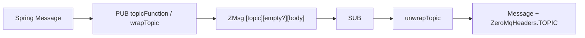
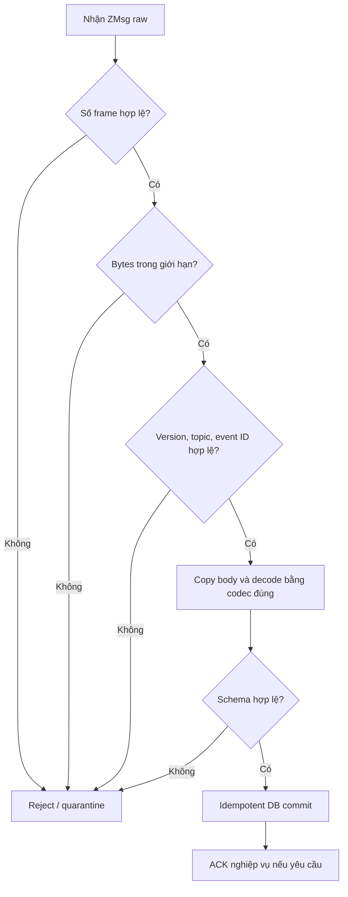
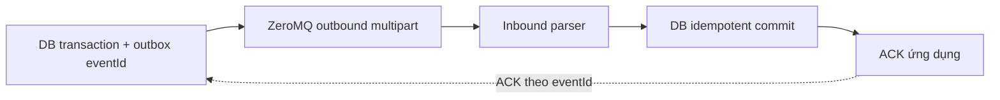

# Multipart message và frame trong ZeroMQ

## 1. Bối cảnh: vì sao subscriber nhận đúng topic nhưng sai payload?

Một ứng dụng Spring Boot dùng Spring Integration để nhận sự kiện `orders.created` từ hệ thống đối tác qua ZeroMQ `PUB/SUB`. Hai bên thống nhất nội dung JSON `{"eventId":"e-42","orderId":"42"}`. Tuy nhiên, trong kiểm thử xuất hiện ba hiện tượng:

1. Subscriber đọc được topic nhưng body rỗng hoặc sai định dạng.
2. Handler nhận `ZMsg` chứ không phải `String` nên bị lỗi ép kiểu.
3. Bên gửi báo đã gửi message, nhưng cơ sở dữ liệu bên nhận chưa có đơn hàng.

Các lỗi này liên quan đến **ranh giới frame**, cấu hình mapping và sự khác biệt giữa **giao nhận ZeroMQ** với **xử lý nghiệp vụ**. Trong ZeroMQ, một message có thể chứa **nhiều frame nhị phân có thứ tự**. Nếu một bên gửi `[topic][body]` nhưng bên kia giải mã theo `[topic][empty][body]`, payload sẽ không được hiểu đúng dù JSON ban đầu hợp lệ.

Bài **“Multipart message và frame”** thuộc chương **Adapter ZeroMQ** của module **SPRING_INTEGRATION_ADAPTERS**. Module hướng dẫn kết nối các hệ thống ngoài bằng inbound/outbound adapter, gateway, poller và `MessageChannel`; thực hành trao đổi qua file, SFTP, HTTP, JMS, AMQP, Kafka và cơ sở dữ liệu; đồng thời xử lý hợp đồng message, lỗi và vòng đời kết nối. Bài này đi sâu vào **wire contract ZeroMQ multipart**, cách Spring Integration chuyển đổi message và những yêu cầu an toàn khi ứng dụng vận hành.

### Mục tiêu học tập

Sau bài học, bạn có thể:

1. Phân biệt `frame`, `multipart message`, JeroMQ `ZFrame/ZMsg` và Spring `Message<?>`.
2. Gửi/nhận nhiều frame bằng `ZMsg`, `ZMQ.SNDMORE` và `hasReceiveMore()`.
3. Hiểu định dạng hai frame `[topic][payload]` và ba frame `[topic][empty][payload]` của PUB/SUB.
4. Cấu hình `ZeroMqMessageProducer` với `receiveRaw`/`unwrapTopic` và `ZeroMqMessageHandler` với `topicFunction`/`wrapTopic`.
5. Viết Java DSL cho inbound `PULL` nhận raw multipart và outbound `PUB` gửi topic.
6. Kiểm tra schema, binary frame, version, event ID, độ dài và quyền sở hữu tài nguyên.
7. Giải thích vì sao tính nguyên tử của multipart **không đồng nghĩa** message được lưu bền vững hoặc xử lý đúng một lần.

## 2. Một ZeroMQ message có thể chứa nhiều frame

**Frame** là một phần dữ liệu nhị phân có ranh giới và độ dài được ZeroMQ xác định. **Multipart message** là một thông điệp gồm một hoặc nhiều frame có thứ tự, được gửi/nhận như một đơn vị ZeroMQ.

```text
Message A: [ "hello" ]
             frame 0                         → một frame

Message B: [ "orders.created" ] [ {"orderId":"42"} ]
                 frame 0            frame 1   → hai frame

Message C: [ "orders.created" ] [ "" ] [ {"orderId":"42"} ]
                 frame 0       frame 1       frame 2
                 topic         empty         body
                                             → ba frame
```

Trong message C, frame giữa có **0 byte**. Đây là **frame rỗng có chủ đích**, không phải một frame bị mất. Nó thường được dùng để phân tách metadata hoặc envelope khỏi body. Nếu bên gửi chèn frame rỗng còn bên nhận không mong đợi, body sẽ bị đọc sai vị trí.

| Đặc điểm | Ý nghĩa trong thiết kế |
| --- | --- |
| Frame có thứ tự | `frame[0]` và `frame[1]` có thể mang ngữ nghĩa khác nhau |
| Mỗi frame chứa byte | Có thể chứa `0x00`, dòng mới, Protobuf hoặc dữ liệu nén; không bắt buộc UTF-8 |
| Frame rỗng vẫn hợp lệ | `[]` hoặc `byte[0]` có ý nghĩa, không tự động bị bỏ qua |
| Boundary được ZeroMQ giữ | Không phải tự dùng dấu `|` hoặc newline để tách các frame |
| Multipart atomic delivery | Ở tầng ZeroMQ, peer nhận **toàn bộ các frame của message hoặc không nhận message đó** |
| Không tự định nghĩa schema | Phải thỏa thuận frame nào là topic, event ID, metadata, body hoặc checksum |

**Quan trọng:** “nhận tất cả frame hoặc không nhận message” chỉ nói về **atomic delivery ở tầng ZeroMQ**. Nó **không** bảo đảm sẽ có receiver online, dữ liệu được lưu xuống disk, database đã commit, hoặc hệ thống tự phát lại message sau crash.

### 2.1. Frame ZeroMQ khác Spring Message

| Khái niệm | Đại diện | Ví dụ |
| --- | --- | --- |
| ZeroMQ frame | Một `byte[]` | UTF-8 của `orders.created` |
| ZeroMQ multipart message | Nhiều frame trong một message | `[topic][empty][jsonBytes]` |
| JeroMQ `ZFrame` | Đối tượng Java chứa một frame | `frame.getData()` |
| JeroMQ `ZMsg` | Container chứa các `ZFrame` | `ZMsg.recvMsg(socket)` |
| Spring `Message<?>` | Payload và `MessageHeaders` | `Message<ZMsg>` hoặc `Message<byte[]>` |
| `ZeroMqHeaders.TOPIC` | Header được inbound mapper tạo từ topic frame | `orders.created` |

Không suy luận rằng ba header trong Spring `Message` sẽ tự biến thành ba ZeroMQ frame. Một mapper cần được thiết kế cụ thể nếu muốn đưa header qua đường truyền. Ngược lại, khi nhận raw `ZMsg`, Spring Integration **không tự giải mã từng frame thành Spring header**.

## 3. JeroMQ API: `ZMsg` và `ZFrame`

Spring Integration ZeroMQ dùng JeroMQ. Trong thư viện này:

- `ZMsg` là container các `ZFrame` với khả năng thêm, duyệt, gửi và nhận multipart.
- `ZFrame.getData()` lấy byte của frame.
- `ZMsg.add(...)` và `addString(...)` thêm một frame.
- `ZMsg.recvMsg(socket)` nhận một multipart message.
- `ZMsg.send(socket)` gửi các frame theo thứ tự.
- `ZMsg.destroy()` giải phóng các frame mà `ZMsg` đang sở hữu.

### 3.1. Tạo ba frame rõ ràng

```java
import java.nio.charset.StandardCharsets;
import org.zeromq.ZFrame;
import org.zeromq.ZMsg;

ZMsg msg = new ZMsg();
msg.add("orders.created".getBytes(StandardCharsets.UTF_8));
msg.add(new byte[0]); // Frame rỗng, không phải null.
msg.add("{\"eventId\":\"e-42\",\"orderId\":\"42\"}"
        .getBytes(StandardCharsets.UTF_8));

if (msg.size() != 3) {
    throw new IllegalStateException("Sai số lượng frame");
}

ZFrame first = msg.getFirst();
byte[] topicBytes = first.getData();
long totalBytes = msg.contentSize();
```

Chọn UTF-8 cho topic và JSON là **hợp đồng của ứng dụng**. Với body là ảnh, tệp nén hoặc Protobuf, hãy giữ `byte[]` và dùng codec tương ứng; không chuyển mọi frame thành `String`.

### 3.2. Gửi multipart với JeroMQ `PUSH`

Ví dụ chạy như một process độc lập, có peer `PULL` đã bind ở `tcp://*:7777`:

```java
import java.nio.charset.StandardCharsets;
import org.zeromq.SocketType;
import org.zeromq.ZContext;
import org.zeromq.ZMQ;
import org.zeromq.ZMsg;

public class RawMultipartSender {
    public static void main(String[] args) {
        try (ZContext context = new ZContext()) {
            ZMQ.Socket push = context.createSocket(SocketType.PUSH);
            try {
                push.connect("tcp://127.0.0.1:7777");

                ZMsg msg = new ZMsg();
                msg.add("v1".getBytes(StandardCharsets.UTF_8));
                msg.add("e-42".getBytes(StandardCharsets.UTF_8));
                msg.add("{\"orderId\":\"42\"}"
                        .getBytes(StandardCharsets.UTF_8));

                try {
                    // false: caller không giao quyền destroy cho send().
                    boolean sent = msg.send(push, false);
                    if (!sent) {
                        throw new IllegalStateException("ZMQ send thất bại");
                    }
                } finally {
                    msg.destroy();
                }
            } finally {
                push.close();
            }
        }
    }
}
```

Kết quả `msg.send(...) == true` có thể chỉ cho biết ZeroMQ đã chấp nhận/đưa message vào queue của socket. **Không được coi đây là ACK consumer đã commit database**. Ví dụ JeroMQ trên có thao tác gửi trực tiếp; khi raw `ZMsg` đi qua một handler Spring Integration có xử lý reactive, vòng đời đối tượng phải được quản lý theo completion boundary riêng, không áp dụng máy móc việc hủy ngay sau `MessageChannel.send()`.

### 3.3. Nhận toàn bộ `ZMsg` qua JeroMQ `PULL`

```java
import java.nio.charset.StandardCharsets;
import org.zeromq.SocketType;
import org.zeromq.ZContext;
import org.zeromq.ZMQ;
import org.zeromq.ZMsg;
import org.zeromq.ZFrame;

public class RawMultipartReceiver {
    public static void main(String[] args) {
        try (ZContext context = new ZContext()) {
            ZMQ.Socket pull = context.createSocket(SocketType.PULL);
            try {
                pull.setReceiveTimeOut(10_000);
                pull.bind("tcp://*:7777");

                ZMsg msg = ZMsg.recvMsg(pull);
                if (msg == null) {
                    throw new IllegalStateException("Receive timeout");
                }
                try {
                    if (msg.size() != 3) {
                        throw new IllegalArgumentException(
                                "Kỳ vọng ba frame");
                    }
                    for (ZFrame frame : msg) {
                        System.out.println("bytes=" +
                                frame.getData().length);
                    }
                    System.out.println(new String(
                            msg.getFirst().getData(),
                            StandardCharsets.UTF_8));
                } finally {
                    msg.destroy();
                }
            } finally {
                pull.close();
            }
        }
    }
}
```

Mỗi socket được một process quản lý. Không chạy thêm một receiver khác cùng bind `tcp://*:7777` trong một network namespace; cổng sẽ xung đột. Đối với kiểm thử đa process/container, thay `127.0.0.1` bằng địa chỉ thật hoặc DNS Service.

## 4. Không dùng `ZMsg`: `SNDMORE` và `RCVMORE`

ZeroMQ cũng cho phép gửi/nhận từng frame trực tiếp qua `ZMQ.Socket`.

### 4.1. Gửi ba frame bằng `ZMQ.SNDMORE`

```java
// push là ZMQ.Socket loại PUSH đã connect tới receiver.
push.send("v1".getBytes(StandardCharsets.UTF_8), ZMQ.SNDMORE);
push.send("e-42".getBytes(StandardCharsets.UTF_8), ZMQ.SNDMORE);
push.send("{\"orderId\":\"42\"}"
        .getBytes(StandardCharsets.UTF_8), 0);
```

`ZMQ.SNDMORE` thông báo **còn frame phía sau trong cùng message**. Frame cuối gửi với flags `0` để kết thúc message. Nếu quên `SNDMORE` ở frame 0, receiver có thể nhận **hai ZeroMQ message riêng**, thay vì một multipart message ba frame.

### 4.2. Đọc đến hết message bằng `hasReceiveMore()`

```java
import java.util.ArrayList;
import java.util.List;

List<byte[]> parts = new ArrayList<>();
byte[] part;
do {
    part = pull.recv(0);
    if (part == null) {
        throw new IllegalStateException("Không đọc được frame");
    }
    parts.add(part);
} while (pull.hasReceiveMore());

if (parts.size() != 3) {
    throw new IllegalArgumentException("Sai framing contract");
}
```

`hasReceiveMore()` kiểm tra **còn phần trong message vừa nhận**. Nếu caller đọc một frame rồi chuyển sang xử lý message tiếp theo, phần còn lại của message cũ sẽ làm sai lệch giao thức. Với phần lớn use case, `ZMsg.recvMsg` giúp tránh phải tự quản lý vòng lặp.

**Không nhầm delimiter text với frame:** chuỗi `"topic|eventId|json"` là **một frame** chứa hai ký tự `|`. Nó không tự trở thành ba frame; ZeroMQ giữ ranh giới frame bằng protocol riêng.

## 5. Hợp đồng frame: version, event ID, topic và body

ZeroMQ không bắt buộc frame 0 phải là topic. Các hệ thống có thể tự thiết kế:

```text
Hợp đồng A (pipeline custom):
    [schemaVersion = "v1"] [eventId = "e-42"] [jsonBody]

Hợp đồng B (pub/sub):
    [topic = "orders.created"] [jsonBody]

Hợp đồng C (pub/sub có empty delimiter):
    [topic = "orders.created"] [""] [jsonBody]

Hợp đồng D (routing envelope minh họa):
    [routingIdentity] [""] [requestBody]
```

| Mục đích frame | Câu hỏi thiết kế |
| --- | --- |
| Topic | SUB lọc theo prefix byte nào? Có trường topic trong frame đầu không? |
| Version | Làm sao biết parser dành cho format `v1` hay `v2`? |
| Event ID | Dùng gì để trace, dedup và ACK khi sender retry? |
| Body | JSON, Protobuf, byte[] hay định dạng khác? Giới hạn bao nhiêu byte? |
| Routing identity | Có cần ROUTER/DEALER định tuyến tới đúng peer không? |
| Empty delimiter | Nó tách topic hay routing envelope? Bên nhận có mong đợi nó không? |

**Không có parser chung đúng cho mọi pattern chỉ vì frame thứ hai rỗng.** Trong PUB/SUB đó có thể là delimiter topic/body; trong ROUTER/DEALER nó có thể thuộc routing envelope. Với custom protocol nhiều frame, ưu tiên `receiveRaw(true)` và parser chuyên biệt.

## 6. Các thành phần Spring Integration xử lý frame

| Thành phần | Socket type hỗ trợ | Nhiệm vụ |
| --- | --- | --- |
| `ZeroMqMessageProducer` | Inbound: `PAIR/PULL/SUB` | Nhận message từ socket, tạo Spring `Message<?>` |
| `ZeroMqMessageHandler` | Outbound: `PAIR/PUSH/PUB` | Chuyển Spring message thành ZeroMQ frame và gửi |
| `ZeroMqMessageProducerSpec` | DSL inbound | `receiveRaw`, `unwrapTopic`, `topics`, `messageMapper` |
| `ZeroMqMessageHandlerSpec` | DSL outbound | `topicFunction`, `topicExpression`, `wrapTopic`, `messageMapper` |
| `ZeroMqChannel` | ZeroMQ-backed Spring channel | Có mapper riêng để trao đổi Spring message/headers |
| `ZeroMqProxy` | Proxy modes | Chuyển tiếp frame giữa các socket phù hợp; không tự hiểu business schema |

### 6.1. `receiveRaw(true)`: payload là ZMsg

Inbound adapter tạo Spring `Message<ZMsg>` chứa **các frame nguyên dạng**. Người nhận chịu trách nhiệm đọc, validate, copy dữ liệu nếu cần và giải phóng `ZMsg`. Spring Integration không tự biến frame đầu thành header `ZeroMqHeaders.TOPIC` thông qua mapper trong chế độ raw.

### 6.2. `receiveRaw(false)`: mapper/converter tạo Message

Khi raw bị tắt (mặc định), inbound adapter dùng `InboundMessageMapper<byte[]>` hoặc `MessageConverter`. Với PUB/SUB message nhiều frame theo framing được hỗ trợ:

- Frame đầu được xem là topic và có thể đưa vào `ZeroMqHeaders.TOPIC`.
- Frame nội dung trở thành payload thông qua mapper/converter.
- `unwrapTopic` quyết định cách hiểu **hai frame** hay **ba frame có delimiter rỗng**.

**Đừng ép payload thành DTO/String** nếu chưa biết converter thực sự tạo loại đối tượng nào. Với custom multipart `[version][eventId][body]`, mapper mặc định dành cho topic **không** tự suy ra frame 0 là schema version.

### 6.3. Outbound message thường và payload raw

`ZeroMqMessageHandler` hoạt động khác nhau tùy payload:

| Payload của Spring message | Hành vi gửi |
| --- | --- |
| `String` / `byte[]` hoặc kiểu được converter hỗ trợ | Dùng `OutboundMessageMapper<byte[]>` để chuyển thành frame body |
| `PUB` với topic expression khác null | Chèn topic frame, có thể kèm empty frame theo `wrapTopic` |
| **`ZMsg` raw** | **Gửi nguyên các frame, bỏ qua conversion và topic injection** |

Theo hợp đồng Spring Integration, outbound handler **không tự destroy `ZMsg` raw**, để caller có thể tái sử dụng. Vì handler có reactive semantics, ứng dụng cần thiết kế **ownership/completion boundary**; không được destroy hoặc chỉnh sửa raw frames quá sớm khi thao tác gửi còn đang được thực hiện.

## 7. PUB/SUB: chuẩn hai frame và ba frame

Khi `ZeroMqMessageHandler` dùng `SocketType.PUB`, topic được tính từ `topicFunction` hoặc `topicExpression`. Nếu không null, handler chèn topic frame.

| Cấu hình bên PUB | Wire format | Cấu hình bên SUB |
| --- | --- | --- |
| `wrapTopic(true)` (mặc định) | `[topic][empty][payload]` | `unwrapTopic(true)` (mặc định) |
| `wrapTopic(false)` | `[topic][payload]` | `unwrapTopic(false)` |
| Payload đã là raw `ZMsg` | **Theo chính các frame trong ZMsg** | Tự giải mã raw hoặc mapper tương thích |
| Topic không được cung cấp | Không có topic được chèn bởi handler | SUB chỉ nhận nếu subscription và schema phù hợp |



Các method `wrapTopic(boolean)`/`unwrapTopic(boolean)` xuất hiện từ **Spring Integration 6.2.6** theo API reference. Nếu dự án đang dùng phiên bản cũ, cần kiểm tra thư viện thực tế thay vì copy method không tồn tại.

### 7.1. Prefix subscription ở frame đầu

`topics("orders.")` đăng ký **prefix byte** đối với `SUB`. Nó có thể khớp `orders.created` và `orders.cancelled`, nhưng không tự đọc property `"topic"` trong JSON body. Nếu publisher gửi một frame duy nhất chứa JSON có field topic, SUB không tự lọc theo field ấy.

### 7.2. Sai lệch phổ biến

- PUB gửi **ba frame**, SUB cấu hình `unwrapTopic(false)`: có nguy cơ coi **empty frame** là body.
- PUB gửi **hai frame**, SUB để `unwrapTopic(true)`: mapper có thể chờ frame rỗng và body ở vị trí không tồn tại.
- Sender gửi **ZMsg raw** với ba frame nhưng vẫn đặt `topicFunction`: topic không tự được chèn thêm, vì raw bypass topic extraction.
- Consumer dùng `receiveRaw(true)` nhưng đọc `ZeroMqHeaders.TOPIC`: header này không được sinh bởi inbound mapper trong chế độ raw.

Muốn kiểm tra, hãy bật raw ở môi trường test để xem **số frame và độ dài mỗi frame**, thay vì chỉ nhìn JSON đã qua một tầng converter.

## 8. Ví dụ Java DSL: inbound PULL nhận multipart raw

### 8.1. Dependency và cấu hình

Ví dụ Maven trong ứng dụng Spring Boot sử dụng BOM quản lý phiên bản tương thích:

```xml
<dependencies>
    <dependency>
        <groupId>org.springframework.boot</groupId>
        <artifactId>spring-boot-starter-integration</artifactId>
    </dependency>
    <dependency>
        <groupId>org.springframework.integration</groupId>
        <artifactId>spring-integration-zeromq</artifactId>
    </dependency>
</dependencies>
```

```yaml
# application.yml
app:
  zeromq:
    pull-port: ${ZEROMQ_PULL_PORT:7777}
    pub-url: ${ZEROMQ_PUB_URL:tcp://publisher.internal:7788}
    topic-prefix: ${ZEROMQ_TOPIC_PREFIX:orders.}
```

### 8.2. Bean `ZContext` và inbound adapter

```java
import java.time.Duration;
import org.springframework.beans.factory.annotation.Value;
import org.springframework.context.annotation.Bean;
import org.springframework.context.annotation.Configuration;
import org.springframework.integration.dsl.IntegrationFlow;
import org.springframework.integration.zeromq.dsl.ZeroMq;
import org.zeromq.SocketType;
import org.zeromq.ZContext;

@Configuration
public class MultipartPullFlowConfiguration {

    @Bean(destroyMethod = "close")
    public ZContext zeroMqContext() {
        return new ZContext();
    }

    @Bean
    public IntegrationFlow inboundMultipartJobs(
            ZContext context,
            @Value("${app.zeromq.pull-port}") int port) {
        return IntegrationFlow.from(
                ZeroMq.inboundChannelAdapter(context, SocketType.PULL)
                        .bindPort(port)
                        .receiveRaw(true)
                        .consumeDelay(Duration.ofMillis(100))
                        .socketConfigurer(s -> s.setRcvHWM(1_000)))
                .channel("multipartJobsReceived")
                .get();
    }
}
```

`ZeroMqMessageProducer` tự đọc socket theo vòng nhận; `consumeDelay` là khoảng chờ khi không có dữ liệu, **không phải `Pollers.fixedDelay` của FTP inbound adapter**. Trong ví dụ, `PULL` bind TCP 7777; sender `PUSH` phải connect tới địa chỉ receiver thực, không phải luôn `127.0.0.1` nếu ở pod khác.

### 8.3. Service activator đọc ba frame custom

Giả sử wire contract là `[version][eventId][jsonBody]`:

```java
import java.nio.charset.StandardCharsets;
import org.springframework.integration.annotation.ServiceActivator;
import org.springframework.messaging.Message;
import org.springframework.stereotype.Component;
import org.zeromq.ZFrame;
import org.zeromq.ZMsg;

@Component
public class MultipartJobConsumer {

    @ServiceActivator(inputChannel = "multipartJobsReceived")
    public void onMessage(Message<ZMsg> message) {
        ZMsg frames = message.getPayload();
        try {
            if (frames.size() != 3) {
                throw new IllegalArgumentException(
                        "Cần [version][eventId][body]");
            }

            ZFrame[] parts = frames.toArray(new ZFrame[0]);
            String version = new String(
                    parts[0].getData(), StandardCharsets.UTF_8);
            String eventId = new String(
                    parts[1].getData(), StandardCharsets.UTF_8);
            byte[] body = parts[2].getData();

            if (!"v1".equals(version)) {
                throw new IllegalArgumentException("Version không hỗ trợ");
            }
            if (eventId.isBlank() || eventId.length() > 128) {
                throw new IllegalArgumentException("Event ID không hợp lệ");
            }
            if (body.length == 0 || body.length > 1_048_576) {
                throw new IllegalArgumentException("Body rỗng/quá lớn");
            }

            // Production: JSON parser/schema validation, idempotency,
            // DB transaction; copy body trước khi chuyển sang async queue.
            System.out.println("Received " + eventId);
        } finally {
            frames.destroy();
        }
    }
}
```

**Cảnh báo vòng đời:** Nếu handler chuyển `ZMsg` sang một worker bất đồng bộ, `destroy()` trong `finally` sẽ làm frame không còn hợp lệ cho worker. Khi cần async, sao chép byte/DTO **trước khi** rời khỏi đoạn code đang sở hữu raw message.

## 9. Ví dụ Java DSL: outbound PUB gửi topic và inbound SUB dùng mapper

Ở đây minh họa **hai service độc lập** để tránh hiểu nhầm rằng hai socket đều có thể `connect` mà không có bên bind:

- **Publisher Spring:** outbound `PUB` connect tới một SUB peer **đã bind**; hoặc dùng overload bind của Spring Integration 6.4+ và cho SUB connect.
- **Subscriber Spring:** inbound `SUB` connect tới một PUB peer **đã bind**.

Hai cấu hình bên dưới là **ví dụ cho hai vai trò triển khai**; khi ghép chúng trong một ứng dụng kiểm thử, phải sửa topology để có đúng một bên bind ở mỗi cặp kết nối.

### 9.1. Outbound PUB gửi định dạng hai frame

```java
import org.springframework.context.annotation.Bean;
import org.springframework.context.annotation.Configuration;
import org.springframework.integration.channel.DirectChannel;
import org.springframework.integration.dsl.IntegrationFlow;
import org.springframework.integration.zeromq.dsl.ZeroMq;
import org.springframework.messaging.MessageChannel;
import org.zeromq.SocketType;
import org.zeromq.ZContext;

@Configuration
public class TwoFramePubConfiguration {

    @Bean("ordersToPublish")
    public MessageChannel ordersToPublish() {
        return new DirectChannel();
    }

    @Bean
    public IntegrationFlow publishOrders(ZContext context) {
        return IntegrationFlow.from("ordersToPublish")
                .handle(ZeroMq.outboundChannelAdapter(
                        context, "tcp://subscriber.internal:7788",
                        SocketType.PUB)
                        .topicFunction(message ->
                                (String) message.getHeaders().get("eventTopic"))
                        .wrapTopic(false))
                .get();
    }
}
```

Đây là cấu hình `PUB connect` tới `SUB` remote đã bind `tcp://*:7788`. `wrapTopic(false)` gửi `[topic][payload]`, không có empty delimiter. Nếu payload là raw `ZMsg`, handler giữ nguyên frame thay vì tự thêm topic.

### 9.2. Publisher tạo Spring message

```java
import java.nio.charset.StandardCharsets;
import org.springframework.beans.factory.annotation.Qualifier;
import org.springframework.messaging.MessageChannel;
import org.springframework.messaging.support.MessageBuilder;
import org.springframework.stereotype.Service;

@Service
public class OrderEventPublisher {

    private final MessageChannel events;

    public OrderEventPublisher(
            @Qualifier("ordersToPublish") MessageChannel events) {
        this.events = events;
    }

    public void publish(String json) {
        if (json == null || json.isBlank()) {
            throw new IllegalArgumentException("Payload trống");
        }
        events.send(MessageBuilder
                .withPayload(json.getBytes(StandardCharsets.UTF_8))
                .setHeader("eventTopic", "orders.created")
                .build());
    }
}
```

Với dữ liệu production, dùng JSON serializer và schema rõ ràng thay vì nhận chuỗi JSON tùy ý. Spring header `eventTopic` chỉ dùng trong handler PUB để chèn topic frame; **không mặc định mọi header khác sẽ tới receiver**.

### 9.3. Inbound SUB hiểu định dạng hai frame

```java
import java.time.Duration;
import org.springframework.beans.factory.annotation.Value;
import org.springframework.context.annotation.Bean;
import org.springframework.context.annotation.Configuration;
import org.springframework.integration.dsl.IntegrationFlow;
import org.springframework.integration.zeromq.dsl.ZeroMq;
import org.zeromq.SocketType;
import org.zeromq.ZContext;

@Configuration
public class TwoFrameSubConfiguration {

    @Bean
    public IntegrationFlow consumePartnerOrders(
            ZContext context,
            @Value("${app.zeromq.pub-url}") String url,
            @Value("${app.zeromq.topic-prefix}") String prefix) {
        return IntegrationFlow.from(
                ZeroMq.inboundChannelAdapter(context, SocketType.SUB)
                        .connectUrl(url)
                        .topics(prefix)
                        .unwrapTopic(false)
                        .receiveRaw(false)
                        .consumeDelay(Duration.ofMillis(100)))
                .channel("mappedOrdersReceived")
                .get();
    }
}
```

Đây là cấu hình **SUB connect tới remote PUB đã bind** ở `pub-url`, không phải đồng thời cắm vào PUB connect của ví dụ trước. Spring `receiveRaw(false)` dùng mapper/converter để tạo `Message<?>`, `unwrapTopic(false)` yêu cầu hai frame `[topic][body]`.

### 9.4. Consumer đọc topic sau mapper

```java
import org.springframework.integration.annotation.ServiceActivator;
import org.springframework.integration.zeromq.ZeroMqHeaders;
import org.springframework.messaging.Message;
import org.springframework.stereotype.Component;

@Component
public class MappedOrdersConsumer {

    @ServiceActivator(inputChannel = "mappedOrdersReceived")
    public void accept(Message<?> message) {
        Object topic = message.getHeaders().get(ZeroMqHeaders.TOPIC);
        Object payload = message.getPayload();

        System.out.println("topic=" + topic +
                ", type=" + payload.getClass().getSimpleName());
        // Serialize/deserialize payload theo mapper đã cấu hình.
    }
}
```

**Nếu muốn dùng định dạng mặc định ba frame**, cấu hình PUB `wrapTopic(true)` và SUB `unwrapTopic(true)`. Khi đó ZeroMQ message có `[topic][empty][body]`; frame rỗng **không phải lỗi**, mà là một phần của wire contract.

## 10. Payload `ZMsg` outbound: tránh double-wrap

Trong Spring Integration, nếu outbound handler nhận `Message<ZMsg>`, nó **không** dùng `topicFunction` để tạo thêm frame topic và **không** chuyển body bằng mapper. Điều này hữu ích khi giao tiếp với đối tác đã quy định custom multipart, nhưng dễ gây lỗi nếu người viết nghĩ cấu hình PUB sẽ tự thêm topic.

```java
import java.nio.charset.StandardCharsets;
import org.zeromq.ZMsg;

ZMsg frames = new ZMsg();
frames.add("orders.created".getBytes(StandardCharsets.UTF_8));
frames.add(new byte[0]);
frames.add("{\"eventId\":\"e-42\"}"
        .getBytes(StandardCharsets.UTF_8));

// Khi gửi raw ZMsg qua ZeroMqMessageHandler, chính các frame
// này là wire format. Handler không tự chèn thêm topic frame.
// Ownership của frames phải được quản lý tới khi gửi hoàn tất.
```

**Không tự động destroy `frames` ngay sau `MessageChannel.send()`** trong luồng reactive/async: sender có thể chưa dùng xong đối tượng raw. Mặt khác, không bao giờ giải phóng nó sẽ gây rò rỉ. Với production, cần có boundary xác nhận gửi/ownership rõ ràng hoặc dùng `byte[]`/DTO được mapper quản lý khi không thật sự cần raw.

## 11. Thiết kế bộ giải mã có kiểm tra schema

ZeroMQ không tự biết ý nghĩa từng frame; mọi nguồn ngoài phải được xem là dữ liệu cần validate.



### 11.1. Giới hạn tổng bytes và từng frame

```java
import org.zeromq.ZFrame;
import org.zeromq.ZMsg;

public void validateMultipart(ZMsg msg) {
    if (msg.size() < 1 || msg.size() > 4) {
        throw new IllegalArgumentException("Số frame không hợp lệ");
    }
    if (msg.contentSize() > 2L * 1024 * 1024) {
        throw new IllegalArgumentException("Message quá 2 MiB");
    }
    for (ZFrame frame : msg) {
        if (frame.getData().length > 1024 * 1024) {
            throw new IllegalArgumentException("Frame quá lớn");
        }
    }
}
```

Giới hạn này bảo vệ downstream **sau khi JeroMQ nhận message**; nó không loại bỏ hoàn toàn chi phí memory đã phát sinh khi socket nhận dữ liệu. Với dữ liệu không tin cậy, còn cần giới hạn HWM, frame size/protocol ở phía producer, kiểm soát mạng và giám sát tài nguyên.

### 11.2. UTF-8 chỉ cho frame được định nghĩa là text

Không dùng `new String(frame.getData())` với dữ liệu nhị phân tùy ý. Nếu frame chứa Protobuf/Avro/file nén, giữ `byte[]` và dùng codec tương ứng. Nếu JSON, dùng serializer chuẩn, kiểm tra schema, giới hạn độ sâu và các field bắt buộc. Khi body được xử lý bất đồng bộ, sao chép byte/DTO trước khi raw `ZMsg` bị giải phóng.

## 12. Những lỗi framing và cách xác minh

| Triệu chứng | Nguyên nhân phổ biến | Cách kiểm tra |
| --- | --- | --- |
| SUB có topic nhưng body rỗng | PUB ba frame, SUB giải mã theo hai frame | Xem `unwrapTopic` và raw frame 1 |
| Consumer cần body nhưng thấy thiếu | PUB hai frame, SUB chờ frame rỗng thứ ba | Đồng bộ `wrapTopic` và `unwrapTopic` |
| `ClassCastException` từ `ZMsg` sang String | `receiveRaw(true)` nhưng handler coi là mapped | Kiểm tra payload type |
| Raw message không có topic header | Bypass inbound mapper | Đọc topic từ frame 0 hoặc dùng mapped mode |
| Bên gửi cấu hình topic nhưng receiver thấy thiếu | Outbound nhận raw `ZMsg` và bỏ qua topic injection | Tự chèn topic vào raw message |
| Một message bị tách thành nhiều message | Quên `SNDMORE` trước frame cuối | Soát flags gửi và `hasReceiveMore()` |
| Frame chứa ký tự `\\0` làm parser lỗi | Dùng text split hoặc codec sai | Bảo toàn byte[], dùng schema nhị phân |
| Event sai thứ tự trường | Hai bên không thống nhất frame index | Phiên bản hóa contract và thêm integration test |
| Message lớn gây tăng heap | Frame quá lớn hoặc HWM quá cao | Giới hạn bytes/queue, giám sát memory |
| Raw `ZMsg` không còn đọc được ở async handler | Destroy/reuse frame quá sớm | Copy payload trước khi release |
| PUB/SUB mất event đầu | Subscription chưa sẵn sàng (*slow joiner*) | Handshake/readiness hoặc replay |
| Gửi thành công nhưng DB chưa có dữ liệu | Socket queue != business commit | ACK, outbox và idempotency |

### 12.1. Kiểm tra format bằng độ dài frame

```text
ZMQ message: [topic][empty][body]
frameCount=3
frame[0].length > 0
frame[1].length = 0
frame[2].length > 0
```

Log **số lượng frame, byte length, topic đã whitelist và event ID**, không dump toàn bộ payload chứa dữ liệu nhạy cảm. `ZMsg.dump()` chỉ thích hợp khi debug có kiểm soát với dữ liệu thử nhỏ.

## 13. Multipart và envelope của ROUTER/DEALER

Một empty delimiter còn có thể xuất hiện trong routing envelope:

```text
PUB/SUB Spring default: [topic][empty][body]
Routing minh họa:     [identity][empty][requestBody]
```

Hai ví dụ đều có frame rỗng nhưng **không cùng semantics**. Trong `ROUTER/DEALER`, identity và routing envelope phục vụ chuyển message đến đúng peer. Trong PUB/SUB, topic phục vụ prefix subscription. Đừng dùng parser “frame 1 rỗng thì frame 0 luôn là topic” cho mọi socket type.

Spring Integration có `ZeroMqProxy` hỗ trợ `SUB_PUB`, `PULL_PUSH` và `ROUTER_DEALER`; proxy định tuyến socket, **không tự biến raw multipart** thành một business DTO. Inbound adapter trực tiếp chỉ hỗ trợ `PAIR/PULL/SUB`, outbound chỉ hỗ trợ `PAIR/PUSH/PUB`. Những pattern request–reply nâng cao cần JeroMQ API hoặc thành phần bổ sung đúng hợp đồng.

## 14. Atomic multipart không đồng nghĩa durable delivery

ZeroMQ giữ ranh giới và tính nguyên vẹn của một multipart message ở mức peer nhận. Tuy nhiên:

1. **PUB/SUB slow joiner:** sự kiện phát trước khi subscription sẵn sàng có thể bị bỏ lỡ.
2. **HWM/backpressure:** queue đầy có thể block hoặc drop tùy socket type.
3. **Sender crash:** message đang nằm trong queue RAM có thể chưa đến receiver.
4. **Receiver crash:** message đã nhận nhưng chưa commit DB có thể mất ở cấp nghiệp vụ.
5. **ACK lost:** sender retry cùng event có thể tạo bản trùng dù receiver đã xử lý.

| Mốc | Có thể suy ra | Không thể suy ra |
| --- | --- | --- |
| `ZMsg.send` trả true | Socket chấp nhận thao tác gửi theo API | Peer đã commit DB |
| `ZMsg.recvMsg` trả ba frame | Peer nhận một message ba frame | Handler parse/validate thành công |
| Spring channel `send` trả true | Message được tiếp nhận theo contract channel | Handler reactive hoàn tất/remote đã nhận |
| DB commit xong | Dữ liệu nghiệp vụ phía consumer đã lưu | Sender đã nhận ACK |

### 14.1. HWM là bộ nhớ, không phải hàng đợi bền vững

`SNDHWM` và `RCVHWM` giới hạn hàng đợi ZeroMQ theo socket/peer. Một multipart message lớn có thể chiếm nhiều memory dù chỉ tính là một message. HWM không biến message thành một bản ghi bền vững.

```java
// Ví dụ cấu hình socket; không phải bảo đảm giao nhận.
.socketConfigurer(socket -> {
    socket.setSndHWM(1_000);
    socket.setSendTimeOut(2_000);
})
```

### 14.2. Outbox, ACK và idempotency

Với sự kiện quan trọng, thiết kế đề xuất:



Sender lưu event bền vững, gửi cùng `eventId` khi cần retry; receiver deduplicate theo khóa `eventId` và chỉ ACK sau khi commit. Đây là **cơ chế ứng dụng bổ sung**, không phải chức năng built-in của ZeroMQ adapter. Với nhu cầu replay và quản lý offset phức tạp, có thể cần bridge sang Kafka/JMS/AMQP phù hợp.

## 15. Vòng đời, bảo mật và kiểm soát resource

### 15.1. ZMsg, ZContext và luồng xử lý

- `ZContext` quản lý JeroMQ socket và resource; để Spring tạo/đóng theo lifecycle.
- Không dùng chung một `ZMQ.Socket` từ nhiều thread tùy tiện.
- Raw `ZMsg` inbound phải được consumer sở hữu và giải phóng đúng lúc.
- Không chuyển `ZFrame` đã bị destroy sang async worker.
- Outbound raw `ZMsg` không được framework tự destroy; phải quản lý ownership và thời điểm hoàn tất.
- Với Spring message thường, dùng mapper/converter để giảm trách nhiệm quản lý raw frame.

### 15.2. Kiểm soát dữ liệu từ nguồn không tin cậy

| Rủi ro | Biện pháp |
| --- | --- |
| Frame count bất thường | Validate số phần trước khi truy cập frame index |
| Frame quá lớn | Byte limit, HWM, giới hạn memory/queue và alert |
| Binary bị decode sai | Content type, codec và schema version |
| Topic độc hại | Prefix allowlist; topic subscription không phải authentication |
| Event ID trùng hoặc quá dài | Unique key và chiều dài tối đa |
| Payload nhạy cảm | Không log raw; mã hóa/xác thực đường truyền khi cần |
| TCP peer không được phép | Firewall, Kubernetes NetworkPolicy và ZeroMQ security phù hợp |

`tcp://` của ZeroMQ **không tự có TLS**. Nếu cần bảo mật, dùng các cơ chế tương thích của ZeroMQ/JeroMQ phiên bản đang triển khai (ví dụ CURVE khi được hỗ trợ) hoặc lớp bảo vệ mạng tin cậy. Kiểm thử framing không nên thực hiện với dữ liệu production chứa thông tin nhạy cảm.

## 16. Kịch bản kiểm thử tích hợp

Kiểm thử tốt cần dùng socket JeroMQ thật hoặc một peer khác ngôn ngữ; mock handler chỉ xác minh logic nội bộ chứ không chứng minh ranh giới frame trên wire.

| Kịch bản | Điều cần xác minh |
| --- | --- |
| PUSH gửi một frame | Consumer raw nhận `ZMsg.size() == 1` |
| PUSH gửi ba frame custom | Nhận đúng `[v1][eventId][body]` |
| Sender thiếu `SNDMORE` | Message bị chia; test phát hiện frame count sai |
| Body chứa byte `0x00` | Byte không bị tách như delimiter text |
| PUB/SUB hai frame | `wrapTopic(false)` và `unwrapTopic(false)` cho topic/body đúng |
| PUB/SUB ba frame | `wrapTopic(true)` và `unwrapTopic(true)` cho topic/body đúng |
| Lệch wrap/unwrap | Test từ chối payload rỗng hoặc thiếu |
| SUB topic prefix không khớp | Không nhận message ngoài subscription |
| Raw inbound | Payload là `ZMsg`, consumer đọc chính xác frame |
| Mapped inbound | Topic header có giá trị theo mapper |
| Outbound raw `ZMsg` | Không bị chèn thêm topic frame |
| PUB gửi trước SUB sẵn sàng | Quan sát slow joiner; không giả định replay |
| Frame count/size quá giới hạn | Reject và ghi metric/quarantine |
| Consumer xử lý async | Không dùng raw frame sau khi destroy |
| Sender/receiver crash | Không giả định ZeroMQ tự phát lại message cũ |
| Gửi lại event ID trùng | DB idempotency tránh tác dụng phụ trùng |
| Nhiều process/container | DNS/port đúng, không dùng nhầm `127.0.0.1` |

**Không đo success bằng `send() == true`.** Với yêu cầu nghiệp vụ, xác minh thêm bytes, schema, unique event ID, kết quả commit và ACK. Đối với PUB/SUB, dùng tín hiệu subscriber-ready để tránh flaky test do slow joiner; không dựa duy nhất vào một `Thread.sleep` ngẫu nhiên.

## 17. Bài tập tình huống

**Đề bài:** Đối tác Python phát sự kiện qua ZeroMQ PUB theo format:

```text
["orders.created", "{\"eventId\":\"e-42\",\"orderId\":\"42\"}"]
```

Đây là message có **hai frame**. Spring Boot dùng inbound SUB:

```java
ZeroMq.inboundChannelAdapter(context, SocketType.SUB)
        .connectUrl("tcp://partner-service:7788")
        .topics("orders.")
        .receiveRaw(false);
// Chưa đặt unwrapTopic.
```

Nhóm Java còn muốn có thêm một luồng PUSH/PULL với hợp đồng `[version][eventId][binaryBody]`, và một handler xử lý bất đồng bộ.

Hãy trả lời:

1. Đối tác đang gửi bao nhiêu frame? Topic và body ở vị trí nào?
2. `unwrapTopic` mặc định của Spring Integration dự đoán hai hay ba frame?
3. Cần thêm cấu hình nào để nhận đúng format PUB hai frame?
4. Vì sao `topics("orders.")` không lọc trường `topic` ở trong JSON?
5. Nếu dùng `receiveRaw(true)`, Spring payload thuộc kiểu gì?
6. Frame rỗng `byte[0]` có phải message lỗi không?
7. Với ba frame gửi thủ công, frame nào cần `SNDMORE`?
8. `hasReceiveMore()` giúp kiểm tra điều gì?
9. Với format `[version][eventId][binaryBody]`, nên dùng raw hay mapper PUB/SUB mặc định?
10. Vì sao không nên decode binaryBody bằng UTF-8?
11. Nếu raw `ZMsg` bị destroy trước khi async handler đọc, nguy cơ gì xảy ra?
12. `ZMsg.send() == true` có chứng minh receiver commit DB không?
13. Atomic multipart delivery có đồng nghĩa message tự replay sau crash?
14. Cần cơ chế gì để xử lý retry nhưng không tạo đơn hàng trùng?

**Gợi ý đáp án:** (1) Hai frame: topic rồi body. (2) Ba frame `[topic][empty][body]`. (3) Thêm `.unwrapTopic(false)`. (4) SUB lọc prefix byte của frame đầu. (5) `ZMsg`. (6) Không, đó là một frame hợp lệ. (7) Hai frame đầu dùng `SNDMORE`, frame cuối dùng flags `0`. (8) Còn frame của message hiện tại. (9) `receiveRaw(true)` hoặc custom mapper theo giao thức, không dùng parser topic mặc định. (10) Binary không có hợp đồng UTF-8. (11) Dữ liệu bị giải phóng không còn an toàn cho worker; cần copy hoặc quản lý ownership. (12) Không. (13) Không. (14) Outbox bền vững, event ID, ACK sau commit và idempotency.

## Ghi nhớ

- **Một ZeroMQ message có thể có nhiều frame**, được gửi/nhận như một đơn vị ở tầng ZeroMQ, nhưng không mặc định được lưu bền vững.
- JeroMQ dùng **`ZMsg`, `ZFrame`**, hoặc `ZMQ.SNDMORE` và `hasReceiveMore()` khi thao tác từng frame.
- Với PUB/SUB trong Spring Integration, **mặc định ba frame** `[topic][empty][payload]`; đặt `wrapTopic(false)`/`unwrapTopic(false)` để dùng **hai frame** `[topic][payload]`.
- Inbound `receiveRaw(true)` đưa `ZMsg` nguyên dạng vào Spring; `receiveRaw(false)` dùng mapper/converter và có thể sinh `ZeroMqHeaders.TOPIC`.
- Outbound nhận raw `ZMsg` **không tự chuyển đổi hoặc thêm topic**; caller phải quản lý vòng đời raw frames.
- **Atomic multipart delivery khác ACK/DB commit**. Luôn có schema version, byte limit, event ID, retry và idempotency theo nhu cầu nghiệp vụ.

## Tài liệu tham khảo

- [Spring Integration Reference — ZeroMQ Support](https://docs.spring.io/spring-integration/reference/zeromq.html)
- [Spring Integration API — ZeroMqMessageProducerSpec](https://docs.spring.io/spring-integration/api/org/springframework/integration/zeromq/dsl/ZeroMqMessageProducerSpec.html)
- [Spring Integration API — ZeroMqMessageProducer](https://docs.spring.io/spring-integration/api/org/springframework/integration/zeromq/inbound/ZeroMqMessageProducer.html)
- [Spring Integration API — ZeroMqMessageHandler](https://docs.spring.io/spring-integration/api/org/springframework/integration/zeromq/outbound/ZeroMqMessageHandler.html)
- [Spring Integration API — ZeroMqMessageHandlerSpec](https://docs.spring.io/spring-integration/api/org/springframework/integration/zeromq/dsl/ZeroMqMessageHandlerSpec.html)
- [JeroMQ API — ZMsg](https://javadoc.io/static/org.zeromq/jeromq/0.6.0/org/zeromq/ZMsg.html)
- [ZeroMQ — Messages and Multipart Framing](https://zeromq.org/messages/)
- [libzmq — Multipart message atomicity](https://zeromq.github.io/libzmq/zmq_msg_send.html)
- [ZeroMQ Guide](https://zguide.zeromq.org/)
